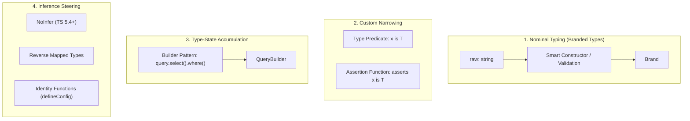

# Module 08: Advanced TypeScript Patterns — Branded Types, Globals, Predicates, Assertions, Builder Pattern, & Identity Functions

> **Weeks 17–20** | Modeled after Matt Pocock's *Total TypeScript Advanced Patterns Workshop* (7 sections, 45 exercises).  
> **Prerequisites**: Modules 01–07 (Generics, Type Transformations, Narrowing, and Strict TSConfig).

---

## Workshop Overview & Mental Model

While everyday TypeScript focuses on typing functions and objects, library authors and infrastructure engineers encounter higher-order challenges: **enforcing domain semantics that structural typing allows**, **augmenting runtime environments without collision**, **accumulating compile-time state across chained calls**, and **directing the compiler's inference engine**.



```ts
// Total TypeScript test helpers
type Expect<T extends true> = T;
type Equal<X, Y> =
  (<T>() => T extends X ? 1 : 2) extends (<T>() => T extends Y ? 1 : 2) ? true : false;
```

---

## Lesson 8.1: Branded Types (Nominal Typing in a Structural System)

### 8.1.1 Structural Typing and Primitive Obsession

TypeScript's type system is **structural**: if two types share the same shape, they are interchangeable. This creates a severe design flaw with primitives—commonly called **Primitive Obsession**:

```ts
function transferFunds(senderId: string, recipientId: string, amount: number) {
  // Logic
}

const userId = "usr_999";
const orderId = "ord_123";

// ❌ Bug passes compilation: arguments accidentally swapped!
transferFunds(orderId, userId, 500);
```

### 8.1.2 Creating Zero-Cost Branded Types

To achieve nominal typing (types distinguished by identity/name rather than structure), attach a phantom property keyed by a `unique symbol`. The symbol is erased at runtime, introducing **zero runtime overhead**:

```ts
declare const brand: unique symbol;

export type Brand<T, TBrand extends string> = T & {
  readonly [brand]: TBrand;
};

export type UserId = Brand<string, "UserId">;
export type PostId = Brand<string, "PostId">;
export type OrderId = Brand<string, "OrderId">;

let uId = "usr_100" as UserId;
//  ^? let uId: UserId
let pId = "pst_200" as PostId;
//  ^? let pId: PostId

type testUid = Expect<Equal<typeof uId, UserId>>;

// @ts-expect-error - PostId is not assignable to UserId!
uId = pId;
```

### 8.1.3 Validated Strings & Numbers

Branded types prevent unvalidated primitives from flowing into sensitive domain operations:

```ts
export type ValidEmail = Brand<string, "ValidEmail">;
export type PositiveNumber = Brand<number, "PositiveNumber">;

function sendVerificationEmail(email: ValidEmail): void {
  console.log(`Sending token to ${email}`);
}

// ❌ Cannot pass raw unvalidated string
const rawInput = "alice@example.com";
// @ts-expect-error - raw string is not ValidEmail
sendVerificationEmail(rawInput);
```

### 8.1.4 Smart Constructors & Validation Boundaries

A **smart constructor** validates input at the boundary and casts it to the branded type once verified:

```ts
function parseEmail(raw: string): ValidEmail {
  const emailRegex = /^[^\s@]+@[^\s@]+\.[^\s@]+$/;
  if (!emailRegex.test(raw)) {
    throw new Error(`Invalid email address: "${raw}"`);
  }
  return raw as ValidEmail;
}

function makePositive(num: number): PositiveNumber {
  if (num <= 0 || !Number.isFinite(num)) {
    throw new Error(`Value must be positive: ${num}`);
  }
  return num as PositiveNumber;
}

const verifiedEmail = parseEmail("user@domain.com");
//    ^? const verifiedEmail: ValidEmail
type testEmail = Expect<Equal<typeof verifiedEmail, ValidEmail>>;
sendVerificationEmail(verifiedEmail); // ✅ Compiles cleanly
```

### 8.1.5 Index Signatures with Branded Types

Branded types make dictionary lookups resilient against passing the wrong ID key:

```ts
interface UserProfile {
  name: string;
  role: "admin" | "member";
}

type UserCache = Record<UserId, UserProfile>;

const cache: UserCache = {
  ["usr_1" as UserId]: { name: "Alice", role: "admin" },
};

function getUser(id: UserId, store: UserCache): UserProfile | undefined {
  return store[id];
}

const postId = "pst_9" as PostId;
// @ts-expect-error - Argument of type 'PostId' is not assignable to 'UserId'
getUser(postId, cache);
```

---


## Lesson 8.3: Type Predicates, Assertion Functions & Classes

### 8.3.1 Type Predicates (`x is T`)

A type predicate is a special return type annotation that instructs the compiler's control flow analyzer to narrow a variable when the function returns `true`:

```ts
function isString(value: unknown): value is string {
  return typeof value === "string";
}

function processValue(val: unknown) {
  if (isString(val)) {
    // val is narrowed to string
    console.log(val.toUpperCase());
  }
}
```

### 8.3.2 Filtering Arrays with Type Predicates

Default `.filter(Boolean)` does not remove `null` or `undefined` at the type level. A predicate-typed filter helper preserves strictness:

```ts
const mixed = ["apple", null, "banana", undefined, "cherry"];

// ❌ Standard filter: still (string | null | undefined)[]
const badFiltered = mixed.filter(Boolean);

// ✅ Type predicate filter
function isNonNullable<T>(value: T): value is NonNullable<T> {
  return value !== null && value !== undefined;
}

const clean = mixed.filter(isNonNullable);
//    ^? const clean: string[]

type testClean = Expect<Equal<typeof clean, string[]>>;
```

### 8.3.3 Assertion Functions (`asserts x is T`)

Assertion functions verify a condition and throw an exception if invalid. Unlike predicates (which return a boolean for `if` branches), assertion functions terminate the current flow:

```ts
function assertIsString(value: unknown, message?: string): asserts value is string {
  if (typeof value !== "string") {
    throw new TypeError(message ?? `Expected string, received ${typeof value}`);
  }
}

function handlePayload(payload: unknown) {
  assertIsString(payload);
  // payload is narrowed to string for all following lines
  console.log(payload.trim());
}
```

### 8.3.4 Avoiding TS2775 ("Assertions require every name...")

> [!WARNING]
> **TypeScript Error TS2775**:  
> *"Assertions require every name in the call target to be declared with an explicit type annotation."*  
> If an assertion function is assigned to an unannotated variable or arrow function, TypeScript refuses to narrow:

```ts
// ❌ FAILS with TS2775 when invoked:
const assertDefinedBad = (val: unknown): asserts val is object => {
  if (!val) throw new Error("Null");
};

// ✅ BEST PRACTICE: Use function declarations OR explicit function type annotations
type AssertDefinedFn = (val: unknown) => asserts val is object;
const assertDefinedGood: AssertDefinedFn = (val) => {
  if (!val) throw new Error("Null");
};
```

### 8.3.5 Combining Brands with Predicates & Assertions

```ts
function isValidEmail(val: string): val is ValidEmail {
  return /^[^\s@]+@[^\s@]+\.[^\s@]+$/.test(val);
}

function assertValidEmail(val: string): asserts val is ValidEmail {
  if (!isValidEmail(val)) {
    throw new Error(`Invalid email: ${val}`);
  }
}
```

### 8.3.6 Predicates and Assertion Methods on Classes

Methods on classes can narrow `this` using polymorphic `this is ...` guards:

```ts
interface AuthenticatedState {
  token: string;
  userId: string;
}

class ApiSdk {
  private authState: AuthenticatedState | null = null;

  public authenticate(token: string, userId: string): void {
    this.authState = { token, userId };
  }

  // Type predicate method on class instance
  public isAuthenticated(): this is this & { authState: AuthenticatedState } {
    return this.authState !== null;
  }

  // Assertion method on class instance
  public assertAuthenticated(): asserts this is this & { authState: AuthenticatedState } {
    if (!this.isAuthenticated()) {
      throw new Error("SDK must be authenticated before performing this request.");
    }
  }

  public getSecretData(): string {
    this.assertAuthenticated();
    // this.authState is guaranteed non-null here
    return `Secret for ${this.authState.userId}`;
  }
}
```

---

## Lesson 8.4: The Builder Pattern & External Libraries

### 8.4.1 Classes as Types and Values

In TypeScript, a `class` statement produces two distinct symbols:
1. A **Value**: The constructor function and prototype executed at runtime.
2. A **Type**: The interface representing instances created by `new Class()`.

### 8.4.2 Type-State Accumulation in the Builder Pattern

The Builder pattern accumulates static types across method chaining without mutating underlying generic variables:

```ts
class QueryBuilder<TSelected extends string = never> {
  private selectedColumns: string[] = [];

  // Each chain returns a new type instance with accumulated selected keys
  public select<TCol extends string>(
    column: TCol
  ): QueryBuilder<TSelected | TCol> {
    const next = new QueryBuilder<TSelected | TCol>();
    next.selectedColumns = [...this.selectedColumns, column];
    return next;
  }

  public execute(): Record<TSelected, unknown> {
    const row = {} as Record<TSelected, unknown>;
    for (const col of this.selectedColumns) {
      row[col as TSelected] = null;
    }
    return row;
  }
}

const query = new QueryBuilder()
  .select("id")
  .select("email")
  .select("createdAt");
//    ^? const query: QueryBuilder<"id" | "email" | "createdAt">

const result = query.execute();
//    ^? const result: Record<"id" | "email" | "createdAt", unknown>
type testQuery = Expect<Equal<typeof result, Record<"id" | "email" | "createdAt", unknown>>>;
```

### 8.4.3 tRPC-Style Procedure Builders

Modern libraries like tRPC accumulate input validation schemas and context middleware:

```ts
type MiddlewareFn<TContextIn, TContextOut> = (ctx: TContextIn) => Promise<TContextOut>;

class ProcedureBuilder<TContext = {}> {
  private middlewares: MiddlewareFn<any, any>[] = [];

  public use<TNewContext>(
    fn: MiddlewareFn<TContext, TNewContext>
  ): ProcedureBuilder<TContext & TNewContext> {
    const builder = new ProcedureBuilder<TContext & TNewContext>();
    builder.middlewares = [...this.middlewares, fn];
    return builder;
  }

  public query<TOutput>(
    resolver: (ctx: TContext) => Promise<TOutput>
  ): (ctx: any) => Promise<TOutput> {
    return async (initialCtx: any) => {
      let currentCtx = initialCtx;
      for (const mw of this.middlewares) {
        const next = await mw(currentCtx);
        currentCtx = { ...currentCtx, ...next };
      }
      return resolver(currentCtx);
    };
  }
}

const proc = new ProcedureBuilder()
  .use(async () => ({ user: { id: "u42", name: "Alice" } }))
  .use(async (ctx) => ({ permissions: ["read", "write"] as const }))
  .query(async (ctx) => {
    // ctx has both user and permissions fully typed
    return `Welcome ${ctx.user.name}, permissions: ${ctx.permissions.join(", ")}`;
  });
```

### 8.4.4 Module Augmentation for External Libraries

When third-party libraries (e.g. Express, Fastify) don't include your domain properties on requests, use `declare module` to augment their internal interface:

```ts
// Augmenting Express Request
import "express";

declare module "express-serve-static-core" {
  interface Request {
    user?: {
      id: string;
      role: "admin" | "user";
    };
    correlationId: string;
  }
}
```

---

## Lesson 8.5: Identity Functions, `const T`, `NoInfer<T>`, & Reverse Mapped Types

### 8.5.1 Identity Functions as an Ergonomic Alternative to `as const`

Identity functions validate a configuration against a broad contract while preserving literal inference without forcing callers to append `as const`:

```ts
interface RouteConfig {
  path: string;
  method: "GET" | "POST" | "PUT" | "DELETE";
}

// Without helper: property types widen to string
const r1 = { path: "/users", method: "GET" };
// r1.method is string

// With identity helper
function defineConfig<const T extends RouteConfig>(config: T): T {
  return config;
}

const route = defineConfig({
  path: "/users",
  method: "GET",
});
//    ^? const route: { readonly path: "/users"; readonly method: "GET"; }

type testRoute = Expect<Equal<typeof route.method, "GET">>;
```

### 8.5.2 Specifying Where Inference Should NOT Happen: `NoInfer<T>` (TS 5.4+)

TypeScript normally infers `T` from every occurrence in a signature. When passing a default value or secondary parameter, you frequently want `T` inferred *only* from the primary source:

```ts
// Without NoInfer: default value widens T to ("red" | "blue" | "purple")
function createThemeBad<T extends string>(options: T[], defaultOption: T): T {
  return defaultOption;
}

// ❌ Desired: error because "purple" is not in the array.
// Reality: T is inferred as "red" | "blue" | "purple", so no error!
createThemeBad(["red", "blue"], "purple");

// ✅ With TS 5.4+ NoInfer<T>: T is ONLY inferred from options!
function createTheme<T extends string>(options: T[], defaultOption: NoInfer<T>): T {
  return defaultOption;
}

// @ts-expect-error - "purple" is not assignable to "red" | "blue"
createTheme(["red", "blue"], "purple");
```

### 8.5.3 Reverse Mapped Types

Reverse mapped types allow the keys and values of an object argument to constrain each other simultaneously:

```ts
type EventHandlers<TState> = {
  [K in keyof TState]: (current: TState[K]) => TState[K];
};

function createStore<TState>(initialState: TState, handlers: EventHandlers<TState>) {
  return { initialState, handlers };
}

const counterStore = createStore(
  { count: 0, label: "counter" },
  {
    count: (c) => c + 1,       // c is inferred as number
    label: (l) => l.trim(),    // l is inferred as string
  }
);
```

### 8.5.4 Dynamic Reducer Pattern

```ts
type ReducerMap<TState, TPayloads extends Record<string, any>> = {
  [K in keyof TPayloads]: (state: TState, payload: TPayloads[K]) => TState;
};

function createReducer<TState, TPayloads extends Record<string, any>>(
  handlers: ReducerMap<TState, TPayloads>
) {
  return (state: TState, action: { [K in keyof TPayloads]: { type: K; payload: TPayloads[K] } }[keyof TPayloads]): TState => {
    const handler = handlers[action.type];
    return handler(state, action.payload);
  };
}

interface AppState { value: number }
interface AppActions {
  INCREMENT: { amount: number };
  RESET: undefined;
}

const reducer = createReducer<AppState, AppActions>({
  INCREMENT: (s, p) => ({ value: s.value + p.amount }),
  RESET: (s) => ({ value: 0 }),
});
```

---

## Anti-Patterns vs. Best Practices

| Category | ❌ Anti-Pattern | ✅ Best Practice |
| :--- | :--- | :--- |
| **Type Predicates** | `function isUser(x: any): x is User { return true; }` (Unchecked assertion) | Exhaustively check all required properties runtime before returning `true` |
| **Global Scope** | Declaring variables in `.d.ts` without `declare global` and `export {}` | Scope augmentations inside `declare global` in explicit modules |
| **Builder Pattern** | Mutating `this` without returning new generic type instance | Return immutable copies with accumulated phantom type state |
| **Inference Leaks** | Forcing users to pass explicit generics where `NoInfer<T>` or `<const T>` solves it | Use `NoInfer<T>` to isolate inference sources |

---

## Hands-On Exercises & Solutions

### Exercise 1: Nominal Branded ID System with Zod Smart Constructors

**Objective**: Create `UserId` and `TenantId` brands and smart constructor functions that validate UUID formatting.

```ts
// Solution
declare const brand: unique symbol;
type Brand<T, B extends string> = T & { readonly [brand]: B };

type UserId = Brand<string, "UserId">;
type TenantId = Brand<string, "TenantId">;

const UUID_REGEX = /^[0-9a-f]{8}-[0-9a-f]{4}-[0-9a-f]{4}-[0-9a-f]{4}-[0-9a-f]{12}$/i;

function parseUserId(id: string): UserId {
  if (!UUID_REGEX.test(id)) throw new Error(`Invalid UserId: ${id}`);
  return id as UserId;
}

function parseTenantId(id: string): TenantId {
  if (!UUID_REGEX.test(id)) throw new Error(`Invalid TenantId: ${id}`);
  return id as TenantId;
}

const uid = parseUserId("123e4567-e89b-12d3-a456-426614174000");
//    ^? const uid: UserId
const tid = parseTenantId("789e0123-e45b-67d8-a901-426614174111");
//    ^? const tid: TenantId

type testEx1Uid = Expect<Equal<typeof uid, UserId>>;

// @ts-expect-error - Mismatched nominal brands
const mismatched: UserId = tid;
```

### Exercise 2: Express / Fastify Request Augmentation & Type Predicate Guard

**Objective**: Augment a request interface to support authenticated user sessions and write a type predicate guard to verify session validity.

```ts
// Solution
interface AuthSession {
  userId: string;
  role: "admin" | "user";
  tokenExpires: number;
}

interface CustomRequest {
  url: string;
  headers: Record<string, string>;
  session?: AuthSession;
}

function isAuthenticatedRequest(
  req: CustomRequest
): req is CustomRequest & { session: AuthSession } {
  return (
    req.session !== undefined &&
    typeof req.session.userId === "string" &&
    req.session.tokenExpires > Date.now()
  );
}

function handleAdminDashboard(req: CustomRequest) {
  if (isAuthenticatedRequest(req)) {
    // req.session is strictly AuthSession
    console.log(`Access granted to ${req.session.userId}`);
  }
}
```

### Exercise 3: Type-State SQL Query Builder

**Objective**: Implement a chained query builder `SqlBuilder<TTable, TSelected>` that only allows `.where()` against columns that actually exist on `TTable`, and whose `.execute()` returns only `Pick<TTable, TSelected>`.

```ts
// Solution
class SqlBuilder<TTable extends Record<string, unknown>, TSelected extends keyof TTable = never> {
  private selected: (keyof TTable)[] = [];
  private whereClauses: string[] = [];

  public select<K extends keyof TTable>(column: K): SqlBuilder<TTable, TSelected | K> {
    const next = new SqlBuilder<TTable, TSelected | K>();
    next.selected = [...this.selected, column];
    next.whereClauses = [...this.whereClauses];
    return next;
  }

  public where<K extends keyof TTable>(column: K, value: TTable[K]): this {
    this.whereClauses.push(`${String(column)} = ${value}`);
    return this;
  }

  public execute(): Pick<TTable, TSelected>[] {
    return [] as Pick<TTable, TSelected>[];
  }
}

interface UsersTable { id: number; username: string; email: string; karma: number }

const userQuery = new SqlBuilder<UsersTable>()
  .select("id")
  .select("username")
  .where("karma", 100);

const rows = userQuery.execute();
//    ^? const rows: Pick<UsersTable, "id" | "username">[]

type testSql = Expect<Equal<typeof rows, { id: number; username: string }[]>>;
```

### Exercise 4: Reverse-Mapped Event Reducer with `NoInfer<T>`

**Objective**: Build a typed state machine with initial state and action transitions where state transitions cannot infer arbitrary wider types.

```ts
// Solution
type StateMachineConfig<TState, TEvents extends string> = {
  initial: TState;
  events: TEvents[];
  transitions: {
    [E in TEvents]: (state: TState) => TState;
  };
};

function defineStateMachine<TState, TEvents extends string>(
  config: {
    initial: TState;
    events: TEvents[];
    transitions: {
      [E in TEvents]: (state: NoInfer<TState>) => NoInfer<TState>;
    };
  }
) {
  return config;
}

const machine = defineStateMachine({
  initial: { status: "idle" as const, retries: 0 },
  events: ["FETCH", "SUCCESS", "RETRY"],
  transitions: {
    FETCH: (s) => ({ ...s, status: "idle" }),
    SUCCESS: (s) => ({ ...s, retries: 0 }),
    RETRY: (s) => ({ ...s, retries: s.retries + 1 }),
  },
});
```

---

## Summary & Next Steps

In this workshop module, we mastered:
1. **Branded Types**: Constructing nominal types using `unique symbol` tags with zero runtime cost, and building validation boundaries with smart constructors.
2. **Global Augmentation**: Scoping ambient types using `declare global`, augmenting Node and browser environments, and module colocation via `export {}`.
3. **Type Predicates & Assertion Functions**: Custom narrowing with `x is T`, array filtering, assertion functions (`asserts x is T`), avoiding TS2775, and polymorphic `this is ...` guards on classes.
4. **The Builder Pattern**: Type-state accumulation across immutable method chains, navigating third-party `.d.ts` definitions, and module augmentation.
5. **Inference Steering**: `NoInfer<T>` in TS 5.4+, const type parameters in identity functions, and reverse-mapped types for mutually constrained configurations.

Proceed to **[Module 09: Runtime Checking with Zod & React Foundations](./09-zod-and-react-foundations.md)** to connect type-level guarantees with runtime schema validation and component architectures.

