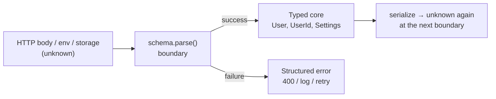

# Module 11: Runtime Boundaries — Validation, Zod 4 & Standard Schema

> Example and tests: [`examples/11-runtime-boundaries/boundaries.test.ts`](../examples/11-runtime-boundaries/boundaries.test.ts) (Zod 4.6.7, `@standard-schema/spec` 1.1.0) and the older walkthrough [`zod-schema-validation.test.ts`](../examples/11-runtime-boundaries/zod-schema-validation.test.ts).
> Run: `mise exec -- node --test examples/11-runtime-boundaries/`

Types are erased ([Module 01](./01-toolchain-and-compiler-model.md)). Everything the type checker proved stops at the edge of the program: HTTP bodies, `JSON.parse`, `localStorage`, environment variables, message queues, files, `postMessage`, and the arguments of server functions. This module is about that edge: how to turn `unknown` into a typed value *with evidence*, how a schema library derives its static types, and how to stay library-neutral with Standard Schema.

---

## 1. The boundary problem, stated precisely

A **trust boundary** is a point where a value enters the program from a source the type checker did not see. At such a point the only sound static type is `unknown`. A **validator** is a function `v: unknown → T | Failure` such that whenever `v(x)` returns a `T`, the runtime value `x` (or a transformed copy of it) really inhabits `T`. A **schema** is a value from which both a validator and the type `T` are derived, so that the two cannot drift apart.

Three ways to cross a boundary, in increasing order of honesty:

| Technique | Static type after | Runtime evidence | Failure mode |
|---|---|---|---|
| `JSON.parse(text) as User` | `User` | None | A wrong payload crashes later, far from the cause (`undefined is not a function` in an unrelated module) |
| Hand-written predicate `isUser(x): x is User` | `User` | As good as the predicate | The predicate and the type drift apart silently ([Module 10](./10-type-safe-api-design-patterns.md)) |
| Schema `User.parse(x)` with `type User = z.infer<typeof User>` | `User` | Full | Cost of parsing; schema must be kept at the edge |

The test `a cast is not a check` shows the first row: `raw as User` compiles, `lied.email` is `undefined`, and `User.parse(raw)` throws a `ZodError` immediately.

### 1.1 Parse, don't validate

"Parse, don't validate" (Alexis King, 2019) says: a check that returns `boolean` throws away what it learned, so the rest of the program must either re-check or trust. A **parser** returns a *more precise type* that records the evidence: `string → Email`, `unknown → User`, `number[] → NonEmptyArray<number>`. Downstream code takes the precise type as a parameter and cannot be called with unchecked data.

In TypeScript, the "more precise type" is either a structural type (the parsed object), a branded type (`string & { __brand: "Email" }`, [Module 10](./10-type-safe-api-design-patterns.md)), or a tuple type that encodes an invariant (`[T, ...T[]]`).



Keep the parse at the edge (controller, loader, message handler) and pass typed values inward. Parsing deep inside the core means every caller must handle failure.

---

## 2. How a schema library computes static types

A Zod schema is a value whose *type* carries two phantom type parameters: the **input** type (what `parse` accepts without failing) and the **output** type (what it returns). In Zod 4 they live under `schema._zod.input` / `schema._zod.output` and are read with:

```ts
type In  = z.input<typeof Schema>;
type Out = z.output<typeof Schema>;   // z.infer is an alias of z.output
```

Each combinator computes its result type from its arguments:

| Combinator | Input type | Output type |
|---|---|---|
| `z.string()` | `string` | `string` |
| `z.object({ a: A, b: B })` | `{ a: In<A>; b: In<B> }` (optional where `In` includes `undefined`) | `{ a: Out<A>; b: Out<B> }` |
| `A.optional()` | `In<A> \| undefined` | `Out<A> \| undefined` |
| `A.transform(f)` | `In<A>` | `ReturnType<f>` (awaited) |
| `A.default(v)` | `In<A> \| undefined` | `Out<A>` (no `undefined`) |
| `A.prefault(v)` | `In<A> \| undefined` | `Out<A>` |
| `z.coerce.number()` | `unknown` | `number` |
| `A.refine(pred)` with a type predicate `(x) => x is R` | `In<A>` | `Out<A> & R` |
| `A.brand<"B">()` | `In<A>` | `Out<A> & z.$brand<"B">` |

The test `z.input and z.output differ wherever a transform, default or coercion sits` asserts each row for a small `Settings` schema. **Failure mode:** typing a form's state or an HTTP *request* type with `z.infer` (the output) when the client sends the *input*: `{ theme?: "light" | "dark" }` is valid input, but `z.infer` claims `theme` is always present.

### 2.1 `.default` vs `.prefault` (Zod 4 semantics)

In Zod 4, `.default(v)` **short-circuits**: if the input is `undefined`, `v` is returned as the *output* without running the inner schema, so `v` must be assignable to the output type. `.prefault(v)` substitutes `v` as *input* and parses it, so `v` must be assignable to the input type. The test shows `z.string().transform(s => s.length).default(99)` returning `99`, while `.prefault("abc")` returns `3`.

### Then vs now: Zod 3 → Zod 4

| Concern | Zod 3 | Zod 4 (4.6.7) | Migration |
|---|---|---|---|
| String formats | `z.string().email()`, `.uuid()`, `.url()` | Top-level `z.email()`, `z.uuid()`, `z.url()`, `z.iso.datetime()`; method forms are `@deprecated` | Search-and-replace; method forms still work |
| Error customisation | `message`, `errorMap`, `invalid_type_error`, `required_error` | One `error` parameter (string or function of the issue); `message` deprecated; the two `*_error` params removed | Rewrite messages to `{ error: … }` |
| `.default()` | Applied to input, then parsed | Short-circuits with an output value; old behaviour is `.prefault()` | Check defaults on schemas with transforms |
| Object strictness | `.strict()`, `.passthrough()` | `z.strictObject()`, `z.looseObject()` (methods still available) | Optional |
| Object merging | `A.merge(B)` | `A.extend(B.shape)`; `.merge` deprecated | Replace |
| Enums | `z.nativeEnum(E)` | `z.enum(E)` accepts enum-like objects; `nativeEnum` deprecated | Replace |
| `z.record` | One argument allowed | Key and value schemas required | Add `z.string()` key |
| Refinements/transforms | Wrapped in `ZodEffects` | Refinements live inside the schema; `.transform()` returns a `ZodPipe` | Type references to `ZodEffects` break |
| `.superRefine` | Available | Still available and not deprecated in 4.6.7's typings; `.check()` is the lower-level alternative | None |
| `.deepPartial()` | Deprecated | Removed | Write a recursive partial schema |

Mixing pitfall: Zod 3 and Zod 4 schema *types* are not interchangeable. A library typed against `ZodType` from v3 rejects v4 schemas. This is exactly the coupling Standard Schema removes (§4).

---

## 3. Parsing APIs and error handling

```ts
const user = User.parse(raw);            // throws ZodError
const result = User.safeParse(raw);      // { success: true; data } | { success: false; error }
const user2 = await User.parseAsync(raw);// required if any refinement/transform is async
```

`safeParse` returns a discriminated union on `success`, so narrowing gives `data: User` or `error: ZodError<User>` (asserted in the tests). Formatting helpers:

- `z.flattenError(err)` → `{ formErrors: string[]; fieldErrors: { [key]: string[] } }` for flat forms.
- `z.treeifyError(err)` → a nested tree mirroring the schema.
- `z.prettifyError(err)` → a human-readable multi-line string for logs.

**Unknown keys.** `z.object` strips unknown keys (the output omits them), `z.strictObject` fails with `unrecognized_keys`, `z.looseObject` keeps them. Stripping is the safe default for inbound data: it prevents mass-assignment of fields such as `isAdmin` that the client should not control.

### 3.1 Refinements and their type effects

- `.refine(fn, { error })` adds a check; the output type is unchanged, unless `fn` is a **type predicate**, in which case the output is intersected with the predicate's type. With a non-empty-array predicate the parsed value's `xs[0]` is `string` even under `noUncheckedIndexedAccess`.
- `.superRefine((value, ctx) => ctx.addIssue({...}))` adds several issues with paths (cross-field validation such as password confirmation). The test asserts two issues at `password` and `confirm`.
- Async refinements force `parseAsync`; calling `parse` on such a schema throws.

---

## 4. Standard Schema: a library-neutral contract

Standard Schema (`@standard-schema/spec`, 1.1.0) is a small interface implemented by Zod (3.24+ and 4), Valibot, ArkType and others. A schema exposes one property, `~standard`:

```ts
interface StandardSchemaV1<Input = unknown, Output = Input> {
  readonly "~standard": {
    readonly version: 1;
    readonly vendor: string;
    readonly validate: (value: unknown) =>
      | { value: Output; issues?: undefined }
      | { issues: ReadonlyArray<{ message: string; path?: ReadonlyArray<PropertyKey | { key: PropertyKey }> }> }
      | Promise</* same */>;
    readonly types?: { readonly input: Input; readonly output: Output };
  };
}
```

Two design points:
1. **Types travel in a phantom property.** `types` is optional and never read at runtime; `StandardSchemaV1.InferOutput<S>` reads it at the type level. That is the same phantom-type technique Zod uses internally.
2. **The `~` prefix** sorts the property last in autocompletion and makes collisions with user-defined keys unlikely.

A consumer (a form library, a router's search-param parser, a server-function framework, an env loader) depends only on the interface:

```ts
async function parseWith<S extends StandardSchemaV1>(schema: S, value: unknown): Promise<StandardSchemaV1.InferOutput<S>> {
  let result = schema["~standard"].validate(value);
  if (result instanceof Promise) result = await result;
  if (result.issues) throw new Error(result.issues.map((i) => i.message).join("; "));
  return result.value;
}
```

The test uses the same function with a Zod schema and with a hand-written `PositiveInt` schema that has no dependency at all. TanStack Form/Router and Solid's server functions accept Standard Schema, so application code can switch validators without touching those libraries.

**When to depend on what.** Applications pick one library and use its full API (`z.infer`, error formatting, JSON Schema export). Libraries that *accept* user schemas type their parameters as `StandardSchemaV1` and never import a validator.

---

## 5. Patterns at the boundary

### 5.1 Typed `fetch`

```ts
async function fetchJson<S extends z.ZodType>(input: string, schema: S, fetchImpl = fetch): Promise<z.output<S>> {
  const res = await fetchImpl(input);
  if (!res.ok) throw new Error(`HTTP ${res.status}`);
  return schema.parse(await res.json());
}
```

`res.json()` is typed `Promise<any>` in the DOM lib; passing it straight into `parse` is the one place `any` is acceptable, because the schema immediately turns it into a checked type. Never write `fetchJson<T>(url): Promise<T>` without a schema: that is a cast with a generic disguise (a "useless generic", [Module 07](./07-generics-and-inference.md)).

### 5.2 Environment variables

Every environment variable is `string | undefined`. Parse them once at start-up and export the typed object:

```ts
const Env = z.object({
  PORT: z.coerce.number().int().default(3000),
  NODE_ENV: z.enum(["development", "test", "production"]),
  DEBUG: z.stringbool().default(false),   // "true"/"yes"/"1" → true
});
export const env = Env.parse(process.env);
```

`z.coerce.number()` turns `""` into `0`; prefer `z.string().regex(/^\d+$/).transform(Number)` where an empty value must fail.

### 5.3 Branded outputs

`z.uuid().brand<"UserId">()` produces `string & z.$brand<"UserId">`. Functions that take a `UserId` can only be called with a parsed value; a plain string is a compile error (tested). Brands are static only: the runtime value is still a string, so serialising and re-reading it requires parsing again.

### 5.4 Server functions and RPC

Arguments of `"use server"` functions (React) or server functions (Solid) are attacker-controlled. The static parameter types are erased; parse them inside the function with a schema. The type-level serializability constraint is in [Module 12](./12-typing-ui-frameworks.md); the security model is owned by the react and solidjs tracks.

---

## 6. Production failure modes

1. **`as` / `!` / `JSON.parse` at the boundary.** The crash appears far from its cause. Parse at the edge.
2. **`z.infer` used as a request type.** Input and output differ under defaults/transforms; use `z.input` for what clients send.
3. **Parsing in the hot path of the core** (every function re-validates). Parse once at the edge and pass branded or parsed types.
4. **`.default()` behaviour changed on upgrade to Zod 4** (short-circuit). Schemas with a transform after a default return different values.
5. **Library code typed against a specific Zod major.** Accept `StandardSchemaV1` instead.
6. **`z.object` strips a field you needed** (silently missing in the output). Use `z.looseObject` or add the field; use `z.strictObject` to make drift loud.
7. **Coercion accepts junk** (`z.coerce.number()` maps `""` to `0`, `z.coerce.boolean()` maps `"false"` to `true`). Use `z.stringbool()` and explicit regexes.
8. **Async refinement + `parse`** throws at runtime. Use `parseAsync`.

---

## Exercises

1. Write a `CheckoutSchema` with a discriminated `payment` union (card/bank/invoice), a cross-field rule "invoice requires a company VAT id" via `superRefine`, and derive both the input type for the form and the output type for the service.
2. Write `parseSearchParams<S extends StandardSchemaV1>(schema: S, params: URLSearchParams)` that converts params into an object and validates it with any Standard Schema.
3. Convert a Zod 3 schema that uses `message`, `errorMap`, `.merge` and `.default` before a `.transform` to Zod 4, and write a test that proves the default behaviour is preserved (hint: `.prefault`).

---

## Interview Drill

<details><summary>1. Why is <code>JSON.parse(text) as User</code> dangerous, and what does "parse, don't validate" propose instead?</summary>

The cast has no runtime effect: a wrong payload is typed as `User` and fails later wherever a missing field is used. "Parse, don't validate" means turning `unknown` into a more precise type with a function that either fails or returns evidence (`User`, a branded `Email`), so downstream code cannot receive unchecked data and never re-checks.
</details>

<details><summary>2. When do <code>z.input</code> and <code>z.output</code> differ? Give three causes.</summary>

Transforms (`string` → `string[]`), defaults/prefaults (input allows `undefined`, output does not), and coercion (`z.coerce.number()` input is `unknown`). Also predicate refinements and brands, which change only the output.
</details>

<details><summary>3. What is Standard Schema and why should a library accept it instead of a Zod schema?</summary>

A minimal interface (`~standard.validate`, `vendor`, `version`, phantom `types`) implemented by Zod, Valibot, ArkType and others. A library typed against it works with any validator and is not broken by a validator's major-version change (Zod 3 vs 4 types are incompatible).
</details>

<details><summary>4. How does Zod compute the static type of <code>z.object({ a: z.string().default("x") })</code>?</summary>

Each schema type carries phantom input/output types. `z.object` maps over its shape: input `{ a?: string | undefined }` (the key is optional because its input includes `undefined`), output `{ a: string }`. `z.infer` reads the output.
</details>

<details><summary>5. What changed about <code>.default()</code> in Zod 4?</summary>

It short-circuits: on `undefined` input it returns the default as the output value without running the inner schema, so the default must match the output type. The Zod 3 behaviour (substitute then parse) is `.prefault()`.
</details>

<details><summary>6. Your server action has typed parameters. Why must it still validate them?</summary>

Types are erased and the action is a public HTTP endpoint; any client can send any payload. Validate with a schema, then authorize.
</details>
