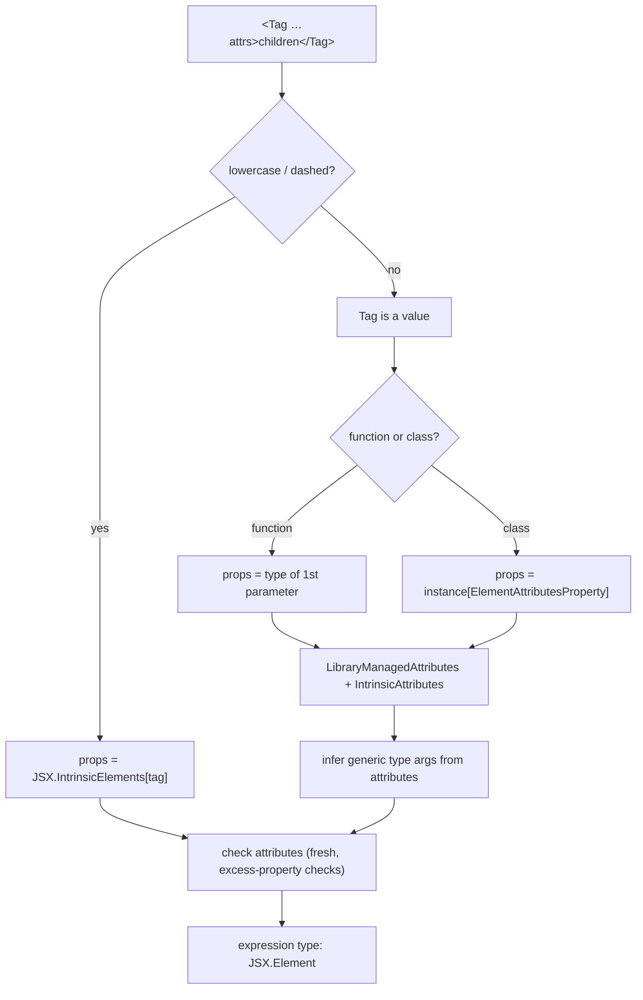

# Module 12: Typing UI Frameworks — React & Solid (Typing Only)

> Type tests: [`examples/12-typing-ui-frameworks/react/react-typing.tsx`](../examples/12-typing-ui-frameworks/react/react-typing.tsx) (`@types/react@19.3.0`) and [`examples/12-typing-ui-frameworks/solid/solid-typing.tsx`](../examples/12-typing-ui-frameworks/solid/solid-typing.tsx) (`solid-js@2.0.0-rc.19`, **release candidate**). Runner: [`examples/12-typing-ui-frameworks/ui-typing.test.ts`](../examples/12-typing-ui-frameworks/ui-typing.test.ts).
> Run: `mise exec -- npm run typecheck` (or `node --test examples/12-typing-ui-frameworks/`).

**Scope.** This module owns how TypeScript *types* JSX, components, props, hooks/primitives, events and refs. It does not explain how the frameworks *run*:
- React rendering, Fiber, hooks internals, effects, transitions, Suspense, Server Components, Actions and the React Compiler → [technologies/react](../../../technologies/react/README.md).
- Solid's reactive graph, run-once components, batching and `flush()`, stores and projections, async boundaries → [technologies/solidjs](../../../technologies/solidjs/README.md).

Where a typing rule only makes sense with a runtime fact, the fact is stated in one sentence and linked.

---

## 1. How TypeScript checks a JSX expression

JSX is not part of ECMAScript. TypeScript parses it in `.tsx` files and checks it against a **JSX namespace** supplied by the framework's type declarations. The emitter either leaves it alone (`"jsx": "preserve"`, for Solid's compiler or Babel) or rewrites it into function calls (`"jsx": "react-jsx"` → `_jsx(type, props)` imported from `<jsxImportSource>/jsx-runtime`).

### 1.1 Resolution of the JSX namespace

With `jsx: "react-jsx" | "react-jsxdev" | "preserve"` and a `jsxImportSource` of `S`, the checker looks for the `JSX` namespace exported by the module `S/jsx-runtime` (`S/jsx-dev-runtime` for `react-jsxdev`). With classic `jsx: "react"`, it uses the `JSX` namespace in scope (global or attached to the factory function). A per-file pragma overrides the config:

```tsx
/** @jsxImportSource @solidjs/web */
```

If the runtime module cannot be found, every JSX tag is an error: **TS2875** ("This JSX tag requires the module path 'solid-js/jsx-runtime' to exist") followed by **TS7026** (no `JSX.IntrinsicElements`). The fixture [`solid-old-jsx-source/`](../examples/12-typing-ui-frameworks/fixtures/solid-old-jsx-source/tsconfig.json) reproduces exactly that with Solid 2.0's packages and the Solid 1.x setting.

### 1.2 The typing algorithm (simplified)

For an element `<Tag a={e1} {...spread}>children</Tag>`:

1. **Classify the tag.** A lowercase identifier or a name with a dash or colon is an **intrinsic element**: its props type is `JSX.IntrinsicElements["tag"]`; a missing key is an error. Any other tag is a **value-based element**: `Tag` is evaluated as an expression.
2. **Derive the props type of a value-based element.** For a function, the type of its first parameter. For a class, the instance type's property named by `JSX.ElementAttributesProperty` (React: `props`). The framework may then rewrite it through `JSX.LibraryManagedAttributes<C, P>` (React uses it for `defaultProps` on class components) and intersect it with `JSX.IntrinsicAttributes` (React: `key`) and `JSX.IntrinsicClassAttributes<T>`.
3. **Infer type arguments.** If the component is generic, the attributes object is an inference site, exactly like a call `Tag({ a: e1, ...spread, children })`. Explicit arguments are written `<Tag<User> …/>`.
4. **Check the attributes object** for assignability with **excess-property checking** (JSX attributes are always "fresh"; see [Module 04](./04-objects-assignability-and-weird-parts.md)). Hyphenated attribute names (`data-*`, `aria-*`) are exempt from excess checks on intrinsic elements.
5. **Children.** The name of the children prop comes from `JSX.ElementChildrenAttribute` (both frameworks: `children`). Multiple children become a tuple/array type.
6. **Check what the component returns.** Since TS 5.1, `JSX.ElementType` (if the namespace declares it) defines what may be used as a tag, so a component returning `string` or `Promise<ReactNode>` is valid. Without it, the return type had to be assignable to `JSX.Element`.
7. **Result type.** The JSX expression has type `JSX.Element`.



### 1.3 Configuration per framework

| | React 19 | Solid 2.0 (RC) | Solid 1.x (then) |
|---|---|---|---|
| `jsx` | `react-jsx` (prod) / `react-jsxdev` | `preserve` (Solid's compiler transforms JSX) | `preserve` |
| `jsxImportSource` | `react` (the default) | `@solidjs/web` | `solid-js` |
| JSX namespace | `React.JSX` (no global `JSX` since `@types/react` 19) | `JSX` exported by `@solidjs/web` | `JSX` from `solid-js` |
| Module resolution | `bundler` or `nodenext` | `bundler` (packages use export conditions `browser`/`node`/`development`) | `bundler` |

The track's two test projects use `"module": "preserve"`, which implies `moduleResolution: "bundler"` ([Module 06](./06-modules-declarations-and-tsconfig.md)).

---

## 2. React: components and props

### 2.1 Component signatures

Type the props parameter directly. `React.FC` is no longer needed: since `@types/react` 18 it no longer adds an implicit `children`, and annotating the function itself prevents generic components.

```tsx
interface GreetingProps {
  name: string;
  children?: ReactNode;
}
export function Greeting({ name, children }: GreetingProps) {
  return <p>Hello {name}{children}</p>;
}
```

A component may return any `ReactNode`: strings, numbers, `bigint`, `null`, arrays, iterables, portals, and (for async Server Components) a `Promise` of those. The type test declares `const Count = ({ n }: { n: number }) => n;` and uses it as a tag.

### 2.2 `ReactNode` vs `ReactElement` vs `JSX.Element`

| Type | What it is | Use it for |
|---|---|---|
| `React.JSX.Element` | The type of a JSX *expression*: `ReactElement<any, any>` | Rarely written by hand; it is what `<div/>` evaluates to |
| `ReactElement<P, T>` | An element object `{ type, props, key }` with typed props | Props that must be a *single element* you will clone or inspect |
| `ReactNode` | Anything React can render | `children`, render-prop results, "slot" props |

`JSX.Element ⊂ ReactElement ⊂ ReactNode`, and `string ⊂ ReactNode` but `string ⊄ JSX.Element`. The type test asserts all four relations. **Failure mode:** typing `children: JSX.Element` rejects `"text"`, numbers and arrays, and pushes callers into needless fragments.

### 2.3 Inheriting and overriding intrinsic props

`ComponentProps<"button">` is `JSX.IntrinsicElements["button"]`: all DOM attributes plus `ref` and `key` handling. To change a prop's type, remove it first; an intersection would combine the two handler types instead of replacing one.

```tsx
type ButtonProps = Omit<ComponentProps<"button">, "onClick"> & {
  variant: "primary" | "ghost";
  onClick: (id: string) => void;
};
```

In React 19, `ComponentProps<"input">` includes `ref`, and `ComponentPropsWithoutRef<"input">` removes it. The type test checks both with `toHaveProperty("ref")`.

### 2.4 Mutually exclusive props: discriminated unions

```tsx
type ModalProps =
  | { variant: "alert"; onConfirm: () => void }
  | { variant: "prompt"; onSubmit: (value: string) => void; defaultValue?: string };
```

JSX attribute objects are fresh, so `<Modal variant="alert" onConfirm={…} onSubmit={…}/>` is an excess-property error against the `"alert"` member. Inside the component, narrow on `props.variant`.

**The destructuring trap.** `function Modal({ variant, onSubmit }: ModalProps)` is an error: `onSubmit` does not exist on every member. Destructuring the discriminant and the payload into separate variables also loses their correlation, except in the narrow case the checker supports (destructured `const` variables from a parameter that is not reassigned). The general rule and its formal reason are in [Module 03](./03-unions-narrowing-and-control-flow.md). Keep `props` whole until you have narrowed.

### 2.5 Generic components

A function component can be generic; the attributes are inference sites.

```tsx
interface TableProps<TRow> {
  rows: readonly TRow[];
  rowKey: (row: TRow) => string;
  renderRow: (row: TRow) => ReactNode;
}
export function Table<TRow>({ rows, rowKey, renderRow }: TableProps<TRow>) { /* … */ }

<Table rows={users} rowKey={(u) => u.id} renderRow={(u) => u.name} />;      // TRow = User
<Table<User> rows={users} rowKey={(u) => u.id} renderRow={(u) => u.name} />; // explicit
```

Inference runs in two phases: context-insensitive arguments (`rows`) first, then context-sensitive ones (the arrow functions) are typed contextually with `TRow` already fixed ([Module 07](./07-generics-and-inference.md)). In `.tsx` files an arrow function's type parameter list `<T>` is ambiguous with a tag; write `<T,>` or `<T extends unknown>`, or use a `function` declaration.

### 2.6 Polymorphic components (`as` prop)

```tsx
type PolymorphicProps<E extends ElementType, Own = {}> =
  Own & { as?: E } & Omit<ComponentProps<E>, keyof Own | "as">;

export function Text<E extends ElementType = "span">({ as, ...rest }: PolymorphicProps<E, { tone?: "muted" }>) {
  const Tag: ElementType = as ?? "span";
  return <Tag {...rest} />;
}

<Text as="a" href="/docs" />;   // ok: anchor props
<Text href="/docs" />;          // error: <span> has no href
```

`E` is inferred from the `as` attribute; `ComponentProps<E>` then supplies the rest. Two costs to know: the type is expensive to compute for large unions of element types (editor latency; profile it with the techniques in [Module 13](./13-library-authoring-performance-and-type-tests.md)), and widening `Tag` to `ElementType` inside the body is an intentional escape hatch, because TypeScript cannot prove that `rest` matches an arbitrary `E`.

### 2.7 HOCs (appendix)

A higher-order component that injects props is typed by removing the injected keys from the wrapped component's props:

```tsx
function withUser<P extends { user: User }>(Component: ComponentType<P>) {
  return function WithUser(props: Omit<P, "user">) {
    const user = useCurrentUser();
    return <Component {...(props as P)} user={user} />;
  };
}
```

The cast is unavoidable: `Omit<P, "user"> & { user: User }` is not provably `P` for a generic `P` (it would be unsound if `P["user"]` were a subtype of `User`). Prefer hooks over HOCs in new code; class components and error boundaries are covered in the react track.

---

## 3. React: hooks, events, refs, context

### 3.1 `useState`

```ts
const [count, setCount] = useState(0);              // number
const [user, setUser] = useState<User | null>(null); // annotate when the initial value is narrower than the state
const [nothing] = useState();                        // undefined
```

The setter is `Dispatch<SetStateAction<S>>`, where `SetStateAction<S> = S | ((prev: S) => S)`. Because a function argument is interpreted as an updater, storing a *function* in state needs `setFn(() => fn)`.

### 3.2 `useRef` overloads (React 19)

| Call | Type | Use |
|---|---|---|
| `useRef<T>(initial: T)` | `RefObject<T>` | Mutable instance value |
| `useRef<T>(null)` | `RefObject<T \| null>` | DOM ref passed to `ref={…}` |
| `useRef<T>(undefined)` | `RefObject<T \| undefined>` | Lazily set value |
| `useRef<T>()` | **Error** in React 19 types | (allowed in 18) |

### Then vs now: refs

**Then (`@types/react` 16–18).** `useRef<T>(null)` returned a *read-only* `RefObject<T>` and `useRef<T>(initial)` a `MutableRefObject<T>`; the choice of overload decided whether you could assign `.current`. Function components could not receive `ref` as a prop: you wrapped them in `forwardRef`, whose signature `forwardRef<T, P>(render)` returns a non-generic component, so **generic components lost their type parameter** and needed a cast-based `fixedForwardRef` helper.

**Now (React 19).** `RefObject<T>.current` is always writable; `MutableRefObject` is deprecated. `ref` is an ordinary prop for function components, so a generic component just declares `ref?: Ref<HTMLInputElement>` in its props and stays generic. `forwardRef` still works but is on the deprecation path.

**Migration.** Replace `forwardRef((props, ref) => …)` with a function that destructures `ref` from props; add the argument to every `useRef()` call; replace `MutableRefObject` with `RefObject`. React ships codemods; the runtime side of the upgrade is in the react track. **Pitfall:** a library compiled against 18 types that exports `forwardRef` components still erases generics for its consumers until it is rebuilt.

### 3.3 Ref callbacks may return a cleanup

React 19 calls a ref callback's returned function on detach. The type of a ref callback became `(instance: T | null) => void | (() => void)`, so an implicit return of an assignment is now a type error:

```tsx
<div ref={(el) => (node = el)} />            // error: HTMLDivElement | null is not a cleanup
<div ref={(el) => { node = el; }} />          // ok
<div ref={(el) => { node = el; return () => { node = null; }; }} />  // ok, with cleanup
```

When React calls the cleanup and whether it also calls the callback with `null` is runtime behaviour, owned by the react track.

### 3.4 `useReducer` with discriminated actions

```ts
type CartAction =
  | { type: "add"; sku: string; qty: number }
  | { type: "remove"; sku: string }
  | { type: "clear" };
```

`dispatch` is typed from the reducer's second parameter, so `dispatch({ type: "add", sku })` (missing `qty`) and `dispatch({ type: "empty" })` are errors. Add a `never` check in the reducer's `default` branch so that a new action member breaks the build ([Module 03](./03-unions-narrowing-and-control-flow.md)). React 19's types infer the action from the reducer (`useReducer<S, A extends AnyActionArg>`); explicit type arguments in the old form `useReducer<Reducer<S, A>>` no longer match.

### 3.5 Events

React passes `SyntheticEvent` wrappers. The generic parameter is the element the handler is attached to, which types `currentTarget`:

```ts
const onChange = (e: ChangeEvent<HTMLInputElement>) => onSearch(e.currentTarget.value);
const onSubmit = (e: FormEvent<HTMLFormElement>) => e.preventDefault();
```

`target` is typed as `EventTarget` because it may be a descendant. Inline handlers get the type contextually, so annotate only extracted handlers. Reusing a `ChangeEvent<HTMLInputElement>` handler on a `<select>` is an error (the test proves it).

### 3.6 Context without a meaningful default

`createContext<T>(default)` requires a default. When no sensible default exists, store `T | null` and wrap the hook so consumers get `T`:

```ts
export function createSafeContext<T>(displayName: string) {
  const Ctx = createContext<T | null>(null);
  function useSafe(): T {
    const value = useContext(Ctx);
    if (value === null) throw new Error(`${displayName} is missing its provider`);
    return value;
  }
  return [Ctx, useSafe] as const;
}
```

`as const` makes the return a tuple instead of `(Context | (() => T))[]` ([Module 05](./05-classes-mutability-and-ts-only-syntax.md)). In React 19 the context object itself is a provider: `<ThemeContext value={…}>`.

### 3.7 `use`, actions and optimistic state: signatures only

| API | Signature (from `@types/react` 19.3) | Typing note |
|---|---|---|
| `use` | `use<T>(usable: Usable<T>): T` where `Usable<T>` is a promise-like or a `Context<T>` | `use(userPromise)` gives `User`; `use(ThemeContext)` gives the context's `T` (including `null` if that is part of `T`) |
| `useActionState` | `useActionState<State, Payload>(action: (state: Awaited<State>, payload: Payload) => State \| Promise<State>, initialState: Awaited<State>, permalink?)` → `[state, dispatch: (payload: Payload) => void, isPending]` | Model the state as a discriminated union (`idle` / `saved` / `error`) |
| `useOptimistic` | `useOptimistic<State, Action>(passthrough: State, reducer: (state: State, action: Action) => State)` → `[State, (action: Action) => void]` | The action type comes from the reducer's 2nd parameter |
| `startTransition` | `(scope: () => void \| Promise<void>) => void` | Async transitions are allowed in 19 |
| `<form action>` | `string \| ((formData: FormData) => void \| Promise<void>)` | A `useActionState` dispatch with `Payload = FormData` fits |

What these hooks *do* (queuing, pending states, rollback, races, progressive enhancement) is owned by the react track's Actions module.

### 3.8 Server-function arguments: a type-level serializability constraint

Arguments and return values of `"use server"` functions cross the network, so functions, class instances and symbols cannot be passed. A constraint type makes that a compile error:

```ts
type Serializable =
  | string | number | boolean | null | undefined | bigint | Date | FormData
  | readonly Serializable[]
  | { readonly [key: string]: Serializable };

function serverFunction<Args extends Serializable[], R extends Serializable>(fn: (...args: Args) => Promise<R>) {
  return fn;
}
serverFunction(async (cb: () => void) => String(cb)); // error
```

This is a *model*; the exact set React's Flight serializer supports (Maps, Sets, typed arrays, promises, server references) is listed in the react track. A static constraint never replaces runtime validation of the arguments: a server function is a public HTTP endpoint, so parse its input with a schema ([Module 11](./11-runtime-boundaries-validation.md)).

### 3.9 Augmenting React's JSX

Custom elements and CSS custom properties are added by module augmentation ([Module 06](./06-modules-declarations-and-tsconfig.md)):

```ts
declare module "react" {
  namespace JSX {
    interface IntrinsicElements {
      "my-rating": { value: number; max?: number; children?: never };
    }
  }
  interface CSSProperties {
    [customProperty: `--${string}`]: string | number;
  }
}
```

Augment `React.JSX`, not the global `JSX` namespace: `@types/react` 19 removed the global one, so a `declare global { namespace JSX … }` block silently adds to a namespace nobody reads.

---

## 4. Solid 2.0 (release candidate): primitives and components

Solid 2.0 is at `2.0.0-rc.19` on npm (`next` tag; `latest` is still 1.9.17). Everything in this section is pinned to rc.19 and may change before 2.0.0. Runtime semantics are in the solidjs track.

### 4.1 Accessors and setters

```ts
type Accessor<T> = () => T;
type Setter<in out T> = { /* overloads: value or updater */ };
type Signal<T> = [get: SourceAccessor<T>, set: Setter<T>];
```

- `createSignal(0)` → `[Accessor<number>, Setter<number>]`. Read with `count()`.
- **Literal widening.** `createSignal("light")` gives `string`, like a `let` binding. Annotate `createSignal<"light" | "dark">("light")` for a union.
- `createSignal<number>()` → `number | undefined`.
- **Functions are not values.** The value overload is `createSignal<T>(value: Exclude<T, Function>)`; a function argument selects the *derived signal* overload (`createSignal(fn)` is a writable memo in 2.0). To store a callback, wrap it in an object.
- `Setter<in out T>` uses an explicit **variance annotation**: setters are invariant in `T` ([Module 07](./07-generics-and-inference.md)).

### 4.2 Memos and colorless async

`createMemo(() => count() * 2)` → `Accessor<number>`. In 2.0 a memo may return a promise or async iterable, and the accessor's type is the **resolved** value:

```ts
const user = createMemo(async () => ({ id: count(), name: "Ada" }));
user(); // { id: number; name: string } — not a Promise
```

The compute function type is `ComputeFunction<Prev, Next> = (v: Prev) => PromiseLike<Next> | AsyncIterable<Next> | Next`, so `T` is inferred through the promise. Reading a pending async memo suspends at runtime; that mechanism is owned by the solidjs track.

### 4.3 Stores

```ts
const [store, setStore] = createStore<{ todos: Todo[] }>({ todos: [] });
setStore((draft) => { draft.todos.push({ id: 1, title: "write", done: false }); });
```

In rc.19 `Store<T> = T` and `StoreSetter<T> = (fn: (state: T) => T | void) => void`: the setter takes a draft function and may mutate it or return a replacement. Wrong field types inside the draft are ordinary assignment errors. The function form `createStore(fn, seed)` returns a derived (projection) store with the same types.

### 4.4 Component types

| Type | Props | Children |
|---|---|---|
| `Component<P>` | `P` | Only if `P` declares them |
| `ParentComponent<P>` | `P & { children?: JSX.Element }` | Optional |
| `VoidComponent<P>` | `P & { children?: never }` | Forbidden |
| `FlowComponent<P, C>` | `P & { children: C }` | Required, of type `C` (e.g. a render function) |
| `ValidComponent` (`@solidjs/web`) | — | A tag name or `Component<any>` (input of `dynamic()`) |
| `ComponentProps<T>` | Props of a component or intrinsic tag | — |

**Accessor-as-prop bug.** `<Label text={mode} />` passes the function, not the string. With `text: string` that is a type error; with `text: any` or a union including functions, it compiles and renders nothing useful. Type props as values and call accessors at the use site.

### 4.5 `merge` and `omit`

`merge(defaults, props)` returns `Merge<[…]>`, the right-biased spread type, so defaults narrow optional props: `merge({ variant: "primary" as const }, props).variant` is `"primary" | "ghost"`, not `… | undefined`. `omit(props, "variant")` removes keys at the type level. They replace 1.x `mergeProps`/`splitProps`; why they preserve reactivity is a runtime concern.

### 4.6 Control flow narrowing

`<Show when={x}>` with a function child passes a **narrowed accessor**: `(item: Accessor<NonNullable<T>>) => JSX.Element`. With `keyed`, it passes the narrowed **value** instead. `<For>` changes its callback shape with the keying mode:

| `<For>` mode | `item` | `index` |
|---|---|---|
| default (`keyed` by reference) | `T` | `Accessor<number>` |
| `keyed={false}` | `Accessor<T>` | `number` |
| `keyed={(item) => key}` | `Accessor<T>` | `Accessor<number>` |

The three overloads are distinguished by the literal type of `keyed`, a direct application of overload resolution on literal types ([Module 07](./07-generics-and-inference.md)).

### 4.7 Context, events, refs, `<Dynamic>`, actions

- **Context.** `createContext<T>()` without a default still yields `useContext(ctx): T`. A missing provider throws `ContextNotFoundError` at runtime instead of returning `undefined`, so the type is honest only if every consumer is under a provider. Use `createContext<T | null>(null)` for genuinely optional context. The context object is the provider: `<ThemeContext value={…}>`.
- **Events.** `onClick={(e) => …}` gets `MouseEvent & { currentTarget: HTMLButtonElement; target: DOMElement }`. Solid 2.0 removed the 1.x `on:click` namespace for native listeners: `on:click={…}` is now a compile error (asserted in the type test). Delegated vs native listener semantics are in the solidjs track.
- **Refs.** `ref={(el) => …}` receives the element type of the tag (`HTMLButtonElement`).
- **`dynamic(() => X)`** returns `Component<ComponentProps<T>>` for `T extends ValidComponent` (a component or a tag name), so `const Field = dynamic(() => cond() ? Rich : "input")` is used as `<Field …/>` with the resolved props checked. The JSX form `<Dynamic component={X} …>` still exists but is `@deprecated` in rc.19 (RFC 03): it re-merges `component` into props and builds a new factory per instance.
- **Generator actions.** `action(function* (title: string) { …; return x; })` has type `(title: string) => Promise<typeof x>`: `action<Args, Y, R>(genFn: (...args: Args) => Generator<Y, R, any>) => (...args: Args) => Promise<R>`.

### Then vs now: Solid 1.x → 2.0 typing

| Concern | 1.x | 2.0 RC (rc.19) | Migration note |
|---|---|---|---|
| `jsxImportSource` | `solid-js` | `@solidjs/web` | Old setting → TS2875 on every tag |
| Prop helpers | `mergeProps`, `splitProps` (tuple result) | `merge`, `omit` | `splitProps(props, ["a"])` → `omit(props, "a")` plus direct reads |
| Async data | `createResource` → `Resource<T>` with `.loading`/`.error` | async `createMemo` → `Accessor<T>` | Pending/error states move to boundaries, not to the type |
| `<For>` callback | `(item: T, index: Accessor<number>)` only | Three shapes by `keyed` | `<Index>` → `<For keyed={false}>` |
| Context | `createContext<T>()` gave `T \| undefined` | `T`, throws if missing | Remove `!`/guards only where a provider is guaranteed |
| Native events | `on:click={…}` | Removed (compile error); use `onClick` (native-listener options: solidjs track) | Rewrite `on:` attributes |
| Polymorphic | `<Dynamic component={…}>` | `dynamic(() => …)` (`<Dynamic>` deprecated) | Hoist one factory per component instance |
| Store setter | Path syntax `setStore("todos", 0, "done", true)` | Draft function | Rewrite path calls as draft mutations |

Pitfall of mixing: libraries built against 1.x types import `JSX` from `solid-js`; in a 2.0 project they type-check against a different namespace or fail to resolve. Check every Solid UI library's 2.0 status before upgrading.

---

## 5. Production failure modes

1. **`children: JSX.Element` rejects text and arrays.** Use `ReactNode` (React) or `JSX.Element` from `@solidjs/web`, which already includes strings and arrays in Solid.
2. **Generic component loses its type parameter** after `forwardRef` or `memo` wrapping (React 18 types). Fix: React 19 ref-as-prop; for `memo`, cast the result to the original generic signature: `memo(Table) as typeof Table`.
3. **Destructured union props**: the component compiles only with `any` or `!` after destructuring. Narrow on `props` first.
4. **Global JSX augmentation that does nothing** under `@types/react` 19. Augment `declare module "react" { namespace JSX … }`.
5. **Polymorphic components slow the editor** (large `ComponentProps<E>` unions recomputed per usage). Restrict `E` to a small union of tags.
6. **Passing an accessor instead of its value** in Solid compiles when the prop type is too loose. Keep prop types precise.
7. **Solid 1.x `jsxImportSource`** after upgrading packages: every tag errors (TS2875).
8. **Assuming server-function argument types are enforced at runtime.** They are erased; validate with a schema.

---

## Interview Drill

<details><summary>1. Explain the difference between <code>ReactNode</code>, <code>ReactElement</code> and <code>JSX.Element</code>, and which to use for <code>children</code>.</summary>

`JSX.Element` is the type of a JSX expression (a `ReactElement<any, any>`). `ReactElement<P>` is an element object with typed props. `ReactNode` is everything React can render: elements, strings, numbers, bigint, booleans, null/undefined, iterables, portals and promises. `JSX.Element ⊂ ReactElement ⊂ ReactNode`. Use `ReactNode` for `children` and slots; `ReactElement` only when you must inspect or clone a single element.
</details>

<details><summary>2. How does TypeScript decide the props type of <code>&lt;Foo a={1} /&gt;</code>?</summary>

Uppercase tag → value-based element. For a function component, the props type is its first parameter's type, adjusted by `JSX.LibraryManagedAttributes` and intersected with `JSX.IntrinsicAttributes`. If `Foo` is generic, its type arguments are inferred from the attributes object as if it were a call argument. The attributes object is then checked with excess-property checks. Lowercase tags look up `JSX.IntrinsicElements[tag]`. The namespace comes from `jsxImportSource/jsx-runtime`.
</details>

<details><summary>3. Why did generic components break with <code>forwardRef</code>, and what fixed it?</summary>

`forwardRef<T, P>(render)` returns `ForwardRefExoticComponent<P & RefAttributes<T>>`, a non-generic type; the type parameter of the inner function is instantiated (to `unknown`) when it is passed as an argument. Fixes: a cast to a generic signature (`fixedForwardRef`), or in React 19, declaring `ref` as a normal prop so no wrapper is needed.
</details>

<details><summary>4. Type a polymorphic <code>as</code> prop. What are its costs?</summary>

`type P<E extends ElementType, Own> = Own & { as?: E } & Omit<ComponentProps<E>, keyof Own | "as">`, with `E` inferred from `as` and a default tag. Costs: expensive type computation over large element-type unions (editor latency), and the body needs a widening to `ElementType` because TS cannot prove `rest` matches `E`.
</details>

<details><summary>5. Your reducer gained a new action type and nothing failed to compile. What was missing?</summary>

An exhaustiveness check: in the `default` branch, assign the action to `never` (`const x: never = action`). With the new member unhandled, `action` is not `never` there and the assignment fails. Also check that the reducer return type is annotated so missing returns are caught.
</details>

<details><summary>6. In Solid 2.0, why does <code>&lt;Show when={user()}&gt;{(u) =&gt; u().name}&lt;/Show&gt;</code> call <code>u()</code>?</summary>

Without `keyed`, `Show`'s function child receives an `Accessor<NonNullable<T>>`, so the callback stays reactive to changes of the narrowed value without re-running. With `keyed`, it receives the value itself and the callback re-runs when the value identity changes. The overload is selected by the literal type of `keyed`.
</details>

<details><summary>7. How do you add a web component <code>&lt;my-rating value={4}/&gt;</code> to React's JSX types?</summary>

Module-augment React's JSX namespace: `declare module "react" { namespace JSX { interface IntrinsicElements { "my-rating": { value: number } } } }`. With `@types/react` 19 there is no global `JSX` namespace to augment.
</details>

<details><summary>8. Why is a type-level <code>Serializable</code> constraint on server functions not enough?</summary>

Types are erased; a server function is reachable by any HTTP client, which can send any payload. The constraint prevents *your* code from passing non-serializable values; the server must still parse its input with a runtime schema and check authorization.
</details>
