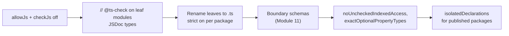

# Module 13: Library Authoring, Type Performance, Type Tests & Migration

> Example and tests: [`examples/13-library-authoring/library-authoring.test.ts`](../examples/13-library-authoring/library-authoring.test.ts) with fixtures in [`examples/13-library-authoring/fixtures/`](../examples/13-library-authoring/fixtures/) (a tiny package checked by publint 0.3.25 and attw 0.18.5, recursion-limit and type-test fixtures).
> Run: `mise exec -- node --test examples/13-library-authoring/`

Application code consumes types; library code *publishes* them. Publishing adds three obligations: the declaration files must describe the JavaScript you ship, every consumer's module resolution must find them, and the types must stay fast enough that they do not dominate your users' editor latency. This module covers those obligations, how to test types themselves, and how to migrate a code base (JavaScript → TypeScript, and 5.x → 7). It closes with the track's version history.

---

## 1. Declaration emit

### 1.1 What a `.d.ts` file is

A declaration file is the erasure dual of a JavaScript file: it keeps *only* the type-level content of a module (signatures, type aliases, interfaces, `declare` statements) and drops all bodies. For a module `M`, `tsc --declaration` emits `M.d.ts` such that type-checking a consumer against `M.d.ts` gives the same result as type-checking it against `M.ts`.

For exported declarations without annotations, the compiler must **print the inferred type**. That has three consequences:

1. Declaration emit needs the full type checker (it is not a per-file transform), unless `isolatedDeclarations` is on.
2. Inferred types can reference names the declaration file cannot reach. TS reports **TS2742** ("The inferred type of 'x' cannot be named without a reference to '…/node_modules/…'. This is likely not portable.") or **TS4023**-family errors. Fix by annotating the export with a public type.
3. Large inferred types (a deeply nested Zod schema, a tRPC router) are printed in full, which bloats `.d.ts` files and slows every consumer. Annotate with a named type, or export the type alias and annotate with it.

### 1.2 `isolatedDeclarations`

With `isolatedDeclarations: true`, every exported declaration must have a type that can be read from syntax alone: explicit return types on exported functions, explicit types on exported `const`s unless the initializer is a literal (including object/array literals of literals). In exchange, any tool can emit `.d.ts` per file without the checker: fast parallel declaration emit in TS 7 (`--builders` with project references), and declaration emit in Oxc/SWC-based build tools.

The fixture `isolated-decl/` exports `function add(a: number, b: number) { return a + b; }` and TS 7.0.2 reports **TS9013** ("Expression type can't be inferred with --isolatedDeclarations") at the return expression; the object literal `{ retries: 3 }` passes because its type is syntactically evident.

### Then vs now: declaration emit

**Then (≤ 5.4).** Only `tsc` could emit declarations, and only after a full type check. Monorepos with project references built `.d.ts` files serially along the dependency graph; bundlers that emitted JS in milliseconds waited for `tsc --emitDeclarationOnly`.

**Now (5.5+, and especially TS 7).** `isolatedDeclarations` makes declaration emit a syntax transform. TS 7's `--builders` builds project references in parallel, and separate syntactic declaration emit removes the type-check from the critical path.

**Migration.** Turning it on late produces one error per unannotated export (thousands in a large package). Enable it per package, use the editor quick fix "Add annotation of type …" in bulk, and add it to new packages from day one. **Pitfall:** annotating with an over-wide type (`: object`, `: Function`) silences the error and destroys the public API's precision. Annotate with the *named* public type.

---

## 2. Publishing: `exports`, conditions and dual packages

How Node and bundlers resolve `exports` at runtime is owned by `languages/javascript` (ESM semantics) and `technologies/nodejs` (loader internals); [Module 06](./06-modules-declarations-and-tsconfig.md) covers how TypeScript resolves them. This section is the publisher's checklist.

### 2.1 The minimal correct ESM-only package

```json
{
  "name": "zto-tiny-lib",
  "type": "module",
  "exports": {
    ".": { "types": "./dist/index.d.ts", "default": "./dist/index.js" },
    "./package.json": "./package.json"
  },
  "files": ["dist"],
  "sideEffects": false
}
```

Rules encoded here:
- **`types` first.** Conditions are matched in object order. If `import` or `default` comes first, TypeScript takes that branch and looks for a `.d.ts` *next to* the `.js` file. If the declarations live elsewhere, it silently falls back. The fixture `bad-pkg/` (`"import"` before `"types"`, declarations in `./types/`) makes publint fail with "types should be the first in the object" and attw report **FallbackCondition**.
- **`"type": "module"`** makes `.js` files ESM. Without it, `tsc` with `module: nodenext` treats the sources as CommonJS; combined with `verbatimModuleSyntax` it reports **TS1287** on every `export` of a value.
- **A `.d.ts` describes exactly one module format.** `index.d.ts` next to an ESM `index.js` is read as ESM; for a CJS build you need `index.d.cts` (or a `package.json` with `"type": "commonjs"` in that directory).

### 2.2 Dual ESM/CJS packages and "masquerading"

A dual package ships `dist/esm/index.js` and `dist/cjs/index.cjs`. The declaration files must be dual too:

```json
"exports": {
  ".": {
    "import": { "types": "./dist/esm/index.d.ts", "default": "./dist/esm/index.js" },
    "require": { "types": "./dist/cjs/index.d.cts", "default": "./dist/cjs/index.cjs" }
  }
}
```

If both branches point at the same `index.d.ts`, TypeScript believes the CJS entry is ESM (**"Masquerading as ESM"** in attw) or the reverse (**"Masquerading as CJS"**). Consumers then get wrong `default`-import typing (`import x from "lib"` typed as the namespace or as `{ default: … }`). Since Node 22.12 can `require()` ESM, many libraries now ship **ESM only**; attw's `--profile esm-only` ignores the `node10` and `node16-cjs` resolution modes that ESM-only packages cannot satisfy, which is why the good fixture passes with that profile.

### 2.3 Checking a package before publishing

| Tool | Checks | Track usage |
|---|---|---|
| `publint` | `package.json` hygiene: condition order, missing files, `type` field, `files` coverage | `publint .` must exit 0 |
| `@arethetypeswrong/cli` (attw) | Packs the package and resolves every entry point under `node10`, `node16-cjs`, `node16-esm`, `bundler`; reports `NoResolution`, `FallbackCondition`, `FalseESM`/`FalseCJS` (masquerading), `CJSResolvesToESM`, `UntypedResolution` | `attw --pack . --profile esm-only` must exit 0 |

attw 0.18.5 depends on the 5.x compiler API internally; it is a separate tool and is unaffected by the project using TS 7.

---

## 3. Testing types

Types are code: they regress when someone widens a return type or loosens a generic. Three techniques, from cheapest to richest.

### 3.1 `@ts-expect-error` as a negative test

`// @ts-expect-error` suppresses the error on the next line **and fails if there is no error** (**TS2578** "Unused '@ts-expect-error' directive", proven by the fixture `unused-expect-error/`). Every negative test in this track is written this way. Never use `@ts-ignore` for tests: it passes whether or not the error exists.

**Pitfall:** `@ts-expect-error` accepts *any* error on that line. A test meant to prove "wrong argument type" also passes if the function name is misspelled. Keep the line minimal and add a comment naming the expected error.

### 3.2 Equality assertions

Assignability (`A extends B`) is too weak for tests: `any` is assignable both ways, and `{ a: 1 }` is assignable to `{}`. The standard **mutual-identity** trick compares how two types behave inside a deferred conditional:

```ts
type Equal<X, Y> =
  (<T>() => T extends X ? 1 : 2) extends (<T>() => T extends Y ? 1 : 2) ? true : false;
type Expect<T extends true> = T;
type _t = Expect<Equal<ReturnType<typeof f>, string>>;
```

Two generic signatures are related only if their deferred conditional types are *identical*, which distinguishes `any` from `unknown`, `readonly` from mutable, and optional from `| undefined`. The helper is in [`examples/utils/type-helpers.ts`](../examples/utils/type-helpers.ts).

`expect-type` (1.4.0) packages the same idea with readable failures: `expectTypeOf(x).toEqualTypeOf<T>()`, `.toExtend<T>()`, `.toHaveProperty("k")`, `.not.…`. A mismatch is reported as a compile error on the call (often "Expected 1 arguments, but got 0", because the library turns the failure into a required argument). The track found one limit while writing Module 12: `toEqualTypeOf` on large DOM types can fail on structural details of the DOM lib; assert those with an assignment instead.

### 3.3 Where type tests run

| Approach | How | Notes |
|---|---|---|
| `tsc --noEmit` over test files | What this track does (`npm run typecheck`, and fixture tests that spawn `tsc`) | Works with TS 7 today |
| `vitest --typecheck` with `*.test-d.ts` | Vitest spawns `tsc` and maps errors to tests | Depends on Vitest's integration with the TS 7 binary (unverified for vitest 5.0.5) |
| Diagnostic snapshots | Spawn `tsc -p fixture`, assert error codes | Assert codes and line numbers, not full messages: message text and union order change across versions (`stableTypeOrdering`) |

---

## 4. Type performance

### 4.1 Where the cost comes from

The checker's work is dominated by **instantiation** (substituting type arguments into generic types) and **relation checks** (assignability between structured types). Both are cached, but caches are keyed by type identity, so code that creates many distinct types (large unions, deep conditional types, intersections of object types) defeats them.

| Pattern | Why it is slow | Cheaper alternative |
|---|---|---|
| Big unions compared pairwise (`A \| B \| … ` vs another union) | Relation is O(n·m) member checks | Discriminated unions (checked by discriminant lookup) |
| Intersections of object types `A & B & C` | Properties are recomputed on each access; no cache of the merged shape | `interface X extends A, B, C {}` (cached, and errors on conflicts) |
| Deeply recursive conditional types | Each level is a new instantiation | Tail-recursive formulation; cap the depth; precompute |
| Polymorphic components / large mapped types re-evaluated per call site | Instantiation per usage | Narrow the parameter domain |
| Inferred types of huge values exported from a module | Printed into `.d.ts`, rechecked by every consumer | Annotate with named types |

### 4.2 Recursion limits

The checker caps instantiation depth to protect against infinite recursion, reporting **TS2589** "Type instantiation is excessively deep and possibly infinite". Measured on 7.0.2 with the fixture `depth/` (building a tuple of length *N*):

| Formulation | Largest *N* that compiles | Fails at |
|---|---|---|
| Non-tail recursive: `[...Build<N, [...A, 0]>]` | 47 | 48 |
| Tail recursive: `Build<N, [...A, 0]>` as the whole branch | 999 | 1000 |

The first boundary reflects an instantiation-depth limit of 100 (each element costs about two nested instantiations here); the second is the tail-recursion iteration limit of 1000 that TS has applied since 4.5. The exact internal constants are inferred from these measurements and from the 5.x source, not from 7.0 documentation (unverified for the Go port's constants; the measured boundaries are verified). A conditional type is evaluated as a loop only when the recursive reference is the entire true or false branch.

### 4.3 Diagnosing slow types

1. `tsc --extendedDiagnostics` prints counts and timings: `Types`, `Instantiations`, `Memory used`, and phase times. A jump in `Instantiations` between two commits points at the change. (Works in 7.0.2; the test asserts the `Instantiations:` line.)
2. `tsc --generateTrace <dir>` writes `trace.json` (Chrome trace format, open in `chrome://tracing` or Perfetto) and type dumps. In 7.0.2 it writes **one `types_N.json` per checker** (four by default); use `--singleThreaded` for a single, easier-to-read type dump.
3. `@typescript/analyze-trace` summarises 5.x/6.x traces into "hot spots"; its compatibility with 7.0's per-checker files is unverified.
4. In the editor, measure with the language server's own logging; a single slow file shows up as completion latency.

**Performance numbers are hardware dependent.** The track asserts that the diagnostics *exist*, never how fast they are.

---

## 5. JavaScript with JSDoc (`checkJs`) in TS 7

TS can type-check `.js` files using JSDoc annotations (`allowJs` + `checkJs`, or `// @ts-check`). TS 7 reworked JSDoc support to align it with TypeScript syntax. Removed or changed in 7.0 (from the release post):

- Values cannot be used as types in JSDoc (`@type {someValue}`); use `typeof someValue`.
- `@enum` is no longer special: an object tagged `@enum` is just an object.
- The standalone `?` type is removed (use `any`/`unknown`); postfix `!` is unsupported.
- `@class` no longer turns a function into a constructor; aliasing `this` and assigning to `prototype` are no longer specially understood.
- Typedefs must use `@typedef`; Closure-style function types (`function(string): number`) are unsupported; use `(s: string) => number`.

The fixture `jsdoc-ts7/` shows both: `@param {Color}` on an `@enum` object is **TS2749** (a value used as a type) and `@type {function(string): number}` no longer parses (**TS1005**).

**Failure mode:** a JS code base with Closure-style JSDoc silently loses types (they become `any`) or gains errors on upgrade. Run 6.0 and 7.0 side by side on the JS files and diff the diagnostics before switching.

---

## 6. Migration playbooks

### 6.1 JavaScript → TypeScript



1. Add `tsconfig.json` with `allowJs`, `checkJs: false`, and the TS 7 defaults (strict is already on; set `"strict": false` only temporarily, per package, never globally).
2. Convert **leaf modules first** (no internal imports), so each converted module only depends on typed code.
3. Type the boundaries with schemas before typing the core. Typing the core while the edges are `any` gives a false sense of safety.
4. Track `any` count and `@ts-expect-error` count in CI; the count may only go down.
5. Turn on the stricter flags (`noUncheckedIndexedAccess`, `exactOptionalPropertyTypes`) at the end, one per commit.

**Organisational pattern** (common in large migrations): a "strict island" per package with project references, so teams migrate independently and the compiler enforces the boundary between strict and lax code.

### 6.2 TypeScript 5.x → 6.0 → 7.0

1. **Upgrade to 6.0 first** and fix every deprecation instead of setting `"ignoreDeprecations": "6.0"`. 7.0 turns them into errors ([Module 01](./01-toolchain-and-compiler-model.md) §4).
2. Make the new defaults explicit where you relied on the old ones: `types`, `rootDir`, `module`, and side-effect imports of assets.
3. Turn on `stableTypeOrdering` in 6.0 and regenerate `.d.ts`/error snapshots in a dedicated commit.
4. Inventory API consumers (typescript-eslint, vue-tsc, Angular, ts-morph, custom transformers, documentation generators). Keep them on `@typescript/typescript6` with the alias pattern.
5. Switch `tsc` in CI to 7.0. Run 6.0 in parallel for one release cycle and compare error counts; differences point at ordering, JSDoc, or template-literal code-point inference changes.
6. Check template-literal utilities that split strings: 7.0 infers by **code point**, so `HeadTail<"😀abc">` is `["😀", "abc"]` instead of two UTF-16 surrogate halves ([Module 08](./08-type-derivation-and-template-literals.md)).

### 6.3 Case studies of public library API typing

These distil design lessons that used to be a separate "expert interviews" lesson:

- **tRPC**: the router object is the single source of truth; the client type is derived by mapping over `typeof router` (no code generation). The cost is that a huge router type is re-instantiated in every consumer, which is why such libraries add explicit annotations and split routers ([Module 10](./10-type-safe-api-design-patterns.md)).
- **TanStack Query `DataTag`**: a query key carries the data type as a phantom property, so `getQueryData(key)` returns the right type without a type argument.
- **Redux Toolkit**: middleware and enhancers accumulate in a tuple type built with variadic tuple types, so `dispatch` knows every middleware's extension.
- **ts-pattern**: exhaustive pattern matching computes "remaining cases" as a type and makes `.exhaustive()` fail to compile when a case is missing. Powerful, but a frequent source of TS2589 on very large unions.

---

## 7. Production failure modes

1. **TS2742 "inferred type cannot be named"** when emitting declarations in a monorepo. Annotate the export with a public type.
2. **Thousands of errors from enabling `isolatedDeclarations` late.** Enable per package, use quick fixes, never annotate with `object`.
3. **`types` condition after `import`/`default`.** Consumers silently get adjacent or no types. publint catches it.
4. **Masquerading ESM/CJS types** in dual packages. One `.d.ts` per format; check with attw.
5. **TS2589 or editor freezes from recursive types.** Rewrite as tail recursion, cap depth, or precompute.
6. **Declaration snapshots churn after upgrading to 7.0** (`stableTypeOrdering`). Regenerate in one commit; assert codes, not messages.
7. **`@ts-ignore` in type tests.** Tests that cannot fail. Use `@ts-expect-error`.
8. **JSDoc-typed JS loses types on 7.0** (`@enum`, Closure syntax). Diff diagnostics of 6.0 vs 7.0 before switching.

---

## 8. Version history (major releases relevant to practitioners)

| Version | Date | Practitioner-relevant changes |
|---|---|---|
| 2.0 | 2016-09 | `strictNullChecks`, `never`, control-flow analysis |
| 2.8 | 2018-03 | Conditional types, `infer` |
| 3.0 | 2018-07 | `unknown`, project references, variadic-ish rest tuples |
| 3.7 | 2019-11 | Optional chaining, assertion functions, recursive type aliases |
| 4.0 | 2020-08 | Variadic tuple types, labelled tuples |
| 4.1 | 2020-11 | Template literal types, key remapping in mapped types |
| 4.5 | 2021-11 | Tail-recursive conditional types, `Awaited` |
| 4.7 | 2022-05 | `module: node16/nodenext`, variance annotations `in`/`out` |
| 4.9 | 2022-11 | `satisfies` |
| 5.0 | 2023-03 | TC39 decorators, `const` type parameters, `bundler` resolution, `verbatimModuleSyntax` |
| 5.2 | 2023-08 | `using` declarations |
| 5.4 | 2024-03 | `NoInfer` |
| 5.5 | 2024-06 | Inferred type predicates, `isolatedDeclarations` |
| 5.8 | 2025-02 | `erasableSyntaxOnly` |
| 6.0 | 2026-03-23 | Last JS-based compiler; new defaults; deprecations |
| 7.0 | 2026-07 (7.0.2 on npm 2026-07-08) | Native Go compiler, parallel checking, deprecations are errors, no classic API |
| 7.1 | beta 2026-10-20 | New API, content mappers, `es2026` (preview) |

Rows up to 5.8 come from model knowledge of the release history at month granularity (unverified dates); 6.0–7.1 are from the release posts and the npm registry.

---

## Interview Drill

<details><summary>1. What does <code>isolatedDeclarations</code> buy you, and what does it cost?</summary>

Declaration files become a per-file syntactic transform, so any tool can emit them in parallel without a type check (fast builds, parallel project references in TS 7). The cost: every export needs an explicit type unless its initializer's type is syntactically obvious; turning it on late creates an error per unannotated export.
</details>

<details><summary>2. A consumer imports your package and gets <code>any</code>. Your <code>exports</code> has <code>"import"</code> before <code>"types"</code>. Explain.</summary>

Conditions are matched in order. TypeScript matches `import`, resolves to `dist/index.js`, and looks for an adjacent `index.d.ts`. If declarations live elsewhere, it finds none (untyped or fallback resolution). Put `types` first in each condition object, and verify with publint and attw.
</details>

<details><summary>3. What is "masquerading as ESM", and how do you fix it?</summary>

The `require` branch of a dual package points at a `.d.ts` that TypeScript interprets as ESM (because of `"type": "module"` or the `.d.ts` extension), so CJS consumers get ESM typing (wrong default-import shape). Ship format-specific declarations (`.d.cts` for CJS, `.d.ts`/`.d.mts` for ESM) under the matching conditions, or publish ESM only.
</details>

<details><summary>4. Why is <code>A extends B ? true : false</code> not enough to test type equality?</summary>

Assignability is not equality: `any` is assignable in both directions, subtypes are assignable to supertypes, and it distributes over unions when `A` is a type parameter. The mutual-identity trick `(<T>() => T extends X ? 1 : 2) extends (<T>() => T extends Y ? 1 : 2)` requires the types to be identical.
</details>

<details><summary>5. How do you find which type makes <code>tsc</code> slow?</summary>

Compare `--extendedDiagnostics` (`Instantiations`, check time) between commits, then run `--generateTrace` (with `--singleThreaded` in TS 7 for one type dump) and open `trace.json` in a trace viewer to find long `checkSourceFile`/`structuredTypeRelatedTo` spans; map the type IDs to source locations via the types dump.
</details>

<details><summary>6. What makes a recursive conditional type tail-recursive, and why does it matter?</summary>

The recursive reference must be the entire branch of the conditional (not wrapped in a tuple spread, template literal or another type). Then the checker evaluates it as a loop with a 1000-iteration limit instead of nested instantiations limited by depth (≈48 tuple elements in the measured non-tail case).
</details>

<details><summary>7. Outline a safe 5.x → 7.0 upgrade for a monorepo with typescript-eslint.</summary>

Upgrade to 6.0; fix deprecations in the shared base config first; make `types`/`rootDir` explicit; add asset declarations; enable `stableTypeOrdering` and regenerate snapshots; alias `typescript` to `@typescript/typescript6` for eslint and add `@typescript/native` for the 7.0 `tsc`; switch CI type checking to 7.0; run both compilers for a cycle and diff diagnostics.
</details>
