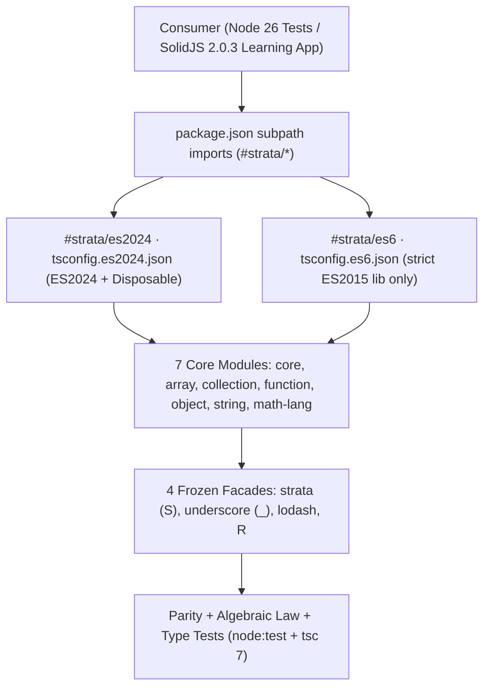
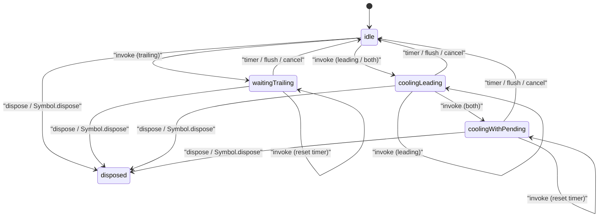

# Module 14 — Strict Functional Programming Library Design: ES2024 vs ES6

> **Executable proofs:** [`examples/14-strict-fp-es2024-vs-es6/`](../examples/14-strict-fp-es2024-vs-es6/) ships two complete, parallel, internal TypeScript libraries — `#strata/es2024` and `#strata/es6` — unifying Underscore, Lodash, and Ramda across seven domains with 100% behavioral parity tests ([`strict-fp-parity.test.ts`](../examples/14-strict-fp-es2024-vs-es6/strict-fp-parity.test.ts)), static type & compiler-profile proofs ([`strict-fp-types.test.ts`](../examples/14-strict-fp-es2024-vs-es6/strict-fp-types.test.ts)), and an interactive SolidJS 2.0.3 + TanStack Table v9 learning web page ([`web/`](../examples/14-strict-fp-es2024-vs-es6/web/)).
>
> **Ownership boundaries:** Type-system patterns (`Option<T>`, `Result<T, E>`, `assertNever`, `DotPath<T>`, `Evolver<T>`, `Lens<S, A>`, `Transducer<In, Out>`, `isolatedDeclarations`, `exactOptionalPropertyTypes`, subpath imports) live here. Underlying ECMAScript runtime semantics for iterators, `Symbol.dispose`, prototype pollution, and Unicode regular expressions are owned by [languages/javascript](../../javascript/README.md) (cross-linked throughout); underlying data structures (LRU cache, Fisher–Yates) are owned by [algorithms/dsa](../../../algorithms/dsa/README.md); SolidJS 2.x reactive runtime internals are owned by [technologies/solidjs](../../../technologies/solidjs/README.md).

---

## 1. Architecture: Internal Non-Publishable Libraries with Parallel ES2024 & ES6 Profiles

Building a general-purpose utility library (the ~300 operations spanning Underscore, Lodash, and Ramda) in strict TypeScript 7 is the strongest stress test of a type system: it combines sum types, variance, recursive template-literal types, explicit finite-state machines, cycle-safe runtime reflection, and strict compiler flags in one codebase. Maintaining an **ES6 (ECMAScript 2015)** counterpart alongside the **ES2024** implementation turns the library into a direct comparative curriculum: every modern native primitive (`Object.groupBy`, `Map.groupBy`, `toSorted`, `toReversed`, `toSpliced`, `.with()`, `Object.hasOwn`, `Symbol.dispose`, `\p{Lu}`) sits beside the exact ES2015 algorithm it replaced, compiled under two mutually enforced `tsconfig` profiles.



### 1.1 Internal Subpath Imports (`#strata/*`) Without Publishing

An internal library does not need npm publishing ceremony (`dist/`, `publint`, `attw`) to expose clean, refactor-proof import specifiers. Node.js Package Imports (`"imports"` in `package.json`, Node 14.6+, supported natively by TypeScript `moduleResolution: "NodeNext"` and Vite) map `#`-prefixed specifiers directly to source files inside the workspace:

```json
{
  "type": "module",
  "imports": {
    "#strata/es2024": "./examples/14-strict-fp-es2024-vs-es6/lib/es2024/index.ts",
    "#strata/es2024/*": "./examples/14-strict-fp-es2024-vs-es6/lib/es2024/*.ts",
    "#strata/es6": "./examples/14-strict-fp-es2024-vs-es6/lib/es6/index.ts",
    "#strata/es6/*": "./examples/14-strict-fp-es2024-vs-es6/lib/es6/*.ts"
  }
}
```

Because Node 26 runs `.ts` files via native type stripping and `languages/typescript/tsconfig.json` enables `erasableSyntaxOnly`, `verbatimModuleSyntax`, and `allowImportingTsExtensions`, consumers import directly from `#strata/es2024` or `#strata/es6/object` with zero build step during testing, while Vite aliases the exact same specifiers for the browser bundle.

### 1.2 Dual Compiler Enforcement Profiles

Strictness guarantees hold only when enforced by `tsc`, not comments. Both `tsconfig.es2024.json` and `tsconfig.es6.json` enable the full strict matrix:

| Flag | Enforced Guarantee | Failure Mode Prevented |
| --- | --- | --- |
| `strict: true` | `strictNullChecks`, `noImplicitAny`, `strictFunctionTypes`, `useUnknownInCatchVariables` | Unchecked `null`/`undefined` dereference and unsound callback bivariance |
| `exactOptionalPropertyTypes: true` | Distinguishes omitted optional property from explicit `undefined` | Silently overwriting defaults when `{ length: undefined }` is passed |
| `noUncheckedIndexedAccess: true` | Indexing `T[]` or `Record<string, T>` yields `T \| undefined` | Out-of-bounds array reads assuming non-empty slices |
| `noPropertyAccessFromIndexSignature: true` | Forces bracket syntax `rec['key']` on index signatures | Confusing known static properties with dynamic dictionary keys |
| `noImplicitReturns: true` & `noFallthroughCasesInSwitch: true` | Every control-flow path returns or breaks explicitly | Silent `undefined` returns and accidental `switch` fallthrough |
| `verbatimModuleSyntax: true` & `erasableSyntaxOnly: true` | `import type` discipline; forbids `enum`, value `namespace`, parameter properties | Broken Node 26 type stripping and unintended side-effect imports |
| `declaration: true` & `isolatedDeclarations: true` | Explicit types on all exported variables, functions, and facades (TS9010–TS9013) | Slow whole-program inference during declaration emit |

The ES6 compiler config enforces the runtime boundary statically. `tsconfig.es6.json` sets `"target": "ES2015"`, `"lib": ["ES2015"]`, and `"types": []` (with a minimal 4-line `es6-env.d.ts` declaring only `setTimeout`/`clearTimeout`). Any accidental ES2016–ES2024 call (`Object.hasOwn`, `Object.entries`, `Object.groupBy`, `.toSorted()`, `.flat()`, `.includes()`, `.padStart()`, `Symbol.dispose`) triggers an immediate `TS2339` compile error, verified automatically by [`strict-fp-types.test.ts`](../examples/14-strict-fp-es2024-vs-es6/strict-fp-types.test.ts).

---

## 2. Core Algebraic Data Types, Value Classification & Cycle-Safe Structural Operations

### 2.1 Sum Types (`Option<T>` and `Result<T, E>`) and Algebraic Laws

In JavaScript, `undefined` conflates three distinct states: an absent key, a present key whose value is `undefined`, and an out-of-bounds lookup. Modeling presence and fallibility as disjoint sum types (algebraic data types, ADTs) makes illegal states unrepresentable:

$$
\text{Option}\langle T \rangle \cong 1 + T, \qquad \text{Result}\langle T, E \rangle \cong T + E
$$

Every transformation on `Option<T>` and `Result<T, E>` satisfies the standard functor and monad laws, verified across both editions in [`strict-fp-parity.test.ts`](../examples/14-strict-fp-es2024-vs-es6/strict-fp-parity.test.ts):

1. **Functor identity**: $\mathrm{map}(\mathrm{id})(x) = x$.
2. **Functor composition**: $\mathrm{map}(g \circ f)(x) = \mathrm{map}(g)(\mathrm{map}(f)(x))$.
3. **Monad left identity**: $\mathrm{flatMap}(\mathrm{some}(a), f) = f(a)$.
4. **Monad right identity**: $\mathrm{flatMap}(m, \mathrm{some}) = m$.
5. **Monad associativity**: $\mathrm{flatMap}(\mathrm{flatMap}(m, f), g) = \mathrm{flatMap}(m, a \mapsto \mathrm{flatMap}(f(a), g))$.

Every `switch` over a discriminant (`opt.tag`, `res.tag`, `classified.kind`, `current.status`) terminates in `default: return assertNever(x);` so adding a new union variant immediately flags every unhandled call site at compile time ([Module 03](./03-unions-narrowing-and-control-flow.md)).

### 2.2 Central Exhaustive Value Classifier (`classifyValue`)

Structural algorithms (`isEqual`, `clone`, `cloneDeep`) often suffer from ad-hoc `if` ladders that forget `DataView`, `TypedArray`, `RegExp`, or `null`-prototype objects. Centralizing runtime classification into one `ClassifiedValue` discriminated union guarantees that every recursive helper handles all ten ECMAScript value categories (`primitive`, `function`, `date`, `regexp`, `array`, `map`, `set`, `dataView`, `typedArray`, `object`) with zero unreachable branches.

### 2.3 Deep Structural Equality and Cloning Mechanics

Deep equality (`isEqual`) must form an equivalence relation (reflexive, symmetric, transitive) under `SameValueZero` (`NaN === NaN` and `+0 === -0`) while terminating on cyclic object graphs via a `WeakMap<object, WeakSet<object>>` pair cache. Deep cloning (`cloneDeep`) memoizes allocated target containers in a `WeakMap<object, unknown>` _before_ recursing into children so self-referential graphs preserve topology, while copying property descriptors (`Object.getOwnPropertyDescriptor` + `Object.defineProperty`) and `RegExp.lastIndex`.

---

## 3. Explicit Finite-State Machines & Resource Disposal (`once`, `debounce`, `throttle`, `trampoline`)

Classic Underscore/Lodash wrappers encode lifecycle state using independent mutable variables (`let timerId: number | undefined; let lastArgs: Args | undefined; let called = false;`). Three booleans and two nullable fields create $2^3 \times 2^2 = 32$ representable combinations even when only 4 or 5 states are valid, permitting impossible configurations such as `{ leading: false, trailing: false }` (a debounce that never fires).

Replacing loose flags with a tagged `DebounceMode` (`{ edge: 'trailing' } \| { edge: 'leading' } \| { edge: 'both' }`) and an explicit 5-state discriminated union ties every payload (`timerId`, `pendingArgs`) strictly to the states where it exists:



### 3.1 Then vs Now: Resource Cleanup (`using` / `Symbol.dispose` vs ES6 `usingResource`)

Timers held by `debounce` and `throttle` leak if a component unmounts or a request aborts before the timer fires. Runtime semantics for explicit resource management belong to [JavaScript Module 10](../../javascript/modules/10-resource-management-temporal.md); here we compare the type-level and call-site patterns:

```ts
// ES2024 (#strata/es2024): implements Disposable ([Symbol.dispose])
{
  using debounced = debounce((query: string) => query.length, 300, { edge: 'both' });
  debounced('ts');
} // Timer cleared automatically on block exit; state === 'disposed'

// ES6 (#strata/es6): explicit DisposableResource + deterministic try/finally scope
usingResource(
  debounce((query: string) => query.length, 300, { edge: 'both' }),
  (debounced) => {
    debounced('ts');
  },
); // finally { debounced.dispose(); } -> state === 'disposed'
```

### 3.2 Stack-Safe Tail Recursion (`trampoline`)

Because V8 does not implement Proper Tail Calls (PTC), deep recursive FP algorithms overflow the call stack around $10^4$ frames. Modeling each step as `Bounce<T> = { tag: 'done'; value: T } \| { tag: 'more'; thunk: () => Bounce<T> }` lets `trampoline` execute arbitrarily deep recursions (50,000+ iterations in our test suite) in $O(1)$ call-stack space.

---

## 4. Transducers, Lazy Sequences & Functional Optics (`Lens<S, A>`)

### 4.1 Transducers as Higher-Order Step-Reducer Transformations

Chaining `.filter().map().slice(0, k)` allocates $O(n)$ intermediate arrays and inspects every element before slicing. A transducer decouples the transformation pipeline from both the input container and the output accumulator by transforming a reducing function `StepReducer<Acc, Out>` into `StepReducer<Acc, In>`:

$$
\text{Transducer}\langle A, B \rangle = \forall \text{Acc}.\; (\text{Acc} \times B \to \text{Step}\langle \text{Acc} \rangle) \to (\text{Acc} \times A \to \text{Step}\langle \text{Acc} \rangle)
$$

Composing transducers (`composeTransducers(filterT(p), mapT(f), takeT(k))`) fuses all stages into a single loop with zero intermediate arrays and halts immediately when `takeT` emits a `Reduced<Acc>` (or `StepResult<Acc>` `{ status: 'reduced' }`). In our verification suite, taking 4 even squares from `1..100` visits only 8 elements instead of 100.

### 4.2 Functional Lenses and the Three Lens Laws

A concrete immutable lens `Lens<S, A>` pairs a total getter `get: (source: S) => A` with a pure copy-on-write setter `set: (value: A, source: S) => S`. Lenses compose associatively (`composeLens(outer, inner)`) and must obey three equational axioms (the **Lens Laws**):

1. **GetPut**: $\mathrm{set}(l, \mathrm{view}(l, s), s) = s$ (writing back what you read changes nothing).
2. **PutGet**: $\mathrm{view}(l, \mathrm{set}(l, a, s)) = a$ (reading back what you just wrote yields that value).
3. **PutPut**: $\mathrm{set}(l, b, \mathrm{set}(l, a, s)) = \mathrm{set}(l, b, s)$ (a second write completely supersedes the first).

For array indexing (`lensIndex<T>(index)`), focusing on `Option<T>` makes out-of-bounds accesses total instead of returning implicit `undefined`; `#strata/es2024` updates immutably via ES2023 `items.with(index, value.value)`, whereas `#strata/es6` clones via `items.slice()`.

---

## 5. Comprehensive Then vs Now Matrix: ES2024 vs ES6 Across All Seven Domains

Every operation below is implemented and verified in both `#strata/es2024` and `#strata/es6`, with the ES6 build statically constrained by `lib: ["ES2015"]`:

| Domain | Operation(s) | ES2024 Implementation (`#strata/es2024`) | ES6 Counterpart (`#strata/es6`) | Behavioral Parity / Intentional Delta |
| --- | --- | --- | --- | --- |
| Core | Own-property check (`isEqual`, `pick`, `template`) | `Object.hasOwn(obj, key)` (ES2022) | `Object.prototype.hasOwnProperty.call(obj, key)` | Identical; avoids prototype-chain spoofing even on `Object.create(null)` |
| Core | `Primitive` & `TypedArray` unions | Includes `bigint`, `BigInt64Array`, `BigUint64Array` (ES2020) | Excludes `bigint` & 64-bit BigInt views (`ES2015` only) | Intentional ES2020+ delta |
| Core | `DataView` / `TypedArray` cloning | `new Uint8Array(buf, off, len).slice()` | Manual `ArrayBuffer` allocation + byte copy loop | Identical cloned bytes and buffer isolation |
| Array | `groupBy` / `groupByMap` | Native `Object.groupBy` & `Map.groupBy` (ES2024) | Manual `Map<K, T[]>` bucket loop | Identical bucket order and contents |
| Array | `sortBy` / `orderBy` / `median` | Non-mutating `Array.prototype.toSorted` (ES2023) | Defensive `slice()`/`map()` copy + mutating `.sort()` | Identical stable Schwartzian ordering |
| Array | `reverse` / `compose` | Non-mutating `Array.prototype.toReversed` (ES2023) | `array.slice().reverse()` / reverse `for` loop | Identical output; zero source mutation |
| Array | `insert` / `remove` / `move` / `dissocPath` | Non-mutating `Array.prototype.toSpliced` (ES2023) | `slice` + spread or `slice()` + `.splice()` | Identical immutable results |
| Array | `update` / `adjust` / `lensIndex` | Non-mutating `Array.prototype.with` (ES2023) | `slice()` + indexed assignment | Identical immutable results |
| Array | `head` / `last` / `nth` | `Array.prototype.at(index)` (ES2022) | Negative-index arithmetic `index < 0 ? len + index : index` | Identical positive, negative, and out-of-bounds behavior |
| Array | `flatten` / `flattenDepth` | `Array.prototype.flat(depth)` (ES2019) | Explicit bounded recursion / iterative stack | Identical output |
| Array | `toPairs` / `fromPairs` | `Object.entries` (ES2017) & `Object.fromEntries` (ES2019) | Manual `Object.keys` / pair assignment loops | Identical record entries |
| Collection | `includes` / `flatMap` / `findLast` | Native `.includes` (ES2016), `.flatMap` (ES2019), `.findLastIndex` (ES2023) | Manual `SameValueZero` loop, nested `for`, reverse `for` | Identical including `NaN` membership and `Option<T>` wrapping |
| Function | `debounce` / `throttle` disposal | Implements `Disposable` (`[Symbol.dispose]`) for `using` | Implements `DisposableResource` (`dispose()`) + `usingResource` | Intentional ES2024 ergonomics delta; identical FSM transitions |
| Object | `values` / `entries` / `mapValues` | `Object.values` & `Object.entries` (ES2017) | `Object.keys` indexed loops | Identical own-enumerable traversal |
| String | `words` / `deburr` | Unicode property escapes `\p{Lu}`, `\p{Ll}`, `\p{N}`, `\p{Diacritic}` (ES2018) | ASCII regex + `[\u0300-\u036f]` after `normalize('NFD')` | Intentional delta: ES2024 splits non-Latin scripts (`ΑλφαΒητα 42`), ES6 matches Latin after deburr |
| String | `padStart` / `padEnd` / `trimStart` / `trimEnd` | Native ES2017 `padStart`/`padEnd` & ES2019 `trimStart`/`trimEnd` | Manual `repeat()`+`slice()` & `^\s+` / `\s+$` regexes | Identical output |
| Math | `round` / `ceil` / `floor` | Exponentiation operator `10 ** precision` (ES2016) | `Math.pow(10, precision)` (ES2015) | Identical IEEE 754 precision |

---

## 6. Reference Defect Audit: Five Bugs Caught and Fixed by Verification

Auditing external architecture drafts against `tsc` 7.0.2 and differential parity tests surfaced five concrete defects that are now fixed in both `#strata/es2024` and `#strata/es6` and pinned by regression tests:

1. **Non-bijective `Set` structural equality**: Checking `for (a of setA) some(b of setB, isEqual(a, b))` returns `true` for `new Set([{ x: 1 }, { x: 1 }])` vs `new Set([{ x: 1 }, { x: 2 }])` because both elements in `setA` match the single `{ x: 1 }` in `setB`. Fix: track matched slots in `setB` with a `Uint8Array` visited bitmap so matching is bijective.
2. **Reference-only `Map` key equality**: Checking `mapB.has(k)` uses `SameValueZero` object identity and returns `false` for `new Map([[{ id: 1 }, 'a']])` vs `new Map([[{ id: 1 }, 'a']])`. Fix: perform bijective structural `[key, value]` entry matching.
3. **`Record<string, unknown>` rejecting TypeScript `interface` types in `DotPath<T>`, `getPath`, `lensProp`, and `evolve`**: Because `interface` declarations are open to declaration merging, TypeScript does not synthesize an implicit string index signature for them ([Module 04](./04-objects-assignability-and-weird-parts.md)). Constraining `DotPath<T>` to `T extends Record<string, unknown>` silently collapses `DotPath<MyInterface>` to `never`. Fix: constrain to `T extends object` while excluding `BuiltinLeaf` types (`Date`, `RegExp`, `Map`, `Set`, functions, arrays) and bound recursion depth with a tuple counter `PrevDepth` to prevent `TS2589` on recursive graphs.
4. **Regex digit attachment drift in `words` / `kebabCase`**: An ES6 pattern `[A-Z]?[a-z]+[0-9]*` glues trailing digits onto the preceding word (`'XMLHttpRequest2'` → `'xml-http-request2'`), diverging from Lodash and the ES2024 Unicode regex (`'xml-http-request-2'`). Fix: separate digit runs `[0-9]+` as standalone tokens in both editions.
5. **Unchecked `isolatedDeclarations`, impossible debounce flags, and missing `Symbol.dispose`**: Enabling `isolatedDeclarations: true` caught missing explicit annotations on `freezeDeep` and the three compatibility facades (`UnderscoreFacade`, `LodashFacade extends Omit<UnderscoreFacade, 'flatten'>`, `RamdaFacade`), while replacing `{ leading?: boolean; trailing?: boolean }` with `DebounceMode` eliminated the unreachable `{ leading: false, trailing: false }` configuration.

---

## 7. Interactive SolidJS 2.0.3 Learning Page

The companion educational web application in [`examples/14-strict-fp-es2024-vs-es6/web/`](../examples/14-strict-fp-es2024-vs-es6/web/) consumes `#strata/es2024` and `#strata/es6` directly (zero copied library files) and demonstrates four SolidJS 2.x + modern web platform patterns:

- **SolidJS 2.0.3 reactivity & split effects**: Uses `solid-js@2.0.3` and `@solidjs/web@2.0.3` with 2-argument `createEffect(compute, apply)` and `onSettled` lifecycle cleanup (see [SolidJS Module 10](../../../technologies/solidjs/modules/10-migration-and-react-comparison.md)).
- **TanStack Table v9 (`@tanstack/table-core@9.3.1`)**: Wires `tableFeatures({ coreReactivityFeature, rowSortingFeature, columnFilteringFeature, globalFilteringFeature, sortFns, filterFns, sortedRowModel, filteredRowModel })` inside a Solid `createMemo` using pure value-atom bindings so sorting and filtering trigger zero `REACTIVE_WRITE_IN_OWNED_SCOPE` diagnostics.
- **`@solid-primitives/*` (Solid 2.0 GA)**: Uses `@solid-primitives/storage` (`makePersisted` + `storageSync`), `@solid-primitives/media` (`usePrefersDark`), and `@solid-primitives/clipboard` (`writeClipboard`) to drive a `<meta name="color-scheme">` + `light-dark()` theme override and copyable subpath-import snippets.
- **Native `<dialog>` & `@container` responsive table**: Implements the import-guide modal with native `showModal()` / `closedby="any"` / `overscroll-behavior: contain` and transforms the parity matrix into stacked cards below `640px` container width.

To launch the learning page locally:

```bash
cd languages/typescript/examples/14-strict-fp-es2024-vs-es6/web
mise exec -- npm ci
mise exec -- npm run dev       # http://localhost:4174
mise exec -- npm test          # Vitest + @solidjs/testing-library (jsdom)
mise exec -- npm run build     # Vite 8 production bundle
```

---

## Interview Drill

### 1. Why does `DotPath<T>` silently evaluate to `never` for an `interface` when constrained with `T extends Record<string, unknown>`?

<details><summary>Model Answer</summary>

In TypeScript, `interface` declarations are open to declaration merging, so the compiler refuses to infer an implicit `[key: string]: unknown` index signature for them, whereas `type` aliases are closed and implicitly assignable to `Record<string, unknown>`. Constraining `DotPath<T>` and `getPath` to `T extends object` (while filtering out `Date`, `RegExp`, `Map`, `Set`, functions, and arrays as leaf types) makes the utility work identically for both `interface` and `type` definitions.

</details>

### 2. Why is `Omit<UnderscoreFacade, 'flatten'>` required when typing `LodashFacade` under `isolatedDeclarations: true`?

<details><summary>Model Answer</summary>

Under `isolatedDeclarations`, every exported value (`underscore`, `lodash`, `R`) must carry an explicit type annotation because the emitter cannot run full expression-level inference across files. In Underscore, `_.flatten` performs deep flattening (`flattenDeep`), whereas in Lodash, `_.flatten` performs a single-level flatten (`flatten`). Because their return types are incompatible, `LodashFacade extends UnderscoreFacade` fails with `TS2430` unless `flatten` is omitted before redeclaring it.

</details>

### 3. Explain the two subtle bugs in a naive structural `isEqual` implementation for `Set` and `Map`.

<details><summary>Model Answer</summary>

First, checking each element of `setA` against `setB` without marking matched elements in `setB` as consumed violates bijection: `new Set([{ x: 1 }, { x: 1 }])` erroneously matches `new Set([{ x: 1 }, { x: 2 }])` when checked left-to-right. Second, checking `mapB.has(k)` uses `SameValueZero` reference identity for object keys, causing structurally equal object keys (`new Map([[{ id: 1 }, 1]])` vs `new Map([[{ id: 1 }, 1]])`) to compare unequal. Both require bijective structural matching with a visited-index bitmap.

</details>

### 4. How does `tsconfig.es6.json` guarantee that the ES6 teaching library cannot accidentally call ES2016–ES2024 APIs?

<details><summary>Model Answer</summary>

Setting `"target": "ES2015"`, `"lib": ["ES2015"]`, and `"types": []` (with a minimal declaration file exposing only `setTimeout` and `clearTimeout`) removes every post-ES2015 library declaration from the global type environment. Calling `Object.hasOwn`, `Object.entries`, `Object.groupBy`, `Array.prototype.includes`, `.flat()`, `.at()`, `.toSorted()`, `.with()`, or `Symbol.dispose` fails type checking immediately with `TS2339`.

</details>

### 5. Why replace `{ leading?: boolean; trailing?: boolean }` with a discriminated union `DebounceMode`?

<details><summary>Model Answer</summary>

Two independent optional booleans admit four combinations, including `{ leading: false, trailing: false }` — a degenerate no-op configuration that silently drops every invocation — and leave ambiguous behavior when combined with `exactOptionalPropertyTypes`. Modeling `DebounceMode` as `{ edge: 'trailing' } \| { edge: 'leading' } \| { edge: 'both' }` makes the impossible state unrepresentable at compile time and pairs directly with exhaustive `assertNever` checks.

</details>

### 6. State the three Lens Laws and explain what breaks if `lensIndex` mutates the input array or ignores bounds.

<details><summary>Model Answer</summary>

The three axioms are **GetPut** (`set(l, view(l, s), s) === s`), **PutGet** (`view(l, set(l, a, s)) === a`), and **PutPut** (`set(l, b, set(l, a, s)) === set(l, b, s)`). Mutating the source array in place breaks referential transparency and corrupts prior snapshots; returning raw `undefined` instead of `Option<T>` makes out-of-bounds slots indistinguishable from arrays holding `undefined`. Returning `Option<T>` and updating via ES2023 `items.with(index, value.value)` (or ES6 `slice()`) keeps updates pure and total.

</details>

### 7. Why does a composed transducer (`composeTransducers(filterT, mapT, takeT)`) outperform chained array methods on large inputs?

<details><summary>Model Answer</summary>

Chained `.filter().map().slice(0, k)` traverses the entire $n$-element array at each stage and allocates $O(n)$ intermediate arrays before discarding elements past $k$. A transducer composes step reducers into a single pass over any `Iterable` with zero intermediate allocations, and `takeT(k)` returns a `Reduced<Acc>` sentinel immediately on the $k$-th emitted element so the loop terminates without touching the remaining elements.

</details>

### 8. Why did wiring TanStack Table v9 inside a SolidJS 2.0 `createMemo` raise `REACTIVE_WRITE_IN_OWNED_SCOPE`, and how was it resolved?

<details><summary>Model Answer</summary>

During `constructTable`, TanStack Table v9 synchronizes external `state` into internal writable atoms. When those atoms were backed by Solid 2.0 `createSignal` setters called inside a `createMemo`, Solid 2.0's dev-mode invariant caught the reactive write inside an owned computation scope. Because the `createMemo` already tracks Solid's `sorting()` and `globalFilter()` signals directly, supplying pure value atoms to `coreReactivityFeature` keeps the table reactive with zero owned-scope signal writes.

</details>
