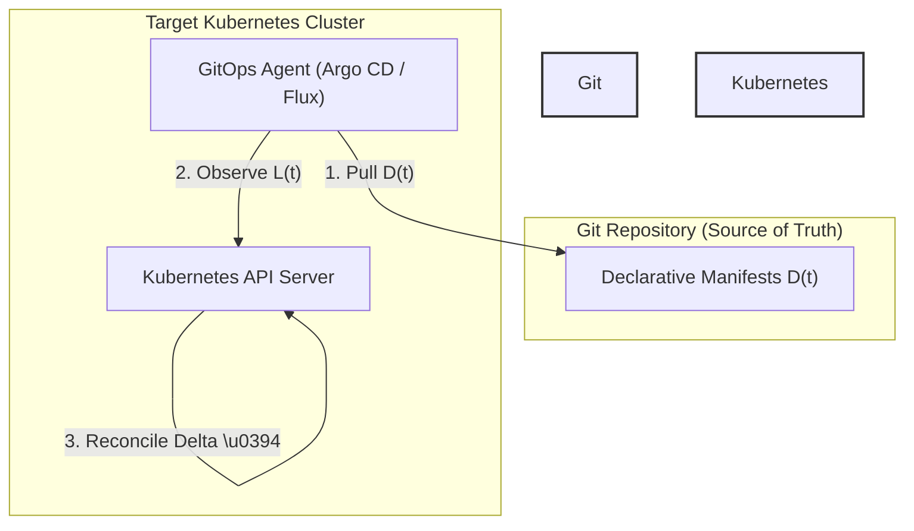

# Module 01: GitOps Principles and Architecture Comparison: OpenGitOps Axioms, Push vs Pull, and Argo CD vs Flux

## 1. Introduction and Formal Foundations

GitOps is an operational framework that takes DevOps best practices applicable to application development—such as version control, collaboration, CI/CD, and audit logging—and applies them to infrastructure and configuration management. The OpenGitOps working group (hosted by the Cloud Native Computing Foundation) formally defines GitOps through four core axioms:

1. **Declarative**: The desired state of a system must be expressed declaratively.
2. **Versioned and Immutable**: The desired state must be stored in a version control system that guarantees immutability, version history, and cryptographic auditability (e.g., Git).
3. **Pulled Automatically**: Software agents must automatically pull the declarative desired state from the source of truth.
4. **Continuously Reconciled**: Software agents must continuously observe actual system state and attempt to reconcile it with the desired state.

Mathematically, let the target state space be $S$, the desired state stored in Git be $D(t) \in S$ at time $t$, and the live state of the Kubernetes cluster be $L(t) \in S$. The reconciliation operator $\Delta: S \times S \to \mathcal{Action}$ computes the corrective actions required to minimize the distance metric $d(D(t), L(t))$ such that $\lim_{t \to \infty} d(D(t), L(t)) = 0$. In a traditional push-based CI/CD pipeline (e.g., Jenkins, GitLab CI pushing via `kubectl apply`), an external authority external to the cluster initiates updates directly into the production environment, requiring cluster-admin credentials stored in CI secrets managers and lacking automated continuous correction against manual out-of-band cluster modifications. In contrast, a pull-based GitOps agent (such as Argo CD or Flux) runs inside the target cluster, authenticates outbound to the Git repository, retrieves $D(t)$, and executes reconciliation locally.



## 2. Push vs Pull CI/CD Architecture

To understand the security and operational boundaries of Argo CD, we contrast push-based CI/CD pipelines with pull-based GitOps controllers. In a push pipeline, the continuous integration server executes deployment scripts that require persistent, highly privileged cluster credentials (`kubeconfig` with cluster-admin privileges) stored within external secrets stores. If an attacker compromises the CI platform, they gain immediate administrative access to all connected target clusters. Furthermore, push pipelines are event-driven rather than state-driven; if a cluster experiences cluster drift due to manual emergency patching (`kubectl edit`), the push pipeline remains oblivious until the next scheduled pipeline run or code commit.

Conversely, pull-based GitOps utilizes an agent residing inside the cluster perimeter. The agent establishes an outbound network connection to the Git repository via HTTPS or SSH, eliminating the need for inbound firewall holes or exposed API server endpoints. Credentials required for repository access are scoped strictly to read-only access on specific repositories or organizations. When human operators perform out-of-band modifications on the cluster (`L(t)`), the pull agent detects the divergence during its periodic reconciliation loop and immediately corrects `L(t)` back to matching `D(t)` (when self-heal is enabled).

## 3. Argo CD vs Flux Architecture Comparison

Argo CD and Flux are both CNCF graduated GitOps engines, yet they differ fundamentally in architecture, control-plane design, and user experience. Flux v2 is composed of lightweight, decoupled Kubernetes controllers (Source Controller, Kustomize Controller, Helm Controller, Notification Controller) that manage resources via custom resource definitions (CRDs) directly reconciled inside the cluster. Argo CD employs a monolithic yet modular application controller backed by an API server, an application-specific Redis caching layer, and a dedicated Repo Server responsible for manifest generation (executing Helm, Kustomize, and custom plugins).

The following comparison details their structural and operational paradigms:

| Architectural Dimension | Argo CD (v3.x) | Flux v2 |
| --- | --- | --- |
| **Control Plane Model** | Centralized API server + Application Controller + Repo Server + Redis cache | Decoupled, single-purpose controllers communicating via Kubernetes custom resources |
| **Manifest Generation** | Offloaded to dedicated `argocd-repo-server` pod (running Helm, Kustomize, CMPs) | Executed in-process by individual controllers (`kustomize-controller`, `helm-controller`) |
| **User Interface** | Rich Web UI, CLI (`argocd`), gRPC/REST API, and declarative CRD management | Primarily CLI (`flux`), Kubernetes CRDs, and web-based UI extensions (Flux Web UI) |
| **Multi-Tenancy** | Strong multi-tenancy via `AppProject` CRDs, Casbin RBAC, and namespace isolation | Namespace-scoped isolation via Kubernetes RBAC and service accounts |
| **State Caching** | Redis cache storing rendered manifests, live state trees, and comparison results | Etcd-backed custom resource status fields and local memory caches |
| **State-Site Scaling** | Sharded application controllers, horizontal repo-server replicas | Controller-level replicas with leader election per controller type |

## 4. Internal Mechanics and Control Loop Pseudocode

The Argo CD application controller executes a continuous reconciliation loop for every registered `Application` custom resource. Below is the CLRS-style pseudocode demonstrating the core reconciliation cycle executed by the application controller.

```ts
/**
 * Executes a single reconciliation pass for an Argo CD Application resource.
 * Loop Invariant: At the start of each iteration, live state L(t) is fetched from the
 * Kubernetes watch cache, desired state D(t) is retrieved/cached from the repo-server,
 * and the calculated diff \Delta accurately reflects all divergences.
 */
function reconcileApplication(app: Application): ReconciliationResult {
  const desiredState = repoServerClient.generateManifests(app.spec.source);
  const liveState = kubernetesClusterClient.getLiveResources(app.spec.destination);

  const normalizedDesired = normalizeManifests(desiredState, app.spec.ignoreDifferences);
  const normalizedLive = normalizeLiveState(liveState, app.spec.ignoreDifferences);

  const diff = calculateDiff(normalizedDesired, normalizedLive);

  if (diff.hasDivergence) {
    app.status.sync.status = 'OutOfSync';
    if (app.spec.syncPolicy?.automated && app.spec.syncPolicy.automated.selfHeal) {
      executeSync(diff, app.spec.syncPolicy.automated.prune);
      app.status.sync.status = 'Synced';
    }
  } else {
    app.status.sync.status = 'Synced';
  }

  updateApplicationStatus(app);
  return { status: app.status.sync.status, diffCount: diff.items.length };
}
```

## 5. Version History and Then vs Now

Argo CD has evolved significantly from its v1.x origins to the modern v3.x stable architecture. Understanding these generational shifts is critical for operating modern GitOps pipelines.

| Aspect | Legacy Approach (Argo CD v1.x - v2.x) | Modern Approach (Argo CD v3.x) |
| --- | --- | --- |
| **Resource Tracking** | `app.kubernetes.io/instance` labels injected directly onto managed Kubernetes objects | `argocd.argoproj.io/tracking-id` annotations (migrating away from mutable label injection) |
| **Default Sync Strategy** | Client-side apply (`kubectl apply` equivalents with annotation size limits) | Server-Side Apply (`ServerSideApply=true`) enabled for robust conflict management |
| **Plugin Architecture** | ConfigMap-based plugin definitions (`argocd-cm` execution scripts) | Sidecar Config Management Plugins (CMPs) running as isolated gRPC microservices |
| **Multi-Source Support** | Single Git source per Application (requiring complex wrapper charts or Kustomize roots) | Multi-source `sources:` array natively supporting mixed Helm, Kustomize, and Git sources |

> [!IMPORTANT]
> **Exam Delta (CGOA & CAPA)**: Certification exams test fundamental OpenGitOps axioms and differentiate pull-based reconciliation from webhook-driven push systems. Candidates must know that Argo CD does not require inbound internet access to clusters because it initiates outbound connections to Git repositories and OCI registries.

## 6. Production Failure Modes and Gotchas

When deploying GitOps at enterprise scale with Argo CD, practitioners frequently encounter specific failure modes:

1. **Auto-Sync Prune Disasters**: Enabling `selfHeal: true` alongside `prune: true` without explicit safeguard annotations (`argocd.argoproj.io/sync-options: Prune=false` or `PruneLast`) can lead to catastrophic resource deletion if a Git commit accidentally removes directory contents or renders an empty manifest list.
2. **Resource Tracking Conflicts (v2 to v3 Migration)**: Upgrading clusters from v2.x to v3.x introduces tracking annotation updates. If existing workloads are tracked solely by labels, changing tracking modes without running migration hooks can result in orphaned resources or duplicate reconciliation loops.
3. **Secret Sprawl in Repositories**: Storing raw Base64-encoded Kubernetes secrets directly in Git violates OpenGitOps immutability and security axioms; operators must enforce Sealed Secrets, External Secrets Operator, or SOPS-encrypted manifests decrypted via sidecar CMPs.

## Interview Drill

<details><summary>1. What are the four official OpenGitOps principles established by the CNCF?</summary>

1. **Declarative**: The desired state of a system must be expressed declaratively.
2. **Versioned and Immutable**: The desired state must be stored in a version control system that guarantees immutability and auditability.
3. **Pulled Automatically**: Software agents must automatically pull the declarative desired state from the source of truth.
4. **Continuously Reconciled**: Software agents must continuously observe actual system state and attempt to reconcile it with the desired state.

- Ref: [OpenGitOps Specifications](https://opengitops.dev/)
</details>

<details><summary>2. How does Argo CD's pull-based model improve cluster security compared to traditional push-based CI/CD pipelines?</summary>

In a push-based model, external CI systems require persistent, high-privilege cluster-admin credentials stored in external secrets stores. If the CI platform is compromised, attackers gain full cluster access. In Argo CD's pull model, an agent runs inside the cluster and makes outbound connections to the Git repository using read-only credentials, eliminating inbound cluster exposure and restricting blast radius.

- Ref: [Module 01 Architecture Comparison](#2-push-vs-pull-cicd-architecture)
</details>

<details><summary>3. What is the architectural difference between Argo CD's Repo Server and Flux's controller design?</summary>

Argo CD centralizes manifest generation (running Helm, Kustomize, and CMPs) inside a dedicated `argocd-repo-server` microservice, communicating via gRPC with the application controller. Flux v2 decentralizes this by embedding manifest generation directly into dedicated, single-purpose controllers (`kustomize-controller`, `helm-controller`) running in-cluster.

- Ref: [Module 01 Architecture Comparison](#3-argo-cd-vs-flux-architecture-comparison)
</details>

<details><summary>4. Explain the mathematical formulation of the reconciliation operator in GitOps.</summary>

Let desired state in Git be $D(t)$ and live cluster state be $L(t)$ within state space $S$. The reconciliation operator $\Delta(D(t), L(t))$ computes corrective actions to minimize the divergence metric $d(D(t), L(t))$ such that $\lim_{t \to \infty} d(D(t), L(t)) = 0$.

- Ref: [Module 01 Introduction](#1-introduction-and-formal-foundations)
</details>

<details><summary>5. Why did Argo CD v3 transition from instance labels to tracking annotations?</summary>

Instance labels (`argocd.argoproj.io/instance`) were frequently mutated by external tooling, triggered unnecessary Kubernetes watch events, and caused collision issues in multi-tenant environments. Tracking annotations (`argocd.argoproj.io/tracking-id`) provide robust, structured metadata tracking without interfering with user-defined labels.

- Ref: [Module 01 Version History](#5-version-history-and-then-vs-now)
</details>

<details><summary>6. What production risks arise when combining `selfHeal: true` and `prune: true` without guardrails?</summary>

If a developer introduces a syntax error, empties a directory, or removes a resource declaration in Git, the controller interprets the absence as an intent to delete the live resource. With `selfHeal` and `prune` active, production workloads are automatically terminated and purged.

- Ref: [Module 01 Production Failure Modes](#6-production-failure-modes-and-gotchas)
</details>

## 8. Proof Map

| Claim / Section | Verification Target | Test File |
| --- | --- | --- |
| OpenGitOps Axioms & Definitions | Validates declarative desired state parsing | `../examples/ts/01-gitops-principles-and-architecture-comparison.test.ts` |
| Push vs Pull Security Boundaries | Asserts outbound connection requirements | `../examples/ts/01-gitops-principles-and-architecture-comparison.test.ts` |
| Reconciliation Operator Math & Loop | Deterministic diff calculation tests | `../examples/ts/01-gitops-principles-and-architecture-comparison.test.ts` |
