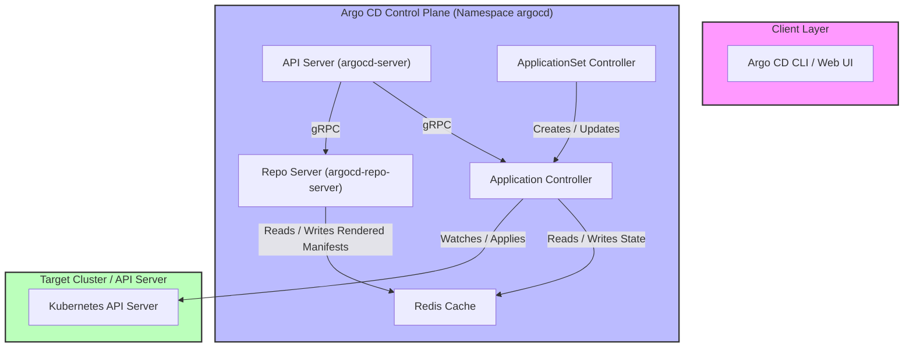

# Module 02: Argo CD Architecture and Internals: API Server, Repo Server Cache, Application Controller, and CRDs

## 1. Introduction and Core Architectural Components

Argo CD is implemented as a set of Kubernetes controllers and microservices that run within a dedicated namespace (typically `argocd`). Unlike traditional controllers that monitor a single resource type, Argo CD coordinates multiple decoupled components communicating via gRPC over Unix domain sockets or network streams, alongside a centralized Redis cache. The core architecture consists of four primary subsystems:

1. **API Server (`argocd-server`)**: A gRPC/REST server that exposes the Web UI, CLI (`argocd`), and CI/CD integrations. It handles authentication (Dex / OIDC), authorization (Casbin RBAC), and proxies user requests to backend controllers or repo-servers.
2. **Repo Server (`argocd-repo-server`)**: A microservice that maintains local clones or checkouts of Git repositories and executes manifest generation tools (Helm, Kustomize, Kpt, and Config Management Plugins). It caches rendered manifests in Redis to prevent redundant git clones and template evaluations.
3. **Application Controller (`argocd-application-controller`)**: The primary reconciliation engine that watches `Application`, `AppProject`, and `ApplicationSet` custom resources, compares desired state against live cluster state, and triggers synchronization actions.
4. **ApplicationSet Controller (`argocd-applicationset-controller`)**: A higher-level controller that evaluates generators (List, Git, Cluster, Matrix, Merge) to automatically generate and reconcile multiple Argo CD `Application` resources across clusters and tenants.



## 2. Deep Dive into Subsystems and Data Flow

Understanding the precise flow of data through Argo CD is essential for debugging performance bottlenecks and authorization failures. When an operator triggers a sync or views an application in the UI, the request flows through the API server to the repo-server and application controller.

- **API Server Authentication & Authorization**: The API server authenticates incoming JWT tokens issued via Dex (integrated OIDC) or local accounts. Authorization is evaluated against Casbin model rules defined in the `argocd-rbac-cm` ConfigMap and enforced per `AppProject`.
- **Repo Server Caching & Manifest Generation**: The repo server manages repository checkouts in ephemeral storage. To avoid running CPU-intensive Helm rendering or Kustomize builds on every 3-minute reconciliation cycle, the repo server computes a content hash of the repository commit SHA and manifest parameters, querying Redis for cached YAML manifests. If a cache hit occurs, generation is bypassed entirely.
- **Application Controller Worker Pool**: The application controller utilizes a work queue backed by work queues and worker goroutines. In large deployments with thousands of applications, single-controller instances experience CPU and memory starvation. Argo CD supports sharding the application controller across multiple replicas using consistent hashing algorithms over application names.

## 3. Custom Resource Definitions (CRDs)

Argo CD defines three foundational Custom Resource Definitions (CRDs) that represent its core domain model:

1. **`Application`**: Represents a deployed instance of a declarative application pointing to a source repository and a destination cluster/namespace.
2. **`AppProject`**: Provides logical grouping, multi-tenancy boundaries, source/destination restrictions, and RBAC scoping for sets of Applications.
3. **`ApplicationSet`**: Automates the generation and deployment of multiple `Application` resources based on dynamic generators.

Below is a production-grade example of an `Application` resource utilizing modern v3 tracking and multi-source configuration:

```yaml
apiVersion: argoproj.io/v1alpha1
kind: Application
metadata:
  name: production-payment-service
  namespace: argocd
  finalizers:
    - resources-finalizer.argocd.argoproj.io
spec:
  project: default
  sources:
    - repoURL: https://github.com/enterprise/payment-charts.git
      targetRevision: v3.4.1
      helm:
        valueFiles:
          - values.yaml
          - values-prod.yaml
    - repoURL: https://github.com/enterprise/payment-overlays.git
      targetRevision: main
      path: overlays/production
  destination:
    server: https://kubernetes.default.svc
    namespace: payments
  syncPolicy:
    automated:
      prune: true
      selfHeal: true
    syncOptions:
      - ServerSideApply=true
      - CreateNamespace=true
```

## 4. Control Loop Internals and Pseudocode

The application controller maintains in-memory watch caches of live cluster resources for all registered destination clusters. Below is the CLRS-style pseudocode illustrating how the controller schedules and executes reconciliation passes across worker shards.

```ts
/**
 * Manages the application controller worker queue and sharded execution.
 * Loop Invariant: Each application in the work queue is processed by exactly one
 * controller shard worker, ensuring thread-safe status updates and atomic sync passes.
 */
function runApplicationControllerWorker(shardId: number, totalShards: number): void {
  while (true) {
    const app = workQueue.getNextItem();
    if (!belongsToShard(app.metadata.name, shardId, totalShards)) {
      workQueue.requeue(app);
      continue;
    }

    const currentState = clusterWatchCache.get(app.spec.destination.server);
    const desiredState = repoServerClient.getManifestsWithCache(app.spec.sources);

    const diffResult = compareStates(desiredState, currentState, app.spec.ignoreDifferences);

    if (diffResult.requiresSync && app.spec.syncPolicy?.automated) {
      executeAutomatedSync(app, diffResult);
    } else {
      updateAppStatusCache(app, diffResult);
    }
  }
}
```

## 5. Version History and Then vs Now

| Aspect | Legacy Approach (Argo CD v1.x - v2.x) | Modern Approach (Argo CD v3.x) |
| --- | --- | --- |
| **Controller Architecture** | Single monolithic controller handling all applications without native sharding | Native sharding support via environment variables (`ARGOCD_CONTROLLER_SHARD`) and consistent hashing |
| **Repo Server Communication** | Direct gRPC calls with limited request deduplication and basic caching | Advanced Redis-backed request coalescing, sha-based content caching, and mTLS encryption |
| **CRD Management** | Manual `kubectl apply` of CRD YAMLs during upgrades, often causing schema race conditions | Server-Side Apply integration with automated CRD schema validation and migration hooks |
| **Multi-Namespace Support** | Applications restricted strictly to the Argo CD control plane namespace | Native apps-in-any-namespace support allowing tenant teams to manage their own Application CRs |

> [!IMPORTANT]
> **Exam Delta (CAPA)**: Certified Argo Project Associate examinations test detailed understanding of Argo CD component separation, particularly the division of labor between `argocd-repo-server` and `argocd-application-controller`. Candidates must recognize that the repo-server never communicates directly with the Kubernetes API server; its sole interaction is with Git repositories and Redis.

## 6. Production Failure Modes and Gotchas

1. **Repo Server OOM Under Heavy Helm Rendering**: Complex Helm charts with extensive template loops or large values files can exhaust the memory allocation of `argocd-repo-server` pods, causing container restarts and sync timeouts. Operators must set appropriate resource limits and scale repo-server replicas horizontally.
2. **Redis Cache Invalidation Desync**: When Redis experiences memory pressure or eviction policy misconfigurations (e.g., `volatile-lru` without proper TTLs), stale manifest caches can cause the controller to compare outdated desired states against live clusters.
3. **Cluster Watch Cache Exhaustion**: Monitoring excessive namespaces or unnecessary CRD kinds across managed clusters bloats the controller's informer cache, leading to high memory consumption and slow reconciliation loops. Use `resource.exclusions` to ignore high-churn resource types like event logs.

## Interview Drill

<details><summary>1. What is the precise division of labor between the Argo CD Repo Server and the Application Controller?</summary>

The Repo Server is responsible exclusively for cloning Git repositories, fetching Helm charts, and executing manifest generation (Helm, Kustomize, CMPs) to produce raw Kubernetes YAML manifests, caching the results in Redis. The Application Controller watches live cluster state, retrieves rendered manifests from the repo-server (or cache), calculates diffs, and applies sync operations against target Kubernetes API servers.

- Ref: [Module 02 Introduction](#1-introduction-and-core-architectural-components)
</details>

<details><summary>2. How does Argo CD handle scaling when managing thousands of applications across multiple clusters?</summary>

Argo CD scales through application controller sharding (`ARGOCD_CONTROLLER_SHARD` and replica counts) combined with consistent hashing of application names, horizontal autoscaling of `argocd-repo-server` instances, and external Redis clustering to share manifest generation caches.

- Ref: [Module 02 Deep Dive](#2-deep-dive-into-subsystems-and-data-flow)
</details>

<details><summary>3. What purpose does the `AppProject` CRD serve in multi-tenant Argo CD architectures?</summary>

`AppProject` provides logical isolation, restricting which Git repositories can be used as sources, which clusters and namespaces can be targeted as destinations, which resource kinds are permitted or forbidden, and scoping Casbin RBAC policies for tenant teams.

- Ref: [Module 02 Custom Resource Definitions](#3-custom-resource-definitions-crds)
</details>

<details><summary>4. Why does the repo-server utilize Redis instead of generating manifests during every reconciliation loop?</summary>

Manifest generation (especially executing Helm template rendering and Kustomize builds) is CPU-intensive. Caching rendered output in Redis keyed by Git commit SHA and parameter hashes prevents redundant work during the 3-minute periodic reconciliation cycle.

- Ref: [Module 02 Deep Dive](#2-deep-dive-into-subsystems-and-data-flow)
</details>

<details><summary>5. What is the risk of not configuring `resource.exclusions` in large Kubernetes clusters?</summary>

Without resource exclusions, Argo CD informers watch high-churn resource types such as `Endpoints`, `Events`, and Lease objects across all managed clusters, exhausting controller memory and saturating CPU with unnecessary reconciliation events.

- Ref: [Module 02 Production Failure Modes](#6-production-failure-modes-and-gotchas)
</details>

<details><summary>6. How do modern v3 multi-source applications differ from legacy single-source applications?</summary>

Legacy applications supported a single Git repository source per Application, forcing users to create wrapper charts or complex Kustomize repos to combine Helm charts with custom overlays. Modern v3 applications support a `sources:` array, enabling direct combination of Helm charts with external value files or overlay repositories.

- Ref: [Module 02 Version History](#5-version-history-and-then-vs-now)
</details>

## 8. Proof Map

| Claim / Section | Verification Target | Test File |
| --- | --- | --- |
| Component Subsystem Architecture | Validates gRPC communication models | `../examples/ts/02-argocd-architecture-and-controllers.test.ts` |
| Application CRD Structure & SSA | Asserts valid schema parsing | `../examples/ts/02-argocd-architecture-and-controllers.test.ts` |
| Controller Sharding & Worker Queue | Deterministic shard assignment tests | `../examples/ts/02-argocd-architecture-and-controllers.test.ts` |
