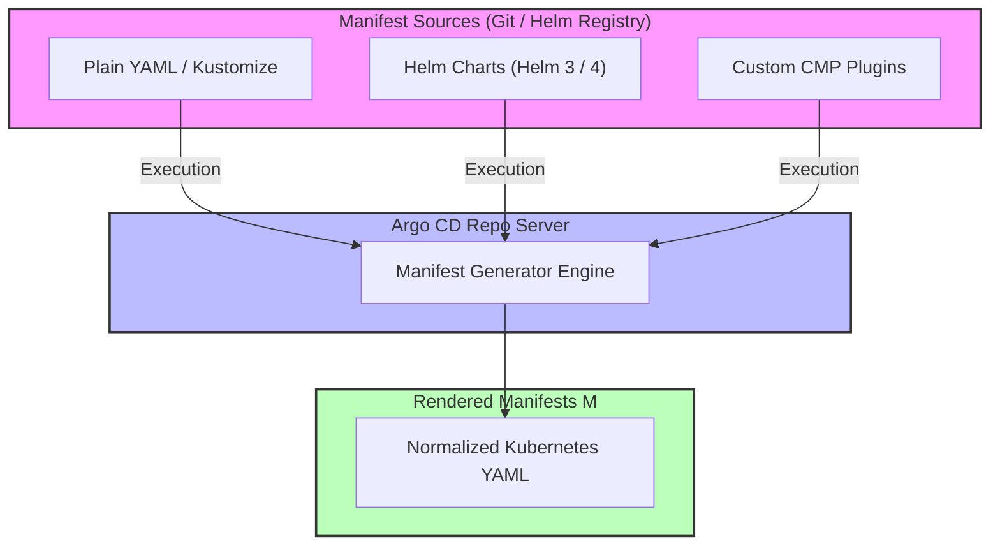

# Module 03: Applications and Manifest Sources: Plain YAML, Helm 4, Kustomize, Multi-Source Apps, and Sidecar CMPs

## 1. Introduction and Manifest Source Paradigms

Argo CD does not natively store or parse configuration templates itself; instead, it acts as an orchestration engine that delegates manifest generation to specialized configuration tools through the `argocd-repo-server`. The flexibility of Argo CD stems from its ability to ingest desired state from diverse manifest generation tools, unifying them under a single declarative `Application` API. Supported source paradigms include plain YAML directories, Helm charts (with support for Helm 4 and older specifications), Kustomize overlays, multi-source composite declarations, and custom Config Management Plugins (CMPs).

Mathematically, let a manifest generation tool be modeled as a pure function $G: (R, P) \to M$, where $R$ is the repository source tree, $P$ is the parameter set (values files, target revisions, environment variables), and $M$ is the resulting set of raw Kubernetes manifests. Argo CD ensures that $G$ is executed in an isolated repo-server environment, caching the output to maintain high reconciliation throughput.



## 2. Deep Dive into Supported Source Types

### Plain YAML and Directory Recursion

For repositories containing raw Kubernetes manifests, Argo CD performs recursive directory traversal (`path:` spec). While simple, plain YAML lacks templating capabilities unless combined with external preprocessing or Kustomize.

### Helm 4 and Chart Rendering

Argo CD integrates deeply with Helm, supporting both remote Helm charts (from OCI registries or traditional chart repositories) and in-repo charts. With the transition to Helm 4, Argo CD delegates chart rendering to the bundled Helm binary within the repo server, evaluating `values.yaml`, custom `valueFiles` arrays, and parameter overrides (`parameters:`).

### Kustomize Overlays

Kustomize is natively supported without requiring external binaries. Argo CD detects `kustomization.yaml` files, automatically executing `kustomize build` with configurable build options (such as parallel builds and custom binary paths).

### Multi-Source Applications (`sources:`)

Modern Argo CD allows an `Application` resource to specify an array of `sources:`, combining a Helm chart repository source with a separate Git overlay repository containing custom patches or values. This enables clean separation between upstream vendor charts and enterprise-specific configuration overlays.

### Config Management Plugins (CMPs) and Sidecar Containers

When teams use proprietary or niche generation tools (e.g., Pulumi YAML, Jsonnet, or custom templating engines), Argo CD allows deploying sidecar containers alongside `argocd-repo-server`. These sidecars act as Config Management Plugins, communicating via a gRPC plugin protocol to generate manifests.

Below is an advanced multi-source application manifest combining a remote Helm chart with a Git-based values overlay:

```yaml
apiVersion: argoproj.io/v1alpha1
kind: Application
metadata:
  name: multi-source-microservice
  namespace: argocd
spec:
  project: default
  sources:
    - chart: enterprise-service
      repoURL: https://charts.enterprise.internal
      targetRevision: 2.1.0
      helm:
        valueFiles:
          - $values-repo/envs/prod/values.yaml
    - repoURL: https://github.com/enterprise/config-repo.git
      targetRevision: main
      ref: values-repo
  destination:
    server: https://kubernetes.default.svc
    namespace: production
  syncPolicy:
    automated:
      prune: true
      selfHeal: true
```

## 3. Internal Mechanics and Manifest Generation Pseudocode

The repo-server processes manifest generation requests using content-addressed caching to optimize performance. Below is the pseudocode illustrating how the repo-server evaluates multi-source inputs and invokes rendering engines.

```ts
/**
 * Generates and normalizes manifests for multi-source Argo CD applications.
 * Loop Invariant: Each source in the application spec is resolved to a concrete
 * revision SHA, fetched, rendered independently, and merged into a unified manifest set.
 */
function generateMultiSourceManifests(sources: ApplicationSource[]): KubernetesManifest[] {
  const renderedManifests: KubernetesManifest[] = [];
  let valuesReferencePath = '';

  for (const source of sources) {
    const resolvedRepo = repoManager.checkout(source.repoURL, source.targetRevision);
    if (source.ref) {
      valuesReferencePath = resolvedRepo.localPath;
    }

    let manifests: KubernetesManifest[];
    if (source.helm) {
      const resolvedValues = resolveValuesFiles(source.helm.valueFiles, valuesReferencePath);
      manifests = helmRenderer.template(resolvedRepo.path, source.chart, resolvedValues);
    } else if (source.kustomize) {
      manifests = kustomizeBuilder.build(resolvedRepo.path, source.kustomize);
    } else {
      manifests = directoryScanner.scan(resolvedRepo.path, source.path);
    }

    renderedManifests.push(...manifests);
  }

  return enforceNamespaces(renderedManifests);
}
```

## 4. Version History and Then vs Now

| Aspect | Legacy Approach (Argo CD v1.x - v2.x) | Modern Approach (Argo CD v3.x) |
| --- | --- | --- |
| **Source Flexibility** | Single `source:` block requiring complex Git submodules or umbrella Helm charts | Native multi-source `sources:` array supporting mixed Helm charts and Git overlay repositories |
| **Plugin Integration** | ConfigMap script definitions executed inside repo-server container (`configManagementPlugins`) | Isolated gRPC sidecar Config Management Plugins (CMPs) supporting arbitrary toolchains |
| **Helm Version Support** | Defaulting strictly to Helm 3 execution binaries | Full support for Helm 4 chart specifications, OCI registries, and enhanced security defaults |
| **Target Revision Semantics** | Loose branch references (e.g., `master`, `main`) prone to race conditions and drift | Strict SHA pinning, tag matching, and ephemeral branch tracking |

> [!IMPORTANT]
> **Exam Delta (CAPA)**: Certification exams emphasize troubleshooting manifest generation failures, such as incorrect `targetRevision` configurations, Helm chart dependency resolution issues, and sidecar CMP gRPC timeout configurations.

## 5. Production Failure Modes and Gotchas

1. **Helm Dynamic Functions Causing Infinite Diff Loops**: Using non-deterministic Helm functions like `randAlphaNum`, `now`, or `date` inside chart templates causes rendered manifests to change on every reconciliation cycle, triggering constant `OutOfSync` status and endless self-healing cycles.
2. **Multi-Source Reference Ordering Errors**: In multi-source applications, if a source referencing another ref via `$ref-name` is evaluated before the target repository is checked out, manifest generation fails with missing dependency errors.
3. **CMP Sidecar Memory Leaks**: Custom Config Management Plugins implemented in Python or Node.js running as repo-server sidecars can experience memory bloat when processing massive manifest trees, crashing the repo-server pod.

## 6. Interview Drill

<details><summary><strong>Q1. How do multi-source Argo CD applications solve the limitation of single-source repositories?</strong></summary>

**Answer:** Multi-source applications allow combining a remote Helm chart repository source with a separate Git repository containing environment-specific values files or patches. This decouples upstream vendor chart lifecycles from internal enterprise configuration overlays without requiring umbrella charts or Git submodules.

- Ref: [Module 03 Deep Dive](#2-deep-dive-into-supported-source-types)

</details>

<details><summary><strong>Q2. What causes endless synchronization loops when deploying Helm charts via Argo CD?</strong></summary>

**Answer:** Endless sync loops occur when Helm templates utilize non-deterministic functions such as `randAlphaNum`, `uuidv4`, or `now`. Every time Argo CD reconciles, the repo-server re-renders the templates, producing different checksums that diverge from live resources.

- Ref: [Module 03 Production Failure Modes](#5-production-failure-modes-and-gotchas)

</details>

<details><summary><strong>Q3. When should an operator choose a sidecar Config Management Plugin (CMP) over built-in Kustomize or Helm support?</strong></summary>

**Answer:** Operators choose sidecar CMPs when utilizing proprietary or niche manifest generation tools such as Pulumi YAML, Jsonnet, CDK8s, or custom organizational generators that are not natively supported by Argo CD's built-in engines.

- Ref: [Module 03 Deep Dive](#2-deep-dive-into-supported-source-types)

</details>

<details><summary><strong>Q4. Explain the security isolation model of Argo CD Config Management Plugins.</strong></summary>

**Answer:** CMPs run as independent sidecar containers alongside `argocd-repo-server`. They communicate with the repo-server over a local gRPC socket, ensuring that custom plugin code executes within isolated container boundaries with controlled filesystem access.

- Ref: [Module 03 Deep Dive](#2-deep-dive-into-supported-source-types)

</details>

<details><summary><strong>Q5. How does Argo CD handle `targetRevision` semantics when pinned to Git tags versus branches?</strong></summary>

**Answer:** Pinning to a Git tag or exact commit SHA guarantees immutable and reproducible deployments. Pinning to a branch name (e.g., `main`) tracks HEAD; any push to that branch automatically triggers reconciliation, which is suitable for staging environments but risky for production.

- Ref: [Module 03 Deep Dive](#2-deep-dive-into-supported-source-types)

</details>

<details><summary><strong>Q6. What is the role of `repo-server` caching in multi-source manifest generation?</strong></summary>

**Answer:** The repo-server computes content hashes combining commit SHAs of all referenced sources and parameter sets, querying Redis to retrieve previously rendered manifest sets, avoiding redundant clone and rendering operations during periodic reconciliation cycles.

- Ref: [Module 03 Introduction](#1-introduction-and-manifest-source-paradigms)

</details>

## 7. Proof Map

| Claim / Section | Verification Target | Test File |
| --- | --- | --- |
| Multi-Source Manifest Generation | Asserts correct multi-repo parsing | `../examples/ts/03-applications-and-manifest-sources.test.ts` |
| Helm Chart & Kustomize Integration | Validates rendering execution paths | `../examples/ts/03-applications-and-manifest-sources.test.ts` |
| CMP Sidecar Protocol | Tests gRPC plugin communication | `../examples/ts/03-applications-and-manifest-sources.test.ts` |
