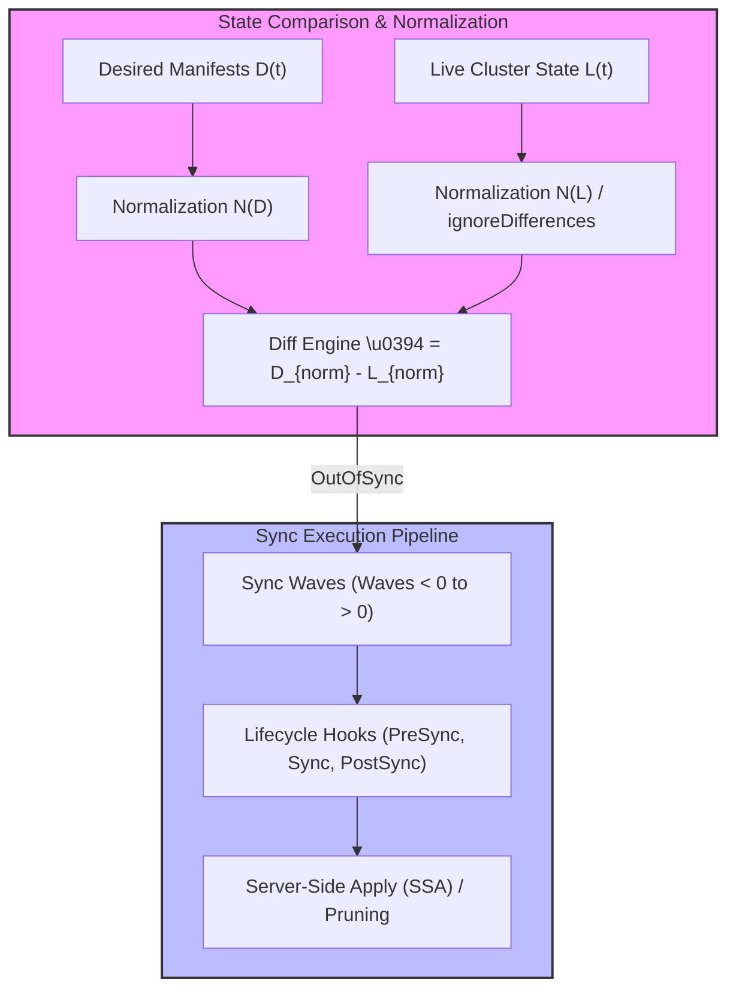

# Module 04: Sync Mechanics, Waves, and Hooks: Live vs Desired Normalization, Server-Side Apply, Phases, and Lua Health

## 1. Introduction and Synchronization Fundamentals

The core responsibility of the Argo CD application controller is bridging the gap between desired configuration states (`D(t)`) and live cluster states (`L(t)`). When a divergence is detected, Argo CD initiates a synchronization workflow governed by sync options, sync policies, sync waves, and lifecycle hooks. To prevent false-positive diffs caused by fields injected or defaulted by Kubernetes mutating webhooks (such as service account tokens, admission controller annotations, or status subresources), Argo CD applies normalization algorithms before computing diffs.

Mathematically, let normalization function $N: S \to S$ strip volatile metadata, managed fields, and ignored paths (configured via `ignoreDifferences`). A diff is computed as $\Delta = D_{norm} - L_{norm}$. If $\Delta \neq \emptyset$, the application is marked `OutOfSync`. Synchronization executes ordered application of $\Delta$ utilizing Server-Side Apply (SSA) or legacy client-side apply mechanisms.



## 2. Deep Dive into Sync Mechanics and Features

### Normalization and `ignoreDifferences`

Kubernetes controllers frequently inject fields into running resources (e.g., HPA modifying deployment replica counts, or Mutating Webhooks injecting sidecars). Operators define `ignoreDifferences` in the `Application` spec to instruct the diff engine to exclude specific JSON paths from comparison, eliminating perpetual `OutOfSync` states.

### Server-Side Apply (SSA)

Legacy Argo CD relied on `kubectl apply`, which stored full configurations in the `kubectl.kubernetes.io/last-applied-configuration` annotation, frequently hitting annotation size limits (262KB) for large Custom Resources. Modern Argo CD leverages Kubernetes Server-Side Apply (`ServerSideApply=true`), which shifts conflict management and field ownership tracking directly to the Kubernetes API server via managed fields.

### Sync Waves and Phases

When deploying complex applications, resource creation order matters (e.g., CustomResourceDefinitions must exist before Custom Resources, and Database migrations must complete before application pods start). Argo CD supports **Sync Waves** (via the `argocd.argoproj.io/sync-wave` annotation, accepting integer values from negative to positive) and **Sync Phases** (PreSync, Sync, PostSync, SyncFail, PostDelete).

### Custom Health Assessment via Lua

Argo CD uses built-in health checks for standard workloads (Deployments, StatefulSets), but custom resources require explicit health evaluation. Operators define custom health checks in `argocd-cm` using Lua scripts that inspect live resource status objects and return health states (`Healthy`, `Progressing`, `Degraded`, `Suspended`).

Below is an example of an application configuring sync waves, SSA, and custom ignore differences:

```yaml
apiVersion: argoproj.io/v1alpha1
kind: Application
metadata:
  name: advanced-sync-app
  namespace: argocd
spec:
  project: default
  source:
    repoURL: https://github.com/enterprise/app-manifests.git
    targetRevision: HEAD
    path: manifests
  destination:
    server: https://kubernetes.default.svc
    namespace: workloads
  syncPolicy:
    syncOptions:
      - ServerSideApply=true
      - PruneLast=true
      - CreateNamespace=true
  ignoreDifferences:
    - group: apps
      kind: Deployment
      jsonPointers:
        - /spec/replicas
```

## 3. Control Loop Internals and Pseudocode

Below is the CLRS-style pseudocode demonstrating how the application controller evaluates sync waves, hooks, and health states during a synchronization pass.

```ts
/**
 * Executes ordered synchronization across sync waves and lifecycle hooks.
 * Loop Invariant: Resources within wave k are fully synchronized and healthy before
 * resources in wave k+1 are submitted to the Kubernetes API server.
 */
function executeSyncPipeline(app: Application, diff: DiffResult): SyncResult {
  const sortedResources = sortBySyncWaves(diff.items);
  const groupedByWave = groupIntoWaves(sortedResources);

  for (const wave of sortedByWaveNumber(groupedByWave)) {
    executeHooks(app, wave.number, 'PreSync');

    for (const resource of wave.resources) {
      applyResourceWithSSA(resource, app.spec.syncOptions);
    }

    waitForWaveHealth(wave.resources, app.spec.timeout);
    executeHooks(app, wave.number, 'PostSync');
  }

  return { status: 'Synced', error: null };
}
```

## 4. Version History and Then vs Now

| Aspect | Legacy Approach (Argo CD v1.x - v2.x) | Modern Approach (Argo CD v3.x) |
| --- | --- | --- |
| **Apply Mechanism** | Client-side apply (`kubectl apply`) with annotation size bottlenecks | Server-Side Apply (`ServerSideApply=true`) with API server-managed field ownership |
| **Health Assessments** | Hardcoded Go functions compiled into the application controller binary | Extensible Lua scripting supporting custom resource health checks defined in ConfigMaps |
| **Pruning Behavior** | Immediate pruning during sync, risking accidental deletion of dependencies | Controlled pruning via `PruneLast=true` and sync-wave ordering ensuring safe tear-down |
| **Hook Management** | Basic hook execution without automated cleanup policies | Robust hook deletion policies (`HookSucceeded`, `HookFailed`) preventing stale job accumulation |

> [!IMPORTANT]
> **Exam Delta (CAPA & CGOA)**: Certification exams thoroughly test sync wave execution order (negative waves execute first, zero is default, positive waves execute last) and hook lifecycle phases. Candidates must understand that PreSync hooks block subsequent waves until healthy.

## 5. Production Failure Modes and Gotchas

1. **Sync Wave Deadlocks with CRDs and CRs**: Placing a CustomResourceDefinition (CRD) and a Custom Resource (CR) in the exact same sync wave often fails because the Kubernetes API server has not yet registered the CRD endpoint when the CR is submitted. CRDs must always reside in an earlier sync wave (e.g., wave `-1`).
2. **Hook Job Name Immutability**: Kubernetes Jobs are immutable in their `spec.template`. If a PreSync hook Job fails and Argo CD attempts to re-apply the exact same Job manifest without cleanup policies (`hook-delete-policy: HookSucceeded`), the apply fails due to immutable field modifications.
3. **Lua Health Script Syntax Errors**: Malformed Lua health scripts injected into `argocd-cm` crash the controller's health evaluation routines, leaving all applications stuck in `Unknown` health states.

## Interview Drill

<details><summary>1. How does Argo CD normalize live cluster state before computing synchronization diffs?</summary>

Argo CD applies normalization functions that strip volatile metadata, status subresources, managed fields, and paths explicitly listed in the application's `ignoreDifferences` specification. This prevents false-positive diffs caused by controllers mutating resources after deployment.

- Ref: [Module 04 Introduction](#1-introduction-and-synchronization-fundamentals)
</details>

<details><summary>2. What are the advantages of Server-Side Apply (SSA) over client-side apply in Argo CD v3?</summary>

SSA shifts field ownership and conflict resolution to the Kubernetes API server, eliminating the 262KB annotation size limit imposed by `kubectl.kubernetes.io/last-applied-configuration` on large Custom Resources and providing robust multi-controller field merging.

- Ref: [Module 04 Deep Dive](#2-deep-dive-into-sync-mechanics-and-features)
</details>

<details><summary>3. Explain the execution order of sync waves and lifecycle hooks during synchronization.</summary>

Argo CD processes resources grouped by sync wave integers, starting from lowest (negative) to highest. Within each wave, PreSync hooks execute first, followed by standard resources, and PostSync hooks execute upon wave health confirmation.

- Ref: [Module 04 Deep Dive](#2-deep-dive-into-sync-mechanics-and-features)
</details>

<details><summary>4. Why do CRDs and Custom Resources require separation into different sync waves?</summary>

The Kubernetes API server requires time to register the dynamic REST endpoint for a newly applied CRD. If a Custom Resource is submitted in the same wave before the API endpoint is registered, the API server rejects the CR creation with a "no matches for kind" error.

- Ref: [Module 04 Production Failure Modes](#5-production-failure-modes-and-gotchas)
</details>

<details><summary>5. How are custom resource health checks implemented in Argo CD?</summary>

Custom resource health checks are implemented via Lua scripts configured within the `resource.custom.health` section of the `argocd-cm` ConfigMap. The script inspects live JSON resource structures and returns health status enums (`Healthy`, `Progressing`, `Degraded`).

- Ref: [Module 04 Deep Dive](#2-deep-dive-into-sync-mechanics-and-features)
</details>

<details><summary>6. What happens if a Hook Job lacks a proper `hook-delete-policy` annotation?</summary>

Without a deletion policy (`HookSucceeded`, `HookFailed`), hook resources persist indefinitely in the cluster. On subsequent syncs, Argo CD attempts to recreate or re-apply the Job, resulting in immutable field errors because Kubernetes Job specs cannot be modified.

- Ref: [Module 04 Production Failure Modes](#5-production-failure-modes-and-gotchas)
</details>

## 7. Proof Map

| Claim / Section | Verification Target | Test File |
| --- | --- | --- |
| Normalization & `ignoreDifferences` | Validates diff filtering tests | `../examples/ts/04-sync-mechanics-waves-and-hooks.test.ts` |
| Sync Wave Ordering & Execution | Asserts wave sequencing logic | `../examples/ts/04-sync-mechanics-waves-and-hooks.test.ts` |
| Lua Health Assessment Logic | Tests health script parsing | `../examples/ts/04-sync-mechanics-waves-and-hooks.test.ts` |
