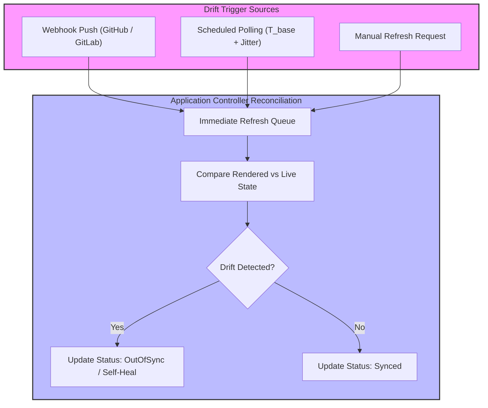

# Module 05: Drift Detection and Reconciliation Patterns: Polling Jitter, Mutating Webhooks, App-of-Apps, and Finalizers

## 1. Introduction and Drift Detection Mechanics

Drift detection is the continuous process by which Argo CD identifies divergences between desired Git state (`D(t)`) and live cluster state (`L(t)`). Drift can originate from multiple sources: manual operator edits (`kubectl edit`), external automation controllers (e.g., Horizontal Pod Autoscalers modifying replica counts), or mutating admission webhooks injecting default values during resource admission. To manage polling scale across thousands of applications without overwhelming Git providers with API rate limits, Argo CD combines configurable polling intervals with exponential backoff, webhook triggers, and random jitter.

Mathematically, let the base reconciliation interval be $T_{base}$, and let jitter $J$ be a random variable uniformly distributed over $[0, \delta]$. The effective polling timeout $T_{poll}$ for an application is given by: $$T_{poll} = T_{base} + J$$ This prevents synchronization thundering herd problems across distributed controller shards when connecting to shared Git remotes.



## 2. Deep Dive into Reconciliation Patterns

### Polling Jitter and Webhook Integration

By default, Argo CD polls Git repositories every 3 minutes (`timeout.reconciliation`). To achieve near-instantaneous reconciliation upon code merges, operators configure repository webhooks that push notification payloads to Argo CD's API server (`/api/webhook`), bypassing polling delays and immediately enqueueing the affected Application for refresh.

### Mutating Webhooks and Permanent Diffs

When admission controllers (such as Istio sidecar injectors or Secret management operators) mutate object specifications upon creation, the live resource `L(t)` permanently differs from the desired manifest `D(t)` stored in Git. Operators resolve this through two primary patterns:

1. Configuring comprehensive `ignoreDifferences` paths targeting injected annotations and sidecar container definitions.
2. Enabling `RespectIgnoreDifferences=true` sync options so the controller ignores those fields during diff calculations.

### App-of-Apps Pattern

Before ApplicationSets became the standard for multi-application management, the **App-of-Apps** pattern was the foundational GitOps composition strategy. An umbrella Argo CD `Application` targets a Git repository path containing multiple child `Application` manifests. When the umbrella application syncs, Argo CD creates and manages the child applications.

### Finalizers and Cascading Deletion

Argo CD utilizes Kubernetes finalizers (`resources-finalizer.argocd.argoproj.io`) to manage application deletion lifecycles. When an `Application` resource is deleted, the finalizer ensures that all managed child workloads are systematically pruned from the cluster before the Application object is removed from `etcd`. Removing the finalizer manually orphans all resources.

Below is an example configuration demonstrating webhook integration settings and cascading finalizers:

```yaml
apiVersion: argoproj.io/v1alpha1
kind: Application
metadata:
  name: umbrella-app-of-apps
  namespace: argocd
  finalizers:
    - resources-finalizer.argocd.argoproj.io
spec:
  project: default
  source:
    repoURL: https://github.com/enterprise/fleet-manifests.git
    targetRevision: main
    path: bootstrap
  destination:
    server: https://kubernetes.default.svc
    namespace: argocd
  syncPolicy:
    automated:
      prune: true
      selfHeal: true
```

## 3. Control Loop Internals and Pseudocode

Below is the CLRS-style pseudocode demonstrating how the application controller handles refresh requests, webhook triggers, and jittered polling intervals.

```ts
/**
 * Manages application refresh scheduling with jitter and webhook notification triggers.
 * Loop Invariant: Every application's next scheduled reconciliation time is randomized
 * within a jitter window to prevent synchronous CPU and network spikes across controller shards.
 */
function scheduleNextReconciliation(app: Application): void {
  const baseInterval = config.getTimeoutReconciliation(); // e.g., 3 minutes
  const jitter = Math.random() * config.getJitterWindow(); // e.g., 30 seconds
  const effectiveInterval = baseInterval + jitter;

  if (
    app.status.refreshRequestedAt &&
    app.status.refreshRequestedAt > app.status.lastReconciledAt
  ) {
    queue.enqueueImmediate(app);
  } else {
    timerQueue.add(app, effectiveInterval);
  }
}
```

## 4. Version History and Then vs Now

| Aspect | Legacy Approach (Argo CD v1.x - v2.x) | Modern Approach (Argo CD v3.x) |
| --- | --- | --- |
| **Multi-App Composition** | App-of-Apps pattern using nested Application CRs with complex sync wave ordering | ApplicationSets with native generators (List, Cluster, Git, Matrix) replacing nested App-of-Apps |
| **Drift Resolution** | Basic polling intervals causing API rate-limit exhaustion on Git providers | Event-driven webhook triggers combined with jittered polling and Redis caching |
| **Orphaned Resource Handling** | Accidental deletion of child resources upon umbrella application deletion | Controlled cascading finalizers and explicit orphan prevention policies |
| **Mutating Webhook Handling** | Constant manual patching of ignore rules and brittle diff filters | Server-Side Apply field ownership tracking combined with `RespectIgnoreDifferences=true` |

> [!IMPORTANT]
> **Exam Delta (CGOA & CAPA)**: Certification exams test knowledge of finalizer behavior and cascading deletion risks. Candidates must understand that deleting an Application without its resource finalizer leaves all deployed Kubernetes workloads running in the cluster as unmanaged orphaned resources.

## 5. Production Failure Modes and Gotchas

1. **Git Provider Rate Limiting via Aggressive Polling**: Setting `timeout.reconciliation` too low across thousands of applications causes Git repository providers (GitHub/GitLab) to rate-limit or block Argo CD API tokens.
2. **Mutating Webhook Infinite Sync Fights**: If an admission controller injects labels or environment variables that are not ignored in `ignoreDifferences`, self-healing triggers an endless loop of corrective syncs.
3. **App-of-Apps Circular Dependencies**: In complex umbrella App-of-Apps hierarchies, misconfigured sync waves can cause child applications to be deleted and recreated during parent synchronization passes, causing production outages.

## Interview Drill

<details><summary>1. How does polling jitter prevent thundering herd problems in large Argo CD deployments?</summary>

Polling jitter adds a random time offset ($J$) to the base reconciliation interval ($T_{base}$) for each application. This distributes git checkouts and api calls evenly over time, preventing thousands of applications from querying Git repositories simultaneously.

- Ref: [Module 05 Introduction](#1-introduction-and-drift-detection-mechanics)

</details>

<details><summary>2. What role do Kubernetes finalizers play when deleting an Argo CD Application resource?</summary>

Argo CD attaches the `resources-finalizer.argocd.argoproj.io` finalizer to Application resources. When an Application is deleted, the finalizer blocks object removal until all managed Kubernetes workloads are successfully pruned from the cluster, preventing accidental resource abandonment.

- Ref: [Module 05 Deep Dive](#2-deep-dive-into-reconciliation-patterns)

</details>

<details><summary>3. Why do mutating admission webhooks cause perpetual out-of-sync states in Argo CD?</summary>

Mutating webhooks modify resource specifications during admission (e.g., injecting Istio sidecars or default environment variables). The live cluster state (`L(t)`) then includes fields absent from the desired Git manifest (`D(t)`), creating a permanent diff.

- Ref: [Module 05 Production Failure Modes](#5-production-failure-modes-and-gotchas)

</details>

<details><summary>4. What are the operational limitations of the traditional App-of-Apps pattern?</summary>

The App-of-Apps pattern relies on nested Application CRs managed by a parent application. It suffers from complex sync wave ordering issues, difficult multi-cluster targeting, and lack of parameterization across different environments, which ApplicationSets were designed to solve.

- Ref: [Module 05 Version History](#4-version-history-and-then-vs-now)

</details>

<details><summary>5. How do repository webhooks optimize Argo CD drift detection compared to scheduled polling?</summary>

Webhooks push instant notification payloads from Git providers to Argo CD's API server upon code pushes. This triggers an immediate application refresh, bypassing the 3-minute polling delay and providing near-instantaneous deployment feedback.

- Ref: [Module 05 Deep Dive](#2-deep-dive-into-reconciliation-patterns)

</details>

<details><summary>6. What happens if an operator manually removes the Argo CD finalizer before deleting an Application?</summary>

Removing the finalizer allows the Kubernetes API server to delete the Application resource immediately without invoking Argo CD's cleanup routines. All deployed Kubernetes workloads remain running in the cluster but become orphaned and unmanaged.

- Ref: [Module 05 Deep Dive](#2-deep-dive-into-reconciliation-patterns)

</details>

## 7. Proof Map

| Claim / Section | Verification Target | Test File |
| --- | --- | --- |
| Polling Jitter & Scheduling | Tests jitter distribution math | `../examples/ts/05-drift-reconciliation-and-app-of-apps.test.ts` |
| Finalizer Cascading Deletion | Validates orphan prevention logic | `../examples/ts/05-drift-reconciliation-and-app-of-apps.test.ts` |
| Webhook Refresh Trigger Handling | Tests API webhook event handling | `../examples/ts/05-drift-reconciliation-and-app-of-apps.test.ts` |
