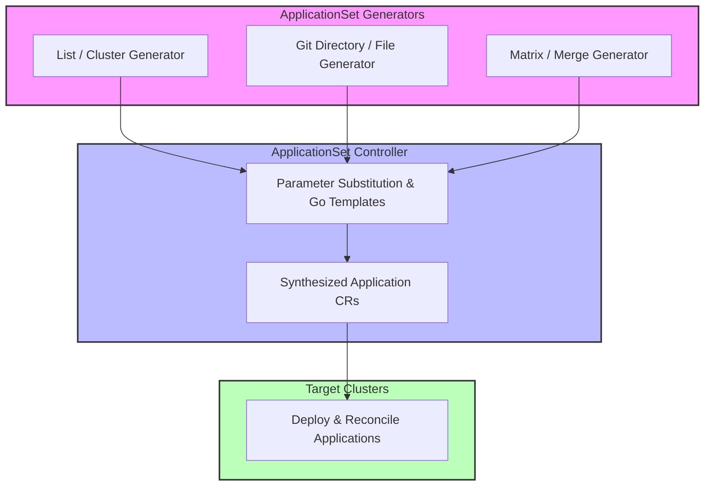

# Module 06: ApplicationSets at Scale: List, Cluster, Git, Matrix, Merge, and Pull Request Generators with Progressive Sync

## 1. Introduction and Architectural Scaling Paradigms

As enterprise Kubernetes footprints scale to hundreds of clusters and thousands of tenant namespaces, managing individual `Application` manifests becomes administratively intractable. The **ApplicationSet** controller solves this challenge by introducing dynamic generator abstractions that automatically synthesize, update, and manage multiple `Application` resources from a single declarative specification. The ApplicationSet controller evaluates input generators, substitutes parameters using Go templates, and applies the generated `Application` objects against the cluster.

Mathematically, let a generator be a mapping function $F: I \to P^{\ast}$, where $I$ is the input parameter space (cluster lists, Git directory structures, pull request metadata) and $P^{\ast}$ is a set of parameter substitutions. The templating engine applies these parameters to a prototype Application template $T$, producing a set of desired applications $\mathcal{A} = \{T(p) \mid p \in P^{\ast}\}$.



## 2. Deep Dive into ApplicationSet Generators

### List Generator

The List generator provides static parameter lists (e.g., region, environment, tier), allowing administrators to define explicit deployment matrices.

### Cluster Generator

The Cluster generator automatically queries all clusters registered within Argo CD (via `secret` resources labeled `argocd.argoproj.io/secret-type: cluster`), generating an application instance for every connected Kubernetes cluster.

### Git Generators (Directory and File)

Git generators scan repository directory structures or parse JSON/YAML configuration files stored in Git, dynamically generating application instances based on discovered paths or configuration keys.

### Matrix and Merge Generators

- **Matrix Generator**: Computes the Cartesian product of two child generators (e.g., combining every registered cluster with every microservice directory in Git).
- **Merge Generator**: Combines parameters from multiple generators by matching a unifying key (e.g., cluster name), allowing base cluster parameters to be overridden by cluster-specific configuration files.

### Progressive Syncs

When deploying updates across hundreds of clusters simultaneously, rolling out changes instantly risks widespread outages. ApplicationSets support **Progressive Syncs**, allowing operators to roll out application updates in controlled waves across clusters grouped by labels (e.g., staging -> canary-clusters -> production-eu -> production-us).

Below is an advanced ApplicationSet combining a Cluster generator with a Git directory generator using matrix expansion and progressive syncs:

```yaml
apiVersion: argoproj.io/v1alpha1
kind: ApplicationSet
metadata:
  name: global-fleet-applicationset
  namespace: argocd
spec:
  generators:
    - matrix:
        generators:
          - clusters:
              selector:
                matchLabels:
                  environment: production
          - git:
              repoURL: https://github.com/enterprise/fleet-configs.git
              revision: main
              directories:
                - path: services/*
  template:
    metadata:
      name: '{{cluster.name}}-{{path.basename}}'
    spec:
      project: default
      source:
        repoURL: 'https://github.com/enterprise/fleet-configs.git'
        targetRevision: HEAD
        path: '{{path.path}}'
      destination:
        server: '{{cluster.server}}'
        namespace: '{{path.basename}}'
      syncPolicy:
        automated:
          prune: true
          selfHeal: true
        syncOptions:
          - ServerSideApply=true
```

## 3. Control Loop Internals and Pseudocode

Below is the CLRS-style pseudocode illustrating how the ApplicationSet controller evaluates generators, renders templates, and reconciles generated Application resources.

```ts
/**
 * Evaluates ApplicationSet generators, computes parameter sets, and reconciles generated Applications.
 * Loop Invariant: For each parameter set generated by input generators, exactly one
 * Application resource exists with correct template substitutions and owner references.
 */
function reconcileApplicationSet(appSet: ApplicationSet): void {
  const parameterSets: ParameterMap[] = [];

  for (const genConfig of appSet.spec.generators) {
    const params = evaluateGenerator(genConfig);
    parameterSets.push(...params);
  }

  const desiredApplications = parameterSets.map((params) =>
    renderTemplate(appSet.spec.template, params),
  );

  applyGeneratedApplications(appSet, desiredApplications);
  pruneStaleApplications(appSet, desiredApplications);
}
```

## 4. Version History and Then vs Now

| Aspect | Legacy Approach (Argo CD v1.x - v2.x) | Modern Approach (Argo CD v3.x) |
| --- | --- | --- |
| **Multi-Cluster Scale** | Manual creation of hundreds of individual Application CRs or complex App-of-Apps wrappers | Dynamic ApplicationSet controllers with native cluster and git generators |
| **Namespace Scope** | ApplicationSets restricted strictly to the Argo CD control plane namespace | Native apps-in-any-namespace support allowing tenant teams to manage ApplicationSets locally |
| **Rollout Safety** | Global instantaneous syncs across all clusters simultaneously | Progressive Syncs with controlled waves, pauses, and health validation gates |
| **Parameterization** | Limited Helm values overrides or static config maps | Advanced Go templating (`{{cluster.name}}`, `{{path.basename}}`) with matrix and merge composition |

> [!IMPORTANT]
> **Exam Delta (CAPA)**: Certified Argo Project Associate examinations test advanced understanding of ApplicationSet generator types, particularly Matrix and Merge generator composition rules and progressive sync wave configuration.

## 5. Production Failure Modes and Gotchas

1. **Unbounded Application Generation via Misconfigured Matrix Generators**: Combining a large cluster generator with a deep git directory generator without strict selectors can accidentally synthesize thousands of unintended applications, overwhelming the controller and etcd.
2. **Template Substitution Syntax Failures**: Incorrect Go template syntax (e.g., misspelled parameter keys like `{{cluster.nam}}`) causes generation failures, stalling reconciliation for the entire ApplicationSet.
3. **Progressive Sync Stalls on Unhealthy Clusters**: If a progressive sync wave targets a cluster that fails health checks, subsequent rollout waves are blocked indefinitely unless timeout or skip policies are configured.

## Interview Drill

<details><summary>1. How do ApplicationSets improve upon the traditional App-of-Apps pattern?</summary>

ApplicationSets replace static nested App-of-Apps hierarchies with dynamic controllers and generators (List, Cluster, Git, Matrix). They automatically synthesize and manage parameterized Application resources across clusters and repositories from a single declarative manifest.

- Ref: [Module 06 Introduction](#1-introduction-and-architectural-scaling-paradigms)

</details>

<details><summary>2. What is the difference between a Matrix generator and a Merge generator in ApplicationSets?</summary>

A Matrix generator computes the Cartesian product of two child generators, generating an instance for every possible combination. A Merge generator combines parameters from multiple generators by matching a unifying key (such as cluster name), allowing base parameters to be overridden by specific child overrides.

- Ref: [Module 06 Deep Dive](#2-deep-dive-into-applicationset-generators)

</details>

<details><summary>3. How do Progressive Syncs prevent widespread outages when updating multi-cluster deployments?</summary>

Progressive Syncs roll out application updates in controlled waves across clusters grouped by labels. The controller waits for applications in the current wave to achieve healthy status before proceeding to subsequent rollout waves.

- Ref: [Module 06 Deep Dive](#2-deep-dive-into-applicationset-generators)

</details>

<details><summary>4. What security risks arise from misconfigured Matrix generators in multi-tenant environments?</summary>

Misconfigured Matrix generators can accidentally synthesize thousands of applications targeting unauthorized tenant namespaces or external clusters, potentially exhausting etcd storage and cluster resources.

- Ref: [Module 06 Production Failure Modes](#5-production-failure-modes-and-gotchas)

</details>

<details><summary>5. How does the Cluster generator discover available target clusters?</summary>

The Cluster generator automatically scans Kubernetes Secrets in the Argo CD control plane namespace that carry the label `argocd.argoproj.io/secret-type: cluster`, extracting cluster server URLs and metadata for parameter substitution.

- Ref: [Module 06 Deep Dive](#2-deep-dive-into-applicationset-generators)

</details>

<details><summary>6. What happens when an item is removed from an ApplicationSet Git generator directory?</summary>

When an item (such as a service directory) is removed from Git, the ApplicationSet controller evaluates the updated parameter set, omits the corresponding Application from desired state, and prunes the generated Application (and its managed workloads) if pruning is enabled.

- Ref: [Module 06 Control Loop Internals](#3-control-loop-internals-and-pseudocode)

</details>

## 7. Proof Map

| Claim / Section | Verification Target | Test File |
| --- | --- | --- |
| ApplicationSet Generator Evaluation | Tests parameter set generation | `../examples/ts/06-applicationsets-and-generators.test.ts` |
| Matrix & Merge Parameter Combination | Validates Cartesian product logic | `../examples/ts/06-applicationsets-and-generators.test.ts` |
| Progressive Sync Wave Rollouts | Asserts progressive rollout ordering | `../examples/ts/06-applicationsets-and-generators.test.ts` |
