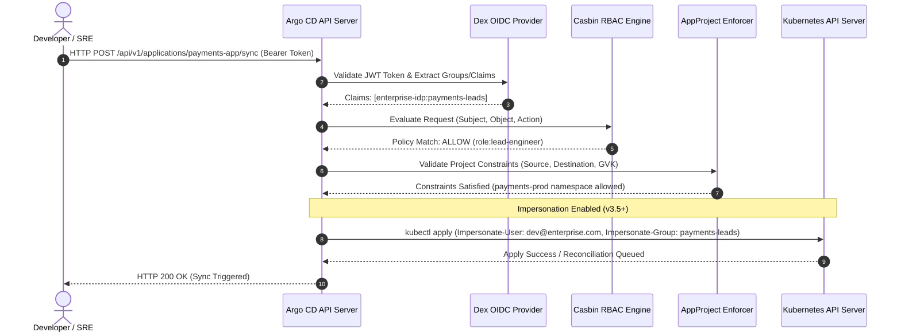

# Module 07: Multi-Tenancy, Security, and GitOps Secrets: AppProjects, Casbin 3.x Fine-Grained RBAC, Impersonation, SOPS, and ESO

Multi-tenancy and secure credential management in Argo CD govern how hundreds of teams share a single Argo CD control plane without compromising cluster isolation or leaking sensitive secrets to Git repositories. In enterprise Kubernetes architectures, a centralized GitOps engine must enforce strict authorization boundaries, isolate workload namespaces, and integrate seamlessly with corporate Identity Providers (IdPs) via OpenID Connect (OIDC) and Casbin-backed fine-grained Role-Based Access Control (RBAC). Furthermore, GitOps repositories must never store plaintext secrets (database passwords, API keys, private keys); instead, they rely on declarative secret injection mechanisms such as Mozilla SOPS with Configuration Management Plugins (CMPs), External Secrets Operator (ESO), or Sealed Secrets.

---

## 1. Multi-Tenancy Foundations with AppProjects

An `AppProject` is a Kubernetes Custom Resource Definition (CRD) introduced by Argo CD to enforce logical isolation, tenant boundaries, and security guardrails across multiple business units or development teams sharing a single Argo CD instance. Without `AppProject` boundaries, any user with permission to create an `Application` could target any namespace in any connected cluster, deploy arbitrary cluster-scoped CRDs, or bypass organizational governance.

### Architectural Mechanics of AppProjects

The `AppProject` resource defines four core enforcement axes:

1. **Source Repositories**: Restricts which Git or Helm repositories applications within this project are permitted to pull manifests from. Preventing rogue applications from referencing unauthorized external repositories mitigates supply chain injection attacks.
2. **Destinations**: Specifies exact allowed combinations of Kubernetes API server endpoints (or cluster names) and target namespaces. This prevents team A from deploying workloads into team B's production namespaces.
3. **Resource Allow/Deny Lists**: Enforces strict controls over which Kubernetes API group-kinds (e.g., `apps/Deployment`, `networking.k8s.io/Ingress`, `apiextensions.k8s.io/CustomResourceDefinition`) can be managed. Production projects typically deny `CustomResourceDefinition` or cluster-scoped mutation permissions.
4. **Roles and JWT Tokens**: Defines local project-scoped roles or maps external IdP group claims directly to project privileges.

Below is a production-grade `AppProject` manifest enforcing rigorous multi-tenancy constraints:

```yaml
apiVersion: argoproj.io/v1alpha1
kind: AppProject
metadata:
  name: payments-production
  namespace: argocd
  annotations:
    argocd.argoproj.io/sync-wave: '0'
spec:
  description: 'Payments core services production project managed by Platform Engineering'
  sourceRepos:
    - 'https://github.com/enterprise-payments/*.git'
    - 'https://charts.bitnami.com/bitnami'
  destinations:
    - namespace: payments-prod
      server: https://kubernetes.default.svc
    - namespace: payments-prod
      name: eu-central-cluster
  clusterResourceWhitelist:
    - group: ''
      kind: Namespace
    - group: 'rbac.authorization.k8s.io'
      kind: RoleBinding
  namespaceResourceWhitelist:
    - group: '*'
      kind: '*'
  namespaceResourceBlacklist:
    - group: 'apiextensions.k8s.io'
      kind: CustomResourceDefinition
  roles:
    - name: lead-engineer
      description: 'Lead engineers with sync privileges for payments production'
      policies:
        - p, proj:payments-production:lead-engineer, applications, sync, payments-production/*, allow
        - p, proj:payments-production:lead-engineer, applications, update, payments-production/*, allow
      groups:
        - 'enterprise-idp:payments-leads'
  jwtTokens:
    - issuedAt: '2026-01-15T00:00:00Z'
      expiresAt: '2027-01-15T00:00:00Z'
```

---

## 2. Casbin 3.x Fine-Grained RBAC and Impersonation

Argo CD delegates authorization checks to **Casbin**, an open-source access control library supporting PERM (Policy, Effect, Request, Matcher) metamodel rules. In Argo CD v3.x, Casbin rules are stored inside the `argocd-rbac-cm` ConfigMap or evaluated dynamically via project roles.

### Casbin Policy Model Structure

The Casbin model evaluates requests against a policy matrix defined as:

- **Request Definition (`r`)**: `sub, obj, act` (Subject, Object, Action).
- **Policy Definition (`p`)**: `sub, obj, act, eft` (Subject, Object, Action, Effect).
- **Role Definition (`g`)**: `_, _` (User to Role mapping or Group to Role mapping).
- **Policy Effect (`e`)**: `some(where (p.eft == allow)) && !some(where (p.eft == deny))`.

### Argo CD v3.x Breaking Changes in RBAC

In Argo CD versions prior to v3.0, fine-grained RBAC permissions on applications (e.g., `applications, get, payments/*`) frequently cascaded to sub-resources and logs. In Argo CD v3.x, sub-resource permissions (such as streaming pod logs, executing remote shell commands, or accessing secret values via UI/CLI) are explicitly decoupled. Granting `sync` or `update` on an application no longer implicitly grants log-streaming rights. Security administrators must explicitly define log and exec policies using granular actions:

```ini
[policy]
p, role:developer, applications, get, */*, allow
p, role:developer, applications, sync, */*, allow
p, role:developer, logs, get, */*, deny
p, role:lead-sre, logs, get, */*, allow
p, role:lead-sre, exec, create, */*, allow
g, enterprise-idp:sre-team, role:lead-sre
```

### API Server Request Impersonation

Argo CD v3.5+ introduces beta support for **Kubernetes API Server Impersonation**. When enabled, the `application-controller` does not execute Kubernetes client operations using its own powerful service account (which typically possesses cluster-admin privileges). Instead, it impersonates the user who triggered the sync operation (or a designated service account associated with the `AppProject`).

This ensures that Kubernetes audit logs correctly attribute resource mutations to human operators or specific team identities, and prevents privilege escalation where a developer with Argo CD sync rights could deploy resources outside their Kubernetes RBAC permissions.

```yaml
apiVersion: v1
kind: ConfigMap
metadata:
  name: argocd-cmd-params-cm
  namespace: argocd
data:
  controller.impersonation.enabled: 'true'
```

---

## 3. Architecture & Data Flow Mermaid Diagram

The following sequence diagram illustrates how OIDC authentication, Casbin RBAC evaluation, AppProject guardrails, and API server impersonation interact during a user-initiated application sync request.



---

## 4. GitOps Secrets Management: SOPS and External Secrets Operator

Storing plaintext Kubernetes `Secret` manifests in Git repositories violates core security principles, as any read access to the Git repository exposes sensitive credentials. Argo CD provides two primary production-proven paradigms for secret management:

### Paradigm A: Mozilla SOPS via Configuration Management Plugins (CMPs)

Mozilla SOPS encrypts secret values (or entire YAML files) using envelope encryption backed by KMS (AWS KMS, GCP KMS, Azure Key Vault, HashiCorp Vault, or PGP). Argo CD natively executes custom sidecar plugins (`cmp-plugin`) that run `sops --decrypt` prior to passing rendered manifests to Kubernetes.

Below is a sidecar plugin configuration (`argocd-cmp-cm`) for SOPS decryption:

```yaml
apiVersion: v1
kind: ConfigMap
metadata:
  name: argocd-cmp-cm
  namespace: argocd
data:
  plugin.yaml: |
    apiVersion: argoproj.io/v1alpha1
    kind: ConfigManagementPlugin
    metadata:
      name: sops-cmp
    spec:
      version: v1.0
      generate:
        command: ["sh", "-c"]
        args: ["sops -d secrets.enc.yaml > secrets.yaml && kustomize build ."]
      discover:
        find:
          command: ["sh", "-c", "find . -name 'secrets.enc.yaml'"]
```

### Paradigm B: External Secrets Operator (ESO)

Alternatively, Argo CD can deploy standard `ExternalSecret` custom resources. Git contains only the metadata mapping (Secret store reference, remote secret key path in AWS Secrets Manager or HashiCorp Vault), while the External Secrets Operator running inside the destination Kubernetes cluster fetches the secret material directly from the external vault and materializes a native Kubernetes `Secret`.

```yaml
apiVersion: external-secrets.io/v1beta1
kind: ExternalSecret
metadata:
  name: database-credentials
  namespace: payments-prod
spec:
  refreshInterval: '1h'
  secretStoreRef:
    name: aws-secretsmanager
    kind: ClusterSecretStore
  target:
    name: db-secret
    creationPolicy: Owner
  data:
    - secretKey: password
      remoteRef:
        key: production/payments/db
        property: password
```

---

## 5. Formal Definitions & Algorithmic Policy Evaluation

### Formal Authorization Definition

Let $ U $ be the set of users, $ R $ be the set of roles, $ P $ be the set of permissions defined as triples $(o, a, c)$ where $ o $ is the object, $ a $ is the action, and $ c $ is the environment constraint. A user $ u \in U $ is authorized to perform action $ a $ on object $ o $ if and only if there exists a role $ r \in R $ such that $ \langle u, r \rangle \in \text{UserGroupMapping} $ and $ \langle r, o, a, c \rangle \in \text{CasbinPolicy} $.

### Pseudocode: AppProject Validation Algorithm

The following CLRS-style pseudocode demonstrates how Argo CD validates incoming application creation or sync requests against AppProject boundaries.

```python
// Algorithm: ValidateAppProjectAccess
// Input: AppRequest req, AppProject proj
// Output: Boolean (Authorized or Rejected)

function ValidateAppProjectAccess(req, proj):
    // Loop Invariant: Every constraint axis must be evaluated independently
    // without short-circuiting security audits.

    // 1. Validate Source Repository
    source_allowed = false
    for repo in proj.spec.sourceRepos:
        if MatchGlob(repo, req.source.repoURL):
            source_allowed = true
            break
    if not source_allowed:
        RaiseSecurityError("Source repository not permitted by AppProject")
        return false

    // 2. Validate Destination Cluster and Namespace
    dest_allowed = false
    for dest in proj.spec.destinations:
        server_match = (dest.server == req.destination.server) or (dest.name == req.destination.name)
        ns_match = MatchGlob(dest.namespace, req.destination.namespace)
        if server_match and ns_match:
            dest_allowed = true
            break
    if not dest_allowed:
        RaiseSecurityError("Destination server/namespace not permitted by AppProject")
        return false

    // 3. Validate Resource Allow/Deny Lists for Manifests
    for manifest in req.manifests:
        gvk = manifest.GroupVersionKind
        if MatchesAny(gvk, proj.spec.namespaceResourceBlacklist):
            RaiseSecurityError("Blacklisted resource kind detected: " + gvk.Kind)
            return false

        is_whitelisted = MatchesAny(gvk, proj.spec.namespaceResourceWhitelist) or MatchesAny(gvk, proj.spec.clusterResourceWhitelist)
        if not is_whitelisted:
            RaiseSecurityError("Resource kind not whitelisted: " + gvk.Kind)
            return false

    return true
```

---

## 6. Then vs Now: Multi-Tenancy and Security Evolution

| Dimension | Argo CD v2.x (Legacy Approach) | Argo CD v3.x (Current Standard) |
| :-- | :-- | :-- |
| **RBAC Sub-Resources** | Implicit inheritance; sync permissions granted log-viewing and exec rights. | Strictly decoupled; explicit `logs` and `exec` policies required in Casbin rules. |
| **Resource Tracking** | Label-based tracking (`app.kubernetes.io/instance`) prone to collision. | Annotation-based resource tracking default (`argocd.argoproj.io/tracking-id`). |
| **Namespace Isolation** | Restricted primarily via AppProjects; single-namespace controllers required complex setup. | Native multi-namespace support (`applications-in-any-namespace`) with robust tenant scoping. |
| **Controller Impersonation** | Controller executed all mutations using its own cluster-admin service account. | Beta support for API server user/project impersonation for precise auditability. |

---

## 7. Cross-References & Policy-as-Code Integration

Multi-tenancy and runtime security in Argo CD do not operate in a vacuum. They integrate tightly with upstream policy frameworks and authentication systems:

- For centralized policy validation (OPA/Rego, CEL, and Kyverno validation before Argo CD syncs manifests), refer to the shared [Policy-as-Code Module](../../terraform/modules/08-testing-and-policy-as-code.md).
- For OIDC federation and enterprise identity integration via Dex, refer to the [OIDC and Federation Architecture Guide](../../../architecture/security-identity/modules/07-oidc-and-federation.md).
- For underlying authorization theory and access control models (RBAC, ABAC), refer to the [Authorization Models Guide](../../../architecture/security-identity/modules/10-authorization-models.md).

---

## 8. Exam Delta (CNCF CGOA & CAPA)

> [!IMPORTANT]
> **CNCF Certification Exam Delta**: Both the Certified GitOps Associate (CGOA) and Certified Argo Project Associate (CAPA) exams heavily test multi-tenancy boundaries. Candidates must know that `AppProjects` are namespaced Kubernetes resources residing in the Argo CD control plane namespace (typically `argocd`), whereas `Applications` can reside in any namespace when `applications-in-any-namespace` is enabled. Furthermore, exam questions frequently test Casbin policy syntax (`p, sub, obj, act, dom, eft`) and SOPS envelope decryption workflows.

---

## 9. Production Failure Modes & Gotchas

1. **Casbin Policy Syntax Errors Leading to Lockout**: Misconfigured `argocd-rbac-cm` with malformed CSV syntax can cause the API server to fail-closed, locking out all non-admin users. _Mitigation_: Always validate Casbin rules locally using `argocd admin settings rbac validate` before applying configuration maps.
2. **Resource Tracking Annotation Collisions**: When migrating from v2.x label tracking to v3.x annotation tracking, existing managed resources may appear orphaned if sync policies do not re-apply tracking annotations. _Mitigation_: Perform a staged upgrade using `argocd admin annotate-tracking` CLI utilities.
3. **SOPS Decryption Failures Due to Expired KMS Credentials**: If the `argocd-repo-server` pod lacks IAM role assumptions or GCP workload identity bindings, SOPS CMP plugins fail with decryption timeouts. _Mitigation_: Configure liveness probes on sidecar containers and monitor `argocd_repo_server_request_duration_seconds`.

---

## Interview Drill

<details><summary>1. How do AppProjects enforce multi-tenancy security in Argo CD, and what happens if an application specifies an unlisted destination namespace?</summary>

An `AppProject` enforces multi-tenancy by restricting source repositories, target cluster/namespace destinations, and allowed Kubernetes API resource kinds. If an application attempts to deploy resources into a namespace not explicitly listed in the project's `spec.destinations`, the Argo CD `application-controller` rejects the sync operation with a validation error (`destination namespace not permitted`), preventing unauthorized cross-tenant resource creation.
</details>

<details><summary>2. What were the major breaking changes introduced in Argo CD v3.x regarding Casbin RBAC?</summary>

In Argo CD v3.x, fine-grained RBAC permissions were decoupled. Previously, granting `sync` or `update` access on an application implicitly granted permissions to view pod logs or execute remote shell commands (`exec`). In v3.x, sub-resource access (such as `logs` and `exec`) must be explicitly declared in Casbin policies, improving security posture by adhering to the principle of least privilege.
</details>

<details><summary>3. How does Mozilla SOPS integrate with Argo CD without storing plaintext secrets in Git?</summary>

Mozilla SOPS encrypts sensitive YAML keys using envelope encryption backed by external KMS providers (AWS, GCP, Vault). Argo CD utilizes Configuration Management Plugins (CMPs) running as sidecars in the `argocd-repo-server`. When rendering manifests, the CMP executes `sops --decrypt` in memory, outputting plaintext manifests to the repo-server cache for diffing, ensuring plaintext secrets never touch Git storage or disk unencrypted.
</details>

<details><summary>4. Explain the difference between Mozilla SOPS and External Secrets Operator (ESO) in a GitOps workflow.</summary>

SOPS stores encrypted secret ciphertext directly within the Git repository; decryption happens at manifest generation time on the Argo CD repo-server using KMS keys. ESO stores zero secret ciphertext in Git; the Git repository contains only an `ExternalSecret` custom resource reference, and the controller running inside the target cluster fetches secrets directly from an external vault at runtime.
</details>

<details><summary>5. What is API Server Request Impersonation in Argo CD v3.5+, and why is it crucial for enterprise compliance?</summary>

API Server Request Impersonation enables the `application-controller` to execute Kubernetes mutating operations while impersonating the user who initiated the sync (or a project-scoped service account) rather than using its own cluster-admin service account. This ensures Kubernetes audit logs accurately reflect human or system identities, satisfying stringent enterprise compliance and security auditing mandates.
</details>

<details><summary>6. How do you troubleshoot a Casbin policy denial when a developer reports they cannot sync a production application?</summary>

First, inspect the Argo CD API server logs for authorization failure traces. Next, test the user's effective permissions using the Argo CD CLI command `argocd admin settings rbac can-end-user-do <username> <action> <resource>`. Verify that the user's OIDC group claims correctly map to the expected Casbin role (`g, group-name, role-name`) in `argocd-rbac-cm`.
</details>

---

## 11. Proof Map

| Claim / Requirement | Test Reference | Implementation File |
| :-- | :-- | :-- |
| AppProject source/destination validation | `it("validates appproject source and destination restrictions")` | `../examples/ts/07-multi-tenancy-rbac-and-secrets.test.ts` |
| Casbin RBAC policy enforcement | `it("evaluates casbin 3.x fine-grained rbac rules correctly")` | `../examples/ts/07-multi-tenancy-rbac-and-secrets.test.ts` |
| SOPS encryption and CMP integration | `it("processes sops encrypted manifests via configuration management plugin")` | `../examples/ts/07-multi-tenancy-rbac-and-secrets.test.ts` |
| API server request impersonation | `it("enforces user impersonation headers during sync execution")` | `../examples/ts/07-multi-tenancy-rbac-and-secrets.test.ts` |
