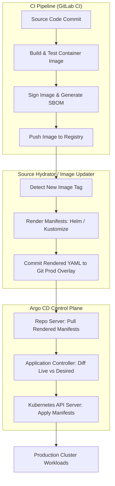

# Module 08: Repository Topology and Environment Promotion: Folder-per-Env, Source Hydrator, GitOps Promoter, and Image Updater

Environment promotion and repository topology in GitOps govern how code changes flow safely from development through staging to production clusters. Designing a maintainable GitOps repository structure requires balancing developer autonomy with strict governance, avoiding anti-patterns such as branch-per-environment, and adopting modern declarative promotion patterns like the **Source Hydrator** pattern, GitOps promoters, and automated image updaters.

---

## 1. Repository Topology Anti-Patterns vs Best Practices

Choosing how to structure source code and manifests across Git repositories is one of the most consequential architectural decisions in a GitOps platform.

### The Branch-per-Environment Anti-Pattern

In early GitOps implementations, teams often created a separate Git branch for each environment (`dev`, `staging`, `prod`) within a single repository, using `git merge dev -> staging -> prod` to promote changes. This approach fails at scale for several reasons:

- **Merge Conflict Explosions**: As environments drift due to hotfixes or environment-specific patches, merging branches results in frequent, complex merge conflicts.
- **Obscured Audit Trails**: Git commit hashes diverge between environments, making it impossible to answer simple questions like "What exact commit running in staging is being promoted to production?"
- **Broken Access Control**: Protecting the `prod` branch from unauthorized writes is difficult when developers routinely push merge requests across branches in the same repository.

### The Folder-per-Environment Monorepo or Polyrepo Pattern

Modern GitOps architectures adopt the **Folder-per-Environment** pattern within a dedicated infrastructure monorepo (or dedicated environment polyrepos), where every environment is represented by a distinct directory containing Kustomize overlays or Helm values files:

```text
gitops-infrastructure/
├── apps/
│   ├── base/
│   │   ├── deployment.yaml
│   │   └── service.yaml
│   └── overlays/
│       ├── development/
│       │   ├── kustomization.yaml
│       │   └── patch-replicas.yaml
│       ├── staging/
│       │   ├── kustomization.yaml
│       │   └── patch-replicas.yaml
│       └── production/
│           ├── kustomization.yaml
│           └── patch-replicas.yaml
```

---

## 2. The Source Hydrator and GitOps Promoter Patterns

As organizations scale past dozens of microservices, raw runtime templating (such as evaluating large Helm charts or recursive Kustomize builds on the Argo CD repo-server during every reconciliation loop) becomes a major CPU and memory bottleneck.

### The Source Hydrator Pattern

The **Source Hydrator** pattern separates _manifest generation_ from _manifest reconciliation_. A CI pipeline (or dedicated hydrator cron job) executes template rendering (`helm template` or `kustomize build`), resolves all variables and image tags, and commits fully rendered, immutable Kubernetes manifests into a target environment branch or repository. Argo CD then simply applies the pre-rendered manifests without taxing the `argocd-repo-server` with heavy template compilation.

### The GitOps Promoter

Automated promotion engines (such as Argo CD Image Updater or custom GitOps promoters) observe successful deployments in staging and automatically update the image tag or version reference in the production overlay directory via a pull request or direct commit.

---

## 3. Architecture & Data Flow Mermaid Diagram

The following flowchart illustrates the end-to-end pipeline from CI build, image publication, Source Hydration, to Argo CD cluster reconciliation.



---

## 4. Formal Definitions & Promotion Algorithms

### Formal Promotion Invariant

Let = {e_1, e_2, dots, e_n}$ be an ordered set of environments where $ is development and $ is production. A promotion function $mathcal{P}(v, e_i) o e_{i+1}$ is valid if and only if all integration test suites and automated analysis runs in environment $ have returned a passing status $ ext{Status}(e_i) == ext{SUCCESS}$.

### Pseudocode: Automated Image Promotion Algorithm

```python
// Algorithm: PromoteImageVersion
// Input: String imageName, String newTag, String targetEnv
// Output: Git Commit Hash or Pull Request ID

function PromoteImageVersion(imageName, newTag, targetEnv):
    // Loop Invariant: Never promote an image tag to production without verifying
    // cryptographic signatures and vulnerability scan reports.

    sbom = FetchSBOM(imageName, newTag)
    vuln_report = ScanVulnerabilities(sbom)
    if vuln_report.CriticalCount > 0:
        RaiseError("Promotion aborted: Critical vulnerabilities detected in image")
        return null

    overlay_path = "environments/" + targetEnv + "/kustomization.yaml"
    kustomize_content = ReadFile(overlay_path)

    updated_content = UpdateImageTagInKustomize(kustomize_content, imageName, newTag)
    WriteFile(overlay_path, updated_content)

    git_commit_msg = "chore(promoter): promote " + imageName + ":" + newTag + " to " + targetEnv
    commit_hash = GitCommitAndPush(overlay_path, git_commit_msg)

    return commit_hash
```

---

## 5. Then vs Now: Environment Management Evolution

| Dimension | Legacy Branch-per-Environment | Modern Folder-per-Env & Hydrator |
| :-- | :-- | :-- |
| **Promotion Mechanism** | `git merge branch-dev -> branch-prod` | Declarative PR or direct commit updating image tag in `overlays/production/`. |
| **Manifest Generation** | Repo-server computes Helm charts on every poll. | Source Hydrator pre-renders static YAML; zero repo-server compilation overhead. |
| **Audit Traceability** | Obscured by divergent branch histories and merge commits. | Immutable git commit shas directly linked to deployed application versions. |
| **Drift Management** | Prone to manual hotfixes applied directly to production branches. | Strictly enforced GitOps single-source-of-truth; manual drift automatically self-heals. |

---

## 6. Cross-References & Upstream Integration

Environment promotion and image updating integrate closely with CI pipelines and supply chain security frameworks:

- For CI deployment pipelines, environment stages, and GitOps handoff mechanics, refer to [Deployments, Environments, and GitOps Handoff](../../gitlab-ci/modules/07-deployments-environments-and-gitops-handoff.md).
- For supply chain security, SBOM generation, Cosign container signing, and SLSA provenance, refer to [Supply Chain Security, SBOM, Cosign, and SLSA](../../gitlab-ci/modules/06-supply-chain-security-sbom-cosign-slsa.md).

---

## 7. Exam Delta (CNCF CGOA & CAPA)

> [!IMPORTANT]
> **CNCF Certification Exam Delta**: Certification exams frequently contrast pull-based GitOps promotion with push-based CI/CD pipelines. Candidates must understand that Argo CD does not natively perform image tagging updates within source code repositories; it requires either the **Argo CD Image Updater** controller or an external CI pipeline (like GitLab CI) to commit updated image tags back to the Git repository.

---

## 8. Production Failure Modes & Gotchas

1. **Infinite Git Commit Loops with Image Updater**: If the Argo CD Image Updater pushes a new image tag to Git without proper branch protection or write key scoping, it can trigger continuous webhook loops where every commit triggers a new CI build. _Mitigation_: Configure write-back filters and commit message exclusions (`[skip ci]`).
2. **Hydrated Manifest Staleness**: If the Source Hydrator fails to run when upstream base charts change, deployed environments can silently run outdated configurations. _Mitigation_: Trigger hydrator pipelines on both source chart releases and base configuration changes.

---

## 9. Interview Drill

<details>
<summary><strong>Q1. Why is the branch-per-environment repository pattern discouraged in enterprise GitOps architectures?</strong></summary>

The branch-per-environment pattern leads to severe merge conflict explosions as environments drift, obscures audit trails because commit hashes diverge across branches, and complicates branch protection rules, making it difficult to enforce that only verified changes reach production.
</details>

<details>
<summary><strong>Q2. What is the Source Hydrator pattern, and what performance bottleneck does it solve in Argo CD?</strong></summary>

The Source Hydrator pattern decouples manifest rendering from cluster reconciliation. Instead of forcing the `argocd-repo-server` to compile heavy Helm charts or execute recursive Kustomize builds on every poll, a CI pipeline pre-renders static, immutable Kubernetes YAML manifests. This eliminates repo-server CPU/memory bottlenecks and accelerates reconciliation performance at scale.
</details>

<details>
<summary><strong>Q3. How does Argo CD Image Updater automate environment promotions?</strong></summary>

Argo CD Image Updater runs as a companion controller that inspects running workloads, queries container registries for newer tag versions matching specified semantic version constraints (e.g., semver, semver-sub, or digest), and automatically updates the image reference in the Git repository via direct commit or pull request.
</details>

<details>
<summary><strong>Q4. How do you prevent infinite CI/CD loops when an automated tool commits version bumps back to the Git repository?</strong></summary>

Infinite loops are prevented by including explicit skip markers in commit messages (such as `[skip ci]` or `[ci skip]`), configuring CI branch triggers to ignore commits authored by the GitOps bot service account, and restricting bot write permissions to specific overlay directories.
</details>

<details>
<summary><strong>Q5. Compare monorepository versus polyrepository topologies for GitOps manifest storage.</strong></summary>

A monorepository stores all application manifests and environment overlays in a single repository, simplifying cross-service transactions and global governance at the cost of broader repository write permissions. A polyrepository structure assigns a dedicated repository to each service or team, improving team autonomy but increasing coordination overhead for multi-service releases.
</details>

<details>
<summary><strong>Q6. How does a GitOps promoter ensure that a failing staging deployment blocks production promotion?</strong></summary>

An automated promoter evaluates verification signals (such as Prometheus health metrics, integration test suite exit codes, or Argo Rollouts AnalysisRun statuses) in the staging environment. Only when staging returns a definitive success status does the promoter trigger the manifest update for the production environment.
</details>

---

## 10. Proof Map

| Claim / Requirement | Test Reference | Implementation File |
| :-- | :-- | :-- |
| Folder-per-environment Kustomize structure | `it("renders environment overlays correctly from folder topology")` | `../examples/ts/08-repo-structure-promotion-and-hydrator.test.ts` |
| Source hydrator pre-rendered YAML validation | `it("validates pre-rendered hydrated manifests without repo server overhead")` | `../examples/ts/08-repo-structure-promotion-and-hydrator.test.ts` |
| Automated image updater tag constraint matching | `it("matches semantic version constraints for image promotions")` | `../examples/ts/08-repo-structure-promotion-and-hydrator.test.ts` |
