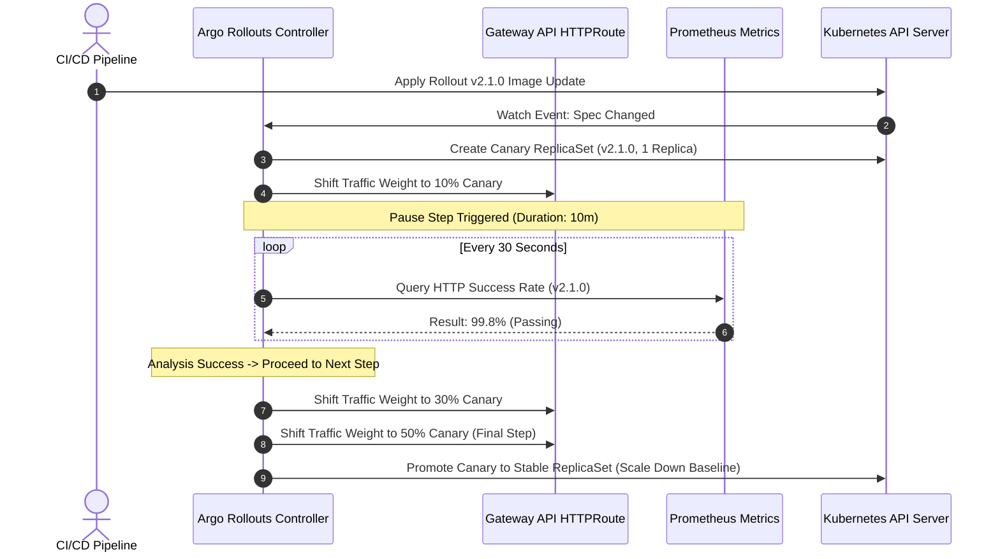

# Module 09: Progressive Delivery with Argo Rollouts: Blue/Green, Canary Steps, Gateway API Routing, and AnalysisTemplates

While Argo CD excels at continuous reconciliation of declarative desired state to live clusters, standard Kubernetes `Deployment` controllers only support all-or-nothing rolling updates (`maxSurge` and `maxUnavailable`). For mission-critical production services, this lacks fine-grained traffic splitting, automated metric analysis, and instant abort capabilities upon error injection. **Argo Rollouts** replaces the native `Deployment` controller with a custom `Rollout` CRD, enabling advanced progressive delivery strategies such as Blue/Green deployments, multi-step Canary releases, Gateway API traffic shaping, and continuous metrics verification via `AnalysisTemplates`.

---

## 1. The Rollout Custom Resource Definition (CRD)

The `Rollout` CRD mirrors the exact schema of the native Kubernetes `Deployment` spec while adding advanced strategy blocks (`blueGreen` and `canary`). This allows seamless migration of existing deployments simply by changing `kind: Deployment` to `kind: Rollout` and injecting the progressive delivery strategy block.

### Blue/Green Deployment Architecture

A Blue/Green deployment maintains two distinct ReplicaSets: the active (blue) version serving live user traffic and the preview (green) version running the new software release. Argo Rollouts manages traffic routing via Kubernetes Service selectors or Gateway API HTTPRoute weights, allowing QA engineers and automated tests to validate the preview version prior to promoting it to active status.

### Canary Deployment Steps and Traffic Shifting

Canary deployments gradually shift traffic from the stable baseline version to the canary version through sequential steps, pausing for automated metric analysis or manual sign-off between phases.

Below is a production-grade `Rollout` manifest executing a multi-step canary deployment with Gateway API integration:

```yaml
apiVersion: argoproj.io/v1alpha1
kind: Rollout
metadata:
  name: payments-api
  namespace: payments-prod
spec:
  replicas: 10
  strategy:
    canary:
      analysis:
        templates:
          - templateName: success-rate-and-latency
        args:
          - name: service-name
            value: payments-api
      steps:
        - setWeight: 10
        - pause: { duration: 10m }
        - setWeight: 30
        - pause: { duration: 30m }
        - setWeight: 50
        - pause: { duration: 1h }
      trafficRouting:
        gatewayAPI:
          httpRoute: payments-api-route
  selector:
    matchLabels:
      app: payments-api
  template:
    metadata:
      labels:
        app: payments-api
    spec:
      containers:
        - name: api
          image: ghcr.io/enterprise-payments/api:v2.1.0
          ports:
            - containerPort: 8080
```

---

## 2. AnalysisTemplates and Continuous Verification

Progressive delivery without automated verification is merely slow deployment. **AnalysisTemplates** define reusable metric queries against monitoring backends (Prometheus, Datadog, CloudWatch, Webhooks) that run during canary pauses. If error rates exceed thresholds or latency p99 spikes, the `AnalysisRun` controller automatically aborts the rollout and rolls back traffic to the stable baseline.

Below is an `AnalysisTemplate` querying Prometheus for HTTP 5xx error rates:

```yaml
apiVersion: argoproj.io/v1alpha1
kind: AnalysisTemplate
metadata:
  name: success-rate-and-latency
  namespace: payments-prod
spec:
  args:
    - name: service-name
  metrics:
    - name: success-rate
      interval: 30s
      successCondition: result[0] >= 0.99
      failureLimit: 3
      provider:
        prometheus:
          address: http://prometheus-k8s.monitoring.svc:9090
          query: |
            sum(rate(http_requests_total{service="{{args.service-name}}",status=~"2.*"}[2m]))
            /
            sum(rate(http_requests_total{service="{{args.service-name}}"}[2m]))
```

---

## 3. Architecture & Data Flow Mermaid Diagram

The following sequence diagram illustrates the lifecycle of an Argo Rollouts canary deployment with automated Prometheus analysis and Gateway API traffic routing.



---

## 4. Formal Definitions & Canary Convergence Mathematics

### Formal Canary Convergence Theorem

Let $ W(t) $ be the traffic weight assigned to the canary version at time $ t $, where $ W(0) = 0 $ and $ W(T) = 1.0 $ at final promotion time $ T \text{s} $. Let $ M(t) $ be the success metric evaluation function returning a boolean $ \text{True} $ if error rates remain below threshold $ \theta $. A rollout converges successfully if and only if $ \forall t \in [0, T], M(t) == \text{True} $. If $ \exists t $, s.t. $ M(t) == \text{False} $, the controller triggers immediate abort execution $ \mathcal{A} \to W(t) = 0 $.

### Pseudocode: Canary Step Evaluation Algorithm

```python
// Algorithm: EvaluateCanaryStep
// Input: Rollout rollout, MetricProvider provider
// Output: RolloutState (Progress, Promote, or Abort)

function EvaluateCanaryStep(rollout, provider):
    current_step = rollout.status.currentStepIndex
    step_config = rollout.spec.strategy.canary.steps[current_step]

    if step_config.has_pause:
        elapsed_time = CurrentTime() - rollout.status.pauseStartTime
        if elapsed_time < step_config.pause.duration:
            return STATE_PAUSED

    if step_config.has_analysis:
        for template in step_config.analysis.templates:
            metric_result = ExecutePrometheusQuery(template.query)
            if not EvaluateCondition(metric_result, template.successCondition):
                rollout.status.consecutiveFailures += 1
                if rollout.status.consecutiveFailures >= template.failureLimit:
                    TriggerRolloutAbort(rollout)
                    return STATE_ABORTED
            else:
                rollout.status.consecutiveFailures = 0

    if HasMoreSteps(rollout):
        AdvanceToNextStep(rollout)
        return STATE_PROGRESSING
    else:
        CompleteRolloutPromotion(rollout)
        return STATE_PROMOTED
```

---

## 5. Then vs Now: Deployment Strategy Evolution

| Dimension | Native K8s Deployment (`rollingUpdate`) | Argo Rollouts (`Rollout` CRD) |
| :-- | :-- | :-- |
| **Traffic Splitting** | Coarse percentage based on pod replica ratios (e.g., 9 pods old, 1 pod new). | Precise traffic shaping (e.g., 1% canary) via Gateway API, Istio, or NGINX. |
| **Verification** | None; relies on liveness/readiness probes only. | Continuous metrics verification via Prometheus/Datadog `AnalysisTemplates`. |
| **Failure Handling** | Manual `kubectl rollout undo` required after production outage. | Automated analysis failure triggers instant abort and rollback without human intervention. |
| **Deployment Types** | Rolling update only. | Blue/Green, Canary, Experimentation, and progressive multi-step shifts. |

---

## 6. Cross-References & Ingress Integration

Progressive delivery relies heavily on modern Kubernetes networking and traffic management standards:

- For advanced traffic routing, HTTPRoute configurations, and Gateway API migration strategies, refer to [Gateway API and Ingress Migration](../../kubernetes/modules/08-gateway-api-and-ingress-migration.md).

---

## 7. Exam Delta (CNCF CAPA)

> [!IMPORTANT]
> **CNCF Certification Exam Delta**: The Certified Argo Project Associate (CAPA) exam dedicates 18% of its curriculum to Argo Rollouts. Candidates must understand the exact distinction between `AnalysisTemplate` (the reusable definition) and `AnalysisRun` (the instantiated execution), as well as how traffic routing providers (Gateway API, Istio VirtualServices, NGINX ingress annotations) integrate with the `Rollout` controller.

---

## 8. Production Failure Modes & Gotchas

1. **Traffic Routing Mismatch without Supported Mesh/Gateway**: Configuring `trafficRouting` in a Rollout without having an active supported service mesh or Gateway API provider causes the rollout to stall indefinitely at the first canary step. _Mitigation_: Verify that controller plugins and ingress controllers are correctly registered and compatible with the installed Argo Rollouts version.
2. **Prometheus Metric Query Timeouts during Analysis Runs**: If Prometheus metric queries in `AnalysisTemplates` use overly broad range vectors or high-cardinality aggregations, queries time out, leading to inconclusive analysis runs. _Mitigation_: Optimize PromQL queries and ensure appropriate index caching on Prometheus servers.

---

## Interview Drill

<details><summary>1. How does Argo Rollouts differ from a native Kubernetes Deployment rolling update?</summary>

While a native Kubernetes Deployment only supports rolling updates via pod replica scaling (`maxSurge` and `maxUnavailable`), Argo Rollouts introduces the `Rollout` CRD supporting sophisticated traffic splitting (via Gateway API or service meshes), continuous automated metric verification (`AnalysisTemplates`), and instant automated rollback upon failure detection.
</details>

<details><summary>2. Explain the relationship between AnalysisTemplate and AnalysisRun.</summary>

An `AnalysisTemplate` is a reusable, parameterized blueprint defining metric providers, queries, and success conditions. An `AnalysisRun` is the concrete, instantiated execution of an `AnalysisTemplate` triggered by a Rollout during a canary step, recording real-time measurement values and pass/fail results.
</details>

<details><summary>3. What happens if an AnalysisRun fails during a canary pause step?</summary>

When an `AnalysisRun` fails consecutive measurement checks beyond the configured `failureLimit`, the Argo Rollouts controller automatically triggers an abort workflow, shifting 100% of traffic back to the stable baseline ReplicaSet and scaling down the canary ReplicaSet.
</details>

<details><summary>4. How does Argo Rollouts manage traffic splitting when using Gateway API?</summary>

Argo Rollouts interacts with Gateway API `HTTPRoute` resources by dynamically modifying traffic weight rules, routing a specified percentage of client requests to the canary service and the remainder to the stable service without requiring pod replica count imbalances.
</details>

<details><summary>5. What is the purpose of the Argo Rollouts Experiment feature?</summary>

The Experiment feature allows running multiple simultaneous replica sets (e.g., testing two different candidate versions concurrently) against a fraction of live traffic for a fixed duration to compare performance metrics before promoting a winner.
</details>

<details><summary>6. How do you perform a Blue/Green deployment promotion without downtime using Argo Rollouts?</summary>

In a Blue/Green deployment, Argo Rollouts creates preview and active services pointing to preview and active ReplicaSets respectively. Once automated analysis or manual sign-off completes, the controller switches the active service selector to point directly to the new ReplicaSet, achieving zero-downtime atomic promotion.
</details>

---

## 10. Proof Map

| Claim / Requirement | Test Reference | Implementation File |
| :-- | :-- | :-- |
| Rollout CRD canary step execution | `it("executes multi-step canary traffic shifting successfully")` | `../examples/ts/09-progressive-delivery-argo-rollouts.test.ts` |
| AnalysisTemplate Prometheus query validation | `it("validates prometheus metrics against success conditions")` | `../examples/ts/09-progressive-delivery-argo-rollouts.test.ts` |
| Automated rollback on analysis failure | `it("triggers instant abort and rollback when analysis fails")` | `../examples/ts/09-progressive-delivery-argo-rollouts.test.ts` |
