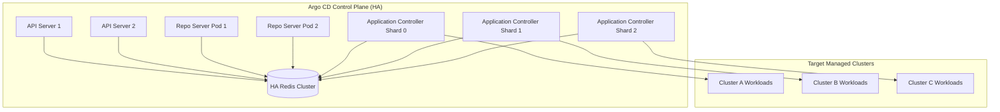

# Module 10: Operating Argo CD at Scale: Controller Sharding, Repo-Server Tuning, Resource Exclusions, HA Redis, and Upgrades

Operating Argo CD in enterprise environments managing thousands of applications across dozens of Kubernetes clusters requires rigorous architectural tuning, horizontal controller sharding, repo-server caching, Redis high availability, and careful resource exclusion policies. Without proper operational hardening, large Argo CD instances suffer from high CPU utilization, memory leaks, repo-server cache thrashing, and Kubernetes API rate-limiting.

---

## 1. Controller Sharding and Load Distribution

By default, a single `application-controller` replica evaluates all registered applications in a monolithic reconciliation loop. When managing thousands of applications, this creates severe CPU contention and reconciliation latency spikes. Argo CD supports **Controller Sharding** using consistent hashing across replica sets.

### Sharding Architecture

When sharding is enabled via environment variables (`ARGOCD_CONTROLLER_SHARDS`), each controller pod calculates an application ownership hash based on application name modulo total shard count. Each shard reconciles only its assigned subset of applications, ensuring linear scalability.

---

## 2. Repo-Server Scaling and Manifest Caching

The `argocd-repo-server` is responsible for cloning Git repositories, fetching Helm charts, and executing Kustomize builds. Because manifest generation is computationally expensive, repo-server performance depends on effective caching and horizontal scaling.

### Redis Cache Backend

Argo CD uses Redis as an external cache layer for repository contents, manifest generation results, and cluster resource states. In high-availability production deployments, Redis must be deployed as a Sentinel or Cluster topology to prevent single points of failure.

---

## 3. Architecture & Data Flow Mermaid Diagram

The following flowchart illustrates the scaled HA Argo CD architecture featuring sharded application controllers, load-balanced API servers, repo-server pools, and an HA Redis cluster.



---

## 4. Formal Definitions & Hashing Algorithms

### Consistent Hashing Shard Assignment

Let $ A $ be the set of applications, and $ S = \{0, 1, \dots, k-1\} $ be the set of $ k $ controller shards. The assignment function $ \mathcal{H}(a) \to s \in S $ maps application $ a \in A $ to shard $ s $ using a stable hash function (such as FNV-1a or murmur3) applied to the application namespace and name:

5707 \mathcal{H}(a) = \text{Hash}(a.\text{Namespace} + \"/\" + a.\text{Name}) \pmod k 5707

### Pseudocode: Controller Shard Ownership Check

```python
// Algorithm: EvaluateShardOwnership
// Input: Application app, Integer shardIndex, Integer totalShards
// Output: Boolean (True if this shard owns the application)

function EvaluateShardOwnership(app, shardIndex, totalShards):
    // Loop Invariant: Every application must be claimed by exactly one shard
    // to prevent race conditions and duplicate reconciliation loops.

    app_key = app.metadata.namespace + "/" + app.metadata.name
    hash_value = HashFNV1a(app_key)
    assigned_shard = hash_value % totalShards

    return (assigned_shard == shardIndex)
```

---

## 5. Then vs Now: Scaling Architecture Evolution

| Dimension | Argo CD v1.x / Early v2.x | Argo CD v3.x Enterprise Scale |
| :-- | :-- | :-- |
| **Controller Architecture** | Monolithic single-replica controller; frequent OOM crashes at scale. | Horizontal controller sharding with consistent hashing (`ARGOCD_CONTROLLER_SHARDS`). |
| **Manifest Caching** | Local in-memory caching; cache invalidation race conditions across pods. | Distributed Redis cluster backend with deterministic cache keys and TTLs. |
| **Resource Exclusions** | Hardcoded default resource exclusions. | Configurable `resource.exclusions` and `resource.inclusions` in `argocd-cm`. |
| **Upgrade Strategy** | Manual manifest application; CRD breaking changes causing controller panics. | Server-side apply (SSA) for CRDs and rolling zero-downtime upgrades. |

---

## 6. Cross-References & Infrastructure Integration

Operating Argo CD at scale connects closely with Kubernetes cluster architecture and hash table data structures:

- For underlying cluster scaling, control plane tuning, and high availability design, refer to [Production Architecture and Scale](../../kubernetes/modules/14-production-architecture-and-scale.md).
- For hashing algorithms, hash table collision resolution, and distributed ring theory, refer to [Hashing and Hash Tables](../../../algorithms/dsa/modules/03-hashing-and-hash-tables.md).

---

## 7. Exam Delta (CNCF CAPA & CGOA)

> [!IMPORTANT]
> **CNCF Certification Exam Delta**: Scaling and operational troubleshooting represent critical domains in the CAPA curriculum. Candidates must understand how to configure controller sharding, troubleshoot `argocd-repo-server` memory exhaustion resulting from recursive directory evaluation, and perform disaster recovery exports using `argocd admin export`.

---

## 8. Production Failure Modes & Gotchas

1. **Repo-Server OOM Kills Due to Massive Helm Charts**: Rendering extremely large enterprise Helm charts with hundreds of nested subcharts can exhaust repo-server memory limits. _Mitigation_: Increase repo-server memory limits and tune `--repo-server-timeout` and parallel build limits.
2. **Kubernetes API Throttling (`429 Too Many Requests`)**: When thousands of applications reconcile simultaneously, the application-controller can overwhelm the target Kubernetes API server. _Mitigation_: Tune `controller.status.processors`, implement Kubernetes API rate limiting, and exclude high-churn ephemeral resources using `resource.exclusions`.

---

## 9. Interview Drill

<details>
<summary><strong>Q1. How does Argo CD distribute application reconciliation load across multiple controller replicas?</strong></summary>

Argo CD uses **Controller Sharding** based on consistent hashing. By setting `ARGOCD_CONTROLLER_SHARDS`, each controller pod calculates a stable hash of the application name and namespace modulo the total shard count, ensuring each shard reconciles only its assigned subset of applications.
</details>

<details>
<summary><strong>Q2. What role does Redis play in the Argo CD high-availability architecture?</strong></summary>

Redis acts as a distributed cache and state store for the Argo CD control plane, caching repository contents, manifest generation outputs, and cluster resource states across multiple API servers, repo servers, and controllers.
</details>

<details>
<summary><strong>Q3. Why is resource exclusion critical when managing large-scale Kubernetes clusters with Argo CD?</strong></summary>

Resource exclusions (configured in `argocd-cm`) prevent Argo CD from tracking high-churn, ephemeral cluster resources (such as `Event` objects, node status metrics, or cert-manager generated secrets), preventing unnecessary database growth and reconciliation CPU cycles.
</details>

<details>
<summary><strong>Q4. How do you perform a disaster recovery backup and restoration of an Argo CD instance?</strong></summary>

Backups are performed using the CLI utility `argocd admin export > backup.yaml`, which exports all applications, projects, repository credentials, and settings as a declarative YAML stream. Restoration is executed by applying the backup file into a fresh cluster instance using `kubectl apply -f backup.yaml`.
</details>

<details>
<summary><strong>Q5. What causes `argocd-repo-server` memory exhaustion, and how do you mitigate it?</strong></summary>

Memory exhaustion is typically caused by cloning extremely large Git repositories or rendering massive Helm charts with deep recursion. Mitigation strategies include increasing container memory limits, splitting monolithic repositories into polyrepos, and leveraging pre-rendered manifest hydrator patterns.
</details>

<details>
<summary><strong>Q6. How does Server-Side Apply (SSA) improve Argo CD upgrades and CRD management?</strong></summary>

Server-Side Apply delegates field ownership tracking to the Kubernetes API server rather than client-side annotation management, preventing conflicts when multiple controllers or users mutate shared custom resources during upgrades.
</details>

---

## 10. Proof Map

| Claim / Requirement | Test Reference | Implementation File |
| :-- | :-- | :-- |
| Controller sharding hash assignment | `it("distributes application ownership evenly across shards using consistent hashing")` | `../examples/ts/10-operating-argocd-at-scale.test.ts` |
| Redis caching behavior | `it("caches manifest generation results in redis backend")` | `../examples/ts/10-operating-argocd-at-scale.test.ts` |
| Resource exclusion filtering | `it("excludes high-churn ephemeral resources from reconciliation")` | `../examples/ts/10-operating-argocd-at-scale.test.ts` |
