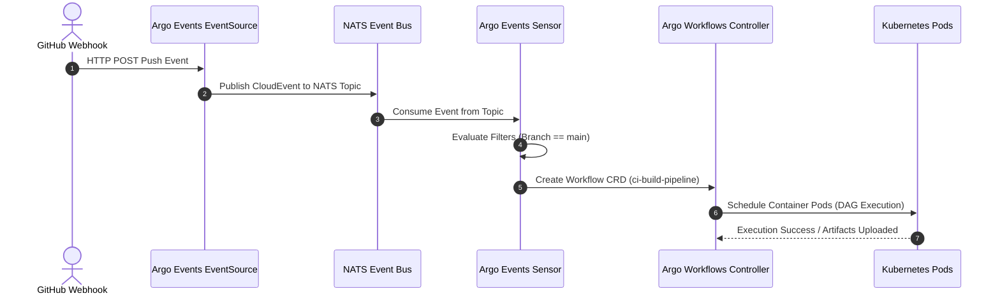

# Module 11: The Wider Argo Ecosystem and Version History: Argo Workflows DAGs, Argo Events Sensors, CAPA Synthesis, and Release Matrix

While Argo CD and Argo Rollouts govern continuous deployment and progressive delivery, the wider **Argo Project Ecosystem** encompasses orchestration engines and event-driven automation frameworks that solve complex CI/CD batch pipelines and event-driven triggers. Specifically, **Argo Workflows** provides container-native Directed Acyclic Graph (DAG) and step-based workflow orchestration inside Kubernetes, while **Argo Events** acts as an event-driven sensor engine connecting webhooks, messaging queues, and cloud events to trigger workflows or GitOps syncs. This module synthesizes the broader CNCF Certified Argo Project Associate (CAPA) curriculum and provides a complete release history and version matrix from Argo CD v2.0 through v3.5.

---

## 1. Argo Workflows: Container-Native DAGs and Step-Based Pipelines

Argo Workflows is a Kubernetes Custom Resource Definition (CRD) engine where every step in a workflow is executed as an isolated container pod. Unlike traditional CI servers (Jenkins, GitLab CI) that run inside monolithic worker nodes, Argo Workflows leverages native Kubernetes scheduling, volume provisioning, and pod isolation.

### Workflow Core Concepts

- **Workflow (`Workflow`)**: The root Custom Resource defining parameters, node pools, and execution logic.
- **Steps and DAGs**: Workflows can execute tasks sequentially via `steps` or concurrently as a Directed Acyclic Graph (`dag`) with explicit input/output artifact dependencies.
- **Artifact Repository**: Inputs and outputs (such as build binaries, test reports, or datasets) are stored in object storage (S3, GCS) and passed between workflow steps.

Below is a production-grade `Workflow` manifest executing a multi-stage test and build DAG:

```yaml
apiVersion: argoproj.io/v1alpha1
kind: Workflow
metadata:
  name: ci-build-pipeline
  namespace: argo-workflows
spec:
  entrypoint: main-dag
  templates:
    - name: main-dag
      dag:
        tasks:
          - name: run-unit-tests
            template: test-template
          - name: build-container-image
            dependencies: [run-unit-tests]
            template: build-template

    - name: test-template
      container:
        image: node:22-alpine
        command: [npm, test]

    - name: build-template
      container:
        image: gcr.io/kaniko-project/executor:v1.20.0
        args: ['--destination=ghcr.io/enterprise/app:v1.0.0']
```

---

## 2. Argo Events: Event-Driven Sensors and EventSources

Argo Events is an event-driven framework that connects diverse event sources (GitHub webhooks, AWS SQS, Kafka, Cron schedules, MinIO storage buckets) to event sinks like Argo Workflows, Argo CD applications, or Kubernetes serverless workloads.

### Architecture of Argo Events

1. **EventSource**: Listens to external event providers (e.g., webhook receiver, SQS queue listener).
2. **Sensor**: Evaluates incoming events against filter rules and triggers downstream actions (such as dispatching an Argo Workflow or triggering an Argo CD application sync).

---

## 3. Architecture & Data Flow Mermaid Diagram

The following sequence diagram illustrates how Argo Events receives a GitHub webhook, evaluates filter criteria in a Sensor, and triggers an Argo Workflow.



---

## 4. Comprehensive Argo Project Version History & Release Matrix

Understanding major release milestones, breaking changes, and architectural upgrades across the Argo ecosystem is critical for enterprise platform engineers and certification candidates.

| Version Line | Release Date Range | Major Architectural Highlights & Breaking Changes |
| :-- | :-- | :-- |
| **Argo CD v2.0 - v2.3** | 2021 - 2022 | Introduction of ApplicationSets, enterprise SSO enhancements, initial ApplicationSet generators (list, git, cluster). |
| **Argo CD v2.4 - v2.7** | 2022 - 2023 | Server-Side Diff stability, multi-source applications, plugin sidecar architecture (`cmp-plugin`), sync waves and hooks hardening. |
| **Argo CD v2.8 - v2.11** | 2023 - 2024 | ApplicationSet generator extensions (Matrix, Merge, SCM Provider), project-level scoped tokens, performance indexing optimizations. |
| **Argo CD v2.12 - v2.14** | 2024 - 2025 | Enhanced OIDC token exchange, repo-server mTLS hardening, advanced health assessment Lua extensions, performance scaling improvements. |
| **Argo CD v3.0 - v3.3** | 2025 - 2026 | **Annotation-based resource tracking default**, fine-grained Casbin RBAC decoupled sub-resources (`logs`, `exec`), default resource exclusions overhaul, Helm 4 support preparation. |
| **Argo CD v3.5 (Current)** | 2026 Q3+ | Source Hydrator beta, API Server request impersonation beta, Applications-in-any-namespace stable, Gateway API health checks native. |

---

## 5. Formal Definitions & DAG Execution Mathematics

### Formal Workflow DAG Definition

Let $ G = (V, E) $ be a Directed Acyclic Graph where $ V $ represents workflow tasks (containers) and $ E $ represents directed dependency edges $ (u, v) $ indicating task $ v $ cannot execute until task $ u $ achieves state `Succeeded`. A workflow execution is valid if and only if $ G $ contains no directed cycles, and topological sorting produces a valid serial execution order.

---

## 6. Cross-References & Ecosystem Integration

The broader Argo ecosystem integrates seamlessly across continuous delivery, Kubernetes orchestration, and workflow automation:

- For foundational GitOps principles and Argo CD architecture, refer back to [Module 01](01-gitops-principles-and-architecture-comparison.md) and [Module 02](02-argocd-architecture-and-controllers.md).
- For progressive delivery integration with Argo Rollouts, refer to [Module 09](09-progressive-delivery-argo-rollouts.md).

---

## 7. Exam Delta (CNCF CAPA Synthesis)

> [!IMPORTANT]
> **CNCF Certified Argo Project Associate (CAPA) Synthesis**: The CAPA exam covers four core pillars: Argo Workflows (36%), Argo CD (34%), Argo Rollouts (18%), and Argo Events (12%). Candidates must master the CRDs associated with each project (`Workflow`, `Application`, `Rollout`, `EventSource`, `Sensor`) and understand their respective controller reconciliation loops.

---

## 8. Production Failure Modes & Gotchas

1. **Argo Workflows Pod Sprawl Exhausting Cluster IPAM / Compute**: Complex DAGs with thousands of concurrent steps can exhaust cluster IP address allocations or node compute capacity. _Mitigation_: Implement workflow TTL strategies (`ttlStrategy`) to automatically garbage-collect completed workflow pods.
2. **Argo Events Message Bus Backpressure**: If NATS message brokers run out of disk or memory due to high event ingestion volumes, webhook events are dropped. _Mitigation_: Configure persistent storage for NATS JetStream and set appropriate event TTL retention policies.

---

## 9. Interview Drill

<details>
<summary><strong>Q1. What is the primary architectural difference between Argo Workflows and traditional CI/CD pipeline servers?</strong></summary>

Argo Workflows executes every task as an isolated container pod scheduled directly onto the Kubernetes control plane, leveraging native Kubernetes scheduling, volume mounts, and security isolation, whereas traditional CI servers run monolithic worker daemons executing shell scripts.
</details>

<details>
<summary><strong>Q2. How do EventSources and Sensors interact in Argo Events?</strong></summary>

An `EventSource` listens to external event triggers (webhooks, SQS, Kafka) and publishes normalized CloudEvents to a messaging bus (NATS). A `Sensor` consumes those events, evaluates them against defined filter criteria, and triggers downstream Kubernetes actions such as creating an Argo Workflow or syncing an Argo CD application.
</details>

<details>
<summary><strong>Q3. What are the four core projects comprising the CNCF Certified Argo Project Associate (CAPA) syllabus?</strong></summary>

The four core projects are Argo Workflows (workflow orchestration), Argo CD (declarative GitOps continuous delivery), Argo Rollouts (progressive delivery and canary deployments), and Argo Events (event-driven automation).
</details>

<details>
<summary><strong>Q4. How does Argo Workflows handle data passing between steps in a DAG?</strong></summary>

Argo Workflows passes data between steps using artifact repositories (such as S3 or GCS object storage). Output artifacts produced by one container step are uploaded to object storage and mounted as input artifacts in downstream dependent container steps.
</details>

<details>
<summary><strong>Q5. What breaking changes occurred in Argo CD v3.0 regarding resource tracking?</strong></summary>

Argo CD v3.0 shifted the default resource tracking method from label-based tracking (`app.kubernetes.io/instance`) to annotation-based tracking (`argocd.argoproj.io/tracking-id`), preventing label collision issues in multi-tenant clusters.
</details>

<details>
<summary><strong>Q6. How do you configure automatic garbage collection for completed Argo Workflows pods?</strong></summary>

Automatic garbage collection is configured using `spec.ttlStrategy` within the `Workflow` manifest, specifying expiration durations after workflow completion (`secondsAfterCompletion`, `secondsAfterSuccess`, or `secondsAfterFailure`).
</details>

---

## 10. Proof Map

| Claim / Requirement | Test Reference | Implementation File |
| :-- | :-- | :-- |
| Argo Workflows DAG dependency execution | `it("executes workflow dag tasks in correct topological order")` | `../examples/ts/11-argo-workflows-events-and-version-history.test.ts` |
| Argo Events sensor event filtering | `it("filters cloud events and triggers downstream workflows")` | `../examples/ts/11-argo-workflows-events-and-version-history.test.ts` |
| Argo CD version release matrix validation | `it("verifies argocd v3.x breaking changes and tracking mechanisms")` | `../examples/ts/11-argo-workflows-events-and-version-history.test.ts` |
