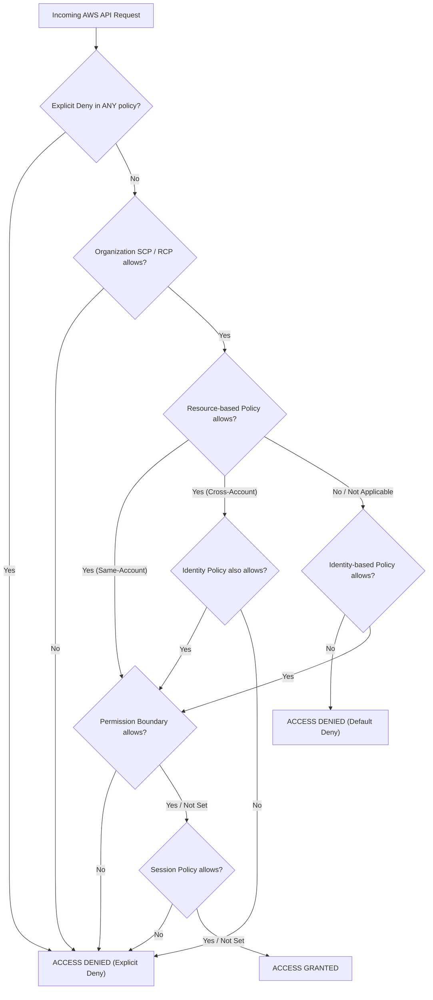

# AWS Architecture & Engineering Cheatsheet

A fast-lookup engineering reference covering IAM evaluation precedence, AWS CLI v2 operations, AWS SDK for JS v3 patterns, and critical service quotas and performance limits across AWS core services.

---

## 1. IAM Policy Evaluation Logic

When an AWS principal issues an API request, the AWS evaluation engine executes a deterministic decision tree across multiple policy types. Any **Explicit Deny** immediately terminates evaluation with `Deny`.



### Precedence Hierarchy Rules

1. **Explicit Deny Trumps All**: If any applicable policy (SCP, RCP, Identity, Resource, Boundary, or Session) contains an explicit `Deny`, the request is denied.
2. **Organizations Guardrails**: If the account belongs to an AWS Organization with Service Control Policies (SCPs) or Resource Control Policies (RCPs) enabled, the action must be explicitly permitted by the effective policy hierarchy.
3. **Cross-Account Authorization**: Cross-account access requires **two-sided permission**: the resource policy must allow the foreign principal, AND the foreign principal's identity policy must permit the action against the target ARN.
4. **Permission Boundary Intersection**: When a permission boundary is attached to an IAM identity, the effective permissions are the mathematical intersection (`Identity AND Boundary`).
5. **Default Deny**: If no policy explicitly allows the action, access is denied by default.

---

## 2. AWS CLI v2 Essential Commands

### STS & Cross-Account Role Assumption

```bash
# Verify current caller identity
aws sts get-caller-identity

# Assume cross-account role with External ID and session name
aws sts assume-role \
  --role-arn "arn:aws:iam::123456789012:role/ProductionDeployer" \
  --role-session-name "cicd-session-42" \
  --external-id "CorpSaaSSecretToken2026" \
  --duration-seconds 3600

# Export temporary session credentials to environment
export AWS_ACCESS_KEY_ID="ASI..."
export AWS_SECRET_ACCESS_KEY="..."
export AWS_SESSION_TOKEN="..."
```

### Amazon S3 High-Throughput Operations

```bash
# High-concurrency directory synchronization (preserves metadata)
aws s3 sync ./dist/ "s3://prod-static-assets-2026/dist/" \
  --delete \
  --cache-control "public, max-age=31536000, immutable"

# Generate a time-bounded presigned URL (valid for 15 minutes)
aws s3 presign "s3://prod-private-reports/q3-audit.pdf" --expires-in 900

# Copy with explicit Bucket Owner Enforced ownership and KMS encryption
aws s3 cp document.pdf "s3://secure-compliance-vault/document.pdf" \
  --sse "aws:kms" \
  --sse-kms-key-id "arn:aws:kms:eu-central-1:123456789012:key/custom-key-uuid"
```

### Amazon DynamoDB Item Operations

```bash
# Query items by Partition Key using key condition expression
aws dynamodb query \
  --table-name "EnterpriseStore" \
  --key-condition-expression "PK = :pk AND SK begins_with(:sk_prefix)" \
  --expression-attribute-values '{":pk": {"S": "TENANT#402"}, ":sk_prefix": {"S": "ORDER#"}}' \
  --consistent-read

# Atomic conditional put (prevent overwriting existing item)
aws dynamodb put-item \
  --table-name "EnterpriseStore" \
  --item '{"PK": {"S": "USER#101"}, "SK": {"S": "PROFILE"}, "Email": {"S": "user@corp.internal"}, "Version": {"N": "1"}}' \
  --condition-expression "attribute_not_exists(PK)"
```

### AWS Lambda Runtime Management

```bash
# Synchronously invoke function with payload and print output
aws lambda invoke \
  --function-name "OrderProcessor" \
  --payload '{"orderId": "ORD-991"}' \
  --cli-binary-format raw-in-base64-out \
  response.json

# Update provisioned concurrency allocation
aws lambda put-provisioned-concurrency-config \
  --function-name "OrderProcessor" \
  --qualifier "LIVE" \
  --provisioned-concurrent-executions 50
```

### AWS KMS & CloudWatch Operations

```bash
# Generate 256-bit symmetric data key for envelope encryption
aws kms generate-data-key \
  --key-id "arn:aws:kms:us-east-1:123456789012:key/custom-key-uuid" \
  --key-spec "AES_256"

# Execute CloudWatch Logs Insights query across distributed log group
aws logs start-query \
  --log-group-name "/aws/lambda/OrderProcessor" \
  --start-time $(date -v -1H +%s) \
  --end-time $(date +%s) \
  --query-string "fields @timestamp, @message | filter statusCode >= 500 | stats count(*) by bin(5m)"
```

---

## 3. AWS SDK for JS v3 Patterns

The AWS SDK for JavaScript v3 is modular, tree-shakable, and enforces typed command execution.

### S3 Streaming Download & Presigned URL Generation

```typescript
import { S3Client, GetObjectCommand, PutObjectCommand } from '@aws-sdk/client-s3';
import { getSignedUrl } from '@aws-sdk/s3-request-presigner';

const s3 = new S3Client({ region: 'eu-central-1' });

// Generate a presigned PUT URL
export async function createUploadUrl(bucket: string, key: string): Promise<string> {
  const command = new PutObjectCommand({
    Bucket: bucket,
    Key: key,
    ContentType: 'application/json',
  });
  return getSignedUrl(s3, command, { expiresIn: 300 });
}

// Stream an S3 object to UTF-8 string
export async function readS3Object(bucket: string, key: string): Promise<string> {
  const command = new GetObjectCommand({ Bucket: bucket, Key: key });
  const response = await s3.send(command);
  return response.Body ? await response.Body.transformToString('utf-8') : '';
}
```

### DynamoDB Document Client with Conditional Writes

```typescript
import { DynamoDBClient } from '@aws-sdk/client-dynamodb';
import { DynamoDBDocumentClient, PutCommand, QueryCommand } from '@aws-sdk/lib-dynamodb';

const ddb = DynamoDBDocumentClient.from(new DynamoDBClient({ region: 'eu-central-1' }));

export interface AccountLedgerItem {
  PK: string;
  SK: string;
  balance: number;
  version: number;
}

// Optimistic concurrency control via condition expression
export async function updateBalance(item: AccountLedgerItem, delta: number): Promise<void> {
  await ddb.send(
    new PutCommand({
      TableName: 'Ledger',
      Item: {
        ...item,
        balance: item.balance + delta,
        version: item.version + 1,
      },
      ConditionExpression: 'attribute_not_exists(PK) OR version = :expectedVersion',
      ExpressionAttributeValues: {
        ':expectedVersion': item.version,
      },
    }),
  );
}
```

### AWS KMS Envelope Encryption

```typescript
import { KMSClient, GenerateDataKeyCommand } from '@aws-sdk/client-kms';
import { createCipheriv, randomBytes } from 'node:crypto';

const kms = new KMSClient({ region: 'us-east-1' });

export async function encryptWithKmsEnvelope(
  keyId: string,
  plaintext: Buffer,
): Promise<{ ciphertext: Buffer; encryptedKey: Uint8Array; iv: Buffer; tag: Buffer }> {
  const { Plaintext: rawKey, CiphertextBlob: encryptedKey } = await kms.send(
    new GenerateDataKeyCommand({ KeyId: keyId, KeySpec: 'AES_256' }),
  );
  const iv = randomBytes(12);
  const cipher = createCipheriv('aes-256-gcm', rawKey!, iv);
  const ciphertext = Buffer.concat([cipher.update(plaintext), cipher.final()]);
  const tag = cipher.getAuthTag();
  Buffer.from(rawKey!).fill(0);
  return { ciphertext, encryptedKey: encryptedKey!, iv, tag };
}
```

---

## 4. Service Quotas & Operational Limits

| Service | Metric / Dimension | Default / Maximum Limit | Architecture Considerations & Workarounds |
| --- | --- | --- | --- |
| **Amazon S3** | Request rate per prefix | 3,500 PUT/POST/DELETE / 5,500 GET/HEAD req/s | Automatically scales across distinct prefixes; use prefix partitioning for heavy loads. |
| **Amazon S3** | Maximum object size | 5 TB (Single PUT: 5 GB) | Objects larger than 100 MB should use multipart upload; required for > 5 GB. |
| **Amazon S3** | Minimum multipart part size | 5 MB (except last part) | Buffering required prior to transmitting discrete multipart chunks. |
| **DynamoDB** | Physical partition throughput | 1,000 WCU / 3,000 RCU per partition | Distribute traffic evenly across high-cardinality partition keys to avoid hot spots. |
| **DynamoDB** | Maximum single item size | 400 KB (attributes + names) | Compress large payloads or offload binary blobs to S3 with object references. |
| **DynamoDB** | Transaction batch size | Up to 100 items (or 4 MB total) | Atomic all-or-nothing transactions consume 2x WCU/RCU; split larger operations. |
| **DynamoDB** | BatchGetItem / BatchWriteItem | 100 items (16 MB) / 25 items (16 MB) | Always check and re-drive `UnprocessedItems` and `UnprocessedKeys`. |
| **AWS Lambda** | Regional concurrent executions | 1,000 executions (soft limit) | Request quota increase early; configure reserved concurrency to protect backends. |
| **AWS Lambda** | Function execution timeout | 900 seconds (15 minutes) | Decompose long-running tasks into Step Functions workflows or ECS Fargate tasks. |
| **AWS Lambda** | Deployment package size | 50 MB (zipped), 250 MB (uncompressed), 10 GB (container) | Use container image packaging or Lambda Layers for heavy dependency trees. |
| **AWS Lambda** | Ephemeral `/tmp` storage | 512 MB to 10,240 MB (10 GB) | Mount Amazon EFS for shared or multi-gigabyte persistent storage needs. |
| **AWS Lambda** | Invocation payload size | 6 MB (Synchronous), 256 KB (Asynchronous) | Use claim-check pattern via S3 presigned URLs for payloads exceeding 6 MB. |
| **Amazon SQS** | Maximum message payload | 256 KB (1 to 262,144 bytes) | Use AWS SQS Extended Client Library with S3 backing for payloads up to 2 GB. |
| **Amazon SQS** | Visibility timeout | Default: 30s, Minimum: 0s, Maximum: 12 hours | Set visibility timeout to at least 6x your Lambda function processing timeout. |
| **Amazon SQS** | FIFO queue standard throughput | 300 msg/s (without batch), 3,000 msg/s (with batch) | Enable SQS FIFO High-Throughput mode to scale partitions up to 70,000 msg/s. |
| **Amazon VPC** | Security groups per ENI | 5 security groups | Consolidate common ingress rules or request quota increase up to 16. |
| **Amazon VPC** | Inbound/outbound rules per SG | 60 rules (IPv4/IPv6 evaluated separately) | Use Security Group referencing instead of sprawling CIDR lists to save quota. |
| **Amazon VPC** | Maximum Transmission Unit (MTU) | 1,500 bytes (internet), 9,001 bytes (Jumbo inside VPC) | Jumbo frames supported between instances within same VPC; clamped to 1500 over IGW/VPN. |
| **AWS KMS** | Direct payload encryption limit | 4,096 bytes (4 KB) | Payloads exceeding 4 KB require client-side envelope encryption via `GenerateDataKey`. |
| **AWS KMS** | Request rate per account & region | 5,500 to 50,000 req/s | Enable S3 Bucket Keys to reduce KMS API calls by 99% and avoid quota throttling. |
| **Amazon CloudWatch** | Custom metrics PutMetricData rate | 150 transactions/second | Emit Embedded Metric Format (EMF) logs to bypass PutMetricData API rate limits and costs. |
| **AWS CloudFormation** | Maximum template body size | 1 MB (S3 URL) \| 51,200 bytes (direct API) | Decompose templates using Nested Stacks or cross-stack exports. |
| **AWS CloudFormation** | Resources per template | 500 resources | Modularize architectures using Nested Stacks or AWS CDK construct libraries. |
| **AWS Secrets Manager** | Secret value size limit | 64 KB | Store larger binary secrets in encrypted S3 buckets with Secrets Manager referencing keys. |
| **SSM Parameter Store** | Standard vs Advanced parameter size | 4 KB (Standard) \| 8 KB (Advanced) | Use Standard parameters for zero-cost configurations; Advanced for larger policies. |
| **AWS DRS** | Staging data replication port | TCP port 1500 | Ensure outbound firewall rules allow continuous block replication from agents. |
