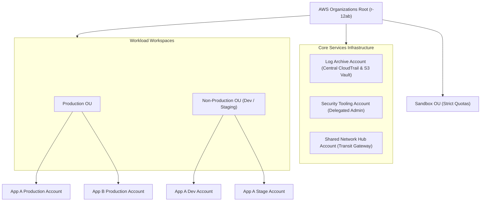
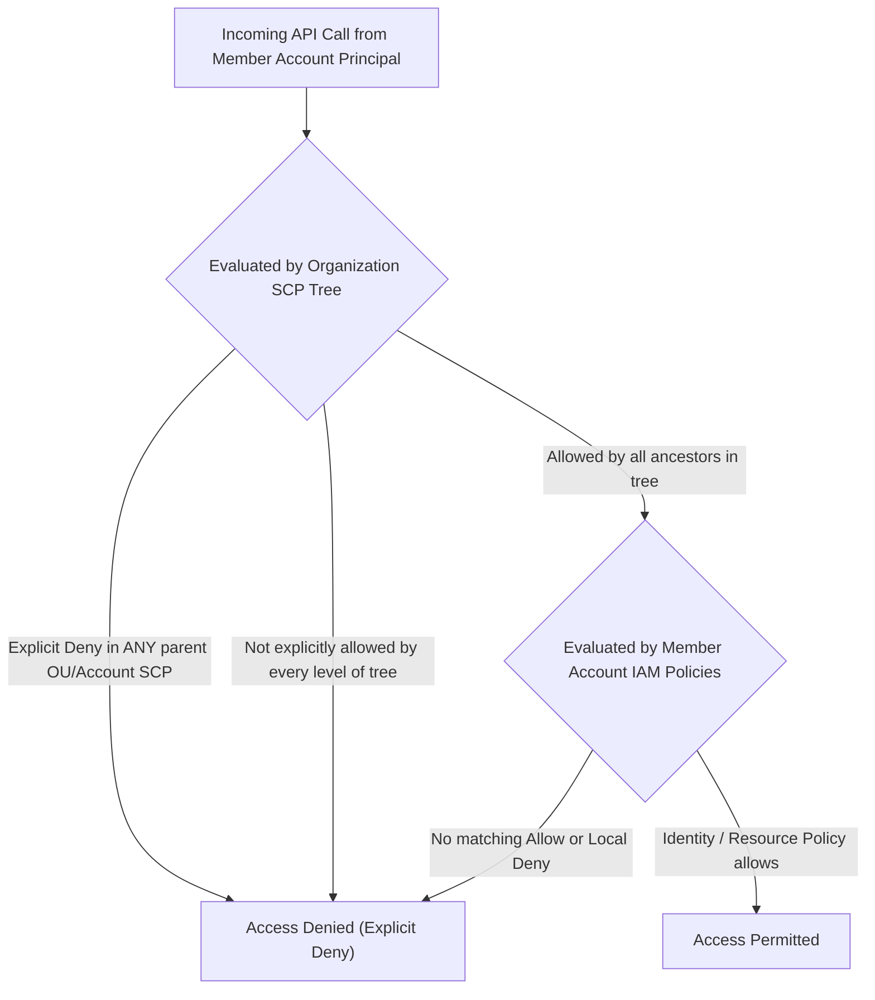
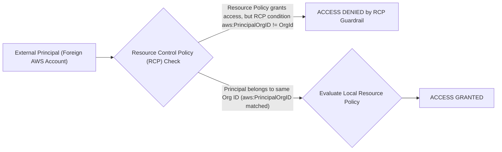
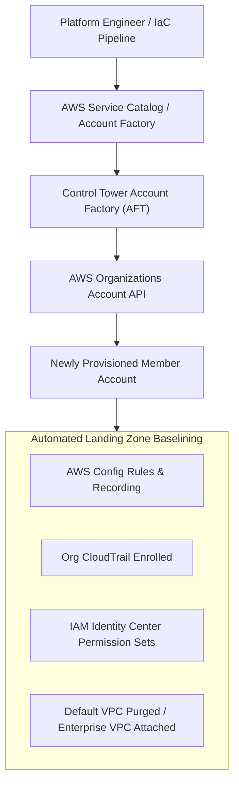
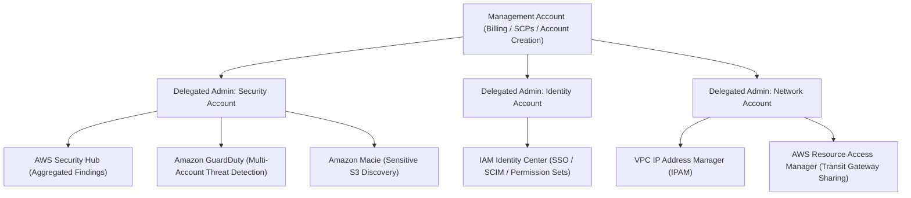

# Module 01: Account and Organization Model

In enterprise cloud architecture, the single AWS account model is an obsolete anti-pattern that violates basic principles of fault isolation, blast radius containment, and least privilege. Modern cloud platforms treat the AWS account as an isolated administrative, cryptographic, and security boundary. AWS Organizations and AWS Control Tower provide the declarative foundation required to operate hundreds or thousands of heterogeneous accounts under a unified governance and policy evaluation framework. Understanding this module requires analyzing multi-account topology, Service Control Policy (SCP) and Resource Control Policy (RCP) evaluation semantics, delegated administration patterns, declarative governance policies, and modern root credential hardening protocols.

---

## 1. AWS Organizations and Multi-Account Governance

An AWS account is the foundational container for identity, data storage, and compute resources. Each account possesses its own discrete 12-digit account identifier, an isolated AWS Identity and Access Management (IAM) namespace, independent service quotas, dedicated CloudTrail audit logs, and discrete billing streams. AWS Organizations transforms isolated accounts into a consolidated hierarchical tree managed from a single administrative root.



### Hierarchy Primitives

1. **Management Account (formerly Master Account)**: The root anchor of the entire organization. It owns the consolidated billing relationship with AWS, orchestrates account creation, pays all invoices, and manages Organization-level policies. The management account is exempt from Service Control Policies (SCPs) and should never host customer application workloads or persistent operational services.
2. **Organizational Units (OUs)**: Hierarchical directory containers used to group accounts with shared security profiles and compliance mandates. OUs can nest up to five levels deep below the root. Policies attached to an OU automatically inherit downward to all child OUs and nested member accounts.
3. **Member Accounts**: Independent AWS accounts subordinate to the organization. IAM administrators within a member account manage local IAM roles and policies, but their effective actions are bounded by policies inherited from parent OUs.
4. **Core Infrastructure Accounts**: A standard AWS landing zone segregates foundational platform responsibilities into dedicated accounts:
   - _Log Archive Account_: Contains an immutable, write-only S3 bucket that aggregates CloudTrail management logs, S3 server access logs, and VPC flow logs across every member account.
   - _Security Tooling Account_: Serves as the delegated administrator for detective and reactive security services including AWS Security Hub, Amazon GuardDuty, AWS IAM Identity Center, and Amazon Macie.
   - _Network Hub Account_: Owns centralized AWS Transit Gateways, Direct Connect Gateways, inspection VPCs with AWS Network Firewalls, and shared egress NAT gateways.

---

## 2. Service Control Policies (SCPs) and Evaluation Boundaries

A Service Control Policy (SCP) is an organization-level JSON policy document that defines the absolute maximum permissions available to IAM users, IAM roles, and account administrators within target accounts or OUs. SCPs function purely as access filters or guardrails; an SCP never grants permissions on its own.



### SCP Evaluation Semantics

- **Filtering Mechanism**: The effective permissions of an IAM identity inside a member account are the mathematical intersection of the account's local IAM policies and all SCPs applied along the ancestry path from the organization root to the account: $$\text{Effective Permissions} = \text{IAM Policies} \cap \text{SCP}_{\text{Root}} \cap \text{SCP}_{\text{OU}_1} \cap \dots \cap \text{SCP}_{\text{Account}}$$
- **Inheritance and The FullAWSAccess Baseline**: By default, AWS Organizations attaches the AWS-managed policy `FullAWSAccess` (`{"Effect": "Allow", "Action": "*", "Resource": "*"}`) to the Root, every OU, and every account. In an _allow-list_ strategy, `FullAWSAccess` is replaced with granular Allow statements at each tier. In a _deny-list_ strategy (the recommended enterprise standard), `FullAWSAccess` remains attached to allow general operations, while explicit `Deny` statements are layered onto specific OUs to enforce non-negotiable security boundaries.
- **The Management Account Exemption**: SCPs do not restrict actions executed by identities within the management account. If an adversary compromises the management account, SCP guardrails provide zero protection. This operational vulnerability dictates that the management account must have all administrative human access locked down.
- **Policy Size Limits and Optimization**: An SCP document has a maximum size limit of 10,240 characters (or bytes). When managing extensive deny-lists or complex conditions, platform teams can attach up to 10 SCPs directly per root, OU, or account, or use wildcard action grouping and `NotAction` blocks with `StringNotEquals` conditions to preserve character budgets.

### Canonical Enterprise SCP Examples

#### 1. Preventing Disablement of Security Services and CloudTrail

```json
{
  "Version": "2012-10-17",
  "Statement": [
    {
      "Sid": "ProtectSecurityObservability",
      "Effect": "Deny",
      "Action": [
        "cloudtrail:DeleteTrail",
        "cloudtrail:StopLogging",
        "cloudtrail:UpdateTrail",
        "guardduty:DeleteDetector",
        "guardduty:DisassociateFromMasterAccount",
        "securityhub:DisableSecurityHub",
        "config:DeleteConfigRule",
        "config:StopConfigurationRecorder"
      ],
      "Resource": "*"
    }
  ]
}
```

#### 2. Restricting Allowed AWS Operating Regions

Enterprises bound by regional data residency mandates (such as GDPR in Europe) must block compute, network, and storage provisioning outside sanctioned regions. Global services that anchor their control plane in `us-east-1` (such as IAM, Route 53, CloudFront, and Support) must be explicitly exempted from the regional block.

```json
{
  "Version": "2012-10-17",
  "Statement": [
    {
      "Sid": "EnforceRegionalDataPerimeter",
      "Effect": "Deny",
      "NotAction": [
        "a4b:*",
        "acm:*",
        "aws-marketplace-management:*",
        "aws-marketplace:*",
        "aws-portal:*",
        "budgets:*",
        "ce:*",
        "chime:*",
        "cloudfront:*",
        "config:*",
        "cur:*",
        "directconnect:*",
        "ec2:DescribeRegions",
        "fms:*",
        "globalaccelerator:*",
        "health:*",
        "iam:*",
        "importexport:*",
        "kms:*",
        "mobileanalytics:*",
        "networkmanager:*",
        "organizations:*",
        "pricing:*",
        "route53:*",
        "route53domains:*",
        "s3:GetAccountPublicAccessBlock",
        "s3:ListAllMyBuckets",
        "shield:*",
        "sts:*",
        "support:*",
        "trustedadvisor:*",
        "waf-regional:*",
        "waf:*",
        "wafv2:*",
        "wellarchitected:*"
      ],
      "Resource": "*",
      "Condition": {
        "StringNotEquals": {
          "aws:RequestedRegion": ["eu-central-1", "eu-west-1"]
        }
      }
    }
  ]
}
```

#### 3. Preventing Member Accounts from Leaving the Organization

```json
{
  "Version": "2012-10-17",
  "Statement": [
    {
      "Sid": "PreventLeavingOrganization",
      "Effect": "Deny",
      "Action": ["organizations:LeaveOrganization"],
      "Resource": "*"
    }
  ]
}
```

---

## 3. Resource Control Policies (RCPs) and Data Perimeters

While Service Control Policies restrict what principals in member accounts can do, they do not restrict what external principals (from accounts outside your organization) can do when accessing resources within your accounts via resource-based policies (such as S3 bucket policies, KMS key policies, or SQS queue policies).

AWS introduced **Resource Control Policies (RCPs)** to enforce centralized preventive guardrails on resource-based policies across all accounts in an organization. RCPs establish a non-bypassable _data perimeter_, guaranteeing that resources owned by your organization cannot be configured to allow access from untrusted external principals, even if a local account administrator inadvertently writes an overly permissive resource policy (`Principal: "*"`).



### Data Perimeter Three-Way Invariant

A formal AWS data perimeter guarantees three continuous invariants:

1. **Trusted Identities**: Only identities belonging to your organization can access your resources.
2. **Trusted Resources**: Identities in your organization can only access resources owned by your organization.
3. **Trusted Network**: Requests to your resources and from your identities must transit approved network paths (VPCs and corporate endpoints), blocking access over untrusted public internet routes.

### Sample RCP Restricting S3 Bucket Access to Corporate Organization

```json
{
  "Version": "2012-10-17",
  "Statement": [
    {
      "Sid": "EnforceOrgDataPerimeterOnS3",
      "Effect": "Deny",
      "Principal": "*",
      "Action": ["s3:GetObject*", "s3:PutObject*"],
      "Resource": "*",
      "Condition": {
        "StringNotEquals": {
          "aws:PrincipalOrgID": "o-enterprise1234"
        }
      }
    }
  ]
}
```

---

## 4. Declarative Policies in AWS Organizations

Beyond authorization guardrails (SCPs and RCPs), AWS Organizations manages multi-account governance through declarative configuration policies:

| Policy Type | Purpose | Primary Architectural Use Case |
| --- | --- | --- |
| **Backup Policies** | Enforces centralized backup scheduling, retention periods, and cross-region copy rules via AWS Backup. | Guarantees compliance for automated daily EBS, RDS, and DynamoDB snapshots across all member accounts without per-account configuration. |
| **Tag Policies** | Enforces standard tagging schema and capitalization across all resources (`CostCenter`, `Environment`, `Owner`). | Prevents resource provisioning if non-compliant tags are supplied; standardizes allocation tags for Cost and Usage Reports (CUR 2.0). |
| **Chatbot Policies** | Governs permissions for Slack and Microsoft Teams integration channels using AWS Chatbot. | Restricts which third-party workspace channels can receive alerts or execute operational commands against production accounts. |
| **AI Services Opt-Out Policies** | Controls whether AWS artificial intelligence services (such as Amazon Bedrock, Rekognition, Comprehend) may store or use customer content for model training. | Enforces strict regulatory opt-out policies globally across all member accounts to ensure proprietary intellectual property is never retained. |

---

## 5. AWS Control Tower and Landing Zone Automation

AWS Control Tower automates the setup and baseline governance of a multi-account AWS environment using prescriptive best practices established by the AWS Well-Architected Framework. Control Tower deploys an automated landing zone that packages Organizations, Identity Center, CloudTrail, Config, and Service Catalog into a self-service platform.



### Control Tower Guardrail Taxonomy

Control Tower enforces rules across three execution disciplines:

1. **Preventive Guardrails**: Enforced using Service Control Policies (SCPs) and Resource Control Policies (RCPs). Unapproved actions are blocked at API invocation time before execution.
2. **Detective Guardrails**: Enforced using AWS Config managed rules and EventBridge remediation targets. Actions are permitted to execute, but if they create non-compliant configurations (such as an unencrypted S3 bucket or public database port), an alert is dispatched to Security Hub and automated remediation triggers.
3. **Proactive Guardrails**: Enforced prior to provisioning during CloudFormation deployment using CloudFormation Guard hooks. If an engineer submits an infrastructure template that violates organizational security baselines, CloudFormation rejects stack creation before resources are instantiated.

### Account Factory for Terraform (AFT)

For organizations managing infrastructure as code, AWS provides Account Factory for Terraform (AFT). AFT establishes a GitOps pipeline driven by AWS CodePipeline or external VCS (GitHub, GitLab) where creating a new account requires only submitting a declarative HCL block describing account metadata, parent OU placement, and custom post-provisioning Terraform modules.

---

## 6. Delegated Administration and Landing Zones

The AWS Management Account should be reserved strictly for organization billing, initial account provisioning, and root policy attachment. Operating operational tooling inside the management account violates the principle of separation of duties and exponentially increases blast radius.

AWS Organizations supports **Delegated Administration**, allowing an organization to nominate specific member accounts as administrators for individual AWS services.



### Architectural Benefits of Delegated Administration

1. **Blast Radius Isolation**: If security tooling is compromised or misconfigured, the adversary cannot modify organization hierarchy, billing settings, or account lifecycles.
2. **Least Privilege for Security Engineers**: Corporate security teams operate with full administrative privileges inside the Security Tooling account without requiring access to the management account root.
3. **Cross-Account Aggregation**: Delegated administrator accounts automatically enable services in newly enrolled member accounts via automated lifecycle hooks, centralizing findings into a single dashboard.

---

## 7. AWS Resource Access Manager (RAM) in Multi-Account Networks

In a distributed multi-account topology, creating dedicated network infrastructure (such as Transit Gateways, Route 53 Resolver rules, and private subnets) within every account generates astronomical costs and extreme routing complexity. **AWS Resource Access Manager (RAM)** enables accounts to securely share supported AWS resources with other accounts, OUs, or the entire organization without duplicating infrastructure.

### Shared VPC Subnets via RAM

Instead of peering individual VPCs across dozens of development accounts, enterprise network teams provision an enterprise VPC within the centralized Network Hub account and share individual subnets with workload accounts via AWS RAM.

- **Ownership Separation**: The Network Hub account owns the VPC, CIDR blocks, route tables, Internet Gateways, NAT Gateways, and Network ACLs.
- **Workload Ownership**: Member accounts provision their own resources (EC2 instances, ECS tasks, RDS databases, Lambda functions) inside the shared subnets. Member accounts manage their own Security Groups, but cannot modify the underlying routing or subnet CIDR masks.
- **Security Group Referencing**: Security groups created in member account A cannot directly reference security groups in member account B unless both belong to the same shared VPC, enabling seamless microservice firewall rules across accounts.

---

## 8. Multi-Account Automation with CloudFormation StackSets

Managing consistent baseline configurations across hundreds of accounts requires programmatic orchestration. **AWS CloudFormation StackSets** extends CloudFormation stacks across multiple accounts and regions in a single declarative operation.

### Service-Managed vs Self-Managed Permissions

- **Service-Managed StackSets**: Integrates natively with AWS Organizations. Permissions are handled automatically by AWS without manual cross-account IAM role provisioning. When an administrator deploys a StackSet to an Organizational Unit with `AutoDeployment: Enabled`, any newly enrolled account joining that OU automatically receives the baseline CloudFormation resources (e.g., IAM baseline roles, Config rules, CloudWatch alarms).
- **Self-Managed StackSets**: Requires administrators to manually establish an administrative role (`AWSCloudFormationStackSetAdministrationRole`) in the source account and an execution role (`AWSCloudFormationStackSetExecutionRole`) across all target member accounts. This model is primarily reserved for cross-organization or hybrid multi-cloud deployments.

### Concurrency and Fault Tolerance Controls

StackSets provides granular deployment execution controls:

- **Maximum Concurrent Accounts**: Governs how many target accounts receive simultaneous stack updates (specified as an absolute number or percentage), preventing API throttling across regions.
- **Failure Tolerance**: Sets a threshold of failed account deployments before the entire StackSet operation halts, preserving system stability and bounding broken rollouts.
- **Region Concurrency**: Supports sequential or parallel multi-region deployments, enabling engineers to canary regional updates (e.g., deploying to `eu-central-1` first before rolling out to global regions).

---

## 9. Centralized Cost Attribution via Tag Policies and Cost Allocation Tags

Operating hundreds of member accounts requires continuous visibility into cloud spending. Without strict tag governance, unallocated infrastructure costs become an unmanageable financial liability.

### Tag Policy Enforcement Mechanics

AWS Organizations Tag Policies allow administrators to define compliant tag keys and case-sensitive allowed values across member accounts.

- **Enforcement Options**: Tag policies can be configured in audit mode (reporting non-compliant resources to AWS Config and Security Hub) or enforcement mode (actively preventing actions such as `ec2:RunInstances` or `rds:CreateDBInstance` if required tags are absent or formatted improperly).
- **Cost Allocation Tags**: Once tags like `CostCenter` or `ProjectCode` are standardized via Tag Policies, they are activated as Cost Allocation Tags in the Management Account. Activated tags propagate directly into AWS Cost Explorer and the AWS Cost and Usage Report (CUR 2.0), allowing finance teams to query infrastructure costs with SQL precision using Amazon Athena.

---

## 10. Root User Hardening and Centralized Root Access

The AWS root user possesses complete, unrestrained administrative access to all resources within an account. Root user credentials bypass all IAM identity-based policies and permission boundaries. If a root user's compromises credentials, an attacker can destroy infrastructure, delete audit logs, and ransom the business.

### Root Hardening Protocol

1. **Eliminate Long-Term Access Keys**: The root user of any AWS account must NEVER possess programmatic access keys (`AWSAccessKeyId` / `AWSSecretAccessKey`). Any existing root keys must be deleted immediately.
2. **FIDO2 Hardware Security Keys**: Secure the root login with hardware-backed Multi-Factor Authentication (MFA), such as dual YubiKey security keys registered via FIDO2 WebAuthn. Hardware keys are immune to phishing, SIM-swapping, and SMS interception attacks.
3. **Dedicated Distribution List for Root Email**: The email address associated with the root user must point to an internal, monitored corporate distribution list (e.g., `aws-root-account-401@corp.internal`) rather than an individual employee's inbox. This guarantees that billing notices, compliance warnings, and account lockout notifications are visible to the engineering team.
4. **Centralized Root Access Management**: Modern AWS Organizations functionality enables administrators to perform privileged root maintenance tasks on member accounts directly from the management account or a delegated admin account using IAM Identity Center temporary credentials. This eliminates the operational requirement to ever log into member accounts as the local root user.

---

## 11. Then vs Now: Evolution of AWS Multi-Account Governance

| Dimension | Legacy Pattern (Then) | Modern Architecture (Now) | Architectural Justification |
| --- | --- | --- | --- |
| **Account Topology** | Single monolithic AWS account with dense IAM user groups and environment prefixes (`prod-`, `dev-`). | Multi-account landing zone organized into structured OUs (Core, Security, Workloads, Sandbox). | Provides absolute hardware, IAM, network, and quota isolation; bounds security blast radius during credential breaches. |
| **Access Guardrails** | Complex, repetitive IAM customer managed policies attached manually to users and roles inside each account. | Centralized Service Control Policies (SCPs) and Resource Control Policies (RCPs) inherited hierarchically. | Enforces non-bypassable preventive security and data perimeters across thousands of accounts without manual per-account configuration. |
| **Management Account Role** | Hosted deployment pipelines, shared Jenkins servers, and direct developer SSH bastion jump hosts. | Dedicated exclusively to billing, organization hierarchy, and delegated admin authorization; zero compute workloads. | Isolates billing and organization root authority from operational software vulnerabilities and compromised developer credentials. |
| **Human Identity Access** | Long-term IAM users created locally in each account with static passwords and access keys. | Centralized IAM Identity Center federated via SAML 2.0 / OIDC (Okta, Entra ID) using short-lived STS credentials. | Automates employee provisioning and offboarding via SCIM; eliminates static credentials and credential leakage risks. |
| **Root Account Access** | Shared root credentials stored in team password managers; frequent direct root logins for maintenance. | Member account root access centralized from the management account; physical FIDO2 hardware MFA enforced on root. | Prevents credential theft; provides non-repudiable audit trails in CloudTrail for privileged operations. |
| **Network Sharing** | Point-to-point VPC peering mesh or multiple VPN tunnels connecting independent accounts. | Centralized Transit Gateway and VPC Subnet sharing via AWS Resource Access Manager (RAM). | Drastically reduces routing complexity, eliminates duplicate NAT Gateway hourly costs, and centralizes traffic inspection. |
| **Cross-Account Provisioning** | Custom Python scripts running nested STS assume-role loops to apply baseline templates. | AWS CloudFormation StackSets with service-managed auto-deployment tied to OU membership. | Guarantees atomic, audited, and automated configuration baselining the instant a new member account is created. |
| **Cost Attribution** | Ad-hoc manual tagging with retrospective cost reallocation spreadsheets. | Declarative Tag Policies enforcing strict schema prior to resource provisioning. | Guarantees 100% tagged infrastructure for automated billing ingestion via CUR 2.0 and Athena. |

---

## Interview Drill

<details><summary>1. A senior engineer in a member account has full `AdministratorAccess` and tries to delete a KMS customer managed key, but receives an `AccessDenied` error. What is the most probable cause?</summary>

The most probable cause is an explicit `Deny` in an applicable Service Control Policy (SCP) attached to the member account or one of its parent Organizational Units (OUs). In AWS IAM evaluation logic, an explicit Deny in an SCP overrides any local identity-based grant, including the AWS-managed `AdministratorAccess` policy. Alternatively, a newly enforced Resource Control Policy (RCP) or an IAM permission boundary attached to the engineer's assumed role could be restricting `kms:ScheduleKeyDeletion`.

</details>

<details><summary>2. Why are Service Control Policies (SCPs) alone insufficient to create an airtight data perimeter for Amazon S3?</summary>

SCPs only govern the API calls executed by IAM identities (users and roles) that reside _within_ the accounts where the SCP is applied. SCPs cannot restrict requests made by external principals (identities in external AWS accounts or unauthenticated internet callers) accessing resources in your accounts via resource-based policies (such as an overly permissive S3 bucket policy allowing `Principal: "*"`). To build an airtight data perimeter, organizations must combine SCPs (governing internal principals) with Resource Control Policies (RCPs) and resource policies containing `aws:PrincipalOrgID` conditions (governing resources).

</details>

<details><summary>3. Can a Service Control Policy be used to prevent the management account from terminating an AWS CloudTrail trail?</summary>

No. Service Control Policies do not apply to identities operating inside the AWS Organizations management account. The management account is completely exempt from SCP restrictions. To protect CloudTrail in the management account, administrators must rely on strict IAM identity policies, multi-person authorization approvals, hardware MFA, and by delegating logging administration to a dedicated Log Archive member account.

</details>

<details><summary>4. What is the operational difference between Delegated Administration and assuming a cross-account IAM role?</summary>

Delegated Administration is a native AWS Organizations capability where the management account designates a member account as the official administrator for a specific AWS service (such as Amazon GuardDuty, AWS Security Hub, or IAM Identity Center). The service itself recognizes the delegated account, automatically enrolls new member accounts, and aggregates telemetry across the organization without requiring explicit cross-account STS role assumption for daily operations. Cross-account IAM roles, by contrast, are point-to-point trust relationships that require explicit STS `AssumeRole` API calls and credential management.

</details>

<details><summary>5. Explain the security implications of using an allow-list versus a deny-list strategy for Service Control Policies.</summary>

In an allow-list strategy, the default `FullAWSAccess` SCP is detached, and administrators explicitly grant only approved services and actions at each OU tier. While this offers the tightest theoretical least privilege, it incurs massive operational maintenance overhead: when AWS launches new services or feature APIs, existing workloads or administrators cannot use them until the entire organization SCP hierarchy is updated. In a deny-list strategy (the enterprise best practice), `FullAWSAccess` remains attached to allow standard API evolution, while explicit `Deny` statements selectively block dangerous actions (e.g., disabling CloudTrail, leaving the organization, launching unapproved regions). Deny-lists are robust, resilient to new service releases, and simpler to audit.

</details>

<details><summary>6. How does AWS Resource Access Manager (RAM) change VPC subnet architecture across multi-account organizations?</summary>

AWS RAM enables VPC sharing, where a centralized network account creates and owns a VPC and its subnets, and shares those subnets with multiple member accounts within the organization. Application developers in member accounts can launch their own EC2, ECS, or RDS resources into the shared subnets and manage their own local Security Groups, but cannot modify CIDRs, routing tables, Network ACLs, or internet gateways. This eliminates duplicate VPC and NAT Gateway costs, simplifies network topology, and standardizes IP address management.

</details>

<details><summary>7. What occurs when an account resides within nested OUs (e.g., an OU within a parent OU) and an SCP at the top OU contains an Allow while an SCP at a lower OU contains a Deny?</summary>

In AWS Organizations policy evaluation, an explicit Deny at ANY level of the hierarchy (Root, parent OU, child OU, or member account) immediately results in an explicit denial of the action. The Deny at the lower OU overrides the Allow at the top OU. Furthermore, for an action to be permitted, it must be explicitly allowed at every single tier between the root and the target account; any break in the chain of allows behaves as an implicit deny.

</details>

<details><summary>8. How does AWS Organizations enforce case-sensitivity and allowed values for Cost Allocation Tags across independent business units?</summary>

AWS Organizations Tag Policies define declarative schemas that specify exact tag key names (e.g., `CostCenter`) and case-sensitive allowed value lists (e.g., `["Engineering", "Marketing", "Finance"]`). When attached to an OU, tag policies can enforce compliance by blocking non-compliant API calls or surfacing non-compliant resources in AWS Config audit reports. In the management account, administrators activate these standardized keys as Cost Allocation Tags, ensuring that all member account spending is properly grouped in the Cost and Usage Report (CUR 2.0) without phantom categories created by capitalization discrepancies (e.g., `costcenter` vs `CostCenter`).

</details>
