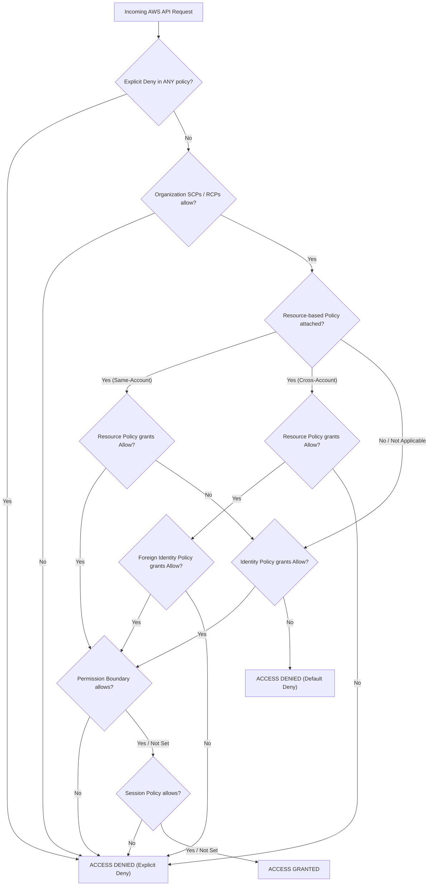
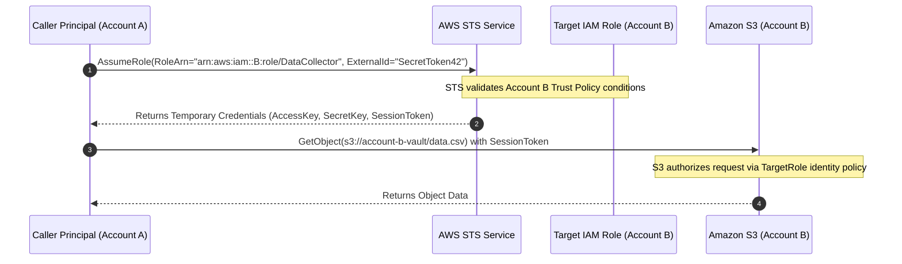
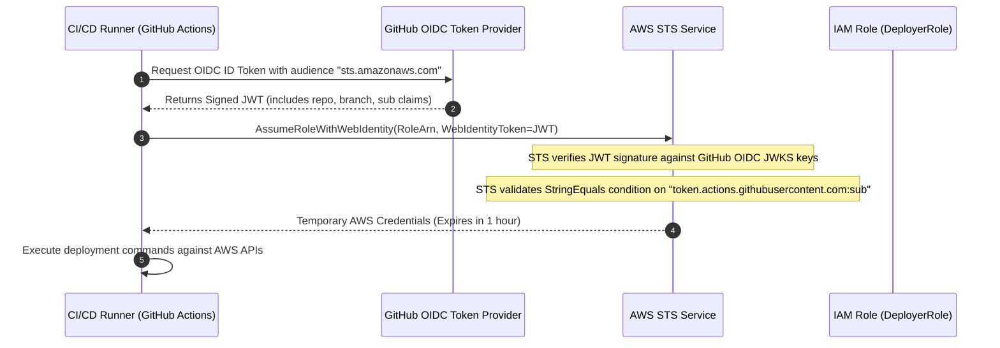
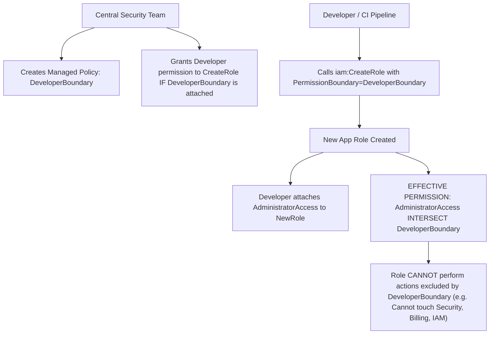
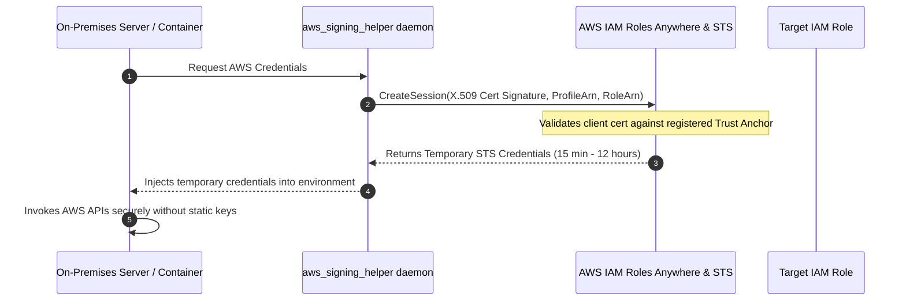
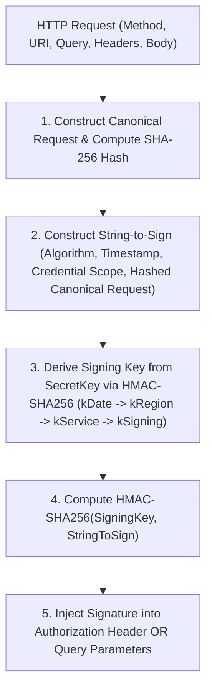

# Module 02: IAM in Depth and Policy Evaluation

AWS Identity and Access Management (IAM) is the foundational authorization and cryptographic identity substrate across all Amazon Web Services. Every API invocation—whether dispatched from the AWS Management Console, an AWS SDK client, the AWS CLI, or an internal microservice—terminates at the IAM policy evaluation engine. Understanding IAM requires mastering the six distinct policy types, the deterministic multi-stage evaluation algorithm, cross-account trust boundaries, confused deputy mitigations, OpenID Connect (OIDC) federated workload identities, Attribute-Based Access Control (ABAC), and Signature Version 4 (SigV4) cryptographic signing.

---

## 1. IAM Policy Taxonomy and Precedence Engine

AWS IAM evaluates permissions across six distinct policy categories. Each category enforces authorization at a specific architectural boundary.



### The Six Policy Types

1. **Service Control Policies (SCPs)**: Centralized organization guardrails specifying the maximum permissions available to accounts within an AWS Organization. SCPs never grant permissions; they filter out unauthorized actions.
2. **Resource Control Policies (RCPs)**: Centralized organization guardrails defining maximum allowable access on resource-based policies across member accounts, preventing unintended external data exposure.
3. **Identity-Based Policies**: JSON policy documents attached directly to IAM identities (users, user groups, and roles). They are subdivided into _managed policies_ (standalone policies with distinct ARNs, versioning, and reusability) and _inline policies_ (embedded directly within a single identity, deleted when the identity is deleted).
4. **Resource-Based Policies**: JSON policy documents embedded directly onto AWS resources (e.g., Amazon S3 bucket policies, AWS KMS key policies, Amazon SQS queue policies, AWS Secrets Manager secret policies, and IAM role trust policies). Unlike identity policies, resource-based policies explicitly define a `Principal` element specifying which caller identities are authorized.
5. **Permission Boundaries**: Managed policies attached to IAM users or roles that define the maximum permissions that identity-based policies can grant. A permission boundary does not grant permissions on its own; it acts as a ceiling or quota.
6. **Session Policies**: Temporary inline or managed policies passed programmatically via the AWS Security Token Service (STS) when assuming a role (`sts:AssumeRole`, `sts:AssumeRoleWithWebIdentity`, `sts:GetFederationToken`). Session policies filter the permissions inherited from the role's identity policies.

---

## 2. Deterministic Policy Evaluation Algorithm

The AWS policy evaluation engine executes a strict sequence of mathematical evaluations:

### Step 1: Explicit Deny Evaluation

The engine parses all policies applicable to the request (SCPs, RCPs, Identity policies, Resource policies, Boundaries, Session policies). If **ANY** statement in any policy contains an `Effect: "Deny"` matching the requested action, target resource, and context conditions, evaluation immediately terminates with `Access Denied`. Explicit Deny is non-negotiable and overrides all Allows.

### Step 2: Organization Guardrails Evaluation (SCPs & RCPs)

If the account is a member of an AWS Organization:

- For actions evaluated against internal principals, the action must be permitted by every SCP along the hierarchy path from the organization root to the account. If no matching Allow exists, access is implicitly denied (`SCP Deny`).
- For resources evaluated against resource policies, the action must comply with applicable Resource Control Policies (RCPs).

### Step 3: Resource Policy vs Identity Policy Evaluation

AWS distinguishes sharply between same-account and cross-account evaluation:

- **Same-Account Requests**: If the principal and the resource exist within the identical AWS account, an explicit `Allow` in **EITHER** an identity-based policy **OR** a resource-based policy satisfies the authorization check. Both are not required.
- **Cross-Account Requests**: If the principal resides in Account A and the target resource resides in Account B, access requires two-sided authorization. First, the resource-based policy in Account B must explicitly permit the foreign principal (`Principal: "arn:aws:iam::AccountA:role/Worker"`). Second, the identity-based policy attached to the principal in Account A must explicitly permit the action against the target ARN in Account B (`Resource: "arn:aws:s3:::account-b-vault/*"`). If either side fails to grant an explicit Allow, cross-account access is denied.

> [!IMPORTANT]
> **The AWS KMS Key Policy Exception**: While standard AWS services (S3, SQS, SNS) follow the either/or same-account rule, AWS Key Management Service (KMS) is a critical exception. By design, KMS key policies are the primary authorization document: an IAM identity policy alone cannot grant access to a KMS key unless the KMS Key Policy explicitly delegates authorization to the account root (`Principal: { "AWS": "arn:aws:iam::<account-id>:root" }`). If this root delegation statement is omitted from the Key Policy, identity policies have zero effect even within the same account.

### Step 4: Permission Boundary Evaluation

If a permission boundary is attached to the principal, the requested action must be explicitly permitted by the boundary policy. If the boundary does not contain a matching Allow, the request is denied (`Boundary Deny`). The effective permission is the logical intersection: $$\text{Effective Permission} = \text{Identity Policy} \cap \text{Permission Boundary}$$

### Step 5: Session Policy Evaluation

If the request is executed using temporary credentials issued with an inline or managed session policy, the action must be permitted by the session policy. If not, access is denied (`Session Policy Deny`).

### Step 6: Default Deny (Implicit Deny)

If evaluation completes all preceding stages and no applicable policy has granted an explicit Allow, the engine defaults to `Access Denied`.

---

## 3. Cross-Account Role Assumption and Confused Deputy Mitigations

Cross-account access without resource-based policies requires assuming an IAM role across account boundaries using the AWS Security Token Service (STS).



### Trust Policy Mechanics

An IAM role differs from an IAM user because it cannot authenticate with static passwords or permanent access keys. Instead, an IAM role carries a **Trust Policy** (a specialized resource-based policy) that defines which trusted entities (principals) are permitted to assume the role.

```json
{
  "Version": "2012-10-17",
  "Statement": [
    {
      "Sid": "AllowAccountAToAssume",
      "Effect": "Allow",
      "Principal": {
        "AWS": "arn:aws:iam::111122223333:root"
      },
      "Action": "sts:AssumeRole",
      "Condition": {
        "StringEquals": {
          "sts:ExternalId": "EnterpriseTenantToken_90210"
        }
      }
    }
  ]
}
```

### The Confused Deputy Problem

The _confused deputy_ is a classic computer security dilemma where a privileged entity (the deputy, such as an AWS service or a multi-tenant SaaS vendor) is manipulated by an unauthorized caller into executing actions against target resources without adequate authorization scoping.

#### Scenario 1: Multi-Tenant SaaS Vendor Mitigation via `sts:ExternalId`

Suppose a third-party SaaS monitoring platform (Account C) connects to customer accounts (Account A and Account B) to collect metrics. If Customer B can trick the SaaS vendor into querying Account A's role ARN, the SaaS vendor becomes a confused deputy. To prevent this, Customer A configures an `sts:ExternalId` condition in their role trust policy. The SaaS vendor passes Customer A's unique external ID when calling `sts:AssumeRole`. Because Customer B does not know Customer A's external ID, Customer B cannot exploit the SaaS platform to access Account A.

#### Scenario 2: Cross-Service Confused Deputy Mitigation via `aws:SourceArn`

When an AWS service (such as Amazon SNS, Amazon CloudWatch, or AWS Config) assumes a role or accesses a resource on your behalf, an attacker could attempt to use their own SNS topic to write into your S3 bucket. To prevent this, resource policies must include global condition context keys:

- `aws:SourceArn`: Enforces that the API request originates from a specific resource ARN (e.g., `arn:aws:sns:eu-central-1:111122223333:ProductionAlerts`).
- `aws:SourceAccount`: Enforces that the request originates from your specific 12-digit AWS account ID.

```json
{
  "Version": "2012-10-17",
  "Statement": [
    {
      "Sid": "MitigateConfusedDeputyOnS3",
      "Effect": "Allow",
      "Principal": {
        "Service": "cloudtrail.amazonaws.com"
      },
      "Action": "s3:PutObject",
      "Resource": "arn:aws:s3:::audit-vault-2026/AWSLogs/111122223333/*",
      "Condition": {
        "StringEquals": {
          "aws:SourceAccount": "111122223333"
        },
        "ArnEquals": {
          "aws:SourceArn": "arn:aws:cloudtrail:eu-central-1:111122223333:trail/EnterpriseAuditTrail"
        }
      }
    }
  ]
}
```

---

## 4. Web Identity Federation and Keyless CI/CD with OIDC

Hardcoding long-term AWS access keys (`AKIA...`) into CI/CD pipelines (such as GitHub Actions or GitLab CI) is one of the leading causes of security breaches in cloud environments. AWS IAM supports **OpenID Connect (OIDC) Web Identity Federation**, allowing external identity providers to issue cryptographically signed JSON Web Tokens (JWTs) that AWS STS exchanges directly for temporary, short-lived security credentials.



### OIDC IAM Trust Policy Configuration

To authorize a specific GitHub repository and branch to deploy infrastructure, configure an IAM role trust policy referencing the OIDC provider:

```json
{
  "Version": "2012-10-17",
  "Statement": [
    {
      "Sid": "AllowGitHubActionsOidc",
      "Effect": "Allow",
      "Principal": {
        "Federated": "arn:aws:iam::111122223333:oidc-provider/token.actions.githubusercontent.com"
      },
      "Action": "sts:AssumeRoleWithWebIdentity",
      "Condition": {
        "StringEquals": {
          "token.actions.githubusercontent.com:aud": "sts.amazonaws.com",
          "token.actions.githubusercontent.com:sub": "repo:acme-corp/backend-api:ref:refs/heads/main"
        }
      }
    }
  ]
}
```

---

## 5. Permission Boundaries and Delegated Administration

In growing organizations, central platform teams become bottlenecks if every new IAM role requires manual security review. Conversely, granting junior developers or automated CI pipelines `iam:CreateRole` and `iam:AttachRolePolicy` allows them to attach `AdministratorAccess` to their own roles, resulting in immediate privilege escalation.

An **IAM Permission Boundary** resolves this challenge by establishing an immutable maximum permission ceiling.



### Condition Logic for Enforcing Permission Boundaries

To safely delegate IAM role creation, attach an identity policy to the developer or CI user requiring that any newly created role MUST have the designated permission boundary attached:

```json
{
  "Version": "2012-10-17",
  "Statement": [
    {
      "Sid": "AllowRoleCreationWithBoundaryOnly",
      "Effect": "Allow",
      "Action": ["iam:CreateRole", "iam:AttachRolePolicy", "iam:PutRolePolicy"],
      "Resource": "*",
      "Condition": {
        "StringEquals": {
          "iam:PermissionsBoundary": "arn:aws:iam::111122223333:policy/DeveloperPermissionBoundary"
        }
      }
    },
    {
      "Sid": "PreventModifyingBoundaryPolicy",
      "Effect": "Deny",
      "Action": [
        "iam:CreatePolicyVersion",
        "iam:DeletePolicy",
        "iam:DeletePolicyVersion",
        "iam:SetDefaultPolicyVersion"
      ],
      "Resource": "arn:aws:iam::111122223333:policy/DeveloperPermissionBoundary"
    }
  ]
}
```

---

## 6. Attribute-Based Access Control (ABAC) with IAM Tags

Traditional Role-Based Access Control (RBAC) requires creating and updating distinct IAM policies whenever a new project, team, or resource is provisioned. As organizations scale to thousands of resources, policy sprawl quickly exhausts the 5,120-byte managed policy size limit.

**Attribute-Based Access Control (ABAC)** defines permissions based on metadata attributes (tags). Rather than enumerating specific resource ARNs, an ABAC policy matches tags attached to the requesting principal with tags attached to the target resource:

```json
{
  "Version": "2012-10-17",
  "Statement": [
    {
      "Sid": "AllowActionIfProjectTagsMatch",
      "Effect": "Allow",
      "Action": ["ec2:StartInstances", "ec2:StopInstances", "ec2:RebootInstances"],
      "Resource": "arn:aws:ec2:*:*:instance/*",
      "Condition": {
        "StringEquals": {
          "aws:ResourceTag/Project": "${aws:PrincipalTag/Project}",
          "aws:ResourceTag/Environment": "${aws:PrincipalTag/Environment}"
        }
      }
    },
    {
      "Sid": "EnforceTaggingOnCreation",
      "Effect": "Allow",
      "Action": "ec2:RunInstances",
      "Resource": "arn:aws:ec2:*:*:instance/*",
      "Condition": {
        "StringEquals": {
          "aws:RequestTag/Project": "${aws:PrincipalTag/Project}"
        }
      }
    }
  ]
}
```

### ABAC Operational Invariants

1. **Dynamic Scaling**: When a new engineer joins the `PaymentGateway` project, an administrator simply tags the engineer's IAM session or Identity Center user with `Project = PaymentGateway`. The engineer immediately gains access to all payment gateway instances without modifying existing IAM policies.
2. **Tag-on-Creation Guardrails**: Using the `aws:RequestTag/${TagKey}` context key, policies enforce that developers cannot launch resources unless they apply the exact project tags assigned to their identity, preventing untagged orphan resources.

---

## 7. IAM Roles Anywhere: Hybrid On-Premises Workload Identity

Historically, on-premises servers, data centers, and external Kubernetes clusters requiring AWS API access relied on static, hardcoded IAM user access keys (`AKIA...`), introducing critical security vulnerabilities.

**AWS IAM Roles Anywhere** extends IAM roles to external physical and virtual workloads using Public Key Infrastructure (X.509 certificates). Workloads authenticate against an AWS Certificate Authority (Private CA or external CA) registered as a Trust Anchor, exchanging cryptographic client certificate proofs for short-lived AWS STS credentials via the `aws_signing_helper` utility.



---

## 8. IAM Identity Center and Enterprise Federation

Managing local IAM users across hundreds of member accounts creates credential sprawl, violates centralized auditing, and introduces severe offboarding risks. **AWS IAM Identity Center (successor to AWS Single Sign-On)** centralizes human identity management.

### Architecture Primitives

- **Identity Provider (IdP) Integration**: Connects via SAML 2.0 and SCIM (System for Cross-domain Identity Management) to enterprise directories such as Microsoft Entra ID (Azure AD), Okta, Ping Identity, or Google Workspace. When an employee is disabled in the corporate IdP, SCIM immediately synchronizes status and terminates access across all AWS accounts.
- **Permission Sets**: Centrally managed templates that define IAM policies applied to human users across target accounts. Permission sets can consist of AWS-managed policies, customer-managed policies, or inline policies. When assigned to an account, Identity Center automatically provisions corresponding IAM execution roles (`AWSReservedSSO_*`) within that account.
- **Account Assignments**: Bindings between a user or group, a permission set, and target AWS accounts. Access can be assigned to individual accounts or inherited across entire Organizational Units.

---

## 9. Cryptographic Request Signing with Signature Version 4 (SigV4)

Every HTTP request dispatched to an AWS REST API must be cryptographically authenticated using the **AWS Signature Version 4 (SigV4)** algorithm. SigV4 ensures three properties: authentication of the sender, protection against data tampering in transit, and defense against replay attacks.



### Mathematical Key Derivation

SigV4 never uses the raw secret access key directly to sign requests. Instead, it derives a scoped, ephemeral signing key using four sequential HMAC-SHA256 operations: $$k_{\text{Date}} = \text{HMAC-SHA256}(\text{"AWS4"} + \text{SecretKey}, \text{DateStamp})$$ $$k_{\text{Region}} = \text{HMAC-SHA256}(k_{\text{Date}}, \text{Region})$$ $$k_{\text{Service}} = \text{HMAC-SHA256}(k_{\text{Region}}, \text{Service})$$ $$k_{\text{Signing}} = \text{HMAC-SHA256}(k_{\text{Service}}, \text{"aws4-request"})$$

The final cryptographic signature is computed as: $$\text{Signature} = \text{HMAC-SHA256}(k_{\text{Signing}}, \text{StringToSign})$$

---

## 10. Temporary Credential Lifecycles & Token Revocation

When temporary credentials are issued via AWS STS (`AssumeRole`, `AssumeRoleWithWebIdentity`, `GetSessionToken`), they remain valid until their expiration timestamp elapses (ranging from 900 seconds to 43,200 seconds / 12 hours).

### Emergency Credential Revocation Mechanics

Because STS credentials are cryptographic assertions evaluated locally by AWS service endpoints, deleting an assumed role or disabling an IAM user does not immediately revoke active, unexpired STS tokens that have already been signed.

- **Revocation via Revocation Time Marker**: To immediately invalidate all active sessions issued prior to an incident, security teams attach an inline policy to the compromised role with an explicit Deny matching `aws:TokenIssueTime`:

```json
{
  "Version": "2012-10-17",
  "Statement": [
    {
      "Sid": "RevokeOlderSessions",
      "Effect": "Deny",
      "Action": "*",
      "Resource": "*",
      "Condition": {
        "DateLessThan": {
          "aws:TokenIssueTime": "2026-11-08T12:00:00Z"
        }
      }
    }
  ]
}
```

---

## 11. Then vs Now: Evolution of AWS Identity Architecture

| Dimension | Legacy Pattern (Then) | Modern Architecture (Now) | Architectural Justification |
| --- | --- | --- | --- |
| **Human Credentials** | Static IAM users created locally in each account with 16-character passwords and access keys. | Centralized IAM Identity Center federated with corporate IdP via SAML 2.0 / SCIM; short-lived STS tokens. | Eliminates static credentials; centralizes offboarding; enforces hardware MFA at the corporate directory level. |
| **CI/CD Authentication** | Long-term IAM access keys (`AKIA...`) pasted into GitHub/GitLab repository secrets. | Keyless OpenID Connect (OIDC) identity federation via `AssumeRoleWithWebIdentity`. | Eliminates credential leakage risks; scopes tokens cryptographically to specific repositories and branches. |
| **Cross-Account Delegation** | Hardcoding account IDs into permissive IAM policies or sharing root account credentials. | Ephemeral STS `AssumeRole` with external IDs and `aws:SourceArn` confused deputy mitigations. | Enforces strict two-sided trust contracts; prevents multi-tenant SaaS confused deputy exploitation. |
| **Privilege Escalation Defense** | Restricting IAM creation entirely to a central operations team, creating development bottlenecks. | Delegated role creation bounded by mandatory IAM Permission Boundaries. | Empowers autonomous developer self-service while guaranteeing that newly created roles cannot exceed security baselines. |
| **On-Premises Workload Identity** | Dedicated IAM users with static access keys embedded in server configuration files. | AWS IAM Roles Anywhere authenticating via local X.509 PKI certificates. | Extends temporary STS security credentials to on-premises servers without persistent cloud secrets. |
| **Policy Scalability** | Role-Based Access Control (RBAC) with thousands of individual role ARNs hardcoded into policies. | Attribute-Based Access Control (ABAC) dynamically matching principal and resource tags. | Eliminates policy size limit exhaustion; scales authorization automatically with resource tagging. |
| **Policy Hygiene** | Manual inspection of JSON policies; guessing minimal required permissions. | IAM Access Analyzer automated policy generation based on CloudTrail activity; mathematical formal verification. | Generates mathematically provable least-privilege policies based on actual observed API calls. |

---

## Interview Drill

<details><summary>1. A principal in Account A attempts to read an S3 object in Account B. Account B's bucket policy allows the principal, but the principal's identity policy in Account A has no S3 statements. Is access permitted?</summary>

No. Cross-account access requires two-sided authorization. For an identity in Account A to access a resource in Account B, Account B's resource-based policy must explicitly permit the foreign principal AND Account A's identity policy must explicitly permit the action against the target resource ARN. Because Account A's identity policy lacks a matching Allow, the evaluation engine terminates with a Default Deny.

</details>

<details><summary>2. How does an IAM Permission Boundary differ from a Service Control Policy (SCP)?</summary>

A Service Control Policy is an organizational guardrail managed in AWS Organizations that sets the maximum allowable permissions for all identities within an entire AWS account or Organizational Unit. It is applied hierarchically from the organization root. An IAM Permission Boundary is an advanced identity-level guardrail applied to a specific IAM user or role within an account. While SCPs govern accounts, permission boundaries govern individual identities, typically used to safely delegate IAM role creation to developers without risking privilege escalation.

</details>

<details><summary>3. Explain the cryptographic derivation of the signing key in AWS Signature Version 4 (SigV4) and why it is more secure than using the raw secret access key.</summary>

SigV4 derives a specialized signing key through four chained HMAC-SHA256 calculations: hashing the date with the secret key, then hashing the region with the date key, then hashing the service name, and finally hashing the string `aws4_request`. This scoped key is valid only for that specific date, region, and service. If a signing key is intercepted or compromised, it cannot be used to sign requests for other AWS services, other regions, or on future dates, whereas leaking the raw secret access key compromises the entire identity indefinitely across all regions and services.

</details>

<details><summary>4. Why must the `token.actions.githubusercontent.com:sub` claim be strictly validated in an IAM OIDC trust policy?</summary>

The `sub` (subject) claim uniquely identifies the specific GitHub organization, repository, and branch triggering the workflow (e.g., `repo:my-org/my-repo:ref:refs/heads/main`). If an administrator configures an OIDC trust policy checking only `aud: "sts.amazonaws.com"` without validating `sub`, ANY GitHub Actions workflow in the world running on ANY repository could assume the role and gain full access to the AWS account.

</details>

<details><summary>5. What is the operational difference between the `aws:SourceArn` and `aws:SourceAccount` condition keys when mitigating the confused deputy problem?</summary>

`aws:SourceAccount` specifies the 12-digit AWS account ID that owns the resource initiating the cross-service request. `aws:SourceArn` specifies the exact full Amazon Resource Name of the resource initiating the request (e.g., a specific CloudTrail ARN or SNS topic ARN). `aws:SourceArn` provides more granular least-privilege scoping than `aws:SourceAccount`. However, if the resource ARN contains an ID that is not known prior to creation, `aws:SourceAccount` provides account-level protection. AWS best practices recommend using both keys whenever the resource ARN is known.

</details>

<details><summary>6. In what scenario can an explicit Allow in a resource-based policy grant access even if an identity-based policy contains no Allow?</summary>

In same-account authorization, an explicit Allow in either an identity-based policy OR a resource-based policy (such as an S3 bucket policy or SQS queue policy) is sufficient to authorize the request, provided there is no explicit Deny in any applicable policy (SCP, boundary, or identity policy). However, for AWS KMS keys, the KMS key policy must ALWAYS explicitly delegate permission to the account or identity, or IAM identity policies have no effect.

</details>

<details><summary>7. How does IAM Access Analyzer mathematically validate that a newly authored policy does not introduce unwanted access?</summary>

IAM Access Analyzer uses automated reasoning and formal methods (specifically Satisfiability Modulo Theories, or SMT solvers) to mathematically prove the access characteristics of IAM policies. Through APIs such as `CheckNoNewAccess`, it compares an existing baseline policy against an updated policy candidate, mathematically proving whether the updated policy grants permissions to actions or resources that were not present in the baseline, eliminating human error during policy refactoring.

</details>
