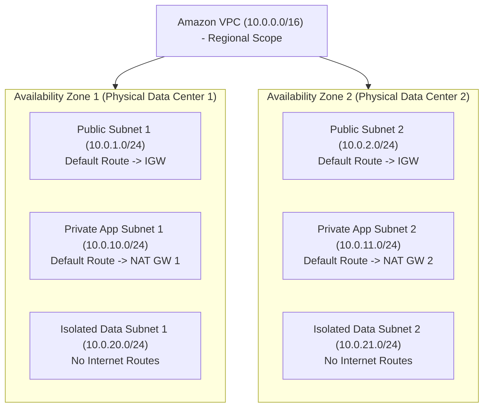
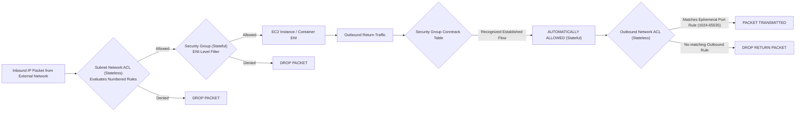
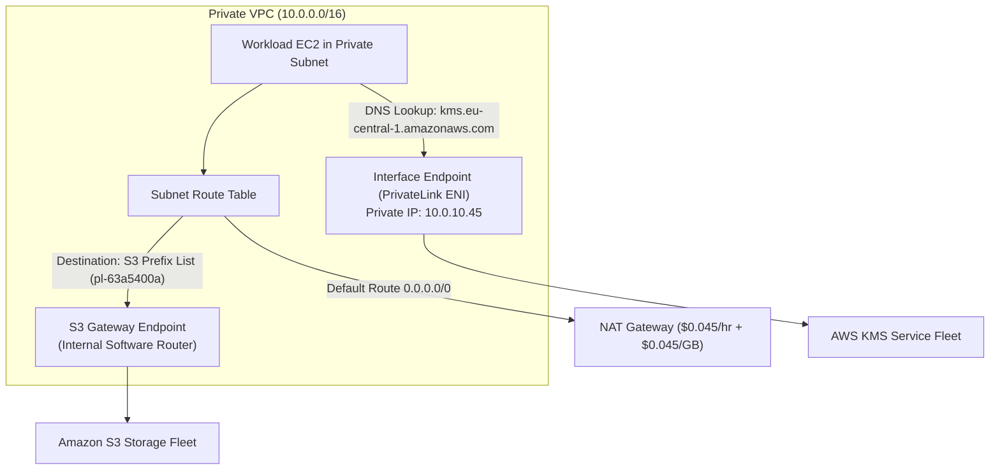
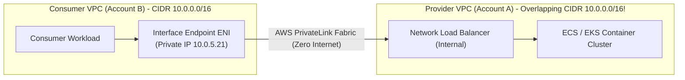
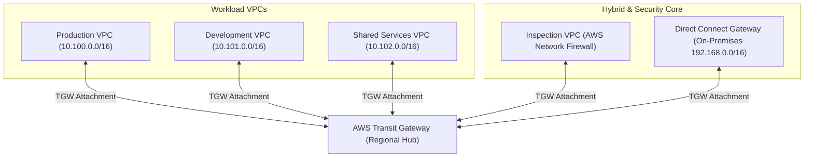
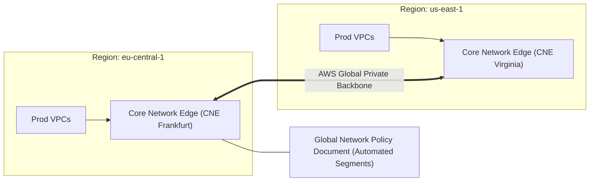
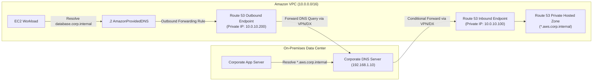
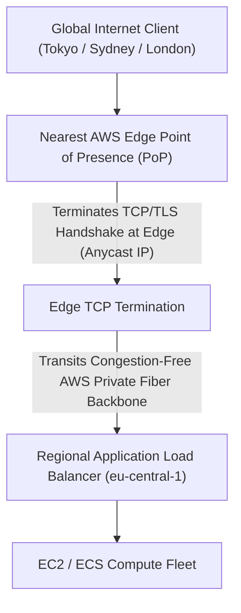

# Module 03: Networking, VPC, and Hybrid Connectivity

Software-defined networking in Amazon Web Services is the transport substrate that connects distributed compute, storage, and database engines across local Availability Zones, hybrid corporate data centers, and the global edge network. Modern cloud networking departs from legacy flat subnets and sprawling point-to-point VPN tunnels. Instead, it enforces isolated routing domains, stateless and stateful firewall boundaries, private software endpoints via AWS PrivateLink, hub-and-spoke transit topologies with AWS Transit Gateway, and hybrid DNS resolution via Route 53 Resolver. Understanding this module requires analyzing VPC topology, Security Group connection tracking mechanics, Gateway versus Interface VPC endpoints, Transit Gateway route table association and propagation, and edge traffic acceleration.

---

## 1. VPC Architecture, Subnet Topology, and AZ Physical Mapping

An Amazon Virtual Private Cloud (VPC) is a logically isolated virtual network dedicated to an AWS account within a single AWS Region. A VPC is bounded by one or more Classless Inter-Domain Routing (CIDR) blocks conforming to RFC 1918 private IPv4 specifications (e.g., `10.0.0.0/16`) and optional Amazon-allocated or BYOIP IPv6 `/56` blocks.



### Subnet Allocation and AWS Reserved IP Addresses

A subnet represents a discrete segment of a VPC's CIDR block constrained to a single Availability Zone. Within every provisioned subnet, AWS permanently reserves exactly **5 IP addresses** for infrastructure routing and management. For a `/24` subnet containing 256 theoretical addresses, exactly 251 addresses are assignable to workloads:

- `x.x.x.0`: Network address (reserved by standard IP networking conventions).
- `x.x.x.1`: Reserved by AWS for the VPC default router.
- `x.x.x.2`: Reserved by AWS for the internal recursive DNS server (Route 53 Resolver / AmazonProvidedDNS).
- `x.x.x.3`: Reserved by AWS for future operational use.
- `x.x.x.255`: Network broadcast address (broadcast is unsupported in VPC software-defined networks; reserved by convention).

### Availability Zone ID (`az-id`) Physical Mapping

To prevent resource hotspots across customer accounts, AWS dynamically randomizes the mapping between human-readable Availability Zone names (such as `eu-central-1a`, `eu-central-1b`) and the physical data center facilities hosting the hardware.

- Account A's `eu-central-1a` may correspond to physical data center cluster `euc1-az1`.
- Account B's `eu-central-1a` may correspond to physical data center cluster `euc1-az2`.

To guarantee physical colocation or true fault isolation across accounts in a multi-account organization, network architects must reference the immutable **Availability Zone ID** (e.g., `euc1-az1`) rather than the localized zone name.

---

## 2. Security Groups vs Network ACLs

Amazon VPC enforces network traffic boundaries at two distinct architectural layers: stateful Elastic Network Interface (ENI) filters (_Security Groups_) and stateless subnet boundaries (_Network Access Control Lists_).



### Architectural Comparison

| Dimension | Security Groups | Network ACLs (NACLs) |
| --- | --- | --- |
| **Operating Layer** | Elastic Network Interface (ENI) virtual filter. | Subnet boundary router. |
| **State Tracking** | **Stateful**: Outbound return traffic for established connections is automatically permitted regardless of outbound rules. | **Stateless**: Outbound return traffic must be explicitly allowed by outbound rules matching client ephemeral ports. |
| **Rule Mechanics** | Allow rules only; all traffic is implicitly denied by default unless an Allow rule matches. | Numbered Allow and Deny rules evaluated in strict ascending numerical order (`1` to `32766`). |
| **Referencing** | Supports mutual referencing by Security Group ID (e.g., `sg-web` allows ingress from `sg-alb`). | CIDR blocks only; cannot reference security groups or logical identity tags. |
| **Connection Limits** | Governed by hypervisor connection tracking (_conntrack_) tables; connection exhaustion drops packets. | Evaluated by hardware network ASIC routers; zero conntrack table overhead. |

### Conntrack Table Exhaustion and Untracked Flows

Security Groups utilize internal hypervisor connection tracking (_conntrack_) to correlate return packets with initiated outbound or inbound requests.

- **Conntrack Capacity**: Modern Nitro EC2 instances support hundreds of thousands of concurrent tracked connections. However, extreme UDP streaming, SYN flood attacks, or microservice connection storms can exhaust the conntrack table, causing the hypervisor to drop subsequent packets even if security groups permit the traffic.
- **Untracked Connections**: If a security group rule explicitly permits ingress TCP traffic from `0.0.0.0/0` on port 443 AND an outbound rule explicitly permits traffic to `0.0.0.0/0` on all ports, the Nitro hypervisor treats the connection as _untracked_, bypassing the conntrack table entirely to achieve maximum line-rate throughput without connection tracking limits.

---

## 3. VPC Endpoints: Gateway Endpoints vs PrivateLink Interface Endpoints

By default, AWS services (such as Amazon S3, DynamoDB, SQS, KMS, and Secrets Manager) expose public IP endpoints anchored on the internet. Instances residing within private subnets without public IPs traditionally routed through expensive NAT Gateways over the internet to access these services. VPC Endpoints enable private, internal connectivity across the AWS software routing fabric.



### Detailed Endpoint Mechanics

1. **Gateway VPC Endpoints (S3 and DynamoDB only)**:
   - _Mechanics_: Configured as a direct route table target in subnet route tables using an AWS prefix list (e.g., `pl-63a5400a`). Packets destined for S3 or DynamoDB public IPs are intercepted at the VPC router and routed internally over private fiber.
   - _Cost_: Free. No hourly charges, no per-GB data processing fees.
   - _Limitations_: Cannot be extended over AWS Transit Gateway, Direct Connect, or VPC Peering to on-premises networks.
2. **Interface VPC Endpoints (AWS PrivateLink)**:
   - _Mechanics_: Provisions one or more Elastic Network Interfaces (ENIs) with private IP addresses directly inside your private subnets. Private DNS integration overrides public AWS service hostnames (e.g., `sqs.eu-central-1.amazonaws.com`) to resolve to the local ENI private IP addresses.
   - _Cost_: Hourly charge per AZ endpoint provisioned plus per-GB data processing fees.
   - _Hybrid Connectivity_: Accessible over Transit Gateway, Direct Connect, and VPN from on-premises data centers and peered VPCs.

### Restricting Access via VPC Endpoint Policies

VPC Endpoints support attaching JSON resource policies that restrict which AWS principals, actions, and resources can traverse the private connection, preventing data exfiltration:

```json
{
  "Version": "2012-10-17",
  "Statement": [
    {
      "Sid": "AllowCorporateBucketsOnly",
      "Effect": "Allow",
      "Principal": "*",
      "Action": ["s3:GetObject", "s3:PutObject"],
      "Resource": "arn:aws:s3:::corporate-finance-vault/*"
    },
    {
      "Sid": "BlockExternalS3Buckets",
      "Effect": "Deny",
      "Principal": "*",
      "Action": "s3:*",
      "Resource": "*",
      "Condition": {
        "StringNotEquals": {
          "aws:ResourceAccount": "111122223333"
        }
      }
    }
  ]
}
```

---

## 4. Building Private SaaS with AWS PrivateLink Provider Services

Beyond consuming AWS services, enterprises can publish their own internal microservices and SaaS platforms as **PrivateLink Endpoint Services**. This architecture enables thousands of customer or consumer VPCs to connect privately to a provider backend without requiring VPC peering, CIDR planning, or public IP exposure.



### PrivateLink Provider Architecture

1. **Underlying Infrastructure**: The provider service must be fronted by an internal **Network Load Balancer (NLB)** deployed across multiple Availability Zones.
2. **CIDR Overlap Independence**: PrivateLink performs Source Network Address Translation (SNAT) at the consumer ENI. The consumer VPC and provider VPC can possess identical or overlapping CIDR blocks (e.g., both using `10.0.0.0/16`) without routing conflicts.
3. **Consumer Acceptance and Whitelisting**: The provider defines an Endpoint Service and explicitly whitelists consumer AWS account ARNs. Connections can be accepted manually or automatically.
4. **Client IP Preservation via Proxy Protocol v2**: Because the consumer ENI performs SNAT, the provider NLB receives traffic with the private IP of the consumer ENI as the source IP. To pass the actual consumer client IP to the backend application, providers enable **Proxy Protocol Version 2** on the target group.

---

## 5. Transit Gateway and Hybrid Cloud Connectivity

When an enterprise scales beyond dozens of VPCs across multiple accounts and requires connectivity to on-premises data centers via AWS Direct Connect and VPNs, a full-mesh VPC peering topology becomes unmanageable ($N(N-1)/2$ peering connections). **AWS Transit Gateway (TGW)** serves as a regional network transit hub that simplifies multi-VPC and hybrid network topologies into a hub-and-spoke model.



### Route Table Associations vs Propagations

A Transit Gateway does not rely on a single flat route table. Instead, it supports multiple custom TGW route tables to enforce strict network segmentation (such as isolating Dev from Prod):

- **Association**: Defines which TGW route table is used to make routing decisions for packets entering the Transit Gateway from a specific attachment. Each attachment can associate with exactly **one** TGW route table.
- **Propagation**: Defines which TGW route tables receive dynamically learned CIDR routes from an attachment. An attachment can propagate its routes to **multiple** TGW route tables simultaneously.

### Enterprise Network Segmentation Pattern

To prevent non-production workloads from establishing lateral network connections to production databases, architects configure distinct routing domains:

1. _Production TGW Route Table_: Associated with Prod VPC attachments. Contains static or propagated routes to the Shared Services VPC and the Inspection VPC. Has NO route to Dev VPC attachments.
2. _Non-Production TGW Route Table_: Associated with Dev VPC attachments. Can route to Shared Services and the internet, but packets addressed to `10.100.0.0/16` (Prod) are dropped.
3. _Inspection TGW Route Table_: Routes all inter-VPC and outbound internet traffic through an inspection VPC housing stateful AWS Network Firewalls or third-party appliance clusters before forwarding.

---

## 6. Global Multi-Region Networks with AWS Cloud WAN

For multinational enterprises operating dozens of VPCs across multiple AWS regions and global on-premises data centers, interconnecting regional Transit Gateways via inter-region peering creates high operational overhead.

**AWS Cloud WAN** provides a managed wide area networking (WAN) service that builds a unified global network across AWS regions and on-premises environments using a centralized policy document.



### Core Concepts of Cloud WAN

- **Core Network Edge (CNE)**: Managed regional gateways provisioned automatically in each region specified in the core network policy.
- **Segments**: Logical routing domains (e.g., `production`, `development`, `shared`) enforced globally across all regions without managing manual inter-region peering tables.
- **Attachment Policies**: Declarative tagging rules that automatically map newly attached VPCs to designated segments based on tags (e.g., tag `Env: Production` maps automatically to the `production` segment).

---

## 7. Hybrid DNS Resolution with Route 53 Resolver

In hybrid cloud architectures combining AWS VPCs with on-premises corporate networks, workloads on both sides require bidirectional DNS name resolution:

- EC2 instances in a VPC must resolve on-premises corporate domains (e.g., `*.corp.internal`).
- On-premises servers must resolve private AWS Route 53 Hosted Zones (e.g., `*.aws.internal`).

**Amazon Route 53 Resolver** (formerly the `.2` resolver / AmazonProvidedDNS) bridges this hybrid boundary using dedicated endpoints:



### Inbound vs Outbound Resolver Endpoints

1. **Inbound Resolver Endpoints**: Provisions ENIs with static private IP addresses in your VPC. On-premises DNS servers configure conditional forwarding rules pointing queries for `*.aws.corp.internal` to these inbound endpoint IP addresses over Direct Connect or VPN.
2. **Outbound Resolver Endpoints & Forwarding Rules**: Enables VPC workloads to query on-premises DNS. Architects configure Route 53 Resolver forwarding rules specifying that any query matching `corp.internal` must be forwarded by the outbound endpoint to the on-premises DNS IP addresses (`192.168.1.10`).

---

## 8. Observability: VPC Flow Logs and Traffic Mirroring

Network engineers require real-time telemetry to audit traffic patterns, debug connectivity failures, and detect security anomalies across VPC subnets and ENIs.

### VPC Flow Logs Structure and Analysis

VPC Flow Logs capture metadata for IP traffic traversing network interfaces. Flow logs can be configured at the VPC, subnet, or individual ENI level, publishing to Amazon CloudWatch Logs, Amazon S3, or Amazon Kinesis Data Firehose.

```
version account-id interface-id srcaddr dstaddr srcport dstport protocol packets bytes start end action log-status
2 111122223333 eni-0123456789abcdef0 198.51.100.1 10.0.10.45 44123 443 6 10 840 1700000000 1700000060 ACCEPT OK
2 111122223333 eni-0123456789abcdef0 203.0.113.5 10.0.10.45 52199 22 6 3 144 1700000000 1700000060 REJECT OK
```

### Diagnosing SG vs NACL Drops in Flow Logs

- **REJECT on Inbound Packet**: Indicates that either an inbound Network ACL rule blocked the connection, or no matching inbound Security Group rule permitted the connection.
- **ACCEPT on Inbound Packet, followed by REJECT on Outbound Packet**: Proves that the Security Group permitted the connection (stateful), but a stateless Network ACL dropped the return packet on the outbound client ephemeral port range (1024–65535).

---

## 9. Origin Access Control (OAC) for CloudFront

When distributing static assets or media hosted in Amazon S3 via Amazon CloudFront, exposing the S3 bucket directly to the internet bypasses CDN caching, exposes S3 to DDoS attacks, and leaks direct S3 URLs.

**CloudFront Origin Access Control (OAC)** enforces that S3 buckets accept read requests strictly when authenticated and cryptographically signed (SigV4) by designated CloudFront distributions.

### S3 Bucket Policy Restricting Access to CloudFront OAC

```json
{
  "Version": "2012-10-17",
  "Statement": [
    {
      "Sid": "AllowCloudFrontServicePrincipalReadOnly",
      "Effect": "Allow",
      "Principal": {
        "Service": "cloudfront.amazonaws.com"
      },
      "Action": "s3:GetObject",
      "Resource": "arn:aws:s3:::static-assets-cdn-vault/*",
      "Condition": {
        "StringEquals": {
          "aws:SourceArn": "arn:aws:cloudfront::111122223333:distribution/EDFDVBD632BHDS5"
        }
      }
    }
  ]
}
```

---

## 10. AWS Global Accelerator for Anycast Routing

For internet-facing applications that experience TCP/TLS handshake latency penalties across global distances, **AWS Global Accelerator** optimizes network ingress by terminating client connections at the edge.



### Architectural Benefits

1. **Static Anycast IP Addresses**: Provides two global static IPv4 Anycast addresses. If an IP becomes unreachable, edge routing automatically reconverges to healthy PoPs without DNS caching delays.
2. **TCP Termination at the Edge**: Client TCP three-way handshakes and TLS handshakes terminate at the nearest edge PoP, drastically reducing initial connection setup time compared to traversing the public internet to distant regional servers.
3. **Instant Health-Check Failover**: Constantly monitors the health of regional endpoints (ALBs, NLBs, EC2 instances). If a primary region suffers an outage, Global Accelerator shifts traffic to a secondary region in under 30 seconds without waiting for client DNS TTL expiration.

---

## 11. Then vs Now: Evolution of AWS Cloud Networking

| Dimension | Legacy Pattern (Then) | Modern Architecture (Now) | Architectural Justification |
| --- | --- | --- | --- |
| **VPC Connectivity** | Mesh of point-to-point VPC Peering connections ($O(N^2)$ operational complexity). | Hub-and-spoke topology managed via AWS Transit Gateway with segmented route tables. | Eliminates peering connection sprawl; enables centralized security inspection and automated routing domain isolation. |
| **PaaS Service Access** | Routing internal traffic over NAT Gateways and the public internet to reach S3 and DynamoDB. | Gateway VPC Endpoints (S3/DynamoDB) and AWS PrivateLink Interface Endpoints. | Eliminates internet exposure; slashes NAT Gateway data transfer costs; protects traffic across private AWS fiber. |
| **Hybrid DNS** | Custom BIND or Unbound EC2 forwarder instances managed manually in public subnets. | Fully managed Route 53 Resolver Inbound and Outbound Endpoints with automated forwarding rules. | Eliminates EC2 patching and maintenance; scales DNS resolution automatically with 99.99% availability. |
| **S3 CDN Ingress** | Legacy Origin Access Identity (OAI) without SSE-KMS or dynamic region support. | Origin Access Control (OAC) with SigV4 signing, full SSE-KMS support, and granular `aws:SourceArn` scoping. | Prevents confused deputy attacks; supports modern cryptographic standards and multi-region bucket configurations. |
| **Global User Ingress** | GeoDNS (Route 53) returning regional public IP addresses subject to client DNS TTL caching delays. | AWS Global Accelerator static Anycast IP addresses terminating TCP/TLS handshakes at edge PoPs. | Bypasses public internet jitter; provides sub-30-second automated failover without waiting for DNS cache expiration. |
| **SaaS Consumer Access** | Public internet APIs with IP allow-lists or complex reciprocal VPC peering configurations. | AWS PrivateLink Endpoint Services backed by internal NLBs with Proxy Protocol v2. | Supports overlapping CIDRs; eliminates public internet ingress; isolates microservices securely. |
| **Global Multi-Region WAN** | Manual mesh of inter-region Transit Gateway peering attachments with custom route propagation. | AWS Cloud WAN declarative global core network with automated regional segment mappings. | Centralizes global network policy in a single JSON document; automates global multi-region routing. |

---

## Interview Drill

<details><summary>1. An engineer configures a Network ACL with rule 100 allowing inbound port 443 from `0.0.0.0/0`, but outbound client responses fail. The Security Group allows all outbound traffic. Why is traffic failing?</summary>

Network ACLs are completely stateless. Unlike Security Groups, which automatically track connection state and permit return traffic, a Network ACL evaluates inbound and outbound traffic independently. When an external client connects to an HTTPS server on port 443, the client's operating system assigns an ephemeral source port (typically ports 1024–65535). For the server's return response to leave the subnet, the Network ACL's outbound rules must explicitly permit outbound traffic destined for ephemeral ports 1024–65535.

</details>

<details><summary>2. Why are Gateway VPC Endpoints preferred over Interface VPC Endpoints for high-throughput S3 workloads inside a VPC?</summary>

Gateway VPC Endpoints for Amazon S3 are provided by AWS at no additional cost; they carry zero hourly charges and zero per-gigabyte data processing fees. They inject direct prefix list routes into subnet route tables, routing traffic directly across the internal AWS network. Interface VPC Endpoints (PrivateLink), by contrast, incur an hourly fee per provisioned ENI plus per-gigabyte data processing fees, which becomes cost-prohibitive for multi-terabyte analytics and data lake workloads.

</details>

<details><summary>3. In AWS Transit Gateway, explain the difference between a route table Association and a route table Propagation.</summary>

An Association determines which single Transit Gateway route table is evaluated when a network packet enters the TGW from an attachment (e.g., a VPC attachment or Direct Connect attachment). Each attachment can associate with exactly one TGW route table. A Propagation determines which TGW route tables learn and dynamically record the CIDR routes of an attachment. An attachment can propagate its routes to multiple TGW route tables simultaneously, enabling flexible network segmentation topologies.

</details>

<details><summary>4. What is the operational danger of hardcoding Availability Zone names (e.g., `us-east-1a`) in multi-account CloudFormation templates?</summary>

AWS dynamically randomizes the mapping between human-readable Availability Zone names (`us-east-1a`, `us-east-1b`) and the physical data center facilities (`use1-az1`, `use1-az2`) across different AWS accounts to distribute customer workloads evenly across data centers. If two different accounts both deploy workloads into `us-east-1a`, their resources may actually reside in physically separate data centers, introducing unexpected inter-AZ network latency and cross-AZ data transfer charges. To ensure physical colocation across accounts, templates must reference immutable Availability Zone IDs (`az-id`).

</details>

<details><summary>5. How does AWS Global Accelerator provide faster failover than Route 53 DNS-based failover during a regional outage?</summary>

Route 53 DNS failover relies on updating DNS records and waiting for clients, intermediate recursive resolvers, and local operating system caches to expire their cached DNS records based on the TTL. If a client resolver ignores TTLs or caches records for hours, users continue sending traffic to the failed region. AWS Global Accelerator uses static Anycast IP addresses that do not change. Traffic routing is handled at the network layer via BGP Anycast announcements at edge points of presence. When a regional health check fails, Global Accelerator reroutes edge traffic to a healthy backend region in under 30 seconds, completely bypassing client DNS caching delays.

</details>

<details><summary>6. Under what circumstances can a Security Group exhaust its connection tracking capacity, and how can untracked flows mitigate this?</summary>

Security Groups maintain an internal connection tracking (_conntrack_) table in the hypervisor to monitor active connections and automatically permit return traffic. In extreme high-throughput workloads (e.g., massive UDP ingest, SYN floods, microservice connection bursts), the conntrack table can fill up, causing subsequent packets to be dropped. If a security group rule explicitly allows bidirectional traffic (e.g., inbound TCP 443 from `0.0.0.0/0` and outbound all traffic to `0.0.0.0/0`), the Nitro hypervisor treats the connection as _untracked_, bypassing the conntrack table entirely and avoiding exhaustion.

</details>

<details><summary>7. How does AWS PrivateLink enable communication between two VPCs that share identical overlapping CIDR blocks (e.g. `10.0.0.0/16`)?</summary>

VPC Peering fails between overlapping CIDRs because the underlying route table cannot determine whether a `10.0.0.0/16` destination address is local or remote. AWS PrivateLink bypasses VPC route tables entirely by provisioning an Elastic Network Interface (Interface Endpoint) directly inside the consumer subnet. When a consumer sends traffic to the endpoint's private IP, the PrivateLink software bus performs Source Network Address Translation (SNAT) and encapsulates the packet, delivering it to the provider's internal Network Load Balancer regardless of overlapping CIDRs.

</details>

<details><summary>8. How can a cloud architect verify whether a dropped packet was rejected by a Security Group or a Network ACL using VPC Flow Logs?</summary>

By analyzing the `action` field in VPC Flow Logs. If the flow log records an inbound connection with action `REJECT`, it may be dropped by either the inbound NACL or the Security Group. However, if the inbound packet is recorded as `ACCEPT` on the destination port (e.g. port 443), but subsequent outbound response packets to the client's ephemeral port (e.g. port 49152) are recorded as `REJECT`, the cause is conclusively a stateless Network ACL missing an outbound allow rule for ephemeral ports, because Security Groups are stateful and would never drop established return packets.

</details>
