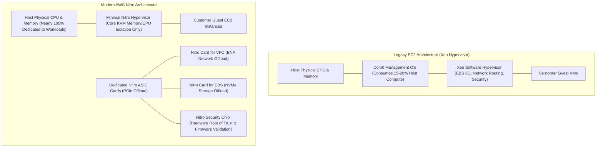
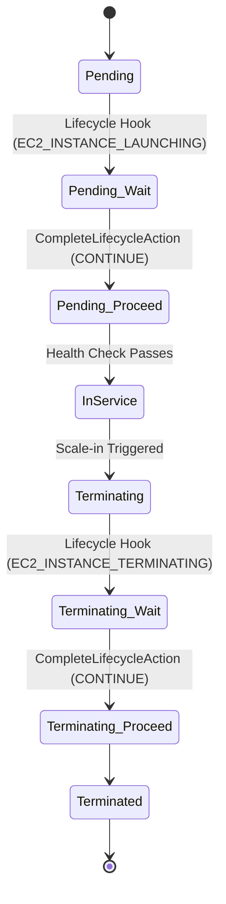
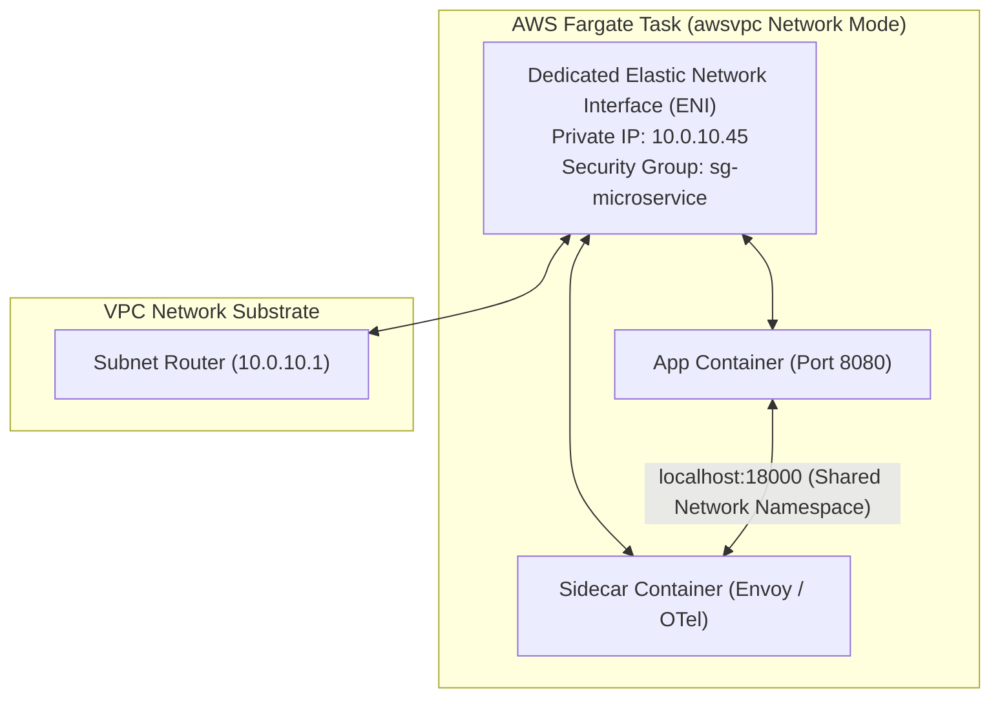
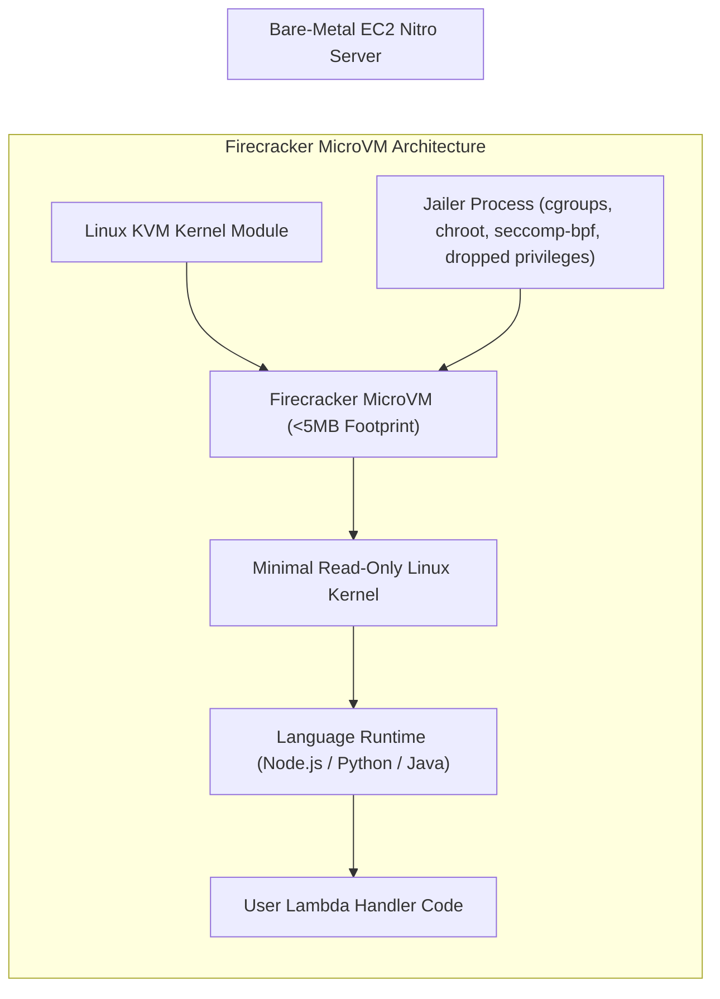
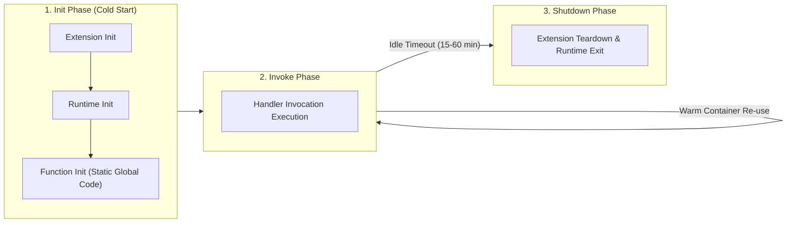
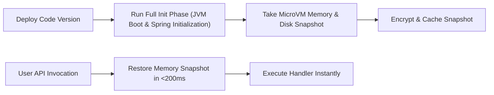

# Module 04: Compute: EC2, ECS, and Lambda Internals

Compute in Amazon Web Services spans a spectrum from dedicated hardware-offloaded virtualization to serverless microVM execution environments. Modern cloud engineering requires understanding how the AWS Nitro System transforms EC2 from software-hypervisor overhead into ASIC-accelerated bare-metal performance, how Auto Scaling Groups orchestrate graceful lifecycle hooks and warm pools, how Amazon ECS Fargate abstracts task networking via `awsvpc`, and how the Firecracker microVM engine powers AWS Lambda's sub-second invocation lifecycle, concurrency controls, SnapStart checkpointing, and durable executions.

---

## 1. EC2 Nitro Hypervisor, IMDSv2, and Instance Lifecycle

Early generations of Amazon EC2 relied on the open-source Xen software hypervisor. The physical host CPU and memory managed system virtualization, network packet routing, and Amazon EBS storage encapsulation, consuming up to 15–20% of host compute capacity (the "hypervisor tax").

The **AWS Nitro System** replaces monolithic software hypervisors with modular hardware ASIC cards and a lightweight, KVM-based kernel hypervisor.



### Nitro Subsystems and Cryptographic Enclaves

1. **Nitro Card for VPC**: Custom ASIC handling the Elastic Network Adapter (ENA) interface. Offloads VPC encapsulation, Security Group connection tracking, and hardware encryption in transit directly to dedicated silicon, enabling up to 100 Gbps network bandwidth with zero host CPU intervention.
2. **Nitro Card for EBS**: Translates EBS volume requests into local NVMe block device commands, providing hardware-accelerated encryption (AES-256) and predictable IOPS.
3. **Nitro Security Chip**: Enforces a hardware root of trust. Intercepts and cryptographically validates every flash memory read, preventing firmware tampering and securing bare-metal hardware.
4. **AWS Nitro Enclaves**: Fully isolated virtual environments running beside EC2 instances with no persistent storage, no external network interface, and no administrator SSH access. Enclaves communicate strictly with the parent instance over an internal local virtual socket (`vsock`). They provide cryptographic attestation documents via AWS KMS to process sensitive private keys, credit card numbers, or cryptographic signing workloads securely.

### Instance Metadata Service Version 2 (IMDSv2)

Every EC2 instance queries a link-local HTTP service at `http://169.254.169.254/latest/meta-data/` to retrieve dynamic metadata, network configurations, and temporary IAM credentials provisioned via its instance profile.

- **The IMDSv1 Vulnerability**: IMDSv1 allowed unauthenticated HTTP `GET` requests. Attackers exploiting Server-Side Request Forgery (SSRF) vulnerabilities in web applications or misconfigured open reverse proxies (e.g., NGINX, Apache) could force the application to fetch `http://169.254.169.254/latest/meta-data/iam/security-credentials/<role-name>` and exfiltrate temporary credentials.
- **IMDSv2 Session Token Mechanics**: IMDSv2 is session-oriented and enforces stateful token negotiation via an HTTP `PUT` request with custom headers that web application firewalls and open reverse proxies block by default.

```bash
# 1. Acquire ephemeral session token valid for 300 seconds (5 minutes)
TOKEN=$(curl -s -X PUT "http://169.254.169.254/latest/api/token" \
  -H "X-aws-ec2-metadata-token-ttl-seconds: 300")

# 2. Access instance metadata using the authenticated session token
curl -s -H "X-aws-ec2-metadata-token: $TOKEN" \
  http://169.254.169.254/latest/meta-data/iam/security-credentials/AppRole
```

- **Hop Limit Enforcement**: The IP Time-to-Live (TTL) hop limit of the IMDSv2 token response packet defaults to 1. On standard virtual machines, the response terminates at the host. On containerized workloads (such as Docker or ECS running on EC2), a hop limit of 1 blocks containers from reaching metadata because the container network bridge decrements the IP packet's Time-to-Live (TTL) counter to 0, effectively preventing container breakout credential theft unless the administrator explicitly raises the hop limit to 2.

---

## 2. EC2 Purchasing Models and Capacity Allocation Strategies

Selecting compute capacity in Amazon EC2 requires balancing interruption tolerance, financial commitment duration, and availability requirements across six distinct purchasing models:

| Purchasing Model | Commitment Duration | Discount vs On-Demand | Interruption Risk | Primary Workload Fit |
| --- | :-: | :-: | :-: | --- |
| **On-Demand** | None (pay per second) | 0% (baseline rate) | None | Spiky, unpredictable, or short-term development workloads. |
| **Spot Instances** | None (spare capacity) | Up to 90% discount | Interrupted with 2-min warning | Stateless batch processing, ML training, CI/CD runners, container fleets. |
| **Compute Savings Plans** | 1 or 3 years ($/hour commitment) | Up to 66% discount | None | General production compute; applies across EC2 families, regions, Fargate, and Lambda. |
| **EC2 Instance Savings Plans** | 1 or 3 years ($/hour commitment) | Up to 72% discount | None | Consistent steady-state workloads tied to a specific instance family in one region. |
| **Standard Reserved Instances** | 1 or 3 years (instance reservation) | Up to 72% discount | None | Legacy reservation model; can be sold on AWS RI Marketplace. |
| **Convertible Reserved Instances** | 1 or 3 years (instance reservation) | Up to 66% discount | None | Steady-state workloads requiring the ability to exchange instance families over time. |

### Spot Allocation Strategies in Auto Scaling

When running fault-tolerant fleets on Spot instances, Auto Scaling Groups support three allocation algorithms:

1. **`lowest-price` (Legacy)**: Launches instances from the pool with the absolute lowest hourly price. Leads to frequent interruptions during market price fluctuations as multiple customers compete for the cheapest capacity pool.
2. **`capacity-optimized`**: Analyzes real-time AWS spare capacity telemetry and launches instances from the pool with the deepest available capacity, minimizing interruption frequency.
3. **`price-capacity-optimized` (Recommended Best Practice)**: Evaluates both capacity depth and price, selecting pools that deliver low interruption probability while maintaining low hourly costs.

---

## 3. Auto Scaling Groups, Lifecycle Hooks, and Warm Pools

An **Amazon EC2 Auto Scaling Group (ASG)** manages a dynamic collection of EC2 instances, maintaining application availability by automatically provisioning instances during load surges, replacing unhealthy instances, and scaling down during lulls to optimize costs.



### Graceful Lifecycle Hooks

By default, when an ASG launches an instance, it registers it with the load balancer target group immediately after instance initialization completes. Similarly, upon scale-in, the ASG terminates the instance abruptly.

Lifecycle Hooks pause the launch or termination sequence, transitioning the instance into a `Pending:Wait` or `Terminating:Wait` state for up to 48 hours:

- **`EC2_INSTANCE_LAUNCHING`**: Pauses startup to allow custom orchestration scripts (e.g., downloading multi-gigabyte machine learning models from S3, pulling container images, registering with Consul or Active Directory) before the instance is marked `InService` and receives client traffic.
- **`EC2_INSTANCE_TERMINATING`**: Pauses termination to allow graceful connection draining, flushing in-flight transaction logs to Amazon S3 or DynamoDB, completing long-running batch jobs, and deregistrating from external monitoring systems before instance destruction.
- **Programmatic Completion**: Automation scripts notify the ASG upon completion by calling `aws autoscaling complete-lifecycle-action --lifecycle-action-result CONTINUE`. If the heartbeat timeout expires without notification, the ASG executes the configured default action (`ABANDON` or `CONTINUE`).

### ASG Warm Pools for Sub-Second Rapid Scaling

For enterprise applications with extensive cold boot overhead (such as legacy Java EE applications that take 10–15 minutes to initialize), traditional reactive scaling policies fail during sudden traffic surges.

ASG Warm Pools maintain a pre-initialized cache of EC2 instances managed in a `Stopped` or `Running` state alongside the Auto Scaling Group:

- **`Stopped` Warm Pool**: Instances are fully booted, software dependencies and models are loaded onto local EBS volumes, and the instance is stopped. When a scale-out event triggers, the instance transitions from `Stopped` to `Running` in under 30 seconds, saving compute runtime costs while avoiding long initialization boot scripts.
- **Lifecycle Re-use**: Instances returned from scale-in can cycle back into the warm pool rather than being terminated, preserving warm disk caches.

---

## 4. Silicon Architecture: AWS Graviton and ARM64 Workloads

AWS designs its own custom server silicon based on the 64-bit ARM architecture. **AWS Graviton3 and Graviton4** processors deliver up to 40% better price-performance than equivalent current-generation x86-64 processors (Intel Xeon and AMD EPYC) while consuming up to 60% less energy.

### Architectural Advantages of Graviton

1. **Dedicated Physical Cores**: Unlike x86 processors that utilize Simultaneous Multithreading (SMT / Hyper-Threading) where two virtual vCPUs share a single physical core and L1/L2 caches, every Graviton vCPU corresponds to a discrete, non-shared physical core. This completely eliminates noisy-neighbor cache contention and side-channel vulnerability risks.
2. **Uniform Cryptographic Acceleration**: Graviton processors feature dedicated cryptographic hardware execution units, delivering superior performance for TLS handshakes, AES-256 block encryption, and SHA-256 hashing.
3. **Multi-Architecture Container Pipelines**: Modern CI/CD systems build multi-architecture container images using Docker Buildx and Amazon ECR, publishing multi-manifest images that run transparently on either `linux/arm64` (Graviton) or `linux/amd64` (x86) nodes.

---

## 5. ECS Fargate Container Networking and Capacity Providers

Amazon Elastic Container Service (ECS) orchestrates Docker containers across EC2 host clusters or serverless **AWS Fargate** infrastructure. In modern production environments, container network isolation and capacity allocation dictate reliability and performance.



### The `awsvpc` Task Networking Mode

Unlike legacy Docker `bridge` mode (which utilizes port mapping and host-level Docker daemon bridging) or `host` mode (which exposes host ports directly), AWS Fargate mandates the **`awsvpc`** networking mode:

1. **Dedicated ENI per Task**: Every Fargate task is allocated its own dedicated Elastic Network Interface (ENI) with a primary private IPv4 address directly from the VPC subnet.
2. **Native Security Group Application**: Security Groups are attached directly to the task's ENI rather than the underlying host instance, enforcing microservice-level firewall rules.
3. **Localhost Sidecar Communication**: All containers residing within the identical task definition share the same network namespace and loopback adapter (`localhost`), enabling zero-latency IPC between application containers and logging/telemetry sidecars (e.g., AWS Distro for OpenTelemetry or Envoy).

### Execution Role vs Task Role

AWS ECS strictly separates infrastructure bootstrap authorization from application runtime authorization:

- **Task Execution Role (`executionRoleArn`)**: Used by the underlying ECS agent and Fargate infrastructure before the container starts. Authorizes pulling private container images from Amazon ECR, retrieving environment secrets from AWS Secrets Manager or Parameter Store, and publishing container stdout/stderr logs to Amazon CloudWatch Logs.
- **Task Role (`taskRoleArn`)**: Injected into the running application container. Authorizes application code to invoke AWS APIs (e.g., querying Amazon DynamoDB, reading S3 objects, publishing to Amazon SQS) using temporary STS credentials.

### ECS Capacity Providers and Fargate Spot

An ECS cluster uses **Capacity Providers** to balance application availability against compute costs:

- **Base Allocation**: Specifies the guaranteed minimum number of tasks that must run on standard, non-interruptible Fargate capacity.
- **Weight Allocation**: Defines the proportional ratio of tasks distributed between standard Fargate and cost-effective **Fargate Spot** (which offers up to a 70% discount using spare AWS capacity).
- **Graceful Termination Handling**: When AWS reclaims Fargate Spot capacity, ECS delivers a `SIGTERM` signal with a 120-second warning window, enabling application containers to complete in-flight transactions and flush state before task eviction.

---

## 6. ECS Task Placement Strategies and Constraints

When running ECS workloads on EC2 clusters rather than Fargate, container placement algorithms dictate resource density and fault tolerance.

### Placement Strategies

ECS provides three placement strategies that can be chained together:

1. **`binpack`**: Places tasks on instances with the least available CPU or memory, maximizing container density and minimizing the total number of running EC2 instances to reduce infrastructure costs.
2. **`spread`**: Places tasks evenly across a specified attribute (such as `attribute:ecs.availability-zone` or `instanceId`), ensuring that instances or Availability Zones do not become single points of failure.
3. **`random`**: Places tasks randomly across the cluster, avoiding deterministic clustering during massive parallel container launches.

### Placement Constraints

Constraints act as strict Boolean filters:

- **`distinctInstance`**: Guarantees that each task in the service is placed on a completely distinct container instance (e.g., preventing two copies of a primary database task from landing on the same physical VM).
- **`memberOf`**: Enforces that tasks run only on instances matching specific expressions (e.g., `memberOf(attribute:ecs.instance-type =~ t4g.*)` to force ARM Graviton execution).

---

## 7. Lambda Firecracker MicroVMs, Concurrency, and SnapStart

AWS Lambda is a serverless event-driven compute engine that executes code without managing servers. Underlying Lambda's rapid scalability is **Firecracker**, an open-source minimalist Virtual Machine Monitor (VMM) developed by AWS in Rust.



### Firecracker Security and Virtualization Mechanics

1. **Sub-5ms Boot Latency**: Unlike traditional QEMU-based hypervisors that emulate hundreds of legacy PC devices, Firecracker strips away all non-essential hardware emulation (no PCI buses, no IDE controllers, no USB). It emulates only five core devices: a serial console, a minimalist keyboard, a virtio-net interface, a virtio-block device, and a minimal interrupt controller.
2. **Multi-Tenant Security Boundaries**: Each customer Lambda invocation runs inside a discrete microVM. The microVM is encapsulated by a dedicated **Jailer** process that enforces strict Linux `cgroups` resource limits, `chroot` filesystem isolation, unshared namespaces (`PID`, `NET`, `IPC`), and strict `seccomp-bpf` system call filters.

### The Three Execution Lifecycle Phases

When a Lambda function is invoked, the execution environment traverses three distinct phases:



1. **Init Phase (Cold Start)**:
   - _Extension Init_: Initializes internal and external monitoring extensions (e.g., telemetry agents).
   - _Runtime Init_: Boots the language runtime (Node.js event loop, Python interpreter, JVM).
   - _Function Init_: Executes global static code outside the exported handler (instantiating AWS SDK clients, opening database connections, reading configuration variables).
2. **Invoke Phase**: Dispatches the event payload to the handler function. In warm containers, only the Invoke Phase executes, achieving execution latencies in single-digit milliseconds.
3. **Shutdown Phase**: If no invocations arrive within an idle window (typically 15 to 60 minutes), Lambda terminates the runtime, sends a shutdown signal to extensions, and recycles the microVM.

### Concurrency Allocations and Scaling Burst Limits

In any AWS Region, an account begins with a regional concurrency limit (default 1,000 concurrent executions).

- **Scaling Burst Mechanics**: When a sudden burst of invocations arrives, Lambda immediately scales up to an initial burst limit (between 500 and 3,000 concurrent executions depending on region). Beyond this initial burst threshold, Lambda scales at a linear rate of **500 additional concurrent executions per minute** until the function reaches its concurrency allocation or regional limit.
- **Unreserved Concurrency**: The shared pool accessible by all functions in the region. A runaway function experiencing an infinite recursion loop can exhaust this shared pool, starving all other functions in the account (`429 TooManyRequestsException`).
- **Reserved Concurrency**: Allocates a guaranteed execution slice dedicated exclusively to a specific function. It simultaneously acts as a **hard upper ceiling**, ensuring the function cannot scale beyond this threshold to protect downstream relational databases (such as Amazon RDS) from connection exhaustion.
- **Provisioned Concurrency**: Eliminates cold starts entirely for latency-critical applications. AWS initializes a designated number of execution environments in advance, running the Init Phase and keeping the microVM memory warm and ready to respond instantly.

### Lambda SnapStart Architecture

For managed Java runtimes (and expanding across runtimes), initialization of heavyweight frameworks (Spring Boot, Quarkus) can take 5–15 seconds during cold starts.

Lambda SnapStart solves this by initializing the execution environment during deployment, taking an encrypted point-in-time snapshot of the microVM's memory and disk state, and caching the snapshot across a multi-tier cache. Upon invocation, Lambda restores the snapshot in under 200 milliseconds.



#### The SnapStart Uniqueness Trap

Because SnapStart restores multiple concurrent microVM execution environments from the identical snapshot image, code that initializes random numbers, UUIDs, or cryptographic seeds during the Init Phase will generate identical values across different instances.

- **Remediation**: Re-seed pseudo-random number generators (PRNGs) inside the handler, or register runtime lifecycle hooks using AWS Lambda SnapStart runtime hooks (`CRaC` / Coordinated Restore at Checkpoint) to refresh entropy and reset network socket connections upon snapshot restoration.

---

## 8. Lambda Networking: Hyperplane ENIs and VPC Access

Historically, executing a Lambda function inside an Amazon VPC introduced notorious cold-start delays of 15 to 30 seconds. In the legacy architecture, the Lambda service provisioned an Elastic Network Interface (ENI) directly inside the customer subnet on every scale-out event, quickly exhausting available subnet IP addresses.

### Modern Hyperplane ENI Architecture

AWS re-architected Lambda VPC networking using **AWS Hyperplane** (the software-defined network fabric that also powers NAT Gateways and Network Load Balancers):

1. **Shared Tunnel ENIs**: The Lambda service provisions a shared pool of Hyperplane ENIs in customer subnets when the function is created or its VPC configuration is updated.
2. **Sub-Millisecond Attachment**: When a new Firecracker microVM launches during a cold start, it establishes a virtual tunnel to the existing pre-provisioned Hyperplane ENI, slashing VPC cold starts from 30 seconds to under 200 milliseconds.
3. **Outbound Internet Constraint**: A Lambda function configured inside a VPC cannot communicate with the public internet or public AWS APIs (e.g., public DynamoDB, STS, Secrets Manager) using an Internet Gateway. Because Lambda ENIs do not possess public IPv4 addresses, outbound internet traffic must route through a **NAT Gateway** or access services privately via **VPC Endpoints**.

---

## 9. Lambda Resource Sizing and CPU Proportionality

In AWS Lambda, memory is the sole configuration knob that controls compute performance. Developers cannot configure vCPU count or clock frequency directly.

### Linear vCPU Allocation

AWS Lambda allocates CPU power proportionally to configured memory:

- **128 MB RAM**: Allocates minimal fractional vCPU capacity (suitable only for simple routing or light transformations).
- **1,769 MB RAM**: Corresponds to exactly **one full vCPU** (single-threaded execution operates at maximum core speed).
- **Over 1,769 MB RAM**: Lambda unlocks multiple vCPUs (e.g., 2 vCPUs at 3,538 MB, up to 6 vCPUs at 10,240 MB). Applications that utilize multi-threaded libraries, parallel compilation, or async thread pools benefit dramatically from allocations above 1,769 MB.

---

## 10. Observability: Profiling Cold Starts with CloudWatch & X-Ray

Understanding where time is spent during cold starts is essential for serverless performance optimization.

### Dissecting the REPORT Log

At the conclusion of every Lambda invocation, the execution environment writes a structured `REPORT` log line to Amazon CloudWatch Logs:

```
REPORT RequestId: c25841e2-b88d-4f81-bf96-9810842db18f
  Duration: 34.12 ms
  Billed Duration: 35 ms
  Memory Size: 1024 MB
  Max Memory Used: 78 MB
  Init Duration: 342.50 ms
```

- **`Duration`**: Exact execution time of the user handler function during the Invoke Phase.
- **`Billed Duration`**: Invocation runtime rounded up to the nearest millisecond (minimum 1 ms).
- **`Init Duration`**: Time spent executing the Init Phase. This field appears **strictly** on cold starts. If `Init Duration` is absent from the report line, the invocation was served by a warm execution environment.
- **X-Ray Subsegments**: Enabling AWS X-Ray active tracing decomposes cold starts into granular subsegments: `initialization` (including `runtime-init` and `function-init`), allowing engineers to isolate slow third-party SDK client instantiations from pure microVM boot latency.

---

## 11. Advanced Serverless: Managed Instances and Durable Functions

Modern serverless architectures address long-running stateful workflows and high-density computing through two recent platform enhancements:

- **Lambda Durable Functions**: Allows developers to write stateful, long-running workflows directly in code using checkpoint and replay semantics. Functions can sleep or await external signals (such as human approvals or asynchronous webhooks) for up to 1 year, billing zero execution cost while idle and resuming execution with preserved state.
- **Lambda Managed Instances**: Provides multi-concurrency execution on dedicated, persistent EC2 capacity managed by AWS. Combines the operational ease of Lambda handlers with predictable EC2 instance pricing (EC2 rate + 15% management fee) and 14-day automated rolling instance lifecycles.

---

## 12. Then vs Now: Evolution of AWS Compute

| Dimension | Legacy Pattern (Then) | Modern Architecture (Now) | Architectural Justification |
| --- | --- | --- | --- |
| **Virtualization Platform** | Xen software hypervisor with Dom0 management OS consuming host compute. | AWS Nitro System with dedicated PCIe ASIC hardware cards for VPC, EBS, and Security. | Eliminates hypervisor tax; dedicates nearly 100% of host CPU and memory to customer workloads; delivers bare-metal line rate I/O. |
| **Silicon Architecture** | Legacy x86 hyper-threaded vCPUs with shared L1/L2 cache contention. | Custom 64-bit ARM AWS Graviton processors with dedicated physical cores. | Delivers up to 40% better price-performance with zero hyper-threading noisy neighbor interference. |
| **Instance Metadata** | IMDSv1 using simple HTTP `GET` requests vulnerable to SSRF credential exfiltration. | IMDSv2 requiring session-oriented HTTP `PUT` tokens with hop limit enforcement. | Mitigates SSRF credential theft across web proxies and container network namespaces. |
| **ASG Scaling Mechanics** | Reactive CPU utilization scaling policies causing 10-minute cold boot lag during traffic spikes. | Scheduled scaling combined with ASG Warm Pools maintaining pre-initialized stopped instances. | Slashes scale-out latency from minutes to under 30 seconds while minimizing idle compute expense. |
| **Container Networking** | Docker `bridge` mode with dynamic port mappings and host port contention. | AWS Fargate with `awsvpc` networking allocating dedicated ENIs and Security Groups per task. | Provides microservice-level firewall isolation; simplifies service discovery; aligns with VPC native routing. |
| **Lambda VPC Cold Starts** | Direct ENI provisioning on cold starts causing 30-second delays and subnet IP exhaustion. | Shared Hyperplane ENIs pre-provisioned at configuration time with virtual microVM tunneling. | Slashes VPC cold starts to sub-second; preserves subnet IP addresses across concurrent invocations. |
| **Serverless Cold Starts** | Heavy language runtimes suffering 10-second JVM cold starts; provisioned concurrency cost penalties. | Lambda SnapStart snapshot restoration (<200ms) and Firecracker microVM optimization. | Slashes cold-start latency by up to 90% without paying for continuous provisioned concurrency. |
| **Long-Running Serverless** | Chaining complex Step Functions state machines for simple delays or multi-day waits. | Native Lambda Durable Functions with automated checkpointing, sleep semantics, and replay. | Simplifies developer DX; eliminates Step Functions state transition billing overhead for simple workflows. |

---

## Interview Drill

<details><summary>1. How does the AWS Nitro System improve compute performance and security compared to the legacy Xen hypervisor?</summary>

The AWS Nitro System offloads virtualization, networking (ENA), storage (EBS NVMe), and security management from the main host processor onto dedicated hardware ASIC cards (Nitro Cards). In the legacy Xen hypervisor, Dom0 software ran on the primary host CPU, consuming up to 15–20% of host CPU and memory capacity (the hypervisor tax). Nitro eliminates this overhead, freeing nearly 100% of CPU and RAM for customer workloads while delivering line-rate I/O. For security, the Nitro Security Chip enforces a hardware root of trust that continuously validates firmware integrity, and Nitro Enclaves provide cryptographically attested, isolated compute environments.

</details>

<details><summary>2. Why does an HTTP TTL hop limit of 1 in IMDSv2 prevent credential theft from containerized applications running on an EC2 host?</summary>

When an application runs inside a Docker or ECS container on an EC2 host, the container resides within a distinct network namespace attached to a virtual bridge (e.g., `docker0`). Packets traversing from the container to the host network interface traverse a routing hop, which decrements the IP packet's Time-to-Live (TTL) counter by 1. If IMDSv2 is configured with a hop limit of 1, the metadata service response packet expires immediately at the host interface and is discarded by the kernel before it can return across the bridge to the container. This prevents a compromised container from acquiring the EC2 host's IAM instance profile credentials unless an administrator explicitly elevates the hop limit to 2.

</details>

<details><summary>3. What is the fundamental difference between an ECS Task Execution Role and an ECS Task Role?</summary>

The ECS Task Execution Role (`executionRoleArn`) is used by the underlying ECS agent and AWS Fargate infrastructure to prepare and manage the container before user code executes. It authorizes pulling container images from private Amazon ECR repositories, writing startup logs to CloudWatch Logs, and retrieving initial secrets from AWS Secrets Manager. The ECS Task Role (`taskRoleArn`) is assumed by the actual application container once running, granting temporary STS credentials to application code to interact with AWS services (e.g., querying DynamoDB, publishing to SQS, writing to S3).

</details>

<details><summary>4. Explain the execution phases of an AWS Lambda function and describe the difference between Reserved Concurrency and Provisioned Concurrency.</summary>

A Lambda execution environment traverses three phases: the Init Phase (loading extensions, initializing the runtime, and executing static code outside the handler), the Invoke Phase (executing the handler function), and the Shutdown Phase (releasing resources upon idle timeout). Reserved Concurrency guarantees that a specific number of concurrent executions are reserved exclusively for a function from the regional pool, while simultaneously acting as a hard upper ceiling to prevent downstream database saturation. Provisioned Concurrency pre-allocates execution environments and runs the Init Phase in advance, maintaining warm microVMs ready to execute the Invoke Phase immediately, eliminating cold-start latency.

</details>

<details><summary>5. What operational risk does the "uniqueness assumption" introduce when enabling AWS Lambda SnapStart, and how is it mitigated?</summary>

Lambda SnapStart optimizes cold starts by taking a snapshot of a fully initialized microVM (including memory and disk) and restoring multiple concurrent execution environments from that identical snapshot. If the code initialized unique state—such as cryptographic random seeds, pseudo-random number generator (PRNG) states, unique transaction IDs, or network socket connections—during the Init Phase, every restored environment will share the exact same state, leading to cryptographic vulnerability or data collisions. This is mitigated by re-seeding PRNGs inside the invocation handler or using SnapStart runtime lifecycle hooks (`CRaC`) to refresh entropy and reconnect network sockets upon restoration.

</details>

<details><summary>6. How do Auto Scaling Group Lifecycle Hooks prevent premature traffic routing to an EC2 instance?</summary>

When an Auto Scaling Group launches a new instance, it defaults to placing it in service immediately after OS initialization, which causes health checks and client requests to fail if application startup, database migrations, or large asset downloads take several minutes. An `EC2_INSTANCE_LAUNCHING` lifecycle hook intercepts this sequence, placing the instance in a `Pending:Wait` state. Traffic is blocked from reaching the instance until an automation script or deployment agent finishes configuration and explicitly calls the `CompleteLifecycleAction` API with the `CONTINUE` result, transitioning the instance to `InService`.

</details>

<details><summary>7. Why does setting an outbound Security Group rule to allow all traffic combined with an inbound rule allowing port 443 cause a connection to become "untracked" on a Nitro instance?</summary>

On AWS Nitro instances, when security group rules permit symmetric bidirectional communication (e.g., ingress allowed from all IPs on port 443 and egress allowed to all IPs on all ports), the Nitro hypervisor recognizes that no stateful tracking is required to evaluate whether return packets are authorized. It categorizes the flow as untracked, bypassing the hypervisor's internal connection tracking (_conntrack_) table entirely. This prevents connection tracking table exhaustion during high-concurrency connection bursts and enables maximum hardware-accelerated packet processing.

</details>

<details><summary>8. Why does configuring an AWS Lambda function inside a private VPC subnet prevent it from connecting to public Amazon DynamoDB by default?</summary>

When a Lambda function is configured to access a VPC, its network traffic is routed through private Hyperplane ENIs placed within customer subnets. Because subnets with routing tables directed to an Internet Gateway (IGW) only support instances with public IP addresses, and Lambda ENIs do not possess public IPs, Lambda cannot route packets directly through an IGW. To communicate with public AWS services (such as DynamoDB, SQS, or STS), the VPC subnet must route traffic through an egress NAT Gateway or traffic must be directed to an internal Gateway or Interface VPC Endpoint.

</details>

<details><summary>9. How does the AWS Lambda concurrency scaling algorithm scale beyond the initial burst threshold during sudden traffic surges?</summary>

When a function experiences an immediate surge in incoming invocations, Lambda scales up to an initial burst limit (between 500 and 3,000 concurrent executions depending on the region). If the traffic continues to climb beyond this immediate burst capacity, Lambda scales out at a deterministic linear rate of 500 additional concurrent executions each minute. If incoming traffic exceeds this scaling rate or breaches the function's reserved concurrency or regional account quota, Lambda throttles excess requests, returning HTTP 429 (`TooManyRequestsException`) to synchronous callers or queueing messages for asynchronous event sources.

</details>

<details><summary>10. At what memory configuration does AWS Lambda allocate a full single vCPU, and what are the architectural performance implications of allocating memory above that threshold?</summary>

AWS Lambda allocates computing power linearly with configured memory, reaching exactly one full vCPU at 1,769 MB of RAM. Allocations below 1,769 MB receive fractional vCPU scheduling. Beyond 1,769 MB, Lambda unlocks multi-threaded dual-core and multi-core execution (allocating up to 6 vCPUs at 10,240 MB). Applications that use single-threaded synchronous code see diminishing performance returns above 1,769 MB, whereas multi-threaded runtimes (such as Java, Go, or Node.js worker pools) achieve near-linear latency reductions by utilizing parallel cores.

</details>
