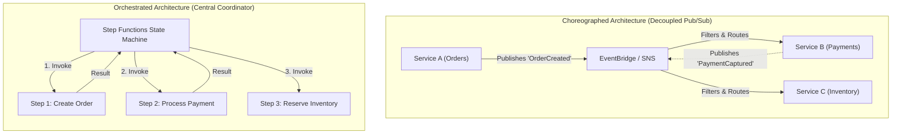
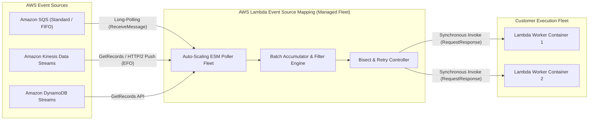
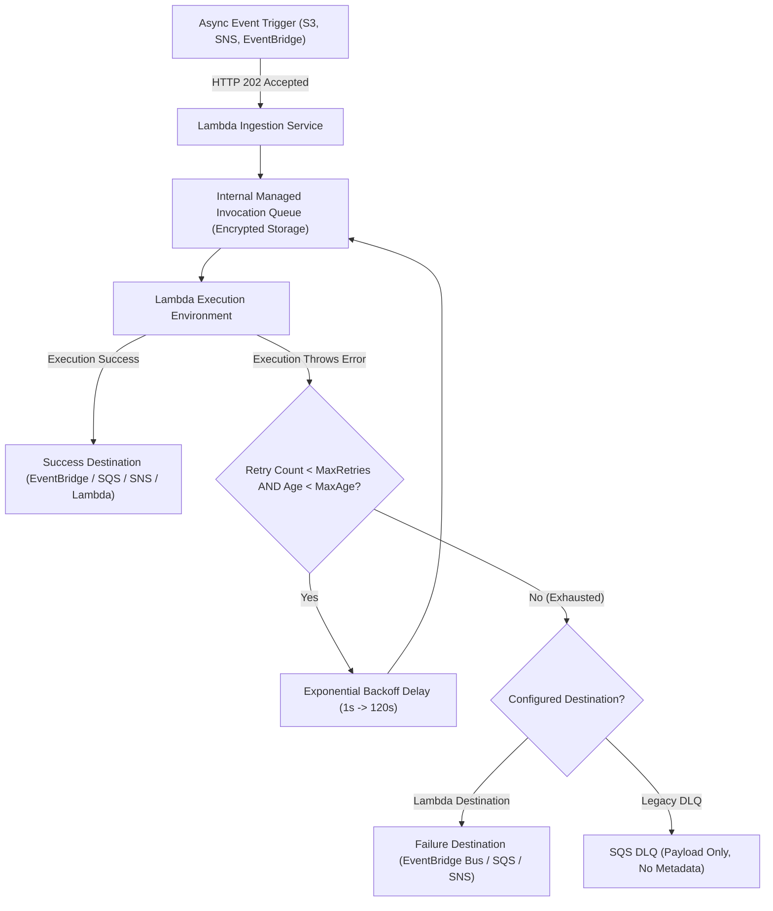
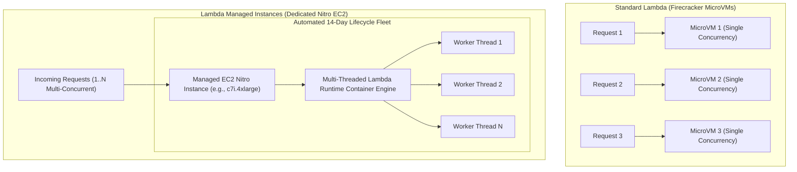
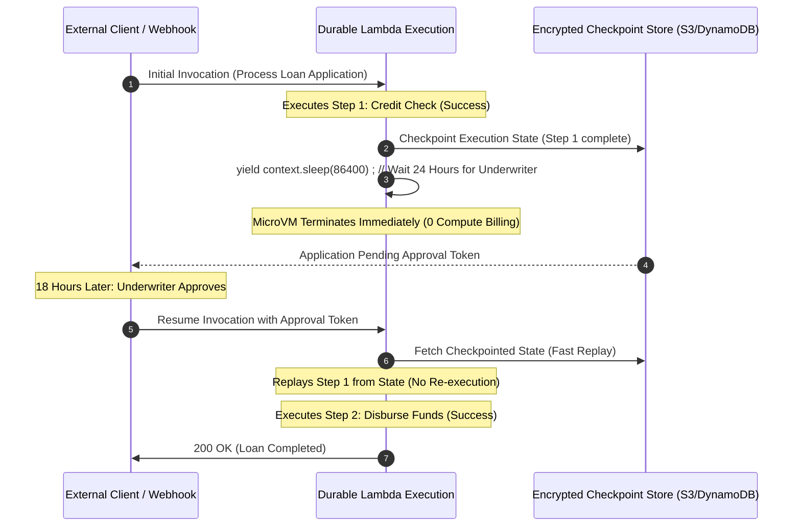
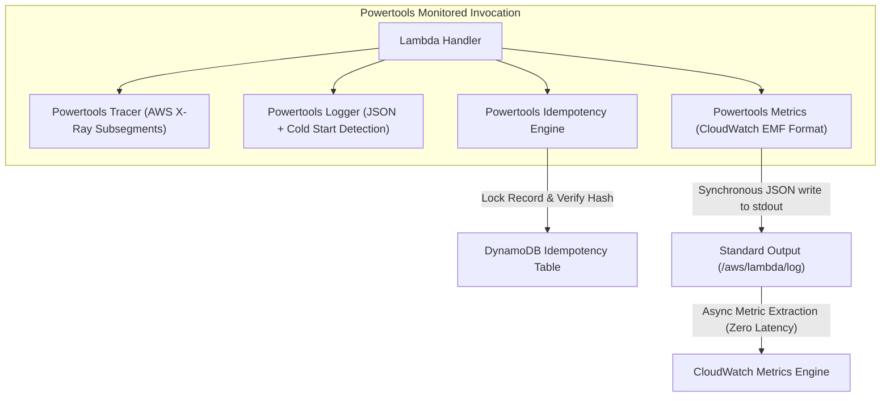
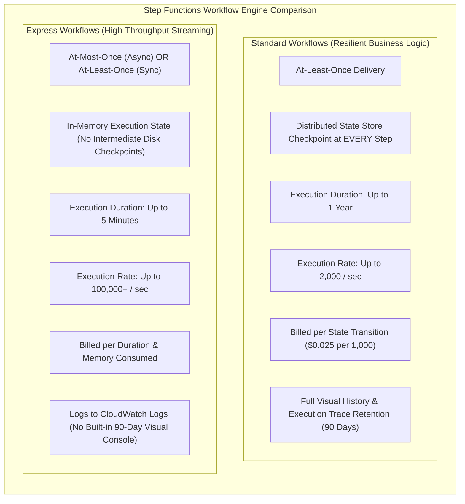

# Module 05: Serverless Event-Driven Architecture

Modern cloud applications decouple systems into autonomous, reactive components using event-driven architectures (EDA). In Amazon Web Services, serverless computing extends far beyond standalone compute functions; it encompasses sophisticated event integration engines, stream-processing event source mappings, resilient partial batch failure recovery, distributed workflow orchestration, and native stateful workflow checkpoints.

---

## 1. Theoretical Foundations: Event Choreography vs Orchestration

Distributed architectures coordinate workflows through two fundamental paradigms: **choreography** and **orchestration**. Choosing between them dictates system coupling, observability, error blast radiuses, and latency profiles.



### Choreography: Reactive Autonomous Decoupling

In choreography, individual services publish events when domain state changes (e.g., `OrderPlaced`, `InvoiceGenerated`). Other services subscribe to relevant event streams and react autonomously.

- **Advantages**: Complete runtime and domain decoupling. Services possess zero compile-time or runtime knowledge of downstream consumers. Additional subscribers can be added without modifying existing publishers.
- **Trade-offs**: Distributed state tracking becomes difficult. Visualizing overall business process progress requires distributed tracing tools (e.g., AWS X-Ray, OpenTelemetry). Cascading event storms, deadlocks, and cyclic dependencies can arise without rigorous architectural schema governance.

### Orchestration: Explicit Algorithmic Coordination

In orchestration, a centralized workflow engine (such as AWS Step Functions) explicitly commands worker services, evaluates conditional branches, catches task exceptions, coordinates timeouts, and executes compensating transactions (the Saga pattern).

- **Advantages**: Clear end-to-end auditability and deterministic state modeling. Workflow logic lives in a single versioned definition (Amazon States Language). Retry budgets, exponential backoffs, and error handlers are managed centrally without polluting service business code.
- **Trade-offs**: Tight coupling to the orchestrator state definition. The orchestrator can become a single point of failure or an administrative bottleneck if business boundaries are poorly defined.

---

## 2. Lambda Event Source Mappings (ESM) Deep Dive

When AWS Lambda integrates with polling-based event sources—Amazon SQS, Amazon Kinesis Data Streams, and Amazon DynamoDB Streams—the invocation model shifts from direct push to an AWS-managed polling fleet called the **Event Source Mapping (ESM)**.



The ESM fleet runs outside the customer's VPC inside the internal AWS Lambda control plane. The ESM continually polls the target queue or stream, aggregates records into batches according to configured thresholds, synchronously invokes the customer's Lambda function (`RequestResponse`), and commits checkpoints or deletes messages upon successful execution.

### SQS Event Source Mapping Mechanics

- **Polling Loop**: ESM worker threads issue `ReceiveMessage` long-polling requests (up to 20 seconds wait time) against the Amazon SQS queue.
- **Batching Window**: Controlled by two parameters:
  - `BatchSize`: Maximum number of records delivered in a single invocation (1 to 10,000 for Standard queues; 1 to 10 for FIFO queues).
  - `MaximumBatchingWindowInSeconds`: Maximum duration (0 to 300 seconds) the ESM waits to accumulate messages before dispatching the batch to the function. If `BatchSize` is met before the window elapses, the batch invokes immediately.
- **Scaling and Concurrency Limits**: The ESM scales out the number of concurrent pollers automatically based on queue depth (`ApproximateNumberOfMessagesVisible`). To prevent an SQS queue from exhausting regional Lambda concurrency or overwhelming a downstream relational database, administrators configure `MaximumConcurrency` (2 to 1,000) directly on the Event Source Mapping.

### Streaming Event Source Mapping: Kinesis and DynamoDB Streams

Unlike SQS queues where messages are consumed independently by competing consumers, stream partitions (shards) represent strictly ordered sequential logs.

- **Shard Iterators**: The ESM requests records using shard iterators (`LATEST`, `TRIM_HORIZON`, or `AT_TIMESTAMP`).
- **One Lambda Worker per Shard by Default**: In standard configurations, exactly one Lambda execution environment processes records from a single shard at any given moment to maintain deterministic in-order processing.
- **Parallelization Factor**: For high-throughput shards where downstream processing is bottlenecked by CPU or I/O, setting `ParallelizationFactor` (1 to 10) allows concurrent Lambda invocations per shard. The ESM partitions the shard's records by the message's partition key hashing, guaranteeing strict ordering within each sub-partition while multiplying aggregate shard processing throughput tenfold.
- **Tumbling Windows**: Enables stateful streaming aggregation over fixed time boundaries (up to 900 seconds / 15 minutes). The ESM retains intermediate aggregation state in an internal cache across multiple function invocations until the time window closes, at which point a final aggregation record is emitted.

### Error Handling and Stream Poison Pill Mitigation

If an unhandled exception occurs while processing a stream batch, standard stream mechanics block shard progress indefinitely because records must be processed in order. AWS ESM provides fine-grained controls to mitigate poison pills:

1. `BisectBatchOnFunctionError`: When set to `true`, if an invocation fails, the ESM automatically divides the failed batch into two halves and retries each half independently. This recursive bisection isolates the single malformed record ("poison pill") down to a batch of size 1.
2. `MaximumRetryAttempts`: Restricts the number of times the ESM retries a failed batch (0 to 10,000). Once exhausted, the failed record is bypassed or dispatched to a destination.
3. `MaximumRecordAgeInSeconds`: Discards stream records that have aged beyond a specified threshold (60 seconds to 604,800 seconds / 7 days), preventing stale data from blocking the real-time processing pipeline.
4. `OnFailureDestination`: Automatically routes metadata and payload pointers of permanently discarded records to an Amazon SQS queue or Amazon SNS topic for offline inspection.

---

## 3. Partial Batch Response Mechanics (`ReportBatchItemFailures`)

In legacy event-driven Lambda architectures, processing errors within a batch forced a coarse binary outcome: either the entire batch succeeded, or the entire batch failed.


### The Duplicate Processing Anti-Pattern

Consider an ESM configured with `BatchSize: 10`. If messages 1 through 3 process successfully, but message 4 encounters a fatal parsing exception:

1. In the legacy model, the function throws an error, causing the entire invocation to fail.
2. The ESM deletes zero messages from SQS.
3. After the SQS visibility timeout expires, all 10 messages reappear in the queue.
4. Downstream systems receive duplicate mutations for messages 1 through 3, risking double billing or redundant inventory reservations unless complex application-level deduplication is implemented.

### The `ReportBatchItemFailures` Protocol

Modern AWS Lambda architectures resolve this through the `ReportBatchItemFailures` configuration option on the Event Source Mapping. When enabled, Lambda expects the handler to catch item-level exceptions, isolate failing records, and return a structured JSON response identifying failed item identifiers.

```typescript
import type { SQSHandler, SQSEvent, SQSBatchResponse } from 'aws-lambda';

export const handler: SQSHandler = async (event: SQSEvent): Promise<SQSBatchResponse> => {
  const batchItemFailures: SQSBatchResponse['batchItemFailures'] = [];

  for (const record of event.Records) {
    try {
      await processMessage(record);
    } catch (error) {
      console.error(`Failed to process message ${record.messageId}:`, error);
      // Append the unique message identifier to indicate item-level failure
      batchItemFailures.push({ itemIdentifier: record.messageId });
    }
  }

  // Succeeded messages are automatically deleted by the ESM.
  // Only records returned in batchItemFailures remain in the queue.
  return { batchItemFailures };
};

async function processMessage(record: SQSEvent['Records'][number]): Promise<void> {
  const body = JSON.parse(record.body);
  if (!body.customerId) {
    throw new Error('Invalid schema: customerId is required.');
  }
  // Execute business logic...
}
```

### Protocol Mechanics for Streaming Sources

For Kinesis and DynamoDB Streams, `itemIdentifier` corresponds to the record's sequence number (`record.kinesis.sequenceNumber` or `record.dynamodb.SequenceNumber`). When a sequence number is returned in `batchItemFailures`, the ESM automatically commits checkpoints up to the record immediately preceding the failure. It then rewinds the shard iterator and replays the stream beginning precisely at the failed record, eliminating both data loss and duplicate processing of prior records.

---

## 4. Asynchronous Invocations, Retries, and Lambda Destinations

Understanding the boundary between synchronous and asynchronous Lambda invocations is critical for engineering resilient distributed systems.

| Dimension | Synchronous Invocations | Asynchronous Invocations |
| --- | --- | --- |
| **Invocation Type Header** | `X-Amz-Invocation-Type: RequestResponse` | `X-Amz-Invocation-Type: Event` |
| **Caller Blocking** | Caller holds HTTP socket open awaiting handler return. | AWS returns HTTP 202 Accepted within milliseconds. |
| **Common Trigger Sources** | API Gateway, Application Load Balancer, AWS AppSync. | Amazon S3, Amazon SNS, EventBridge, CloudWatch Alarms. |
| **Retry Responsibility** | Caller must implement client-side retries and backoff. | Lambda internal execution queue manages retry lifecycle. |
| **Failure Routing** | Returns HTTP 5xx error payload directly to client. | Routes to Dead-Letter Queue (DLQ) or Lambda Destinations. |

### The Asynchronous Invocation Queue and Retry Engine

When an asynchronous invocation arrives:

1. Lambda places the event into an internal, AWS-managed, highly available SQS queue.
2. An internal poller dequeues the event and invokes the execution environment.
3. If the function throws an unhandled exception or times out, Lambda invokes automatic retry logic:
   - **Retry Count**: Defaults to 2 automatic retries (total of 3 execution attempts).
   - **Backoff Algorithm**: Exponential backoff with jitter: 1 second after initial failure, then 2 minutes after second failure.
   - **Maximum Event Age**: Defaults to 21,600 seconds (6 hours). If an event sits in the internal queue longer than `MaximumEventAgeInSeconds` (configurable from 60 seconds to 6 hours), it is discarded without further execution attempts.
   - **Maximum Retry Attempts**: Configurable from 0 (fail immediately) to 2.



### Legacy Dead-Letter Queues (DLQ) vs Modern Lambda Destinations

In early Lambda architectures, unhandled asynchronous failures routed to an SQS queue or SNS topic configured via the `DeadLetterConfig` parameter. Modern architectures replace DLQs with **Lambda Destinations** (`DestinationConfig`):

```json
{
  "DestinationConfig": {
    "OnSuccess": {
      "Destination": "arn:aws:events:eu-central-1:111122223333:event-bus/analytics-bus"
    },
    "OnFailure": {
      "Destination": "arn:aws:sqs:eu-central-1:111122223333:order-processing-failures"
    }
  }
}
```

### Why Lambda Destinations Surpass Legacy DLQs

1. **Rich Contextual Metadata**: Legacy DLQs transmit only the raw event payload. Lambda Destinations wrap the event in a comprehensive JSON envelope containing:
   - `requestPayload`: The original input event.
   - `responsePayload`: The exception class, error message, and full runtime stack trace.
   - `requestContext`: Request ID, execution duration, memory configured, and execution timestamp.
   - `approximateInvokeCount`: Number of times Lambda attempted invocation before routing to destination.
2. **Success Capture (`OnSuccess`)**: Destinations allow chaining serverless routines without Step Functions or manual SNS calls, emitting clean event records upon successful handler completion.
3. **EventBridge Integration**: Destinations target Amazon EventBridge event buses natively, allowing central routing rules to fan out failure notifications to PagerDuty, Datadog, Slack webhooks, and automated recovery Lambdas simultaneously.

---

## 5. Lambda Managed Instances

Announced at AWS re:Invent 2025, **AWS Lambda Managed Instances** bridges the divide between pure serverless microVM execution and provisioned EC2 instances, solving extreme cold-start challenges and high-concurrency cost ceilings for high-throughput enterprise workloads.



### The Architectural Problem It Solves

Traditional AWS Lambda executes under a strict concurrency model: **one active invocation per microVM environment**. A service receiving 5,000 concurrent requests requires 5,000 distinct microVMs. For massive enterprise applications (e.g., high-frequency trading gateways, ad-tech auctions, heavy Java Spring Boot services), this introduces two friction points:

1. **Cold Starts**: Rapid scaling bursts induce hundreds of simultaneous microVM initializations.
2. **Economic Inefficiency**: Memory and CPU initialized during the Init Phase cannot be amortized across concurrent requests within the same hardware instance.

### Managed Instance Mechanics

With Lambda Managed Instances:

- **Dedicated EC2 Infrastructure**: Functions execute on dedicated Amazon EC2 Nitro instances running an AWS-managed container runtime.
- **Multi-Concurrency**: A single instance handles dozens or hundreds of concurrent invocations simultaneously over shared memory and vCPU pools, mirroring standard web server concurrency (similar to Node.js event loops or Go goroutines).
- **Pricing Model**: Customers pay standard Amazon EC2 instance pricing for the underlying instances plus a **15% AWS management fee**. Per-request execution charges are eliminated, significantly reducing compute costs for steady high-throughput microservices.
- **Automated Lifecycle Management**: AWS fully manages the host fleet:
  - Automated operating system and kernel security patching.
  - Zero-downtime rolling replacements with a maximum instance lifetime of **14 days**.
  - Integrated with Auto Scaling to dynamically provision and drain instances based on real-time traffic demand.

---

## 6. Lambda Durable Functions

Introduced at AWS re:Invent 2025, **AWS Lambda Durable Functions** provides native, code-level workflow orchestration directly within function code, eliminating the cognitive friction of authoring external state machines for simple delays, approvals, and multi-step retries.



### Deterministic Replay and Suspension Mechanics

Lambda Durable Functions implements the **checkpoint-and-replay pattern** (pioneered by academic literature and Temporal/Cadence frameworks):

1. **Deterministic Execution**: The function executes sequential steps. When it encounters a durable wait primitive (such as `await context.sleep(duration)` or `await context.waitForExternalEvent(eventName)`), the runtime captures the execution stack, local variables, and completed step outputs.
2. **Immediate MicroVM Deallocation**: The runtime serializes the execution state, persists it to an encrypted distributed state store, and terminates the microVM execution environment.
3. **Zero Idle Compute Billing**: The customer incurs zero compute or memory charges while the function is suspended. Suspensions can remain active for up to **1 year**.
4. **Replay Reconstitution**: When the timer fires or an external event arrives with the correlation token, Lambda launches a fresh execution environment. The function restarts from line 1, but the durable runtime intercepts previously executed step invocations, immediately returning their cached checkpoint values without re-executing remote API calls. Once execution reaches the suspension point, normal execution resumes.

---

## 7. Powertools for AWS Lambda: Production Hardening

Writing production-grade serverless functions requires strict adherence to operational observability, structured telemetry, and distributed transaction idempotency. **Powertools for AWS Lambda** provides standard, battle-tested utilities across TypeScript and Python.



### 1. Structured JSON Logging and Cold-Start Detection

Legacy `console.log()` statements emit unindexed plain text that is expensive to query with CloudWatch Logs Insights. Powertools Logger structures every log entry as a standardized JSON schema, automatically capturing:

- AWS Request ID, function name, version, and memory allocation.
- `cold_start: true` boolean indicator on the initial invocation of a container.
- Correlation IDs extracted from incoming API Gateway headers (`X-Correlation-Id`).

### 2. Distributed Tracing with AWS X-Ray

Powertools Tracer wraps asynchronous operations in X-Ray subsegments automatically:

- Traces outbound HTTP/HTTPS requests generated by the AWS SDK.
- Annotates traces with cold-start status and custom business metadata (e.g., `tenantId`, `orderStatus`).
- Captures downstream service response latencies and exceptions with zero manual boilerplate.

### 3. CloudWatch Embedded Metric Format (EMF)

Publishing custom application metrics via the traditional AWS SDK API (`cloudwatch.putMetricData`) introduces synchronous HTTP overhead (often adding 50–150ms of billable latency per invocation) and incurs API request costs. Powertools Metrics leverages **CloudWatch Embedded Metric Format (EMF)**:

- Metrics are formatted as specialized structured JSON lines and written directly to standard output (`stdout`).
- The CloudWatch Logs ingestion pipeline asynchronously extracts the metrics from the log stream in real time and publishes them to CloudWatch Metrics.
- **Outcome**: Zero HTTP network latency added to customer requests, and zero `PutMetricData` API costs.

### 4. DynamoDB-Backed Idempotency Engine

To enforce strict once-only processing across retried events, Powertools provides an automated idempotency utility backed by an Amazon DynamoDB table.

```typescript
import { IdempotencyConfig, makeIdempotent } from '@aws-lambda-powertools/idempotency';
import { DynamoDBPersistenceLayer } from '@aws-lambda-powertools/idempotency/dynamodb';
import type { APIGatewayProxyEvent, APIGatewayProxyResult } from 'aws-lambda';

const persistenceStore = new DynamoDBPersistenceLayer({
  tableName: 'IdempotencyRecords',
});

const config = new IdempotencyConfig({
  eventKeyJmesPath: 'powertools_json(body).orderId', // Deduplicate based on orderId in payload
  expiresAfterSeconds: 3600, // 1-hour idempotency window
});

const processOrder = async (event: APIGatewayProxyEvent): Promise<APIGatewayProxyResult> => {
  const body = JSON.parse(event.body || '{}');
  // Charge payment and reserve inventory...
  return {
    statusCode: 201,
    body: JSON.stringify({ status: 'ORDER_CREATED', orderId: body.orderId }),
  };
};

// Wrap the core handler with automatic idempotency enforcement
export const handler = makeIdempotent(processOrder, {
  persistenceStore,
  config,
});
```

#### Idempotency Protocol Execution Phases

1. **Acquire In-Progress Lock**: Upon handler entry, the utility extracts the idempotency key (e.g., `orderId`) and hashes the payload. It executes a conditional `PutItem` to the DynamoDB table with `attribute_not_exists(idempotency_key)`.
2. **Concurrent Collision Handling**: If another execution with the identical idempotency key is actively running, the conditional write fails. The utility polls until the in-progress execution finishes or raises an `IdempotencyConflictError`.
3. **Save Response Payload**: When the business logic finishes successfully, the handler's return response is saved into the DynamoDB item alongside an `EXPIRED` timestamp.
4. **Idempotent Short-Circuit**: Any subsequent invocation presenting the same key bypasses function execution entirely and immediately returns the cached response payload directly from DynamoDB.

---

## 8. AWS Step Functions: Workflow Orchestration

AWS Step Functions coordinates distributed microservices, serverless workflows, and human-in-the-loop tasks using declarative state machines defined in the **Amazon States Language (ASL)**.



### Standard vs Express Workflows: Comprehensive Comparison

| Feature / Dimension | Standard Workflows | Express Workflows |
| --- | --- | --- |
| **Primary Use Case** | Long-running, auditable workflows (order fulfillment, ETL pipelines). | High-volume, event-driven processing (IoT ingest, streaming ETL, web backends). |
| **Maximum Duration** | 1 year | 5 minutes |
| **Execution Rate** | Up to 2,000 starts per second | Over 100,000 starts per second |
| **State Persistence** | Synchronously checkpointed to persistent storage at every transition. | Execution runs entirely in-memory; checkpoints are omitted. |
| **Execution History** | Full visual step-by-step history retained in AWS Console for 90 days. | Emitted to Amazon CloudWatch Logs Insights or OpenSearch. |
| **Execution Semantics** | Exactly-once state transitions; at-least-once service calls. | Asynchronous: at-most-once. Synchronous: at-least-once. |
| **Pricing Model** | $0.025 per 1,000 state transitions. | $1.00 per 1M requests + $0.00001667 per GB-second of execution time. |

### Distributed Map State for Large-Scale Parallel Processing

Traditional Step Functions `Map` states executed iterations concurrently within a single execution environment, capped at 40 concurrent child executions. The modern **Distributed Map State** unlocks massive serverless parallel processing:

- **Child Execution Fleet**: Launches up to **10,000 parallel worker executions** simultaneously.
- **Direct S3 Dataset Processing**: Ingests multi-gigabyte or terabyte datasets directly from Amazon S3 (single massive CSV files, JSON arrays, S3 Inventory manifests, or millions of individual S3 objects in a prefix).
- **Execution Mode**: Each child iteration can run as a nested Standard or Express Workflow, providing isolated retries, concurrency limits, and failure thresholds (e.g., terminate execution if failure rate exceeds 5%).

```json
{
  "Type": "Map",
  "ItemProcessor": {
    "ProcessorConfig": {
      "Mode": "DISTRIBUTED",
      "ExecutionType": "EXPRESS"
    },
    "StartAt": "ProcessRecord",
    "States": {
      "ProcessRecord": {
        "Type": "Task",
        "Resource": "arn:aws:states:::lambda:invoke",
        "OutputPath": "$.Payload",
        "Parameters": {
          "FunctionName": "arn:aws:lambda:eu-central-1:111122223333:function:TransformRecord:$LATEST",
          "Payload.$": "$"
        },
        "End": true
      }
    }
  },
  "ItemReader": {
    "Resource": "arn:aws:states:::s3:getObject",
    "ReaderConfig": {
      "InputType": "CSV",
      "CSVHeaderLocation": "FIRST_ROW"
    },
    "Parameters": {
      "Bucket": "corporate-analytics-landing",
      "Key": "raw-events/daily-log.csv"
    }
  },
  "MaxConcurrency": 1000,
  "End": true
}
```

---

## 9. Architectural Patterns and Production Failure Modes

Building enterprise-scale serverless architectures requires anticipating failure modes inherent in asynchronous distributed systems.

### 1. The Claim Check Pattern for Massive Payloads

Amazon EventBridge, Amazon SNS, and Amazon SQS enforce a strict **256 KB message payload ceiling** (up to 2 MB for EventBridge with extended payloads, but with latency and pricing trade-offs). When events contain large payloads (e.g., high-resolution medical imagery, raw video files, large PDF contracts):

- **Publisher**: Uploads the raw payload to an Amazon S3 bucket and generates a unique object key. It publishes an event containing only lightweight metadata and an S3 URI (the "Claim Check").
- **Subscriber**: Receives the lightweight event, verifies authenticity, and downloads the full payload directly from S3 using the claim check pointer.


### 2. Downstream Saturation and the Thundering Herd

Lambda scales out horizontally in milliseconds. If 2,000 concurrent Lambda instances launch to process a surge in SQS messages and each worker attempts to open an independent connection to an un-pooled Amazon Aurora database:

- **Failure Mode**: The database exhausts its maximum connection pool (`max_connections`), CPU spikes to 100%, query timeouts cascade across the system, and Lambda functions fail, resulting in message redrives and a perpetual failure loop.
- **Mitigation Architecture**:
  1. Attach **Amazon RDS Proxy** between Lambda and the database fleet to multiplex thousands of ephemeral Lambda connections over a small pool of warm database connections.
  2. Configure `MaximumConcurrency` on the SQS Event Source Mapping to strictly cap concurrent workers processing the queue below the database's safe throughput threshold.

---

## 10. Then vs Now: Evolution of AWS Serverless Architecture

| Dimension | Legacy Architecture (Then) | Modern Cloud Standard (Now) |
| --- | --- | --- |
| **Batch Processing Failures** | Binary all-or-nothing failures; one bad message reprocessed entire batch. | `ReportBatchItemFailures` allows granular item-level re-queuing with zero duplicate executions. |
| **Asynchronous Error Routing** | SQS Dead-Letter Queue containing raw, un-annotated message body. | Lambda Destinations routing rich JSON envelopes (error stack trace, request ID, invocation context) to EventBridge. |
| **High-Throughput Concurrency** | Provisioned Concurrency reserving thousands of single-execution microVMs. | Lambda Managed Instances running multi-concurrent executions on dedicated EC2 Nitro hosts. |
| **Multi-Day Workflows** | Complex Step Functions state machines required for simple sleeps and delays. | Native Lambda Durable Functions with zero-compute-cost suspension for up to 1 year. |
| **Custom Telemetry** | Synchronous `putMetricData` HTTP calls adding 50–150ms billable latency. | CloudWatch Embedded Metric Format (EMF) via standard out with zero execution latency. |
| **ETL Batch Scaling** | Step Functions Map state limited to 40 concurrent child iterations. | Distributed Map State executing up to 10,000 parallel workers directly over S3 datasets. |

---

## Interview Drill

<details><summary>1. How does configuring ReportBatchItemFailures in an SQS Event Source Mapping prevent the duplicate processing anti-pattern?</summary>

In a standard SQS Event Source Mapping without partial batch responses, if a function throws an unhandled error while processing any message within a batch, the invocation fails entirely. Because the ESM cannot determine which messages succeeded, it deletes nothing from SQS, causing all messages in the batch to become visible again and reprocess after the visibility timeout expires. When `ReportBatchItemFailures` is enabled, the handler catches exceptions per item and returns a structured response `{ batchItemFailures: [{ itemIdentifier: messageId }] }`. The ESM deletes all succeeded message IDs from the queue and leaves only the failed message IDs to retry, preventing duplicate processing of succeeded records.

- Ref: [modules/05-serverless-event-driven-architecture.md#3-partial-batch-response-mechanics-reportbatchitemfailures](05-serverless-event-driven-architecture.md#3-partial-batch-response-mechanics-reportbatchitemfailures), https://docs.aws.amazon.com/lambda/latest/dg/with-sqs.html

</details>

<details><summary>2. Why are Lambda Destinations superior to legacy Dead-Letter Queues (DLQs) for asynchronous invocations?</summary>

Legacy DLQs configured via `DeadLetterConfig` route only the raw original event payload to an SQS queue or SNS topic, stripping all execution context. In contrast, Lambda Destinations (`DestinationConfig`) wrap the failure in a comprehensive JSON envelope that includes the original `requestPayload`, the exact error message and stack trace (`responsePayload`), invocation timestamps, approximate retry counts, and execution request IDs. Furthermore, Destinations support `OnSuccess` execution chaining and integrate directly with Amazon EventBridge event buses to fan out failure notifications across multi-account monitoring tools without custom application code.

- Ref: [modules/05-serverless-event-driven-architecture.md#4-asynchronous-invocations-retries-and-lambda-destinations](05-serverless-event-driven-architecture.md#4-asynchronous-invocations-retries-and-lambda-destinations), https://docs.aws.amazon.com/lambda/latest/dg/invocation-async.html

</details>

<details><summary>3. What is the execution and billing difference between AWS Step Functions Standard Workflows and Express Workflows?</summary>

Standard Workflows are designed for long-running (up to 1 year), auditable business processes. They checkpoint state synchronously to persistent distributed storage at every transition, guarantee at-least-once execution with exactly-once state transitions, retain a 90-day visual audit history in the console, and are billed per state transition ($0.025 per 1,000 transitions). Express Workflows are designed for high-volume, event-driven streaming workloads (up to 5 minutes duration) running over 100,000 executions per second. They run entirely in-memory without persistent disk checkpoints, emit execution logs to CloudWatch Logs, and are billed based on execution duration and memory consumed.

- Ref: [modules/05-serverless-event-driven-architecture.md#8-aws-step-functions-workflow-orchestration](05-serverless-event-driven-architecture.md#8-aws-step-functions-workflow-orchestration), https://docs.aws.amazon.com/step-functions/latest/dg/concepts-standard-vs-express.html

</details>

<details><summary>4. How does the BisectBatchOnFunctionError parameter protect streaming event pipelines in Amazon Kinesis?</summary>

In streaming services like Kinesis and DynamoDB Streams, records in a shard must be processed in strict sequential order. If a malformed record ("poison pill") throws an unhandled exception, the stream processor halts and retries the batch indefinitely, blocking the entire shard. Enabling `BisectBatchOnFunctionError` instructs the Event Source Mapping to automatically split a failed batch into two separate halves upon an error and retry each half independently. The ESM repeats this bisection recursively until the single offending record is isolated into a batch of size 1, where it can be exhausted to an On-Failure Destination while allowing the remainder of the shard to proceed.

- Ref: [modules/05-serverless-event-driven-architecture.md#2-lambda-event-source-mappings-esm-deep-dive](05-serverless-event-driven-architecture.md#2-lambda-event-source-mappings-esm-deep-dive), https://docs.aws.amazon.com/lambda/latest/dg/with-kinesis.html

</details>

<details><summary>5. What are AWS Lambda Managed Instances and how do their concurrency and pricing models differ from standard Lambda?</summary>

Lambda Managed Instances (announced at re:Invent 2025) execute serverless functions on dedicated Amazon EC2 Nitro instances managed entirely by AWS. In standard Lambda, each microVM handles exactly one concurrent invocation at a time, requiring thousands of microVMs during scaling bursts. Managed Instances support multi-concurrency, allowing a single host to run many concurrent invocations simultaneously across shared memory and vCPU pools. Pricing shifts from standard per-request and GB-second execution fees to the baseline Amazon EC2 instance price plus a 15% management fee, dramatically lowering costs for steady-state high-concurrency microservices while eliminating cold starts.

- Ref: [modules/05-serverless-event-driven-architecture.md#5-lambda-managed-instances](05-serverless-event-driven-architecture.md#5-lambda-managed-instances), https://aws.amazon.com/blogs/aws/

</details>

<details><summary>6. How do Lambda Durable Functions suspend execution for up to 1 year without incurring compute charges?</summary>

Lambda Durable Functions uses a deterministic checkpoint-and-replay engine. When function code awaits an external event or timer (e.g., `context.sleep()`), the runtime serializes the local execution state, call stack, and step outputs to an encrypted distributed state store and immediately shuts down the microVM execution environment. Because no active memory or CPU is consumed during the wait window, customers incur zero compute billing. When resumed via an external webhook or timer event, a fresh microVM launches, replays completed steps from saved checkpoints without re-executing side effects, and continues execution from the suspension point.

- Ref: [modules/05-serverless-event-driven-architecture.md#6-lambda-durable-functions](05-serverless-event-driven-architecture.md#6-lambda-durable-functions), https://aws.amazon.com/blogs/aws/

</details>

<details><summary>7. Why does CloudWatch Embedded Metric Format (EMF) improve performance compared to the standard AWS SDK PutMetricData API?</summary>

Calling `cloudwatch.putMetricData()` requires making a synchronous HTTPS POST request over the network from within the Lambda function handler, adding 50 to 150 milliseconds of billable execution latency per call and incurring CloudWatch API request fees. In contrast, Embedded Metric Format (EMF) writes structured JSON metric definitions directly to standard output (`stdout`). The CloudWatch Logs ingestion subsystem ingests the log stream and extracts custom metrics asynchronously in the background. This results in zero added HTTP latency to the function and avoids `PutMetricData` API costs.

- Ref: [modules/05-serverless-event-driven-architecture.md#7-powertools-for-aws-lambda-production-hardening](05-serverless-event-driven-architecture.md#7-powertools-for-aws-lambda-production-hardening), https://docs.aws.amazon.com/AmazonCloudWatch/latest/monitoring/CloudWatch_Embedded_Metric_Format.html

</details>

<details><summary>8. How does the Claim Check pattern overcome payload limits in Amazon SQS and EventBridge?</summary>

Amazon SQS and Amazon EventBridge enforce a 256 KB message size limit. The Claim Check pattern circumvents this limitation by decoupling payload storage from messaging. The publishing service stores the large payload (e.g., a 10 MB payload) directly in an Amazon S3 bucket, generating an object reference key. The publisher then dispatches a lightweight message to SQS or EventBridge containing only metadata and the S3 URI pointer. Downstream consuming Lambda functions receive the pointer and use the AWS SDK to retrieve the complete payload from S3, enabling the processing of arbitrary payload sizes without violating message bus quotas.

- Ref: [modules/05-serverless-event-driven-architecture.md#9-architectural-patterns-and-production-failure-modes](05-serverless-event-driven-architecture.md#9-architectural-patterns-and-production-failure-modes), https://docs.aws.amazon.com/prescriptive-guidance/latest/cloud-design-patterns/claim-check.html

</details>

<details><summary>9. What role does ParallelizationFactor play in scaling Amazon Kinesis Data Streams consumers?</summary>

By default, an Event Source Mapping maintains strict FIFO ordering per shard by dedicating exactly one Lambda execution environment per shard. If incoming traffic exceeds the single-threaded throughput capacity of a Lambda worker, consumer lag increases. Setting `ParallelizationFactor` (between 1 and 10) allows the ESM to spin up multiple concurrent Lambda invocations per shard. The ESM partitions the incoming records by hashing their partition keys, preserving strict in-order delivery within each partition key group while scaling out parallel processing up to ten concurrent workers per shard.

- Ref: [modules/05-serverless-event-driven-architecture.md#2-lambda-event-source-mappings-esm-deep-dive](05-serverless-event-driven-architecture.md#2-lambda-event-source-mappings-esm-deep-dive), https://docs.aws.amazon.com/lambda/latest/dg/with-kinesis.html

</details>

<details><summary>10. How does a DynamoDB-backed idempotency utility prevent double-charging in payment processing during Lambda retries?</summary>

When a client or upstream event source retries an invocation (due to network blips or timeouts), the Lambda function may execute twice with the identical payload. An idempotency utility extracts a unique transactional identifier (such as `orderId`) and executes a conditional write (`attribute_not_exists`) to an idempotency DynamoDB table before invoking business logic. If a record already exists with that key, the utility detects the duplicate, skips payment execution, and returns the cached result from the initial execution. If the initial execution is still in progress, concurrent invocations wait or raise a conflict error, preventing race conditions and double charges.

- Ref: [modules/05-serverless-event-driven-architecture.md#7-powertools-for-aws-lambda-production-hardening](05-serverless-event-driven-architecture.md#7-powertools-for-aws-lambda-production-hardening), https://docs.aws.amazon.com/lambda/latest/dg/services-dynamodb.html

</details>
