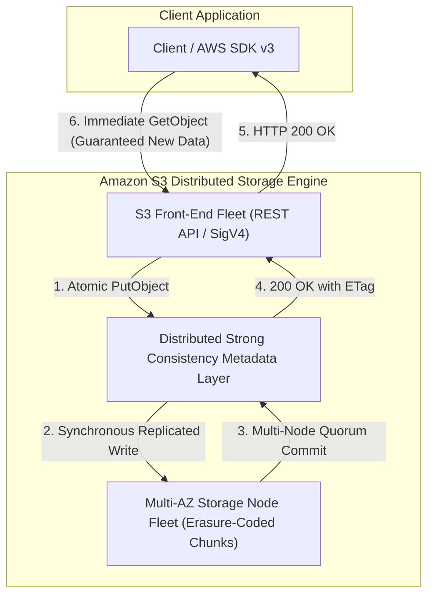
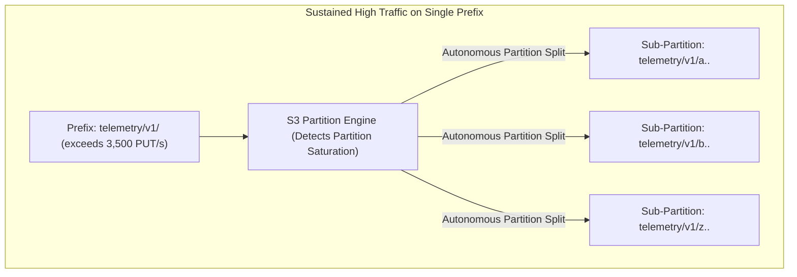
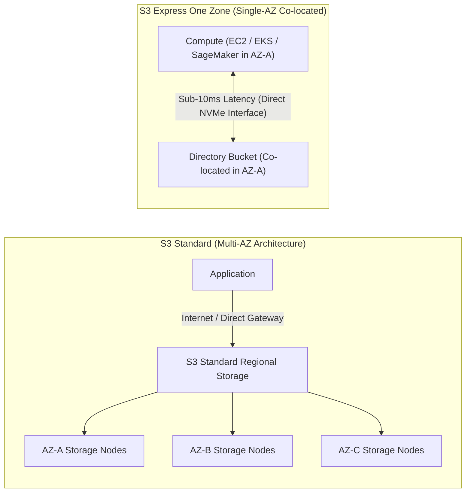
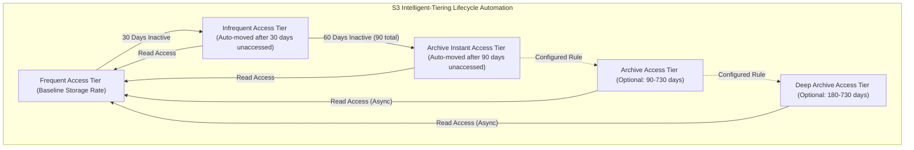
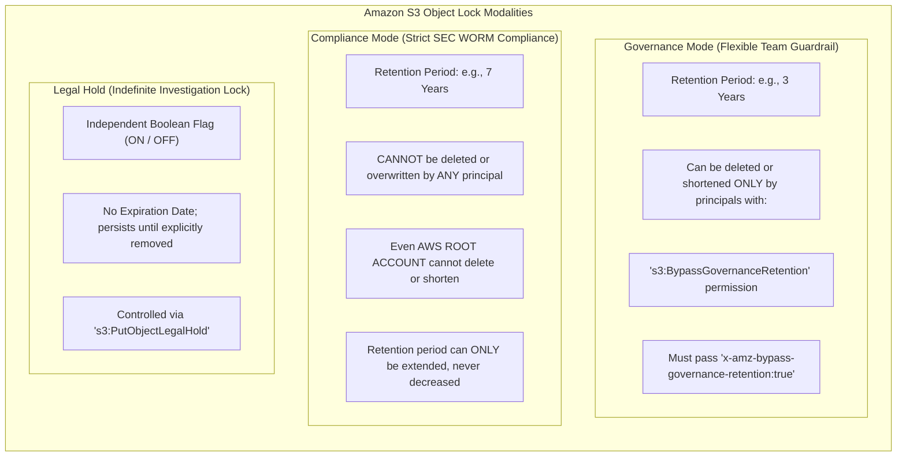
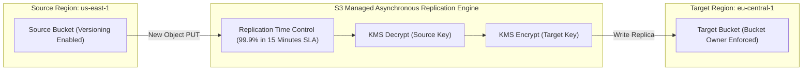
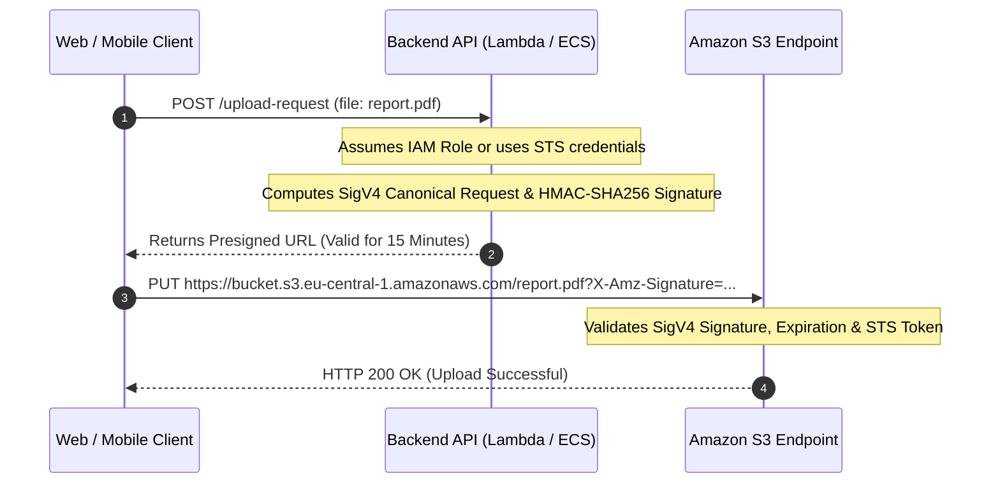
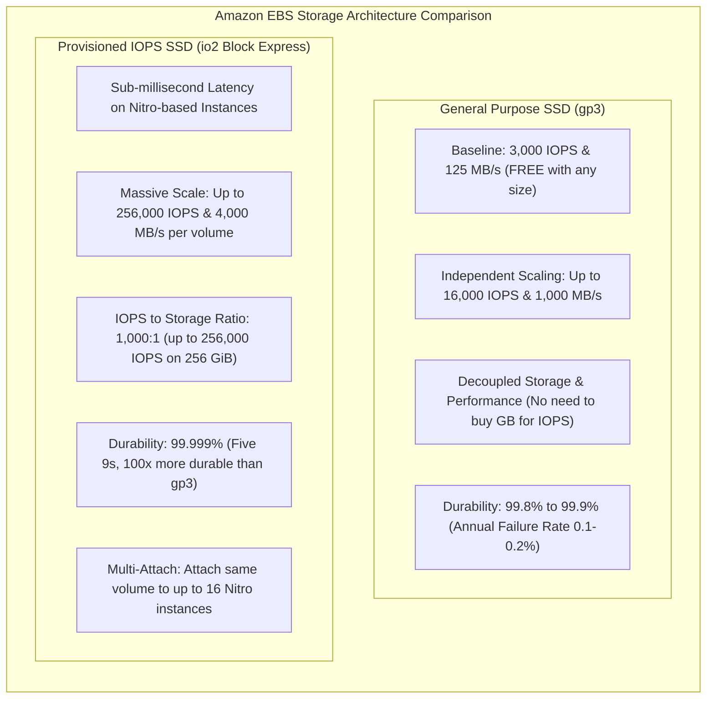
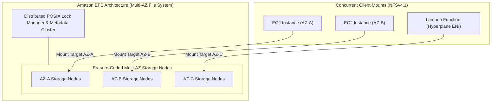

# Module 06: Storage: S3, EBS, and EFS Internals

Cloud storage systems present distinct trade-offs across latency, consistency models, throughput scalability, access protocols, and economic tiering. In Amazon Web Services, storage divides into three foundational modalities: **Amazon S3** (distributed object store accessed over HTTP/REST with strong consistency), **Amazon EBS** (low-latency block devices attached via PCIe/NVMe to EC2 instances), and **Amazon EFS** (distributed, POSIX-compliant network file systems accessed over NFSv4.1).

---

## 1. Amazon S3 Storage Engine & Consistency Model

Amazon Simple Storage Service (Amazon S3) is a massively distributed key-value object store designed to deliver 99.999999999% (11 9's) of data durability across multiple physical facilities within an AWS Region.



### Strong Read-After-Write Consistency

Historically, Amazon S3 operated under an eventual consistency model for overwrite PUTs and DELETEs: reading an object immediately after overwriting or deleting it could return the stale object version or a transient 404. In December 2020, AWS upgraded Amazon S3 to provide **strong read-after-write consistency** at zero additional cost and without latency penalties across all AWS commercial and GovCloud regions:

- **Scope**: Applies to `PUT`, `POST`, and `DELETE` requests of both brand new objects and overwritten objects, as well as bucket metadata and tag updates.
- **Listing Consistency**: Read-after-write consistency extends to bucket object listings (`ListObjectsV2`). Immediately after writing or deleting an object, listing the bucket prefix deterministically reflects the change.
- **Architectural Impact**: Eliminates the need for external caching and synchronization layers (such as the open-source `S3Guard` library or secondary DynamoDB index trackers), allowing big data engines (Apache Spark, Trino, Presto) to read direct query output from S3 without race conditions.

### Atomic Conditional Writes

Concurrent writers to the same S3 key traditionally resulted in last-writer-wins race conditions. S3 supports atomic conditional writes using HTTP conditional headers:

- `If-None-Match: *`: Guarantees that the `PutObject` or `CompleteMultipartUpload` request succeeds only if the target object key does not already exist in the bucket. If the key exists, S3 halts the upload and returns HTTP 412 (`PreconditionFailed`), preventing mutual overwrite collisions in distributed lock implementations or ingestion pipelines.
- `If-Match: <ETag>`: Enforces optimistic concurrency control. The upload succeeds only if the existing object matches the provided ETag, ensuring that intermediate modifications by other workers abort the transaction.

```bash
# Atomic upload: Write new object only if no object exists at that key
aws s3api put-object \
  --bucket corporate-ledger-vault \
  --key balances/account-901.json \
  --body account-901.json \
  --if-none-match "*"
```

---

## 2. Request Rate Scaling and Prefix Partitioning

Amazon S3 scales horizontally by automatically distributing object keys across internal storage partitions.



### Baseline Request Rate Limits per Prefix

Each partitioned prefix in an Amazon S3 bucket natively supports:

- **3,500 PUT/POST/DELETE** requests per second.
- **5,500 GET/HEAD** requests per second.

These quotas apply **per partitioned prefix**, not per bucket. A bucket containing 10 distinct prefixes can achieve an aggregate throughput of 35,000 PUT requests and 55,000 GET requests per second without configuration changes.

### Autonomous Prefix Partition Splitting

When an application generates sustained request volume exceeding baseline thresholds on a specific prefix, S3 automatically detects the I/O concentration:

1. S3 dynamically splits the underlying index partition hosting the prefix.
2. The prefix divides into sub-partitions based on key character boundaries (e.g., `telemetry/2026/01/` through `telemetry/2026/12/`).
3. Each new partition inherits the full 3,500 PUT / 5,500 GET baseline request capacity.
4. If traffic surges instantly without a gradual ramp-up (e.g., jumping from 100 to 50,000 requests in 1 second), S3 returns HTTP 503 (`SlowDown`) while partition splitting executes. AWS SDKs automatically catch 503 errors and apply exponential backoff with jitter.

### The Obsolete Hash-Prefixing Anti-Pattern

Prior to 2018, S3 partitions did not split dynamically across lexicographical boundaries. Engineers were advised to prepend random MD5 or hexadecimal hashes to keys (e.g., `s3://bucket/2a8f-orders/` and `s3://bucket/9f1c-orders/`) to distribute load across internal partitions.

With modern autonomous partition splitting, **hash-prefixing is an obsolete anti-pattern**. Applications should organize data using clean, logical, human-readable directory structures (e.g., `s3://bucket/tenant=acme/year=2026/month=11/`). S3 splits prefixes internally regardless of naming patterns.

---

## 3. S3 Express One Zone: Sub-10ms High-Performance Storage

Introduced to support latency-sensitive analytics, machine learning training checkpoints, and real-time interactive applications, **Amazon S3 Express One Zone** represents a distinct storage tier engineered for raw performance.



### Architecture and Performance Characteristics

- **Directory Buckets**: Unlike standard S3 general-purpose buckets, Express One Zone objects reside inside specialized **directory buckets** named with an AZ suffix (e.g., `my-bucket--use1-az1--x-s3`).
- **Single-AZ Co-location**: Data is physically stored in the same Availability Zone as the compute cluster, removing inter-AZ network transit hops.
- **Latency**: Delivers consistent **single-digit millisecond (sub-10ms) data access latencies**, up to 10× faster than S3 Standard.
- **Cost Structure**: Reduces request costs by 50% compared to S3 Standard, while charging a higher baseline per-gigabyte storage fee, making it ideal for compute-heavy workloads where data is read and written millions of times per day.
- **Appendable Objects**: Supports direct data appends to existing objects without rewriting the entire payload, dramatically accelerating log ingestion and streaming checkpoints.

### Session-Based Authentication (`CreateSession`)

Standard S3 calculates an HMAC-SHA256 SigV4 signature for every individual HTTP request, introducing measurable CPU overhead when issuing tens of thousands of requests per second. S3 Express One Zone replaces per-request SigV4 hashing with **session-based authentication**:

1. The client issues an initial `CreateSession` API call using standard IAM credentials.
2. S3 returns an ephemeral session token valid for 5 minutes.
3. Subsequent requests authenticate using the lightweight session token header, reducing request processing overhead and client-side CPU load.

---

## 4. S3 Storage Class Hierarchy & Intelligent-Tiering

Amazon S3 offers a granular spectrum of storage classes optimized for access patterns, retrieval latency, and cost.

| Storage Class | Availability Zones | Minimum Duration | Minimum Billable Size | Retrieval Latency | Retrieval Fee | Best Use Case |
| --- | :-: | :-: | :-: | :-: | :-: | --- |
| **S3 Standard** | $\ge 3$ | None | None | Milliseconds | None | Active data, dynamic web assets, gaming. |
| **S3 Express One Zone** | 1 | None | None | Single-digit ms | None | ML training checkpoints, real-time analytics. |
| **S3 Standard-IA** | $\ge 3$ | 30 days | 128 KB | Milliseconds | Per GB retrieved | Disaster recovery backups, older active logs. |
| **S3 One Zone-IA** | 1 | 30 days | 128 KB | Milliseconds | Per GB retrieved | Reproducible secondary backups, thumbnails. |
| **S3 Glacier Instant Retrieval** | $\ge 3$ | 90 days | 128 KB | Milliseconds | Per GB retrieved | Medical records, news archives accessed 1x/year. |
| **S3 Glacier Flexible Retrieval** | $\ge 3$ | 90 days | None | 1–5m (Expedited) \| 3–5h (Std) \| 5–12h (Bulk) | Per GB retrieved | Compliance archives, annual regulatory audits. |
| **S3 Glacier Deep Archive** | $\ge 3$ | 180 days | None | 12 hours (Std) \| 48 hours (Bulk) | Per GB retrieved | 7–10 year regulatory legal retention, raw tape replacement. |

### Minimum Duration and Billable Size Penalties

Two critical economic traps govern Infrequent Access (IA) and Glacier classes:

1. **Minimum Duration Charge**: If an object stored in S3 Standard-IA is deleted, overwritten, or transitioned to another tier 10 days after creation, AWS bills for the full **30-day minimum duration**. Transitioning to Glacier Deep Archive and deleting after 20 days incurs a **180-day billable penalty**.
2. **Minimum Billable Size (128 KB)**: Objects smaller than 128 KB stored in Standard-IA or Glacier are billed for a full 128 KB of storage capacity. Storing millions of 5 KB JSON documents in Standard-IA results in massive cost inflation.



### S3 Intelligent-Tiering Mechanics

S3 Intelligent-Tiering automates cost optimization for datasets with unknown, changing, or unpredictable access patterns:

- **Zero Retrieval Fees**: Unlike manual IA or Glacier classes, Intelligent-Tiering charges **zero data retrieval fees** when cold objects are accessed.
- **Automated Two-Way Tiering**: Objects automatically move to Infrequent Access after 30 consecutive days of inactivity, and to Archive Instant Access after 90 days. When an object is read, S3 automatically moves it back to the Frequent Access tier with millisecond latency.
- **Monitoring Fee**: A tiny monthly per-object monitoring fee applies to objects $\ge 128$ KB (objects $< 128$ KB remain in the Frequent tier without monitoring charges).

---

## 5. S3 Data Protection: Object Lock, Versioning, and Compliance

Organizations handling financial data (SEC Rule 17a-4), healthcare records (HIPAA), or judicial evidence require Write-Once-Read-Many (WORM) storage guarantees.



### Governance Mode vs Compliance Mode

- **Governance Mode**: Protects objects from accidental deletion by standard users. Users with specific IAM permissions (`s3:BypassGovernanceRetention`) can bypass the lock or delete the object version by explicitly providing the `x-amz-bypass-governance-retention:true` request header. Useful for testing retention configurations and allowing administrative cleanup.
- **Compliance Mode**: Guarantees immutable WORM compliance. No IAM principal—including the AWS Account Root User and AWS Support engineers—can delete the locked object version, overwrite it, or shorten the retention window until the retention period elapses. Once set, compliance mode cannot be disabled or downgraded.
- **Legal Hold**: An independent toggle that places an indefinite hold on an object version without setting a retention date. An object under Legal Hold cannot be deleted until an authorized principal explicitly removes the hold flag via `s3:PutObjectLegalHold`.

---

## 6. Replication Mechanics: Cross-Region (CRR) and Same-Region (SRR)

Amazon S3 Replication automatically replicates objects asynchronously across buckets in different regions (Cross-Region Replication / CRR) or within the same region across accounts (Same-Region Replication / SRR).

### Replication Prerequisites and Guarantees

1. **S3 Versioning**: Must be explicitly enabled on both source and target buckets.
2. **IAM Service Role**: S3 requires an IAM role with read permissions on the source bucket and write (`s3:ReplicateObject`, `s3:ObjectOwnerOverrideToBucketOwner`) permissions on the target bucket.
3. **Replication Time Control (RTC)**: Standard replication offers no delivery SLA. For mission-critical compliance and disaster recovery, enabling **S3 Replication Time Control (S3 RTC)** provides a formal Service Level Agreement: **99.9% of newly uploaded objects are replicated within 15 minutes**, backed by CloudWatch metrics tracking replication latency, pending bytes, and pending operations.



### Bucket Owner Enforced Setting

Historically, S3 evaluated object access using legacy Access Control Lists (ACLs). When an external account uploaded an object into a customer bucket, the external account owned the object, preventing the bucket owner from accessing or replicating it unless ACLs were manually granted.

Modern AWS security standards require enabling **Bucket Owner Enforced** (S3 Object Ownership):

- Disables all legacy S3 ACLs bucket-wide.
- Every object uploaded to the bucket—regardless of the uploader's AWS account—is automatically owned by the bucket owner.
- Simplifies authorization to 100% IAM and bucket resource policies.

---

## 7. Presigned URLs and SigV4 Cryptographic Delegation

Presigned URLs delegate temporary read or write permissions to external clients without requiring IAM user credentials or granting public access to the bucket.



### Signature Version 4 Derivation

The application constructs a canonical HTTP request (method, URI, query parameters, headers) and derives a signing key through a series of chained HMAC-SHA256 calculations: $$\text{DateKey} = \text{HMAC-SHA256}(\text{"AWS4"} + \text{SecretKey}, \text{DateStamp})$$ $$\text{RegionKey} = \text{HMAC-SHA256}(\text{DateKey}, \text{Region})$$ $$\text{ServiceKey} = \text{HMAC-SHA256}(\text{RegionKey}, \text{"s3"})$$ $$\text{SigningKey} = \text{HMAC-SHA256}(\text{ServiceKey}, \text{"aws4_request"})$$

### The Token Expiration Boundary Trap

A critical security and engineering boundary governs presigned URL expiration:

- **IAM User Credentials**: A presigned URL created using long-term IAM user access keys can specify an expiration window of up to **7 days (604,800 seconds)**.
- **STS Assumed Role Credentials**: If the presigned URL is generated by an EC2 instance profile, ECS task role, or Lambda function execution role, the credentials originate from AWS STS. The presigned URL's maximum lifetime is **strictly bounded by the remaining lifetime of the temporary STS token**. Even if the code specifies `expiresIn: 86400` (24 hours), the presigned URL becomes invalid the moment the temporary STS token expires (typically 1 hour, or up to 12 hours max for assumed roles).

---

## 8. Amazon EBS Block Storage: gp3 vs io2 Block Express

Amazon Elastic Block Store (Amazon EBS) provides raw, unformatted, block-level storage volumes attached directly over the AWS Nitro NVMe bus to EC2 instances.



### Comparison Matrix: gp3 vs io2 Block Express

| Metric / Parameter | gp3 (General Purpose SSD) | io2 Block Express (Provisioned IOPS) |
| --- | --- | --- |
| **Target Workload** | Boot volumes, virtual desktops, medium databases, dev/test. | Mission-critical relational databases (SAP HANA, Oracle, MS SQL, Aurora). |
| **Baseline Performance** | 3,000 IOPS and 125 MB/s included with volume price. | 100 IOPS baseline; scales with provisioned IOPS. |
| **Maximum IOPS** | 16,000 IOPS | 256,000 IOPS |
| **Maximum Throughput** | 1,000 MB/s | 4,000 MB/s |
| **Latency Profile** | Single-digit millisecond (3–5 ms) | Sub-millisecond (typically $< 1$ ms) |
| **Durability (AFR)** | 99.8%–99.9% (0.1%–0.2% annual failure rate) | 99.999% (0.001% annual failure rate) |
| **Multi-Attach Support** | No | Yes (attach to up to 16 Nitro instances in same AZ) |

### Multi-Attach Limits and Clustered File Systems

`io2 Block Express` supports attaching a single EBS volume to up to 16 Nitro EC2 instances located within the same Availability Zone.

- **The Data Corruption Trap**: Standard file systems (ext4, XFS, NTFS) assume exclusive control over raw block pointers, caching inode allocations in host RAM. Attaching an ext4 volume to multiple EC2 instances causes immediate data corruption as hosts overwrite each other's block tables unawares.
- **Required Architecture**: Multi-Attach requires a **clustered file system** with distributed lock managers (such as GFS2, OCFS2, or clustered database engines like Oracle RAC) that coordinate disk writes across nodes.

---

## 9. Amazon EFS: Distributed POSIX Shared File System

Amazon Elastic File System (Amazon EFS) is a serverless, fully elastic network file system conforming to POSIX standards, accessible simultaneously from thousands of EC2 instances, ECS containers, and Lambda functions over **NFSv4.1**.



### Performance Modes: General Purpose vs Max I/O

- **General Purpose**: The default performance mode. Recommended for latency-sensitive workloads (web serving, home directories, content management). Delivers the lowest latency per file operation (sub-millisecond reads) by centralizing metadata locks.
- **Max I/O**: Designed for big data analytics, media rendering, and massively distributed parallel processing where thousands of EC2 instances access the file system concurrently. Trades higher per-operation metadata latency for virtually unlimited aggregate IOPS throughput.

### Throughput Modes: Elastic vs Provisioned vs Bursting

1. **Elastic Throughput (Recommended)**: Automatically scales throughput up and down based on active workload I/O demand. Customers pay strictly for the data read (e.g., \$0.03/GB) and written (e.g., \$0.06/GB), completely eliminating the need to monitor credit balances or provision unused throughput.
2. **Provisioned Throughput**: Dedicates a fixed throughput bandwidth (MB/s) regardless of the amount of data stored, ideal for applications with high throughput-to-storage ratios.
3. **Bursting Throughput**: Baseline throughput scales linearly at 50 KB/s per GB of standard storage. Workloads accumulate burst credits during idle periods to burst up to 100 MB/s, but risk severe I/O throttling when credit buckets deplete.

---

## 10. Then vs Now: Evolution of AWS Storage Architecture

| Dimension | Legacy Architecture (Then) | Modern Cloud Standard (Now) |
| --- | --- | --- |
| **S3 Consistency** | Eventual consistency; overwrite PUTs and DELETEs could return stale data. | Strong read-after-write consistency across all regions for all operations. |
| **S3 Prefix Scaling** | Manual hash-prefixing (`2a8f-key`) required to distribute internal load. | Autonomous partition splitting handles human-readable hierarchical prefixes. |
| **Ultra-Low Latency S3** | S3 Standard with 50–100ms first-byte latencies; required ElastiCache in front. | S3 Express One Zone delivering sub-10ms latencies with directory buckets. |
| **S3 Object Ownership** | Complex ACLs where external uploaders retained ownership of objects. | Bucket Owner Enforced disabling ACLs and granting 100% ownership to bucket owner. |
| **EBS IOPS Scaling** | gp2 required purchasing unneeded storage gigabytes to earn baseline IOPS. | gp3 provides 3,000 IOPS baseline and decouples IOPS/throughput from volume size. |
| **EFS Throughput** | Bursting credit buckets that degraded performance when credits drained. | Serverless Elastic Throughput scaling dynamically with pay-per-use economics. |

---

## Interview Drill

<details><summary>1. How does strong read-after-write consistency in Amazon S3 impact big data query engines like Apache Spark and Trino?</summary>

Prior to December 2020, S3's eventual consistency model meant that writing a file or list of files and immediately querying them could return missing files or stale versions. Big data engines required complex client-side consistency shims—such as `S3Guard` (which tracked committed files in DynamoDB) or explicit directory committers—to prevent query anomalies and data corruption. With native strong read-after-write consistency for PUT, DELETE, and listing operations (`ListObjectsV2`), big data frameworks write directly to S3 and read query results immediately with zero intermediate consistency layers or synchronization overhead.

- Ref: [modules/06-storage-s3-ebs-and-efs-internals.md#1-amazon-s3-storage-engine--consistency-model](06-storage-s3-ebs-and-efs-internals.md#1-amazon-s3-storage-engine--consistency-model), https://docs.aws.amazon.com/AmazonS3/latest/userguide/Welcome.html#ConsistencyModel

</details>

<details><summary>2. Why is hash-prefixing object keys considered an obsolete anti-pattern in modern Amazon S3 design?</summary>

In early generations of S3, partition splitting was static and required randomized key prefixes (such as MD5 hashes) to distribute writes across internal partitions. Modern S3 features autonomous partition splitting: when sustained request volume exceeds 3,500 PUTs or 5,500 GETs per second on any prefix, S3 automatically splits the underlying index partition. Because S3 splits partitions dynamically regardless of character distributions, manual hash-prefixing adds needless code complexity and disrupts logical prefix-based data organization without providing performance benefits.

- Ref: [modules/06-storage-s3-ebs-and-efs-internals.md#2-request-rate-scaling-and-prefix-partitioning](06-storage-s3-ebs-and-efs-internals.md#2-request-rate-scaling-and-prefix-partitioning), https://docs.aws.amazon.com/AmazonS3/latest/userguide/optimizing-performance.html

</details>

<details><summary>3. What is the fundamental difference between S3 Object Lock Governance Mode and Compliance Mode?</summary>

In Governance Mode, objects are protected from deletion or modification by standard users, but principals possessing the `s3:BypassGovernanceRetention` permission can bypass or delete the object version by supplying the `x-amz-bypass-governance-retention:true` request header. In Compliance Mode, the lock is completely immutable: no user, including the AWS Account Root User and AWS Support, can delete or overwrite the object version or shorten the retention period until the configured duration has elapsed, fulfilling strict regulatory WORM requirements (such as SEC Rule 17a-4).

- Ref: [modules/06-storage-s3-ebs-and-efs-internals.md#5-s3-data-protection-object-lock-versioning-and-compliance](06-storage-s3-ebs-and-efs-internals.md#5-s3-data-protection-object-lock-versioning-and-compliance), https://docs.aws.amazon.com/AmazonS3/latest/userguide/object-lock-overview.html

</details>

<details><summary>4. Why does generating an S3 presigned URL using an IAM role have a shorter maximum expiration than one generated using IAM user credentials?</summary>

When an IAM user signs a presigned URL, long-term access keys are used, allowing SigV4 expiration parameters up to 7 days (604,800 seconds). However, when an IAM role (such as an EC2 instance profile or Lambda execution role) signs the URL, the signature incorporates temporary security credentials issued by AWS STS (`X-Amz-Security-Token`). A presigned URL's validity is strictly bounded by the underlying STS token's lifetime (typically 1 hour, or up to 12 hours max). The moment the temporary STS token expires, the presigned URL is rejected by S3, regardless of the expiration time specified in the URL query string.

- Ref: [modules/06-storage-s3-ebs-and-efs-internals.md#7-presigned-urls-and-sigv4-cryptographic-delegation](06-storage-s3-ebs-and-efs-internals.md#7-presigned-urls-and-sigv4-cryptographic-delegation), https://docs.aws.amazon.com/AmazonS3/latest/userguide/using-presigned-url.html

</details>

<details><summary>5. How does S3 Express One Zone achieve sub-10ms data access latencies compared to S3 Standard?</summary>

S3 Express One Zone stores data in single-AZ directory buckets physically co-located within the same Availability Zone as customer compute instances (EC2, EKS, SageMaker), eliminating cross-AZ network hops. In addition, it employs session-based authentication (`CreateSession`), reducing per-request cryptographic hashing overhead, and utilizes high-performance NVMe-based hardware architectures, delivering up to 10× faster access latencies and 50% lower request costs than S3 Standard.

- Ref: [modules/06-storage-s3-ebs-and-efs-internals.md#3-s3-express-one-zone-sub-10ms-high-performance-storage](06-storage-s3-ebs-and-efs-internals.md#3-s3-express-one-zone-sub-10ms-high-performance-storage), https://docs.aws.amazon.com/AmazonS3/latest/userguide/s3-express-one-zone.html

</details>

<details><summary>6. What economic trap occurs when storing small files (< 128 KB) in S3 Standard-IA or Glacier Instant Retrieval?</summary>

S3 Standard-Infrequent Access and S3 Glacier Instant Retrieval enforce a minimum billable object size of 128 KB. If an application stores millions of 4 KB log files in Standard-IA, S3 bills each object as if it were 128 KB, resulting in a 32× storage cost penalty. Furthermore, IA classes charge per-GB retrieval fees, meaning frequent read access on small files can result in total costs far exceeding S3 Standard.

- Ref: [modules/06-storage-s3-ebs-and-efs-internals.md#4-s3-storage-class-hierarchy--intelligent-tiering](06-storage-s3-ebs-and-efs-internals.md#4-s3-storage-class-hierarchy--intelligent-tiering), https://aws.amazon.com/s3/pricing/

</details>

<details><summary>7. How does EBS gp3 improve cost and architectural flexibility compared to legacy gp2 volumes?</summary>

In legacy `gp2` volumes, performance (IOPS and throughput) was tightly coupled to volume size (3 IOPS per GB); achieving 3,000 IOPS required provisioning a 1 TiB volume, even if the application only needed 50 GiB of data. In `gp3`, baseline performance of 3,000 IOPS and 125 MB/s is included with every volume size at a 20% lower per-GB storage cost. Engineers can scale IOPS (up to 16,000) and throughput (up to 1,000 MB/s) independently without paying for unused storage gigabytes.

- Ref: [modules/06-storage-s3-ebs-and-efs-internals.md#8-amazon-ebs-block-storage-gp3-vs-io2-block-express](06-storage-s3-ebs-and-efs-internals.md#8-amazon-ebs-block-storage-gp3-vs-io2-block-express), https://docs.aws.amazon.com/AWSEC2/latest/UserGuide/ebs-volume-types.html

</details>

<details><summary>8. Why can an ext4 filesystem become corrupted if an EBS io2 volume with Multi-Attach is mounted to multiple EC2 instances simultaneously?</summary>

Standard filesystems like ext4, XFS, and NTFS are non-distributed and assume exclusive ownership of physical block allocation tables. Each host instance caches inode allocations and free-block maps in memory. When multiple operating systems mount the same raw block device simultaneously without distributed lock coordination, they issue concurrent, uncoordinated writes that overwrite each other's filesystem metadata, causing catastrophic data corruption. Multi-Attach requires a clustered filesystem with a distributed lock manager (such as GFS2 or Oracle RAC).

- Ref: [modules/06-storage-s3-ebs-and-efs-internals.md#8-amazon-ebs-block-storage-gp3-vs-io2-block-express](06-storage-s3-ebs-and-efs-internals.md#8-amazon-ebs-block-storage-gp3-vs-io2-block-express), https://docs.aws.amazon.com/AWSEC2/latest/UserGuide/ebs-volumes-multi.html

</details>

<details><summary>9. What is the operational guarantee provided by S3 Replication Time Control (S3 RTC)?</summary>

Standard S3 Cross-Region Replication (CRR) operates asynchronously with best-effort delivery and no SLA. S3 Replication Time Control (S3 RTC) provides a formal Service Level Agreement guaranteeing that 99.9% of newly uploaded objects are replicated to the destination bucket within 15 minutes. It also exposes real-time CloudWatch metrics tracking replication latency, pending bytes, and pending operations to meet enterprise disaster recovery RPO requirements.

- Ref: [modules/06-storage-s3-ebs-and-efs-internals.md#6-replication-mechanics-cross-region-crr-and-same-region-srr](06-storage-s3-ebs-and-efs-internals.md#6-replication-mechanics-cross-region-crr-and-same-region-srr), https://docs.aws.amazon.com/AmazonS3/latest/userguide/replication-time-control.html

</details>

<details><summary>10. When should an enterprise select Amazon EFS Elastic Throughput over Provisioned Throughput?</summary>

EFS Elastic Throughput is the recommended mode for spiky, unpredictable, or developer-facing workloads where throughput requirements fluctuate dynamically. Elastic throughput automatically scales performance up and down without credit buckets, charging strictly for the actual data read and written. Provisioned Throughput is cost-effective only when an application exhibits steady, continuous, high-throughput consumption that can fully saturate a fixed provisioned bandwidth allocation 24/7.

- Ref: [modules/06-storage-s3-ebs-and-efs-internals.md#9-amazon-efs-distributed-posix-shared-file-system](06-storage-s3-ebs-and-efs-internals.md#9-amazon-efs-distributed-posix-shared-file-system), https://docs.aws.amazon.com/efs/latest/ug/performance.html

</details>
