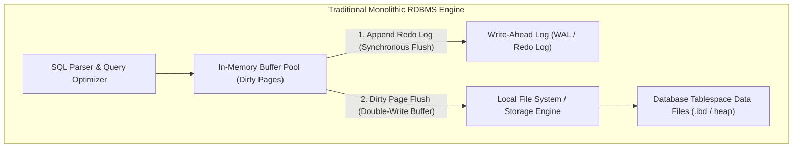
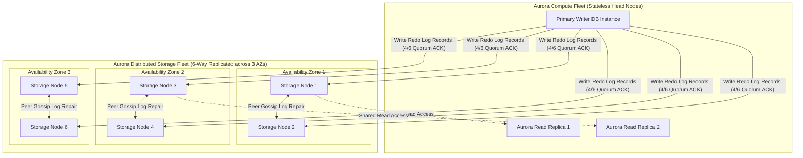
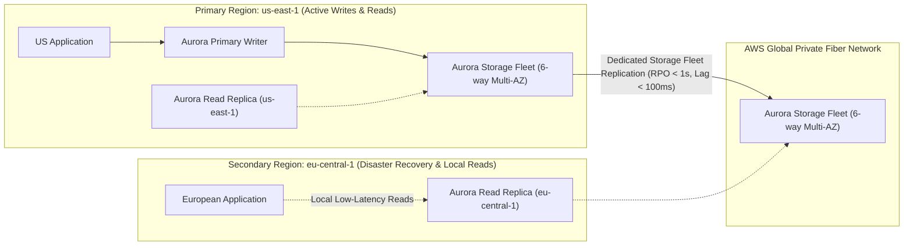
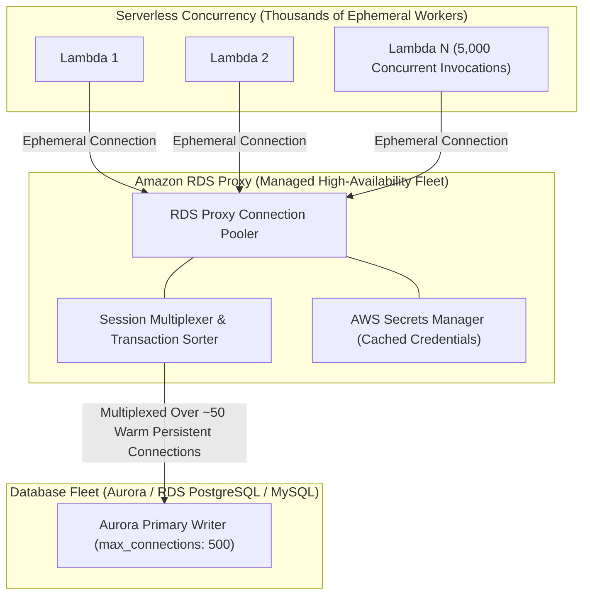
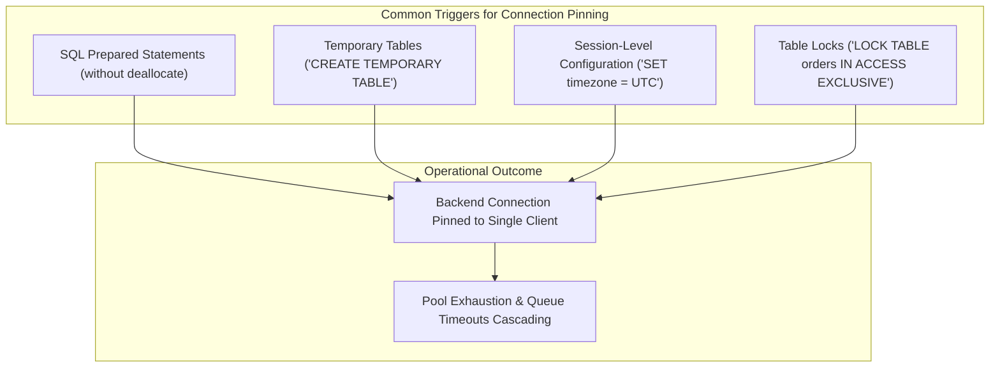
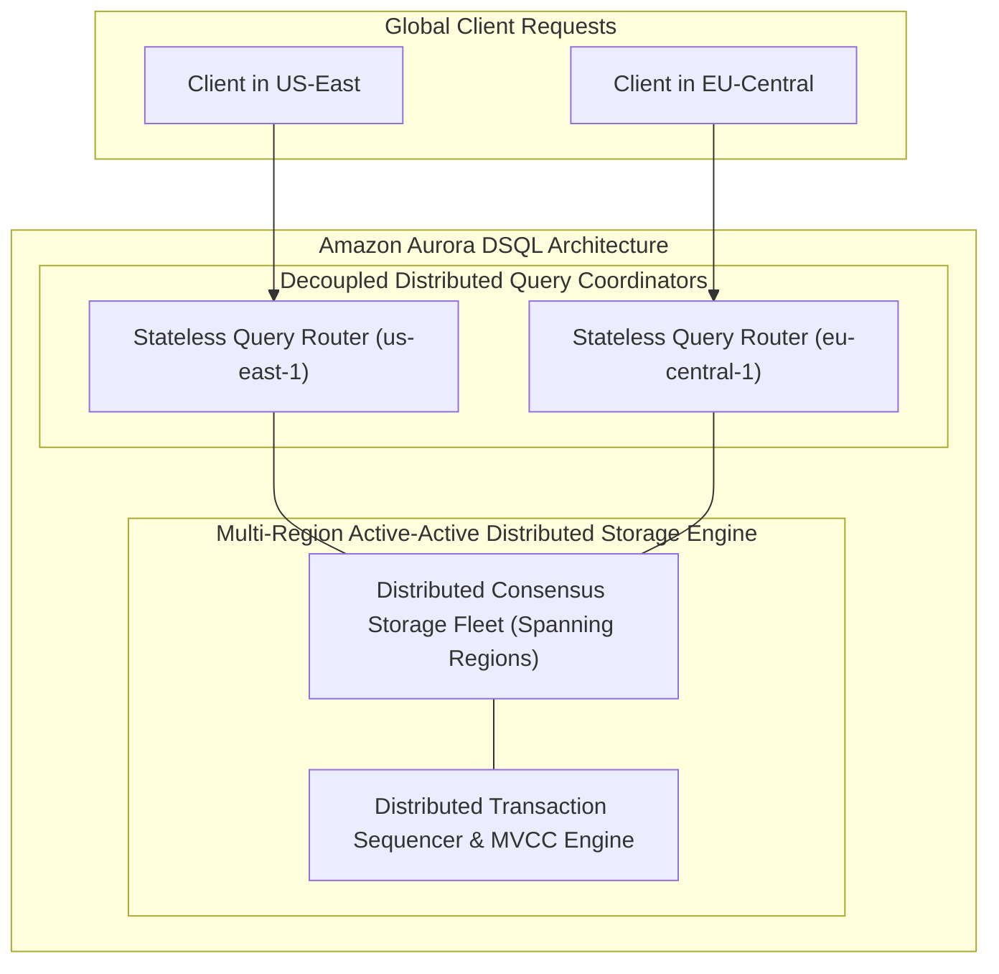

# Module 07: Relational Databases: RDS, Aurora, and DSQL

Relational database management systems (RDBMS) historically represented the most difficult component of a cloud architecture to scale horizontally and make fault-tolerant. Amazon Web Services transforms relational storage from traditional single-host virtual machine deployments into decoupled, distributed, log-structured engines. This module details the operational mechanics of Amazon RDS Multi-AZ deployments, the storage-engine internals of Amazon Aurora's 6-way quorum architecture, RDS Proxy connection multiplexing, and Amazon Aurora DSQL's distributed multi-region active-active SQL engine.

---

## 1. Relational Database Foundations & Cloud Architecture Challenges

Traditional on-premises relational databases (such as PostgreSQL, MySQL, and Oracle) were designed around a monolithic assumption: compute processing and physical disk storage reside on the same server chassis, connected by high-speed local PCIe or SAS busses.

### The I/O Bottleneck in Monolithic Databases

In standard database engines, writing a single row requires multiple distinct disk I/O operations:

1. **Write-Ahead Log (WAL) Flush**: Synchronous write of the transaction redo record to disk to ensure durability before acknowledging a `COMMIT`.
2. **Double-Write Buffer**: Writing dirty buffer pool pages to a contiguous double-write disk area to prevent torn pages caused by OS crashes during partial writes.
3. **Data File Page Flush**: Asynchronously flushing modified 8 KB or 16 KB data pages back to tablespace files.
4. **Change Buffer & Undo Log**: Writing undo records to support Multi-Version Concurrency Control (MVCC) isolation.

When deployed across virtualized cloud environments where disk storage traverses a network (such as Amazon EBS), this high volume of random page writes saturates network bandwidth and exhausts EBS IOPS, creating an architectural ceiling on transaction throughput.

---

## 2. Amazon RDS High Availability Architectures

Amazon Relational Database Service (Amazon RDS) automates database provisioning, OS patching, automated backups, and failure recovery. RDS offers two distinct high-availability topologies for standard database engines (PostgreSQL, MySQL, MariaDB, Oracle, SQL Server).

```mermaid
flowchart TD
    subgraph MultiAZInstance ["Amazon RDS Multi-AZ DB Instance Deployment"]
        ClientApp1["Client Application"]
        PrimaryInst["Primary DB Instance (AZ-A)"]
        StandbyInst["Standby DB Instance (AZ-B - Non-Readable)"]
        EBS1["EBS Primary Volume"]
        EBS2["EBS Mirror Standby Volume"]

        ClientApp1 -->|"Read / Write (DNS Endpoint)"| PrimaryInst
        PrimaryInst --- EBS1
        EBS1 -->|"Synchronous Physical Block Replication"| EBS2
        EBS2 --- StandbyInst
    end

    subgraph MultiAZCluster ["Amazon RDS Multi-AZ DB Cluster Deployment"]
        ClientApp2["Client Application"]
        WriterInst["Primary Writer DB (AZ-A)"]
        Reader1["Readable Standby DB 1 (AZ-B)"]
        Reader2["Readable Standby DB 2 (AZ-C)"]

        ClientApp2 -->|"Writes"| WriterInst
        ClientApp2 -.->|"Read Traffic (Reader Endpoint)"| Reader1
        ClientApp2 -.->|"Read Traffic (Reader Endpoint)"| Reader2

        WriterInst -->|"Semi-Synchronous Raft Consensus"| Reader1
        WriterInst -->|"Semi-Synchronous Raft Consensus"| Reader2
    end
```

### 1. Multi-AZ DB Instance Deployment (Synchronous EBS Mirroring)

- **Architecture**: A primary database instance runs in Availability Zone A, and a physically identical standby instance runs in Availability Zone B.
- **Physical Block-Level Replication**: Replication occurs at the storage layer via synchronous physical block-level EBS volume mirroring. When a transaction commits, the primary database waits until the storage blocks are committed to both the primary and standby EBS volumes before returning success to the client.
- **Standby Accessibility**: The standby instance is **strictly passive and non-readable**. It runs in recovery mode and cannot process queries or offload read traffic.
- **Failover Mechanics**: In the event of an infrastructure failure, AZ disruption, or instance crash:
  1. RDS detects host or network unreachability.
  2. The standby EBS volume is attached to the standby compute instance (if not already attached), and database crash recovery runs.
  3. RDS updates the database endpoint's DNS CNAME record to resolve to the standby instance's IP address.
  4. Total failover time is typically **60 to 120 seconds**, bounded by DNS propagation and database crash recovery log replaying.

### 2. Multi-AZ DB Cluster Deployment (Two Readable Standbys with Raft)

- **Architecture**: Available for MySQL and PostgreSQL. Provisions one primary writer instance and **two readable standby instances** across three separate Availability Zones.
- **NVMe SSD Storage and Semi-Synchronous Replication**: Instances utilize local NVMe SSD storage combined with network storage. Replication executes using a semi-synchronous consensus protocol (based on Raft).
- **Sub-35ms Commit Latency**: Transactions commit as soon as the primary and at least one readable standby acknowledge the write, delivering typical commit latencies under 35 milliseconds (up to 2.5× faster than standard Multi-AZ instance replication).
- **Readable Standby Endpoints**: Both standby instances are fully open for read queries, allowing applications to distribute read traffic across two additional nodes via a dedicated cluster reader endpoint.
- **Automated Failover Under 35 Seconds**: Because both standby instances actively track transaction state in memory, failovers typically complete in **under 35 seconds** with zero data loss ($RPO = 0$).

---

## 3. Amazon Aurora Distributed Log-Structured Storage Architecture

Amazon Aurora reimagines the relational database by decoupling the database SQL processing layer from the underlying distributed storage engine.

### The Architectural Paradigm: "The Log is the Database"

In traditional RDBMS systems, dirty pages must be written to disk alongside log records. Amazon Aurora alters this fundamental premise:

- **Zero Dirty Page Writing**: The Aurora compute instance never writes modified data pages back to storage over the network.
- **Only Redo Logs Sent**: When a transaction commits, the compute node sends only small **redo log records** describing the change to the storage fleet.
- **In-Storage Page Materialization**: The storage nodes receive redo log records and apply them asynchronously to base pages in the background. If a query requires an 8 KB page, the storage node applies any outstanding log records up to the requested Log Sequence Number (LSN) and returns the reconstituted page to compute RAM.
- **I/O Reduction**: Eliminating double-write buffers and dirty page flushes reduces network I/O packets by up to **80%**, enabling Aurora to deliver up to 5× the throughput of standard MySQL and 3× the throughput of standard PostgreSQL on identical hardware.

### 6-Way Storage Replication Across 3 Availability Zones

Aurora replicates all cluster storage across three Availability Zones within an AWS Region:

- For every 10 GB storage segment (called a **Protection Group**), Aurora allocates **6 copies (2 per AZ)** across independent physical storage hosts.
- The storage volume automatically scales up to 128 TiB in 10 GB increments without administrative intervention or downtime.

### Quorum Consensus Mechanics: 4/6 Write and 3/6 Read

Aurora implements a voting quorum consensus model across the 6 storage nodes:

1. **Write Quorum ($V_w = 4/6$)**: A write transaction is acknowledged as committed as soon as **4 out of 6 storage copies** write the redo log record to non-volatile disk.
   - _Failure Tolerance_: If an entire Availability Zone experiences an outage (losing 2 copies), 4 copies remain available. Aurora continues writing and committing transactions without interruption or failover.
2. **Read Quorum ($V_r = 3/6$)**: When the database restarts or verifies log continuity, it polls **3 out of 6 nodes**.
   - _Mathematical Invariant_: Because $V_w + V_r = 4 + 3 = 7 > 6$, the read quorum and write quorum are mathematically guaranteed to overlap by at least one node. The node with the highest committed LSN provides the authoritative state.
   - _Failure Tolerance_: Aurora can tolerate the loss of an entire Availability Zone plus an additional node in another AZ (3 out of 6 nodes lost) without data loss ($RPO = 0$).

### Background Peer Gossip Protocol

Storage nodes within a Protection Group continuously gossip with each other over the AWS private datacenter network. If a transient network glitch or hardware hiccup causes node 5 to drop behind the other nodes, it detects the missing LSN gap and directly requests the missing redo log segment from its peers. The compute engine is never interrupted to re-transmit historical log records.

---

## 4. Aurora Scaling, Read Replicas, and Global Database

Because the underlying 6-way storage fleet is decoupled from the compute tier, Aurora scales read capacity and geographic distribution with unprecedented efficiency.

### Aurora Read Replicas: Shared-Storage Low-Latency Scaling

In standard RDS databases, read replicas maintain independent EBS storage volumes and must execute physical block or logical streaming replication, frequently suffering from significant replica lag during write bursts.

- **Single Shared Storage Volume**: All Aurora Read Replicas share the identical underlying 6-way replicated storage fleet as the primary writer.
- **Zero Storage Duplication**: Replicas do not replicate or store independent copies of data files.
- **Single-Digit Millisecond Replica Lag**: The primary writer sends redo log streams directly to read replicas in-memory strictly to invalidate stale pages cached in their local buffer pools. Typical Aurora replica lag is **under 10 milliseconds**.
- **Scale**: Up to **15 read replicas** can be provisioned per cluster.
- **Automated Failover Target**: If the primary writer fails, RDS promotes the read replica with the highest priority tier to primary writer in under 15 seconds, preserving the exact same underlying storage volume.

### Aurora Global Database: Cross-Region Active-Active Reads

For multi-region disaster recovery and low-latency global read access, **Aurora Global Database** extends the storage replication engine across AWS Regions:

- **Dedicated Storage Replication**: Replication is executed directly by the internal storage fleet over dedicated AWS global network fiber, bypassing database compute engines entirely.
- **Minimal Performance Impact**: Cross-region replication does not consume compute vCPU or RAM on the primary writer instance.
- **Latency and Recovery Metrics**: Delivers typical cross-region replication lag of **under 100 milliseconds** and a Recovery Point Objective ($RPO$) of **under 1 second**.
- **Disaster Recovery Failover**:
  - _Planned Managed Failover_: Seamlessly inverts primary and secondary regions with zero data loss ($RPO = 0$) in under 3 minutes, ideal for regional maintenance or disaster recovery drills.
  - _Unplanned Failover_: Promotes a secondary region cluster to full standalone read/write operation in **under 1 minute** during catastrophic regional outages.

---

## 5. Amazon RDS Proxy: Connection Pooling and Resilient Multiplexing

Serverless applications (such as AWS Lambda) scale by launching thousands of ephemeral concurrent execution environments. When thousands of Lambda workers connect directly to an RDBMS, the database quickly crashes due to connection saturation.

### The Connection Exhaustion Problem

Traditional database engines allocate dedicated server memory and operating system process threads for every open client connection (e.g., PostgreSQL forks a dedicated backend process allocating 5–10 MB of RAM per connection).

- If 3,000 Lambda functions burst simultaneously, 3,000 connections open against the database.
- The database exhausts its `max_connections` ceiling, memory crashes the operating system (OOM killer), and incoming queries fail with `FATAL: remaining connection slots are reserved`.

### Connection Pooling and Multiplexing

Amazon RDS Proxy resides between client applications and the database:

- **Multiplexing**: Multiplexes thousands of client connections over a compact, persistent pool of warm backend database connections (e.g., pooling 5,000 client requests over 50 persistent database connections).
- **Graceful Failover Handling**: During an Aurora or RDS Multi-AZ failover, RDS Proxy holds incoming client queries in memory rather than throwing immediate connection dropped exceptions. Once the new primary writer assumes leadership, RDS Proxy routes the buffered queries to the new writer, reducing client-visible failover downtime by up to **66%**.
- **Automated Security**: Clients can authenticate to RDS Proxy using **IAM authentication tokens**. RDS Proxy manages backend database passwords securely, retrieving and caching credentials automatically from **AWS Secrets Manager**.

### Database Connection Pinning Triggers

A proxy can multiplex connections only when a client connection is idle between transactions. If a client triggers stateful session behavior, RDS Proxy **pins** the client connection to a specific backend connection, preventing other clients from using that connection until the session terminates.

#### Pinning Mitigation Strategies

- For PostgreSQL, execute prepared statements with named parameters or use query-level execution.
- Avoid temporary tables; use Common Table Expressions (`WITH` queries) or unlogged tables.
- Monitor the `DatabaseConnectionsCurrentlyPinned` CloudWatch metric to detect and refactor pinning queries.

---

## 6. Amazon Aurora DSQL: Distributed Serverless SQL Architecture

Introduced at AWS re:Invent 2024, **Amazon Aurora DSQL** represents a paradigm shift in cloud database engineering: a fully serverless, distributed SQL database engineered for multi-region active-active strong consistency.

### Core Architecture and Mechanics

- **PostgreSQL Compatibility**: Exposes a standard PostgreSQL dialect and wire protocol, allowing existing applications, ORMs, and drivers to connect without code alterations.
- **Decoupled Stateless Query Coordinators**: Query parsing, optimization, and execution run on a completely stateless, auto-scaling fleet of compute routers that scale up and down in milliseconds.
- **Multi-Region Active-Active Strong Consistency**: Unlike Aurora Global Database (which is single-writer with asynchronous read replicas), Aurora DSQL allows **read and write operations in multiple AWS Regions simultaneously**.
- **Serializable Isolation**: Distributed transactions utilize advanced hardware-backed distributed consensus and timestamp sequencers to guarantee **serializable transaction isolation** across regions without split-brain anomalies or dual-write conflicts.
- **Zero Capacity Planning**: Completely eliminates instances, sizes, cluster parameters, storage volume provisioning, and replication pipelines. Customers pay strictly for the compute operations and storage consumed.

---

## 7. Architectural Decision Framework: RDS vs Aurora vs DSQL

| Feature / Metric | RDS Multi-AZ Instance | RDS Multi-AZ Cluster | Aurora Serverless v2 | Aurora DSQL |
| --- | --- | --- | --- | --- |
| **Storage Model** | Mirrored EBS volumes | Local NVMe SSD + EBS | 6-way replicated log-structured storage | Distributed serverless storage fleet |
| **Commit Latency** | Single-digit ms (5–15 ms) | Sub-35 ms | Sub-5 ms | Single-digit ms |
| **Failover Duration** | 60–120 seconds | $< 35$ seconds | $< 15$ seconds | Zero failover (Active-Active) |
| **Read Replicas** | Up to 15 (independent EBS) | 2 (readable standbys) | Up to 15 (shared storage) | Native active-active multi-region |
| **Scaling Granularity** | Vertical instance resizing (downtime) | Vertical instance resizing | In-place dynamic ACU scaling (0.5 to 128) | Completely autonomous pay-per-request |
| **Multi-Region Writes** | No (manual promotion) | No | No (Single writer via Global DB) | **Yes (Active-Active Multi-Region)** |
| **Best Use Case** | Legacy enterprise databases (Oracle, SQL Server). | High-write MySQL/Postgres needing fast failover. | High-throughput enterprise workloads with variable traffic. | Mission-critical distributed systems requiring zero-downtime multi-region active-active SQL. |

---

## 8. Then vs Now: Evolution of AWS Relational Databases

| Dimension | Legacy Architecture (Then) | Modern Cloud Standard (Now) |
| --- | --- | --- |
| **I/O Architecture** | Monolithic engines writing dirty pages, double-write buffers, and WAL to EBS. | "The Log is the Database": Aurora transmits only redo log records over network. |
| **Storage Durability** | Dual-copy EBS mirroring within a single region across two AZs. | 6-way storage replication across 3 AZs with 4/6 write quorum and peer gossip repair. |
| **Read Scaling** | Replicas maintain independent storage and lag significantly during write bursts. | Up to 15 replicas sharing the identical storage volume with $< 10$ms replica lag. |
| **Serverless Connections** | Lambda connection storms exhaust database connection pools and crash instances. | RDS Proxy multiplexes thousands of ephemeral connections over a warm connection pool. |
| **Cross-Region DR** | Manual cross-region snapshot copying or slow logical replication scripts. | Aurora Global Database replicating at the storage layer with $RPO < 1$s. |
| **Multi-Region Writes** | Complex application sharding, dual-master conflicts, and eventual consistency. | Aurora DSQL providing multi-region active-active serializable SQL transactions. |

---

## Interview Drill

1. How does the architectural premise "The Log is the Database" allow Amazon Aurora to achieve significantly higher throughput than standard PostgreSQL or MySQL?

In standard monolithic databases, writing a transaction requires synchronous logging to the Write-Ahead Log (WAL), writing dirty pages to a double-write buffer to prevent torn pages, and asynchronously flushing modified 8 KB or 16 KB data pages to disk. On cloud block storage, this generates massive network packet amplification. Aurora completely eliminates dirty page flushing and double-write buffer I/O. The database compute engine sends only lightweight redo log records across the network to a distributed storage fleet. The storage fleet applies the log records asynchronously to reconstruct data pages in the background, reducing network I/O by up to 80% and eliminating I/O bottlenecks.

- Ref: [modules/07-relational-databases-rds-aurora-and-dsql.md#3-amazon-aurora-distributed-log-structured-storage-architecture](07-relational-databases-rds-aurora-and-dsql.md#3-amazon-aurora-distributed-log-structured-storage-architecture), https://docs.aws.amazon.com/AmazonRDS/latest/AuroraUserGuide/Aurora.Overview.StorageReliability.html

2. Explain the quorum voting mechanics of Amazon Aurora's 6-way storage replication and describe its failure tolerance.

Aurora allocates 6 storage copies for every 10 GB Protection Group, distributed evenly across 3 Availability Zones (2 copies per AZ). It enforces a write quorum of 4/6 ($V_w = 4$) and a read quorum of 3/6 ($V_r = 3$). A write transaction commits when 4 out of 6 nodes acknowledge writing the redo log record. Because $V_w = 4$, Aurora can tolerate the complete outage of an entire Availability Zone (losing 2 copies) and continue processing writes without interruption. Furthermore, because $V_w + V_r = 4 + 3 = 7 > 6$, read and write quorums always intersect by at least one node, allowing Aurora to tolerate the loss of an entire AZ plus another node (3 out of 6 copies lost) without data loss ($RPO = 0$).

- Ref: [modules/07-relational-databases-rds-aurora-and-dsql.md#3-amazon-aurora-distributed-log-structured-storage-architecture](07-relational-databases-rds-aurora-and-dsql.md#3-amazon-aurora-distributed-log-structured-storage-architecture), https://docs.aws.amazon.com/AmazonRDS/latest/AuroraUserGuide/Aurora.Overview.StorageReliability.html

3. What is the fundamental difference between an RDS Multi-AZ DB Instance deployment and an RDS Multi-AZ DB Cluster deployment?

An RDS Multi-AZ DB Instance deployment consists of a primary instance and a single standby instance across two AZs. Replication occurs synchronously at the storage block level via EBS mirroring. The standby instance is non-readable, and failover takes 60–120 seconds via DNS CNAME updates. An RDS Multi-AZ DB Cluster deployment provisions one primary writer and two readable standby instances across three AZs using local NVMe SSDs and Raft semi-synchronous replication. Standby instances serve active read traffic, commit latency is under 35 milliseconds, and failovers complete in under 35 seconds.

- Ref: [modules/07-relational-databases-rds-aurora-and-dsql.md#2-amazon-rds-high-availability-architectures](07-relational-databases-rds-aurora-and-dsql.md#2-amazon-rds-high-availability-architectures), https://docs.aws.amazon.com/AmazonRDS/latest/UserGuide/multi-az-db-clusters-concepts.html

4. Why do Aurora Read Replicas exhibit single-digit millisecond replica lag compared to standard RDS Read Replicas?

Standard RDS read replicas maintain independent EBS storage volumes and must asynchronously replay Write-Ahead Logs onto their own disk files, creating significant replica lag during write-heavy transactions. In Aurora, all read replicas share the exact same underlying 6-way replicated storage volume as the primary writer. Replicas do not execute disk replication. The primary writer streams redo log records directly to replicas in-memory strictly to invalidate stale pages in their local buffer pools, keeping replica lag typically under 10 milliseconds.

- Ref: [modules/07-relational-databases-rds-aurora-and-dsql.md#4-aurora-scaling-read-replicas-and-global-database](07-relational-databases-rds-aurora-and-dsql.md#4-aurora-scaling-read-replicas-and-global-database), https://docs.aws.amazon.com/AmazonRDS/latest/AuroraUserGuide/Aurora.Replication.html

5. How does Amazon RDS Proxy prevent connection exhaustion when used with serverless AWS Lambda architectures?

Relational databases allocate substantial memory and thread resources for each open connection. When thousands of ephemeral Lambda containers launch simultaneously, they attempt to open thousands of connections, exhausting database connection limits (`max_connections`) and crashing the database. RDS Proxy pools and multiplexes thousands of ephemeral client connections over a small, persistent pool of warm backend database connections. It also queues incoming queries during failover events, reducing client-visible errors and accelerating failover recovery.

- Ref: [modules/07-relational-databases-rds-aurora-and-dsql.md#5-amazon-rds-proxy-connection-pooling-and-resilient-multiplexing](07-relational-databases-rds-aurora-and-dsql.md#5-amazon-rds-proxy-connection-pooling-and-resilient-multiplexing), https://docs.aws.amazon.com/AmazonRDS/latest/AuroraUserGuide/rds-proxy.html

6. What is "connection pinning" in RDS Proxy, and what database operations trigger it?

Connection pinning occurs when RDS Proxy is forced to bind a client connection to a specific dedicated backend database connection for the duration of the session, preventing that backend connection from being multiplexed among other clients. Pinning is triggered by session-state modifications, including SQL prepared statements (without deallocation), creating temporary tables (`CREATE TEMPORARY TABLE`), altering session variables (`SET timezone`), or executing table locks. Excessive pinning exhausts the proxy connection pool and degrades concurrency.

- Ref: [modules/07-relational-databases-rds-aurora-and-dsql.md#5-amazon-rds-proxy-connection-pooling-and-resilient-multiplexing](07-relational-databases-rds-aurora-and-dsql.md#5-amazon-rds-proxy-connection-pooling-and-resilient-multiplexing), https://docs.aws.amazon.com/AmazonRDS/latest/AuroraUserGuide/rds-proxy-pinning.html

7. How does Aurora Global Database achieve cross-region replication with minimal impact on primary database performance?

Aurora Global Database offloads cross-region replication from the database compute instances to the dedicated Aurora storage fleet. Storage nodes in the primary region replicate redo log streams directly to storage nodes in secondary regions across the dedicated AWS global private network backbone. Because compute engines do not participate in replicating data blocks across regions, primary writer CPU, memory, and transactional commit latencies are completely unaffected by cross-region replication lag, delivering typical latencies under 100 milliseconds and $RPO < 1$ second.

- Ref: [modules/07-relational-databases-rds-aurora-and-dsql.md#4-aurora-scaling-read-replicas-and-global-database](07-relational-databases-rds-aurora-and-dsql.md#4-aurora-scaling-read-replicas-and-global-database), https://docs.aws.amazon.com/AmazonRDS/latest/AuroraUserGuide/aurora-global-database.html

8. How does Amazon Aurora DSQL achieve multi-region active-active strong consistency without traditional replication lag?

Amazon Aurora DSQL decouples stateless distributed SQL query routers from a multi-region distributed consensus storage engine. Instead of designating a single primary writer and replicating to secondary readers, Aurora DSQL coordinates transactions across regions using distributed timestamp sequencing and multi-region consensus. Transactions execute with strict serializable isolation, allowing applications in multiple AWS Regions to write simultaneously without split-brain anomalies, cross-region conflict resolution, or manual active-passive failovers.

- Ref: [modules/07-relational-databases-rds-aurora-and-dsql.md#6-amazon-aurora-dsql-distributed-serverless-sql-architecture](07-relational-databases-rds-aurora-and-dsql.md#6-amazon-aurora-dsql-distributed-serverless-sql-architecture), https://aws.amazon.com/blogs/aws/

9. What is the role of peer gossip log repair in an Aurora storage cluster?

Aurora storage nodes within a 10 GB Protection Group continuously communicate using a peer gossip protocol. If a storage node experiences transient network loss or disk latency and misses several redo log records, it detects the LSN sequence gap through gossip messages from its peer nodes. The lagging node directly fetches the missing log records from peer storage nodes without requiring the database compute instance to retransmit them, ensuring self-healing durability without taxing the database engine.

- Ref: [modules/07-relational-databases-rds-aurora-and-dsql.md#3-amazon-aurora-distributed-log-structured-storage-architecture](07-relational-databases-rds-aurora-and-dsql.md#3-amazon-aurora-distributed-log-structured-storage-architecture), https://docs.aws.amazon.com/AmazonRDS/latest/AuroraUserGuide/Aurora.Overview.StorageReliability.html

10. Under what conditions will an Aurora Read Replica be promoted during a primary writer failover, and how long does the process take?

When the primary writer fails, the Aurora cluster promotion engine examines all provisioned read replicas and selects the replica configured with the lowest priority tier (Tier 0 being highest priority, down to Tier 15). If multiple replicas share the same priority tier, Aurora promotes the replica that matches the primary's instance size or is largest. Because replicas share the underlying 6-way storage volume and maintain warm buffer pools, failovers typically complete in under 15 seconds with zero storage recovery downtime.

- Ref: [modules/07-relational-databases-rds-aurora-and-dsql.md#4-aurora-scaling-read-replicas-and-global-database](07-relational-databases-rds-aurora-and-dsql.md#4-aurora-scaling-read-replicas-and-global-database), https://docs.aws.amazon.com/AmazonRDS/latest/AuroraUserGuide/aurora-failover.html

