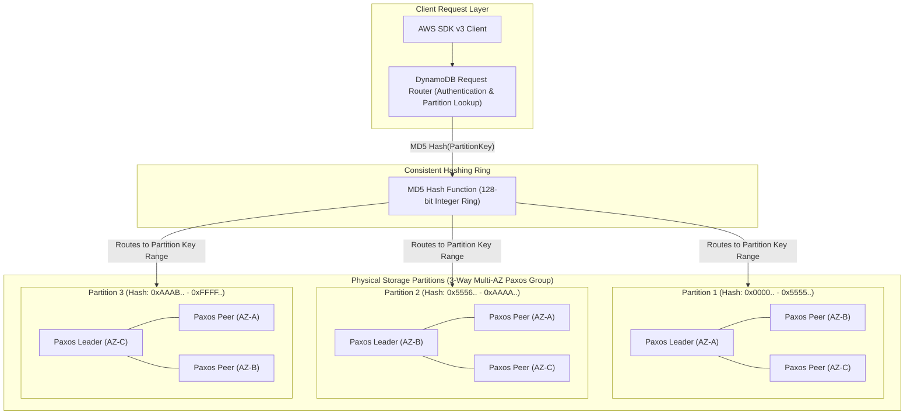
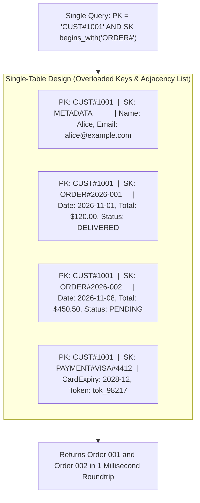
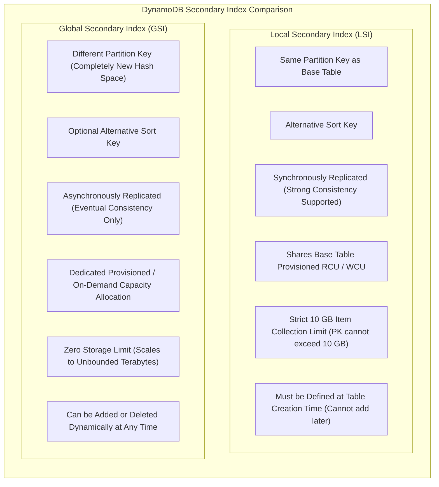
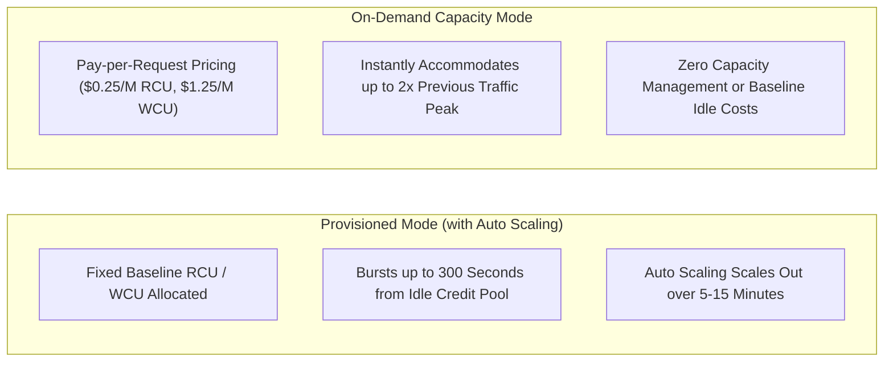
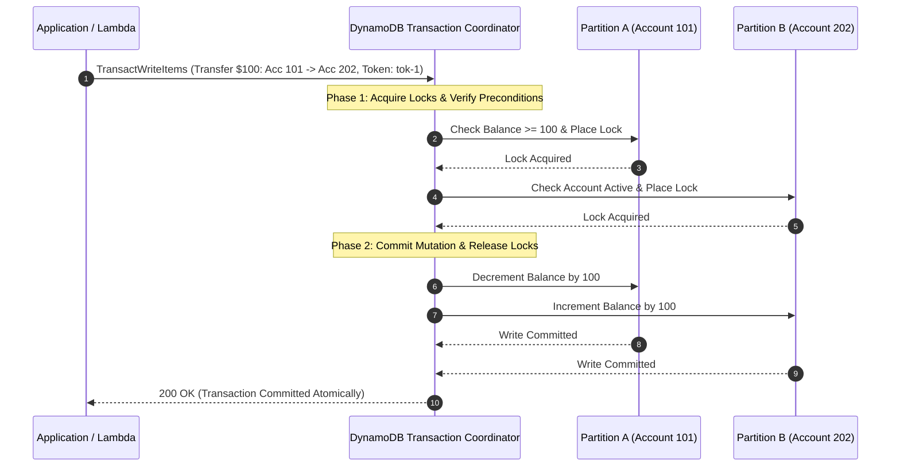
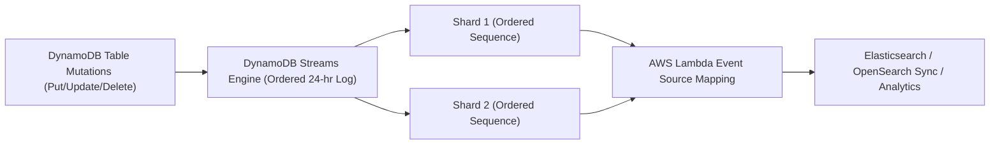
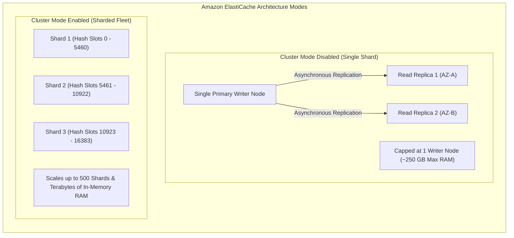
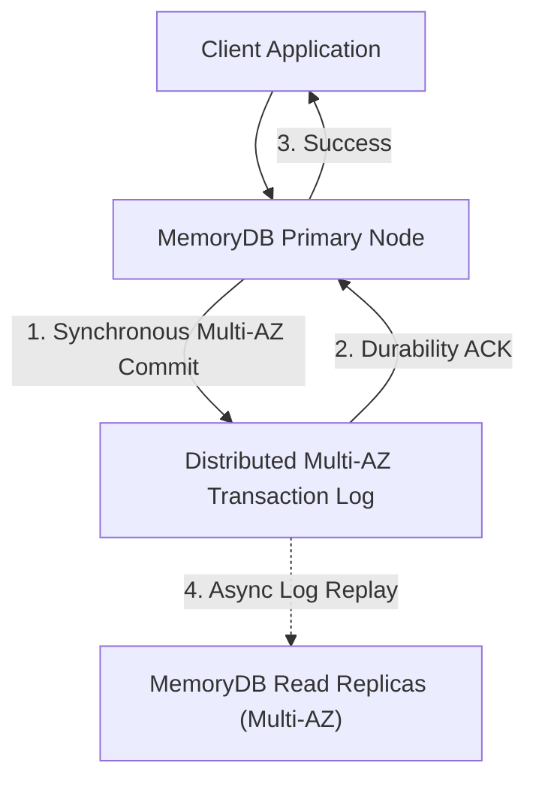

# Module 08: NoSQL: DynamoDB and In-Memory Caching

Modern cloud applications demand microsecond-to-millisecond latency profiles and horizontal scalability that bypass the limits of traditional relational databases. Amazon Web Services provides two primary distributed non-relational storage engines: **Amazon DynamoDB** (a fully managed, serverless NoSQL database designed for single-digit millisecond response times at any scale) and **Amazon ElastiCache / Amazon MemoryDB** (in-memory caching and persistent database engines delivering sub-millisecond performance).

---

## 1. Amazon DynamoDB Core Architecture & Storage Engine

Amazon DynamoDB is a distributed, multi-master key-value and document database built on decentralized distributed systems concepts (consistent hashing, B-tree indexing, and Paxos consensus).

### Partition Key Hashing and Partition Allocation

- **Partition Key (PK)**: The primary key attribute used to distribute items across physical partitions. DynamoDB feeds the partition key value into an MD5 cryptographic hash function that outputs an integer within an internal 128-bit key ring.
- **Physical Partition Limits**: A single DynamoDB physical storage partition possesses fixed hardware-level throughput and storage ceilings:
  - Maximum Storage Capacity: **10 GB** of data.
  - Maximum Write Throughput: **1,000 Write Capacity Units (WCU)** per second (1 WCU = 1 KB write/sec).
  - Maximum Read Throughput: **3,000 Read Capacity Units (RCU)** per second (1 RCU = 4 KB strongly consistent read/sec, or 8 KB eventually consistent).
- **Sort Key (SK) Storage**: When a table uses a composite primary key (Partition Key + Sort Key), items sharing the identical partition key are stored contiguously on the same physical partition in a local **B-tree** sorted lexicographically by Sort Key. This enables efficient logarithmic range queries (`begins_with`, `between`, `<`, `>`).

### Autonomous Partition Splitting Mechanics

When an application's data footprint or throughput requirements scale beyond a partition's physical constraints, DynamoDB automatically executes a **partition split**:

1. **Triggers**:
   - Total data stored on the partition approaches 10 GB.
   - Sustained provisioning or request volume on the partition exceeds 1,000 WCU or 3,000 RCU.
2. **Splitting Procedure**: DynamoDB allocates two new child partitions, splits the hash space in half, redistributes the items, and updates the global request router routing tables.
3. **Capacity Dilution Trap in Provisioned Tables**: When a provisioned table with 1,000 WCU splits from 1 partition into 4 partitions due to data volume growth, the table's total provisioned capacity is distributed evenly across all physical partitions: $$\text{WCU per partition} = \frac{\text{Total Provisioned WCU}}{\text{Number of Physical Partitions}} = \frac{1,000}{4} = 250\text{ WCU}$$ If traffic subsequently concentrates on a single partition key, that hot key can only consume 250 WCU before throttling, even though the aggregate table was provisioned for 1,000 WCU.

---

## 2. DynamoDB Single-Table Design

In relational modeling, schemas normalize data into distinct tables linked by foreign keys, resolving queries using runtime relational `JOIN` operations. In distributed NoSQL systems, relational joins require cross-partition network communication that introduces unpredictable, high latency.

**Single-Table Design** models an entire domain's heterogeneous entities (Users, Orders, LineItems, Payments) within a single physical DynamoDB table, fulfilling complex multi-entity access patterns in a single HTTP `Query` roundtrip.

### Overloaded Partition and Sort Keys

Instead of descriptive entity-specific column names (such as `UserId`, `OrderId`), single-table tables utilize generic, overloaded attribute names:

- `PK` (Partition Key): Holds entity namespace prefixes (`USER#<id>`, `ORG#<id>`, `TENANT#<id>`).
- `SK` (Sort Key): Holds entity sub-types, relationships, or chronological prefixes (`PROFILE`, `ORDER#<date>`, `INVOICE#<id>`).

### Entity Adjacency Lists

By grouping related parent and child entities under the same partition key, single-table design creates an **adjacency list**. A single query fetching `PK = 'CUST#1001'` returns the customer profile record and all associated order records contiguously from local B-tree storage, completely eliminating database joins.

### Composite Sort Keys for Multi-Attribute Filtering

DynamoDB `Query` operations evaluate sort key conditions on a single attribute. To query across multiple dimensions without secondary indexes, engineers construct composite sort keys:

- Schema: `STATUS#<status>#DATE#<timestamp>` (e.g., `STATUS#PENDING#DATE#2026-11-08T18:00:00Z`).
- Query: Retrieve all pending orders after November 1st using: $$\text{SK begins-with}(\text{"STATUS\#PENDING\#DATE\#2026-11"})$$

---

## 3. Secondary Indexes: Global (GSI) vs Local (LSI)

Secondary indexes enable querying data using alternative attributes when access patterns cannot be satisfied by the primary key.

### Comparison Matrix: Global Secondary Indexes vs Local Secondary Indexes

| Dimension / Feature | Local Secondary Index (LSI) | Global Secondary Index (GSI) |
| --- | --- | --- |
| **Partition Key** | Must be **identical** to base table partition key. | Can be **different** from base table partition key. |
| **Sort Key** | Alternative sort key required. | Optional alternative sort key. |
| **Consistency Mode** | Supports both Strongly Consistent and Eventually Consistent reads. | **Strictly Eventually Consistent** reads. |
| **Capacity Accounting** | Consumes base table RCU and WCU allocations. | Requires **independent, dedicated** RCU and WCU allocations. |
| **Storage Constraints** | **Strict 10 GB limit** per item collection (all items sharing a PK). | **Unbounded**; scales horizontally across multiple partitions. |
| **Lifecycle** | Must be defined during table creation; cannot be modified or dropped. | Can be created, modified, or deleted at any time online. |
| **Maximum Per Table** | Up to 5 LSIs per table. | Up to 20 GSIs per table. |

### The GSI Backpressure Throttling Trap

When an item is written or updated on the base table, DynamoDB replicates the mutation asynchronously to all associated GSIs:

- If a GSI is provisioned with insufficient write capacity (e.g., base table has 1,000 WCU, but GSI is provisioned with only 50 WCU), GSI storage buffers fill up rapidly.
- To prevent replication lag from drifting indefinitely, DynamoDB applies **backpressure**: it throttles writes on the primary base table (`ProvisionedThroughputExceededException`).
- **Production Standard**: Always provision GSI write capacity to match or exceed base table write throughput, or operate in On-Demand capacity mode.

---

## 4. Capacity Modes, Bursting, and Hot Partitions

DynamoDB provides two distinct capacity billing and scaling modes.

### Provisioned vs On-Demand Modes

- **Provisioned Mode**: Customers specify expected RCU and WCU allocations. Application Auto Scaling adjusts capacity between configured minimums and maximums based on target utilization (typically 70%).
- **On-Demand Capacity Mode**: Automatically accommodates workloads as traffic fluctuates. On-Demand instantly handles up to **double the previous peak traffic**. If a table previously peaked at 10,000 requests/second, it will immediately support up to 20,000 requests/second without throttling.

### The Hot Partition Ceiling

A common engineering misconception is that On-Demand capacity mode eliminates all throttling. While On-Demand scales the table's _aggregate_ capacity infinitely, individual physical partitions remain bound by hardware physics: $$\text{Partition Ceiling} = 1,000\text{ WCU / sec and } 3,000\text{ RCU / sec}$$ If an application directs 2,500 write requests per second to the exact same partition key value (e.g., `PK = 'CAMPAIGN#BLACKFRIDAY'`), the request router routes all 2,500 requests to a single physical partition. Because 2,500 WCU exceeds the 1,000 WCU partition hardware ceiling, DynamoDB throttles 1,500 requests with HTTP 400 (`ProvisionedThroughputExceededException`), regardless of whether the table is On-Demand or Provisioned.

#### Mitigation: Write Sharding / Partition Key Salting

To distribute load across partitions for high-velocity keys, append a deterministic or randomized numerical suffix ("salt"): $$\text{PK} = \text{"CAMPAIGN\#BLACKFRIDAY."} + \text{randomInt}(0, 10)$$ The 2,500 writes distribute across 10 distinct physical partitions (250 WCU each), well below the 1,000 WCU partition limit. Reads query all 10 salted prefixes in parallel and merge results client-side.

---

## 5. DynamoDB ACID Transactions

DynamoDB supports multi-item, cross-table ACID transactions via the `TransactWriteItems` and `TransactGetItems` APIs.

### Transaction Characteristics and Constraints

1. **Scope and Limits**: Transactions can operate on up to **100 items** or a maximum payload size of **4 MB** across one or more tables within the same AWS Region and account.
2. **Two-Phase Commit (2PC)**: The coordinator verifies all condition checks across all items. If any condition check fails, or if a concurrent write conflicts with a locked item, the entire transaction aborts with a `TransactionCanceledException` and zero items are modified.
3. **Capacity Pricing**: Transactions consume **double the capacity** of standard operations:
   - 1 transactional write ($< 1$ KB) consumes **2 WCUs**.
   - 1 transactional read ($< 4$ KB) consumes **2 RCUs**.
4. **Idempotent Transaction Tokens (`ClientRequestToken`)**: Supplying an idempotent token ensures that retried network requests return success without re-executing transactions or duplicating financial ledger entries. Tokens remain active for 10 minutes.

---

## 6. DynamoDB Streams and Time-to-Live (TTL)

Change Data Capture (CDC) and automated lifecycle management enable reactive serverless event-driven architectures.

### DynamoDB Streams Architecture

- **24-Hour Time Horizon**: Change events are recorded in strictly ordered log shards retained for **24 hours**. Older records are deleted automatically.
- **Stream View Types**:
  - `KEYS_ONLY`: Only the primary key attributes of the modified item.
  - `NEW_IMAGE`: The complete item as it appears after the modification.
  - `OLD_IMAGE`: The complete item as it appeared before the modification.
  - `NEW_AND_OLD_IMAGES`: Both the pre-mutation and post-mutation item states.
- **Shard Splitting**: When a table's physical partition splits, the corresponding stream shard splits into two child shards. The Lambda Event Source Mapping automatically consumes the parent shard to completion before reading child shards, preserving chronological ordering.

### Time-to-Live (TTL) Mechanics

DynamoDB TTL automatically purges expired items without manual maintenance scripts:

- **Timestamp Configuration**: The application designates an attribute containing an absolute Unix epoch timestamp in seconds (e.g., `1794240000`).
- **Zero Capacity Consumption**: TTL deletions are executed by an internal background sweeper fleet and **do not consume read or write capacity units**.
- **Deletion Window Guarantee**: TTL typically deletes expired items within **48 hours** of expiration.
- **Stream Emission**: When TTL deletes an item, it emits a `REMOVE` event to DynamoDB Streams with a system identity metadata field: $$\text{record.userIdentity.principalId} = \text{"dynamodb.amazonaws.com"}$$ This allows event handlers to distinguish between automated TTL expirations and user-initiated deletions.

---

## 7. In-Memory Caching: Amazon ElastiCache (Valkey & Redis OSS)

For sub-millisecond read performance, applications place an in-memory caching tier in front of DynamoDB or relational databases.

### Cluster Mode Disabled vs Cluster Mode Enabled

- **Cluster Mode Disabled**: Consists of a single primary writer node and up to 5 read replicas within a single shard. All writes must target the primary node, capping total memory to the size of a single instance (~250 GB).
- **Cluster Mode Enabled**: Data is partitioned across **1 to 500 shards** using 16,384 hash slots (`CRC16(key) % 16384`). Supports horizontal write scaling, failovers localized to single shards, and multi-terabyte in-memory caching capacity.
- **Valkey Engine Support**: AWS supports Valkey (an open-source high-performance fork of Redis OSS) at up to 33% lower pricing and 20% higher throughput than legacy Redis OSS.

### Caching Strategies & Failure Patterns

1. **Cache-Aside (Lazy Loading)**: Application queries the cache. On cache miss, it reads from DynamoDB, writes the result to the cache with a TTL, and returns the data. Stale data risks are mitigated by appropriate TTLs.
2. **Write-Through**: Application writes to DynamoDB and immediately writes to the cache in the same request. Eliminates cache misses but incurs write latency overhead.
3. **Cache Stampede (Thundering Herd)**: Occurs when a high-traffic key expires simultaneously across thousands of worker threads. All workers detect a cache miss and execute concurrent queries against the database, saturating the database.
   - _Mitigation_: Probabilistic early expiration (XFetch algorithm) or injecting randomized jitter into cache TTLs: $$\text{TTL} = \text{BaseTTL} + \text{randomInt}(0, 60)$$

---

## 8. Amazon MemoryDB for Redis

While ElastiCache uses asynchronous replication to replicas (where a primary node crash can result in minor data loss of in-flight writes), **Amazon MemoryDB for Redis** is built as a primary, durable, transactional database.

### Architecture and Durability Guarantees

- **Multi-AZ Transaction Log**: When a write occurs, MemoryDB synchronously writes the transaction to a multi-AZ distributed transactional append-only log before acknowledging success to the client.
- **Zero Data Loss ($RPO = 0$)**: If the primary node crashes, a replica reads the committed transaction log to catch up completely before promotion, guaranteeing zero lost transactions.
- **Microsecond Reads, Low-Millisecond Writes**: Delivers sub-millisecond in-memory read latencies and single-digit millisecond write latencies with full ACID durability.

---

## 9. Architectural Decision Framework: DynamoDB vs ElastiCache vs MemoryDB

| Dimension / Metric | Amazon DynamoDB | Amazon ElastiCache (Valkey/Redis) | Amazon MemoryDB |
| --- | --- | --- | --- |
| **Data Model** | Key-Value & Document | In-memory Data Structures (Sets, Hashes, Lists) | In-memory Data Structures |
| **Primary Role** | Primary Serverless Database | Ephemeral Caching Tier | Primary Transactional Database |
| **Read Latency** | Single-digit millisecond (2–5 ms) | Sub-millisecond ($< 1$ ms) | Sub-millisecond ($< 1$ ms) |
| **Write Latency** | Single-digit millisecond (3–8 ms) | Sub-millisecond ($< 1$ ms) | Single-digit millisecond (3–6 ms) |
| **Durability** | Multi-AZ Paxos committed to SSD | Ephemeral (Asynchronous replica sync) | Multi-AZ Transactional Log ($RPO = 0$) |
| **Capacity Management** | Fully Serverless (On-Demand or Provisioned) | Provisioned Node Clusters or Serverless | Provisioned Shards or Serverless |
| **Query Complexity** | Single primary key or secondary indexes | Rich Redis data commands | Rich Redis data commands |

---

## 10. Then vs Now: Evolution of AWS NoSQL and Caching

| Dimension | Legacy Architecture (Then) | Modern Cloud Standard (Now) |
| --- | --- | --- |
| **Table Design** | Normalized multi-table designs with application-layer joins. | Single-Table Design with overloaded keys and entity adjacency lists. |
| **Capacity Sizing** | Static provisioned capacity causing throttling during unpredictable surges. | On-Demand capacity mode with instant 2× burst scaling. |
| **Transaction Processing** | Complex application-level distributed locks and saga state machines. | Native ACID transactions (`TransactWriteItems`) across up to 100 items. |
| **Secondary Indexes** | Over-reliance on LSIs with restrictive 10 GB collection ceilings. | Dynamically managed GSIs scaling horizontally across partitions. |
| **Cache Durability** | ElastiCache Redis risking data loss during primary node crash. | MemoryDB for Redis with Multi-AZ transactional logging and zero data loss. |
| **In-Memory Engines** | Proprietary or licensing-restricted Redis OSS engines. | Open-source Valkey engines offering 20% higher throughput at 33% lower cost. |

---

## Interview Drill

1. How does DynamoDB Partition Key hashing distribute data across physical storage partitions, and what causes a partition split?

DynamoDB passes the Partition Key (PK) through an internal 128-bit MD5 hash function to determine the target storage partition along an integer key ring. Each physical partition can store a maximum of 10 GB of data and deliver a maximum throughput of 1,000 WCUs or 3,000 RCUs. When an existing partition approaches the 10 GB storage ceiling or experiences sustained throughput exceeding the 1,000 WCU / 3,000 RCU limits, DynamoDB autonomously executes a partition split. It divides the hash range in half, allocates two child partitions, redistributes the data, and updates the request router tables.

- Ref: [modules/08-nosql-dynamodb-and-in-memory-caching.md#1-amazon-dynamodb-core-architecture--storage-engine](08-nosql-dynamodb-and-in-memory-caching.md#1-amazon-dynamodb-core-architecture--storage-engine), https://docs.aws.amazon.com/amazondynamodb/latest/developerguide/HowItWorks.Partitions.html

2. Explain the architectural advantages of Single-Table Design over multi-table relational modeling in DynamoDB.

In distributed NoSQL architectures, executing relational queries across multiple normalized tables requires cross-partition network roundtrips and complex client-side joins that degrade performance and introduce latency spikes. Single-Table Design models all domain entities within a single physical table using generic, overloaded primary keys (`PK` and `SK`). By grouping related parent and child entities into contiguous adjacency lists sharing the same partition key, an application can retrieve heterogeneous records (such as a customer profile and all their associated orders) in a single logarithmic HTTP `Query` operation.

- Ref: [modules/08-nosql-dynamodb-and-in-memory-caching.md#2-dynamodb-single-table-design](08-nosql-dynamodb-and-in-memory-caching.md#2-dynamodb-single-table-design), https://aws.amazon.com/blogs/compute/creating-a-single-table-design-with-amazon-dynamodb/

3. Why can an under-provisioned Global Secondary Index (GSI) cause write throttling on the primary base table?

When an item is created or updated on the base table, DynamoDB asynchronously replicates the modified attributes to all associated GSIs. To prevent the asynchronous replication stream from lagging indefinitely when a GSI lacks sufficient write capacity, DynamoDB applies backpressure by throttling writes on the primary base table itself. Even if the base table has ample available WCU, write operations will throw `ProvisionedThroughputExceededException` until GSI write throughput is provisioned to accommodate the write volume.

- Ref: [modules/08-nosql-dynamodb-and-in-memory-caching.md#3-secondary-indexes-global-gsi-vs-local-lsi](08-nosql-dynamodb-and-in-memory-caching.md#3-secondary-indexes-global-gsi-vs-local-lsi), https://docs.aws.amazon.com/amazondynamodb/latest/developerguide/GSI.html#GSI.ThroughputConsiderations

4. What is the fundamental difference between a Local Secondary Index (LSI) and a Global Secondary Index (GSI) regarding consistency and storage limits?

A Local Secondary Index (LSI) must share the identical partition key as the base table, must be defined at table creation time, supports strongly consistent reads, and enforces a strict 10 GB item collection size limit (the sum of all items and index entries sharing a single partition key cannot exceed 10 GB). A Global Secondary Index (GSI) can define a completely different partition key and sort key, can be created or deleted dynamically at any time, supports only eventually consistent reads, consumes independent provisioned capacity, and has no storage size limits.

- Ref: [modules/08-nosql-dynamodb-and-in-memory-caching.md#3-secondary-indexes-global-gsi-vs-local-lsi](08-nosql-dynamodb-and-in-memory-caching.md#3-secondary-indexes-global-gsi-vs-local-lsi), https://docs.aws.amazon.com/amazondynamodb/latest/developerguide/SecondaryIndexes.html

5. Why does DynamoDB On-Demand capacity mode not protect against throttling on a hot partition key?

On-Demand capacity mode automatically scales a table's aggregate throughput across the entire fleet of physical storage partitions. However, individual physical partitions remain bound by hardware-level constraints: exactly 1,000 WCU/sec and 3,000 RCU/sec. If application traffic concentrates heavily on a single partition key value (e.g., thousands of concurrent writes targeting the same ID), all traffic routes to the single partition holding that key. Once request volume exceeds 1,000 writes/sec on that partition, DynamoDB throttles the requests with HTTP 400 errors despite operating in On-Demand mode.

- Ref: [modules/08-nosql-dynamodb-and-in-memory-caching.md#4-capacity-modes-bursting-and-hot-partitions](08-nosql-dynamodb-and-in-memory-caching.md#4-capacity-modes-bursting-and-hot-partitions), https://docs.aws.amazon.com/amazondynamodb/latest/developerguide/bp-partition-key-design.html

6. How does write sharding (salting) resolve hot partition key throttling?

Write sharding appends a randomized or calculated suffix (a "salt") to a high-velocity partition key (e.g., `ORDER#2026-11-08.1` through `ORDER#2026-11-08.10`). Because the partition keys are distinct, DynamoDB hashes them to different locations on the consistent hashing ring, distributing the writes evenly across 10 physical storage partitions. When reading, the application queries all 10 partition shards concurrently using parallel asynchronous requests and merges the results client-side.

- Ref: [modules/08-nosql-dynamodb-and-in-memory-caching.md#4-capacity-modes-bursting-and-hot-partitions](08-nosql-dynamodb-and-in-memory-caching.md#4-capacity-modes-bursting-and-hot-partitions), https://docs.aws.amazon.com/amazondynamodb/latest/developerguide/bp-partition-key-sharding.html

7. What are the capacity unit consumption rules and transaction boundaries for DynamoDB TransactWriteItems?

`TransactWriteItems` coordinates atomic ACID writes across up to 100 items or 4 MB of data in a single request. If any condition check or prerequisite in the transaction fails, the entire transaction aborts with zero modifications. Because transactions employ a two-phase commit coordinator with item locking, transactional operations consume exactly double the capacity of standard operations: 2 WCUs per 1 KB written, and 2 RCUs per 4 KB read.

- Ref: [modules/08-nosql-dynamodb-and-in-memory-caching.md#5-dynamodb-acid-transactions](08-nosql-dynamodb-and-in-memory-caching.md#5-dynamodb-acid-transactions), https://docs.aws.amazon.com/amazondynamodb/latest/developerguide/transaction-apis.html

8. How do DynamoDB Time-to-Live (TTL) deletions interact with write capacity units and DynamoDB Streams?

DynamoDB TTL purges expired items based on a Unix epoch timestamp attribute. TTL deletions are executed by an internal background process and do not consume any provisioned or on-demand write capacity units (they are completely free of WCU charges). Furthermore, TTL deletions emit standard `REMOVE` records to DynamoDB Streams, which can be distinguished from manual user deletes by verifying that `record.userIdentity.principalId` equals `dynamodb.amazonaws.com`.

- Ref: [modules/08-nosql-dynamodb-and-in-memory-caching.md#6-dynamodb-streams-and-time-to-live-ttl](08-nosql-dynamodb-and-in-memory-caching.md#6-dynamodb-streams-and-time-to-live-ttl), https://docs.aws.amazon.com/amazondynamodb/latest/developerguide/TTL.html

9. What is the fundamental architectural difference between Amazon ElastiCache for Redis and Amazon MemoryDB for Redis?

Amazon ElastiCache for Redis is primarily an in-memory caching tier that uses asynchronous replication to standby replicas. If a primary node fails before changes replicate, in-flight writes can be lost. Amazon MemoryDB for Redis is designed as a primary, durable transactional database. Writes are synchronously committed to a multi-AZ distributed transaction log before acknowledging the client. If a primary node fails, replicas read the committed transaction log to ensure zero data loss ($RPO = 0$), combining microsecond in-memory read latency with multi-AZ durability.

- Ref: [modules/08-nosql-dynamodb-and-in-memory-caching.md#8-amazon-memorydb-for-redis](08-nosql-dynamodb-and-in-memory-caching.md#8-amazon-memorydb-for-redis), https://docs.aws.amazon.com/memorydb/latest/devguide/what-is-memorydb-for-redis.html

10. How does adding randomized jitter to cache TTLs mitigate the Cache Stampede (Thundering Herd) failure mode?

A cache stampede occurs when a heavily accessed key expires, causing thousands of concurrent client requests to encounter a cache miss at the exact same instant and simultaneously query the underlying database, causing database saturation and failure. Adding randomized jitter (e.g., `TTL = 300 + random(0, 60)` seconds) distributes expiration timestamps across a time window. This staggers cache misses, ensuring that only a small, manageable number of queries hit the database at any moment while warm cache entries are regenerated.

- Ref: [modules/08-nosql-dynamodb-and-in-memory-caching.md#7-in-memory-caching-amazon-elasticache-valkey--redis-oss](08-nosql-dynamodb-and-in-memory-caching.md#7-in-memory-caching-amazon-elasticache-valkey--redis-oss), https://aws.amazon.com/caching/best-practices/

