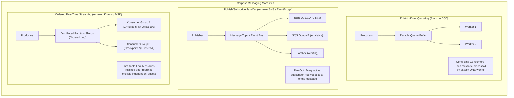
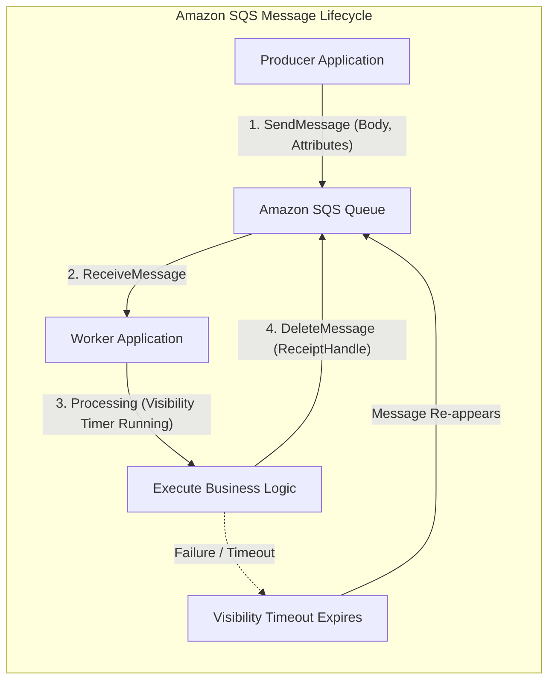
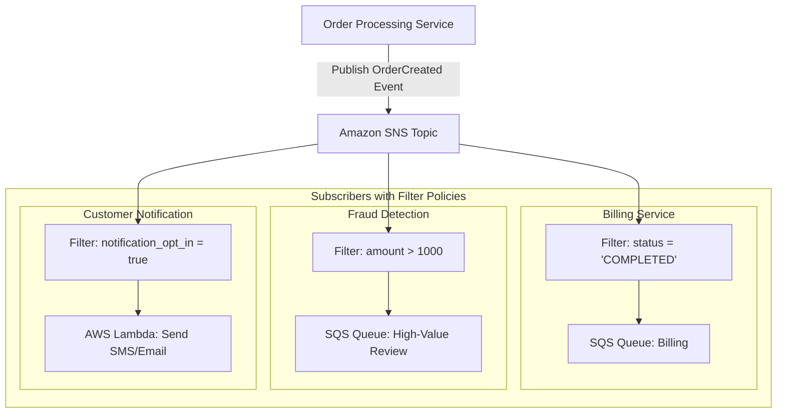
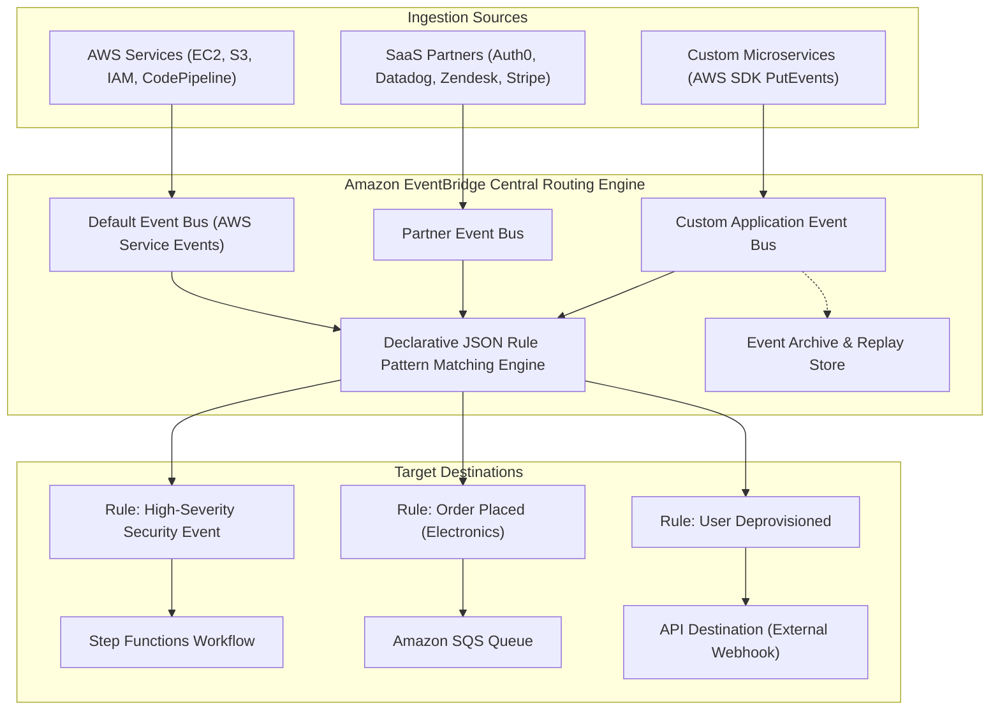
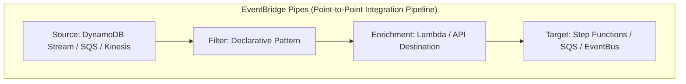
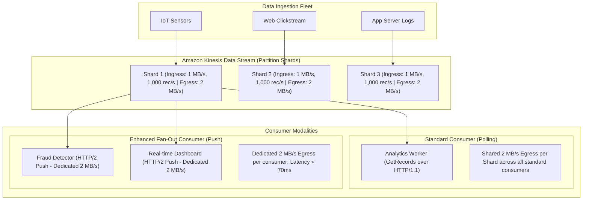
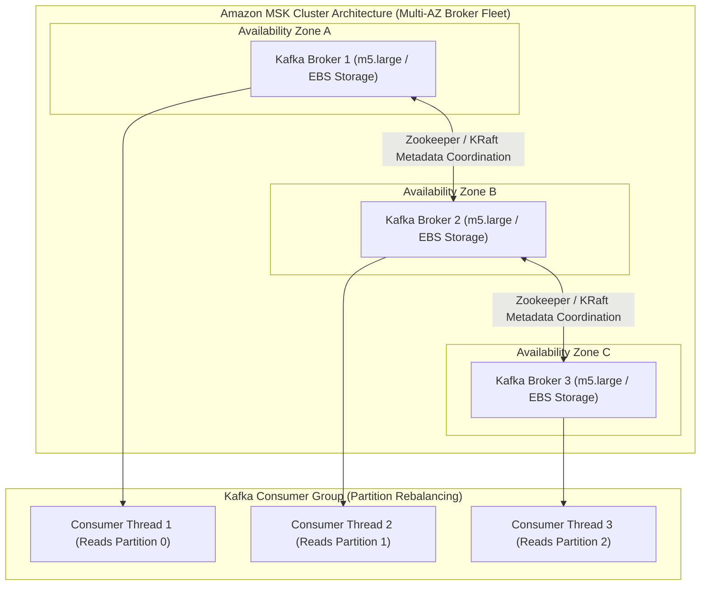

# Module 09: Messaging, Integration, and Streaming

Modern cloud architectures decompose complex systems into decoupled, asynchronous microservices. Communication between these services requires specialized messaging primitives tailored to specific delivery semantics, ordering guarantees, fan-out topologies, and throughput scales. Amazon Web Services provides five foundational messaging and integration engines: **Amazon SQS** (point-to-point queueing), **Amazon SNS** (pub/sub push fan-out), **Amazon EventBridge** (declarative schema-driven event bus and point-to-point pipes), **Amazon Kinesis Data Streams** (low-latency ordered data streaming), and **Amazon Managed Streaming for Apache Kafka / MSK** (enterprise Kafka clusters).

---

## 1. Enterprise Messaging Foundations: Queueing vs Pub/Sub vs Event Streams

Selecting the correct integration primitive dictates system resilience, message durability, consumer scaling, and operational overhead.



### 1. Point-to-Point Queueing (Competing Consumers)

In queueing systems (Amazon SQS), messages are buffered in a distributed queue. Multiple worker instances pull messages concurrently from the queue. Each message is processed and acknowledged by **exactly one consumer**, enabling horizontal worker scaling and shock-absorption during load spikes.

### 2. Publish/Subscribe Fan-Out

In pub/sub systems (Amazon SNS and EventBridge), publishers push messages to a central topic or event bus without knowledge of downstream consumers. The messaging platform copies and pushes the message simultaneously to all registered subscribers (fan-out), applying declarative attribute filters so subscribers receive only relevant subsets of events.

### 3. Distributed Event Streaming

In streaming platforms (Amazon Kinesis Data Streams and Apache Kafka / MSK), data records are written sequentially to append-only, partitioned logs (shards). Records are immutable and retained for a configurable retention window (e.g., 24 hours to 365 days). Consumers maintain their own read pointers (offsets/checkpoints), allowing multiple independent applications to process the identical data stream at their own pace or replay historical data.

---

## 2. Amazon SQS Architecture & Lifecycle Internals

Amazon Simple Queue Service (Amazon SQS) is a fully managed message queuing service offering high availability and massive horizontal scalability.



### Standard Queues vs FIFO Queues

- **Standard Queues**:
  - **Throughput**: Unlimited transactions per second.
  - **Delivery Guarantee**: **At-least-once delivery**. A message is delivered at least once, but occasional duplicate deliveries can occur due to distributed node retries.
  - **Ordering**: **Best-effort ordering**. Messages are generally delivered in the order received, but network latency across distributed storage servers can cause out-of-order delivery.
- **FIFO (First-In, First-Out) Queues**:
  - **Throughput**: Baseline of **300 transactions/second** (up to 3,000 msg/s with 10-message batching). With **High-Throughput FIFO mode** enabled, throughput scales up to **70,000 transactions/second** when partitioned across distinct Message Group IDs.
  - **Delivery Guarantee**: **Strictly-once processing**. Duplicates within a 5-minute deduplication window are automatically dropped based on the `MessageDeduplicationId` or SHA-256 body hash.
  - **Ordering**: **Strict chronological ordering** preserved per `MessageGroupId`. Messages with different group IDs process concurrently across workers, while messages within the same group ID process strictly sequentially.

### The Visibility Timeout Lifecycle

When a worker receives a message via `ReceiveMessage`:

1. SQS does not delete the message. Instead, it starts an internal countdown called the **Visibility Timeout** (configurable from 0 seconds to 12 hours; defaults to 30 seconds).
2. During this window, the message is hidden from all other workers querying the queue.
3. If the worker completes processing before the visibility timeout elapses, it calls `DeleteMessage` using the ephemeral `ReceiptHandle`. SQS permanently purges the message from storage.
4. **Heartbeat Extension (`ChangeMessageVisibility`)**: If a complex batch task takes longer than anticipated, the worker issues `ChangeMessageVisibility` to extend the timeout window, preventing other workers from prematurely claiming the in-flight message.
5. If the worker crashes or the timer expires before deletion, the message becomes visible in the queue again for another worker to process.

### In-Flight Message Limits

A message is considered **in flight** after being delivered to a worker until it is deleted or its visibility timeout expires:

- Standard Queues: Maximum of **120,000 in-flight messages** per queue.
- FIFO Queues: Maximum of **20,000 in-flight messages** per queue.
- _Failure Mode_: If an application exhausts in-flight limits (e.g., due to stalled worker threads that fail to delete or extend messages), SQS rejects incoming `ReceiveMessage` calls with `OverLimit` errors.

### Dead-Letter Queue (DLQ) Redrive Automation

To prevent "poison pills" (malformed messages that repeatedly crash worker processes) from looping indefinitely:

- Configure a **Dead-Letter Queue (DLQ)** with a `maxReceiveCount` threshold (typically 3 to 5).
- When a message fails and is received more than `maxReceiveCount` times, SQS automatically moves it to the target DLQ without invoking further application code.
- **Automated DLQ Redrive**: Once developers deploy a bug fix, administrators can trigger the automated DLQ redrive feature via the AWS Console or the `StartMessageMoveTask` API. SQS moves messages from the DLQ back to the primary source queue at scale (up to 1,000 messages/sec) with zero custom migration scripts.

---

## 3. Amazon SNS: High-Throughput Pub/Sub Fan-Out

Amazon Simple Notification Service (Amazon SNS) is a fully managed, push-based publish/subscribe messaging service designed for high-throughput, instantaneous multi-endpoint fan-out.



### Standard vs FIFO Topics

- **Standard Topics**: Unlimited publish throughput, fan-out to standard SQS queues, Lambda functions, HTTP/HTTPS webhooks, Amazon Kinesis Data Firehose, SMS, and email. Best-effort ordering with at-least-once delivery.
- **FIFO Topics**: Guarantees strictly ordered, deduplicated fan-out to **Amazon SQS FIFO queues only**. Supports up to 3,000 messages/sec (or 30,000 with batching) using `MessageGroupId` and `MessageDeduplicationId`.

### Message Attribute Subscription Filter Policies

By default, every subscriber to an SNS topic receives every published message. To prevent consumer applications from wasting compute resources discarding irrelevant messages, administrators configure **Subscription Filter Policies**:

- Evaluated entirely within the SNS infrastructure before message delivery.
- Supports matching on **Message Attributes** or within the **Message Body** (`FilterPolicyScope: "MessageBody"`).
- Supported operators:
  - Exact string match: `{"store": ["online", "mobile"]}`
  - Numeric range match: `{"price": [{ "numeric": [">", 100, "<=", 500] }]}`
  - Prefix match: `{"order_id": [{ "prefix": "ord-" }]}`
  - Exists match: `{"discount_code": [{ "exists": true }]}`
  - Anything-but match: `{"status": [{ "anything-but": "CANCELLED" }]}`

---

## 4. Amazon EventBridge: The Central Serverless Event Router

Amazon EventBridge is a serverless event bus service that ingests real-time data from application microservices, AWS SaaS partners, and native AWS services, routing events to targets based on declarative JSON patterns.



### Event Buses: Default, Custom, and Partner

1. **Default Event Bus**: Present in every AWS account. Automatically receives events emitted by native AWS services (e.g., `EC2 Instance State-change Notification`, `S3 Object Created`, `AWS Health Events`).
2. **Custom Event Bus**: Dedicated buses created by engineers to route internal business events between microservices within an account or across organizational accounts.
3. **Partner Event Bus**: Connects external third-party SaaS providers (Datadog, Auth0, Shopify, PagerDuty) directly to an AWS account without managing custom webhook ingress endpoints.

### Declarative JSON Event Pattern Matching

EventBridge rules evaluate incoming JSON envelopes against declarative event patterns. A rule matches an event if all specified fields in the pattern match the corresponding event fields.

```json
{
  "source": ["com.acme.ecommerce"],
  "detail-type": ["OrderPlaced"],
  "detail": {
    "orderId": [{ "prefix": "ord-" }],
    "totalAmount": [{ "numeric": [">", 250.0] }],
    "status": [{ "anything-but": ["REJECTED", "FRAUD_FLAGGED"] }],
    "loyaltyMember": [{ "exists": true }]
  }
}
```

### Event Archive and Replay

EventBridge allows configuring an **Event Archive** on any event bus with configurable retention (from 1 day to indefinite):

- **Continuous Ingestion**: Every event matching an archive filter is captured and encrypted in persistent storage.
- **Replay Capabilities**: During disaster recovery, post-incident reviews, or when deploying a new microservice that requires historical data, developers initiate an **Event Replay**. EventBridge streams historical events back through target rules within a specified time window, recreating historical state in staging or production.

---

## 5. EventBridge Pipes and EventBridge Scheduler

Modern event-driven architectures minimize boilerplate glue code by utilizing specialized EventBridge integration utilities.



### EventBridge Pipes: Zero-Code Point-to-Point Pipelines

Historically, transferring data from an Amazon SQS queue or DynamoDB Stream to a downstream service required writing, deploying, and maintaining a dedicated Lambda function.

**EventBridge Pipes** provides a managed point-to-point integration engine comprising four distinct phases:

1. **Source**: Pulls messages or records from DynamoDB Streams, Amazon Kinesis Data Streams, Amazon SQS, Amazon MQ, or Apache Kafka.
2. **Filter**: Evaluates declarative JSON filter patterns. Non-matching events are discarded at the source without incurring enrichment or target invocation costs.
3. **Enrichment (Optional)**: Transforms or augments the event payload by synchronously invoking an AWS Lambda function, AWS Step Functions workflow, or an external HTTP endpoint via API Destinations.
4. **Target**: Delivers the enriched event payload to over 20 AWS services (such as Amazon SQS, SNS, EventBridge Event Bus, Step Functions, or CloudWatch Logs).

### EventBridge Scheduler: Universal Serverless Task Execution

Replacing legacy CloudWatch Events cron rules, **EventBridge Scheduler** is a dedicated serverless scheduling service capable of triggering millions of one-time and recurring tasks:

- **Scheduling Modalities**:
  - _Rate-based_: Executes every $N$ minutes, hours, or days (`rate(15 minutes)`).
  - _Cron-based_: Standard 5-field cron syntax with explicit timezone support (`cron(0 9 * * ? *)` in `Europe/Prague`).
  - _One-time_: Fires at a single precise timestamp in the future (e.g., triggering a subscription renewal reminder 30 days after signup).
- **Flexible Time Windows**: Injects randomized jitter into schedule execution (e.g., spanning requests over a 15-minute window) to prevent downstream thundering herds during synchronized cron spikes.

---

## 6. Amazon Kinesis Data Streams: Real-Time Streaming Architecture

Amazon Kinesis Data Streams is an enterprise real-time data streaming service designed for high-volume continuous ingestion of clickstreams, financial transactions, IoT telemetry, and application logs.



### Shard Architecture and Throughput Quotas

A Kinesis stream is composed of one or more **shards**. Each shard delivers deterministic throughput:

- **Ingress Capacity**: **1 MB per second** or **1,000 records per second** per shard.
- **Standard Egress Capacity**: **2 MB per second** per shard, **shared** across all standard consumers reading via the HTTP `GetRecords` polling API.
- **Record Retention**: Configurable from 24 hours (default) up to **365 days** (extended retention).

### Standard Polling vs Enhanced Fan-Out (EFO)

- **Standard Consumer (Pull Model)**: Consumers issue HTTP `GetRecords` calls against each shard. The 2 MB/s egress bandwidth is shared among all consumers. If 5 distinct microservices poll the same shard, each receives an average of 400 KB/s, and polling latency averages 200–500 milliseconds.
- **Enhanced Fan-Out (EFO - Push Model)**: Dedicated to latency-critical microservices. Each EFO consumer registers an HTTP/2 connection (`SubscribeToShard`) with Kinesis:
  - Kinesis **pushes** records to the consumer over HTTP/2 server push.
  - Each registered EFO consumer receives a **dedicated 2 MB/s of egress throughput per shard**.
  - Reduces end-to-end propagation latency to **under 70 milliseconds**.
  - Up to 20 EFO consumers can register per stream without competing for read bandwidth.

### Capacity Modes: Provisioned vs On-Demand

- **Provisioned Mode**: Engineers manually provision shard counts. Scaling requires executing shard split or merge operations via the API or Application Auto Scaling scripts. Ideal for predictable, steady-state streaming data.
- **On-Demand Mode**: Automatically accommodates fluctuating stream volume. Scales up to **200 MB/s write and 400 MB/s read** without managing shards.

---

## 7. Amazon Managed Streaming for Apache Kafka (MSK)

For enterprise applications running native Apache Kafka workloads or migrating from on-premises Kafka clusters, **Amazon Managed Streaming for Apache Kafka (Amazon MSK)** provides managed Kafka infrastructure.



### MSK Provisioned vs MSK Serverless

- **MSK Provisioned**: Full control over Kafka brokers, compute instance families (m5, m7g), EBS storage volumes, and Kafka cluster configuration properties. Supports automatic EBS storage volume expansion without downtime.
- **MSK Serverless**: Completely removes broker and instance management. Automatically partitions and scales throughput up to 200 MB/s write and 400 MB/s read, charging strictly per partition-hour and data streamed.

### Security and Authentication

Amazon MSK integrates enterprise security controls:

- **Authentication**: Supports mutual TLS (mTLS), SASL/SCRAM with AWS Secrets Manager, and native **IAM Access Control** (signing Kafka requests using SigV4 credentials).
- **VPC Isolation**: Brokers reside within customer VPC subnets, communicating securely over private ENIs with automated TLS 1.3 encryption in transit.

---

## 8. Architectural Decision Framework: SQS vs SNS vs EventBridge vs Kinesis vs MSK

| Feature / Dimension | Amazon SQS | Amazon SNS | Amazon EventBridge | Amazon Kinesis Streams | Amazon MSK |
| --- | --- | --- | --- | --- | --- |
| **Messaging Paradigm** | Point-to-Point Queue | Pub/Sub Fan-Out | Central Event Bus & Router | Real-Time Log Stream | Enterprise Kafka Stream |
| **Delivery Model** | Consumer Pull (Long Poll) | Push to Subscriptions | Push to Targets | Pull (Std) / Push (EFO) | Consumer Group Pull |
| **Ordering** | FIFO (per MessageGroup) | FIFO (per MessageGroup) | No ordering guarantees | Strict per Shard | Strict per Partition |
| **Payload Ceiling** | 256 KB | 256 KB | 256 KB (Ext. 2 MB) | 1 MB per record | 1 MB (Configurable to 10 MB) |
| **Message Retention** | 1 min to 14 days | Ephemeral (0 days) | Ephemeral (or Indefinite Archive) | 24 hrs to 365 days | Configurable (Days to Infinite) |
| **Filtering Engine** | None | Attribute / Body Filter | Declarative JSON Patterns | Custom Application Code | Kafka Streams / Flink |
| **Best Use Case** | Decoupling worker jobs and batch queues. | Broadcast fan-out to SQS/webhooks/mobile. | Choreographed serverless microservices & SaaS. | Real-time clickstreams, analytics, EFO push. | Migrating existing Kafka apps, custom Kafka APIs. |

---

## 9. Then vs Now: Evolution of AWS Messaging and Integration

| Dimension | Legacy Architecture (Then) | Modern Cloud Standard (Now) |
| --- | --- | --- |
| **Point-to-Point Glue** | Custom Lambda functions deployed to copy SQS messages to Step Functions. | EventBridge Pipes handling source-to-target streaming without code. |
| **Task Scheduling** | CloudWatch Events cron rules with limited scale and UTC-only timezones. | EventBridge Scheduler supporting millions of one-time and recurring tz-aware tasks. |
| **High-Throughput FIFO** | SQS FIFO capped strictly at 300 msg/s (3,000 batch). | High-Throughput FIFO scaling up to 70,000 msg/s across message groups. |
| **Streaming Fan-Out** | Multiple consumers sharing 2 MB/s shard bandwidth, causing read throttling. | Enhanced Fan-Out (EFO) delivering dedicated 2 MB/s HTTP/2 push per consumer. |
| **Kafka Management** | Managing manual EC2 Zookeeper and broker instances with manual disk resizing. | MSK Serverless or MSK Provisioned with automatic EBS auto-expansion. |
| **Event Replay** | Irreversible message drops; required re-running upstream transaction pipelines. | EventBridge Archive and Replay allowing precise historical stream replay. |

---

## Interview Drill

<details><summary>1. How does the Visibility Timeout mechanism in Amazon SQS prevent multiple workers from processing the same message simultaneously?</summary>

When a worker calls `ReceiveMessage`, SQS assigns the message a temporary locked status by starting the Visibility Timeout countdown timer (default 30 seconds). While the timer is running, the message remains in the queue but is hidden from all subsequent `ReceiveMessage` requests issued by other concurrent workers. If the worker processes the message successfully, it deletes it using the `ReceiptHandle`. If the worker crashes or fails before deleting the message, the visibility timeout expires, and SQS makes the message visible again to other workers, ensuring fault-tolerant, at-least-once processing.

- Ref: [modules/09-messaging-integration-and-streaming.md#2-amazon-sqs-architecture--lifecycle-internals](09-messaging-integration-and-streaming.md#2-amazon-sqs-architecture--lifecycle-internals), https://docs.aws.amazon.com/AWSSimpleQueueService/latest/SQSDeveloperGuide/sqs-visibility-timeout.html

</details>

<details><summary>2. What is the role of Message Group ID and Message Deduplication ID in Amazon SQS FIFO queues?</summary>

In Amazon SQS FIFO queues, the `MessageGroupId` is the tag that specifies that a particular message belongs to a specific ordered message group. SQS guarantees that messages sharing the same `MessageGroupId` are delivered to consumers in strict sequential chronological order, while messages with different group IDs can be processed in parallel by different workers. The `MessageDeduplicationId` is the unique token used for deduplication. If a message with the identical deduplication ID is submitted within the 5-minute deduplication window, SQS acknowledges receipt but discards the duplicate message, guaranteeing strictly-once processing.

- Ref: [modules/09-messaging-integration-and-streaming.md#2-amazon-sqs-architecture--lifecycle-internals](09-messaging-integration-and-streaming.md#2-amazon-sqs-architecture--lifecycle-internals), https://docs.aws.amazon.com/AWSSimpleQueueService/latest/SQSDeveloperGuide/FIFO-queues.html

</details>

<details><summary>3. How does Amazon Kinesis Enhanced Fan-Out (EFO) solve the shared bandwidth bottleneck of standard Kinesis consumers?</summary>

Standard Kinesis consumers poll shards using the HTTP `GetRecords` API, sharing a fixed 2 MB/s of total egress throughput per shard across all active consumers. When three or more distinct consumer applications read the same stream, they compete for this 2 MB/s bandwidth and experience polling latencies of 200–500ms. Enhanced Fan-Out (EFO) provides a dedicated 2 MB/s of egress throughput per shard for each registered consumer. Kinesis pushes records to EFO consumers over an HTTP/2 server push connection (`SubscribeToShard`), reducing propagation latency to under 70 milliseconds and allowing up to 20 independent consumers per stream without bandwidth degradation.

- Ref: [modules/09-messaging-integration-and-streaming.md#6-amazon-kinesis-data-streams-real-time-streaming-architecture](09-messaging-integration-and-streaming.md#6-amazon-kinesis-data-streams-real-time-streaming-architecture), https://docs.aws.amazon.com/streams/latest/dev/enhanced-consumers.html

</details>

<details><summary>4. What are the four operational stages of an EventBridge Pipe, and how does it reduce serverless architecture complexity?</summary>

An EventBridge Pipe consists of: Source (polling SQS, DynamoDB Streams, Kinesis, or Kafka), Filter (evaluating declarative JSON patterns to discard irrelevant events at the source), Enrichment (synchronously transforming or enriching data via Lambda, Step Functions, or HTTP API Destinations), and Target (dispatching to SQS, SNS, EventBridge, or Step Functions). EventBridge Pipes eliminates the need to author, deploy, and maintain custom "glue" Lambda functions whose sole purpose was pulling from a stream, reformatting JSON, and pushing to a downstream queue.

- Ref: [modules/09-messaging-integration-and-streaming.md#5-eventbridge-pipes-and-eventbridge-scheduler](09-messaging-integration-and-streaming.md#5-eventbridge-pipes-and-eventbridge-scheduler), https://docs.aws.amazon.com/eventbridge/latest/userguide/eb-pipes.html

</details>

<details><summary>5. How does EventBridge Archive and Replay assist in disaster recovery and bug remediation?</summary>

EventBridge Archive captures events flowing through an event bus and stores them encrypted in persistent storage for a retention period ranging from 1 day to indefinite. When a downstream consumer fails due to an application bug or infrastructure outage, developers can fix and redeploy the consumer code, then trigger an Event Replay. EventBridge replays the archived events matching a specific time window through the event bus rules, allowing the newly deployed application to recover missing state and reprocess historical transactions deterministically.

- Ref: [modules/09-messaging-integration-and-streaming.md#4-amazon-eventbridge-the-central-serverless-event-router](09-messaging-integration-and-streaming.md#4-amazon-eventbridge-the-central-serverless-event-router), https://docs.aws.amazon.com/eventbridge/latest/userguide/eb-event-archive.html

</details>

<details><summary>6. Under what circumstances would an architect choose Amazon SNS over Amazon EventBridge for pub/sub messaging?</summary>

Amazon SNS is chosen for high-throughput, low-latency, simple fan-out messaging scenarios (such as broadcasting notifications to millions of mobile push tokens, SMS endpoints, email, or thousands of SQS queues simultaneously) where raw throughput and sub-10ms delivery speed are paramount. Amazon EventBridge is chosen when routing requires complex, declarative JSON pattern matching on message payload bodies, direct integration with third-party SaaS partners, integration with over 20 native AWS service targets, or event schema registry and replay features.

- Ref: [modules/09-messaging-integration-and-streaming.md#8-architectural-decision-framework-sqs-vs-sns-vs-eventbridge-vs-kinesis-vs-msk](09-messaging-integration-and-streaming.md#8-architectural-decision-framework-sqs-vs-sns-vs-eventbridge-vs-kinesis-vs-msk), https://aws.amazon.com/eventbridge/faqs/

</details>

<details><summary>7. What happens when an Amazon SQS queue reaches its in-flight message limit?</summary>

When an SQS queue reaches its maximum in-flight message limit (120,000 messages for Standard queues, 20,000 for FIFO queues), SQS halts delivery of additional messages to workers. Subsequent `ReceiveMessage` requests issued by consumers are rejected with an `OverLimit` error until active workers delete in-flight messages or until their visibility timeouts expire, returning messages to the queue.

- Ref: [modules/09-messaging-integration-and-streaming.md#2-amazon-sqs-architecture--lifecycle-internals](09-messaging-integration-and-streaming.md#2-amazon-sqs-architecture--lifecycle-internals), https://docs.aws.amazon.com/AWSSimpleQueueService/latest/SQSDeveloperGuide/sqs-quotas.html

</details>

<details><summary>8. How do Subscription Filter Policies in Amazon SNS optimize downstream compute costs?</summary>

By default, an SNS topic fans out 100% of published messages to all subscribed endpoints. If subscribing microservices require only a small fraction of those messages, worker functions or containers spend billable compute cycles downloading, parsing, and discarding irrelevant messages. SNS Subscription Filter Policies evaluate attribute or payload criteria at the SNS messaging layer, filtering out non-matching messages before delivery. Subscribed SQS queues and Lambda functions receive only relevant messages, reducing execution invocations and compute costs.

- Ref: [modules/09-messaging-integration-and-streaming.md#3-amazon-sns-high-throughput-pubsub-fan-out](09-messaging-integration-and-streaming.md#3-amazon-sns-high-throughput-pubsub-fan-out), https://docs.aws.amazon.com/sns/latest/dg/sns-message-filtering.html

</details>

<details><summary>9. What is the throughput capacity limit of an Amazon Kinesis Data Stream shard for ingress and egress?</summary>

A single Amazon Kinesis Data Streams shard supports an ingress capacity of 1 MB per second or 1,000 records per second (whichever threshold is reached first). For egress, a shard supports 2 MB per second total throughput shared across all standard consumers using the `GetRecords` API. If Enhanced Fan-Out (EFO) is enabled, each registered EFO consumer receives a dedicated 2 MB per second of egress throughput per shard over HTTP/2.

- Ref: [modules/09-messaging-integration-and-streaming.md#6-amazon-kinesis-data-streams-real-time-streaming-architecture](09-messaging-integration-and-streaming.md#6-amazon-kinesis-data-streams-real-time-streaming-architecture), https://docs.aws.amazon.com/streams/latest/dev/service-sizes-and-limits.html

</details>

<details><summary>10. How does EventBridge Scheduler use flexible time windows to prevent the Thundering Herd problem?</summary>

When millions of scheduled tasks are configured to run at the exact same minute (such as `cron(0 0 * * ? *)` at midnight), downstream databases and API endpoints experience an instantaneous spike in incoming requests (the Thundering Herd), often leading to connection pool exhaustion and system failure. EventBridge Scheduler offers a "Flexible Time Window" setting. When configured (e.g., a 15-minute flexible window), the scheduler injects randomized jitter into individual task invocations across that 15-minute window, smoothing traffic distribution while ensuring all jobs execute reliably.

- Ref: [modules/09-messaging-integration-and-streaming.md#5-eventbridge-pipes-and-eventbridge-scheduler](09-messaging-integration-and-streaming.md#5-eventbridge-pipes-and-eventbridge-scheduler), https://docs.aws.amazon.com/scheduler/latest/UserGuide/managing-schedule-flexible-time-windows.html

</details>
