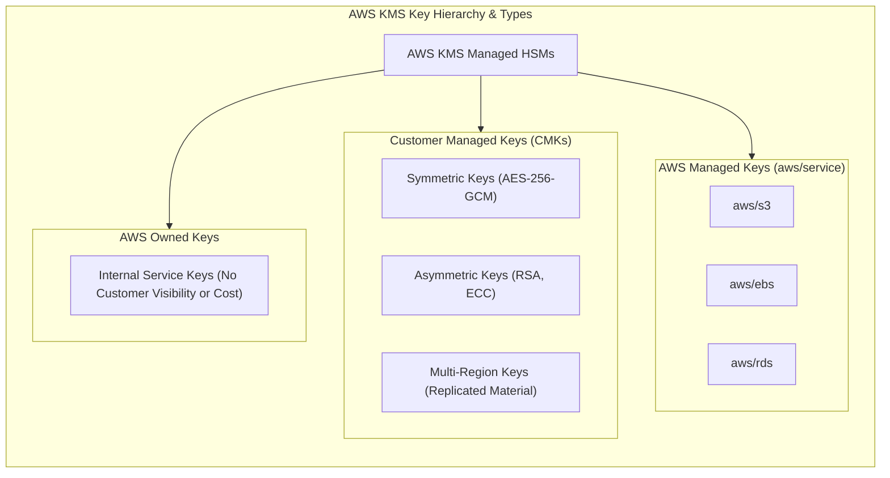
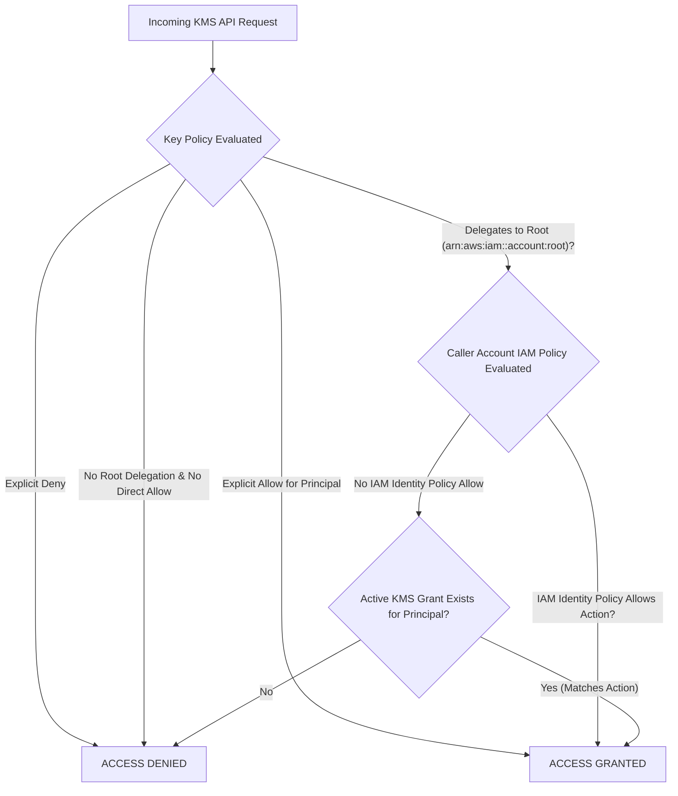
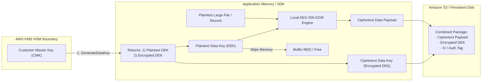
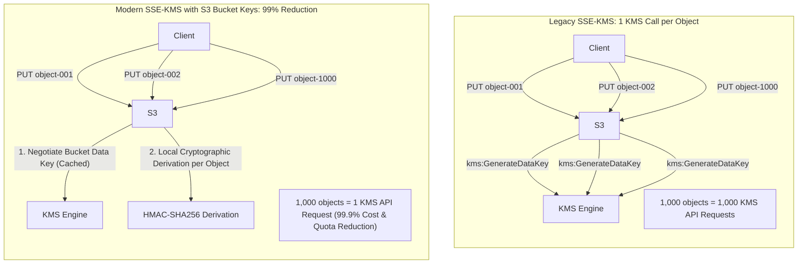
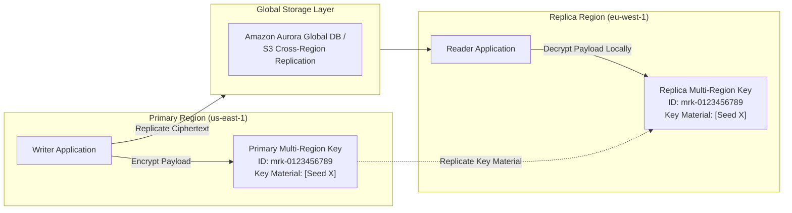
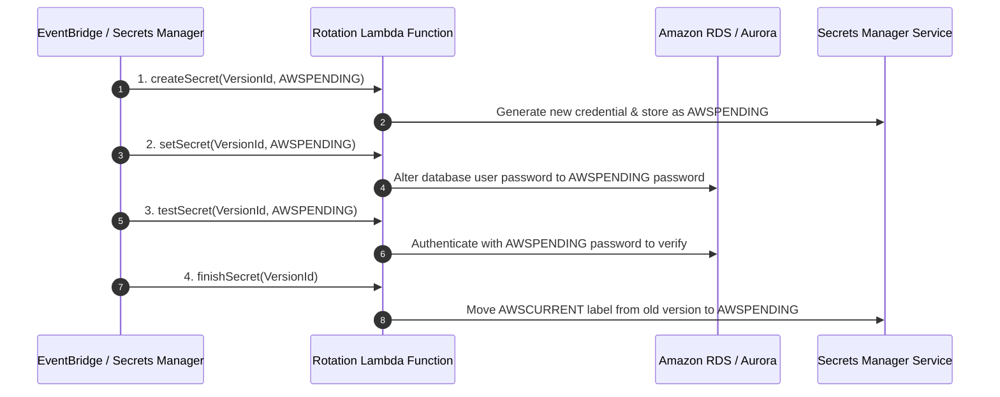
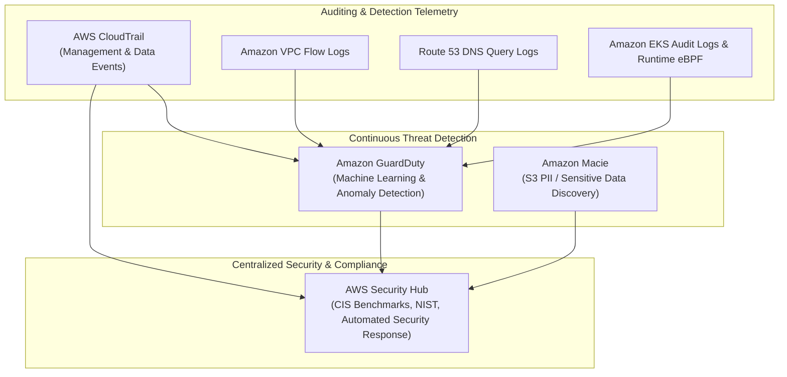
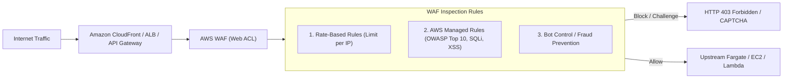
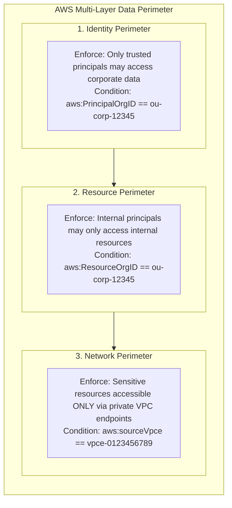

# Module 10: Security, Governance, and Cryptography

Modern cloud security relies on rigorous defense-in-depth across multiple abstraction layers: cryptographic key management, automated credential rotation, continuous audit logging, automated threat detection, edge traffic filtering, and comprehensive data perimeter boundaries. Within Amazon Web Services (AWS), cryptographic access is governed primarily by **AWS Key Management Service (KMS)**, programmatic secrets are managed and rotated through **AWS Secrets Manager**, and detective controls are continuously enforced by **AWS CloudTrail**, **Amazon GuardDuty**, and **AWS Security Hub**.

---

## 1. AWS Key Management Service (KMS) Architecture

AWS Key Management Service (AWS KMS) is a managed cryptographic service integrated with hardware security modules (HSMs) validated under FIPS 140-2 (and FIPS 140-3) Cryptographic Module Validation Program. KMS allows systems to generate, rotate, and manage cryptographic keys while enforcing strict access policies.



### 1. Key Taxonomy: Customer Managed vs AWS Managed vs AWS Owned

AWS KMS categorizes cryptographic keys into three distinct ownership and management tiers:

| Key Category | Created By | Key Policy Configurable? | Automatic Rotation | Customer Cost | Cross-Account Usable? |
| --- | --- | :-: | :-: | :-: | :-: |
| **Customer Managed Keys (CMKs)** | Customer | Yes (Full Control) | Optional (Every 365 or 90–2560 days) | \$1.00/month + API requests | Yes (Via Key Policy & Grants) |
| **AWS Managed Keys** | AWS (e.g., `aws/s3`) | View Only (Not editable) | Automatic (Every 365 days / 3 years depending on service) | Free monthly key fee + API requests | No (Account internal only) |
| **AWS Owned Keys** | AWS Internal | No (Invisible in KMS console) | Fully managed by AWS internal schedule | Free (Zero customer cost or API billing) | N/A (Internal service fabric only) |

### 2. Symmetric vs Asymmetric KMS Keys

Symmetric KMS keys contain a 256-bit Advanced Encryption Standard (AES) key in Galois/Counter Mode (GCM). The key material never leaves the KMS HSMs unencrypted. All cryptographic calls (`Encrypt`, `Decrypt`, `GenerateDataKey`) occur inside the HSM boundary.

Asymmetric KMS keys represent an RSA or Elliptic Curve (ECC) key pair. While the private key never leaves the KMS HSM boundary, clients can download the public key via `GetPublicKey` to verify signatures or encrypt data outside of AWS KMS without incurring API request fees.

---

## 2. KMS Key Policies & Delegation Mechanics

In AWS KMS, the **Key Policy** is the fundamental, primary authorization document. Unlike other AWS resources where an IAM identity policy alone can grant access, KMS operates under a strict two-tier authorization model:



### The Key Policy Root Delegation Prerequisite

If a Customer Managed Key's policy does **not** explicitly delegate control to the root account (`arn:aws:iam::<account-id>:root`), identity-based IAM policies (including `AdministratorAccess`) have zero effect. The key becomes inaccessible to all principals except those explicitly named in the Key Policy:

```json
{
  "Version": "2012-10-17",
  "Id": "key-policy-with-iam-delegation",
  "Statement": [
    {
      "Sid": "Enable IAM User Permissions Through Account Root",
      "Effect": "Allow",
      "Principal": {
        "AWS": "arn:aws:iam::111122223333:root"
      },
      "Action": "kms:*",
      "Resource": "*"
    }
  ]
}
```

> [!IMPORTANT]
> The principal `arn:aws:iam::<account-id>:root` in a KMS Key Policy does not mean "only the root user". It refers to the **account identity domain itself**, delegating authorization decisions for this key to the account's IAM service. Without this statement, an account administrator cannot grant access to other IAM users or roles via identity policies.

### KMS Grants

A KMS Grant is an advanced programmatic delegation mechanism that grants temporary, scoped permissions to a principal without modifying the Key Policy. Grants are heavily utilized by AWS services (such as Amazon EBS or Amazon RDS) when provisioning resources asynchronously:

- **`CreateGrant`**: Assigns specific cryptographic operations (e.g., `Decrypt`, `GenerateDataKeyWithoutPlaintext`) to a grantee principal, optionally constrained by encryption context parameters.
- **`RetireGrant`**: Revokes the grant gracefully once the resource (e.g., an EBS volume) is terminated.
- **`RevokeGrant`**: Administratively invalidates a grant if a compromise is suspected.

---

## 3. Cryptographic Operations & Envelope Encryption Mechanics

AWS KMS imposes a strict maximum payload size of 4,096 bytes (4 KB) for direct `Encrypt` and `Decrypt` API calls. To encrypt arbitrary data objects, databases, and multi-terabyte files, AWS employs **Envelope Encryption**.



### Step-by-Step Envelope Encryption Protocol

1. **Request Data Encryption Key (DEK)**: The client calls `kms:GenerateDataKey` specifying the KMS Key ID and key specification (`AES_256`).
2. **KMS HSM Processing**: KMS generates a 256-bit random entropy buffer inside the HSM. It encrypts this buffer using the CMK.
3. **Dual Return**: KMS returns two items to the client:
   - A **Plaintext Data Key** (32 bytes).
   - A **Ciphertext Data Key** (encrypted under the CMK).
4. **Local Payload Encryption**: The client uses the plaintext DEK to encrypt the arbitrarily sized data locally using authenticated symmetric encryption (such as AES-GCM).
5. **Memory Sanitation**: The application zeroes out the plaintext DEK buffer from volatile memory immediately after encryption.
6. **Package Assembly**: The encrypted data key is stored alongside the ciphertext payload (e.g., in S3 object metadata or header).
7. **Envelope Decryption**: When reading, the application extracts the ciphertext DEK, invokes `kms:Decrypt`, receives the plaintext DEK from KMS, decrypts the local payload, and wipes the DEK from memory.

---

## 4. Amazon S3 Bucket Keys & Request Reduction

When Amazon S3 encrypts objects using Server-Side Encryption with AWS KMS (SSE-KMS), every individual object upload (`PUT`) and download (`GET`) traditionally issued an independent API call to KMS (`GenerateDataKey` or `Decrypt`). In workloads processing millions of transactions per day, this created two critical bottlenecks:

1. **API Cost Accumulation**: KMS charges \$0.03 per 10,000 requests, rapidly turning KMS into the dominant line item on S3 storage bills.
2. **KMS Service Quotas**: Default KMS requests-per-second quotas (typically 5,500 to 50,000 req/s depending on region) were rapidly exhausted by distributed analytics clusters (e.g., EMR, Athena, Spark).



### S3 Bucket Key Mechanics

When **S3 Bucket Keys** are enabled on a bucket:

- Amazon S3 requests a time-limited **bucket-level data key** from AWS KMS.
- S3 securely caches this bucket-level key within the S3 service fabric.
- When objects are written or read within that bucket, S3 uses cryptographic key derivation functions (KDF) locally to generate unique, per-object keys from the bucket key without contacting AWS KMS.
- This architectural optimization reduces KMS API request volume and cost by **up to 99%**.

---

## 5. Multi-Region KMS Keys

Standard AWS KMS keys are strictly regional resources: a key created in `us-east-1` cannot be used to decrypt ciphertext in `eu-west-1`. Multi-Region KMS keys solve cross-region data replication and disaster recovery challenges by replicating key material across AWS regions.



### Architectural Guarantees of Multi-Region Keys

- **Shared Key ID and Key Material**: The primary key and all regional replica keys share the identical key ID (prefixed with `mrk-`), key material, and algorithm properties.
- **Independent Key Policies**: Each regional replica key maintains its own independent Key Policy, allowing localized administrative control in compliance with regional data sovereignty mandates.
- **Zero Cross-Region Latency**: Applications in `eu-west-1` decrypt ciphertext encrypted in `us-east-1` directly using the local `eu-west-1` replica key, eliminating cross-region network calls and cross-region KMS dependencies during disaster recovery failovers.

---

## 6. AWS Secrets Manager: Automated Rotation Lifecycle

AWS Secrets Manager protects database credentials, API tokens, and private certificates throughout their operational lifecycle, eliminating hard-coded credentials in application source code.



### The 4-Step Rotation Lambda Protocol

AWS Secrets Manager executes rotation through an automated four-stage state machine implemented via an AWS Lambda function:

1. **`createSecret`**: The function generates a new cryptographic secret value and stages it in Secrets Manager under the staging label `AWSPENDING`.
2. **`setSecret`**: The function communicates with the target database or external service (e.g., executing `ALTER USER ... IDENTIFIED BY ...` over TLS) to apply the pending credential alongside the existing active credential.
3. **`testSecret`**: The function attempts to establish a real connection and query against the database using the `AWSPENDING` credentials, proving end-to-end viability.
4. **`finishSecret`**: Once verified, the function moves the `AWSCURRENT` staging label from the old secret version to the `AWSPENDING` version, promoting it to active production status. The previous credential receives the `AWSPREVIOUS` label to enable rollback.

### AWS Secrets Manager vs AWS Systems Manager Parameter Store

| Evaluation Dimension | AWS Secrets Manager | SSM Parameter Store (Standard) | SSM Parameter Store (Advanced) |
| --- | --- | --- | --- |
| **Primary Use Case** | Highly sensitive passwords, API keys, DB credentials | Configuration parameters, feature flags | Large config files, policy docs |
| **Automated Rotation** | Built-in native Lambda rotation engine | No native rotation (Requires custom EventBridge + Lambda) | No native rotation |
| **Maximum Value Size** | 64 KB | 4 KB | 8 KB |
| **KMS Encryption** | Always encrypted (CMK or `aws/secretsmanager`) | Optional (`SecureString` type) | Optional (`SecureString` type) |
| **Cross-Account Access** | Native resource-based policies on secret | No resource policies (Requires RAM or IAM roles) | No resource policies |
| **Pricing Model** | \$0.40 / secret / month + \$0.05 / 10k API calls | Free for standard storage; standard API free | \$0.05 / advanced param / month + \$0.05 / 10k calls |

---

## 7. Detective & Compliance Services: CloudTrail, GuardDuty, and Security Hub

Continuous observability into identity actions, infrastructure configuration, and network traffic is mandated by regulatory frameworks (SOC 2, ISO 27001, PCI-DSS).



### 1. AWS CloudTrail: Management vs Data Events & CloudTrail Lake

AWS CloudTrail records API calls made by users, roles, and AWS services across an entire organization:

- **Management Events**: Control plane operations that configure infrastructure (e.g., `ec2:RunInstances`, `s3:CreateBucket`, `iam:CreateRole`). Delivered to S3 by default with one free trail per region.
- **Data Events**: High-volume resource data plane operations (e.g., `s3:GetObject`, `s3:PutObject`, `lambda:Invoke`, `dynamodb:PutItem`). Disabled by default due to high event volumes; charged at \$0.10 per 100,000 events.
- **Log File Integrity Validation**: CloudTrail generates digest files containing cryptographic hashes (SHA-256 with RSA digital signatures) of all delivered log files every hour, enabling mathematical proof that logs have not been modified or deleted.
- **CloudTrail Lake**: A managed, immutable data lake that aggregates multi-account audit logs across regions and enables SQL queries without building custom ETL pipelines.

### 2. Amazon GuardDuty

Amazon GuardDuty is an agentless threat detection service that continuously monitors VPC Flow Logs, CloudTrail management and data events, Route 53 DNS query logs, and EKS audit logs. GuardDuty uses machine learning, anomaly detection, and integrated threat intelligence feeds to identify unauthorized behavior, such as compromised credentials, crypto-mining EC2 instances, DNS data exfiltration, and unusual S3 data access.

### 3. AWS Security Hub & Automated Security Response

AWS Security Hub provides Cloud Security Posture Management (CSPM). It aggregates findings from GuardDuty, Macie, Inspector, IAM Access Analyzer, and AWS Config, benchmarking compliance against frameworks such as the **CIS AWS Foundations Benchmark** and **PCI-DSS**. Security Hub findings follow the standardized **AWS Security Finding Format (ASFF)**, allowing EventBridge rules to trigger automated remediation via AWS Systems Manager Automation runbooks.

### 4. Amazon Macie

Amazon Macie uses machine learning and pattern matching to discover, classify, and protect sensitive data stored in Amazon S3 buckets. Macie scans for personally identifiable information (PII) such as credit card numbers, national identification numbers, and private encryption keys, reporting unauthorized public bucket exposure and unencrypted data repositories.

---

## 8. Perimeter Defense: AWS WAF & AWS Shield

Edge protection prevents web application exploits, distributed denial-of-service (DDoS) attacks, and unauthorized bots from reaching application compute layers.



### AWS WAF (Web Application Firewall)

AWS WAF inspects HTTP/HTTPS traffic directed at Amazon CloudFront, Application Load Balancers (ALB), Amazon API Gateway, and AWS AppSync. Key filtering mechanisms include:

- **Rate-Based Rules**: Track request volumes per client IP within a configurable sliding window (e.g., blocking IPs exceeding 500 requests per 5 minutes to mitigate brute-force attacks).
- **AWS Managed Rules (AMR)**: Curated rule sets maintained by AWS Threat Research protecting against common vulnerabilities (e.g., OWASP Top 10, SQL injection, cross-site scripting, known bad inputs).
- **Bot Control**: Identifies and blocks malicious scrapers, crawlers, and automated credential-stuffing bots using browser fingerprinting and challenge tokens.

### AWS Shield Standard vs Shield Advanced

- **AWS Shield Standard**: Automatic, perimeter-wide DDoS defense active across all AWS customers at no additional cost. Mitigates common Layer 3 (Network) and Layer 4 (Transport) attacks (e.g., SYN floods, UDP reflection attacks) at AWS edge locations.
- **AWS Shield Advanced**: Enterprise-tier protection (\$3,000/month flat fee + data transfer) providing Layer 7 DDoS mitigation, direct 24/7 engagement with the **AWS Shield Response Team (SRT)**, automated WAF rule creation during active DDoS events, and financial **DDoS Cost Protection** to refund scaling spike costs incurred on EC2, ALB, CloudFront, or Route 53 during an attack.

---

## 9. Comprehensive Data Perimeters: Multi-Layer Isolation Architecture

An enterprise **Data Perimeter** ensures that only trusted identities, accessing from trusted network locations, can access trusted corporate resources. Implementing a data perimeter requires combining three complementary policy controls:



### 1. Identity Perimeter

Guarantees that untrusted external principals cannot access company resources, even if a resource policy is misconfigured. Configured on resource-based policies and VPC endpoint policies:

```json
{
  "Effect": "Deny",
  "Principal": "*",
  "Action": "s3:*",
  "Resource": "arn:aws:s3:::corporate-finance-vault/*",
  "Condition": {
    "StringNotEquals": {
      "aws:PrincipalOrgID": "o-enterpriseorg123"
    }
  }
}
```

### 2. Resource Perimeter

Prevents corporate credentials from exfiltrating data to external AWS accounts (e.g., copying corporate data to a personal S3 bucket). Enforced via Service Control Policies (SCPs) and VPC Endpoint policies using `aws:ResourceOrgID`:

```json
{
  "Effect": "Deny",
  "Action": ["s3:PutObject", "s3:GetObject"],
  "Resource": "*",
  "Condition": {
    "StringNotEquals": {
      "aws:ResourceOrgID": "o-enterpriseorg123"
    }
  }
}
```

### 3. Network Perimeter

Guarantees that sensitive data can only be reached from trusted network paths (such as corporate VPCs or on-premises networks routed through Direct Connect), denying public internet traffic even with valid credentials:

```json
{
  "Effect": "Deny",
  "Principal": "*",
  "Action": "s3:*",
  "Resource": "arn:aws:s3:::corporate-finance-vault/*",
  "Condition": {
    "StringNotEquals": {
      "aws:sourceVpce": "vpce-0a1b2c3d4e5f67890"
    }
  }
}
```

---

## 10. Interview Drill: Security, Governance, and Cryptography

<details><summary>1. Why is an IAM user with AdministratorAccess unable to use a Customer Managed KMS key if the Key Policy omits the account root delegation statement?</summary>

In AWS KMS, the Key Policy is the fundamental access control document for a cryptographic key. The evaluation engine evaluates the Key Policy first. By default, a KMS Key Policy restricts all access unless explicitly granted. For identity-based IAM policies (including `AdministratorAccess`) to have any authority over a KMS key, the Key Policy must contain a statement that explicitly delegates authorization decisions to the account root principal (`arn:aws:iam::<account-id>:root`). If this delegation statement is missing, IAM identity policies have zero evaluation power, and the key is accessible only to principals explicitly named in the Key Policy statements.

- Ref: [modules/10-security-governance-and-cryptography.md#2-kms-key-policies--delegation-mechanics](10-security-governance-and-cryptography.md#2-kms-key-policies--delegation-mechanics), https://docs.aws.amazon.com/kms/latest/developerguide/key-policies.html

</details>

<details><summary>2. What is the difference between AWS KMS GenerateDataKey and Encrypt, and why is envelope encryption necessary for files larger than 4 KB?</summary>

The KMS `Encrypt` API call performs encryption entirely inside the KMS Hardware Security Module (HSM) and enforces a strict maximum payload ceiling of 4,096 bytes (4 KB). `GenerateDataKey` generates a 256-bit symmetric Data Encryption Key (DEK) inside the HSM, returning both a plaintext DEK and a ciphertext DEK encrypted under the KMS Customer Master Key. Envelope encryption uses `GenerateDataKey`: the application uses the plaintext DEK to encrypt large files locally using AES-256-GCM, stores the encrypted DEK alongside the ciphertext, and wipes the plaintext DEK from memory, bypassing the 4 KB HSM payload limit while maintaining hardware-backed master key protection.

- Ref: [modules/10-security-governance-and-cryptography.md#3-cryptographic-operations--envelope-encryption-mechanics](10-security-governance-and-cryptography.md#3-cryptographic-operations--envelope-encryption-mechanics), https://docs.aws.amazon.com/kms/latest/developerguide/concepts.html#enveloping

</details>

<details><summary>3. How do S3 Bucket Keys reduce AWS KMS API costs and prevent request quota throttling on high-throughput analytical workloads?</summary>

Without S3 Bucket Keys, every S3 `PUT` and `GET` operation against an SSE-KMS encrypted bucket generates an independent API call to AWS KMS (`GenerateDataKey` or `Decrypt`). In analytics workloads reading billions of objects, this triggers KMS API rate limit throttling and massive costs. When S3 Bucket Keys are enabled, S3 requests a single bucket-level data key from KMS and caches it in memory. S3 then derives unique per-object keys locally using HMAC-SHA256 without contacting KMS, reducing KMS API calls and associated request costs by up to 99%.

- Ref: [modules/10-security-governance-and-cryptography.md#4-amazon-s3-bucket-keys--request-reduction](10-security-governance-and-cryptography.md#4-amazon-s3-bucket-keys--request-reduction), https://docs.aws.amazon.com/AmazonS3/latest/userguide/bucket-key.html

</details>

<details><summary>4. What are the four operational stages executed by an AWS Secrets Manager rotation Lambda function?</summary>

The four stages are: 1) `createSecret`: generates a new secret value and stores it in Secrets Manager under the staging label `AWSPENDING`; 2) `setSecret`: updates the password or credential on the target database or system to match the `AWSPENDING` secret; 3) `testSecret`: verifies the pending credential by attempting a real authenticated connection against the target system; and 4) `finishSecret`: moves the active staging label `AWSCURRENT` from the old secret version to `AWSPENDING`, while marking the old version as `AWSPREVIOUS`.

- Ref: [modules/10-security-governance-and-cryptography.md#6-aws-secrets-manager-automated-rotation-lifecycle](10-security-governance-and-cryptography.md#6-aws-secrets-manager-automated-rotation-lifecycle), https://docs.aws.amazon.com/secretsmanager/latest/userguide/rotate-secrets_how.html

</details>

<details><summary>5. Under what circumstances would an enterprise choose AWS Secrets Manager over Systems Manager Parameter Store?</summary>

AWS Secrets Manager is chosen when workloads require built-in automated credential rotation via Lambda, native cross-account access delegation using resource-based policies directly attached to secrets, or larger secret payload storage (up to 64 KB). Parameter Store is chosen for application configuration values, hierarchical configuration trees, and scenarios where cost optimization is critical, as Standard Parameter Store parameters incur zero storage fees and zero API request charges.

- Ref: [modules/10-security-governance-and-cryptography.md#6-aws-secrets-manager-automated-rotation-lifecycle](10-security-governance-and-cryptography.md#6-aws-secrets-manager-automated-rotation-lifecycle), https://docs.aws.amazon.com/systems-manager/latest/userguide/sysman-paramstore-supsvs.html

</details>

<details><summary>6. How does AWS CloudTrail Log File Integrity Validation mathematically prove that audit logs have not been tampered with or deleted?</summary>

Every hour, CloudTrail generates a cryptographic digest file in S3 containing SHA-256 hashes of all log files delivered over the preceding hour, along with the digital signature of the digest file generated using RSA public/private key pairs managed by AWS. By verifying the cryptographic signatures with the CloudTrail public key and comparing SHA-256 hashes using the AWS CLI command `aws cloudtrail validate-logs`, security teams can prove conclusively whether any log file was altered, deleted, or inserted after delivery.

- Ref: [modules/10-security-governance-and-cryptography.md#7-detective--compliance-services-cloudtrail-guardduty-and-security-hub](10-security-governance-and-cryptography.md#7-detective--compliance-services-cloudtrail-guardduty-and-security-hub), https://docs.aws.amazon.com/awscloudtrail/latest/userguide/cloudtrail-log-file-validation-intro.html

</details>

<details><summary>7. What telemetry sources does Amazon GuardDuty analyze, and why is its architecture considered agentless?</summary>

Amazon GuardDuty analyzes AWS CloudTrail management events, CloudTrail S3/Lambda/DynamoDB data events, Amazon VPC Flow Logs, Route 53 DNS query logs, and Amazon EKS audit logs. It is agentless because it ingests this telemetry directly from the AWS global infrastructure backplanes without installing software agents on EC2 instances or containers, and without impacting application CPU, memory, or network throughput.

- Ref: [modules/10-security-governance-and-cryptography.md#7-detective--compliance-services-cloudtrail-guardduty-and-security-hub](10-security-governance-and-cryptography.md#7-detective--compliance-services-cloudtrail-guardduty-and-security-hub), https://docs.aws.amazon.com/guardduty/latest/ug/guardduty_data-sources.html

</details>

<details><summary>8. How do AWS Multi-Region KMS keys eliminate cross-region network latency during disaster recovery failover?</summary>

Multi-Region KMS keys replicate key material across designated replica regions while sharing the exact same key ID (`mrk-...`) and key metadata. Because the cryptographic key material is present in the local Hardware Security Modules of the replica region, secondary workloads decrypt replicated data (such as Aurora Global Database storage or S3 Cross-Region Replicated objects) using their local regional KMS endpoint without routing cryptographic API requests across the global WAN back to the primary region.

- Ref: [modules/10-security-governance-and-cryptography.md#5-multi-region-kms-keys](10-security-governance-and-cryptography.md#5-multi-region-kms-keys), https://docs.aws.amazon.com/kms/latest/developerguide/multi-region-keys-overview.html

</details>

<details><summary>9. What are the three distinct perimeters that constitute an AWS Data Perimeter, and what condition keys enforce them?</summary>

An AWS Data Perimeter consists of: 1) Identity Perimeter, ensuring only trusted identities access resources (enforced via `aws:PrincipalOrgID` or `aws:PrincipalAccount`); 2) Resource Perimeter, ensuring internal identities can only access authorized internal resources and cannot exfiltrate data to external accounts (enforced via `aws:ResourceOrgID` or `aws:ResourceAccount`); and 3) Network Perimeter, ensuring resources can only be accessed from expected network pathways such as private VPC endpoints (enforced via `aws:sourceVpce` or `aws:sourceVpc`).

- Ref: [modules/10-security-governance-and-cryptography.md#9-comprehensive-data-perimeters-multi-layer-isolation-architecture](10-security-governance-and-cryptography.md#9-comprehensive-data-perimeters-multi-layer-isolation-architecture), https://aws.amazon.com/blogs/security/establishing-a-data-perimeter-on-aws/

</details>

<details><summary>10. What financial and operational advantages does AWS Shield Advanced provide over AWS Shield Standard?</summary>

While AWS Shield Standard provides automatic Layer 3/4 DDoS protection at no cost, AWS Shield Advanced adds Layer 7 DDoS mitigation, 24/7 direct access to the specialized AWS Shield Response Team (SRT) who can write custom WAF rules during active attacks, automated WAF rate-limiting rule generation, and DDoS Cost Protection—a financial policy that reimburses customers for autoscaling spike charges incurred by EC2 instances, Application Load Balancers, CloudFront distributions, or Route 53 health checks as a direct result of a DDoS attack.

- Ref: [modules/10-security-governance-and-cryptography.md#8-perimeter-defense-aws-waf--aws-shield](10-security-governance-and-cryptography.md#8-perimeter-defense-aws-waf--aws-shield), https://docs.aws.amazon.com/waf/latest/developerguide/shield-advanced-features.html

</details>
