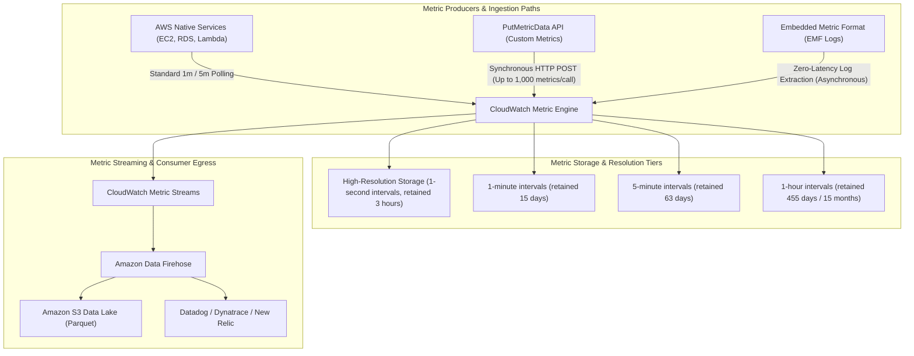
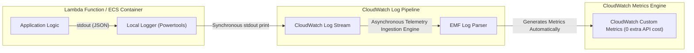
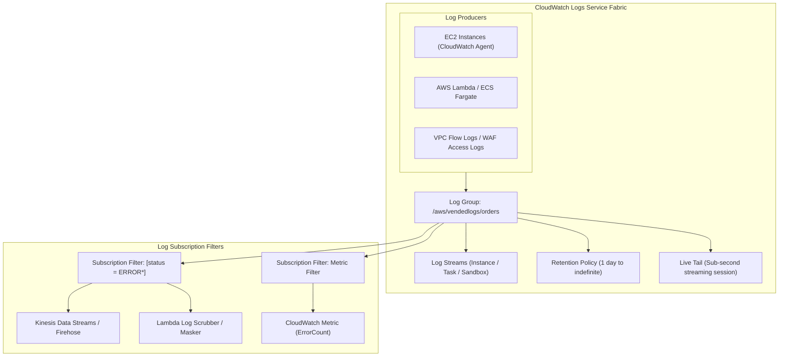
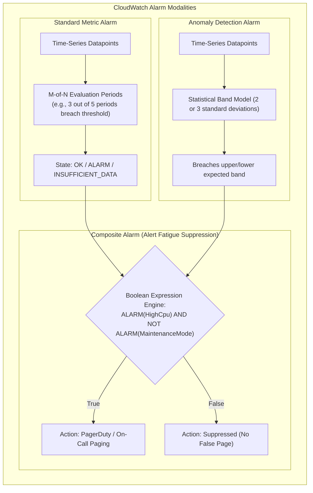
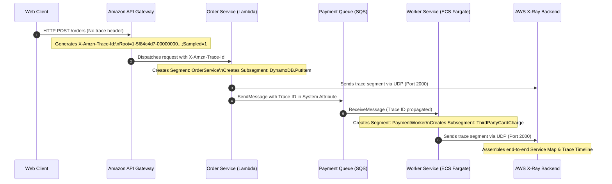
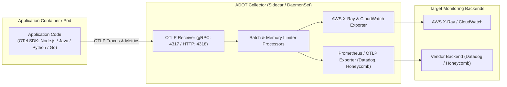
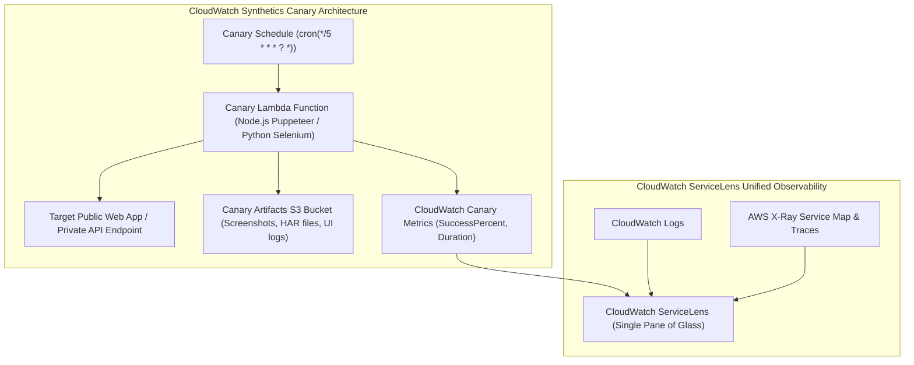

# Module 11: Observability, Monitoring, and Auditing

Production systems require deep observability across the three foundational telemetry pillars: **Metrics**, **Logs**, and **Distributed Traces**. Amazon Web Services provides a unified telemetry fabric centered on **Amazon CloudWatch** (metrics, structured logs, composite alerting, synthetic canaries) and **AWS X-Ray** combined with the **AWS Distro for OpenTelemetry (ADOT)** (distributed distributed tracing). Operating mission-critical workloads demands mastering telemetry ingestion pipelines, low-latency log querying, automated alert suppression, and vendor-neutral OpenTelemetry collection architectures.

---

## 1. Amazon CloudWatch Architecture & Metric Ingestion

Amazon CloudWatch is the core monitoring and observability service for AWS resources and customer applications. It processes time-series metric data points organized under a three-tier namespace, dimension, and metric name hierarchy.



### 1. High-Resolution vs Standard Metrics

- **Standard Resolution**: Metrics are recorded at a 1-minute or 5-minute granularity. Standard metrics are retained for 15 months (455 days) through progressive downsampling rollups.
- **High-Resolution Metrics**: Metrics published with `StorageResolution: 1` accept sub-minute data points (1-second, 5-second, 10-second, or 30-second intervals). High-resolution data is stored at full 1-second fidelity for 3 hours, then rolled up to 1-minute intervals for 15 days. High-resolution metrics allow rapid anomaly detection and sub-minute autoscaling triggering.

### 2. Custom Metrics & Pricing Constraints

Publishing metrics via the `PutMetricData` API costs \$0.30 per custom metric per month for the first 10,000 metrics, plus \$0.01 per 1,000 `PutMetricData` requests. In microservice architectures emitting thousands of dimensions, calling `PutMetricData` synchronously introduces:

1. **Network Overhead**: Additional HTTP round-trips in request-handling worker threads.
2. **Cost Explosions**: Combinatorial dimension cardinality (e.g., `CustomerId` $\times$ `OrderId` $\times$ `StatusCode`) creating millions of unique metric streams.
3. **Throttling**: Hitting regional API rate quotas (default 150 transactions per second for `PutMetricData`).

### 3. CloudWatch Metric Streams

Traditionally, external Application Performance Monitoring (APM) tools (Datadog, Dynatrace, New Relic) collected CloudWatch metrics via periodic API polling using `GetMetricData`. In large AWS organizations, polling thousands of metrics triggered substantial `GetMetricData` API bills and delayed alert visibility by 5–10 minutes.

**CloudWatch Metric Streams** replaces polling with an asynchronous, continuous push architecture:

- CloudWatch pushes metrics near-instantly to **Amazon Data Firehose**.
- Firehose streams metrics in JSON or OpenTelemetry (OTLP) format directly to Amazon S3 or third-party HTTP endpoints with sub-minute latency.
- Metric streams support inclusive and exclusive namespace filters, allowing organizations to stream only critical infrastructure metrics while slashing API polling costs.

---

## 2. Embedded Metric Format (EMF): Zero-Latency Asynchronous Telemetry

To eliminate the latency penalty, API request charges, and throttling risks of synchronous `PutMetricData` API calls, AWS introduced the **Embedded Metric Format (EMF)**.



### EMF Architectural Mechanics

Instead of making network calls to `monitoring.amazonaws.com`, the application serializes metrics directly into standard output (`stdout`) as a structured JSON object containing a reserved `_aws` metadata envelope:

```json
{
  "_aws": {
    "Timestamp": 1700000000000,
    "CloudWatchMetrics": [
      {
        "Namespace": "EnterprisePlatform/PaymentGateway",
        "Dimensions": [
          ["Environment", "Region"],
          ["Environment", "Region", "PaymentProvider"]
        ],
        "Metrics": [
          { "Name": "TransactionLatency", "Unit": "Milliseconds" },
          { "Name": "ProcessingFee", "Unit": "None" },
          { "Name": "SuccessfulTransactions", "Unit": "Count" }
        ]
      }
    ]
  },
  "Environment": "production",
  "Region": "us-east-1",
  "PaymentProvider": "Stripe",
  "OrderId": "ord-8839102",
  "CustomerId": "cust-99120",
  "TransactionLatency": 128.45,
  "ProcessingFee": 2.15,
  "SuccessfulTransactions": 1
}
```

### Advantages of Embedded Metric Format

1. **Zero Execution Latency**: Writing to `stdout` takes less than 1 millisecond and never blocks application worker threads or database connections.
2. **Zero `PutMetricData` Costs**: CloudWatch extracts metrics asynchronously from the log ingestion stream at no additional charge. Users pay standard CloudWatch Logs ingestion fees (\$0.50/GB) and standard custom metric storage fees, saving 100% of `PutMetricData` API call costs.
3. **Correlation by Design**: Because high-cardinality metadata (such as `OrderId`, `CustomerId`, and `TraceId`) resides in the exact same log event as the metric values, developers can jump directly from a CloudWatch metric anomaly to the precise log event that produced it.

---

## 3. CloudWatch Logs: Storage, Subscription Filters, and Live Tail

Amazon CloudWatch Logs provides centralized log aggregation, indexing, and querying for applications, systems, and network traffic.



### 1. Log Groups and Log Streams

- **Log Group**: A logical administrative container sharing identical retention, encryption (KMS CMK), and access control policies (e.g., `/aws/lambda/checkout-processor`).
- **Log Stream**: A sequence of log events originating from the identical physical or virtual host (e.g., an individual EC2 instance ID or Lambda execution environment container sandbox).
- **Default Retention Pitfall**: By default, CloudWatch Log Groups are configured with **Never Expire** retention. In high-throughput systems generating terabytes of logs daily, retaining uncompressed logs indefinitely results in massive storage bills. Best practice mandates enforcing automated retention policies (e.g., 30 or 90 days) via AWS Organizations Tag Policies or IaC.

### 2. Subscription Filters

Subscription filters extract log events in real-time and stream them to downstream processing engines:

- **Amazon Kinesis Data Streams / Firehose**: Ingests high-throughput log events for archiving in an S3 data lake or indexing into OpenSearch.
- **AWS Lambda**: Enables real-time log enrichment, PII data redaction/masking, or automated incident dispatching (e.g., sending high-severity exceptions to Slack or PagerDuty).
- **Metric Filters**: Matches text patterns or JSON attributes in log events (e.g., `{ $.statusCode = 500 }`) and increments a CloudWatch metric without requiring a custom application code change.

### 3. CloudWatch Logs Insights

CloudWatch Logs Insights is a high-speed, interactive SQL-like query engine that analyzes terabytes of log data without managing search infrastructure:

```text
fields @timestamp, @message, statusCode, latency
| filter statusCode >= 500 and environment = 'production'
| stats count(*) as ErrorCount, avg(latency) as AvgLatency by bin(5m), serviceName
| sort ErrorCount desc
| limit 50
```

---

## 4. CloudWatch Alarms: Metric Thresholds, Anomaly Detection, and Composite Alarms

CloudWatch Alarms evaluate metric time-series data and initiate actions (such as Amazon SNS notifications, EC2 Auto Scaling policies, or EC2 instance recovery) when metrics breach defined boundaries.



### 1. M-of-N Metric Alarm Evaluation

To prevent transient spikes from triggering false alarms, CloudWatch supports **M-of-N evaluation**:

- **Evaluation Periods ($N$)**: The number of recent consecutive time periods to examine (e.g., 5 periods of 1 minute).
- **Datapoints to Alarm ($M$)**: The number of periods within the evaluation window that must breach the threshold to trigger the alarm (e.g., 3 out of 5).
- If $M=1$ and $N=1$, any single transient spike triggers an alarm. If $M=3$ and $N=5$, the system tolerates isolated blips while reliably triggering if degradation persists.

### 2. Anomaly Detection Alarms

Instead of hardcoding static numeric thresholds (e.g., `CPU > 85%`), CloudWatch Anomaly Detection fits a statistical machine learning model to a metric's historical trends, accounting for hourly, daily, and weekly seasonality. CloudWatch generates an upper and lower prediction band. Alarms trigger when actual values deviate from the predicted band, making it ideal for traffic metrics that fluctuate predictably between business hours and weekends.

### 3. Composite Alarms: Mitigating Alert Fatigue

In microservice architectures, an infrastructure outage (such as an Amazon RDS master failover) causes dozens of dependent microservices to simultaneously fire database connection alarms, high latency alarms, and HTTP 500 alarms.

**Composite Alarms** evaluate boolean logic across multiple underlying alarms to determine whether an operational alert should be dispatched:

- **Rule Syntax**: Supports `ALARM`, `OK`, and `INSUFFICIENT_DATA` combined with `AND`, `OR`, and `NOT` operators:
  ```text
  ALARM("RDS-CpuSaturation") AND ALARM("App-Http5xxErrors") AND NOT ALARM("ScheduledMaintenanceWindow")
  ```
- **Alert Suppression**: When maintenance is active (`ScheduledMaintenanceWindow` in ALARM), the `NOT` clause suppresses the composite alarm, preventing on-call engineers from receiving redundant pages during planned deployments.

---

## 5. Distributed Tracing: AWS X-Ray & AWS Distro for OpenTelemetry (ADOT)

In distributed, asynchronous microservice architectures, a single incoming user request traverses API Gateways, Lambda functions, SQS queues, and multiple downstream microservices. Pinpointing the exact service causing latency or errors requires **Distributed Tracing**.



### 1. Trace Header Anatomy & Propagation

Tracing across network and process boundaries relies on the `X-Amzn-Trace-Id` HTTP header, composed of three required fields:

```text
X-Amzn-Trace-Id: Root=1-5f84c4d7-6b459463e6e44b5639fce4d7;Parent=53995cbe3140f4ec;Sampled=1
```

- **`Root`**: The globally unique trace identifier generated at the edge (by API Gateway, CloudFront, or ALB). The first segment is a 4-byte UNIX epoch timestamp in hex, followed by a 96-bit random entropy identifier.
- **`Parent`**: The unique 64-bit segment identifier of the caller service.
- **`Sampled`**: A single-bit decision flag (`1` for traced and stored, `0` for ignored), ensuring sampling decisions are made once at the ingress boundary and respected throughout downstream call graphs.

### 2. Segments vs Subsegments

- **Segment**: Represents work performed by an individual compute resource or service container (e.g., the Lambda execution environment or ECS task). Contains host metadata, runtime environment info, and HTTP response codes.
- **Subsegment**: Represents granular work units within a service, such as downstream database queries (`DynamoDB.GetItem`), HTTP outbound calls, or internal function computation blocks.

### 3. Sampling Rules: Reservoir and Fixed Rate

To control data volume and tracing costs, AWS X-Ray applies centralized sampling rules:

- **Reservoir**: The guaranteed baseline number of traces recorded per second (e.g., 1 trace per second). Ensures that even low-traffic services maintain continuous diagnostic coverage without gaps.
- **Fixed Rate**: The percentage of subsequent requests sampled once the reservoir is exhausted (e.g., 5% of remaining requests).
- Centralized sampling rules configured in X-Ray apply dynamically across all running application instances without redeploying code.

### 4. AWS Distro for OpenTelemetry (ADOT)

AWS Distro for OpenTelemetry (ADOT) is a secure, production-ready, AWS-supported distribution of the vendor-neutral OpenTelemetry (OTel) project.



#### Why Adopt ADOT Over Native X-Ray SDKs?

1. **Zero Vendor Lock-In**: Applications instrument code against standard OpenTelemetry APIs. If an enterprise migrates from AWS X-Ray to Honeycomb or Datadog, zero application code changes are required; only the collector exporter configuration is updated.
2. **Sidecar / DaemonSet Decoupling**: Application containers offload trace compression, batching, and network retries to the local ADOT collector, insulating application threads from telemetry transmission overhead.
3. **Multi-Vendor Dual Shipping**: The ADOT collector can simultaneously export traces to AWS X-Ray while streaming Prometheus metrics to Amazon Managed Service for Prometheus (AMP) and third-party monitoring platforms.

---

## 6. Synthetic Monitoring & Unified Visibility: CloudWatch Synthetics & ServiceLens

Reactive monitoring triggers alerts only after real users experience outages. Proactive observability requires synthetic transaction testing and unified dashboarding.



### 1. CloudWatch Synthetics Canaries

CloudWatch Synthetics runs configurable scripts (canaries) that simulate the exact actions of real users 24/7/365:

- **Browser Automation Canaries**: Built on headless Chromium using Puppeteer (Node.js) or Selenium (Python). The canary loads a web application, clicks buttons, enters login credentials, verifies DOM elements, records HTTP Archive (HAR) files, and captures screenshots at each failure step.
- **API Canaries**: Executes HTTP multi-step workflows (e.g., authenticate via OAuth2 token, post a shopping cart item, verify inventory status), validating response headers, JSON schemas, and latency.
- **VPC Canaries**: Deployed inside private subnets to monitor internal microservices and PrivateLink endpoints without exposing interfaces to the public internet.

### 2. CloudWatch ServiceLens: The Unified Pane of Glass

CloudWatch ServiceLens integrates CloudWatch Metrics, CloudWatch Logs, and AWS X-Ray distributed traces into an interactive, visual topology map:

- **Service Dependency Mapping**: Automatically discovers and maps service relationships, highlighting high-latency nodes and elevated error rates in red.
- **Contextual Correlation**: Clicking on an impacted node on the map reveals its correlated CloudWatch metrics, filtered CloudWatch logs, and individual X-Ray trace timelines side-by-side, eliminating manual cross-referencing between disconnected monitoring consoles.

---

## 7. Comparative Architectural Decision Framework

Selecting the optimal observability and alerting pattern requires evaluating trade-offs across latency, cardinality, infrastructure overhead, and cost:

| Telemetry Modality | Primary Ingestion Mechanism | Granularity / Resolution | Cost Driver | Best Use Case |
| --- | --- | --- | --- | --- |
| **CloudWatch Standard Metrics** | AWS Native Polling / `PutMetricData` | 1 minute (5-minute default) | \$0.30 / metric / month + API calls | Infrastructure capacity planning, EC2/RDS health |
| **High-Resolution Custom Metrics** | `PutMetricData` (StorageResolution: 1) | 1 second to 30 seconds | \$0.30 / metric / month + frequent API calls | Sub-minute auto-scaling, critical financial transactions |
| **Embedded Metric Format (EMF)** | stdout JSON in Lambda / Fargate | Real-time (1 second) | Standard log ingestion (\$0.50/GB) | High-volume microservices, serverless cost optimization |
| **CloudWatch Logs Insights** | On-demand ad-hoc SQL query | Millisecond timestamps | \$0.005 per GB of log data scanned | Root-cause incident forensics, ad-hoc log querying |
| **CloudWatch Metric Streams** | Firehose push from CloudWatch | Near real-time (< 1 minute) | \$0.003 / 1,000 metric updates + Firehose | Streaming telemetry to Datadog, Splunk, or S3 Data Lake |
| **AWS X-Ray / ADOT Tracing** | UDP daemon / OTLP gRPC collector | Sampled request paths | \$5.00 / million traces recorded | Distributed microservice latency bottleneck diagnosis |

---

## 8. Interview Drill: Observability, Monitoring, and Auditing

<details><summary>1. How does CloudWatch Embedded Metric Format (EMF) achieve zero execution latency and eliminate PutMetricData API charges?</summary>

EMF achieves zero execution latency by serializing structured JSON metrics directly to `stdout` within application execution environments (such as Lambda or ECS Fargate). Writing to standard output is an in-memory buffer operation requiring less than 1 millisecond, eliminating synchronous network round-trips to AWS endpoints. The CloudWatch Logs ingestion agent detects the reserved `_aws` JSON metadata envelope and automatically extracts metrics asynchronously in the background. Because no `PutMetricData` API calls are made, 100% of custom metric API request charges are eliminated.

- Ref: [modules/11-observability-monitoring-and-auditing.md#2-embedded-metric-format-emf-zero-latency-asynchronous-telemetry](11-observability-monitoring-and-auditing.md#2-embedded-metric-format-emf-zero-latency-asynchronous-telemetry), https://docs.aws.amazon.com/AmazonCloudWatch/latest/monitoring/CloudWatch_Embedded_Metric_Format.html

</details>

<details><summary>2. Why are CloudWatch Composite Alarms critical in enterprise architectures, and how do they prevent alert fatigue during scheduled maintenance?</summary>

In microservice architectures, an outage in a core dependency triggers cascading metric breaches across dozens of dependent services, causing alert storms that overwhelm on-call responders. Composite Alarms evaluate boolean expressions (`AND`, `OR`, `NOT`) across multiple underlying alarms. By defining a rule such as `ALARM(CriticalHttp5xxErrors) AND NOT ALARM(DeploymentMaintenanceMode)`, the alarm engine automatically suppresses emergency notifications whenever a scheduled maintenance alarm is active, preventing false alarms and alert fatigue.

- Ref: [modules/11-observability-monitoring-and-auditing.md#4-cloudwatch-alarms-metric-thresholds-anomaly-detection-and-composite-alarms](11-observability-monitoring-and-auditing.md#4-cloudwatch-alarms-metric-thresholds-anomaly-detection-and-composite-alarms), https://docs.aws.amazon.com/AmazonCloudWatch/latest/monitoring/Create_Composite_Alarm.html

</details>

<details><summary>3. What is the difference between CloudWatch Standard Resolution and High-Resolution metrics, and what are their retention windows?</summary>

Standard resolution metrics support data point intervals down to 1 minute and are retained for up to 15 months through progressive aggregation rollups. High-resolution metrics support sub-minute intervals (1-second, 5-second, 10-second, or 30-second data points). High-resolution data is stored at full 1-second fidelity for 3 hours, then rolled up to 1-minute intervals for 15 days, 5-minute intervals for 63 days, and 1-hour intervals for 455 days. High-resolution metrics enable sub-minute alerting and rapid auto-scaling reactions.

- Ref: [modules/11-observability-monitoring-and-auditing.md#1-amazon-cloudwatch-architecture--metric-ingestion](11-observability-monitoring-and-auditing.md#1-amazon-cloudwatch-architecture--metric-ingestion), https://docs.aws.amazon.com/AmazonCloudWatch/latest/monitoring/publishingMetrics.html#high-resolution-metrics

</details>

<details><summary>4. How does the X-Amzn-Trace-Id header propagate context across distributed systems, and what do its Root, Parent, and Sampled flags signify?</summary>

The `X-Amzn-Trace-Id` HTTP header passes distributed trace context across service hops over network boundaries. The `Root` field contains the globally unique trace identifier generated at the ingress boundary (combining a 4-byte timestamp and a 96-bit random identifier). The `Parent` field specifies the unique segment ID of the immediate upstream caller service. The `Sampled` flag (`1` or `0`) indicates whether this trace was selected for recording by the ingress sampling rule, ensuring that downstream microservices honor the sampling decision consistently without making conflicting sampling calls.

- Ref: [modules/11-observability-monitoring-and-auditing.md#5-distributed-tracing-aws-x-ray--aws-distro-for-opentelemetry-adot](11-observability-monitoring-and-auditing.md#5-distributed-tracing-aws-x-ray--aws-distro-for-opentelemetry-adot), https://docs.aws.amazon.com/xray/latest/devguide/xray-concepts.html#xray-concepts-tracingheader

</details>

<details><summary>5. Under what circumstances would an enterprise deploy the AWS Distro for OpenTelemetry (ADOT) rather than the native AWS X-Ray SDK?</summary>

An enterprise deploys ADOT when aiming to avoid proprietary vendor lock-in by standardizing application code on open-source OpenTelemetry APIs. ADOT provides a decoupled collector running as a sidecar or DaemonSet that receives OTLP telemetry and can dual-ship traces and metrics simultaneously to AWS X-Ray, Amazon Managed Prometheus, and third-party APM platforms (such as Datadog or Honeycomb) without requiring application re-instrumentation or redeployments.

- Ref: [modules/11-observability-monitoring-and-auditing.md#5-distributed-tracing-aws-x-ray--aws-distro-for-opentelemetry-adot](11-observability-monitoring-and-auditing.md#5-distributed-tracing-aws-x-ray--aws-distro-for-opentelemetry-adot), https://aws-otel.github.io/docs/introduction

</details>

<details><summary>6. How does CloudWatch Metric Streams reduce latency and cost compared to traditional GetMetricData polling mechanisms?</summary>

Traditional monitoring integrations poll CloudWatch every 5 to 10 minutes via `GetMetricData` API calls, incurring significant per-request API costs and delaying incident detection. CloudWatch Metric Streams creates an asynchronous, event-driven push pipeline that continuously routes time-series metric data through Amazon Data Firehose directly to S3 data lakes or third-party monitoring platforms with sub-minute delivery latency, eliminating API polling quotas and reducing per-metric egress costs.

- Ref: [modules/11-observability-monitoring-and-auditing.md#1-amazon-cloudwatch-architecture--metric-ingestion](11-observability-monitoring-and-auditing.md#1-amazon-cloudwatch-architecture--metric-ingestion), https://docs.aws.amazon.com/AmazonCloudWatch/latest/monitoring/CloudWatch-Metric-Streams.html

</details>

<details><summary>7. What is the operational danger of configuring CloudWatch Log Groups with default retention policies?</summary>

By default, newly created CloudWatch Log Groups have a retention policy of "Never Expire". In high-throughput environments producing gigabytes or terabytes of logs per day, uncompressed raw log events accumulate indefinitely in S3 backing storage, resulting in continuously escalating storage charges. Organizations should enforce automated log retention policies (e.g., 30, 60, or 90 days) via Infrastructure as Code or AWS Organizations Tag Policies.

- Ref: [modules/11-observability-monitoring-and-auditing.md#3-cloudwatch-logs-storage-subscription-filters-and-live-tail](11-observability-monitoring-and-auditing.md#3-cloudwatch-logs-storage-subscription-filters-and-live-tail), https://docs.aws.amazon.com/AmazonCloudWatch/latest/logs/WhatIsCloudWatchLogs.html

</details>

<details><summary>8. How do X-Ray sampling rules use reservoir and fixed rate parameters to balance diagnostic coverage against tracing cost?</summary>

X-Ray sampling rules configure a **Reservoir** and a **Fixed Rate**. The reservoir defines a guaranteed baseline quota of requests recorded every second (e.g., 1 request/second), ensuring that low-volume services maintain continuous trace visibility without gaps. The fixed rate specifies the percentage of additional requests sampled once the reservoir is exhausted (e.g., 5% of subsequent requests). This hybrid model caps tracing expenditure during massive traffic spikes while guaranteeing complete coverage during low-traffic periods.

- Ref: [modules/11-observability-monitoring-and-auditing.md#5-distributed-tracing-aws-x-ray--aws-distro-for-opentelemetry-adot](11-observability-monitoring-and-auditing.md#5-distributed-tracing-aws-x-ray--aws-distro-for-opentelemetry-adot), https://docs.aws.amazon.com/xray/latest/devguide/xray-console-sampling.html

</details>

<details><summary>9. What telemetry does CloudWatch Synthetics generate, and how does it catch regressions before real users are affected?</summary>

CloudWatch Synthetics runs automated canary scripts (using headless Chromium with Puppeteer or Selenium) that continuously simulate real customer interaction flows (e.g., user login, cart checkout, REST API calls) on a scheduled basis. Canaries verify DOM rendering, validate HTTP response codes, record HTTP Archive (HAR) network timings, and capture failure screenshots, detecting UI breakage, API schema regressions, and DNS latency spikes proactively before end users report failures.

- Ref: [modules/11-observability-monitoring-and-auditing.md#6-synthetic-monitoring--unified-visibility-cloudwatch-synthetics--servicelens](11-observability-monitoring-and-auditing.md#6-synthetic-monitoring--unified-visibility-cloudwatch-synthetics--servicelens), https://docs.aws.amazon.com/AmazonCloudWatch/latest/monitoring/CloudWatch_Synthetics_Canaries.html

</details>

<details><summary>10. How does CloudWatch ServiceLens correlate metrics, logs, and distributed traces into a unified investigative workflow?</summary>

CloudWatch ServiceLens unifies CloudWatch Metrics, CloudWatch Logs, and AWS X-Ray service maps into a single interactive topology visualization. When an engineer selects an unhealthy microservice node on the ServiceLens map, the interface displays its correlated throughput and error metrics, isolates the specific X-Ray trace segments exceeding latency thresholds, and deep-links directly into the exact CloudWatch Logs Insights events produced by that request, eliminating context switching between disparate operational tools.

- Ref: [modules/11-observability-monitoring-and-auditing.md#6-synthetic-monitoring--unified-visibility-cloudwatch-synthetics--servicelens](11-observability-monitoring-and-auditing.md#6-synthetic-monitoring--unified-visibility-cloudwatch-synthetics--servicelens), https://docs.aws.amazon.com/AmazonCloudWatch/latest/monitoring/ServiceLens.html

</details>
