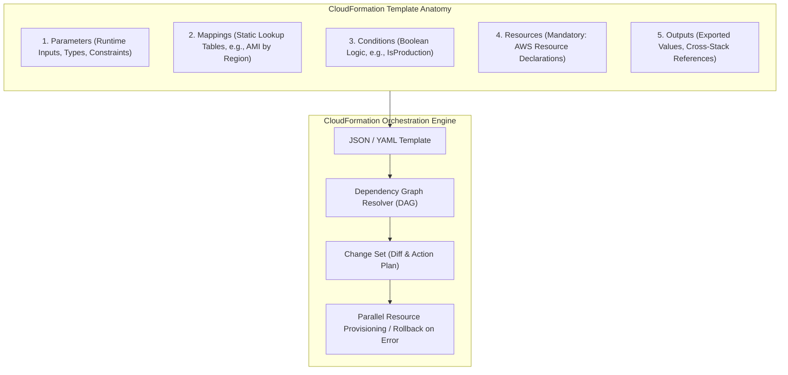
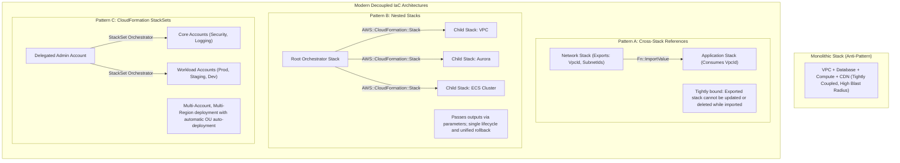
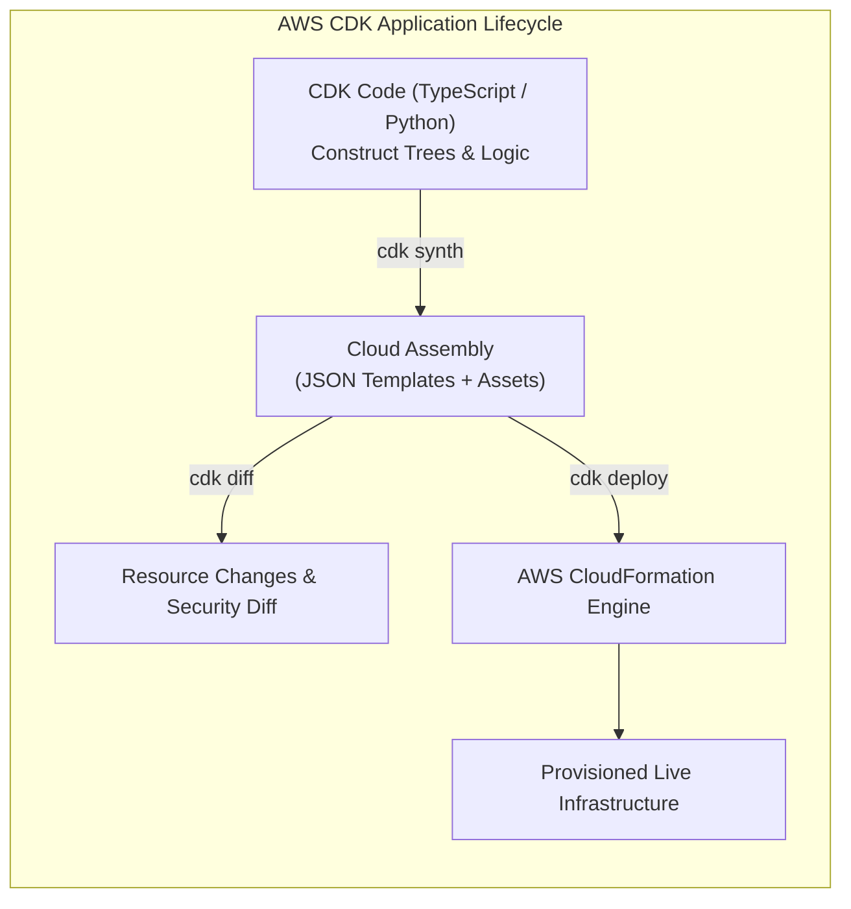
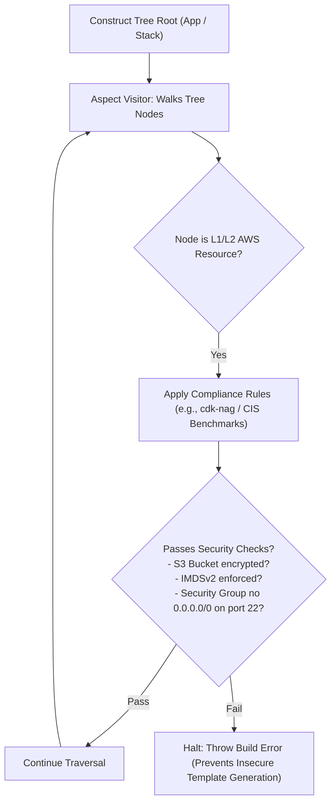
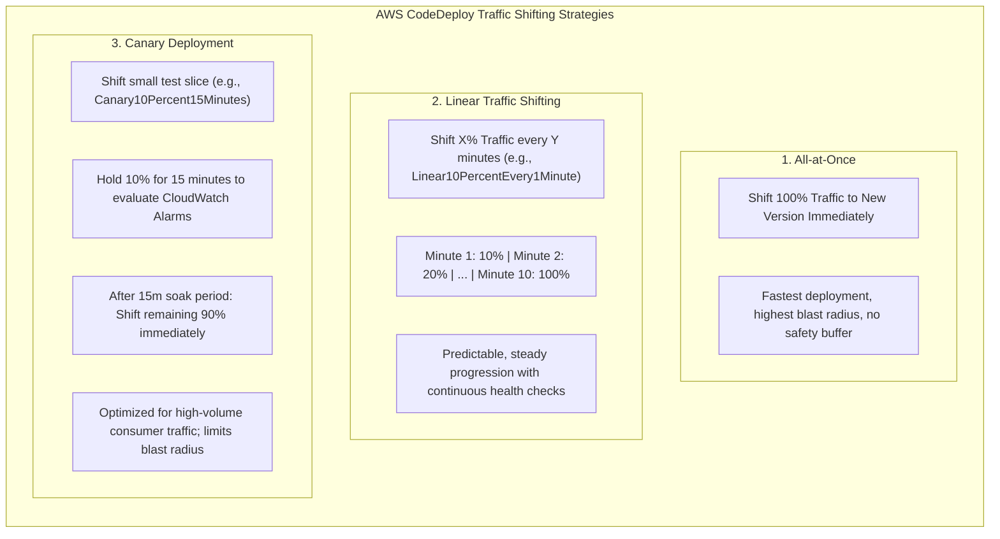
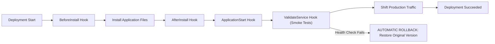
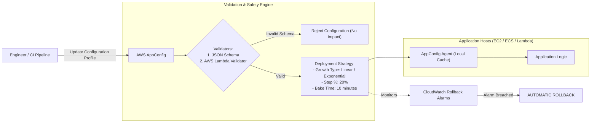
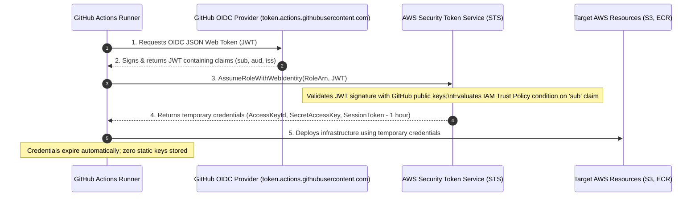

# Module 12: Infrastructure as Code and CI/CD

Managing cloud infrastructure at enterprise scale requires declarative, version-controlled automation that eliminates manual drift and enforces architectural consistency. Amazon Web Services provides two complementary Infrastructure as Code (IaC) abstraction layers: the foundational, declarative **AWS CloudFormation** engine, and the higher-level, object-oriented **AWS Cloud Development Kit (CDK)**. Operating modern delivery pipelines also demands progressive, automated deployment strategies via **AWS CodeDeploy**, dynamic runtime configuration with **AWS AppConfig**, and keyless credential exchange using **OpenID Connect (OIDC)**.

---

## 1. AWS CloudFormation Engine & Template Anatomy

AWS CloudFormation is the native declarative orchestration engine that provisions and configures AWS resources as a single, coordinated logical unit called a **Stack**.



### 1. Template Structure & Anatomy

CloudFormation templates follow a standardized top-level anatomy:

- **`Parameters`**: Custom values provided at stack creation or update time (e.g., environment names, instance types, VPC IDs) with validation rules (`AllowedValues`, `AllowedPattern`, `ConstraintDescription`).
- **`Mappings`**: Static 2-dimensional lookup tables evaluated at compile time via `Fn::FindInMap` (e.g., mapping region names and architectures to specific Amazon Machine Image IDs).
- **`Conditions`**: Boolean expressions evaluated via intrinsic functions (`Fn::Equals`, `Fn::If`, `Fn::Not`, `Fn::Or`) determining whether specific resources are provisioned (e.g., provisioning an Aurora Read Replica only if `EnvType == 'prod'`).
- **`Resources`**: The only **mandatory** section in a template. Declares AWS resources, their physical properties, update policies, and creation policies.
- **`Outputs`**: Values exposed to the console, CLI, or exported as cross-stack references via `Export: { Name: !Sub "${AWS::StackName}-VpcId" }`.

### 2. Stack Lifecycle: Change Sets, Drift Detection, and Termination Protection

- **Change Sets**: Before applying modifications to an active stack, CloudFormation generates a Change Set. A Change Set inspects the differences between the current stack state and proposed template, detailing proposed additions, non-destructive updates (`Updates: True`), and destructive replacements (`Replacement: True`). Reviewing Change Sets in CI/CD pipelines prevents unintentional deletion of stateful databases or storage buckets.
- **Drift Detection**: Identifies manual out-of-band modifications made to stack resources via the AWS Console or CLI. CloudFormation compares the expected resource properties defined in the template against the actual live resource configuration returned by AWS APIs, flagging drifted properties and values.
- **Termination Protection**: A stack-level flag that prevents accidental deletion through the AWS Console or API. A delete request fails immediately unless termination protection is explicitly disabled first.
- **Stack Policies**: A JSON policy document attached directly to a CloudFormation stack that acts as a guardrail against unintended updates. While IAM policies govern who can invoke CloudFormation, Stack Policies govern what resources can be modified during stack updates. For example, attaching a Stack Policy with `Effect: Deny, Action: Update:*, Resource: LogicalResourceId/ProductionDatabase` prevents any template update from replacing or modifying the primary database instance.
- **DeletionPolicy and UpdateReplacePolicy**: Every resource definition supports `DeletionPolicy` and `UpdateReplacePolicy` attributes (`Delete`, `Retain`, or `Snapshot`). By configuring `DeletionPolicy: Retain` on Amazon S3 buckets or `DeletionPolicy: Snapshot` on Amazon RDS instances, CloudFormation preserves the physical storage resource or takes a final cryptographic backup if the stack is accidentally deleted.
- **Rollback Triggers**: CloudFormation allows associating CloudWatch Alarms directly with a stack update. If any monitored metric (e.g., application error rate, CPU saturation, or synthetic canary failure) breaches its threshold during stack creation or update, CloudFormation automatically cancels the deployment and initiates an automated rollback to the previous stable stack configuration.

---

## 2. Cross-Stack References vs Nested Stacks vs StackSets

As architectures grow, monolithic CloudFormation templates quickly reach the 1 MB template body limit and 500-resource limit, while creating blast radius risks. Architectures decompose stacks using three structural patterns:



### 1. Cross-Stack References (`Fn::ImportValue`)

One stack exports output values that another stack imports using `Fn::ImportValue`:

- **Advantage**: Decouples lifecycle boundaries. The foundational networking stack can be managed by a platform team, while application teams import `VpcId` in their separate stacks.
- **The Export Lock Pitfall**: A stack exporting a value **cannot be deleted or modified** in a way that alters that export as long as any other stack references it. To modify an exported subnet ID, every importing stack must first be updated to remove the reference, creating complex multi-stage deployment dependencies.

### 2. Nested Stacks (`AWS::CloudFormation::Stack`)

Nested stacks declare child templates as resources inside a parent orchestrator template:

- Allows templates to be shared and reused across multiple parent stacks.
- Bypasses the 500-resource limit by distributing components into child templates.
- **Unified Transaction Boundary**: If any child stack fails to create or update, CloudFormation rolls back the entire hierarchy, guaranteeing atomic infrastructure state.

### 3. CloudFormation StackSets (Multi-Account & Multi-Region)

CloudFormation StackSets deploy stacks across multiple AWS accounts and multiple AWS regions in a single automated operation:

- **Service-Managed Deployments**: Integrated directly with AWS Organizations. When configured with `AutoDeployment: Enabled`, creating a new member account in an Organizational Unit (OU) automatically triggers the StackSet to provision baseline security roles, VPCs, and GuardDuty configurations in that account without manual intervention.
- **Fault Tolerance Controls**: Configured with `MaxConcurrentPercentage` (limiting how many accounts update simultaneously) and `FailureTolerancePercentage` (automatically halting the multi-account rollout if failures exceed a defined threshold).

---

## 3. AWS Cloud Development Kit (CDK): Object-Oriented IaC

The **AWS Cloud Development Kit (AWS CDK)** is an open-source software development framework that defines cloud infrastructure using imperative programming languages (TypeScript, Python, Java, C#, Go) which synthesizes down to declarative CloudFormation templates.



### 1. Construct Levels: L1, L2, and L3

The fundamental building block in AWS CDK is a **Construct**. CDK categorizes constructs into three architectural tiers:

| Construct Level | Class Name Format | Description & Architectural Abstraction | Least-Privilege Defaults |
| --- | --- | --- | :-: |
| **L1 (Primitives)** | `Cfn<Resource>` (e.g., `CfnBucket`) | Direct 1:1 mapping to raw CloudFormation resource types. Generated automatically from CloudFormation specifications. | No (Requires explicit manual configuration) |
| **L2 (Curated)** | Base Resource (e.g., `s3.Bucket`) | High-level AWS-curated constructs containing sane defaults, security best practices, and fluent helper methods (e.g., `bucket.grantRead(role)`). | Yes (Enforces SSE encryption, blocks public access by default) |
| **L3 (Patterns)** | Pattern Name (e.g., `ApplicationLoadBalancedFargateService`) | Multi-resource architectural patterns assembling ALBs, ECS clusters, task definitions, Route 53 records, and ACM certificates in a single construct. | Yes (Pre-wires secure routing, health checks, and IAM roles) |

### 2. CDK Aspects & Static Compliance Enforcement (`cdk-nag`)

CDK Aspects apply the software engineering **Visitor Pattern** to traverse the entire construct tree of an application at synthesis time. Aspects inspect, validate, and mutate constructs before CloudFormation templates are generated:



#### Enforcing Enterprise Guardrails with `cdk-nag`

By registering `cdk-nag` Aspects in the CDK entry point, CI/CD pipelines automatically evaluate infrastructure definitions against security benchmarks (such as **CIS AWS Foundations** and **AWS Solutions**) during `npm run build` or `cdk synth`, failing pull request builds before any AWS API calls are executed:

```typescript
import { App, Aspects } from 'aws-cdk-lib';
import { AwsSolutionsChecks } from 'cdk-nag';

const app = new App();
// Attach security compliance visitor across all stacks
Aspects.of(app).add(new AwsSolutionsChecks({ verbose: true }));
```

### 3. CDK Assets, Bundling, and Bootstrap Architecture

Modern applications bundle runtime code, Docker images, and database migrations alongside their infrastructure definitions:

- **CDK Bootstrap (`cdk bootstrap`)**: Before deploying a CDK stack into an AWS account and region, the target environment must be bootstrapped. Bootstrapping provisions a dedicated CloudFormation stack (`CDKToolkit`) containing an Amazon S3 staging bucket for CloudFormation templates and zipped code assets, an Amazon ECR repository for container images, and IAM execution roles assumed by CloudFormation to execute deployments.
- **File and Lambda Assets**: When a construct references local code (e.g., `lambda.Code.fromAsset('./handlers/orders')`), the CDK synthesis engine hashes the contents of the local directory. If the hash differs from the remote asset catalog, CDK automatically bundles, zips, and uploads the artifact to the bootstrap S3 bucket prior to CloudFormation template execution.
- **Docker Image Assets**: With `DockerImageAsset` (or containerized ECS/Lambda tasks), CDK orchestrates local container image builds using the local Docker engine, tags the image with the content hash digest, and automatically logs in and pushes the image to the bootstrap Amazon ECR repository.
- **Deterministic Cache Busting**: The cryptographic SHA-256 hash of the asset source is passed as a CloudFormation parameter and embedded directly in the logical resource ID. When an engineer modifies handler code, the hash changes, instructing CloudFormation to perform an update on the Lambda or ECS task definition, eliminating stale cache bugs in automated deployment pipelines.

---

## 4. Deployment Strategies: AWS CodeDeploy & Traffic Shifting

Rolling out code updates to production environments without downtime requires progressive traffic shifting and automated rollback alarms. AWS CodeDeploy orchestrates zero-downtime deployments across Amazon EC2, ECS, and AWS Lambda.



### 1. Traffic Shifting Profiles Compared

| Deployment Configuration | Initial Traffic Slice | Soak / Wait Interval | Subsequent Increment | Blast Radius Exposure |
| --- | :-: | :-: | :-: | :-: |
| **AllAtOnce** | 100% | 0 minutes | None | 100% of incoming users |
| **Canary10Percent5Minutes** | 10% | 5 minutes | 90% (Final Shift) | 10% for 5 minutes |
| **Canary10Percent15Minutes** | 10% | 15 minutes | 90% (Final Shift) | 10% for 15 minutes |
| **Linear10PercentEvery1Minute** | 10% | 1 minute | 10% every minute | Gradually increases by 10% |
| **Linear10PercentEvery3Minutes** | 10% | 3 minutes | 10% every 3 minutes | Gradually increases over 30 minutes |

### 2. CodeDeploy Lifecycle Event Hooks

CodeDeploy executes automated validation scripts (Lambda functions or shell scripts) at critical checkpoints during the deployment lifecycle. If any hook script returns a non-zero exit code or invokes the `PutLifecycleEventHookExecutionStatus` API with `Failed`, CodeDeploy immediately cancels the deployment and shifts 100% of traffic back to the original version:



- **`BeforeInstall`**: Executes pre-installation tasks (decrypting secrets, backing up configuration).
- **`AfterInstall`**: Configures permissions, unpackages artifacts, updates symlinks.
- **`ApplicationStart`**: Starts system daemons, initializes runtime processes.
- **`ValidateService`**: Executes automated smoke tests and health checks against localhost. If endpoint returns HTTP 500 or times out, the deployment fails before user traffic is routed.
- **`BeforeAllowTraffic`**: Used in ECS and AWS Lambda deployments. Invokes a dedicated Lambda test function to perform pre-traffic routing validation tests (e.g., executing integration test queries against the replacement task or Lambda version) before the load balancer or traffic router begins shifting production requests.
- **`AfterAllowTraffic`**: Executes post-traffic shift validation after 100% of production traffic has successfully been routed to the replacement target, confirming end-to-end operational stability before CodeDeploy marks the deployment as complete and terminates legacy resources.

---

## 5. Runtime Configuration & Feature Flags: AWS AppConfig

Coupling feature flags and dynamic configuration updates to application CI/CD deployments creates deployment bottlenecks. **AWS AppConfig** provides centralized, dynamic runtime configuration without redeploying code.



### AppConfig Safety Mechanisms

1. **Syntactic & Semantic Validation**: AppConfig validates new configuration profiles against a **JSON Schema** or invokes an **AWS Lambda validator**. If an engineer enters an invalid string instead of an integer, AppConfig rejects the deployment before it leaves the control plane.
2. **Gradual Deployment Strategies**: Configures a deployment rate (e.g., rolling out configuration to 20% of the fleet every 2 minutes) with a designated **Bake Time** (soak period).
3. **Automatic CloudWatch Rollback Alarms**: If application error rates spike during configuration rollout, CloudWatch Alarms breach and signal AppConfig to automatically roll back the configuration to the previous stable version across all hosts.

---

## 6. Keyless CI/CD with OpenID Connect (OIDC) Federation

Historically, external CI/CD platforms (such as GitHub Actions, GitLab CI, and CircleCI) authenticated to AWS using static, long-lived IAM user access keys (`AWS_ACCESS_KEY_ID` and `AWS_SECRET_ACCESS_KEY`) stored as CI secrets. This legacy model presented critical security vulnerabilities:

- **Credential Leakage**: Static access keys accidentally printed in build logs or leaked via repository forks allowed unrestricted API access.
- **Zero Rotation**: Secrets were rarely rotated, violating compliance standards.
- **Privilege Persistence**: Compromised keys remained active until manually revoked.



### Configuring Keyless OIDC Authentication

To establish keyless federation, security engineers configure two components in AWS:

#### 1. IAM OpenID Connect Identity Provider

Register the external IdP in AWS IAM with the provider URL `https://token.actions.githubusercontent.com` and audience `sts.amazonaws.com`.

#### 2. IAM Role with Scoped Trust Policy

The IAM Role's trust policy must enforce strict conditions on the JWT claims, asserting that only builds originating from a specific repository, branch, or tag can assume the role:

```json
{
  "Version": "2012-10-17",
  "Statement": [
    {
      "Effect": "Allow",
      "Principal": {
        "Federated": "arn:aws:iam::111122223333:oidc-provider/token.actions.githubusercontent.com"
      },
      "Action": "sts:AssumeRoleWithWebIdentity",
      "Condition": {
        "StringEquals": {
          "token.actions.githubusercontent.com:aud": "sts.amazonaws.com"
        },
        "StringLike": {
          "token.actions.githubusercontent.com:sub": "repo:enterprise-org/payment-service:ref:refs/heads/main"
        }
      }
    }
  ]
}
```

> [!CAUTION]
> Never configure an OIDC trust policy without a specific `sub` (subject) condition constraint! If a trust policy only checks `aud: sts.amazonaws.com` without restricting `sub` to your organization's repository, **any user in any public GitHub repository** can request a valid GitHub JWT and assume your AWS role.

---

## 7. Comparative Architectural Decision Framework

| IaC / Deployment Tool | Abstraction Level | Primary Strengths | Limitations / Operational Caveats | Best Use Case |
| --- | :-: | --- | --- | --- |
| **AWS CloudFormation** | Declarative L1 | Native AWS service, drift detection, zero client runtime required | Verbose YAML/JSON, lacks native abstraction patterns | Multi-account baseline StackSets, immutable compliance templates |
| **AWS CDK** | Imperative / Object-Oriented | Real programming languages, reusable L2/L3 constructs, compile-time type safety | Requires Node.js build toolchain, synthesizes to CloudFormation | Complex microservice architectures, enterprise component libraries |
| **AWS CodeDeploy** | Continuous Delivery Engine | Automated linear/canary traffic shifting, lifecycle hook scripts, auto-rollback | Requires deployment agent for EC2 (agentless for Lambda/ECS) | Zero-downtime blue/green deployments for ECS, Lambda, and EC2 |
| **AWS AppConfig** | Dynamic Runtime Config | Decoupled feature flags, JSON schema validation, automatic bake times | Storage size limits, requires client agent or polling | Feature flagging, A/B testing, dynamic operational tuning |

---

## 8. Interview Drill: Infrastructure as Code and CI/CD

<details><summary>1. What is the fundamental difference between AWS CloudFormation Change Sets and Drift Detection?</summary>

A CloudFormation Change Set is a **pre-deployment preview** that calculates the delta between the currently deployed stack state and a proposed template update. It details which resources will be added, modified, or destructively replaced before any real changes are executed. Drift Detection is a **post-deployment audit** that compares the live, actual properties of resources in AWS against their expected values recorded in the CloudFormation template, identifying unauthorized, manual out-of-band modifications made via the console or CLI.

- Ref: [modules/12-infrastructure-as-code-and-cicd.md#1-aws-cloudformation-engine--template-anatomy](12-infrastructure-as-code-and-cicd.md#1-aws-cloudformation-engine--template-anatomy), https://docs.aws.amazon.com/AWSCloudFormation/latest/UserGuide/using-cfn-updating-stacks-changesets.html

</details>

<details><summary>2. Why does referencing outputs across stacks using Fn::ImportValue create an "Export Lock", and how do Nested Stacks avoid this limitation?</summary>

When a stack exports an output value and another stack imports it via `Fn::ImportValue`, CloudFormation creates a hard dependency lock. The exporting stack cannot be deleted, and the specific exported output cannot be modified or removed, as long as any other stack references it. To update the value, engineers must perform a multi-stage migration (updating all consumer stacks first to decouple the import). Nested stacks avoid this hard lock because output values are passed directly into child stack input parameters within the single parent orchestrator template, maintaining unified rollback boundaries without persistent inter-stack export locks.

- Ref: [modules/12-infrastructure-as-code-and-cicd.md#2-cross-stack-references-vs-nested-stacks-vs-stacksets](12-infrastructure-as-code-and-cicd.md#2-cross-stack-references-vs-nested-stacks-vs-stacksets), https://docs.aws.amazon.com/AWSCloudFormation/latest/UserGuide/using-cfn-nested-stacks.html

</details>

<details><summary>3. What are the three Construct levels in the AWS Cloud Development Kit (CDK), and how do they differ in abstraction?</summary>

The three CDK construct levels are: 1) **L1 Constructs (Primitives)**: Prefixed with `Cfn` (e.g., `CfnBucket`), these are direct 1:1 representations of raw CloudFormation resources with no default values; 2) **L2 Constructs (Curated)**: Core AWS service constructs (e.g., `s3.Bucket`) that encapsulate security best practices, automatic least-privilege IAM policies, and helper methods (e.g., `grantRead`); and 3) **L3 Constructs (Patterns)**: Multi-resource composite architectures (e.g., `ApplicationLoadBalancedFargateService`) that coordinate load balancers, container clusters, DNS records, and TLS certificates in a single construct.

- Ref: [modules/12-infrastructure-as-code-and-cicd.md#3-aws-cloud-development-kit-cdk-object-oriented-iac](12-infrastructure-as-code-and-cicd.md#3-aws-cloud-development-kit-cdk-object-oriented-iac), https://docs.aws.amazon.com/cdk/v2/guide/constructs.html

</details>

<details><summary>4. How do CDK Aspects implement the Visitor Pattern, and how does cdk-nag use them to enforce compliance at synthesis time?</summary>

CDK Aspects apply the Visitor Pattern to traverse every node in the CDK construct tree during the synthesis phase (`cdk synth`). An Aspect inspects each construct's configuration before CloudFormation templates are emitted. Tools like `cdk-nag` implement Aspects to validate constructs against enterprise security standards (such as CIS Benchmarks). If an unencrypted S3 bucket or open security group is detected, the Aspect halts synthesis and emits a build error, preventing non-compliant infrastructure from ever being deployed to AWS.

- Ref: [modules/12-infrastructure-as-code-and-cicd.md#3-aws-cloud-development-kit-cdk-object-oriented-iac](12-infrastructure-as-code-and-cicd.md#3-aws-cloud-development-kit-cdk-object-oriented-iac), https://docs.aws.amazon.com/cdk/v2/guide/aspects.html

</details>

<details><summary>5. How does a Canary deployment differ from a Linear deployment strategy in AWS CodeDeploy?</summary>

A Canary deployment shifts a small percentage of user traffic (e.g., 10%) to the new application version for a specified soak period (e.g., 15 minutes). If CloudWatch alarms remain healthy during that window, CodeDeploy shifts the remaining 90% of traffic immediately in a single step. A Linear deployment shifts traffic incrementally in equal percentages over regular intervals (e.g., shifting 10% every 1 minute for 10 minutes until 100% is reached). Canaries minimize risk for high-volume customer traffic with an extended soak period, while linear deployments provide a smooth, continuous rollout.

- Ref: [modules/12-infrastructure-as-code-and-cicd.md#4-deployment-strategies-aws-codedeploy--traffic-shifting](12-infrastructure-as-code-and-cicd.md#4-deployment-strategies-aws-codedeploy--traffic-shifting), https://docs.aws.amazon.com/codedeploy/latest/userguide/deployment-configurations.html

</details>

<details><summary>6. What is the role of the ValidateService lifecycle hook in AWS CodeDeploy, and what happens if it fails?</summary>

The `ValidateService` hook is the final verification checkpoint executed before CodeDeploy routes production traffic to an updated instance or task. It executes automated health check scripts (e.g., querying local HTTP endpoints or running integration smoke tests). If the script returns a non-zero exit code or encounters an error, CodeDeploy immediately halts the deployment, marks the target as unhealthy, and initiates an automated rollback to restore the previous stable application version.

- Ref: [modules/12-infrastructure-as-code-and-cicd.md#4-deployment-strategies-aws-codedeploy--traffic-shifting](12-infrastructure-as-code-and-cicd.md#4-deployment-strategies-aws-codedeploy--traffic-shifting), https://docs.aws.amazon.com/codedeploy/latest/userguide/reference-appspec-file-structure-hooks.html

</details>

<details><summary>7. Why does keyless CI/CD authentication using OpenID Connect (OIDC) provide superior security compared to static IAM user access keys?</summary>

Keyless OIDC authentication eliminates long-lived static credentials (`AWS_ACCESS_KEY_ID` and `AWS_SECRET_ACCESS_KEY`) stored in external CI/CD secret vaults. Instead, the CI runner requests a cryptographically signed JSON Web Token (JWT) from its IdP and exchanges it with AWS STS (`AssumeRoleWithWebIdentity`) for temporary, short-lived security credentials valid for only one hour. This eliminates credential leakage vectors, automates credential rotation, and prevents compromised CI secrets from being used outside the specific runner context.

- Ref: [modules/12-infrastructure-as-code-and-cicd.md#6-keyless-cicd-with-openid-connect-oidc-federation](12-infrastructure-as-code-and-cicd.md#6-keyless-cicd-with-openid-connect-oidc-federation), https://docs.aws.amazon.com/IAM/latest/UserGuide/id_roles_providers_create_oidc.html

</details>

<details><summary>8. In an IAM OIDC trust policy for GitHub Actions, why is the StringLike condition on the 'sub' claim strictly mandatory?</summary>

The `sub` (subject) claim in a GitHub Actions OIDC token identifies the exact repository, branch, or environment executing the workflow (e.g., `repo:org/repo:ref:refs/heads/main`). If an IAM trust policy validates only the audience (`aud: sts.amazonaws.com`) without scoping the `sub` claim, **any workflow in any public GitHub repository worldwide** could generate a valid GitHub JWT, present it to AWS STS, and assume your organization's IAM role, resulting in catastrophic unauthorized access.

- Ref: [modules/12-infrastructure-as-code-and-cicd.md#6-keyless-cicd-with-openid-connect-oidc-federation](12-infrastructure-as-code-and-cicd.md#6-keyless-cicd-with-openid-connect-oidc-federation), https://docs.github.com/en/actions/deployment/security-hardening-your-deployments/configuring-openid-connect-in-amazon-web-services

</details>

<details><summary>9. How does CloudFormation StackSets enable automated governance across newly created accounts in an AWS Organization?</summary>

When integrated with AWS Organizations in service-managed mode and configured with `AutoDeployment: Enabled`, a CloudFormation StackSet automatically detects when a new member account is created in, or moved into, a target Organizational Unit (OU). The StackSet automatically triggers stack instances to provision foundational security baselines, IAM roles, logging configurations, and VPCs into the new account without requiring manual operator intervention.

- Ref: [modules/12-infrastructure-as-code-and-cicd.md#2-cross-stack-references-vs-nested-stacks-vs-stacksets](12-infrastructure-as-code-and-cicd.md#2-cross-stack-references-vs-nested-stacks-vs-stacksets), https://docs.aws.amazon.com/AWSCloudFormation/latest/UserGuide/stacksets-orgs-auto-deployment.html

</details>

<details><summary>10. How does AWS AppConfig provide dynamic configuration updates without coupling feature releases to deployment pipelines?</summary>

AWS AppConfig decouples runtime configuration from application code deployments. Applications retrieve configuration profiles from the local AppConfig agent or via API calls at runtime. Engineers can toggle feature flags, adjust rate limits, or alter business rules dynamically. AppConfig validates configurations against JSON schemas, deploys them gradually using progressive rollout strategies with bake times, and monitors CloudWatch alarms to trigger automated rollbacks if errors spike.

- Ref: [modules/12-infrastructure-as-code-and-cicd.md#5-runtime-configuration--feature-flags-aws-appconfig](12-infrastructure-as-code-and-cicd.md#5-runtime-configuration--feature-flags-aws-appconfig), https://docs.aws.amazon.com/appconfig/latest/userguide/what-is-appconfig.html

</details>
