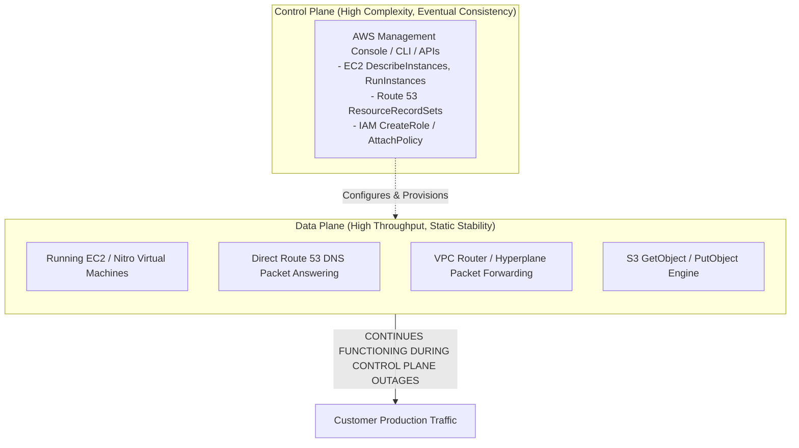
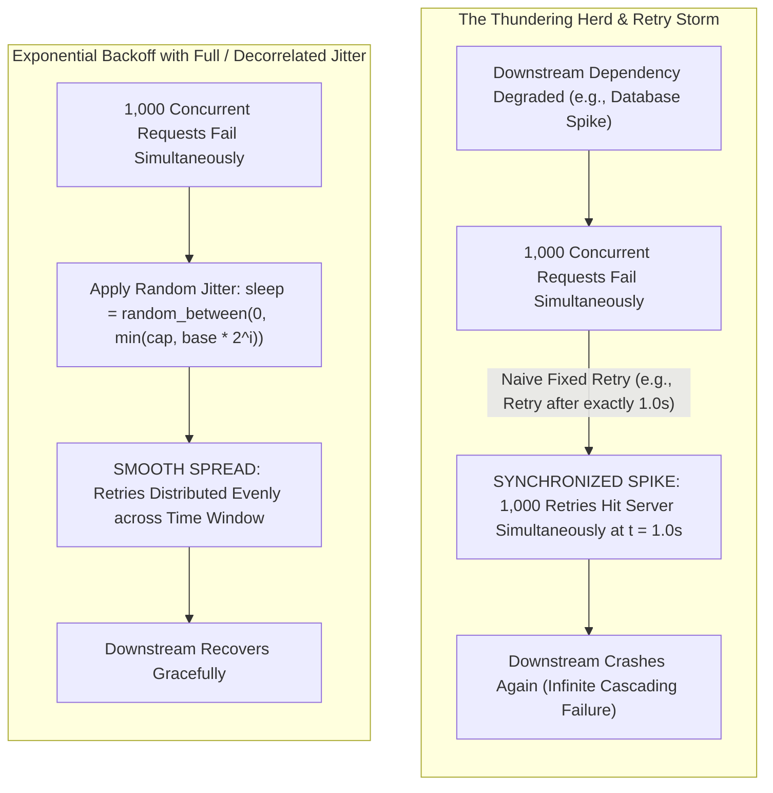
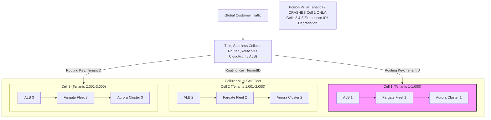
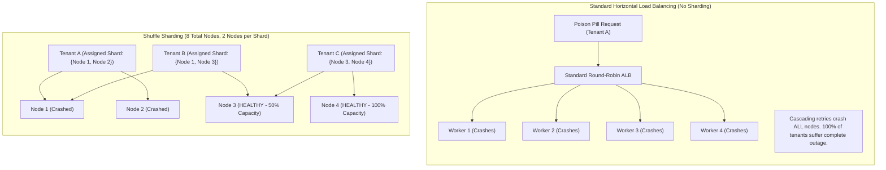
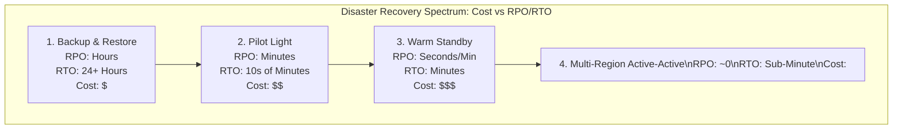
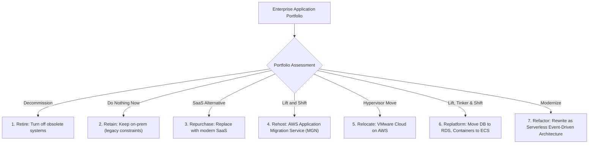
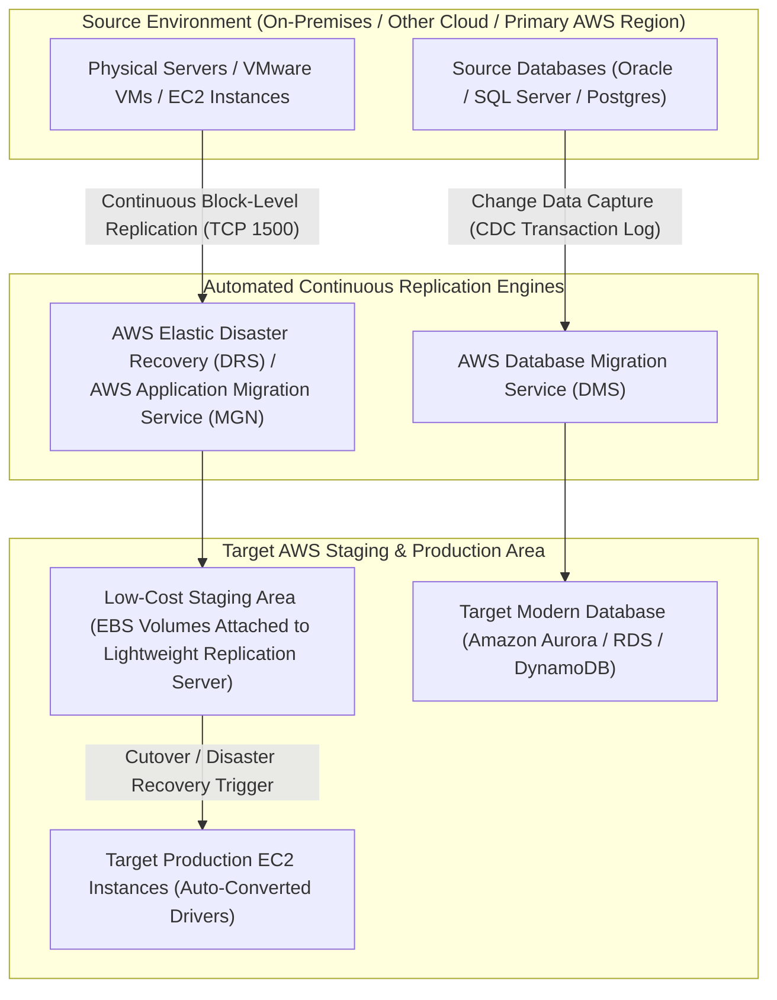
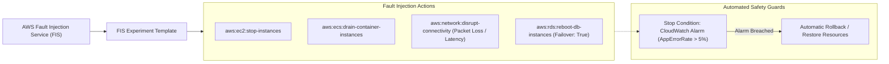

# Module 13: Resilience, DR, and Migration

Engineering mission-critical enterprise systems requires assuming that all components eventually fail. Under the AWS Well-Architected Reliability Pillar, resilience is not achieved by attempting to build unbreakable components, but by designing fault-tolerant architectures that operate through systemic failures. This module explores deep resilience engineering patterns: **static stability**, **timeouts and backoff with jitter**, **shuffle sharding**, **cellular architectures**, the spectrum of **Disaster Recovery (DR)** strategies evaluated against **RPO** and **RTO** budgets, **chaos engineering** with AWS Fault Injection Service (FIS), and automated cloud migration engines including **AWS Elastic Disaster Recovery (DRS)**, **AWS Application Migration Service (MGN)**, and **AWS Database Migration Service (DMS)**.

---

## 1. Well-Architected Reliability: Control Planes vs Data Planes & Static Stability

Resilient system design begins with decoupling the operational dynamics of **Control Planes** from **Data Planes**.

### 1. Control Planes vs Data Planes Defined

- **Data Plane**: The real-time operational engine responsible for delivering Day-to-Day customer value. Includes packet forwarding through VPC routers, processing HTTP requests on running EC2 instances, executing queries on Amazon Aurora, and serving DNS queries at Route 53 edge nodes. Data planes are optimized for massive throughput, low latency, and extreme availability (targeting 99.999% or higher).
- **Control Plane**: The administrative and management engine used to configure, provision, modify, and delete resources. Includes the AWS CLI, CloudFormation orchestration, IAM credential issuance, and EC2 instance launching. Control planes prioritize consistency and validation over extreme availability (typically offering 99.9% availability).

### 2. The Principle of Static Stability

**Static stability** is the architectural property whereby a system continues operating normally without requiring runtime control plane operations, dynamic configuration changes, or external service dependencies during an outage.

#### Antipattern: Dynamic Dependency During Disasters

Consider an application that provisions new EC2 instances across secondary Availability Zones via Auto Scaling only after an Availability Zone failure is detected. If the disaster impairs the regional EC2 control plane (`RunInstances`), the application cannot scale and crashes.

#### Best Practice: Statically Stable Provisioning

A statically stable architecture pre-provisions steady-state capacity across multiple Availability Zones in advance. If one AZ experiences a catastrophic outage, the remaining AZs already possess sufficient running capacity to absorb 100% of the workload without relying on control plane APIs to launch new compute.

#### Static Stability Mechanics Across Core AWS Services

- **Route 53 Data Plane**: Route 53 serves DNS answers directly from thousands of globally distributed edge servers. Even if the Route 53 control plane (`ChangeResourceRecordSets` in `us-east-1`) becomes completely unavailable, DNS resolution for existing records continues operating uninterrupted.
- **IAM Credential Caching**: Applications that assume IAM roles receive temporary credentials valid for 1 hour. Statically stable applications cache credentials locally and renew them proactively (e.g., at the 45-minute mark), surviving transient AWS STS regional latency spikes without dropping active user connections.
- **Local Configuration Caching**: Services reading runtime configuration from AWS AppConfig or Systems Manager Parameter Store cache configuration locally on host memory or disk. If Parameter Store encounters an outage, the application continues processing transactions using cached configuration rather than failing fast.

---

## 2. Timeouts, Retries, and Backoff with Jitter: Amazon Builders' Library Foundations

Distributed systems experience transient network blips, packet drops, and momentary server saturation. Handling these failures requires mathematically sound retry and backoff algorithms that prevent client retries from overwhelming recovering backends.

### 1. The Mathematics of Exponential Backoff with Jitter

When a client request fails with an HTTP 503 or 429 error, retrying immediately exacerbates downstream contention. The **Amazon Builders' Library** defines three standard backoff algorithms:

#### A. Truncated Exponential Backoff (Without Jitter)

$$T_i = \min(M, B \times 2^i)$$ Where $B$ is the base delay (e.g., 100ms), $i$ is the retry attempt count, and $M$ is the maximum backoff ceiling (e.g., 20 seconds). While exponential backoff spaces out individual retries, it produces **synchronized lock-step retry bursts** across large fleets of concurrent clients (the Thundering Herd).

#### B. Full Jitter (Recommended Default)

$$T_i = \text{random}(0, \min(M, B \times 2^i))$$ Full jitter draws a uniform pseudo-random duration between 0 and the current exponential backoff ceiling. Full jitter breaks up synchronized client bursts, distributing load smoothly over time while minimizing aggregate client wait duration.

#### C. Decorrelated Jitter

$$T_i = \min(M, \text{random}(B, T_{i-1} \times 3))$$ Decorrelated jitter calculates each sleep duration based on the previous sleep duration multiplied by a factor of 3, ensuring retries space out rapidly even under heavy continuous contention.

### 2. Circuit Breakers: State Machine & Client-Side Shedding

When a downstream microservice enters an extended failure state, continuing to send requests wastes compute resources and exhausts connection pools. A **Circuit Breaker** wraps remote calls in a three-state finite state machine:

- **`Closed`**: Normal operation. Requests flow directly to the downstream dependency. If failure rates remain below a configured threshold (e.g., $< 5\%$), the breaker stays closed.
- **`Open`**: When failures breach the error threshold (e.g., 50 consecutive timeouts), the circuit breaker trips to `Open`. All subsequent calls fail fast immediately on the client side with a local exception without making network calls.
- **`Half-Open`**: After a configurable cooldown interval (e.g., 30 seconds), the circuit breaker enters `Half-Open` state, allowing a small test percentage of requests through. If the test requests succeed, the breaker resets to `Closed`. If any test request fails, the breaker trips back to `Open`.

---

## 3. Cellular Architectures: Eliminating Cascading Failure Blast Radii

In traditional scale-up or horizontally partitioned architectures, a catastrophic bug (such as a poisoned transaction payload, memory leak, or thread starvation issue) propagates across the entire fleet, taking down the whole system. A **Cellular Architecture** bounds the blast radius by dividing a massive monolithic service into independent, self-contained mini-deployments called **Cells**.

### Architectural Principles of Cells

1. **Strict Independence**: Cells share zero runtime infrastructure, zero compute instances, and zero databases. A failure in Cell 1 cannot propagate to Cell 2.
2. **Deterministic Cell Sizing**: Rather than allowing a cluster to grow indefinitely (which introduces nonlinear contention, connection pool exhaustion, and cascading timeouts), cells are capped at a proven, maximum safe size (e.g., 50 instances, 5,000 tenants). Growth is achieved by adding new cells, not enlarging existing cells.
3. **Thin Cellular Router**: The entry point is a simple, highly reliable routing layer (e.g., Route 53 or an ALB with path-based routing) whose sole responsibility is mapping an incoming tenant ID or account ID to their designated cell.
4. **Cell Evacuation**: If a cell experiences hardware degradation, automated traffic controls can evacuate healthy tenants from the degraded cell to a standby cell in minutes.

---

## 4. Shuffle Sharding: Mathematical Blast Radius Containment

**Shuffle sharding** is an advanced routing and capacity allocation technique that isolates bad actors, malicious requests, and "poison pill" transactions, reducing systemic blast radius to near-zero without dedicating dedicated hardware to every single tenant.

### The Problem: Standard Horizontal Routing Vulnerability

Suppose an application runs a fleet of 8 worker nodes shared across hundreds of customers. If Tenant A submits a "poison pill" request (e.g., a regex query triggering exponential catastrophic backtracking, or an out-of-memory payload), the request crashes Worker 1. The client retries on Worker 2, crashing it. The retry loop cascades across all 8 workers, taking down the entire system and causing a **100% outage for all tenants**.

### The Math of Shuffle Sharding

Instead of assigning a tenant to 1 node or all nodes, shuffle sharding assigns each tenant to a **unique combination of $k$ nodes out of a total fleet of $N$ nodes**. The number of unique virtual shards is given by the combination formula:

$$\text{Combinations} = \binom{N}{k} = \frac{N!}{k!(N - k)!}$$

#### Example 1: Small Fleet ($N = 8, k = 2$)

$$\binom{8}{2} = \frac{8 \times 7}{2 \times 1} = 28 \text{ unique virtual shards}$$ If Tenant A crashes its 2 assigned nodes (Nodes 1 & 2):

- Any tenant whose shard is $\{1, 2\}$ is fully down. The probability of another specific tenant sharing that exact combination is only $1 / 28 \approx 3.57\%$.
- Tenants assigned to $\{1, 3\}$ lose Node 1 but retain Node 3 (degraded, but operating at 50% capacity).
- Tenants assigned to combinations with neither Node 1 nor Node 2 (such as $\{3, 4\}$, $\{5, 6\}$) experience **zero degradation (100% operational)**.

#### Example 2: Enterprise Fleet ($N = 100, k = 4$)

$$\binom{100}{4} = \frac{100 \times 99 \times 98 \times 97}{4 \times 3 \times 2 \times 1} = 3,921,225 \text{ unique virtual shards}$$

- In a 100-node fleet with 4 nodes per shard, there are nearly **4 million unique shards**.
- If a poison-pill tenant crashes all 4 of its nodes, the mathematical probability that any other specific tenant shares all 4 nodes is:

$$\frac{1}{3,921,225} \approx 0.0000255\%$$

- Across thousands of tenants, virtually **zero other tenants suffer a complete outage**. The vast majority suffer zero impact, transforming a company-ending total outage into an isolated, imperceptible blip.

---

## 5. Disaster Recovery (DR) Strategies: RPO vs RTO Spectrum

Disaster recovery planning evaluates architectural choices against two fundamental business continuity metrics:

- **Recovery Point Objective (RPO)**: The maximum acceptable data loss measured in time (e.g., losing at most 5 minutes of transactional data). Governed by data replication mechanisms.
- **Recovery Time Objective (RTO)**: The maximum acceptable downtime before business operations must be restored (e.g., restoring system availability within 15 minutes of an outage). Governed by automation, infrastructure provisioning speed, and failover DNS mechanics.

### Comprehensive Comparison of DR Strategies

| DR Strategy | Operational Mechanics | Data Tier Architecture | Compute Tier Architecture | Typical RPO | Typical RTO | Cost Factor |
| --- | --- | --- | --- | :-: | :-: | :-: |
| **Backup & Restore** | Periodic data backups restored only after a disaster is declared. | Nightly S3 / AWS Backup snapshots replicated cross-region. | Zero compute running in DR region. Provisioned from scratch via IaC. | Hours (Time since last snapshot) | 24+ Hours (Time to provision fleets and hydrate DBs) | Lowest ($) |
| **Pilot Light** | Critical core data replicated continuously; compute infrastructure remains stopped or scaled to zero. | Continuous DB replication (Aurora Global DB / RDS cross-region read replica). | Minimal core servers running or stopped; AMIs/templates ready to scale up. | Minutes (Storage replication lag) | Tens of Minutes (Time to scale up compute and promote DB) | Low ($$) |
| **Warm Standby** | Scaled-down, fully functional replica fleet running live in the DR region 24/7/365. | Continuous synchronous/asynchronous replication with readable replicas. | Running fleet scaled to 10–20% capacity; handles minimal test traffic. | Seconds to Minutes | Minutes (Time to scale ASG from 10% to 100% capacity) | Medium ($$$) |
| **Multi-Region Active-Active** | Workloads running at full production capacity across 2+ regions simultaneously. | Bi-directional replication (DynamoDB Global Tables / Aurora DSQL). | Full production fleets running in all regions; global Anycast / Route 53 ARC routing. | Near-Zero | Sub-Minute (Automated health check DNS routing shift) | Highest ($$$$) |

---

## 6. Enterprise Workload Migration: The 7 Rs Strategy Framework

Enterprise cloud adoption requires categorizing applications across the industry-standard **7 Rs of Cloud Migration**:

### The 7 Migration Strategies Defined

| Strategy | Migration Approach | Architectural Modification | Tooling Involved | Business Drivers |
| --- | --- | --- | --- | --- |
| **1. Retire** | Decommission application | None (System terminated) | AWS Application Discovery Service | Eliminate license costs, unneeded legacy apps |
| **2. Retain** | Keep in on-premises data center | None | AWS Migration Hub | Regulatory blockers, unamortized hardware |
| **3. Repurchase** | Drop custom app, adopt third-party SaaS | Total replacement | Workday, Salesforce, AWS Marketplace | Reduce custom software maintenance overhead |
| **4. Rehost** | "Lift-and-shift" physical/VM instances | Zero code or OS changes | **AWS Application Migration Service (MGN)** | Rapid data center exit, contract expirations |
| **5. Relocate** | Move VM instances at hypervisor level | Zero OS conversion | VMware Cloud on AWS | Preserve VMware NSX networking & vCenter tools |
| **6. Replatform** | "Lift, tinker, and shift" | Minor updates (managed services) | **AWS Database Migration Service (DMS)**, ECS | Reduce database admin burden without rewriting code |
| **7. Refactor** | Cloud-native rewrite | Total architectural overhaul | AWS Lambda, DynamoDB, EventBridge, CDK | Maximize elasticity, agility, and business velocity |

---

## 7. Automated Disaster Recovery & Workload Migration Services

Modern cloud operations replace manual recovery runbooks with automated, block-level and transactional migration platforms.

### 1. AWS Elastic Disaster Recovery (DRS)

AWS Elastic Disaster Recovery (AWS DRS) provides continuous, block-level data replication from on-premises virtual machines, bare metal servers, or cross-region AWS instances into a low-cost staging area in a target AWS region:

- **Low-Cost Staging Architecture**: Replicated data is written to low-cost Amazon EBS volumes attached to lightweight EC2 replication servers in a designated staging VPC, eliminating the cost of running idle compute fleets.
- **Sub-Second RPO & Sub-Minute RTO**: Block-level continuous data protection (CDP) achieves recovery point objectives of seconds.
- **Non-Disruptive DR Drills**: Allows testing disaster recovery drills at any time without disrupting the primary operating environment or halting continuous replication.
- **Automated Failback**: After a disaster recovery event, DRS supports bi-directional synchronization, allowing workloads to fail back seamlessly to the primary environment once restored.

### 2. AWS Application Migration Service (MGN)

AWS Application Migration Service (AWS MGN) is the primary AWS lift-and-shift migration service, superseding legacy CloudEndure Migration:

- **Block-Level Live Replication**: An agent installed on source physical or virtual servers streams storage blocks to an AWS staging area over TLS (port 1500).
- **Automated OS Modernization**: During cutover, AWS MGN automatically injects AWS Nitro drivers, updates network configurations, and converts operating system kernels to run natively on modern EC2 instance families.
- **Minimal Cutover Downtime**: Because data synchronization runs continuously in the background, final cutovers require only stopping the source machine, completing the final block sync, and booting the new EC2 instance in minutes.

### 3. AWS Database Migration Service (DMS)

AWS DMS migrates relational databases, data warehouses, and NoSQL databases to AWS with virtually zero application downtime:

- **Homogeneous Migrations**: Migrating like-to-like database engines (e.g., on-premises PostgreSQL to Amazon RDS for PostgreSQL or Aurora PostgreSQL).
- **Heterogeneous Migrations**: Migrating disparate engines (e.g., Oracle or Microsoft SQL Server to Amazon Aurora MySQL). Combined with the **AWS Schema Conversion Tool (AWS SCT)** to automatically convert database schemas, stored procedures, views, and triggers.
- **Change Data Capture (CDC)**: Executes in two phases:
  1. **Full Load**: Extracts all existing historical data from source tables and writes them to the target database.
  2. **CDC Ongoing Replication**: Reads the transaction redo/WAL logs of the source database in real-time, streaming insert, update, and delete transactions to the target database until cutover day, allowing zero-downtime database migrations.

---

## 8. Chaos Engineering: Resilience Testing with AWS Fault Injection Service (FIS)

Testing whether a complex distributed architecture can survive real-world failures cannot be performed purely on whiteboards. **AWS Fault Injection Service (AWS FIS)** is a managed chaos engineering platform that introduces controlled, real-world fault injections into production or staging environments.

### FIS Safety Mechanisms

1. **Pre-Configured Stop Conditions**: Every FIS experiment must bind to one or more Amazon CloudWatch Alarms (e.g., payment failure rate $> 1\%$). If the fault causes unexpected systemic damage beyond the expected hypothesis, the CloudWatch Alarm triggers, and FIS immediately stops the experiment and rolls back the fault.
2. **Granular Target Scoping**: FIS selects target resources using precise IAM tag filters (e.g., `Env: staging-chaos` or `Cell: cell-03`), ensuring un-targeted production cells are insulated from the experiment.
3. **Multi-Domain Injections**: Supports compute terminations (EC2/ECS/EKS), network latency and packet disruption via AWS Systems Manager and VPC routing tables, and database primary master failovers.

---

## 9. Comparative Architectural Decision Framework

Selecting the proper resilience, disaster recovery, and migration pattern requires balancing risk tolerance against infrastructure and operational complexity:

| Architecture / Primitive | Primary Objective | RPO / RTO Capability | Operational Complexity | Cost Profile |
| --- | --- | --- | --- | --- |
| **Static Stability** | Control plane outage survival | Operates indefinitely through control plane loss | Low to Medium | Low (Steady-state capacity planning) |
| **Timeouts & Full Jitter** | Eliminating retry storms | Mitigates cascading failure spikes | Low (SDK configuration) | Free |
| **Cellular Architecture** | Eliminating cascading blast radius | Limits outage to single cell subset | High (Cell routing, deployment coordination) | Medium to High |
| **Shuffle Sharding** | Poison-pill isolation across multi-tenant fleets | Limits total outage probability to $\approx 0\%$ | Medium (Hashing router logic) | Very Low (Shared infrastructure) |
| **AWS DRS** | Enterprise block-level disaster recovery | RPO: Seconds \| RTO: Minutes | Low (Managed service, automated drills) | Low (Staging area storage only) |
| **AWS MGN** | Physical/VM lift-and-shift migration | Downtime limited to final reboot window | Low to Medium | Low during replication phase |
| **AWS DMS (CDC)** | Zero-downtime database migration | Continuous real-time transactional sync | Medium (Requires CDC engine tuning) | Medium (DMS replication instance cost) |
| **AWS FIS** | Chaos engineering validation | Validates resilience hypotheses safely | Medium (Requires GameDay planning) | Low (Pay per experiment minute) |

---

## 10. Interview Drill: Resilience, DR, and Migration

1. What is the fundamental difference between an AWS Control Plane and an AWS Data Plane, and how does Static Stability exploit this distinction?

The Control Plane manages administrative operations, provisioning, and configuration changes (e.g., launching an EC2 instance via `RunInstances` or updating DNS records in Route 53). The Data Plane delivers day-to-day transaction processing and packet routing (e.g., running virtual machines, resolving DNS queries at edge nodes, or reading from S3). Control planes prioritize strong validation and eventual consistency, while data planes target extreme availability (99.999%). Static Stability ensures systems do not depend on control plane APIs to survive an outage; pre-provisioned capacity and local credential/configuration caching allow workloads to continue functioning uninterrupted during control plane failures.

- Ref: [modules/13-resilience-dr-and-migration.md#1-well-architected-reliability-control-planes-vs-data-planes--static-stability](13-resilience-dr-and-migration.md#1-well-architected-reliability-control-planes-vs-data-planes--static-stability), https://aws.amazon.com/builders-library/static-stability-using-availability-zones/

2. How does Shuffle Sharding mitigate the cascading failure caused by a "poison pill" transaction in a multi-tenant application?

In traditional horizontal architectures, a poison pill request crashes a worker node, and client retries cascade across all remaining nodes, taking down the entire fleet (100% outage). In shuffle sharding, each tenant is deterministically assigned to a unique combination of $k$ nodes out of a total fleet of $N$ nodes ($\binom{N}{k}$ combinations). If a poison pill tenant crashes all $k$ of its assigned nodes, only tenants that happen to share that identical $k$-node combination suffer a full outage. In a 100-node fleet with 4 nodes per shard, the probability of any other specific tenant sharing all 4 nodes is 1 in 3,921,225 ($\approx 0.000025\%$), ensuring virtually all other tenants experience zero impact.

- Ref: [modules/13-resilience-dr-and-migration.md#4-shuffle-sharding-mathematical-blast-radius-containment](13-resilience-dr-and-migration.md#4-shuffle-sharding-mathematical-blast-radius-containment), https://aws.amazon.com/builders-library/shuffle-sharding/

3. What are the key architectural characteristics of a Cellular Architecture, and how does it prevent systemic blast radius growth as a platform scales?

A cellular architecture divides a massive application into multiple complete, self-contained, independent mini-deployments called cells. Cells share zero compute, networking, or database components. Rather than scaling a single cluster to thousands of nodes (which introduces non-linear locks, database contention, and systemic blast radius), cells are capped at a proven maximum safe size. Growth is achieved by deploying additional cells. If a catastrophic failure occurs, the blast radius is strictly confined to the single impacted cell, while all other cells continue running unaffected.

- Ref: [modules/13-resilience-dr-and-migration.md#3-cellular-architectures-eliminating-cascading-failure-blast-radii](13-resilience-dr-and-migration.md#3-cellular-architectures-eliminating-cascading-failure-blast-radii), https://docs.aws.amazon.com/wellarchitected/latest/reliability-pillar/cellular-architectures.html

4. What is the operational distinction between RPO and RTO, and how do they determine the choice between Pilot Light and Warm Standby DR strategies?

Recovery Point Objective (RPO) is the maximum acceptable data loss measured in time, dictated by data replication frequency. Recovery Time Objective (RTO) is the maximum acceptable downtime before services are restored, dictated by failover automation and infrastructure provisioning speed. In a **Pilot Light** strategy, critical data is replicated continuously, but compute infrastructure is stopped or scaled to zero; when disaster strikes, compute must be provisioned or started, resulting in an RTO of tens of minutes. In a **Warm Standby** strategy, a scaled-down fleet (e.g., 10–20% capacity) is already running live in the DR region; failover requires only scaling the active Auto Scaling Group to 100%, achieving an RTO of minutes.

- Ref: [modules/13-resilience-dr-and-migration.md#5-disaster-recovery-dr-strategies-rpo-vs-rto-spectrum](13-resilience-dr-and-migration.md#5-disaster-recovery-dr-strategies-rpo-vs-rto-spectrum), https://docs.aws.amazon.com/whitepapers/latest/disaster-recovery-workloads-on-aws/disaster-recovery-options-in-the-cloud.html

5. How does AWS Elastic Disaster Recovery (DRS) achieve low ongoing operational costs while supporting sub-second RPO?

AWS DRS maintains continuous, block-level data replication into a low-cost staging area in the target AWS region. Instead of keeping a full fleet of target production compute instances running 24/7, replicated data is attached to a lightweight, low-cost EC2 replication server writing to inexpensive EBS volumes. Only when a disaster recovery drill or failover is initiated does DRS automatically launch full-scale production compute instances and attach converted volumes, achieving sub-second RPO via continuous block replication while slashing ongoing DR idle compute costs.

- Ref: [modules/13-resilience-dr-and-migration.md#7-automated-disaster-recovery--workload-migration-services](13-resilience-dr-and-migration.md#7-automated-disaster-recovery--workload-migration-services), https://docs.aws.amazon.com/drs/latest/userguide/how-it-works.html

6. Why is Full Jitter superior to simple exponential backoff when handling transient downstream service degradation?

Truncated exponential backoff without jitter causes all clients whose requests failed at time $t$ to back off for approximately the identical calculated time interval. When that interval elapses, all clients retry simultaneously, producing a synchronized spike in traffic (the Thundering Herd) that re-saturates the recovering downstream service. Full Jitter selects a uniform random delay between 0 and the current exponential backoff ceiling ($T = \text{random}(0, \min(M, B \times 2^i))$), spreading the retries evenly across the entire time window and allowing the downstream service to recover.

- Ref: [modules/13-resilience-dr-and-migration.md#2-timeouts-retries-and-backoff-with-jitter-amazon-builders-library-foundations](13-resilience-dr-and-migration.md#2-timeouts-retries-and-backoff-with-jitter-amazon-builders-library-foundations), https://aws.amazon.com/blogs/architecture/exponential-backoff-and-jitter/

7. What are the two phases of an AWS Database Migration Service (DMS) migration with Change Data Capture (CDC), and how do they enable zero-downtime cutover?

The two phases are: 1) **Full Load**: DMS extracts all existing data from source database tables, bulk-loads it into the target database, and builds primary keys; and 2) **Change Data Capture (CDC)**: While the full load is running and thereafter, DMS continuously monitors the source database transaction logs (redo log, WAL, or binary log) and streams all new inserts, updates, and deletes to the target database in near real-time. Because data remains synchronized continuously, the application cutover requires only a brief pause in application writes, validating replication catch-up, and pointing application connection strings to the new database with near-zero downtime.

- Ref: [modules/13-resilience-dr-and-migration.md#7-automated-disaster-recovery--workload-migration-services](13-resilience-dr-and-migration.md#7-automated-disaster-recovery--workload-migration-services), https://docs.aws.amazon.com/dms/latest/userguide/CHAP_Task.CDC.html

8. In the 7 Rs of cloud migration, what is the core difference between Rehosting and Replatforming?

**Rehosting** ("lift-and-shift") moves physical or virtual machines directly to AWS EC2 without modifying the operating system or application code, typically automated via AWS Application Migration Service (MGN). **Replatforming** ("lift, tinker, and shift") introduces targeted cloud optimizations to replace legacy components with managed AWS services without rewriting core business logic—such as migrating a self-hosted database to Amazon RDS/Aurora or packaging a monolithic app into a container running on Amazon ECS Fargate.

- Ref: [modules/13-resilience-dr-and-migration.md#6-enterprise-workload-migration-the-7-rs-strategy-framework](13-resilience-dr-and-migration.md#6-enterprise-workload-migration-the-7-rs-strategy-framework), https://docs.aws.amazon.com/whitepapers/latest/migration-strategy-hybrid/migration-strategies.html

9. How does AWS Fault Injection Service (FIS) prevent a chaos experiment from causing an uncontrolled production outage?

AWS FIS incorporates mandatory automated **Stop Conditions** bound to Amazon CloudWatch Alarms. When creating an FIS experiment template, operators define safety thresholds (e.g., overall HTTP error rate exceeding 1% or customer latency exceeding 500ms). If the fault injection triggers an alarm breach, FIS immediately halts the experiment and rolls back the injected fault, returning the system to its pre-experiment configuration and capping the experiment's impact.

- Ref: [modules/13-resilience-dr-and-migration.md#8-chaos-engineering-resilience-testing-with-aws-fault-injection-service-fis](13-resilience-dr-and-migration.md#8-chaos-engineering-resilience-testing-with-aws-fault-injection-service-fis), https://docs.aws.amazon.com/fis/latest/userguide/stop-conditions.html

10. What role does Route 53 Application Recovery Controller (ARC) play in multi-region disaster recovery failovers?

Route 53 Application Recovery Controller (ARC) provides highly reliable, statically stable routing controls and readiness checks for multi-region architectures. ARC routing controls use simple, isolated control panels that do not depend on the standard Route 53 control plane or standard regional dependencies, allowing operators or automated systems to execute instant, fail-safe traffic shifts between active regions during regional outages with deterministic execution guarantees.

- Ref: [modules/13-resilience-dr-and-migration.md#5-disaster-recovery-dr-strategies-rpo-vs-rto-spectrum](13-resilience-dr-and-migration.md#5-disaster-recovery-dr-strategies-rpo-vs-rto-spectrum), https://docs.aws.amazon.com/r53recovery/latest/dg/what-is-route-53-recovery.html

