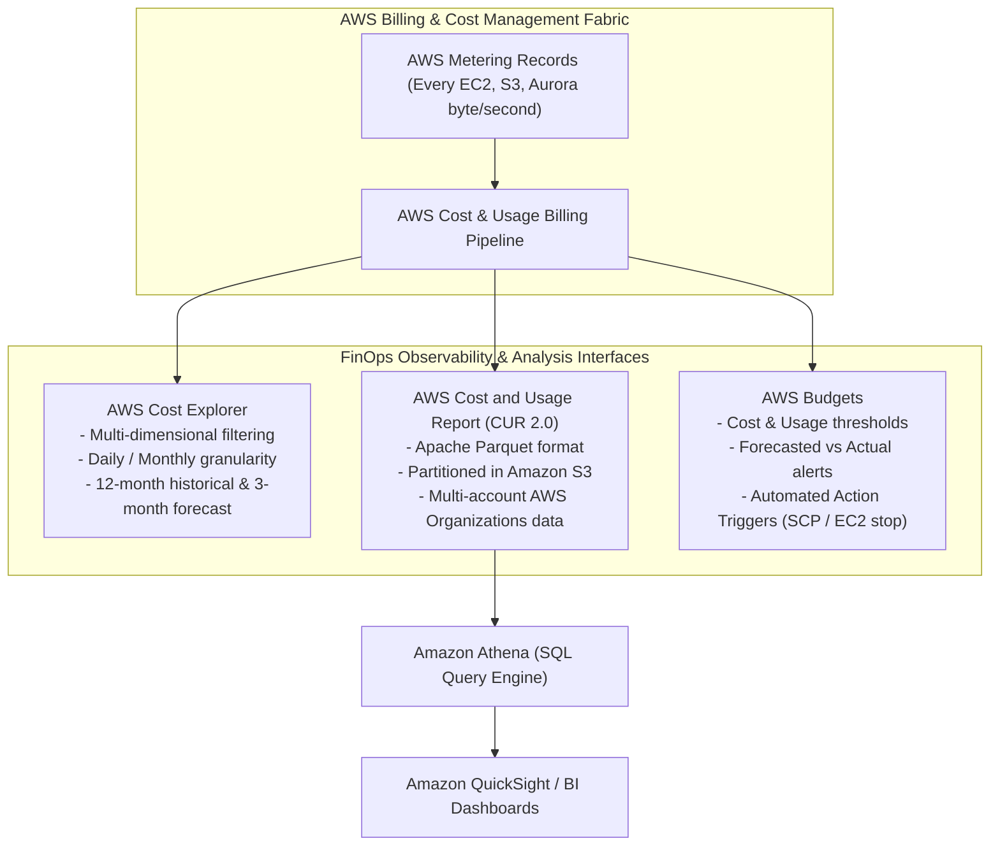
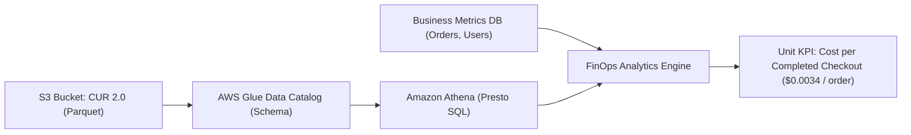
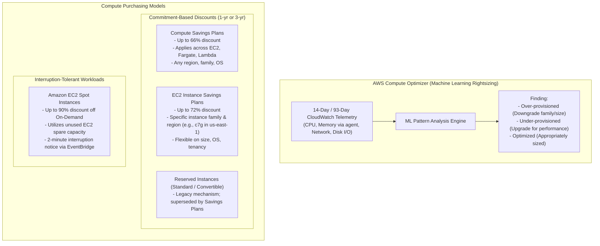
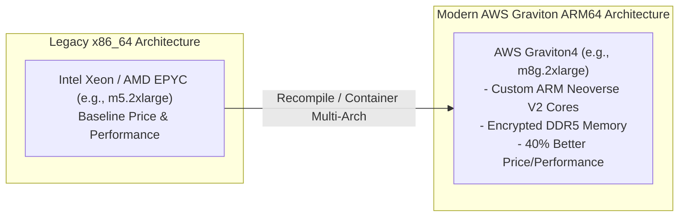
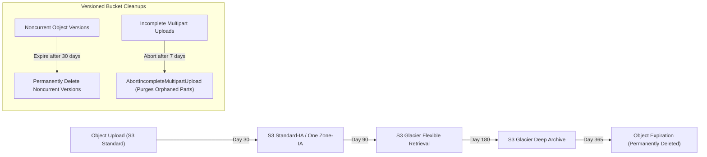

# Module 14: Cost Optimization, FinOps, and Version History

Operating in the cloud replaces upfront capital expenditure (CapEx) with continuous operational expenditure (OpEx). Without disciplined architectural governance and continuous financial engineering (**FinOps**), cloud expenditures inevitably balloon through idle compute, over-provisioned storage tiers, unmonitored cross-AZ network traffic, and legacy purchasing models. This concluding module covers enterprise cost visibility via **AWS Cost Explorer**, **Cost and Usage Report (CUR 2.0)**, and **AWS Budgets**, unit economics querying with **Amazon Athena**, network data transfer optimization, compute rightsizing with **AWS Compute Optimizer**, commitment modeling across **Savings Plans** and **Spot Instances**, AWS **Graviton** ARM64 processor modernization, storage tiering via **S3 Storage Lens**, and provides an exhaustive **Then vs Now Architectural Evolution** and **Historical Version Timeline**.

---

## 1. Enterprise FinOps: Cost Visibility, Allocation Tags, and CUR 2.0

Cloud financial management requires attributing every dollar spent to specific business units, products, engineering squads, and operational environments.



### 1. Cost Allocation Tags & Tag Governance

Every AWS resource can be annotated with metadata tags (key-value pairs). However, by default, resource tags are **not** visible in billing reports until explicitly activated as **Cost Allocation Tags**:

- **AWS-Generated Tags**: Prefixed with `aws:` (e.g., `aws:createdBy`). Created and applied automatically by AWS; must be activated in the Billing Console.
- **User-Defined Tags**: Custom tags applied by engineers (e.g., `Environment`, `CostCenter`, `Owner`, `Project`). Once activated, AWS begins appending these tag columns to billing records within 24 hours (retroactive tagging is not supported).
- **Tag Policies**: Enforced at the AWS Organizations level via Service Control Policies (SCPs) and Tag Policies. Tag Policies standardize tag keys and allowed values (e.g., requiring `Environment` to match only `production`, `staging`, or `development`), preventing typos (such as `env` vs `Environment`) from fragmenting billing data.

### 2. Cost and Usage Report (CUR 2.0)

The **AWS Cost and Usage Report (CUR 2.0)** is the most granular dataset of billing telemetry in AWS:

- **Parquet Format**: Delivered in columnar Apache Parquet format partitioned by month, optimizing SQL analytical query performance.
- **Line-Item Granularity**: Contains individual line items for every distinct resource, identity ARN, usage type, operation, and pricing tier across all accounts in an AWS Organization.
- **Athena Integration**: Querying CUR 2.0 in Amazon Athena using standard Presto/Trino SQL enables custom FinOps dashboards in Amazon QuickSight, answering complex financial questions (e.g., "Which microservices accounted for the top 10% of inter-AZ data transfer charges in `us-east-1` last week?").

### 3. AWS Budgets: Actual vs Forecasted Thresholds

AWS Budgets tracks cost and usage against customizable financial targets:

- **Actual vs Forecasted Alerts**: Sends Amazon SNS notifications or emails when actual spend crosses a threshold (e.g., actual spend $> 80\%$) or when machine learning forecasting predicts spend will breach 100% before the end of the billing period.
- **AWS Budget Actions**: Executes automated governance actions when a threshold is breached:
  - Applying an SCP to restrict an Organizational Unit from provisioning new compute instances.
  - Halting target EC2 or RDS instances automatically to prevent runaway costs.

---

## 2. Unit Economics & FinOps Analytics with Amazon Athena

Advanced cloud financial engineering shifts focus from aggregate monthly spend to **Unit Economics**: quantifying infrastructure costs per business metric (such as _Cost per Daily Active User (DAU)_, _Cost per Processed Payment_, or _Cost per Search Query_).



### 1. Unblended vs Amortized Costs

When querying CUR datasets, FinOps practitioners must distinguish between two primary accounting dimensions:

- **Unblended Cost**: Reflects the raw cash-outflow billed on a specific calendar day. If an upfront 3-year Savings Plan is purchased on January 1st, unblended cost spikes dramatically on January 1st and drops to zero for subsequent months.
- **Amortized Cost**: Evenly distributes upfront and recurring commitment payments across the actual hourly usage over the commitment lifetime. Amortized cost reflects true operational workload consumption, enabling equitable chargeback to individual squads.

### 2. Forensic SQL Queries Against CUR 2.0

Querying the Cost and Usage Report in Amazon Athena isolates unattached resources and untagged infrastructure leaks:

```sql
-- Identify unattached Amazon EBS volumes generating billable storage charges
SELECT
  line_item_usage_account_id AS account_id,
  line_item_resource_id AS ebs_volume_id,
  product_volume_type AS volume_type,
  round(sum(line_item_unblended_cost), 2) AS monthly_cost_usd
FROM "cur_db"."cur_table"
WHERE line_item_product_code = 'AmazonEC2'
  AND line_item_usage_type LIKE '%EBS:VolumeUsage%'
  AND pricing_unit = 'GB-Mo'
GROUP BY 1, 2, 3
HAVING sum(line_item_unblended_cost) > 5.0
ORDER BY monthly_cost_usd DESC;
```

```sql
-- Identify Inter-AZ data transfer expenditure grouped by service and operation
SELECT
  line_item_usage_account_id AS account_id,
  line_item_product_code AS service_name,
  line_item_operation AS operation,
  round(sum(line_item_usage_amount), 2) AS gigabytes_transferred,
  round(sum(line_item_unblended_cost), 2) AS total_cost_usd
FROM "cur_db"."cur_table"
WHERE line_item_usage_type LIKE '%AWS-In-Bytes%'
   OR line_item_usage_type LIKE '%AWS-Out-Bytes%'
   OR line_item_usage_type LIKE '%DataTransfer-Regional-Bytes%'
GROUP BY 1, 2, 3
ORDER BY total_cost_usd DESC
LIMIT 20;
```

```sql
-- Audit untagged resources violating the enterprise CostCenter tagging mandate
SELECT
  line_item_usage_account_id AS account_id,
  line_item_product_code AS service_name,
  count(DISTINCT line_item_resource_id) AS untagged_resource_count,
  round(sum(line_item_unblended_cost), 2) AS untagged_spend_usd
FROM "cur_db"."cur_table"
WHERE resource_tags_user_cost_center IS NULL
  AND line_item_resource_id IS NOT NULL
GROUP BY 1, 2
HAVING sum(line_item_unblended_cost) > 10.0
ORDER BY untagged_spend_usd DESC;
```

---

## 3. Network Egress & Data Transfer Cost Optimization

Network data transfer is frequently the most misunderstood and unexpectedly expensive component of enterprise AWS architectures. Data transfer pricing varies drastically depending on whether packets traverse Availability Zone, Region, or Internet boundaries.

```mermaid
flowchart TD
    subgraph SameAZ ["Same Availability Zone (AZ-a to AZ-a)"]
        Node1["EC2 Instance (AZ-a)"] -->|"Intra-AZ Private IP: FREE ($0.00/GB)"| Node2["RDS Instance (AZ-a)"]
    end

    subgraph CrossAZ ["Inter-Availability Zone (AZ-a to AZ-b)"]
        Node3["EC2 Instance (AZ-a)"] -->|"$0.01/GB Out"| Fabric["AWS Network Fabric"]
        Fabric -->|"$0.01/GB In"| Node4["ECS Container (AZ-b)"]
        NoteCross["TOTAL: $0.02/GB Round-Trip Data Transfer"]
    end

    subgraph InternetEgress ["Internet Egress vs VPC Endpoints"]
        Node5["EC2 (Private Subnet)"] -->|"NAT Gateway: $0.045/hr + $0.045/GB processed"| NAT["NAT Gateway"]
        NAT -->|"$0.09/GB Internet Out"| PublicWeb["Public Internet / APIs"]
        Node6["EC2 (Private Subnet)"] -->|"Gateway VPC Endpoint: 100% FREE ($0.00/GB)"| S3Bucket["Amazon S3 / DynamoDB"]
    end
```



### 1. Data Transfer Cost Topology

| Traffic Path | Ingress Cost | Egress Cost | Total Effective Cost | Architectural Mitigation |
| --- | :-: | :-: | :-: | --- |
| **Intra-AZ (Same AZ, Private IP)** | Free ($0.00) | Free ($0.00) | **$0.00 / GB** | Co-locate latency-sensitive microservices in same AZ. |
| **Inter-AZ (Same Region)** | $0.01 / GB | $0.01 / GB | **$0.02 / GB** | Deploy AZ-aware routing; balance read replicas per AZ. |
| **Inter-Region (e.g., us-east-1 to eu-west-1)** | Free ($0.00) | $0.02 / GB | **$0.02 / GB** | Compress payloads; batch cross-region replication. |
| **Internet Data Transfer Out (DTO)** | Free ($0.00) | $0.09 / GB | **$0.09 / GB** | Front public endpoints with Amazon CloudFront ($0.02–$0.085/GB). |
| **NAT Gateway Processing Fee** | $0.045 / GB | $0.045 / GB | **$0.045/GB + $0.045/hr** | Route S3 & DynamoDB traffic via free **Gateway VPC Endpoints**. |

### 2. The NAT Gateway Anti-Pattern

A standard AWS bill-shock scenario occurs when private workloads stream terabytes of analytical data or backup archives to Amazon S3 or DynamoDB through an AWS NAT Gateway. In addition to standard data transfer fees, NAT Gateways assess a **$0.045 per GB data processing fee** plus $0.045 per hour per gateway.

**The Architectural Fix**: Provisioning free **Gateway VPC Endpoints** for Amazon S3 and Amazon DynamoDB in the VPC route tables. Gateway endpoints route traffic over the AWS private network backbone, bypassing NAT Gateways entirely and slashing data transfer fees to **$0.00 per GB**.

---

## 4. Compute Optimization: Compute Optimizer, Commitments, and Spot Fleets

Compute services (EC2, ECS Fargate, Lambda, and EBS) typically constitute the largest share of an enterprise AWS bill. Optimizing compute involves three complementary pillars: **rightsizing**, **commitment modeling**, and **interruption-tolerant elasticity**.



### 1. AWS Compute Optimizer

AWS Compute Optimizer analyzes historical CloudWatch resource utilization metrics (CPU, memory, disk I/O, network throughput) over a 14-day (default) or 93-day (enhanced) observation window:

- **Memory Metric Requirement**: Memory utilization is not captured by standard CloudWatch hypervisor polling. To evaluate memory rightsizing for EC2 instances, the **CloudWatch Agent** must be installed and configured to emit `mem_used_percent`.
- **Finding Categories**: Identifies resources as _Under-provisioned_ (experiencing hardware bottlenecks), _Over-provisioned_ (excess capacity wasting budget), or _Optimized_.
- **Inference Recommendations**: Suggests modern Graviton (ARM64) instance replacements (e.g., recommending migrating `c5.2xlarge` to `c7g.xlarge`, reducing cost by 40% while improving performance).

### 2. Commitment Models: Savings Plans vs Reserved Instances

| Evaluation Dimension | Compute Savings Plans | EC2 Instance Savings Plans | Standard Reserved Instances | Convertible Reserved Instances |
| --- | --- | --- | --- | --- |
| **Commitment Commitment** | Hourly $ spend (e.g., $50/hr) | Hourly $ spend (e.g., $50/hr) | Specific instance attributes | Specific instance attributes |
| **Term Duration** | 1 or 3 Years | 1 or 3 Years | 1 or 3 Years | 1 or 3 Years |
| **Maximum Discount** | Up to 66% | Up to 72% | Up to 72% | Up to 66% |
| **Services Covered** | EC2, ECS Fargate, AWS Lambda | EC2 Instances Only | EC2 Instances Only | EC2 Instances Only |
| **Region Flexibility** | Any AWS Region | Locked to specific region | Locked to specific region | Locked to specific region |
| **Family Flexibility** | Any family (e.g., `m5` to `c7g`) | Locked to family (e.g., `c7g`) | Locked to instance type | Exchangeable via manual console process |
| **Payment Options** | All Upfront, Partial Upfront, No Upfront | All Upfront, Partial Upfront, No Upfront | All Upfront, Partial Upfront, No Upfront | All Upfront, Partial Upfront, No Upfront |

### 3. Amazon EC2 Spot Instances: Architecture & Allocation Strategies

Spot Instances allow customers to purchase unused EC2 spare capacity at discounts of up to **90%** compared to On-Demand prices. In exchange for the steep discount, AWS can reclaim the instance whenever capacity is needed elsewhere:

- **Two-Minute Interruption Notice**: When AWS needs the capacity, it delivers an interruption warning via **Amazon EventBridge** (`EC2 Spot Instance Interruption Warning`) and the local Instance Metadata Service (IMDS) exactly 2 minutes before termination. Applications intercept this signal to gracefully drain in-flight connections, save state to S3, or checkpoint training weights.
- **Capacity-Optimized Allocation Strategy**: Instead of selecting the single cheapest Spot pool, the `capacity-optimized` allocation strategy analyzes real-time spare capacity depths across multiple instance types and Availability Zones, launching instances in the pools least likely to face immediate interruption.
- **Best-Practice Fleets**: Workloads should run diverse instance families (e.g., configuring Auto Scaling Groups to accept `c6g.xlarge`, `c7g.xlarge`, `m6g.xlarge`, and `m7g.xlarge` across all 3 AZs), maximizing pool diversity and insulating workloads from targeted pool reclamation.

---

## 5. AWS Graviton Architecture & Processor Modernization

A cornerstone of modern AWS compute FinOps is migrating workloads from legacy x86_64 architectures (Intel Xeon, AMD EPYC) to custom **AWS Graviton** ARM64 processors.



### Graviton Architectural Advantages

- **Dedicated Physical Cores**: Unlike x86 hyperthreaded vCPUs (where two virtual CPUs share execution units on a single physical core, leading to noisy-neighbor cache contention), every Graviton vCPU is a full, dedicated physical core with private L1 and L2 caches.
- **Performance & Cost Multiplier**: Graviton4 delivers up to 30% faster compute performance, 75% higher memory bandwidth, and up to 40% better price/performance compared to comparable current-generation x86 instances.
- **Managed Service Adoption**: Managed services (including Amazon Aurora, Amazon RDS, Amazon OpenSearch, and AWS Lambda) support Graviton via simple configuration changes (e.g., setting RDS `DBInstanceClass` to `db.m7g.xlarge` or Lambda architecture to `arm64`), delivering instant 20% cost reductions with zero source code alterations.

---

## 6. Storage Cost Optimization: S3 Lifecycle Policies & Storage Lens

Storage costs compound exponentially over time as data lakes, database backups, and access logs accumulate. Optimizing storage requires programmatic data lifecycle transitions and comprehensive organization-wide storage visibility.



### 1. Programmatic S3 Lifecycle Policies

Lifecycle configuration rules automate data tier transitions and cleanup:

- **Storage Tier Transitions**: Transitions objects through colder tiers as access frequency decreases:
  - `S3 Standard` $\rightarrow$ `S3 Standard-Infrequent Access (IA)` (30 days minimum storage charge, $0.01/GB retrieval fee).
  - `S3 Standard-IA` $\rightarrow$ `S3 Glacier Flexible Retrieval` (90 days minimum, minutes-to-hours retrieval).
  - `S3 Glacier` $\rightarrow$ `S3 Glacier Deep Archive` ($0.00099/GB/month; lowest storage cost in the cloud, 180 days minimum storage duration, 12-hour retrieval SLA).
- **AbortIncompleteMultipartUpload**: When large multi-part uploads fail or stall, orphaned parts remain in the bucket indefinitely, consuming billable storage space while remaining invisible to standard `ListObjects` queries. Enforcing an `AbortIncompleteMultipartUpload` rule (e.g., aborting stalled uploads after 7 days) eliminates this common storage leak.
- **Noncurrent Version Expiration**: In versioned buckets, overwriting or deleting an object creates noncurrent versions that accumulate indefinitely. Lifecycle policies must define `NoncurrentVersionExpiration` rules (e.g., retaining noncurrent versions for 30 days or keeping only the 3 most recent versions).

### 2. Amazon S3 Storage Lens

Amazon S3 Storage Lens provides organization-wide visibility into object storage usage and activity metrics:

- **Consolidated Multi-Account View**: Aggregates metrics across all accounts, regions, and buckets in an AWS Organization into a single interactive dashboard.
- **Cost-Optimization Metrics**: Flags buckets with incomplete multipart uploads, identifies buckets missing lifecycle transition rules, and highlights buckets with high percentages of noncurrent versions.
- **Data Protection Metrics**: Identifies buckets lacking encryption, versioning, or Object Lock immutability rules.

### 3. Amazon S3 Intelligent-Tiering Economics & Trade-Offs

For datasets with unknown, unpredictable, or changing access patterns, **Amazon S3 Intelligent-Tiering** automates cost optimization without operational lifecycle rule maintenance or data retrieval fees:

- **Five Autonomous Access Tiers**: Automatically monitors access patterns and transitions objects across tiers:
  - **Frequent Access Tier**: Default active storage tier (billed at standard S3 rates).
  - **Infrequent Access Tier**: Automatically moves objects after 30 consecutive days of zero read access, delivering a 40% storage cost reduction.
  - **Archive Instant Access Tier**: Automatically moves objects after 90 consecutive days of zero read access, delivering a 68% storage cost reduction with millisecond retrieval performance.
  - **Optional Asynchronous Archive Tiers**: Archive Access (configurable from 90 to 730 days) and Deep Archive Access (configurable from 180 to 730 days), matching Glacier and Deep Archive pricing.
- **Zero Retrieval Charges**: Unlike S3 Standard-IA or Glacier, accessing an object in Intelligent-Tiering incurs **zero data retrieval fees**; the object simply moves back to the Frequent Access tier automatically upon read.
- **FinOps Rule of Thumb (The Small Object Anti-Pattern)**: S3 Intelligent-Tiering assesses a monthly monitoring and automation charge of **$0.0025 per 1,000 objects**. Furthermore, objects smaller than 128 KB are ineligible for auto-tiering and remain permanently in the Frequent Access tier. Enabling Intelligent-Tiering on buckets storing millions of tiny files ($< 128$ KB) creates an anti-pattern where monitoring fees exceed total monthly storage expenditure.

---

## 7. Architectural Evolution: Then vs Now

Practices that represented cloud best practices a decade ago are considered severe anti-patterns today. The following table provides an exhaustive comparison of the architectural evolution of the AWS platform:

| Architectural Domain | Legacy Approach ("Then") | Modern Standard ("Now") | Driver for Change & Migration Pitfalls |
| --- | --- | --- | --- |
| **Networking Fabric** | EC2-Classic (flat shared network, public IPs directly on instances) | Amazon VPC with AWS Nitro Hypervisor & PrivateLink | EC2-Classic lacked security isolation. Modern VPC provides microsegmentation, Transit Gateway, and PrivateLink. |
| **Account Governance** | Single monolithic AWS account with shared root credentials | AWS Organizations, AWS Control Tower, Multi-Account Landing Zones | Single account allows blast radius sprawl; multi-account provides strict blast radius isolation and delegated admin. |
| **Identity & Authentication** | Static, long-lived IAM user access keys (`AKIA...`) hardcoded in configs | Keyless OIDC federation (`AssumeRoleWithWebIdentity`), IAM Identity Center | Static keys leaked in git repositories; keyless OIDC generates temporary 1-hour credentials via STS. |
| **S3 Access Control** | S3 Access Control Lists (ACLs) per object | S3 Bucket Owner Enforced (ACLs disabled), Bucket Policies, OAC | ACLs caused cross-account ownership confusion; Bucket Owner Enforced guarantees bucket owner owns 100% of objects. |
| **Compute Architecture** | Xen virtualization on x86, dedicated EC2 instances | AWS Nitro System with Graviton4 (ARM64) processors | Nitro offloads hypervisor overhead to dedicated hardware; Graviton provides 40% superior price/performance. |
| **Relational Databases** | Monolithic Amazon RDS running on single EBS volume | Amazon Aurora distributed storage (6-way quorum) & Aurora DSQL | Standard RDS bottlenecked on EBS write queue; Aurora separates compute from storage, eliminating double-write buffers. |
| **Event Routing** | Amazon CloudWatch Events / cron polling scripts | Amazon EventBridge (Buses, Pipes, Scheduler with flexible windows) | Legacy cron polling produced thundering herds; EventBridge provides schema matching, pipes, and jittered schedules. |
| **Telemetry Ingestion** | Synchronous `PutMetricData` API calls from worker threads | CloudWatch Embedded Metric Format (EMF) via stdout JSON logs | `PutMetricData` introduced latency and API costs; EMF extracts metrics asynchronously from logs at zero extra API fee. |
| **Disaster Recovery** | Manual disaster recovery runbooks and snapshot restoration | Automated continuous block replication via AWS DRS and MGN | Manual runbooks yielded multi-hour RTOs and error-prone drills; DRS enables non-disruptive automated testing and sub-minute RTO. |
| **IaC Orchestration** | Monolithic CloudFormation JSON templates | AWS CDK (TypeScript/Python) with L2 constructs and `cdk-nag` | Monolithic JSON lacked abstraction and testing; CDK provides object-oriented type safety and compile-time guardrails. |
| **Secrets Management** | Plaintext database credentials in environmental variables / AMI | AWS Secrets Manager automated rotation via Lambda & KMS | Static environment variables leak in process memory and dumps; Secrets Manager rotates passwords without downtime. |
| **Container Hosting** | Self-managed Docker engines on EC2 with manual orchestration | Amazon ECS Fargate serverless containers with `awsvpc` | EC2 container hosts required OS patching and capacity scaling; Fargate manages microVMs with dedicated ENIs. |

---

## 8. Architectural Version History: Major AWS Milestones

Understanding platform evolution helps engineers understand legacy system designs and evaluate modern alternatives:

| Year | Milestone Release | Technical Capability & Architectural Significance |
| --- | --- | --- |
| **2006** | Amazon S3 & Amazon EC2 Launched | The birth of modern cloud computing: programmatic object storage and elastic compute on-demand. |
| **2009** | Amazon VPC Announced | Introduction of isolated software-defined private networks, ending the legacy EC2-Classic era. |
| **2012** | Amazon DynamoDB Launched | Fully managed NoSQL database offering single-digit millisecond latency at any scale using SSD storage. |
| **2014** | AWS Lambda & Amazon Aurora Introduced | Inception of the serverless event-driven computing paradigm and cloud-native decoupled database storage. |
| **2017** | AWS Nitro System & AWS Organizations | Dedicated ASIC cards offloading virtualization I/O from EC2 hosts, and multi-account governance hierarchy. |
| **2018** | AWS Graviton (ARM64) & AWS Transit Gateway | First custom AWS ARM-based server silicon, and centralized hub-and-spoke multi-VPC networking. |
| **2019** | AWS CDK & Amazon EventBridge Announced | Shift toward imperative, object-oriented IaC, and the emergence of declarative serverless event buses. |
| **2020** | S3 Strong Consistency & S3 Bucket Keys | Strong read-after-write consistency across all S3 operations, and 99% KMS API request cost reduction. |
| **2021** | AWS Graviton3 & AWS DRS | High-performance DDR5 ARM compute, and Elastic Disaster Recovery replacing legacy CloudEndure. |
| **2022** | EventBridge Pipes & DVA-C02 Transition | Declarative point-to-point event streaming pipelines eliminating custom glue code. |
| **2023** | S3 Express One Zone & Graviton4 | Directory buckets delivering single-digit millisecond latency, and 4th-generation 96-core ARM architecture. |
| **2024** | Amazon Aurora DSQL Announced | Distributed SQL database architecture with active-active multi-region transactional consistency. |
| **2025** | Lambda Durable Functions & Managed Instances | Long-running durable workflows with checkpoint-and-replay suspension up to 1 year, and multi-concurrency EC2 execution. |
| **2026** | DVA-C03 & SAP-C03 Exam Standard Transitions | Elimination of legacy deployment tooling, integration of Resource Control Policies (RCPs), and CUR 2.0 FinOps standard. |

---

## 9. Comparative Architectural Decision Framework

Selecting the appropriate compute, storage, and networking cost optimization strategy requires evaluating commitments, lifecycle dynamics, and operational overhead:

| Financial Dimension | Primary Mechanism | Cost Reduction Potential | Operational Overhead | Architectural Trade-Off |
| --- | --- | :-: | :-: | --- |
| **Compute Commitments** | Compute Savings Plans | 20% to 66% | Low | Requires steady-state baseline spend commitment for 1 or 3 years. |
| **Spot Elasticity** | EC2 Spot Instances (Capacity-Optimized) | 70% to 90% | Medium | Workload must be fault-tolerant and handle 2-minute interruption notices. |
| **ARM Silicon Modernization** | AWS Graviton4 Instances / Lambda ARM64 | 20% to 40% | Low to Medium | Requires multi-arch container compilation (`linux/arm64`). |
| **S3 Storage Tiering** | S3 Lifecycle Transitions & Intelligent-Tiering | 40% to 95% | Very Low | Cold archive tiers impose retrieval fees and asynchronous retrieval latencies. |
| **VPC Data Transfer** | Gateway VPC Endpoints for S3/DynamoDB | 100% of NAT Fees | Very Low | Replaces $0.045/GB NAT Gateway charges with free AWS backbone routing. |
| **FinOps Analytics** | CUR 2.0 with Amazon Athena | 10% to 30% (Waste Elimination) | Medium | Requires SQL analytics queries and active Cost Allocation Tag governance. |

---

## 10. Interview Drill: Cost Optimization, FinOps, and Version History

<details><summary>1. What is the fundamental difference between Compute Savings Plans and EC2 Instance Savings Plans?</summary>

Compute Savings Plans provide the highest flexibility, committing to an hourly spend (e.g., $50/hour) for 1 or 3 years. They offer up to a 66% discount and automatically apply across Amazon EC2, AWS Fargate, and AWS Lambda regardless of instance family, size, operating system, tenancy, or AWS region. EC2 Instance Savings Plans commit to an hourly spend on a specific instance family within a designated region (e.g., `c7g` in `us-east-1`), offering deeper discounts of up to 72% but restricting flexibility to that single instance family and geographic region.

- Ref: [modules/14-cost-optimization-finops-and-version-history.md#4-compute-optimization-compute-optimizer-commitments-and-spot-fleets](14-cost-optimization-finops-and-version-history.md#4-compute-optimization-compute-optimizer-commitments-and-spot-fleets), https://docs.aws.amazon.com/savingsplans/latest/userguide/what-is-savings-plans.html

</details>

<details><summary>2. Why are resource tags invisible in AWS billing reports by default, and how does an organization activate them?</summary>

By default, AWS treats resource tags purely as operational metadata. To expose tags in AWS Cost Explorer, Budgets, and the Cost and Usage Report (CUR), an administrator must navigate to the AWS Billing Console and explicitly activate them as **Cost Allocation Tags**. Tags are categorized into AWS-Generated tags (prefixed with `aws:`) and User-Defined tags. Once activated, AWS begins appending tag columns to billing records within 24 hours; cost allocation tagging is forward-looking and does not apply retroactively to past usage.

- Ref: [modules/14-cost-optimization-finops-and-version-history.md#1-enterprise-finops-cost-visibility-allocation-tags-and-cur-20](14-cost-optimization-finops-and-version-history.md#1-enterprise-finops-cost-visibility-allocation-tags-and-cur-20), https://docs.aws.amazon.com/awsaccountbilling/latest/aboutv2/cost-alloc-tags.html

</details>

<details><summary>3. What is the technical mechanism of an Amazon EC2 Spot Instance interruption, and how does an application handle it gracefully?</summary>

When AWS reclaims Spot capacity, it emits an **EC2 Spot Instance Interruption Warning** exactly 2 minutes prior to instance termination. This warning is delivered via an Amazon EventBridge event and locally via the Instance Metadata Service (`http://169.254.169.254/latest/meta-data/spot/instance-action`). Applications running an agent or event listener intercept this signal to execute graceful shutdown routines: draining active web sessions, returning unacknowledged SQS messages to queues, flushing logs, and checkpointing calculation states to Amazon S3 before termination.

- Ref: [modules/14-cost-optimization-finops-and-version-history.md#4-compute-optimization-compute-optimizer-commitments-and-spot-fleets](14-cost-optimization-finops-and-version-history.md#4-compute-optimization-compute-optimizer-commitments-and-spot-fleets), https://docs.aws.amazon.com/AWSEC2/latest/UserGuide/spot-interruptions.html

</details>

<details><summary>4. Why does AWS Compute Optimizer require the CloudWatch Agent to provide accurate EC2 instance rightsizing recommendations?</summary>

Standard Amazon CloudWatch metrics collected by the underlying hypervisor track CPU utilization, network I/O, and disk I/O, but cannot inspect host operating system memory allocations. Memory utilization is an internal OS construct. Without the CloudWatch Agent installed to publish the `mem_used_percent` metric, Compute Optimizer can evaluate instances only on CPU and I/O dimensions, potentially recommending downsizing an instance that is actually constrained by physical RAM allocations.

- Ref: [modules/14-cost-optimization-finops-and-version-history.md#4-compute-optimization-compute-optimizer-commitments-and-spot-fleets](14-cost-optimization-finops-and-version-history.md#4-compute-optimization-compute-optimizer-commitments-and-spot-fleets), https://docs.aws.amazon.com/compute-optimizer/latest/ug/metrics.html

</details>

<details><summary>5. How does an S3 Lifecycle AbortIncompleteMultipartUpload policy prevent silent, compounding storage cost leaks?</summary>

When an application initiates an S3 multi-part upload and fails to complete it (due to a network interruption or application crash), the already-uploaded storage parts remain stored in the S3 bucket indefinitely. These orphaned parts do not appear in standard `ListObjects` API responses, but AWS continues billing for their storage consumption at standard S3 rates. An `AbortIncompleteMultipartUpload` lifecycle rule instructs S3 to automatically purge incomplete multi-part uploads after a configured threshold (e.g., 7 days), permanently stopping this billing leak.

- Ref: [modules/14-cost-optimization-finops-and-version-history.md#6-storage-cost-optimization-s3-lifecycle-policies--storage-lens](14-cost-optimization-finops-and-version-history.md#6-storage-cost-optimization-s3-lifecycle-policies--storage-lens), https://docs.aws.amazon.com/AmazonS3/latest/userguide/mpu-abort-incomplete-mpu-lifecycle-config.html

</details>

<details><summary>6. How does routing S3 traffic through a Gateway VPC Endpoint eliminate massive NAT Gateway data processing bills?</summary>

When private EC2 instances or containers access Amazon S3 without a VPC endpoint, the traffic routes through an AWS NAT Gateway. In addition to standard hourly NAT instance fees, AWS charges a $0.045 per GB data processing fee for all traffic passing through the NAT Gateway. By adding a free Gateway VPC Endpoint for S3 to the subnet route table, traffic destined for S3 routes directly over the AWS private internal backbone, completely bypassing the NAT Gateway and reducing data processing fees for S3 traffic from $0.045/GB to $0.00/GB.

- Ref: [modules/14-cost-optimization-finops-and-version-history.md#3-network-egress--data-transfer-cost-optimization](14-cost-optimization-finops-and-version-history.md#3-network-egress--data-transfer-cost-optimization), https://docs.aws.amazon.com/vpc/latest/privatelink/vpc-endpoints-s3.html

</details>

<details><summary>7. What automated actions can an AWS Budget execute when forecasted or actual spend breaches a configured threshold?</summary>

AWS Budget Actions can automatically: 1) apply a restrictive Service Control Policy (SCP) to an AWS Organizations Organizational Unit, blocking member accounts from provisioning additional expensive resources; 2) attach a restrictive IAM policy to a specific user, role, or group; or 3) execute target AWS Systems Manager Automation runbooks to cleanly shut down or terminate running EC2 or RDS instances, enforcing hard financial guardrails without waiting for manual human intervention.

- Ref: [modules/14-cost-optimization-finops-and-version-history.md#1-enterprise-finops-cost-visibility-allocation-tags-and-cur-20](14-cost-optimization-finops-and-version-history.md#1-enterprise-finops-cost-visibility-allocation-tags-and-cur-20), https://docs.aws.amazon.com/cost-management/latest/userguide/budgets-controls.html

</details>

<details><summary>8. In the "Then vs Now" architectural evolution, why did AWS transition from S3 Access Control Lists (ACLs) to S3 Bucket Owner Enforced?</summary>

Under legacy S3 ACLs, when a principal in Account B uploaded an object into an S3 bucket owned by Account A, Account B retained ownership of that object. Account A (the bucket owner) could not read, manage, or delete the object unless Account B explicitly attached an ACL granting permissions. This created severe operational and security anomalies. "S3 Bucket Owner Enforced" permanently disables ACLs across the bucket: the bucket owner automatically owns 100% of uploaded objects, and access is governed strictly by IAM and Bucket Policies.

- Ref: [modules/14-cost-optimization-finops-and-version-history.md#7-architectural-evolution-then-vs-now](14-cost-optimization-finops-and-version-history.md#7-architectural-evolution-then-vs-now), https://docs.aws.amazon.com/AmazonS3/latest/userguide/about-object-ownership.html

</details>

<details><summary>9. Why do AWS Graviton4 processors provide superior performance stability compared to x86 hyperthreaded instances?</summary>

In x86 hyperthreaded architectures, two virtual CPUs share execution units, instruction decoders, and L1/L2 caches on a single physical core, leading to noisy-neighbor contention when concurrent threads execute compute-heavy instructions. AWS Graviton4 processors assign each vCPU to a fully dedicated physical ARM Neoverse V2 core with private 2 MB L2 cache, completely eliminating hyperthreading resource contention and providing consistent, deterministic performance for high-throughput databases and analytical workloads.

- Ref: [modules/14-cost-optimization-finops-and-version-history.md#5-aws-graviton-architecture--processor-modernization](14-cost-optimization-finops-and-version-history.md#5-aws-graviton-architecture--processor-modernization), https://aws.amazon.com/ec2/graviton/

</details>

<details><summary>10. How does the capacity-optimized Spot allocation strategy differ from the lowest-price strategy in high-scale EC2 fleets?</summary>

The lowest-price allocation strategy launches Spot instances strictly into the pool with the absolute lowest current spot price. This frequently concentrates entire fleets into a single, high-demand instance pool that is vulnerable to immediate, simultaneous capacity reclamation by AWS. The `capacity-optimized` strategy evaluates real-time capacity depth metrics across multiple instance types and Availability Zones, distributing launches into the pools with the deepest available spare capacity. This reduces overall interruption frequency by up to 50% without meaningful price variance.

- Ref: [modules/14-cost-optimization-finops-and-version-history.md#4-compute-optimization-compute-optimizer-commitments-and-spot-fleets](14-cost-optimization-finops-and-version-history.md#4-compute-optimization-compute-optimizer-commitments-and-spot-fleets), https://docs.aws.amazon.com/AWSEC2/latest/UserGuide/spot-fleet-allocation-strategy.html

</details>
