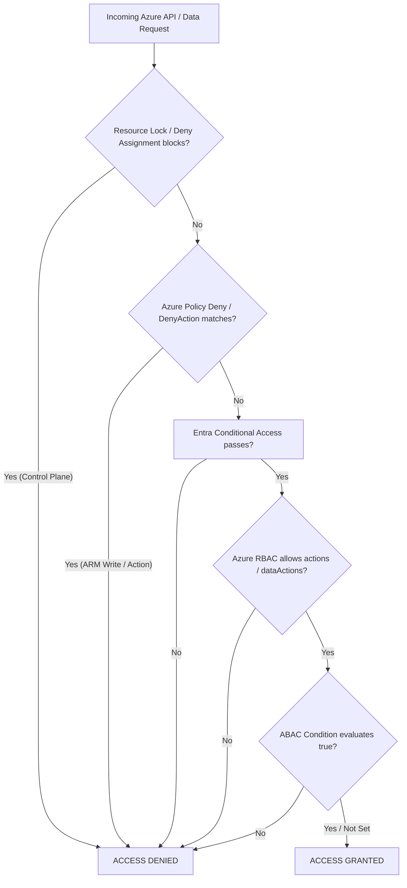

# Microsoft Azure Architecture & Engineering Cheatsheet

A fast-lookup engineering desk reference covering Entra ID and RBAC/ABAC CLI operations, Bicep and Deployment Stacks, Virtual Networking and post-2026-03-31 outbound egress math, Private Link DNS zones, compute and messaging semantics, Storage and Cosmos DB hard limits, KQL diagnostic queries, BCDR targets, and top production failure modes.

Verified against Azure CLI 2.93.0, Bicep 0.49.2, Terraform `hashicorp/azurerm` 5.14.0, `@azure/storage-blob` 12.34.0, `@azure/cosmos` 4.10.2, `@azure/service-bus` 7.10.0, Azurite 3.38.0, Azure Functions Core Tools 4.16.1, PSRule for Azure 1.47.0, Node.js 26.13.0, and TypeScript 7.0.2 on 2026-11-20.

---

## 1. Governance, Entra ID & RBAC CLI

### Azure Authorization & Guardrail Precedence



- **Control Plane vs. Data Plane**: ARM `actions` (such as `Owner` or `Contributor`) do **not** grant data-plane access to Storage Blobs, Key Vault secrets, or Service Bus queues when Entra auth is enforced; assign explicit data roles (`Storage Blob Data Contributor`, `Key Vault Secrets User`, `Azure Service Bus Data Receiver`).
- **RBAC Propagation Latency**: New role assignments cache across tokens and edge nodes for up to **30 minutes**; acquire a fresh token (`az account get-access-token`) or retry with backoff after provisioning.

### Account, Policy & Remediation Commands

```bash
# Inspect and switch active subscription context
az account list --output table
az account set --subscription "<subscription-id-or-name>"
az account show --query "{id:id, tenantId:tenantId, user:user.name}"

# List Management Group hierarchy
az account management-group list --output table

# Assign a built-in Azure Policy at Subscription scope (effect: Audit, Deny, Modify, DeployIfNotExists)
az policy assignment create \
  --name "require-https-storage" \
  --policy "404c3081-a854-4457-ae30-26a93ef943f9" \
  --scope "/subscriptions/<subscription-id>"

# Trigger on-demand compliance evaluation and remediate existing non-compliant resources
az policy state trigger-scan --resource-group "rg-prod-core"
az policy remediation create \
  --name "remediate-diag-settings" \
  --policy-assignment "enable-diag-settings" \
  --subscription "<subscription-id>"
```

### RBAC, Azure ABAC & Workload Identity Federation

```bash
# Assign a data-plane RBAC role using objectId + principalType to avoid Entra Graph replication race
az role assignment create \
  --assignee-object-id "<managed-identity-principal-id>" \
  --assignee-principal-type "ServicePrincipal" \
  --role "Storage Blob Data Contributor" \
  --scope "/subscriptions/<sub-id>/resourceGroups/rg-data/providers/Microsoft.Storage/storageAccounts/stproddata01"

# Assign an Azure ABAC-conditioned role restricting read/write to a specific blob container
az role assignment create \
  --assignee-object-id "<principal-id>" \
  --assignee-principal-type "ServicePrincipal" \
  --role "Storage Blob Data Contributor" \
  --scope "/subscriptions/<sub-id>/resourceGroups/rg-data/providers/Microsoft.Storage/storageAccounts/stproddata01" \
  --condition "@Resource[Microsoft.Storage/storageAccounts/blobServices/containers:name] StringEquals 'ingest'" \
  --condition-version "2.0"

# Configure secretless OIDC Workload Identity Federation for GitHub Actions on a User-Assigned Identity
az identity federated-credential create \
  --name "github-main-deploy" \
  --identity-name "id-ci-deployer" \
  --resource-group "rg-identity" \
  --issuer "https://token.actions.githubusercontent.com" \
  --subject "repo:<org>/<repo>:ref:refs/heads/main" \
  --audience "api://AzureADTokenExchange"

# Configure federated credential directly on an Entra App Registration
az ad app federated-credential create \
  --id "<app-object-id>" \
  --parameters '{"name":"gitlab-prod","issuer":"https://gitlab.example.com","subject":"project_path:group/project:ref_type:branch:ref:main","audiences":["api://AzureADTokenExchange"]}'
```

### IMDS Token & Spot Eviction Polling (Inside Azure VM / VMSS)

```bash
# Acquire Managed Identity OAuth 2.0 token via link-local IMDS (Metadata: true header is mandatory)
curl -sS -H "Metadata: true" \
  "http://169.254.169.254/metadata/identity/oauth2/token?api-version=2018-02-01&resource=https://management.azure.com/"

# Poll IMDS Scheduled Events for 30-second Spot VM eviction notices
curl -sS -H "Metadata: true" \
  "http://169.254.169.254/metadata/scheduledevents?api-version=2020-07-01"
```

---

## 2. Bicep, Deployment Stacks & IaC Patterns

### Bicep Lint, Build, What-If & Deployment Stacks

```bash
# Static lint and compile Bicep to ARM JSON offline
az bicep lint --file ./infra/main.bicep
az bicep build --file ./infra/main.bicep --outfile ./dist/main.json
az bicep decompile --file ./legacy-template.json

# Preview ARM changes before applying (WARNING: never use --mode Complete unless purging unmanaged resources)
az deployment group what-if \
  --resource-group "rg-app-prod" \
  --template-file ./infra/main.bicep \
  --parameters ./infra/prod.bicepparam

# Create/update a Deployment Stack with Deny Assignments and safe orphan detachment
az stack group create \
  --name "stack-app-prod" \
  --resource-group "rg-app-prod" \
  --template-file ./infra/main.bicep \
  --parameters ./infra/prod.bicepparam \
  --deny-settings-mode "denyWriteAndDelete" \
  --deny-settings-excluded-actions "Microsoft.Storage/storageAccounts/blobServices/containers/write" \
  --action-on-unmanage "detachAll" \
  --yes
```

- **Deployment Stack `action-on-unmanage` options**: `detachAll` (leaves removed resources intact in Azure, safest default), `deleteResources` (deletes removed resources except resource groups), `deleteAll` (deletes removed resources and resource groups).
- **Terraform `azurerm` 5.14.0 vs `AzAPI`**: Use `azurerm` for mature, typed resources and `azapi_resource` / `azapi_update_resource` for Day-0 GA/preview Azure ARM API properties not yet exposed in `azurerm`.
- **Offline CI Verification**: Run `az bicep lint`, `PSRule.Rules.Azure` (`1.47.0`) against `.bicep` / ARM JSON, and `terraform test` with `mock_provider "azurerm"` before touching a live subscription.

---

## 3. Networking, Private Link & Post-2026-03-31 Egress

### Subnet Reserved IP Math & NSG Evaluation

- **Usable Subnet IPs Formula**: $\text{Usable IPs} = 2^{(32 - \text{prefix})} - 5$. Azure reserves `.0` (network), `.1` (default gateway), `.2` and `.3` (Azure DNS mapping), and the last address (broadcast).
- **Minimum Sized Subnets**: `/29` = 3 usable IPs; `/28` = 11 usable IPs; `/27` = 27 usable IPs (minimum recommended for `GatewaySubnet`); `/26` = 59 usable IPs (minimum for `AzureBastionSubnet` and `AzureFirewallSubnet`).
- **NSG Dual Evaluation**: Inbound traffic passes `Subnet NSG` then `NIC NSG`; outbound traffic passes `NIC NSG` then `Subnet NSG`. Both rulesets must explicitly allow a flow. Debug exclusively via **Effective Security Rules** and **Effective Routes** on the target NIC.

### Post-2026-03-31 Outbound Egress & NAT Gateway SNAT Math

> [!IMPORTANT]
> New VNets created using the Network API version released after **2026-03-31** (or created in the Azure Portal) default to private subnets (`defaultOutboundAccess: false`) with **zero implicit internet egress**; earlier API versions (including `2025-07-01`) retain the legacy default unless `defaultOutboundAccess: false` is set explicitly. Every outbound-capable workload requires an explicit egress path.

- **NAT Gateway SNAT Port Formula**: Each Public IP provides **64,512** SNAT ports (`65,535 - 1,023` reserved well-known ports). Up to **16** Public IPs per NAT Gateway = **1,032,192** SNAT ports. Ports are allocated dynamically across all subnets attached to the NAT Gateway per unique `(destination IP, destination port, protocol)` tuple, with configurable TCP idle timeout (`4–120` minutes, default `4` min).

| Outbound Method | SNAT Allocation | Availability & Scope | Primary Use Case & Trade-off |
| --- | --- | --- | --- |
| **Azure NAT Gateway** | 64,512 dynamic ports per PIP (up to 16 PIPs) | Zone-resilient subnet-level resource | Default production egress; prevents SNAT exhaustion |
| **Standard LB Outbound Rules** | Static fixed port blocks pre-allocated per backend VM | Regional/zonal LB backend pool | Legacy or tightly coupled inbound+outbound LB setups |
| **Azure Firewall** | 2,048 SNAT ports per public IP per backend firewall instance | Centralized hub VNet inspection | L4/L7 egress filtering, FQDN allowlisting, TLS inspection |
| **Instance Public IP** | 64,512 ports dedicated to one NIC | Single VM NIC | Bastion-free jump hosts or direct public appliances (avoid in prod) |

### Private Link `privatelink.*` DNS Zone Mapping

| Azure Service | Group ID (`subresource`) | Required Private DNS Zone Name |
| --- | --- | --- |
| **Blob Storage / Data Lake** | `blob` / `dfs` | `privatelink.blob.core.windows.net` / `privatelink.dfs.core.windows.net` |
| **Azure Files** | `file` | `privatelink.file.core.windows.net` |
| **Azure Key Vault / Managed HSM** | `vault` / `managedhsm` | `privatelink.vaultcore.azure.net` / `privatelink.managedhsm.azure.net` |
| **Azure SQL Database** | `sqlServer` | `privatelink.database.windows.net` |
| **Azure SQL Managed Instance** | `managedInstance` | `privatelink.{dnsPrefix}.database.windows.net` |
| **Azure Database for PostgreSQL Flexible** | `postgresqlServer` | `privatelink.postgres.database.azure.com` |
| **Azure Cosmos DB (NoSQL)** | `Sql` | `privatelink.documents.azure.com` |
| **Service Bus / Event Hubs** | `namespace` | `privatelink.servicebus.windows.net` |
| **App Service / Functions** | `sites` | `privatelink.azurewebsites.net` (requires both `<app>.privatelink.azurewebsites.net` and `<app>.scm.privatelink.azurewebsites.net` for Kudu/SCM deploy) |
| **Azure Container Registry (ACR)** | `registry` | `privatelink.azurecr.io` |
| **Azure AI Search** | `searchService` | `privatelink.search.windows.net` |
| **Azure Managed Redis** | `redisEnterprise` | `privatelink.redis.azure.net` |

### L4/L7 Ingress & Global Load Balancing Decision Matrix

| Service | OSI Layer & Scope | TLS / WAF | Routing & Proxy Behavior | Best Fit |
| --- | --- | --- | --- | --- |
| **Azure Load Balancer** | L4 (TCP/UDP), Regional or Global | None (pass-through) | 5-tuple hash directly to VM/VMSS private IPs | Non-HTTP TCP/UDP, ultra-low latency, internal tier L4 VIPs |
| **Application Gateway WAF v2** | L7 (HTTP/HTTPS), Regional | TLS termination, mTLS, OWASP WAF v2 | Reverse proxy, URL path/host routing, cookie affinity | Regional web apps, AKS ingress (AGIC), private VNet L7 WAF |
| **Azure Front Door** | L7 (HTTP/HTTPS), Global Anycast Edge | Edge TLS offload, CDN, Global WAF | Anycast split-TCP edge proxy + Private Link origins | Global multi-region HTTP apps, edge caching, DDoS/WAF |
| **Azure Traffic Manager** | DNS (Layer 7 control, no data proxy) | None | Returns DNS `A`/`CNAME` records (Priority, Weighted, Performance, Geo) | Multi-region non-HTTP endpoints or DNS failover across clouds |

---

## 4. Compute, Serverless & Messaging

### App Service Slot-Sticky Settings & Swap Checklist

- **Slot-Sticky Settings** (`--slot-settings` on `az webapp config appsettings set`): Pin environment-specific database strings, slot identity flags, and `WEBSITE_RUN_FROM_PACKAGE` (when deploying per-slot artifacts) so they stay bound to `staging` vs `production`.
- **Swap Pitfall**: During a swap, Azure applies target slot settings to the source slot, restarts workers, and sends an internal warm-up request to `/`. If `applicationInitialization` paths are missing or health probes return `401/302` (e.g., Auth/EasyAuth redirect), warm-up is bypassed and cold workers receive live traffic.

```bash
# Pin slot-sticky app settings on staging before previewing/swapping
az webapp config appsettings set \
  --name "app-orders-prod" \
  --resource-group "rg-app-prod" \
  --slot "staging" \
  --slot-settings "ENVIRONMENT=staging" "APPINSIGHTS_ROLE=orders-staging"

# Execute swap with preview, verify staging health, then complete swap
az webapp deployment slot swap --name "app-orders-prod" --resource-group "rg-app-prod" --slot "staging" --action "preview"
az webapp deployment slot swap --name "app-orders-prod" --resource-group "rg-app-prod" --slot "staging" --action "swap"
```

### Azure Container Apps (ACA) KEDA & Revisions CLI

```bash
# List revisions and split traffic 90/10 between two immutable revisions
az containerapp revision list --name "ca-ai-worker" --resource-group "rg-aca-prod" -o table
az containerapp ingress traffic set \
  --name "ca-ai-worker" \
  --resource-group "rg-aca-prod" \
  --revision-weight "ca-ai-worker--v1=90" "ca-ai-worker--v2=10"

# Attach a KEDA Service Bus queue scaler (0 to 20 replicas, scale out every 10 queued messages)
az containerapp update \
  --name "ca-ai-worker" \
  --resource-group "rg-aca-prod" \
  --min-replicas 0 --max-replicas 20 \
  --scale-rule-name "sb-orders-scaler" \
  --scale-rule-type "azure-servicebus" \
  --scale-rule-metadata "queueName=orders" "messageCount=10" \
  --scale-rule-identity "system"
```

### Azure Functions Hosting Plans Comparison

| Feature | Flex Consumption | Consumption (Classic) | Premium (`EP1`–`EP3`) | Dedicated (App Service Plan) |
| --- | --- | --- | --- | --- |
| **Cold Start & Pre-Warm** | Per-function Always Ready instances | Cold starts after idle (~minutes) | Pre-warmed buffer (`>= 1` instance) | Zero cold start (`Always On`) |
| **Max Execution Timeout** | Unbounded HTTP / long background (check SKU defaults) | 10 min (default 5 min) | Unbounded (default 30 min, configurable) | Unbounded (`Always On`) |
| **VNet Integration** | Built-in regional VNet integration | Not supported | Regional VNet integration + Private Endpoint | Regional VNet integration + PE |
| **Instance Sizing & Concurrency** | Selectable `512` MB / `2048` MB / `4096` MB; deterministic HTTP concurrency | Fixed 1.5 GB | 3.5 GB – 14 GB RAM | Fixed plan SKU (B/S/P/I) |
| **OS & Worker Model** | Linux only, Isolated Worker model | Windows / Linux | Windows / Linux | Windows / Linux |

### Azure Messaging & Eventing Decision Matrix

| Service | Pattern & Protocol | Max Payload | Ordering & Retention | Delivery Semantics & Primary Fit |
| --- | --- | --- | --- | --- |
| **Service Bus** | Queues & Pub/Sub Topics (`AMQP`) | `256 KB` (Std) \| `1 MB` / `100 MB` (Prem) | FIFO via `SessionId`; up to `90d`+ | Transactional Peek-Lock, DLQ, Duplicate Detection; enterprise commands |
| **Event Grid** | Push Event Router (`HTTPS` / `MQTT`) | `1 MB` (CloudEvents v1.0) | Unordered; `24h` retry | Reactive discrete state-change triggers with topic filtering |
| **Event Hubs** | Partitioned Stream (`AMQP` / `Kafka`) | `1 MB` (Std) \| `1 MB`+ (Prem/Ded) | Ordered per partition; `1–90d`+ | High-throughput telemetry/streaming with consumer-group offsets |
| **Storage Queues** | Simple HTTP Queue (`REST`) | `64 KB` (Base64) | Best-effort unordered; `7d` default | Cheap backlog buffering over `80 GB` where Service Bus features aren't needed |

### Service Bus Peek-Lock, Lock Renewal & DLQ (`@azure/service-bus` 7.10.0)

- **Default Lock Duration**: `60s` (`Max 5 min` server setting). If processing exceeds lock duration without renewal, `MessageLockLost` triggers redelivery. After `MaxDeliveryCount` (default `10`), the broker moves the message to `<entity>/$deadletterqueue`.

```typescript
import { DefaultAzureCredential } from '@azure/identity';
import { ServiceBusClient } from '@azure/service-bus';

const sb = new ServiceBusClient('sb-prod-eu.servicebus.windows.net', new DefaultAzureCredential());
const receiver = sb.createReceiver('orders', {
  receiveMode: 'peekLock',
  maxAutoLockRenewalDurationInMs: 300_000,
});

const [msg] = await receiver.receiveMessages(1, { maxWaitTimeInMs: 5_000 });
if (msg) {
  try {
    // Process idempotently using msg.messageId before lock expires
    await receiver.completeMessage(msg);
  } catch (err) {
    await receiver.deadLetterMessage(msg, {
      deadLetterReason: 'ValidationFailed',
      deadLetterErrorDescription: String(err),
    });
  }
}
```

---

## 5. Storage & Cosmos DB Hard Limits

### Storage Redundancy & Customer-Initiated Failover

- **Account Naming**: `3–24` lowercase letters and numbers only, **globally unique** across all Azure tenants.

| Redundancy | Copies & Placement | Annual Durability | Replication & Read/Failover Semantics |
| --- | --- | --- | --- |
| **LRS** | 3 synchronous copies in 1 datacenter (1 AZ) | 99.999999999% (11 nines) | Single-AZ; survives rack/disk failure, not zonal outage |
| **ZRS** | 3 synchronous copies across 3 AZs in 1 region | 99.9999999999% (12 nines) | Zero-RPO zonal HA; survives full Availability Zone loss |
| **GRS / RA-GRS** | 3 sync (primary) + 3 async (paired region) | 99.99999999999999% (16 nines) | Customer-initiated failover (typical RPO `<= 15 min`, no strict SLA); `RA-GRS` secondary reads can lag |
| **GZRS / RA-GZRS** | ZRS in primary + async LRS in paired region | 99.99999999999999% (16 nines) | Recommended mission-critical baseline combining zero-RPO zonal HA + regional DR |

### Blob Access Tiers, Early Deletion & Archive Rehydration

| Tier | Min Retention | Early Deletion Penalty | Retrieval & Rehydration Behavior |
| --- | --- | --- | --- |
| **Hot** | None (`0` days) | None | Immediate millisecond read/write; lowest access cost, highest storage cost |
| **Cool** | `30` days | Pro-rated remaining days | Immediate millisecond read; higher per-GB read/operation cost |
| **Cold** | `90` days | Pro-rated remaining days | Immediate millisecond read; optimized for rarely accessed 90d+ datasets |
| **Archive** | `180` days | Pro-rated remaining days | Offline (`0` direct reads); requires rehydration (`Standard` up to `15h`, `High` `< 1h` for `< 10 GB`) |

### User Delegation SAS & Optimistic Concurrency (`@azure/storage-blob` 12.34.0)

```typescript
import { DefaultAzureCredential } from '@azure/identity';
import {
  BlobSASPermissions,
  BlobServiceClient,
  generateBlobSASQueryParameters,
} from '@azure/storage-blob';

const service = new BlobServiceClient(
  'https://stproddata01.blob.core.windows.net',
  new DefaultAzureCredential(),
);
const startsOn = new Date(Date.now() - 60_000);
const expiresOn = new Date(Date.now() + 15 * 60_000);
const userDelegationKey = await service.getUserDelegationKey(startsOn, expiresOn);

const sas = generateBlobSASQueryParameters(
  {
    containerName: 'exports',
    blobName: 'report.parquet',
    permissions: BlobSASPermissions.parse('r'),
    startsOn,
    expiresOn,
  },
  userDelegationKey,
  'stproddata01',
).toString();

// Optimistic concurrency: conditional update fails with HTTP 412 PreconditionFailed if ETag changed
const blobClient = service.getContainerClient('exports').getBlockBlobClient('state.json');
await blobClient.upload('{"v":2}', 7, { conditions: { ifMatch: '"0x8DC123456789ABC"' } });
```

### Azure Cosmos DB Hard Limits & Consistency Matrix (`@azure/cosmos` 4.10.2)

- **Strict Partition Ceilings**: **20 GB** maximum per logical partition (writes fail with HTTP `403`, substatus `1014`). **50 GB** and **10,000 RU/s** maximum per physical partition. When a physical partition splits, provisioned container RU/s divides **evenly** across the resulting physical partitions.
- **Hierarchical Partition Keys (HPK)**: Up to **3 levels** (e.g., `['/tenantId', '/userId', '/sessionId']`) to bypass the 20 GB ceiling per top-level tenant while keeping prefix queries single-partition.
- **Throttling & Cost Headers**: Handle HTTP `429` via `x-ms-retry-after-ms`; inspect `x-ms-request-charge` on queries to catch expensive cross-partition scans.

| Consistency Level | Read Guarantee | Write Latency & RU Cost | Typical Use Case |
| --- | --- | --- | --- |
| **Strong** | Linearizable; always sees latest committed write | Highest latency (sync quorum across regions); 2x read RU | Financial ledgers, strict global uniqueness |
| **Bounded Staleness** | Prefix order; lags at most `K` versions or `T` seconds | Sync within region, bounded async cross-region; 2x read RU | Global leaderboards, geo-replicated reads with lag SLA |
| **Session** _(Default)_ | Monotonic read-your-own-writes via `x-ms-session-token` | Low local latency; 1x read RU | User profiles, shopping carts, multi-step workflows |
| **Consistent Prefix** | Never sees out-of-order writes; may lag | Low latency; 1x read RU | Social feeds, telemetry dashboards |
| **Eventual** | Converges asynchronously; order not guaranteed | Lowest latency; 1x read RU | Counters, view counts, non-critical metadata |

```typescript
import { DefaultAzureCredential } from '@azure/identity';
import { CosmosClient } from '@azure/cosmos';

const cosmos = new CosmosClient({
  endpoint: 'https://cosmos-prod-eu.documents.azure.com:443/',
  aadCredentials: new DefaultAzureCredential(),
});
const container = cosmos.database('appdb').container('sessions');

const { resource, headers } = await container.items.upsert({
  id: 's-101',
  tenantId: 't-42',
  userId: 'u-7',
  ttl: 3600,
});
const sessionToken = headers['x-ms-session-token'] as string;
const readResp = await container.item('s-101', ['t-42', 'u-7']).read({ sessionToken });
console.log(resource?.id, readResp.requestCharge);
```

---

## 6. Key Vault, KQL One-Liners, BCDR & Top 14 Gotchas

### Key Vault RBAC, Purge Protection & Managed HSM

- **Authorization**: Enable **Azure RBAC** (`enableRbacAuthorization: true`) on all new vaults; avoid legacy Vault Access Policies.
- **Soft-Delete & Purge Protection**: Soft-delete (`7–90` days, default `90` days) is mandatory and cannot be disabled. Enabling `enablePurgeProtection: true` prevents permanent deletion until retention expires—blocking Terraform/Bicep recreate cycles using the same vault or secret name.
- **Managed HSM**: Single-tenant FIPS 140-3 Level 3 HSM cluster requiring explicit Security Domain initialization (minimum 3 RSA quorum keys) and separate `privatelink.managedhsm.azure.net` Private Endpoint.

### KQL Diagnostic One-Liners (Log Analytics)

```kusto
// 1. Application Insights HTTP 5xx error spike grouped in 5-minute bins
AppRequests
| where TimeGenerated > ago(1h) and toint(ResultCode) >= 500
| summarize Errors = count(), P95Ms = percentile(DurationMs, 95) by bin(TimeGenerated, 5m), OperationName
| order by TimeGenerated desc

// 2. Storage Blob RBAC / SAS authorization failures (401/403)
StorageBlobLogs
| where TimeGenerated > ago(1h) and StatusCode in (401, 403)
| project TimeGenerated, CallerIpAddress, AuthenticationType, OperationName, StatusText, Uri

// 3. Cosmos DB 429 throttling and top RU-consuming queries
CDBDataPlaneRequests
| where TimeGenerated > ago(1h) and (StatusCode == 429 or todouble(RequestCharge) > 50)
| summarize Count = count(), TotalRU = sum(todouble(RequestCharge)) by OperationName, StatusCode, PartitionKeyRangeId

// 4. Container Apps console errors collected via Log Analytics
ContainerAppConsoleLogs_CL
| where TimeGenerated > ago(30m) and Log_s has_any ("error", "exception", "fatal")
| project TimeGenerated, ContainerAppName_s, RevisionName_s, Log_s
```

### BCDR Architecture RPO / RTO Quick Matrix

| Mechanism | Protection Scope | Typical RPO | Typical RTO | Key Architectural Constraint |
| --- | --- | --- | --- | --- |
| **Availability Zones (ZRS / Zone-Redundant)** | Datacenter / AZ outage within 1 region | `0` (synchronous) | Seconds to `< 2 min` | Must deploy across `>= 2` zones (3 recommended); check zonal SKU support |
| **Azure Backup (Snapshot + Immutable Vault)** | Accidental delete, ransomware, corruption | `15 min`–`24h` (policy schedule) | Minutes to hours | Lock Immutable Vault only after retention math is verified (`Locked` is irreversible) |
| **Azure Site Recovery (ASR)** | VM / Hyper-V / VMware regional DR | `< 30 sec`–`5 min` (app-consistent `1h+`) | `15–60 min` (recovery plan) | Provision target VNet/NSGs/NAT Gateway in DR region ahead of failover |
| **Azure SQL Failover Groups** | Cross-region SQL DB / SQL MI | `~5 sec` (async geo-rep) | `< 30–60 sec` (grace period configurable) | Preserves fixed read-write & read-only listener FQDNs without app config edits |
| **Storage GRS / GZRS Failover** | Full primary region outage | `~15 min` typical (no SLA) | Minutes to hours (DNS switch) | Customer-initiated; tail writes after last sync are lost; converts account to LRS/ZRS until re-enabled |
| **Cosmos DB Multi-Region Writes** | Active-active global multi-region HA | `0` (Strong) \| `< 1 sec` (Session) | `< 1 sec` (SDK auto-reroute) | Requires custom or LWW conflict resolution policy (`_ts`) |

### Top 14 Production Gotchas Quick Lookup

| # | Symptom / Failure Mode | Root Cause | Production Fix |
| :-: | --- | --- | --- |
| 1 | New VM/subnet has no outbound internet after 2026-03-31 | Network API version released after 2026-03-31 (or Portal creation) sets `defaultOutboundAccess: false`; earlier APIs retain the legacy default unless set explicitly | Attach **Azure NAT Gateway** (or Firewall/LB outbound rule) to subnet |
| 2 | Private Endpoint resolves to public IP inside VNet | Missing `privatelink.*` Private DNS Zone VNet link | Link `privatelink.<service>` Private DNS Zone to client and hub VNets |
| 3 | `Owner` / `Contributor` gets `403` reading Blob or Key Vault | ARM control-plane RBAC excludes `dataActions` | Assign explicit data-plane RBAC role (`Storage Blob Data Contributor`, etc.) |
| 4 | ARM deployment unexpectedly deletes existing RG resources | Deployment executed with `--mode Complete` | Use `--mode Incremental` or **Deployment Stacks** (`--action-on-unmanage detachAll`) |
| 5 | App Service swap drops cold traffic or breaks prod config | Missing `slotSetting: true` or failed `applicationInitialization` | Mark environment settings slot-sticky and exclude warm-up paths from auth redirects |
| 6 | Service Bus messages redelivered and dead-lettered repeatedly | Processing exceeded lock duration (`MessageLockLost`) | Increase `maxAutoLockRenewalDurationInMs` or `lockDuration` (`<= 5 min`); inspect `$deadletterqueue` |
| 7 | Cosmos DB returns HTTP `403/1014` or `429` hot partition | Logical partition hit **20 GB** or physical hit **10,000 RU/s** | Use high-cardinality or **Hierarchical Partition Keys** and `x-ms-retry-after-ms` backoff |
| 8 | Durable Functions orchestrator fails with `NonDeterministicWorkflow` | Orchestrator used `DateTime.now()`, `randomUUID()`, or direct I/O | Use `context.df.currentUtcDateTime`, `newGuid()`, and move I/O into **Activity** functions |
| 9 | Key Vault Terraform/Bicep recreate fails with `VaultAlreadyExists` | Soft-delete + **Purge Protection** blocks same-name reuse | Purge non-protected test vaults, or suffix vault names with deployment epoch/hash |
| 10 | Storage Account creation fails with `StorageAccountAlreadyTaken` | Name must be `3–24` lowercase alphanumerics globally unique | Derive deterministic names from `uniqueString(resourceGroup().id)` |
| 11 | Storage `RA-GRS` read misses recent writes; failover loses data | Async geo-replication lags (`~15 min` typical RPO, no SLA) | Replicate idempotent writes explicitly or use Cosmos DB / SQL if strict RPO is required |
| 12 | NSG allows port `443`, yet VNet traffic still times out | Dual evaluation: both **Subnet NSG** and **NIC NSG** must allow | Inspect **Effective Security Rules** on the NIC and fix the blocking boundary |
| 13 | ARM deployment fails even though target resources are in healthy region | Resource Group metadata lives in a degraded region | Host RG metadata in resilient primary regions; avoid cross-region RG dependencies |
| 14 | Azure Policy `DeployIfNotExists` leaves existing resources non-compliant | Policy effects fire only on resource create/update (`PUT`) | Trigger an explicit `az policy remediation create` task for pre-existing resources |
