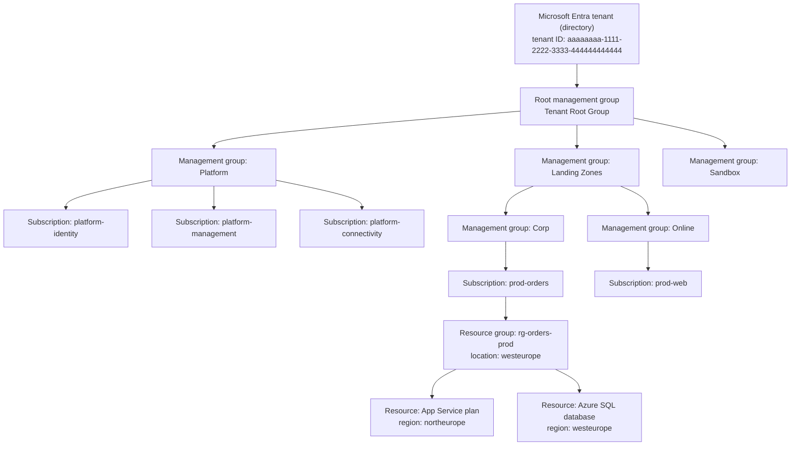
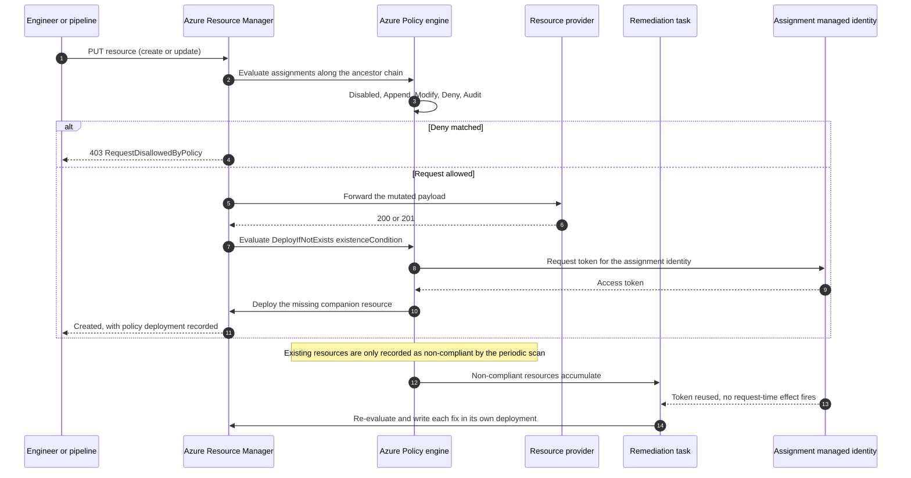
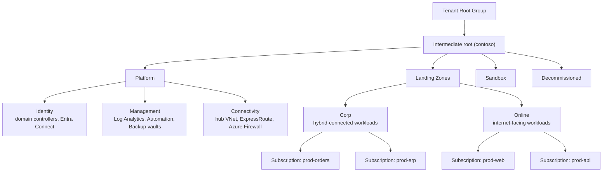

# Module 01: Tenancy, Governance, and Azure Policy

Every Azure resource exists inside a chain of containment that starts at a Microsoft Entra tenant and ends at a single resource ID. That chain is simultaneously a billing structure, a quota boundary, an authorization scope, a policy scope, and a failure domain. Architects who treat it as a folder tree for human convenience eventually discover that a metadata region outage in Frankfurt can block tag updates on a virtual machine in Virginia, that a `ReadOnly` lock can break a storage tool without blocking a single blob write, and that a `DeployIfNotExists` policy silently does nothing to the ten thousand resources that already existed before the assignment.

This module builds the governance model from first principles, then spends most of its length on the failure modes that only appear at enterprise scale. It assumes the provider-neutral treatment of hierarchy, shared responsibility and FinOps in [`architecture/cloud-foundations`](../../../architecture/cloud-foundations/README.md); the Azure delta is what follows.

---

## 1. The Governance Hierarchy as a Formal Tree

The Azure containment hierarchy is a rooted tree. Resource groups cannot nest, management groups cannot have two parents, and a subscription belongs to exactly one management group at a time.



### Node Types, Identifiers, and Invariants

| Node | Identifier scheme | Mutability and uniqueness | Hard invariants | Primary architectural role |
| --- | --- | --- | --- | --- |
| Microsoft Entra tenant | Directory (tenant) GUID | Immutable ID; display name mutable; globally unique | Exactly one identity provider per tenant; a subscription trusts exactly one tenant | Identity, directory, consent boundary |
| Management group | GUID, unique inside the tenant | Renamable; movable inside the tree; single parent | Root group cannot be moved or deleted; six levels of management groups below the root, subscriptions occupy the seventh | Policy and RBAC inheritance spine; cost roll-up |
| Subscription | GUID | Globally unique; movable between management groups and (by transfer) between tenants | Exactly one management group parent; exactly one tenant; quotas are per subscription, per region, per resource family | Billing, quota, throttle, blast-radius unit |
| Resource group | Name, unique within the subscription | 1–90 characters; region fixed at creation and never changeable; cannot nest | Exactly one region; deleting it deletes every contained resource | Deployment target, lifecycle unit, lock and tag anchor |
| Resource | Provider, type, name, API version | Name rules vary per provider; movable between resource groups and subscriptions with provider constraints | Exactly one resource group; a region dictated by the resource type | The billable, configurable object |

Two invariants drive most governance bugs.

The first is that **policy and RBAC assignments are inherited, but tags and locks are not transitive in the way people assume**. A policy assignment on a management group applies to every descendant scope; a tag written on a management group does not appear on a resource. Those are different mechanisms and they fail differently.

The second is that **the depth of the tree is part of the request path**. Every control-plane write evaluates every assignment along the ancestor chain, from the resource group up to the tenant root. A six-level hierarchy with three hundred assignments is not free: it costs evaluation latency on every deployment and it multiplies the number of places an exemption can hide.

### Ancestry and Effective Scope

Let $T = (V, E, r)$ be the tree with root $r$ (the tenant root management group). For a node $x$, the ancestor closure is the unique path

$$
\mathrm{Anc}(x) = \{\, x, P(x), P^{2}(x), \dots, r \,\}
$$

where $P$ is the parent function. An inherited assignment set at $x$ is therefore the union of every assignment whose scope is in $\mathrm{Anc}(x)$:

$$
A(x) = \bigcup_{s \in \mathrm{Anc}(x)} \mathrm{AssignmentsAt}(s)
$$

A resource group is a _sibling_ of another resource group and inherits nothing from it. A subscription moved from `Sandbox` to `Landing Zones/Corp` instantly gains every assignment and role assignment on the new path and loses every assignment on the old one. Nothing about the resources changes; everything about their governance changes.

> [!IMPORTANT]
> A subscription move between management groups is a governance change, not a billing change. Existing resources are not re-created, but every inherited policy and RBAC assignment is recomputed at the next evaluation. A `Deny` policy can leave a resource permanently unmodifiable until it is made compliant or exempted, and a `DenyAction` policy can begin blocking deletes immediately.

---

## 2. Subscription: The Triple Boundary

A subscription is the only node in the tree that is simultaneously a billing container, a quota container, and a throttling container. Management groups are organizational; resource groups are lifecycle containers. Only the subscription carries the three limits that decide whether an architecture scales.

| Boundary | Mechanism | Consequence when ignored |
| --- | --- | --- |
| Billing | Subscription is the invoicing and cost-reporting grain; an EA enrollment or MCA billing profile can own thousands of them | A single shared subscription makes chargeback approximate at best, because cost allocation depends on tags that may be missing |
| Quota | vCPU per region per family, public IPs, storage accounts per region, role assignments, and dozens more are counted per subscription | One team's autoscaling burst starves every other team in the same subscription; quota increases are per subscription, not per team |
| Throttling | ARM request limits are enforced per subscription and per region (on the order of 12,000 reads and 1,200 writes per hour for the subscription-level bucket) | A CI/CD fleet that deploys everything into one subscription hits `429 TooManyRequests` and retries amplify the problem |
| Blast radius | Deleting a subscription destroys every resource inside it | A "temporary" shared subscription becomes the single point of catastrophic deletion |

The practical rule is one subscription per workload-and-environment pair for anything production-facing, plus dedicated platform subscriptions. The number of subscriptions is not a cost problem — subscriptions themselves are free — it is an operational problem, which is why enterprises automate their creation.

### Subscription Vending

The programmatic primitive is the subscription alias, which creates a subscription and places it in a management group in one idempotent call. This is the seam where a platform team turns a request ticket into a governed subscription.

```bash
az account alias create \
  --name prod-orders \
  --display-name "prod-orders" \
  --billing-scope "/providers/Microsoft.Billing/billingAccounts/12345678/enrollmentAccounts/87654321" \
  --workload Production \
  --management-group-id corp \
  --tags costCenter=1040 environment=prod
```

The ordering matters: create the alias with the target management group already set, do not create it at the tenant root and move it later. A subscription that spends even a few minutes at the root inherits the root's policy set, and any `Deny` assignment there can reject the very first deployment the pipeline attempts.

---

## 3. The Resource Group Location Illusion

A resource group has a `location`. It is the single most misunderstood property in Azure.

The resource group location **does not constrain where child resources live**, and it **does not store the child resources**. It stores the resource group's own metadata: the group's record in the Azure Resource Manager (ARM) directory, the deployment history for that group, and the index that maps resource IDs to their providers. A resource group in `westeurope` can contain a VM in `japaneast`, a SQL database in `brazilsouth`, and a storage account in `australiaeast`, and none of that data is stored in Western Europe.

The trap is that **the control plane depends on the metadata region anyway**. Every ARM write that targets a resource inside the group must resolve the group's record and the tenant's authorization data, and that resolution path crosses the region where the group's metadata lives. When that region is impaired, the following break even though the resources are healthy and in other regions:

| Operation | Depends on resource group metadata region | Behaviour during a metadata-region impairment |
| --- | --- | --- |
| `az deployment group create` / `what-if` | Yes | Fails or hangs; the deployment record cannot be created |
| Create, update, or delete a child resource | Yes | Fails validation before the resource provider is even called |
| `az role assignment create` at the resource group or resource scope | Yes | Authorization write fails even though existing tokens still work for reads |
| `az tag update` / `az resource tag` on a child resource | Yes | Tag writes fail; this is the classic "why can I not tag anything during an incident" symptom |
| `az group delete` | Yes | Deletion stalls in `Deleting` state |
| `az resource move` between groups or subscriptions | Yes | Move validation fails |
| Data-plane traffic to storage, SQL, Service Bus, Key Vault, or an App Service | No | Continues to serve as long as the data-plane region is healthy |
| Existing VMs, AKS nodes, and containers | No | Keep running; the guest OS never consults the resource group location |
| ARM _reads_ of a resource's properties | Partially | Frequently served from caches and continue, which is what makes the incident confusing |

That last row is why the incident is diagnosed badly. `az vm show` keeps working, `kubectl` keeps working, the application keeps serving, and the platform team concludes that Azure is fine. Then a pipeline fails on a tag update and someone spends an hour blaming the pipeline.

> [!WARNING]
> The resource group location is a **control-plane dependency**, not a data-residency control. Placing the resource group in an EU region does not move an `eastus` storage account's data, and it does not make the group resilient to an EU outage. Pick the group's region for the stability of the metadata service you are willing to depend on, then document that dependency in the disaster-recovery runbook.

Design rules that follow from the mechanics:

1. **Use few, large, deliberately chosen regions for resource groups.** Do not create one resource group per microservice in a different region each; every distinct region adds a distinct control-plane dependency.
2. **Keep the resource group region in the name or in a mandatory tag.** During an incident the first question is "which metadata regions are affected", and the answer must be queryable, not archaeological.
3. **Put the resource group region in the DR runbook next to the data-plane region.** The runbook must distinguish "the workload is down" from "the workload is up but unmanageable", because the mitigations differ: the first is failover, the second is waiting or using pre-staged automation that does not require ARM writes.
4. **Never rely on tag-based automation that writes tags during an incident.** Tag remediation is an ARM write and therefore fails exactly when the on-call engineer needs it.
5. **Prefer `CanNotDelete` locks over delete-time policy for resource groups**, because lock evaluation is part of the same control plane and behaves predictably, whereas a policy exemption change during an incident requires the same unavailable write path.

---

## 4. Azure Policy: Definitions, Initiatives, and Assignments

Azure Policy is a constraint engine that evaluates resource _configuration_ (a JSON document describing desired state) rather than _who_ is calling (RBAC). The object model has five layers, and confusing them is the second most common source of governance bugs after the resource group location.

| Layer | Object | Scope | What it actually controls |
| --- | --- | --- | --- |
| Rule | Policy definition (`Microsoft.Authorization/policyDefinitions`) | Tenant or management group | The `if`/`then` logic, the effect, the parameters, and the `mode` (`All` or `Indexed`) |
| Bundle | Initiative / policy set definition (`policySetDefinitions`) | Tenant or management group | A named group of definitions with parameters mapped through, plus grouping labels for compliance reporting |
| Application | Policy assignment (`policyAssignments`) | Management group, subscription, resource group | Scope, parameter values, `enforcementMode`, exclusions, `nonComplianceMessages`, and the managed identity used by deploy/modify effects |
| Exception | Policy exemption (`policyExemptions`) | Same as assignment | A `Waiver` (never compliant, deliberately) or `Mitigated` (compliant by other means), with an optional expiry |
| Repair | Remediation task (`policyRemediations`) | Same as assignment | A one-shot, identity-backed job that retrofits existing resources for `Modify`, `DeployIfNotExists`, and `Append` |

A definition is inert. Only an assignment causes evaluation. This sounds obvious, yet "we have the CIS benchmark initiative" is frequently a statement about a definition that nobody assigned.

The `mode` field is a real behavioural switch:

- `Indexed` evaluates only resource types that support tags and location, and skips resource groups and subscriptions. Use it for tag policies, because tag-less child resource types otherwise generate permanent, unfixable non-compliance.
- `All` evaluates everything, including resource groups and subscriptions. Use it for policies that target `Microsoft.Resources/subscriptions/resourceGroups` directly.

### A Minimal Custom Definition

```json
{
  "mode": "Indexed",
  "parameters": {
    "requiredTag": { "type": "String", "defaultValue": "environment" }
  },
  "policyRule": {
    "if": {
      "field": "[concat('tags[', parameters('requiredTag'), ']')]",
      "exists": "false"
    },
    "then": { "effect": "deny" }
  }
}
```

Deploying this at a management group converts an unenforceable convention into a hard failure at deployment time. That is the correct trade only after the audit phase, described below.

### Rollout Order That Does Not Break Production

1. Assign the initiative at the target scope with `enforcementMode: DoNotEnforce`. Deny, Modify, Append, and DeployIfNotExists are not enforced; compliance is still computed. This is the only way to discover the blast radius without an outage.
2. Read the compliance report per resource type. Every non-compliant resource is either a real finding or a policy bug.
3. Fix the policy for false positives (usually by narrowing `mode`, adding `type` conditions, or excluding a resource group that is itself the subject of the policy).
4. Switch `enforcementMode` to `Default` at the lowest scope that covers the workload, not at the tenant root.
5. Backfill with a remediation task, then re-check compliance until the non-compliant count is zero apart from justified exemptions.

---

## 5. Effect Ordering and the Remediation Gap

Azure Policy evaluates effects in a fixed documented order within a single request. The order is not alphabetical and it is not "deny first"; it is a pipeline in which earlier effects mutate the request that later effects see.

| Order | Effect | Acts on | Can repair existing resources | Typical use |
| --- | --- | --- | --- | --- |
| 1 | `Disabled` | Nothing | No | Temporarily neutralizing one definition inside a shared initiative |
| 2 | `Append` | Request payload | No | Adding a field the resource provider defaults badly, such as a required `sku` or a diagnostic setting stub |
| 3 | `Modify` | Request payload and resource tags | Yes, via remediation | Tag inheritance, forcing `allowSharedKeyAccess: false`, setting a minimum TLS version |
| 4 | `Deny` | The request, after 2 and 3 have run | No, and it blocks updates on non-compliant existing resources | Region restrictions, forbidden SKUs, required tags |
| 5 | `Audit` | Compliance record only | No | The observation phase of any rollout |
| 6 | `DeployIfNotExists` | A dependent resource, after the primary write succeeds | Yes, via remediation | Deploying diagnostic settings, private DNS records, or a deny-assignment companion |
| 7 | `AuditIfNotExists` | Compliance record only | No | Reporting a missing companion resource without creating it |
| 8 | `DenyAction` | A specific action on an existing resource | No | Blocking `*/delete` on resources carrying `dataClass=regulated` |

Two consequences fall out of this ordering that are worth stating explicitly because they surprise people.

**Append and Modify run before Deny.** A `Modify` that adds a required tag can satisfy a `Deny` that requires that tag in the same request. Conversely, a `Deny` on a field that `Modify` is supposed to fix will still fire, because `Modify` may not have produced a compliant value. When a deny and a modify disagree, the deployment fails and the error message names the deny assignment.

**A Deny can make an already-deployed resource unmanageable.** Deny is evaluated against the _resulting_ state of every write. If a resource was created before the policy and now violates it, then every subsequent update — including an update that would fix the violation only partially — is rejected. The escape hatches are: an exemption with an expiry, an update that lands the resource fully compliant in one request, or delete-and-recreate.

### The Remediation Gap

This is the single most expensive misunderstanding in Azure governance:

> [!WARNING]
> `DeployIfNotExists`, `Modify`, and `Append` are **request-time** effects. They run when a resource is created or updated through ARM. They do not run retroactively against resources that already exist. Azure Policy's periodic compliance scan (roughly every 24 hours, plus on assignment change and on demand) will mark pre-existing resources as non-compliant, and then stop. Nothing is fixed until someone starts a remediation task.

Remediation has hard prerequisites, and each one has its own failure mode:

| Prerequisite | Failure if missing |
| --- | --- |
| The assignment has a system-assigned or user-assigned managed identity | The assignment deploys, compliance is computed, remediation fails with an authorization error |
| The assignment has a `location` (required whenever an identity is attached) | Assignment creation fails; the identity must live in a region |
| The policy definition declares `roleDefinitionIds` that the identity's roles cover | Remediation partially applies and reports per-resource failures |
| The remediation's `resourceDiscoveryMode` matches the intent | `ExistingNonCompliant` only touches what the last scan flagged; `ReEvaluateCompliance` re-scans first and catches drift |
| The identity still holds its roles | Silent partial failure after a well-meaning "least privilege" cleanup removed a role |

```bash
# Inspect what the assignment's identity is and whether remediation is even possible
az policy assignment show --name enforce-tls --scope "/providers/Microsoft.Management/managementGroups/platform" \
  --query "{identity:identity, location:location, enforcement:enforcementMode}"

# Retrofit every existing resource the scan flagged, re-evaluating compliance first
az policy remediation create \
  --name remediate-tls-2026-11 \
  --policy-assignment "/providers/Microsoft.Management/managementGroups/platform/providers/Microsoft.Authorization/policyAssignments/enforce-tls" \
  --resource-discovery-mode ReEvaluateCompliance

az policy remediation show --name remediate-tls-2026-11 \
  --query "{state:provisioningState, total:deploymentSummary.totalDeployments, failed:deploymentSummary.failedDeployments}"
```

Two operational rules follow. First, **treat remediation as a migration, not a policy**: it is idempotent-ish but it is not continuous, it has a start time, and it produces deployment records that show up in the resource group's history. Second, **run remediation in waves with a canary scope**, because a `Modify` that rewrites a tag on ten thousand resources simultaneously generates ten thousand ARM writes and can trip subscription throttling.



The diagram makes the gap visible: the left-hand path is request-time, the bottom path is human-initiated. There is no arrow from the periodic scan to the resource provider, and that missing arrow is the entire trap.

---

## 6. Resource Locks: ARM-Level Immutability

Locks are the bluntest governance primitive in Azure and the only one that overrides RBAC outright. A lock has exactly two levels.

| Lock level | Control-plane effect | Data-plane effect | Who can remove it |
| --- | --- | --- | --- |
| `CanNotDelete` | Delete operations on the locked scope and every descendant are rejected with `409 ScopeLocked`; reads and writes continue | None | Principal with `Microsoft.Authorization/locks/delete` at the scope, in practice `Owner` or `User Access Administrator` |
| `ReadOnly` | Every request classified as a write is rejected with `409 ScopeLocked`, including `POST` actions that are semantically reads | None | Same as above |

Locks inherit down the scope, are additive (the most restrictive wins), and **override every RBAC role including `Owner`**. An `Owner` who wants to delete a locked resource must first remove the lock, and that removal is itself an auditable, logged operation. This is the whole point: the lock converts "someone with the right role made a mistake" into "someone deliberately removed a control".

A lock is created on the scope it protects. In Bicep, an extension resource at resource-group scope looks like this:

```bicep
targetScope = 'subscription'

param location string = 'westeurope'
param rgName string = 'rg-orders-prod'

resource rg 'Microsoft.Resources/resourceGroups@2024-03-01' = {
  name: rgName
  location: location
  tags: {
    environment: 'prod'
    costCenter: '1040'
  }
}

resource rgLock 'Microsoft.Authorization/locks@2020-05-01' = {
  scope: rg
  name: 'protect-${rgName}'
  properties: {
    level: 'CanNotDelete'
    notes: 'Production resource group. Removal requires a CAB approval and an audited PR.'
  }
}
```

### The `ReadOnly` Storage Trap

`ReadOnly` is described as "read-only", which leads architects to assume it is safe on data stores. It is not, because the lock classifies ARM operations, not intent.

A storage account under a `ReadOnly` lock still accepts blob writes through the data plane: an application using Entra ID credentials with `Storage Blob Data Contributor` writes, overwrites, and deletes blobs normally, because those requests go to `*.blob.core.windows.net` and never touch ARM. Meanwhile the control plane rejects `POST /listKeys` with HTTP `409 Conflict` (`ScopeLocked`), which is the action `Microsoft.Storage/storageAccounts/listKeys/action`. Everything that depends on an account key then fails:

- Storage Explorer and most GUI tools, which default to account-key authentication.
- Any SAS generation that uses the account key, including `az storage container generate-sas --account-key`.
- `az storage account keys list` and `Get-AzStorageAccountKey`.
- Legacy SDKs and third-party backup tools configured with a connection string.

The result is a bizarre incident profile: the application is happily writing blobs, the storage team cannot open the account in a tool, and a `ReadOnly` lock that was added "to protect production" is responsible. A user-delegation SAS still works, because `getUserDelegationKey` is a data-plane call authenticated with an Entra token and a data role. That asymmetry is the diagnostic: if user-delegation SAS works and account-key SAS does not, look for a lock.

> [!CAUTION]
> `ReadOnly` does not protect data from deletion. It protects the _configuration_ from change while leaving the data plane fully writable. If the requirement is "no blob may be deleted", the control is blob soft delete, versioning, an immutability policy, or a data-plane role restriction — not a `ReadOnly` lock.

The inverse trap also exists. Teams add `CanNotDelete` to a storage account expecting it to protect blobs; it protects only the account object in ARM. Blob deletion is unaffected.

### Lock Strategy

1. Lock at resource-group scope for workload lifecycle protection, and add narrower locks only where a specific resource must outlive its group.
2. Never use `ReadOnly` on anything an operational tool mutates through ARM, and never use it on a storage account or Key Vault that tooling administers with shared keys.
3. Expect Terraform and Bicep `destroy` to fail with `409 ScopeLocked`. In Terraform the lock is a separate `azurerm_management_lock` resource, so destroy it before its target or the resource group deletion fails on the lock the same configuration created.
4. Log and alert on `Microsoft.Authorization/locks/delete`. Removing a lock is the real privileged action.
5. In CI/CD, never grant `Microsoft.Authorization/locks/*` to a workload identity. If the pipeline can remove the lock, the lock is decorative.

---

## 7. Tags: Inheritance, Cost Allocation, and the Point-in-Time Problem

Tags are key-value metadata on resources, resource groups, and subscriptions. They are the only mechanism that connects technical resources to financial and ownership semantics, and they are the weakest such mechanism because nothing enforces them by default.

Limits worth memorizing: up to 50 tags per resource or resource group, tag names up to 512 characters, tag values up to 256, and not every resource type supports tags at all. Tag names are case-insensitive for matching but preserve the case you wrote, which means `CostCenter` and `costcenter` are the same key with unpredictable display.

### Tags Do Not Inherit

A tag on a resource group is not present on a child resource. Cost Management can _group_ by resource group, and the portal shows resource-group tags in some views, but the resource's own tag set is empty. Any query, automation, or export that filters `tag.costCenter` on resources will miss everything that only has the tag at group level.

The fix is a `Modify` policy that copies the tag down at write time, plus a remediation task for everything that predates the assignment.

```json
{
  "mode": "Indexed",
  "policyRule": {
    "if": {
      "field": "tags['costCenter']",
      "exists": "false"
    },
    "then": {
      "effect": "modify",
      "details": {
        "roleDefinitionIds": [
          "/providers/Microsoft.Authorization/roleDefinitions/4a9ae827-6dc8-4573-8ac7-8239d42aa03f"
        ],
        "operations": [
          {
            "operation": "addOrReplace",
            "field": "tags['costCenter']",
            "value": "[resourceGroup().tags['costCenter']]"
          }
        ]
      }
    }
  }
}
```

Three details make or break this policy. `roleDefinitionIds` must reference a role that can write tags on the resource — `Tag Contributor` (`4a9ae827-6dc8-4573-8ac7-8239d42aa03f`) is the narrow choice; `Contributor` is the tempting, over-broad one. The `addOrReplace` operation overwrites whatever the resource had, which is correct for inheritance and wrong for team-owned tags. And `resourceGroup().tags['costCenter']` evaluates to null when the group has no such tag, so the operation either does nothing or writes an empty value depending on the resource provider — either way the resource does not become compliant, and the compliance report shows a policy that cannot converge. The policy needs a companion `Deny` that requires `costCenter` on the resource group itself.

The inheritance direction is one-way by design: resource group to resource. There is no built-in "subscription tag to resource" inheritance, and no inheritance at all for management groups. If cost allocation needs the business unit, that value must be written on every resource or encoded in the subscription name and mapped in the FinOps pipeline.

### Cost Allocation Versus Cost Reporting

Tags feed three different systems, and they disagree:

| System | What it reads | Latency | Retroactivity |
| --- | --- | --- | --- |
| Azure Cost Management reports and exports | Tags on the resource at the time usage was metered | Hours of ingestion lag | None: fixing a tag today does not re-attribute last month's spend |
| Cost allocation rules | Tag values at metering time, with rules that split shared cost across dimensions | Next report refresh | Rules apply to the period you configure, but they cannot invent a tag that was absent |
| Your own CMDB or chargeback pipeline | Whatever your export captured | Your pipeline's lag | Whichever backfill you implement yourself |

This is the point-in-time problem. A tag added on the 28th of the month does not move the 27 days of spend that ran without it. Architects who promise retroactive chargeback on the strength of a tag policy are promising something the platform does not do.

### Tag Enforcement Ladder

1. `Audit` the tag policy for one billing cycle. Count the gaps per resource type.
2. `Modify` with inheritance from the resource group, and remediate in waves.
3. `Deny` missing tags on new resources, but only for resource types where the tag is genuinely applicable, and only after the resource group itself is guaranteed to carry the tag.
4. Give teams an exemption path with an expiry, so a blocked deployment at 02:00 has a documented remedy that is not "disable the policy".

---

## 8. Management Groups at Scale and the CAF Enterprise-Scale Topology

Management group limits are small enough to design against deliberately.

| Limit | Value | Practical consequence |
| --- | --- | --- |
| Levels below the root | 6 | A `Platform / Region / Workload / Env / Team` design consumes most of the budget; do not model your org chart |
| Management groups per tenant | 10,000 | Not the binding constraint in practice |
| Parents per management group | 1 | No DAG, no multi-inheritance; overlapping policy intents must be expressed as separate assignments |
| Management groups per subscription | 1 | Every move is a full inheritance swap |
| Root group | Cannot be moved or deleted | It is the tenant boundary; treat its assignments as tenant-wide law |

### Subscription Placement Pitfalls

- **Moving a subscription is not a rename.** All inherited assignments change at once. A subscription moved into a folder with a `Deny` on public IPs will keep its existing public IPs but cannot create new ones, and cannot update those resources until they comply.
- **Quota does not move with the tree.** Placement has no effect on vCPU quota; the subscription keeps the limits it had.
- **Cost roll-up at management group scope requires access to that scope.** A FinOps team with `Cost Management Reader` on subscriptions but not on the management group cannot see the roll-up.
- **Management groups are per tenant.** A multi-tenant enterprise runs independent trees and cannot share policy assignments across tenants without duplicate definitions and assignments.
- **Deleting a management group requires moving or deleting its children first**, including subscriptions. There is no cascade delete, which is a feature.

### CAF Enterprise-Scale Topology

The Cloud Adoption Framework's enterprise-scale landing zone reference is the de facto default topology. It separates the subscriptions that _provide_ platform capability from the subscriptions that _consume_ it.



| Branch | Purpose | Connectivity | Typical policy posture |
| --- | --- | --- | --- |
| Platform / Identity | Domain controllers and Entra Connect; the most restricted subscription in the tenant | Peered to the hub; no internet ingress | Maximum deny, no workload deployment, break-glass access only |
| Platform / Management | Central Log Analytics workspace, Automation accounts, Backup vaults, Update Manager | Peered to the hub | Deny public IPs, enforce diagnostic settings to the central workspace |
| Platform / Connectivity | Hub VNet, Azure Firewall or NVAs, ExpressRoute/VPN gateways, Private DNS zones | Terminates hybrid connectivity | Deny workload resource types entirely |
| Landing Zones / Corp | Workloads that reach on-premises through the hub | Peered to the hub, forced tunnelling through the firewall | Deny public IPs, deny outbound internet, require private endpoints |
| Landing Zones / Online | Internet-facing workloads with their own ingress | Peered to the hub; egress through the firewall | Deny on-premises routes, require WAF in front of ingress |
| Sandbox | Experiments and training | Isolated, no peering | Cheap SKU allowances, hard budget, no hybrid connectivity |
| Decommissioned | Quarantine before subscription cancellation | None | Deny everything except deletion, so nothing is accidentally revived |

The topology's value is not the folder names; it is that every subscription has exactly one place to live, and the platform team can reason about connectivity, policy, and cost per branch rather than per subscription.

---

## 9. Cost Management: Budgets Are Not Caps

Azure budgets are monitoring objects. They evaluate metered cost against a threshold and notify. They do not throttle, scale down, or block spend.

| Property | Behaviour that matters |
| --- | --- |
| Evaluation cadence | Asynchronous and lagging. Cost data is typically available within 8–24 hours, and budget evaluation runs on a schedule, so a burst can overshoot a monthly budget by a wide margin before the first alert fires |
| Threshold semantics | `Actual` and `Forecasted` are separate notification configurations; a forecast alert can fire before any money is spent |
| Notification targets | Email recipients, Entra roles, action groups. Only the action group can do anything |
| Scope | Subscription, resource group, or a filter over a billing scope. Management-group-scope budgets exist but are not a universal substitute for per-subscription budgets |
| Enforcement | None. The only native spending limit is the legacy offer-level cap on pay-as-you-go and free offers, not an enterprise control |

> [!WARNING]
> A budget alert that only emails a distribution list is a notification, not a control. If the requirement is a hard financial ceiling, the architecture must include an automated action triggered by the budget's action group, plus the authority to actually stop the workload.

### Budget Plus Action Group Plus Automation

```bicep
targetScope = 'subscription'

param budgetAmount int = 5000
param opsEmail string = 'cloud-ops@example.com'
param runbookWebhookUri string

resource alerts 'Microsoft.Insights/actionGroups@2023-01-01' = {
  name: 'ag-budget-enforcement'
  location: 'global'
  properties: {
    groupShortName: 'budgetenf'
    enabled: true
    automationRunbookReceivers: [
      {
        name: 'throttle-workload'
        automationAccountId: resourceId('Microsoft.Automation/automationAccounts', 'aa-finops')
        runbookName: 'Invoke-BudgetCircuitBreaker'
        webhookResourceId: resourceId('Microsoft.Automation/automationAccounts/webhooks', 'aa-finops', 'budget-breaker')
        serviceUri: runbookWebhookUri
        isGlobalRunbook: false
      }
    ]
    emailReceivers: [
      { name: 'finops', emailAddress: opsEmail, useCommonAlertSchema: true }
    ]
  }
}

resource monthlyBudget 'Microsoft.CostManagement/budgets@2023-11-01' = {
  name: 'budget-subscription-monthly'
  properties: {
    category: 'Cost'
    amount: budgetAmount
    timeGrain: 'Monthly'
    timePeriod: {
      startDate: '2026-11-01'
      endDate: '2027-11-01'
    }
    filter: {
      dimensions: {
        name: 'ResourceGroupName'
        operator: 'In'
        values: [ 'rg-orders-prod', 'rg-web-prod' ]
      }
    }
    notifications: {
      actualAtNinety: {
        enabled: true
        operator: 'GreaterThan'
        threshold: 90
        contactEmails: [ opsEmail ]
        actionGroups: [ alerts.id ]
      }
      forecastAtHundred: {
        enabled: true
        operator: 'GreaterThan'
        threshold: 100
        thresholdType: 'Forecasted'
        contactEmails: [ opsEmail ]
        actionGroups: [ alerts.id ]
      }
    }
  }
}
```

The automation behind the action group is where the engineering lives. A runbook that "deletes the resource group" is a foot-gun; the defensible ladder is:

1. **At 90% actual:** annotate the subscription with a tag, post to the incident channel, and open a ticket. No infrastructure change.
2. **At 100% forecasted:** scale the non-production plan down (`az appservice plan update --number-of-workers 1`), disable staging slots, and pause non-critical jobs.
3. **At 100% actual with no acknowledgement:** apply a `Deny` policy assignment that blocks new deployments of the expensive resource types, or stop the specific resources. Deleting is a last resort and should require a human.

Automation must be idempotent and must record that it acted, because budget notifications repeat. A runbook that scales down on every fire is fine; one that fires a rollback per notification is not.

---

## 10. Production Patterns

### Audit-First Policy Rollout with Exemptions That Expire

```bash
SCOPE="/providers/Microsoft.Management/managementGroups/corp"
# Built-in initiative ID for the Microsoft cloud security benchmark; substitute your own set definition ID.
INITIATIVE="/providers/Microsoft.Authorization/policySetDefinitions/1f3afdf9-d0c9-4c3d-847f-89da613e70a8"

# 1. Assign without enforcement, with an identity so DINE/Modify can be enabled later without re-creating the assignment
az policy assignment create \
  --name baseline-corp-audit \
  --scope "$SCOPE" \
  --policy-set-definition "$INITIATIVE" \
  --enforcement-mode DoNotEnforce \
  --mi-system-assigned \
  --identity-scope "$SCOPE" \
  --location westeurope \
  --display-name "Baseline (audit only) - Corp"

# 2. Read the damage before enforcing anything
az policy state list --management-group corp \
  --filter "complianceState eq 'NonCompliant'" \
  --query "length(@)"

# 3. Grant a time-boxed exemption only where the finding is genuinely acceptable
az policy exemption create \
  --name legacy-erp-waiver \
  --scope "/subscriptions/00000000-0000-0000-0000-000000000000/resourceGroups/rg-erp-prod" \
  --policy-assignment "$SCOPE/providers/Microsoft.Authorization/policyAssignments/baseline-corp-audit" \
  --exemption-category Waiver \
  --expires-on 2027-03-31 \
  --description "ERP vendor appliance cannot meet TLS 1.2 until the 2027 upgrade."
```

Exemptions without an expiry are how a governance programme dies: the exemption list grows monotonically and nobody can tell a deliberate exception from an abandoned one.

### Lock and Tag Baseline for a New Workload Subscription

Every new subscription should land with four things already applied, because retrofitting any of them is a migration:

1. The management group placement (subscription alias, not a later move).
2. A `CanNotDelete` lock on each production resource group.
3. The tag inheritance `Modify` assignment, remediated before the first deployment.
4. A budget with an action group, scoped to the subscription.

### Keeping Policy Definitions Under Version Control

Policy definitions are code. Store them as JSON or Bicep in the same repository as the infrastructure, deploy them from a pipeline with a workload identity, and never let a definition change only in the portal. A definition change is a silent behaviour change for every assignment that references it, which makes an unreviewed portal edit one of the highest-risk actions in the tenant.

---

## 11. Then vs Now

| Practice | Then | Now | Why it changed |
| --- | --- | --- | --- |
| Landing-zone orchestration | Azure Blueprints: a package of ARM templates, policy assignments, and role assignments, versioned and assigned to subscriptions | Deployment Stacks with `denySettings` plus policy initiatives and template specs | Blueprints is retired on 2026-07-11; the stack provides lifecycle ownership and deny settings without a bespoke assignment engine |
| Subscription administration | Classic administrators: Account Administrator, Service Administrator, Co-Administrator | Microsoft Entra RBAC roles (`Owner`, `Contributor`, `User Access Administrator`) | Classic administrator roles were retired on 2024-08-31; they bypassed policy and audit in ways that could not be governed |
| Policy rollout | Assign with `Deny` and fix the fallout | `enforcementMode: DoNotEnforce` plus compliance reporting plus remediation waves | Deny-first rollouts caused production outages on resources that could no longer be updated |
| Tag governance | Convention plus a spreadsheet audit | `Modify` inheritance, remediation tasks, cost allocation rules, and tag-based budget filters | Cost allocation without resource-level tags is not retroactive and not auditable |
| Cost control | Classic alerts on a single metric, or a spreadsheet | Budgets with action groups, forecast thresholds, and automation that throttles | Budgets still do not cap spend; only the wired automation does |
| Deletion protection | Backup and hope | `CanNotDelete` locks, `DenyAction` policies, blob immutability, purge protection | Locks are the only control that overrides `Owner`, and they are cheap |

Migrating a Blueprint is not a lift-and-shift. The Blueprint's assignment identity, its parameter files, and its resource groups become a Deployment Stack (for the resource lifecycle) and one or more policy assignments (for the guardrails). The critical migration pitfall is duplicating guardrails: running the Blueprint and the new initiative simultaneously produces two assignments with the same effect, two compliance records, and two identities that both attempt remediation.

---

## 12. Hands-On Verification Lab

The governance model in this module is executable. [`../examples/01-governance-and-policy.test.ts`](../examples/01-governance-and-policy.test.ts) models the hierarchy, the resource-group control-plane dependency, the request-time-only behaviour of deploy effects, and lock evaluation as pure functions, and asserts the behaviours documented above.

```bash
cd technologies/azure
mise exec -- npm test
```

### Verified Behaviours

1. **Scope chain and depth**: `scopeChain` resolves `Tenant → ManagementGroup → … → Subscription → ResourceGroup → Resource` in that exact order, `isScopeOrAncestor` is directional (a management group is an ancestor of a resource; a resource group is not an ancestor of a management group), and six management-group levels validate while the seventh is rejected with `exceeds the maximum of 6`.
2. **Resource group metadata outage**: a control-plane write is refused with `503` when the resource group's metadata region is down and the resource's own region is healthy. This is the negative test for "a healthy resource is still manageable", and it is the mechanism behind the incident in [Section 3](#3-the-resource-group-location-illusion).
3. **The remediation gap**: a resource created before the `DeployIfNotExists` assignment is reported non-compliant and _not_ repaired by a compliance scan; the same evaluation with the remediation flag set reports it remediated; a resource created after the assignment is compliant at request time. Three assertions, one behaviour: request-time effects are not retroactive.
4. **`ReadOnly` versus `listKeys`**: an inherited `ReadOnly` lock rejects `POST` `listKeys` with HTTP `409 Conflict` (`ScopeLocked`) in ARM (asserted as a non-200 denial in the offline model), while a data-plane blob read and a control-plane `GET` both succeed. That asymmetry is exactly why Storage Explorer breaks while the application keeps writing.
5. **Ancestor deny**: a property test over one to six management-group levels proves that a `Deny` at any ancestor scope rejects a non-compliant resource regardless of child compliance, and that a deny-all at the root management group always wins with the assignment name in the reason.

The suite is hermetic: it needs no Azure subscription, because the properties under test are the evaluation algebra rather than the service. The shared model lives in `../examples/lib/azure-models.ts`. Live checks — `az policy state list`, remediation execution, lock enforcement during a real deployment — belong in a sandbox subscription and are recorded in the track's integration notes.

---

## Interview Drill

**Q1.** A resource group sits in `westeurope`. Its application runs in `northeurope` and its database in `westeurope`. During a Western Europe control-plane incident, the application is healthy but every deployment and tag update fails. Explain the mechanism and what you change afterwards.

<details>
<summary>Model Answer</summary>

**Answer.** The resource group's `location` stores the group's metadata record, deployment history, and the index used to resolve its children. ARM control-plane writes for any resource in the group must consult that metadata, so an impairment of the metadata region blocks deployments, resource creation and updates, RBAC writes, tag writes, and moves — regardless of where the resources actually run. Data-plane traffic and running compute are unaffected, which is why the application stays healthy and the incident looks like a pipeline problem.

Post-incident changes: record the resource group region as a control-plane dependency in the DR runbook alongside the data-plane regions; consolidate resource groups so the tenant depends on fewer metadata regions; ensure on-call runbooks distinguish "workload down" from "workload unmanageable"; and avoid incident-response automation that depends on ARM writes such as tag remediation.

- Ref: [Section 3](#3-the-resource-group-location-illusion), [Azure resource groups overview](https://learn.microsoft.com/en-us/azure/azure-resource-manager/management/manage-resource-groups-portal)

</details>

**Q2.** You assign a built-in initiative that includes a `DeployIfNotExists` for diagnostic settings. Compliance reports 4,000 non-compliant resources and nothing gets fixed. The assignment has a system-assigned identity. What are the possible causes, in the order you would check them?

<details>
<summary>Model Answer</summary>

**Answer.** First, confirm the diagnosis: `DeployIfNotExists` runs only at resource create or update. Resources that predate the assignment will never be touched until a remediation task runs. That is the expected behaviour, not a bug.

Then check the preconditions that make remediation fail: the assignment `location` is set (an identity cannot exist without a region); the identity's role assignments cover every `roleDefinitionIds` entry in the definition, typically `Monitoring Contributor` plus `Log Analytics Contributor`; the policy's `existenceCondition` is correct, because a wrong condition makes every resource look compliant or permanently non-compliant; and the resources are in scope, not excluded by an exemption or an `excludedScopes` entry.

Finally start remediation with `ReEvaluateCompliance` so the scan is fresh, in waves, and watch `deploymentSummary.failedDeployments`. A silent partial failure after a role cleanup is common, because the same identity is used at request time as well: new resources that should be remediated at creation also fail, and the only evidence is a per-resource deployment record.

- Ref: [Section 5](#5-effect-ordering-and-the-remediation-gap), [Remediate non-compliant resources](https://learn.microsoft.com/en-us/azure/governance/policy/how-to/remediate-resources)

</details>

**Q3.** An engineer adds a `ReadOnly` lock to a production storage account to "protect it". Two hours later the application still writes blobs correctly, but the on-call cannot regenerate an account-key SAS and Storage Explorer refuses to open the account. Explain both behaviours and what the correct control was.

<details>
<summary>Model Answer</summary>

**Answer.** A lock is an ARM control-plane construct. Blob writes authenticated with Entra ID and a `Storage Blob Data Contributor` role go to the blob data plane and never traverse the lock, so they continue. `POST /listKeys` is an ARM action (`Microsoft.Storage/storageAccounts/listKeys/action`) and `ReadOnly` rejects every write-classified request including POST actions, so no account key can be retrieved and no account-key SAS can be generated. Storage Explorer defaults to account-key authentication, hence the failure.

The correct controls for "protect the data" are data-plane controls: blob soft delete, versioning, an immutability policy, and least-privilege data roles. If the requirement was "do not let anyone change the account configuration", then `ReadOnly` is right — but the tooling must be migrated off shared keys first, with `allowSharedKeyAccess: false` and user-delegation SAS, which is unaffected by the lock because `getUserDelegationKey` is a data-plane call.

- Ref: [Section 6](#6-resource-locks-arm-level-immutability), [Lock resources to prevent changes](https://learn.microsoft.com/en-us/azure/azure-resource-manager/management/lock-resources)

</details>

**Q4.** A `Deny` policy requires the `environment` tag. A team's deployment fails with `RequestDisallowedByPolicy`. They add the tag to the template and redeploy, and it still fails. The resource is in a resource group whose own tag set does not include `environment`, and the template reads `resourceGroup().tags.environment`. Diagnose.

<details>
<summary>Model Answer</summary>

**Answer.** The resource group is non-compliant with its own governance baseline, and the template is deriving a required value from an object that does not have it. In ARM template evaluation `resourceGroup().tags.environment` resolves to an empty value, so the deployed tag is empty or absent and the deny fires again.

Fix in two steps: apply the tag to the resource group itself (with a policy that denies resource groups missing mandatory tags, `mode: All`, scoped to the subscription or management group), and only then deploy the workload. If tag inheritance is done with a `Modify` assignment, verify that the assignment identity holds `Tag Contributor` and that remediation has run for the resource group, because `Modify` also does not act retroactively.

The deeper lesson is ordering in the governance ladder: the resource group's tags must be enforced before any policy that consumes them from a resource, otherwise every deployment in the group fails with a message that points at the resource rather than the group.

- Ref: [Section 7](#7-tags-inheritance-cost-allocation-and-the-point-in-time-problem), [Azure Policy definition structure](https://learn.microsoft.com/en-us/azure/governance/policy/concepts/definition-structure)

</details>

**Q5.** Your tenant is at 4,000 role assignments in a subscription. You must give 1,200 engineers read access to 40 resource groups. A colleague proposes per-user `Reader` assignments at each resource group. Quantify the problem and give two designs that scale.

<details>
<summary>Model Answer</summary>

**Answer.** Per-user per-resource-group `Reader` is $1{,}200 \times 40 = 48{,}000$ role assignments, twelve times the 4,000 assignment ceiling for a single subscription, before any other role on the subscription. Each assignment is also an ARM object to create, audit, and eventually clean up, and the ceiling is per subscription with a separate 500-per-management-group limit.

Design one: assign `Reader` to security groups at the highest common scope, ideally once at the management group or subscription, and manage membership in Entra ID instead of in ARM. That collapses the object count to a handful of assignments.

Design two: where read scope must differ per team, use one group per (team, resource-group) pair but only for the exceptions, plus an ABAC condition where the resource type supports it, so a single assignment covers many resources by attribute rather than by enumeration. Membership changes then flow through group management, which is the system designed for high-churn principal lists. (The RBAC algebra and ABAC conditions are developed in [Module 02](02-entra-id-rbac-and-workload-identity.md).)

- Ref: [Section 2](#2-subscription-the-triple-boundary), [Azure subscription and service limits](https://learn.microsoft.com/en-us/azure/azure-resource-manager/management/azure-subscription-service-limits)

</details>

**Q6.** A subscription is moved from the `Sandbox` management group to `Landing Zones/Corp`. Within minutes, deletions of two storage accounts start failing with a policy error, and a deployment that used to work now fails on a missing private endpoint. What happened, and what should the runbook have said?

<details>
<summary>Model Answer</summary>

**Answer.** The move replaces the inherited assignment set in one step. The `Sandbox` branch presumably had no `DenyAction` and no private-endpoint requirement; the `Corp` branch has both. `DenyAction` takes effect on the next delete attempt, so the deletion of the two storage accounts is blocked immediately. The private-endpoint requirement is typically enforced by `Deny` or `DeployIfNotExists`; a `Deny` blocks the new deployment, while a `DINE` would try to deploy an endpoint that may have no subnet or DNS zone to live in.

The runbook should have: pre-flight compliance of the subscription against the destination branch (`az policy state summarize` on the subscription with a temporary `DoNotEnforce` assignment, or a what-if style assessment); an inventory of `DenyAction` targets; a plan for private endpoints, DNS zones, and route requirements; and a rollback path — moving the subscription back, which is itself an inheritance swap and not an undo of any delete that already happened.

The broader point: a subscription move is the highest-impact governance operation available to a platform team, and it deserves the same change control as a production deployment.

- Ref: [Section 8](#8-management-groups-at-scale-and-the-caf-enterprise-scale-topology), [Moving subscriptions between management groups](https://learn.microsoft.com/en-us/azure/governance/management-groups/manage)

</details>

**Q7.** Finance asks for a hard €10,000 monthly cap per product team, enforced automatically, with no manual intervention. Design it end to end and state exactly where it can still fail.

<details>
<summary>Model Answer</summary>

**Answer.** Enforce per subscription, not per tenant: one subscription per team-environment pair, a `Microsoft.CostManagement/budgets` resource at subscription scope with the amount, a 90% actual notification and a 100% forecasted notification, both wired to an action group. The action group invokes an Automation runbook or a function that performs a graded response: annotate and notify at 90%; scale non-production plans to one worker and disable staging slots at 100% forecast; apply a deny policy for expensive resource types, or stop the specific resources, at 100% actual without acknowledgement. Record every action with an idempotency key so repeated notifications do not repeat the action.

Where it still fails: cost ingestion lags by hours, so a burst can overshoot before the first notification; forecast notifications can be wrong in both directions; the automation identity itself needs `Contributor`-level rights, which is a privileged identity to protect; and the graded response only stops what it knows how to stop, so an unmodelled resource type keeps spending. That is why the design also needs a second line of defence: quotas on the expensive resource families, and a weekly review of the top cost drivers rather than only a threshold alarm.

- Ref: [Section 9](#9-cost-management-budgets-are-not-caps), [Create and manage budgets](https://learn.microsoft.com/en-us/azure/cost-management-billing/costs/tutorial-acm-create-budgets)

</details>

**Q8.** You are the platform architect for a tenant with 400 subscriptions. Design the management group hierarchy, say what belongs at each level, and justify why you did not use seven levels.

<details>
<summary>Model Answer</summary>

**Answer.** A workable hierarchy is: tenant root group, an intermediate root for the organization, then `Platform` (Identity, Management, Connectivity), `Landing Zones` (Corp, Online), `Sandbox`, and `Decommissioned`. That is three levels of management groups below the tenant root, with the platform subscriptions at the fourth, which leaves three levels of headroom for future needs such as a regulated-data branch or a regional split.

Assignments at the tenant root are the tenant-wide law: the security baseline initiative, the tag baseline, and the diagnostic-settings initiative. The intermediate root carries organization-specific guardrails that every subscription must inherit. Platform branches carry the strictest denies and almost no workload permits. Landing zone branches carry connectivity posture: Corp denies public IPs and forces egress through the hub, Online forbids hybrid routes and requires WAF. Sandbox gets cheap-SKU allowances, a hard budget, and no peering. Decommissioned denies everything except the operations needed to delete.

Six levels are the platform maximum, not a design target. Every additional level multiplies evaluation work on every request, creates another place for an exemption to hide, and makes the compliance report harder to read. The number of levels should be driven by the number of _distinct policy postures_, which is small, not by the org chart, which is large and changes.

- Ref: [Section 8](#8-management-groups-at-scale-and-the-caf-enterprise-scale-topology), [CAF landing zone design areas](https://learn.microsoft.com/en-us/azure/cloud-adoption-framework/ready/landing-zone/)

</details>
