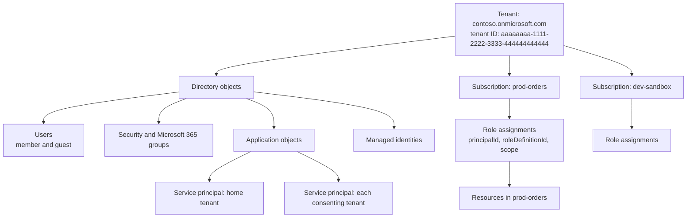
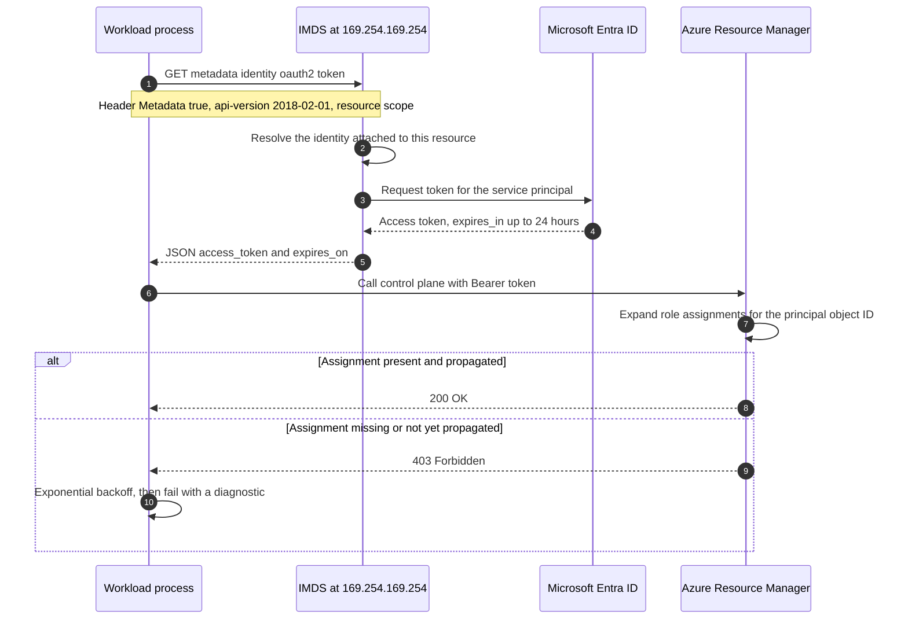
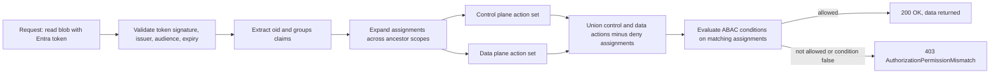
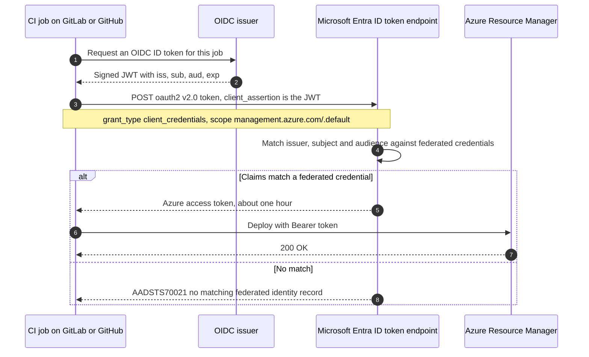

# Module 02: Microsoft Entra ID, Azure RBAC, and Workload Identity

Azure authorization is split across two systems that look like one. Microsoft Entra ID answers _who is calling_ and issues a token; Azure Resource Manager and each resource provider answer _what that caller may do_, evaluating role assignments on every request. Almost every production identity incident lives in the seam between them: a principal that exists but has not replicated, a token whose embedded group claims are hours stale, a role assignment that exists but has not propagated, or a data-plane role that nobody granted because "Owner should be enough".

This module treats the directory as a formal object graph, derives the RBAC evaluation algebra, and then works through the mechanics of managed identities and workload identity federation — the two credential-free paths that modern Azure architectures depend on. Protocol-level OAuth 2.1 and OIDC theory lives in [`architecture/security-identity`](../../../architecture/security-identity/README.md); the provider-neutral identity model lives in [`architecture/cloud-foundations`](../../../architecture/cloud-foundations/README.md). What follows is the Azure realisation and its traps.

---

## 1. The Directory as the Identity Boundary

A Microsoft Entra tenant is a directory: a replicated store of identity objects with a single security boundary, a single consent boundary, and a single set of directory-level policies. Everything else in Azure inherits from it.

| Relationship | Cardinality | Consequence |
| --- | --- | --- |
| Tenant to subscription | One to many; each subscription trusts exactly one tenant | A subscription cannot straddle two directories; a tenant transfer re-homes every identity relationship |
| Subscription to resource | One to many | The tenant of the subscription is the tenant of every resource in it |
| App registration to service principal | One to many, one per consenting tenant | The same application has a different object ID in every tenant |
| Managed identity to resource | System-assigned: exactly one to one; user-assigned: many to many | The identity's lifecycle is a design decision, not a platform detail |

Three boundaries behave differently from the rest of Azure and are worth stating plainly.

**The tenant is not the billing account.** An enterprise agreement or Microsoft Customer Agreement can span several directories, and a subscription can be transferred between tenants while the invoice stays with the same payer. Billing governance and identity governance therefore have different owners and different change control.

**The tenant is the trust boundary for tokens.** A token issued by tenant A is meaningless in tenant B's resources unless a resource explicitly trusts it. Guest users (B2B) do not change this: a guest authenticates in their home tenant and receives a token from the _resource_ tenant, with a `Guest` user type in that directory.

**The tenant is the outermost policy boundary for directory controls.** Conditional Access, PIM, password protection, and cross-tenant access settings apply to the directory, not to a subscription, and cannot be scoped per management group.



The diagram's important edge is the one from `Role assignments` to `Resources`: a role assignment stores a `principalId` (an object ID), a role definition ID, and a scope string. It stores no permissions of its own. Permissions are derived at request time by expanding the role definition and walking the scope ancestry, which is why a deleted and re-created principal silently orphans its assignments.

---

## 2. Directory Objects: Applications, Service Principals, and the Multi-Tenant Seam

The single most consequential distinction in Entra ID is between an **application object** and a **service principal**.

| Aspect | Application object (app registration) | Service principal (enterprise application) |
| --- | --- | --- |
| Where it lives | Exactly one directory: the home tenant | One instance per tenant that consented |
| Identity | `appId` (client ID), globally unique and immutable | `objectId`, unique per tenant; every instance shares the same `appId` |
| Owns | Redirect URIs, credentials (certificates, secrets, federated credentials), API permissions requested, exposed scopes and app roles, token configuration | The tenant-local grant: admin consent records, app role assignments, SSO and provisioning configuration, assignment-required setting, and the object that RBAC assigns roles to |
| Created by | Registration in the home tenant | Consent (user or admin) in a target tenant, or `New-MgServicePrincipal`/`az ad sp create` |
| Deletion impact | Deletes the home-tenant service principal too, and breaks every other tenant's instance because the application no longer exists | Revokes access in that tenant only; the application and other tenants' instances are untouched |

For a multi-tenant SaaS product this produces two classic outages.

**Outage one: re-registering the application.** Someone deletes the app registration to "start clean" and creates a new one. The new registration gets a new `appId`. Every customer tenant still holds a service principal for the old `appId`; those instances can no longer obtain tokens, every admin consent is invalid, and every role assignment in every customer subscription points to an object ID that no longer resolves. There is no rename-the-appId operation. Recovery means re-consenting every tenant and re-creating every assignment, which is a multi-week customer-facing incident.

**Outage two: deleting the customer's service principal.** A customer's IT admin deletes the enterprise application to "remove the app". The application object and every other tenant are fine. In that tenant, all role assignments that referenced the deleted service principal now display as an unresolved identity, and re-consenting creates a _new_ `objectId` — the old assignments stay orphaned and must be replaced. This is why SaaS provisioning code should treat `objectId` as tenant-local state and re-resolve it after every consent event rather than caching it forever.

### Identifiers You Must Not Confuse

| Identifier | Example shape | Where it is used | Stable across |
| --- | --- | --- | --- |
| Application (client) ID | `8f1c2d3e-....` | OAuth client identity, `az login --service-principal -u`, federated credential audience checks | Tenants, re-consent, credential rotation |
| Service principal object ID | `11111111-....` | RBAC `principalId`, PIM, app role assignments, audit logs | Nothing: it is per tenant and changes on re-consent |
| Application object ID | `99999999-....` | Graph operations on the registration itself | The home tenant |
| Tenant ID | `aaaaaaaa-....` | Token authority, `az account set`, cross-tenant checks | Never changes, even if the directory is renamed |

A role assignment stores the **service principal object ID**, not the app ID. That single fact explains most "the identity exists but the assignment is orphaned" incidents.

### Secrets, Certificates, and Federated Credentials

A confidential client can prove its identity in three ways, and the choice is a security decision rather than a convenience one.

| Mechanism | What is stored | Rotation | Failure mode |
| --- | --- | --- | --- |
| Client secret | A string, visible to anyone with access to the registration and to the pipeline variable store | Manual, with an expiry that everyone discovers too late | Leaks into logs, repositories, and screenshots; a shared secret authenticates from anywhere on the internet |
| Certificate | A public key on the registration, a private key in a vault or store | Manual, but the private key never leaves the holder | Better, but the private key still has to be distributed to every runner |
| Federated credential (workload identity federation) | Only a trust relationship: issuer, subject, audience | None; there is nothing to rotate | Misconfigured subject or audience; a subject pattern broad enough to be a wildcard |

The third row is developed in [Section 9](#9-workload-identity-federation). It removes the credential entirely, which is why it is now the default recommendation for CI/CD and for any workload running outside Azure.

---

## 3. Groups at Scale: Dynamic Membership and the Licensing Trap

Groups are the unit of assignment in every well-run tenant: nobody assigns roles to a human except through break-glass. Two properties of groups cause most of the damage.

### Security Groups, Microsoft 365 Groups, and Membership Rules

| Group type | Membership | Can hold a role assignment | Notable constraint |
| --- | --- | --- | --- |
| Security group (assigned) | Manually added users, service principals, devices, or other groups | Yes | The workhorse for RBAC |
| Security group (dynamic user) | Computed from a rule over user attributes | Yes | Rule evaluation is asynchronous; a user added to the directory is not a member yet |
| Security group (dynamic device) | Computed from a rule over device attributes | Yes (device-targeted scenarios) | A group cannot be both dynamic-user and dynamic-device |
| Microsoft 365 group | Owners and members; also mail and SharePoint-backed | Yes | Membership implies a mailbox and a SharePoint site; not appropriate as a pure RBAC container |
| Distribution list | Mail recipients | No | Not a security principal; a frequent and silent misconfiguration |

A dynamic rule is a small expression language over directory attributes:

```text
(user.department -eq "Payments") and (user.accountEnabled -eq true) and (user.city -eq "Brno")
```

Two operational properties matter. First, evaluation is asynchronous and incremental: an attribute change propagates in minutes, while the initial population of a large tenant can take considerably longer, so a pipeline that creates a user and immediately expects group-based access will fail. Second, a dynamic group is only as good as the attribute hygiene behind it — if `department` is populated by hand in an on-premises directory and synchronised, the group is a mirror of that data quality, including its nulls.

### The Nested Group Licensing Trap

Group-based licensing assigns licences to group members. **Nested membership is not honoured.** If group `lic-payments` is a member of group `lic-engineering`, users who are members of `lic-payments` and not directly of `lic-engineering` receive nothing. The portal does not necessarily make this obvious: the group looks correctly configured, and the per-user licence report shows the users as unlicensed.

The consequences compound:

- Users lose access to Microsoft 365 services at the worst possible moment — typically when a licence assignment is "cleaned up" by removing a redundant-looking direct membership.
- The error is reported per user on the group's licensing blade, but only if someone looks.
- On-premises security groups synchronised through Entra Connect inherit the same limitation, so restructuring the on-premises nesting does not help.
- Dynamic groups can be licensed, but the same direct-membership rule applies: the rule must select the users who should be licensed, not a group that contains them.

The design rule is to make licensed groups **flat and terminal**: each user is a direct member of exactly the groups whose licences they need, and nesting is reserved for RBAC containers where the consuming service resolves transitivity.

> [!WARNING]
> Do not generalise "nested groups work" or "nested groups do not work" across Azure. Group-based licensing does not traverse nesting. Azure RBAC generally resolves transitive directory membership, but services that consume the raw `groups` claim in a token — some Kubernetes integrations, custom applications, and legacy APIs — see only the groups emitted at token issuance, and a user in more than roughly 200 groups gets an overage claim instead of a full list. Model nesting as a per-consumer compatibility question and verify it in the actual service.

### Why Groups Are Mandatory Above a Certain Scale

A role assignment on a user is an ARM object with a lifecycle, an audit trail, and a quota. A group membership is a directory object with a lifecycle, an audit trail, and no ARM quota. Every organisation that has hit the assignment ceiling (see [Section 7](#7-the-assignment-quota-and-abac-as-the-relief-valve)) has hit it because assignments were modelled per human rather than per role-and-scope pair.

---

## 4. Managed Identities: Lifecycle and Token Acquisition

A managed identity is a service principal with no credential material that the customer can read. The platform creates the principal, rotates whatever it uses internally, and exposes a local token endpoint. There are exactly two kinds.

| Property | System-assigned | User-assigned |
| --- | --- | --- |
| Creation | Implicit, when the resource is created with an identity block | Explicit resource: `Microsoft.ManagedIdentity/userAssignedIdentities` |
| Lifecycle | Bound to the resource: deleted with it | Independent; survives the compute it is attached to |
| Cardinality | One per resource, cannot be shared | One identity, many resources |
| Identity name | Same as the resource | Chosen at creation |
| Pre-provisioning | Impossible: the compute must exist first | Possible: create the identity and grant roles before any compute exists |
| Typical use | A single VM or app that owns its own permissions | A fleet of identical workers, a blue/green pair, or a role granted to a workload that does not exist yet |
| Cross-tenant | No | No: an identity belongs to the tenant of the resource |

The pre-provisioning property is the one architects underuse. With a system-assigned identity, the deployment order is forced: create the resource, wait for the principal to replicate, grant the role, then let the application start. With a user-assigned identity, the identity and its assignments are part of the platform baseline, and the workload's deployment only attaches an existing object. That removes an entire class of first-boot failures and makes the identity auditable before the workload exists.

### The Metadata Endpoints

Two endpoints exist, and they are not interchangeable.

**Instance Metadata Service (IMDS)** on `169.254.169.254` is available to any Azure VM, and to containers running on the VM's network namespace. It is link-local, non-routable, and requires the request header `Metadata: true`:

```bash
curl --silent --show-error \
  --header "Metadata: true" \
  --get "http://169.254.169.254/metadata/identity/oauth2/token" \
  --data-urlencode "api-version=2018-02-01" \
  --data-urlencode "resource=https://management.azure.com/" \
  --data-urlencode "client_id=00000000-0000-0000-0000-000000000000"
```

The response carries `access_token`, `expires_in`, `expires_on`, `resource`, and `token_type`. When several user-assigned identities are attached to the same resource, the caller must select one with exactly one of `client_id`, `object_id`, or `msi_res_id`; omitting all three when more than one is attached is an error, not a default.

The `Metadata: true` requirement is a security control, not a formality. It defeats the simplest server-side request forgery: an attacker who can make the application issue an arbitrary `GET` still cannot set a custom header, and a browser cannot set it cross-origin without a CORS preflight that IMDS does not grant. It does not defeat an attacker who can execute code or read the application's configuration, which is why the identity's permissions are the real boundary.

**App Service, Functions, and Container Apps** do not expose IMDS. They inject two environment variables into the process: `IDENTITY_ENDPOINT` and `IDENTITY_HEADER`. The header value is a secret that authenticates the caller to the local endpoint:

```bash
curl --silent --show-error \
  --header "X-IDENTITY-HEADER: $IDENTITY_HEADER" \
  --get "$IDENTITY_ENDPOINT" \
  --data-urlencode "api-version=2019-08-01" \
  --data-urlencode "resource=https://vault.azure.net"
```

The legacy pair `MSI_ENDPOINT` and `MSI_SECRET` is the predecessor of this mechanism and still appears in older documentation; new code should read `IDENTITY_*` first and treat `MSI_*` as a fallback only for old hosting plans.



### The Token Cache and the 24-Hour Staleness Window

Three independent caches sit between a role change and the caller's experience, and conflating them produces bad diagnoses.

| Cache | What it holds | Typical lifetime | What a role change does to it |
| --- | --- | --- | --- |
| Directory replication of the principal | The new service principal object | Seconds to minutes | A role assignment attempted too early fails with `PrincipalNotFound` |
| RBAC assignment propagation | The new assignment, in the authorization cache in front of ARM | Seconds normally, up to 30 minutes in the documented cache window | Access starts working without any token change |
| Token-embedded claims | `groups`, `roles`, `wids`, `amr` in the access token | Up to 24 hours for managed identity tokens, about an hour for user tokens | The old claims stay until the token is refreshed |

The third row is the trap that produces "we removed their access and they still got in". Azure RBAC evaluates assignments against the principal object ID and the group object IDs presented in the token. Removing a user from a group does not rewrite tokens already issued; the user keeps the group's access until their token refreshes. A managed identity restarted in place may still present a cached token from the SDK's in-memory cache, and the local endpoint may serve a cached token as well. The remedies are unglamorous: recycle the process after a directory change that must take effect immediately, keep group nesting shallow, use PIM for access that must be revocable quickly, and set shorter token lifetimes via Conditional Access sign-in frequency where the risk justifies it.

> [!IMPORTANT]
> A `403` immediately after `terraform apply` is usually not a bug in the role assignment. It is either assignment propagation (retry with backoff for up to 30 minutes) or a stale token whose group claims predate the change (recycle the workload). Capture the token's `oid`, `groups`, and `iat` before concluding anything; the `403` body alone cannot distinguish the two.

---

## 5. Azure RBAC: The Formal Evaluation Algebra

Azure RBAC is an allow-list model with assignment-time scoping and no user-editable deny. Formally, a role definition $d$ is a tuple

$$
d = (A_d,\ \overline{A}_d,\ D_d,\ \overline{D}_d)
$$

where $A_d$ is the set of control-plane actions, $\overline{A}_d$ the `notActions` subtraction, $D_d$ the data actions, and $\overline{D}_d$ the `notDataActions`. Effective control-plane permissions for principal $p$ at scope $s$ are

$$
\mathrm{Control}(p, s) = \left( \bigcup_{\sigma \in \mathrm{Anc}(s)} \bigcup_{a \in \mathrm{Assign}(p, \sigma)} \left( A_{a} \setminus \overline{A}_{a} \right) \right) \setminus \mathrm{Deny}(p, s)
$$

and data-plane permissions are the same expression over $D$ and $\overline{D}$. Three consequences follow directly from the algebra and are worth memorising.

**`notActions` is not a deny.** It subtracts from one role definition before the union. If a principal holds two roles, one of which excludes `Microsoft.Storage/storageAccounts/delete`, the other may re-add it through the union. The only construct with absolute precedence is a deny assignment, and deny assignments are not user-created: they come from Deployment Stack `denySettings`, managed applications, and Blueprint-era enforcement.

**Assignments union across ancestors, never intersect.** There is no "most specific scope wins" rule, unlike some other clouds. An assignment at the tenant root cannot be narrowed by an assignment at a resource group, only by a deny assignment or by removing the broad assignment.

**Scope is a prefix of the resource ID, not a hierarchical permission.** An assignment at a resource group applies to every descendant resource ID. That is why a subscription-scoped `Contributor` cannot be "fixed" by a resource-group-scoped `Reader`.

### Evaluation as an Algorithm

```text
EVALUATE(principal p, resource r, action α)
 1  s ← resource ID of r
 2  G ← transitive group closure of p            ▹ from the token groups claim or directory lookup
 3  P ← ∅, D ← ∅                                 ▹ accumulated control-plane and data-plane actions
 4  for each σ in ANCESTRY(s), from s up to the tenant root
 5      for each assignment a in ASSIGNMENTS(σ) where a.principal ∈ ({p} ∪ G)
 6          d ← ROLE_DEFINITION(a.roleDefinitionId)
 7          C ← ACTIONS(d) minus NOT_ACTIONS(d)            ▹ control plane
 8          E ← DATA_ACTIONS(d) minus NOT_DATA_ACTIONS(d)  ▹ data plane
 9          if CONDITION(a) holds for (r, α) then P ← P ∪ C and D ← D ∪ E
10  P ← P minus DENY_ACTIONS(p, s)
11  D ← D minus DENY_DATA_ACTIONS(p, s)
12  if α ∈ P ∪ D then return ALLOW else return DENY      ▹ default deny
```

_Loop invariant:_ after each iteration of line 4, $P$ and $D$ contain exactly the permissions granted by the assignments at the scopes visited so far whose conditions hold for this request. Both sets are monotonically non-decreasing across iterations, which is precisely why no descendant assignment can remove an ancestor grant.

### Scopes and the Assignment Object

A role assignment is a triple `(principalId, roleDefinitionId, scope)`. The `roleDefinitionId` is always subscription-scoped, even when the assignment is at a resource group:

```text
/subscriptions/00000000-0000-0000-0000-000000000000/providers/Microsoft.Authorization/roleDefinitions/b24988ac-6180-42a0-ab88-20f7382dd24c
```

This is the most common Bicep bug in the entire identity domain. `resourceId('Microsoft.Authorization/roleDefinitions', roleGuid)` produces a resource-group-scoped ID that looks plausible and fails at deployment, while `subscriptionResourceId('Microsoft.Authorization/roleDefinitions', roleGuid)` produces the correct one.

---

## 6. Control Plane and Data Plane Are Separate Universes

Every Azure resource has two surfaces, and Azure RBAC treats them as disjoint action namespaces.

| Surface | Action namespace | Transport | Example role | Example operation |
| --- | --- | --- | --- | --- |
| Control plane (ARM) | `actions` / `notActions`, e.g. `Microsoft.Storage/storageAccounts/read` | `management.azure.com` | `Contributor`, `Owner`, `Storage Account Contributor` | Create an account, list keys, change the SKU, delete the account |
| Data plane | `dataActions` / `notDataActions`, e.g. `Microsoft.Storage/storageAccounts/blobServices/containers/blobs/read` | The service endpoint, e.g. `account.blob.core.windows.net` | `Storage Blob Data Reader` | Read a blob, write a secret, send a message |

The best-known consequence is that **`Owner` on a storage account cannot read a blob with Entra ID authentication**. `Owner` is `*` over `actions` and includes no `dataActions` at all. The same holds for Key Vault: `Owner` cannot read a secret through the data plane, because `Microsoft.KeyVault/vaults/secrets/getSecret/action` is a data action.

| Role | Can manage the account or vault | Can read data with Entra auth | Can read data with a shared key |
| --- | --- | --- | --- |
| `Owner` | Yes | **No** | Yes, by calling `listKeys` and using the account key |
| `Contributor` | Yes | **No** | Yes, by calling `listKeys` |
| `Storage Account Contributor` | Yes, including `listKeys` | **No** | Yes |
| `Storage Blob Data Reader` | No | Yes, blobs only | No |
| `Storage Blob Data Contributor` | No | Yes, read/write/delete blobs | No |
| `Key Vault Secrets User` | No | Yes, secret contents | No |
| `Key Vault Reader` | Metadata only | **No** | No |

Two nuances turn this table from trivia into architecture.

**The shared-key bypass.** An `Owner` who cannot read blobs can call `listKeys`, receive the account key, and then read every blob with shared-key authentication. The control plane role therefore grants _effective_ data access even though it grants no data action. Setting `allowSharedKeyAccess: false` on the account — and preferably enforcing it with a `Modify` policy and a `Deny` policy on the ARM property — closes the bypass. With shared key disabled, an `Owner` must grant itself a data role, which is an auditable role assignment rather than an implicit power.

**`Owner` can escalate, which is not the same as `Owner` having access.** `Owner` includes `Microsoft.Authorization/roleAssignments/write`, so it can grant itself `Storage Blob Data Reader` at any scope it owns. That is a deliberate design: the platform lets a sufficiently privileged principal delegate to itself, and the mitigation is governance (PIM, deny assignments, approval) rather than pretending the boundary is hard. Say it precisely in a design review: _Owner does not have data access; Owner has the ability to take data access, visibly._



The `403` code matters during diagnosis: `AuthorizationPermissionMismatch` means the action was not in the effective set, `AuthorizationFailed` usually means the principal has no assignment at all, and `InvalidAuthenticationTokenAudience` means the token was requested for the wrong resource. Distinguishing them cuts most identity debugging in half.

---

## 7. The Assignment Quota and ABAC as the Relief Valve

Azure RBAC caps role assignments per scope. The published ceilings are 4,000 role assignments per subscription and 500 per management group. The numbers sound generous until they are multiplied by an organisation that assigns per human.

| Design | Principals | Scopes per principal | Assignments |
| --- | --- | --- | --- |
| Per-user, per-resource-group `Reader` | 1,200 engineers | 40 resource groups | 48,000, or 12× the subscription ceiling |
| Per-user, subscription `Contributor` plus RG `Reader` | 1,200 engineers | 2 | 2,400, leaving 1,600 for everything else |
| Per-team group, subscription `Contributor` | 60 teams | 1 | 60 |
| Per-team group plus ABAC condition on container prefix | 60 teams | 1 | 60, with per-container scoping |

The arithmetic is why group-based assignment is not a nice-to-have. It is also why ABAC exists: it moves part of the scoping decision out of the assignment object and into a condition evaluated at request time, so one assignment can cover what would otherwise be hundreds.

### ABAC Conditions on Storage and Key Vault

A role assignment condition is a boolean expression over the resource, the request, and the principal. The version must be `2.0`. Storage exposes container and blob attributes; Key Vault exposes secret and key attributes.

```text
(
  (
    !(ActionMatches{'Microsoft.Storage/storageAccounts/blobServices/containers/blobs/read'}
      AND NOT SubOperationMatches{'Microsoft.Storage/storageAccounts/blobServices/containers/blobs/runAsSuperUser/action'})
  )
  OR
  (
    @Resource[Microsoft.Storage/storageAccounts/blobServices/containers:name] StringStartsWith 'projects/'
    AND @Resource[Microsoft.Storage/storageAccounts/blobServices/containers/blobs:path] StringStartsWith 'projects/'
  )
)
```

Read that expression as: _block nothing except blob reads, and allow blob reads only when both the container name and the blob path start with `projects/`_. The double negation is not decoration; it is how the storage conditions express "this condition applies only to read operations" while leaving every other action to the rest of the permission set.

| Element | Storage | Key Vault |
| --- | --- | --- |
| Resource attributes | `containers:name`, `containers:tags`, `blobs:path`, `blobs:tags` | `secrets:name`, `secrets:tags`, `keys:name`, `keys:tags` |
| Request attributes | `@Request[Microsoft.Storage/storageAccounts/blobServices/containers/blobs:versionId]` | Limited; request-level scoping is mostly by resource attribute |
| Operators | `StringEquals`, `StringLike`, `StringStartsWith`, `Exists`, `ForAnyOfAnyValues:StringEquals` | Same set |
| Negation | `!` before a clause | Same |

Three constraints are worth internalising before promising ABAC in a design.

1. **Conditions narrow, never expand.** A condition cannot grant access the role does not have.
2. **Conditions need a role whose actions map to the available keys.** Wildcard roles such as `Owner` have nothing to condition on, so "ABAC on Owner" is not a thing. Conditions work on data roles such as `Storage Blob Data Contributor` and `Key Vault Secrets User`.
3. **Key Vault ABAC requires the Azure RBAC permission model.** A vault still using access policies ignores role-assignment conditions entirely, which is one more reason the access-policy model is legacy.

Conditions are also visible in `az role assignment list --include-inherited --query "[].condition"`, which is the fastest way to audit whether the ABAC layer actually exists or only exists in the design document.

---

## 8. PIM, Conditional Access, and Just-in-Time Elevation

Standing `Owner` is the single largest identity risk in an Azure tenant, and the controls that reduce it operate at different layers.

**Privileged Identity Management (PIM)** turns a permanent assignment into an _eligible_ one that must be activated. Activation is time-bound, can require justification, approval, and MFA, and writes an auditable event. Mechanically, activation creates a time-bound role assignment (`roleEligibilityScheduleRequest` to `roleAssignmentScheduleRequest`), which means PIM inherits all the propagation behaviour described earlier: an activation is not instant, and the same up-to-30-minute cache window applies. PIM for Azure resources requires Entra ID P2 (or Entra ID Governance); PIM for Groups extends the model to group membership, which is the practical way to make a group-based RBAC design time-bound.

**Conditional Access** is evaluated when a token is issued, not when an ARM call is made. It can require compliant devices, block legacy authentication, enforce sign-in frequency, and (for supported clients and resources) apply token protection that binds a token to a device. Two consequences matter for Azure architects:

- Conditional Access targets users and groups; service principals and managed identities have no interactive sign-in to evaluate. Service principals are covered only by the separate Conditional Access for workload identities, which is a different policy set, applies to service principals rather than managed identities, and is not a substitute for scoping the federated credential. The control for workload identities is federation scoping and role minimisation.
- Shortening token lifetime via sign-in frequency also shortens the staleness window described in [Section 4](#4-managed-identities-lifecycle-and-token-acquisition). It is the only lever that reduces the window for _user_ tokens; managed identity tokens have no CA equivalent.

| Control | Layer | Reduces | Does not reduce |
| --- | --- | --- | --- |
| PIM eligibility | Assignment | Standing privilege, blast radius of a compromised account | Propagation latency after activation |
| Conditional Access | Token issuance | Token theft, unmanaged device access, stale sessions | Workload identity risk |
| Token protection | Token binding | Replay of a stolen token on another device | Access by the legitimate device |
| Deny assignment | Authorization | Any action, for any principal, regardless of role | The need to manage exceptions |
| ABAC condition | Assignment evaluation | Scope of a single grant | The number of principals |

The layered design that survives review is: no standing `Owner` for humans, PIM with approval for the few who need it, group-based assignment for everything routine, ABAC where the data model supports it, and workload identity federation with a subject pinned to a protected branch for automation.

---

## 9. Workload Identity Federation

Federated credentials replace a stored secret with a trust relationship. The workload obtains a short-lived OIDC token from its platform (GitHub Actions, GitLab CI, AKS, or any OIDC provider), presents it to Entra ID, and receives an Azure access token in exchange. Nothing long-lived is stored anywhere.



### Creating the Trust

```bash
# On a user-assigned managed identity (preferred for platform-owned workload identities)
az identity federated-credential create \
  --name gitlab-main \
  --identity-name id-platform-deploy \
  --resource-group rg-platform-identity \
  --issuer "https://gitlab.com" \
  --subject "project_path:platform/infra-live:ref_type:branch:ref:main" \
  --audience "api://AzureADTokenExchange"

# On an app registration (when the workload needs its own application permissions)
az ad app federated-credential create \
  --id 8f1c2d3e-0000-0000-0000-000000000000 \
  --parameters '{
    "name": "github-production",
    "issuer": "https://token.actions.githubusercontent.com",
    "subject": "repo:contoso/platform-infra:environment:production",
    "audiences": ["api://AzureADTokenExchange"]
  }'
```

| Provider | Issuer | Subject shape | Hardening note |
| --- | --- | --- | --- |
| GitHub Actions | `https://token.actions.githubusercontent.com` | `repo:org/repo:ref:refs/heads/main`, `repo:org/repo:environment:production`, `repo:org/repo:pull_request` | Prefer an `environment` subject with required reviewers over a branch ref |
| GitLab CI | `https://gitlab.com` | `project_path:group/project:ref_type:branch:ref:main` | Protected branches and protected environments are part of the trust boundary |
| AKS workload identity | The cluster's OIDC issuer URL | `system:serviceaccount:namespace:serviceaccount` | One federated credential per namespace and service account pair |

The subject is the security control. A subject of `repo:org/*` or a GitLab wildcard trusts every repository in the organisation; anyone who can push to any of them can obtain the identity. A subject pinned to `refs/heads/main` trusts anyone who can merge to main, which is why branch protection and required reviews are authentication controls in a federated world, not merely code-review hygiene.

> [!WARNING]
> A federated credential has no secret to rotate, so the failure modes move to configuration: a wrong audience produces `AADSTS70021`, a subject that does not match the token's `sub` produces the same error, and a trust broad enough to work "for now" is a permanent privilege escalation path. Review federated credentials as carefully as you review role assignments.

---

## 10. Production Patterns

### Deterministic Role Assignments in Bicep

Role assignment names must be GUIDs and must be stable across redeployments, or every `apply` creates a duplicate. `guid()` over the scope, the principal, and the role gives a deterministic name.

```bicep
targetScope = 'resourceGroup'

param principalId string
param storageAccountName string = 'stordersprod001'

// Storage Blob Data Contributor
var blobDataContributorRole = subscriptionResourceId(
  'Microsoft.Authorization/roleDefinitions',
  'ba92f5b4-2d11-453d-a403-e96b0029c9fe'
)

resource storage 'Microsoft.Storage/storageAccounts@2023-05-01' = {
  name: storageAccountName
  location: resourceGroup().location
  sku: { name: 'Standard_ZRS' }
  kind: 'StorageV2'
  properties: {
    allowSharedKeyAccess: false
    minimumTlsVersion: 'TLS1_2'
    supportsHttpsTrafficOnly: true
  }
}

resource blobRole 'Microsoft.Authorization/roleAssignments@2022-04-01' = {
  name: guid(storage.id, principalId, blobDataContributorRole)
  scope: storage
  properties: {
    roleDefinitionId: blobDataContributorRole
    principalId: principalId
    principalType: 'ServicePrincipal'
  }
}
```

Three details in that snippet are load-bearing. `subscriptionResourceId` produces the subscription-scoped role definition ID that ARM requires. `principalType: 'ServicePrincipal'` lets ARM skip the directory lookup that produces the intermittent `PrincipalNotFound` error when the principal was created seconds earlier in the same deployment. `allowSharedKeyAccess: false` means the data role is the only way in, which makes the assignment meaningful.

### IMDS Acquisition with Backoff

```typescript
const IMDS = 'http://169.254.169.254/metadata/identity/oauth2/token';

export async function managedIdentityToken(
  resource: string,
  clientId: string,
  attempts = 6,
): Promise<string> {
  let delay = 500;
  for (let attempt = 1; attempt <= attempts; attempt++) {
    const url = new URL(IMDS);
    url.searchParams.set('api-version', '2018-02-01');
    url.searchParams.set('resource', resource);
    url.searchParams.set('client_id', clientId);

    const res = await fetch(url, {
      headers: { Metadata: 'true' },
      signal: AbortSignal.timeout(2_000),
    });

    if (res.ok) {
      const body = (await res.json()) as { access_token: string };
      return body.access_token;
    }

    // 400 means the request is wrong (missing Metadata header, unknown client_id).
    // Retrying a malformed request only wastes the deployment window.
    if (res.status === 400 || res.status === 404) {
      throw new Error(`IMDS rejected the request: ${res.status} ${await res.text()}`);
    }

    if (attempt === attempts) throw new Error(`IMDS unavailable after ${attempts} attempts`);
    await new Promise((resolve) => setTimeout(resolve, delay + Math.random() * 250));
    delay = Math.min(delay * 2, 15_000);
  }
  throw new Error('unreachable');
}
```

The distinction between a retryable failure and a permanent one is the whole point. A `400` is a bug in the caller (most often the missing `Metadata: true` header); a `429` or a connection reset is a transport failure; a `403` from the _resource_ later in the flow is an authorization problem, so it earns a bounded backoff during deployment and an alert in steady state, never an unbounded retry.

### Deployment-Time Identity Checklist

1. Create the user-assigned identity (or the resource with a system-assigned one) in the same deployment as the role assignment, with `principalType` set.
2. Grant the narrowest role at the narrowest scope that covers the workload, and prefer a data role over a control-plane role with `listKeys`.
3. Disable shared key access on storage accounts and use the RBAC permission model on Key Vaults.
4. Treat `429` and connection errors as transport-retryable. Treat `403` as an authorization signal: bounded backoff during a deployment, an alert in steady state.
5. Record the identity's object ID in the workload's outputs, because it is the key you will need when someone asks "who has access to this".

---

## 11. Then vs Now

| Practice | Then | Now | Why it changed |
| --- | --- | --- | --- |
| Product name and CLI surface | Azure Active Directory, Azure AD Graph, and the `AzureAD` PowerShell module | Microsoft Entra ID, Microsoft Graph, and the `Microsoft.Graph` PowerShell module | Renamed in 2023; identifiers such as `AzureAD` survive in tooling, in Terraform provider names (`azuread`), and in error codes, and must not be treated as a different product |
| App authentication | Client secrets in pipeline variables, rotated annually | Federated credentials with a pinned subject and audience | Secrets leak, cannot be scoped to a repository, and authenticate from anywhere |
| Token libraries | ADAL, `Microsoft.Azure.Services.AppAuthentication`, `AzureServiceTokenProvider` | MSAL and `@azure/identity` | ADAL is deprecated; the AppAuthentication library is retired and does not support federated credentials |
| Credential selection | `AzureServiceTokenProvider` with a connection string | `DefaultAzureCredential`, or a specific credential in production | `DefaultAzureCredential` can silently fall back to a developer's CLI login; pin the credential in production and let the chain apply only locally |
| Standing privilege | Permanent `Owner` assignments for administrators | PIM eligibility with approval, MFA, and a bounded activation window | Standing owner is the highest-value target in the tenant |
| Key Vault authorization | Vault access policies | Azure RBAC with `Key Vault Secrets User` and ABAC conditions | Access policies ignore role conditions, are capped, and are invisible to standard role-assignment audits |
| Key Vault / Storage data access | Shared keys distributed to applications | Entra ID data roles with `allowSharedKeyAccess: false` | Shared keys cannot be scoped, attributed, or revoked per workload |
| Guest and partner access | Direct member accounts in the tenant | B2B guests with cross-tenant access settings and Conditional Access | Guest objects give lifecycle control and policy enforcement that member accounts do not |

The migration pitfall in every row is coexistence. A tenant running ADAL and MSAL simultaneously, or access policies and RBAC on the same vault, or secrets and federated credentials for the same app, has two authorization paths and two audit stories. Pick a cutover date per application and remove the old path; "both, for safety" is how the old path survives for a decade.

---

## 12. Hands-On Verification Lab

[`../examples/02-entra-rbac-and-abac.test.ts`](../examples/02-entra-rbac-and-abac.test.ts) models the RBAC evaluation algebra, the control-plane and data-plane split, the propagation window, and ABAC condition evaluation as pure functions.

```bash
cd technologies/azure
mise exec -- npm test
```

### Verified Behaviours

1. **`Owner` versus the data plane**: an `Owner` assignment (actions `*`, no `dataActions`) cannot perform `Microsoft.Storage/storageAccounts/blobServices/containers/blobs/read` with Entra authentication and receives `403`, while the same assignment permits `Microsoft.Storage/storageAccounts/read` on the control plane. Adding `Storage Blob Data Reader` at the storage account scope grants the blob read.
2. **`notActions` carve-out**: a `*` role minus `Microsoft.Authorization/*/write` cannot create a role assignment. The test pins the subtraction semantics of a single role definition; the union rule from [Section 5](#5-azure-rbac-the-formal-evaluation-algebra) is what allows a second role to re-add the permission, which is why `notActions` is not a deny.
3. **Propagation window**: an assignment created at t=0 is refused at t=60 s with a reason that mentions propagation; `backoffAttemptsUntilPropagated` returns a schedule of more than one attempt, and the modelled client reaches an allowed request within it. This is the executable form of "the `403` after `terraform apply` is expected, not a bug".
4. **ABAC narrowing**: a condition set requiring container `logs` and blob tag `prod` allows the matching request, denies a request whose container is `secrets`, and `StringStartsWith '2026/'` matches a blob path. Conditions narrow a single assignment and leave other actions untouched.
5. **Deny assignment precedence**: a property test over one to four allow assignments at any scope and a deny assignment at any scope proves that the deny always wins over any combination of `Owner` and `Storage Blob Data Reader`, and the verdict names the deny assignment.

The suite is hermetic: no tenant, no credentials, no network. It exercises `evaluateAccess`, `evaluateAccessWithAbac` and `backoffAttemptsUntilPropagated` from `../examples/lib/azure-models.ts`. Verifying the real propagation window, directory replication, and PIM activation latency requires a sandbox tenant and is recorded in the track's integration notes.

---

## Interview Drill

**Q1.** A customer reports that your multi-tenant SaaS application stopped working after your team re-created the app registration in your home tenant. Every customer tenant still shows the enterprise application. What exactly broke, what is now orphaned, and how do you prevent a recurrence?

<details>
<summary>Model Answer</summary>

**Answer.** The app registration's `appId` is the identity that customer-tenant service principals and consent grants reference. Deleting and re-creating the registration produced a new `appId`; every customer service principal still points at the old one, which no longer exists, so token requests fail and every role assignment in customer subscriptions references a principal that no longer resolves.

The repair has three parts. First, restore the old registration if the deletion is recent enough (soft-delete and restore through the directory), which is the only path that preserves `appId`. Second, if restore is impossible, re-consent each tenant and re-create every role assignment against the new object IDs, which is a customer-visible migration. Third, prevent recurrence: treat the app registration as a protected production asset with PIM-gated ownership, lock the resource, export its configuration as code, and make deletion a change that requires an approval outside the portal.

- Ref: [Section 2](#2-directory-objects-applications-service-principals-and-the-multi-tenant-seam), [Application and service principal objects](https://learn.microsoft.com/en-us/entra/identity-platform/app-objects-and-service-principals)

</details>

**Q2.** A managed identity has `Contributor` on a storage account, and the application receives `403 AuthorizationPermissionMismatch` when reading a blob with `DefaultAzureCredential`. The team wants to add `Owner`. Explain why that will not help and give the correct fix.

<details>
<summary>Model Answer</summary>

**Answer.** `Contributor` and `Owner` are control-plane roles over `actions`. Blob reads are data actions (`Microsoft.Storage/storageAccounts/blobServices/containers/blobs/read`) and are not included in either role. Adding `Owner` changes nothing for the data plane; it only makes the identity able to grant itself more, which is a worse outcome.

The correct fix is a data role at the storage account or container scope: `Storage Blob Data Reader` for reads, `Storage Blob Data Contributor` for write. Then verify that shared key access is disabled, because if it is enabled the team may be "fixing" a symptom while another code path uses `listKeys`. Also verify the token audience: a token requested for `https://management.azure.com/` cannot be used against `https://storage.azure.com/`, and that produces a different but adjacent failure.

- Ref: [Section 6](#6-control-plane-and-data-plane-are-separate-universes), [Assign an Azure role for access to blob data](https://learn.microsoft.com/en-us/azure/storage/blobs/assign-azure-role-data-access)

</details>

**Q3.** Your pipeline runs `terraform apply`, which creates a user-assigned managed identity and a role assignment for it, then immediately starts a VM that uses it. The VM's first requests fail with `403`. Two hours later the same code works. Explain each failure point and the design change that removes the race.

<details>
<summary>Model Answer</summary>

**Answer.** There are two races. The first is directory replication: a freshly created service principal is not immediately resolvable, so the role assignment can fail with `PrincipalNotFound`. Setting `principalType: 'ServicePrincipal'` on the assignment avoids the directory lookup in most cases, and a retry with backoff covers the remainder. The second is RBAC propagation: even a successfully created assignment takes seconds to minutes, and up to the documented 30-minute cache window, before the authorization path in front of ARM honours it. The VM starts, requests a token successfully (the identity exists), and is then denied by ARM.

The design change is to invert the order: pre-create the user-assigned identity and its role assignments in the platform baseline, then have the workload deployment only attach an existing identity. The workload's first boot then happens after propagation, and the platform team owns identity lifecycle separately from workload lifecycle. As a safety net, the workload should retry `403` with exponential backoff for a bounded window and emit a diagnostic that names the principal object ID, the role, and the scope.

- Ref: [Section 4](#4-managed-identities-lifecycle-and-token-acquisition), [Managed identity best practices](https://learn.microsoft.com/en-us/entra/identity/managed-identities-azure-resources/managed-identity-best-practice-recommendations)

</details>

**Q4.** An engineer is removed from the `grp-storage-admins` group at 10:00. At 10:05 they can still download blobs. At 14:00 they still can. At 18:00 they cannot. The audit team calls this a failed revocation. Is it, and what would you have done differently?

<details>
<summary>Model Answer</summary>

**Answer.** It is a real exposure window, but it is not a failure of the removal. Access tokens embed group object IDs, and a token issued at 09:55 carries the old group set for its lifetime — up to about an hour for a user token, up to 24 hours for a managed identity token. Azure RBAC evaluates the groups presented in the token, so the removal only takes effect when the token refreshes or is revoked.

The controls that shorten the window are Conditional Access sign-in frequency (shorter token lifetime), Continuous Access Evaluation for supported workloads, and explicit session revocation for the user. For genuinely urgent revocation, the correct tool is a deny assignment or disabling the account, both of which are evaluated independently of the token's group claims. The design lesson for a privileged group is PIM: make the membership eligible and time-bound so the default state is no access, and treat standing group membership as the exception.

- Ref: [Section 4](#4-managed-identities-lifecycle-and-token-acquisition), [Configure sign-in frequency](https://learn.microsoft.com/en-us/entra/identity/conditional-access/concept-session-lifetime)

</details>

**Q5.** A subscription has hit the 4,000 role-assignment limit during a migration. The team proposes requesting a quota increase. Evaluate that proposal and give two designs that fit inside the limit.

<details>
<summary>Model Answer</summary>

**Answer.** There is no general-purpose increase for role assignments; the ceiling is a platform limit, and the proposal delays the problem by at most one migration wave. The arithmetic is also diagnostic: hitting 4,000 means the model is per-user, and per-user models grow linearly with headcount.

Design one: replace user assignments with group assignments at the highest common scope. One `Reader` at subscription scope plus per-team groups for the exceptions typically reduces the count by one to two orders of magnitude, and membership changes stop creating ARM objects.

Design two: where the scope must vary per resource, use ABAC conditions on data roles (container prefix, secret name prefix, tags) so a single assignment covers many resources by attribute instead of one assignment per resource. Combine with PIM for Groups so the group membership itself is time-bound.

Before either, audit for orphaned assignments left by deleted principals — migrations often accumulate them, and they consume quota while granting nothing.

- Ref: [Section 7](#7-the-assignment-quota-and-abac-as-the-relief-valve), [Azure RBAC limits](https://learn.microsoft.com/en-us/azure/azure-resource-manager/management/azure-subscription-service-limits)

</details>

**Q6.** You must let an application read only the secrets whose names start with `app-orders-`, across three vaults, and you must not give it access to anything else. Design it, and state where the guarantee is weaker than it looks.

<details>
<summary>Model Answer</summary>

**Answer.** Use one `Key Vault Secrets User` assignment per vault, each with an ABAC condition on `Microsoft.KeyVault/vaults/secrets:name StringStartsWith 'app-orders-'`, version `2.0`. The vault must use the Azure RBAC permission model, because access-policy vaults ignore role-assignment conditions. The condition narrows the data action; the role provides it; the scope limits the vaults.

The guarantee is weaker in three places. `Key Vault Reader`-style metadata roles would reveal secret names and versions without content, which may still be sensitive. An identity holding `Contributor` or `Owner` on the vault can change the vault's authorization model or read through the control plane if the vault allows it, so the control-plane role set must also be minimised. And a condition evaluates only on operations that carry the attribute; operations that do not map to the condition key fall outside the condition's narrowing, which is why the expression must be written as "deny everything except the matching read" rather than "allow when the name matches".

- Ref: [Section 7](#7-the-assignment-quota-and-abac-as-the-relief-valve), [Azure ABAC conditions for Key Vault](https://learn.microsoft.com/en-us/azure/role-based-access-control/conditions-role-assignments-portal)

</details>

**Q7.** A CI pipeline authenticates to Azure with a client secret. Replace it with workload identity federation, and list the four configuration mistakes that most often leave the new setup either broken or insecure.

<details>
<summary>Model Answer</summary>

**Answer.** Create a federated credential on a user-assigned managed identity (or an app registration if the workload needs application permissions), with the issuer of the CI platform, the audience `api://AzureADTokenExchange`, and a subject pinned to the exact repository and ref or environment. The job requests an OIDC token from its platform, exchanges it at `https://login.microsoftonline.com/<tenant>/oauth2/v2.0/token` with `client_assertion_type=urn:ietf:params:oauth:client-assertion-type:jwt-bearer`, and uses the returned Azure token. Delete the client secret afterwards; leaving it in place keeps the weaker path alive.

The four mistakes: an audience mismatch (the platform's `aud` must equal the credential's audience), a subject mismatch caused by environment or ref naming (a job on `refs/heads/main` does not match a subject for `environment:production`), a subject that is too broad (`repo:org/*` trusts every repository, and a wildcard in GitLab has the same effect), and a trust that ignores who can push to the protected ref. The last one is the subtle one: after federation, branch protection and environment approvals are authentication controls, because anyone who can run a job on the trusted ref can obtain the identity.

- Ref: [Section 9](#9-workload-identity-federation), [Workload identity federation concepts](https://learn.microsoft.com/en-us/entra/workload-id/workload-identity-federation)

</details>

**Q8.** Design the identity model for a platform team that manages 400 subscriptions, 60 application teams, and a small number of break-glass administrators. State the object model, the assignment model, and what you monitor.

<details>
<summary>Model Answer</summary>

**Answer.** Object model: humans in Entra ID with no direct role assignments; one security group per (team, role) pair, flat, synchronised from the HR-driven directory where possible; service principals and user-assigned managed identities per workload, created by IaC with the identity pre-provisioned before compute exists; three break-glass accounts that are cloud-only, excluded from Conditional Access but monitored, and whose credentials are held offline.

Assignment model: teams get `Reader` at the management group or subscription through their group, and `Contributor` only on their own resource groups. Data roles (`Storage Blob Data Contributor`, `Key Vault Secrets User`) are assigned at resource scope with ABAC conditions where the data model allows, which keeps the assignment count far below the 4,000-per-subscription ceiling. Platform teams get control-plane roles through PIM eligibility with approval; no human holds standing `Owner` except break-glass. Workload identities use federated credentials pinned to a protected branch or environment, never secrets.

Monitoring: role-assignment changes, PIM activations and their justification and duration, assignments created outside the IaC pipeline, orphaned assignments whose principal no longer resolves, federated credential additions or edits, and `403` rates per workload identity as a deployment-health signal. Alert on the first, second, and fourth; treat the third as an incident, because a portal-created assignment is a governance bypass.

- Ref: [Section 8](#8-pim-conditional-access-and-just-in-time-elevation), [Azure RBAC best practices](https://learn.microsoft.com/en-us/azure/role-based-access-control/best-practices)

</details>
