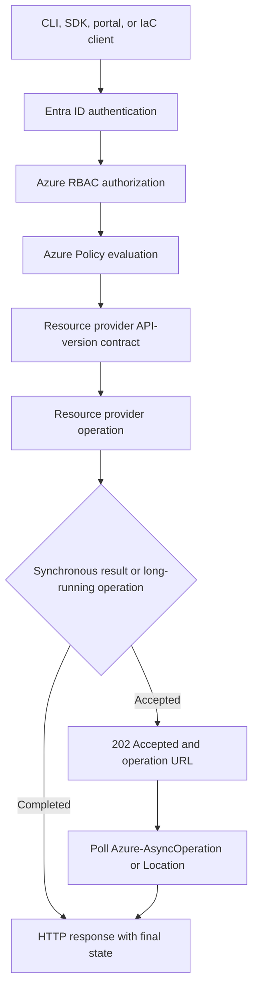
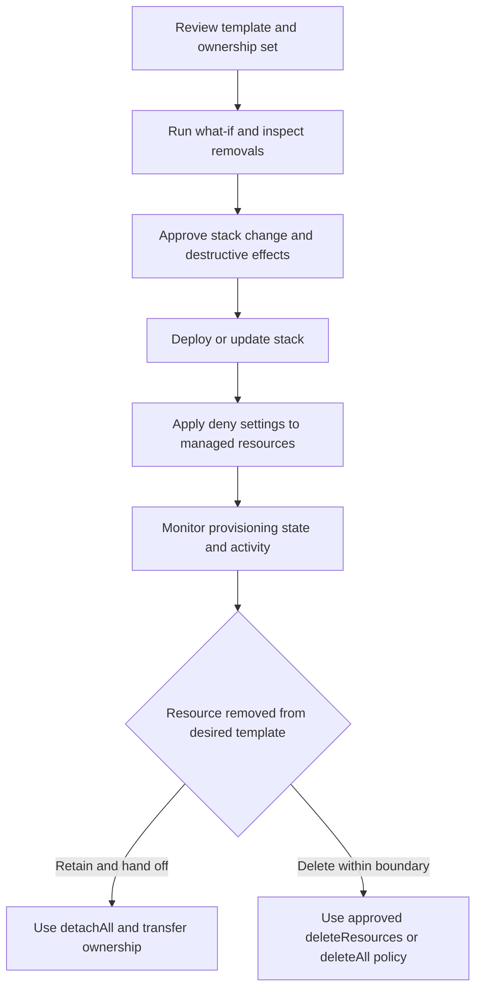

# Module 03: ARM, Bicep, and Infrastructure-as-Code Patterns

Azure Resource Manager (ARM) is the control-plane front door for Azure resources. Bicep compiles a declarative source language into ARM templates, while Terraform providers translate Terraform plans into resource-provider API calls. Production safety depends less on syntax than on understanding scope, API contracts, ownership boundaries, asynchronous operations, and deletion semantics.

This module covers Azure-specific implementation details. For provider-neutral infrastructure-as-code concepts, state, locking, and Terraform mechanics, see [Terraform](../../terraform/README.md). For cloud model and governance foundations, see [Cloud Foundations](../../../architecture/cloud-foundations/README.md). For general networking and routing concepts used by private deployment agents, see [Networking](../../../architecture/networking/README.md).

**Verified tool baseline for examples and discussion:** Azure CLI 2.93.0, Bicep 0.49.2, Terraform `hashicorp/azurerm` 5.14.0, PSRule for Azure 1.47.0, Node.js 26.13.0, and TypeScript 7.0.2.

---

## 1. ARM resource-provider architecture

ARM is a regional and global control-plane service that accepts authenticated management requests and routes them to the owning resource provider (RP). A resource provider owns a namespace such as `Microsoft.Storage` and implements resource-specific API contracts, validation, provisioning, and lifecycle operations.

An ARM resource ID is a hierarchical address, not a promise that every component is implemented by one service. The subscription, resource group, provider namespace, resource type, and resource name identify the control-plane object whose contract is being invoked.

For example, `Microsoft.Storage/storageAccounts/blobServices/containers` is a nested resource type whose parent storage account and blob service have their own lifecycle and API-version behavior.

The ARM endpoint, resource provider, and data-plane endpoint are separate interfaces. Creating a storage account through ARM does not itself authorize a request to read blobs through the storage data plane.

### 1.1 Control-plane request pipeline

An ARM request passes through authentication, authorization, policy evaluation, API-contract validation, and resource-provider execution. The exact internal implementation is not a public transaction protocol, so treat the following as the observable logical pipeline rather than a guarantee about private service internals.



1. The client obtains an access token for the Azure Resource Manager audience and sends it to the ARM endpoint.
2. ARM validates the token and the caller's identity before checking authorization at the requested scope.
3. Azure RBAC evaluates whether the principal has the required control-plane action, including inherited assignments and applicable deny assignments.
4. Azure Policy evaluates the request against assigned definitions and initiatives; effects such as `Deny`, `Modify`, and `DeployIfNotExists` have distinct outcomes.
5. ARM resolves the provider namespace, resource type, API version, and request body against the resource provider's contract.
6. The resource provider validates service-specific constraints and either returns a final result or begins a long-running operation.
7. ARM returns the operation result to the client, which must not infer completion merely because an initial request was accepted.

RBAC and Policy are related but different gates. RBAC decides whether a principal may perform an action; Policy evaluates whether the requested resource state complies with governance rules.

An `Owner` role assignment does not make an API version valid, bypass an Azure Policy deny effect, or grant data-plane access unless the relevant data actions are included.

An ARM deployment can succeed while a later application-level check fails. IaC tests therefore prove authored configuration and provider behavior, not all runtime service behavior.

### 1.2 Resource provider API versions are contracts

An API version selects a versioned schema and behavior contract for a resource type. It is not simply the installed CLI version and does not guarantee that every feature available in a service's data plane is exposed in that API version.

The same provider namespace can expose different API versions for different resource types. A parent resource and a nested child resource can therefore need different API versions in the same Bicep file.

Use a stable API version supported by the target cloud and resource type. Pinning a version makes reviews reproducible, but the pinned contract still needs periodic review for feature gaps, retirement notices, and service changes.

Do not copy an API version from an unrelated resource declaration. Validate against the resource provider's documentation or the current resource-type schema and then compile with the pinned Bicep compiler.

If a desired property is absent from the `azurerm` schema, first check whether the Azure resource provider API exposes it and whether the provider release supports it. The gap may be in Terraform's provider schema rather than in ARM.

### 1.3 Long-running operations and polling

Many create, update, and delete operations are asynchronous. ARM can return `202 Accepted` while a resource provider continues provisioning.

The response may provide an `Azure-AsyncOperation` header, a `Location` header, and a `Retry-After` interval. Clients should honor the returned polling URL and interval rather than repeatedly issuing the original write.

An asynchronous status response commonly reports a state such as `InProgress`, `Succeeded`, `Failed`, or `Canceled`. Treat the final provisioning state and error payload as authoritative; the first HTTP response is only acceptance.

The `provisioningState` property is resource-provider-specific and may be visible on the resource after the operation ends. It is not a substitute for following the operation URL when the API returns one.

SDKs, Azure CLI, Bicep deployment clients, and Terraform providers implement polling differently. A custom deployment orchestrator must preserve request IDs, correlation IDs, polling URLs, and retry intervals for diagnosis.

Do not retry a create blindly after a network timeout. The first request may still be running, and repeating a non-idempotent side effect can create duplicate external effects even if ARM resource identity is deterministic.

### 1.4 ARM throttling and retry behavior

ARM applies throttling by subscription and tenant buckets. The working limits for this module are **1,200 writes per hour** and **12,000 reads per hour** per applicable subscription or tenant bucket.

The exact bucket and operation classification can vary by endpoint and workload. A deployment that fans out thousands of independent resource operations may hit a service limit before its wall-clock timeout.

ARM responses expose remaining-capacity headers such as `x-ms-ratelimit-remaining-subscription-writes` and `x-ms-ratelimit-remaining-subscription-reads`. Capture these headers when diagnosing bursts and quota pressure.

A `429 Too Many Requests` response is a capacity signal, not evidence of an invalid template. Respect `Retry-After` where supplied and use bounded exponential backoff with jitter for retryable operations.

Avoid retry storms: many parallel workers that all retry at the same fixed interval synchronize and create a second burst at the end of the wait.

Use a deployment graph that respects actual dependencies instead of serializing every resource or launching all writes at once. ARM can parallelize independent resources, but client-side parallelism still consumes throttling capacity.

Batch read-only inventory work and cache stable metadata where correctness permits. Do not cache authorization decisions or resource state beyond the consistency assumptions of the workflow.

When a deployment repeatedly fails under throttling, reduce fan-out, partition independent work across safe deployment waves, and preserve idempotent resource names so a resumed run converges.

---

## 2. Deployment scopes and composition

ARM deployments can target four scopes: tenant, management group, subscription, and resource group. The deployment scope determines the available resource types, the deployment record location, and the syntax required to address resources elsewhere in the hierarchy.

| Scope | Typical use | Examples of directly deployable objects |
| --- | --- | --- |
| `tenant` | Tenant-wide bootstrap and management-group hierarchy | Management groups, policy definitions, tenant-level role assignments |
| `managementGroup` | Governance across subscriptions | Policy assignments, management-group-scoped role assignments |
| `subscription` | Subscription baseline and resource-group creation | Resource groups, subscription-level role assignments, policy assignments |
| `resourceGroup` | Application or platform workload deployment | Virtual networks, storage accounts, compute resources, resource-group role assignments |

The resource group's Azure region stores deployment metadata and does not force every contained resource to use that region.

Resource locations remain service-specific. A resource provider may require a resource location, accept a global location, or use a locationless resource type.

A Bicep file declares its deployment scope with a `targetScope` value. The deployment command must use a scope compatible with that declaration.

```bicep
targetScope = 'resourceGroup'

param location string = resourceGroup().location
param environment string

resource workspace 'Microsoft.OperationalInsights/workspaces@2023-09-01' = {
  name: 'law-${environment}'
  location: location
  properties: {
    retentionInDays: 30
    sku: {
      name: 'PerGB2018'
    }
  }
}
```

### 2.1 Cross-scope Bicep modules

A Bicep module is a separately compiled deployment unit invoked from a parent template. The module's target scope can differ from the parent deployment's scope when the caller has permissions and the module declares a compatible target scope.

Use `scope: resourceGroup(subscriptionId, resourceGroupName)` when a module targets a resource group other than the parent's current resource group.

Use `scope: subscription(subscriptionId)` or `scope: managementGroup(managementGroupId)` for modules that declare those target scopes. A tenant-scope module uses the tenant scope function and must be deployed by an appropriately authorized principal.

```bicep
targetScope = 'subscription'

param workloadSubscriptionId string
param workloadResourceGroupName string
param location string

module network './modules/network.bicep' = {
  name: 'network-${uniqueString(workloadSubscriptionId, workloadResourceGroupName)}'
  scope: resourceGroup(workloadSubscriptionId, workloadResourceGroupName)
  params: {
    location: location
  }
}
```

Cross-scope deployment is not a privilege escalation. The deployment identity needs the required actions at the target scope, and Policy applies at that scope and inherited ancestors.

Use modules to define clear ownership seams, not to fragment a tightly coupled deployment into dozens of tiny deployments. Every module creates a deployment record and can add operational and throttling overhead.

Prefer explicit module outputs for stable contracts. Avoid reaching into implementation details of a child module from the parent through string-based resource IDs when an output can express the dependency.

Use a deterministic module deployment name when re-running the same logical operation should update or reuse the same deployment record. Include environment and scope identity where the same module can run in multiple targets.

### 2.2 Scope hierarchy and deployment authority

The Azure resource hierarchy is Entra tenant, management group, subscription, resource group, and resource. Role assignments and Policy assignments can inherit down this tree according to their scope and definition.

A tenant-scope deployment is a bootstrap operation with broad blast radius. Separate it from routine workload deployments and use an identity whose permissions are limited to the required hierarchy operations.

A subscription-scope deployment can create a resource group and then call a resource-group module. This pattern makes the target resource group explicit and keeps the workload resources in their natural lifecycle boundary.

Resource-group deployments are often the right unit for application releases because the deployment history is close to the managed workload. They are not an automatic ownership boundary if another team independently manages resources in the same group.

Keep platform-owned shared services and application-owned resources in different resource groups when their change cadence, permission model, or deletion policy differs.

---

## 3. Deployment modes and deletion semantics

ARM resource-group deployments support incremental and complete deployment modes. **Complete mode is banned for production deployments in this curriculum.**

Incremental mode creates or updates resources present in the template and leaves unrelated resources alone. It does not mean ARM merges every omitted property with the current resource; properties omitted from a declared resource can still be reset or defaulted according to the resource provider's `PUT` semantics.

Complete mode treats the template as the desired full set of resources at the deployment scope. At the end of a successful deployment, ARM deletes resources in the resource group that are absent from the template.

The blast radius includes resources created manually, by a separate team, by a different IaC state, or by an older deployment that the current template does not enumerate.

### 3.1 Complete-mode production disaster

The common failure sequence is straightforward: a team applies a template containing only the application tier to a shared resource group in complete mode, and ARM removes the database, monitoring workspace, private endpoint, or emergency recovery resource that the template did not include.

The template can be syntactically valid and the deployment can report success even though the unwanted deletes are the intended result of complete mode.

An operator may believe that the template represents one component because the deployment name or pipeline belongs to that component. Complete mode instead treats the target resource group as the deletion boundary.

This is a particularly dangerous mismatch in shared resource groups. The deployment caller may not own the resources being deleted, but the mode is evaluated against the resource group's full resource set.

Complete-mode behavior for child resources can differ from the reader's mental model of a flat list. Some child resources are represented and enumerated as independent resource types; others are coupled to parent deletion, and resource-provider behavior can affect whether an omitted child is deleted, retained, or causes an operation failure.

Deleting a parent can also remove dependent child configuration or service state even if a child resource was not separately enumerated in the template's resource list.

Do not infer that a child resource survives because the parent remains, or that it will be deleted because the parent is omitted. Verify the exact resource type and operation behavior in a disposable environment before any planned destructive action.

Complete mode's handling of nested deployments, extensions, and provider-managed child resources is not a safe substitute for explicit ownership. Review the full deployment diff and resource-provider contract instead of assuming one uniform recursion rule.

An ARM what-if preview can show planned removals, but a preview is not a transactional lock. The resource set can change between preview and deployment, and what-if can have blind spots described later in this module.

For new production designs, use **Deployment Stacks** to declare ownership and unmanage behavior. Use incremental deployments for ordinary resource-group reconciliation when a stack is not appropriate.

### 3.2 Incremental mode is not property-level patch mode

Incremental mode's preservation guarantee concerns resources absent from the template. It does not guarantee preservation of omitted fields on a resource that is present.

Many ARM resource providers implement resource `PUT` as replacement of the provider's writable representation. An omitted property may be reset to a service default, preserved by the provider, or rejected, depending on the resource contract.

Inspect generated templates and provider documentation when changing nested properties. A resource declaration should state the complete desired configuration for the properties it owns.

Avoid using a minimal template as a patch for a resource unless the resource API explicitly supports patch semantics and the deployment path invokes that API correctly.

---

## 4. Deployment Stacks as explicit ownership boundaries

A Deployment Stack groups managed resources and records what should happen when a resource is removed from the stack's template or when the stack is deleted.

Stacks provide a more explicit lifecycle boundary than Complete mode. They can also apply deny settings that protect managed resources against direct changes outside the stack.

Stacks do not remove the need to understand resource-provider behavior, review changes, or authorize the pipeline carefully. A stack with destructive unmanage behavior can still delete valuable resources by design.

### 4.1 `actionOnUnmanage`

`actionOnUnmanage` specifies how the stack handles resources that stop being managed by it. The values are `deleteAll`, `deleteResources`, and `detachAll`.

| Value | Unmanaged stack resource behavior | Appropriate use |
| --- | --- | --- |
| `deleteAll` | Delete managed resources and their resource groups where applicable | Ephemeral environments whose full boundary is intentionally disposable |
| `deleteResources` | Delete resources but retain resource groups | Workload boundaries where the group is retained for audit or controlled reuse |
| `detachAll` | Remove stack management and leave the resources in place | Adoption, migration, or handoff where another owner takes over |

Treat `deleteAll` as a destructive lifecycle setting and scope it to a resource group whose complete ownership is unambiguous.

Before changing a stack template, compare the stack's current managed resource set with the proposed set. Removing a resource from the template can invoke the configured unmanage action.

Use `detachAll` for a deliberate ownership transfer only after the receiving deployment system or team has accepted responsibility. A detached resource no longer receives stack protections.

### 4.2 `denySettings` and deny assignments

Stack deny settings create a deny assignment that can block operations even when a caller's Azure RBAC role would otherwise allow them. A subscription `Owner` can therefore be prevented from manually writing or deleting protected stack resources.

This behavior is a guardrail, not an assertion that the owner role has disappeared. The role remains assigned, but the deny assignment blocks matching operations on protected resources.

The `denySettings` object includes a `mode`, `excludedPrincipals`, and `excludedActions`. The relevant modes are `denyDelete` and `denyWriteAndDelete`.

`denyDelete` blocks deletion of protected resources while permitting writes that are otherwise authorized.

`denyWriteAndDelete` blocks writes and deletes outside the deployment stack's permitted management path, protecting both resource existence and configuration.

`excludedPrincipals` lists principals that should bypass the deny settings. Keep this list minimal and use stable principal IDs rather than display names.

`excludedActions` lists operations excluded from the deny rules. Add an action only when an operational requirement needs it, and record the reason and owner.

An emergency principal excluded from a deny setting is a powerful break-glass path. Protect its credentials and monitor its use through the organization's identity controls.

Do not assume that deny settings block every possible action on every control plane. Verify the affected resource types, operation names, deployment-stack behavior, and documented exceptions.

An Azure Policy assignment and a stack deny assignment solve different problems. Policy can govern a broad population of resources; stack deny settings protect the resources in a specific managed stack from direct mutation.

### 4.3 Stack lifecycle sequence

Create a stack only after confirming its scope, deployment identity, action-on-unmanage policy, deny exclusions, and recovery path.



The stack deployment itself must be performed by an identity authorized for the target scope and resource-provider operations.

Do not rely on a portal user's Owner role as a recovery mechanism when deny settings intentionally prevent manual changes.

Recovery from a wrongly denied change is to use the stack's authorized management path, update the stack or its settings deliberately, and then reconcile the intended resource state.

---

## 5. What-if previews: useful evidence, not proof

ARM what-if evaluates a proposed template against current control-plane state and classifies likely changes as create, modify, delete, or no change.

What-if is an important review step for high-impact deployments, but it is neither a transaction nor a complete simulation of resource-provider runtime side effects.

### 5.1 False-positive `Modify` noise

What-if can report a `Modify` for properties that the resource provider returns as read-only, defaulted, normalized, or differently serialized from the template.

Common sources of noise include service-populated properties, default values, casing or formatting normalization, API-version schema changes, and properties that are not writable even though they appear in a GET response.

A `Modify` result is therefore a prompt to inspect the resource type, property path, and API contract. It is not automatically a planned behavioral change.

Normalize template inputs and pin API versions to reduce avoidable noise. Do not hide recurring differences by ignoring all `Modify` output.

### 5.2 Runtime side effects that what-if can miss

What-if does not execute the resource provider's eventual deployment and cannot fully predict service behavior that occurs after the control-plane request.

A change can trigger resource-provider side effects such as restarting a workload, rotating a service endpoint, rebuilding a backend pool, or applying a setting asynchronously after the deployment has completed.

Some service defaults, external dependencies, data-plane changes, and eventual-consistency effects may not be represented as explicit ARM resource diffs.

What-if can also be incomplete when the caller lacks permissions to read a resource or when the provider does not expose enough state to calculate an exact diff.

Review the raw what-if result, inspect provider warnings, and pair the preview with a service-specific maintenance plan for disruptive changes.

For production-critical resources, deploy to a representative non-production environment first and verify service health, dependency behavior, and rollback feasibility.

---

## 6. Bicep engineering patterns

Bicep is a declarative language that compiles to ARM JSON. The compiler performs syntax, type, and reference analysis before ARM receives the generated template.

Bicep improves authoring and modularity; it does not change the resource provider's API contract or remove ARM runtime limitations.

Use `bicep build` to inspect generated ARM JSON when debugging an unexpected expression, condition, dependency, or resource shape.

Use `bicep lint` during local validation and keep warnings actionable. A linter cannot prove that a deployment is authorized, quota-safe, or free of runtime service side effects.

### 6.1 Strongly typed inputs and user-defined types

User-defined types constrain the shape and allowed values of module inputs. They move configuration mistakes toward compile-time feedback rather than late ARM deployment failures.

```bicep
@sealed()
type StorageSku = 'Standard_LRS' | 'Standard_ZRS' | 'Standard_GRS'

@sealed()
type StorageConfiguration = {
  name: string
  sku: StorageSku
  publicNetworkAccess: 'Enabled' | 'Disabled'
  minTlsVersion: 'TLS1_2'
}

param configuration StorageConfiguration
```

Use named types for repeated shapes that carry domain meaning, such as a subnet configuration or workload identity assignment.

Avoid using `any()` or broad object types to silence compiler errors. Loose types remove a useful validation boundary and move errors to deployment time.

Use unions for a finite set of supported values and objects for structured configuration. Keep defaults explicit when they are a security or cost decision.

Decorators such as `@minLength`, `@maxLength`, `@allowed`, and `@secure` express input constraints and help protect deployment parameters.

`@secure()` prevents a parameter value from being exposed in deployment history in the same way as an ordinary parameter, but it does not make secrets safe in source control, shell history, pipeline logs, or downstream outputs.

### 6.2 Discriminated unions with `@discriminator`

The `@discriminator` decorator identifies a property whose literal value selects the valid shape of a union. This helps model configuration where different resource variants require different fields.

```bicep
@discriminator('kind')
type NetworkTarget =
  | {
      kind: 'privateEndpoint'
      subnetId: string
      privateDnsZoneIds: string[]
    }
  | {
      kind: 'serviceEndpoint'
      subnetId: string
      serviceName: string
    }
```

The discriminator value is part of the input contract. Each union branch should use a distinct literal and contain only fields valid for that variant.

Do not treat type unions as runtime validation of arbitrary external JSON. Compile-time checking applies when the value is known to the Bicep compiler; external deployment parameters still need validation by the deployment interface and resource provider.

Keep the discriminator's meaning stable across module versions. Changing a literal can be a breaking interface change for every caller.

### 6.3 Private Bicep registries

Bicep registries store versioned modules as OCI artifacts. A private Azure Container Registry (ACR) can act as a module registry for organization-owned reusable infrastructure.

Use immutable module versions for production callers. A tag such as `:latest` makes the compiled deployment depend on mutable registry state and weakens reproducibility.

Use a registry path that reflects ownership and responsibility, for example `br:contosoiac.azurecr.io/platform/network:v1.4.0`.

Authenticate the build and deployment identities to ACR through the approved workload identity mechanism. Do not embed registry credentials in Bicep source or checked-in configuration.

The compiler may need to restore registry modules before offline validation. Cache the exact module artifacts or provide a deliberate private registry connection; do not silently fall back to an unpinned public module.

Review a module's compiled template and its transitive module dependencies before promotion. A small top-level module can compile into a large, high-impact deployment.

### 6.4 `existing` references

Use `existing` to reference a resource that is already provisioned and owned outside the current deployment. An `existing` declaration does not create, update, or delete that resource.

```bicep
param storageAccountName string

resource storage 'Microsoft.Storage/storageAccounts@2023-05-01' existing = {
  name: storageAccountName
}

output blobEndpoint string = storage.properties.primaryEndpoints.blob
```

An `existing` reference still requires the relevant read permission when ARM resolves properties or when a module uses the resource in a runtime expression.

Use the correct scope on cross-resource-group or cross-subscription existing references. A same-name resource in a different scope is a different resource.

An `existing` declaration is not a lifecycle lock. Another deployment or operator can modify or delete the referenced resource.

Avoid making a resource `existing` merely to work around an unwanted create/update diff while leaving its ownership ambiguous.

### 6.5 Deterministic names and idempotency

IaC should converge on a stable resource identity when the same logical input is deployed repeatedly. A generated name based only on random values breaks that property.

`uniqueString()` produces a deterministic hash-like suffix for the same input string. A common pattern is `uniqueString(resourceGroup().id)` to derive a stable resource name suffix within one resource group.

```bicep
var deploymentSuffix = uniqueString(resourceGroup().id)
var workspaceName = 'law-${deploymentSuffix}'
```

Include the correct uniqueness boundary in the input. `uniqueString(resourceGroup().id)` can produce the same name in different contexts only according to the hash input; it does not guarantee global uniqueness across Azure.

Storage account names and other globally scoped names need an organization-controlled uniqueness strategy that avoids exposing secrets or personal data in resource names.

Do not use a deployment name as a substitute for a resource identity design. Deployment records and deployed resources have separate names and lifecycles.

Idempotent resource declarations do not automatically make external side effects idempotent. Custom scripts, deployment scripts, and event-triggered provisioning need their own idempotency keys or reconciliation logic.

### 6.6 Compile-time and runtime expression traps

Bicep expressions are evaluated in different contexts. Loop bounds, type declarations, and many resource names are resolved during compilation or template expansion, while `reference()` and `list*()` functions require runtime ARM state.

Do not call `reference()` in a loop expression that must be known before deployment. Resolve a runtime property in a resource or module output after the dependency exists.

`reference()` and `list*()` are runtime functions. A template can fail if a runtime function is evaluated for a resource that is conditionally absent or for a loop item that does not exist.

An `if` condition on a resource does not mean every expression that references that resource is safe when the condition is false. Guard dependent expressions and use nullable types or separate modules where appropriate.

When a resource has a condition, make references to it conditional as well. Inspect compiled ARM JSON when an expression appears to be evaluated outside the expected branch.

Do not use a runtime `reference()` where a symbolic Bicep reference is sufficient. Symbolic references make dependencies clearer and allow the compiler to infer the deployment graph.

Avoid manually adding `dependsOn` when a direct symbolic reference already establishes the dependency. Unnecessary dependencies reduce parallelism and can hide accidental coupling.

Some resource provider list operations require a particular API version or permission and can return secret material. Treat `listKeys()` and similar calls as sensitive data paths.

Keep outputs free of credentials, keys, connection strings, and other secrets. Deployment outputs can be persisted and surfaced in pipeline logs.

### 6.7 Module contracts and versioning

A Bicep module interface consists of its parameters, outputs, resource behavior, and lifecycle assumptions. Treat a change to any of these as an interface change even if the file remains syntactically valid.

Make modules small enough that one team can understand their resource ownership and deletion effects, but large enough to represent a coherent operational component.

Prefer parameters for genuine environment differences and defaults for stable, safe conventions. Avoid turning every resource property into a parameter when callers should not own that decision.

Document whether a module creates a new resource, adopts an existing resource, or expects the caller to supply an ID.

Return resource IDs and stable endpoint metadata as outputs. Do not return secrets for convenience.

Test module consumers against the pinned compiler version. Bicep language or type-system changes can expose previously unnoticed interface problems.

---

## 7. Terraform `azurerm` and AzAPI provider boundaries

The AzureRM provider and AzAPI provider both communicate with Azure resource providers but have different schema ownership.

`hashicorp/azurerm` 5.14.0 provides a typed, stable Terraform interface for commonly used Azure resources. It does not necessarily expose every newly released ARM feature on the day that feature becomes available.

Provider support follows the provider's implementation, schema, testing, and release process. A resource provider API can expose a property before AzureRM adds it to its resource schema.

AzAPI provides a more direct Terraform interface to ARM resource types and API versions. It is useful for day-zero features, preview properties, and resource types not yet covered by AzureRM.

Use AzureRM for the stable core of a deployment when its resource model covers the required configuration. Use `azapi_resource` for a new ARM resource or a feature gap that AzureRM does not yet model.

Use `azapi_update_resource` to update selected properties on an existing resource only when the ownership boundary is explicit and compatible with the resource's other Terraform owner.

### 7.1 Preventing dual ownership and state drift

Two Terraform resources must not independently claim authoritative ownership of the same resource properties. AzureRM refresh can observe an AzAPI change and plan to restore its own configured state.

The safest pattern is one Terraform resource owner per Azure resource. If AzAPI owns a resource, keep all of its ARM properties in the AzAPI configuration unless the provider contract specifically supports a separate update resource.

When using `azapi_update_resource` alongside AzureRM, define exactly which properties each provider manages and verify that AzureRM does not continually overwrite the AzAPI-managed fields.

Do not use `ignore_changes` to conceal an unclear ownership model. Use it only for a documented field that another controller intentionally owns, and test the plan behavior after refresh.

Do not import one Azure resource into two Terraform addresses or separate state files. That creates competing plans and can produce destructive updates even when both configurations appear reasonable.

Pin AzureRM, AzAPI, and Terraform versions. Provider upgrades can change schemas, diff behavior, default handling, or API versions.

### 7.2 AzureRM for stable core and AzAPI for a gap

The following example illustrates a boundary rather than a universal configuration. The exact API version and body must match the Azure resource type and feature being used.

```hcl
terraform {
  required_providers {
    azurerm = {
      source  = "hashicorp/azurerm"
      version = "= 5.14.0"
    }
    azapi = {
      source = "Azure/azapi"
    }
  }
}

provider "azurerm" {
  features {}
}

resource "azurerm_resource_group" "workload" {
  name     = "rg-orders-prod"
  location = "westeurope"
}

resource "azapi_resource" "feature_gap" {
  type      = "Microsoft.Example/widgets@2025-01-01"
  name      = "orders-feature"
  parent_id = azurerm_resource_group.workload.id
  body = {
    properties = {
      enabled = true
    }
  }
}
```

The `Microsoft.Example` type above is a placeholder and is not a real Azure resource provider type. Replace it with a documented resource type before use.

For a production resource, verify the selected API version, schema, required fields, and provider registration in the target Azure cloud.

Do not create the same resource with AzureRM and AzAPI in separate blocks. Pick one owner and move ownership through a deliberate import or state-move procedure if the implementation changes.

---

## 8. Offline validation and policy-as-code pipeline

Offline validation catches many source, type, configuration, and policy defects before a deployment reaches Azure. It cannot prove live RBAC, Policy assignment, quota availability, region capacity, asynchronous service health, or data-plane behavior.

The local validation pipeline in this module uses Bicep linting, PSRule for Azure 1.47.0, Terraform tests with `mock_provider "azurerm"`, and OPA/Conftest policy checks.

Run validation with pinned tools in the Azure track's mise environment. Do not let a local globally installed compiler silently replace the documented tool version.

### 8.1 Bicep lint and build

`bicep lint` checks the Bicep source against compiler diagnostics and configured linter rules.

`bicep build` compiles the source into ARM JSON and catches additional syntax and type errors.

```bash
bicep lint ./infra/main.bicep
bicep build ./infra/main.bicep --outfile /tmp/main.json
```

The `what-if` command requires Azure access and is not an offline test. Treat it as a cloud-backed preview step after local compilation and policy validation.

### 8.2 PSRule for Azure

PSRule for Azure 1.47.0 evaluates Azure-oriented best-practice rules against template or resource metadata supported by its rule set.

Use PSRule results as policy evidence and tune the rule selection deliberately. A clean result means the selected rules passed for the evaluated inputs, not that the deployment is secure in every context.

Run rules against generated ARM JSON when that is the artifact actually deployed. This tests the compiler output rather than a source file that may compile differently than expected.

Keep any rule suppression narrow, documented, and time-bounded. A global suppression can convert an actionable policy gap into a permanent blind spot.

### 8.3 Terraform tests with a mock provider

Terraform's test framework can exercise module plans without creating real Azure resources. A mock provider validates module behavior and expected resource configuration; it does not emulate Azure resource-provider semantics.

```hcl
mock_provider "azurerm" {}

run "storage_is_private_and_hardened" {
  command = plan

  assert {
    condition     = azurerm_storage_account.example.public_network_access_enabled == false
    error_message = "Storage account public network access must be disabled."
  }

  assert {
    condition     = azurerm_storage_account.example.min_tls_version == "TLS1_2"
    error_message = "Storage account minimum TLS version must be TLS1_2."
  }
}
```

Use fixtures with explicit values for security-sensitive configuration. Tests that rely on provider defaults can pass today and change behavior after a provider upgrade.

Add negative tests for public access, weak TLS, missing private connectivity, and unsafe deletion options where the module exposes those choices.

### 8.4 OPA/Conftest guardrails

OPA policies can reject generated plans or configuration when a required invariant is missing. The repository's required checks are to deny public blob access and enforce `min_tls_version = "TLS1_2"`.

Write policy against a stable machine-readable input, such as a Terraform plan in JSON form, and version that schema with the policy.

```rego
package terraform.azure.storage

deny contains message if {
  some resource in input.resource_changes
  resource.type == "azurerm_storage_account"
  resource.change.after.public_network_access_enabled == true
  message := sprintf("%s must not allow public network access", [resource.address])
}

deny contains message if {
  some resource in input.resource_changes
  resource.type == "azurerm_storage_account"
  resource.change.after.min_tls_version != "TLS1_2"
  message := sprintf("%s must enforce TLS1_2", [resource.address])
}
```

Policy should fail closed when a required field is absent or unknown in a production plan. A policy that silently treats unknown values as compliant creates a gap at exactly the point where evaluation is least certain.

Test both compliant and non-compliant fixtures. Include unknown or omitted property cases so a future provider schema change cannot weaken the guardrail without a test failure.

Do not treat Conftest as a replacement for Azure Policy. Conftest evaluates an artifact before deployment; Azure Policy evaluates applicable resources and requests at Azure control-plane boundaries.

### 8.5 What the offline pipeline cannot prove

Offline checks cannot verify that the deployment principal has effective permissions at every cross-scope target.

Offline checks cannot confirm that Azure Policy assignments, exemptions, and remediation tasks in the actual tenant match the policy source used by the pipeline.

Offline checks cannot prove that a selected resource provider API version is currently available in the target cloud or that a feature is enabled for the subscription.

Offline checks cannot prove regional quota, service capacity, asynchronous provisioning success, DNS propagation, data-plane connectivity, or operational failover.

Use a non-production Azure environment for integration tests that require live ARM behavior. Isolate it by subscription or resource group, use low-privilege identities, and make cleanup behavior explicit.

---

## 9. Production deployment sequence and controls

Use a repeatable deployment sequence that separates source validation, review, authorization, execution, and post-deployment verification.

1. The author pins compiler and provider versions and validates source locally.
2. The pipeline builds Bicep or creates the Terraform plan using the same pinned versions used for deployment.
3. Policy checks evaluate the generated artifact and fail on public storage access or TLS settings weaker than `TLS1_2`.
4. A cloud-backed what-if or Terraform plan is generated with the intended deployment identity and saved as a review artifact.
5. A reviewer checks scope, resource ownership, planned deletions, sensitive outputs, and service-specific runtime effects.
6. The pipeline applies the reviewed artifact with an identity scoped to the target resource group or stack.
7. The pipeline waits for asynchronous provisioning to finish and captures correlation IDs for failures.
8. Post-deployment checks verify resource provisioning state, application health, private access, and expected monitoring signals.

Do not regenerate a mutable plan between approval and apply without repeating review. The plan is evidence about a particular configuration and state snapshot.

Use separate identities for authoring, plan generation, and emergency administration where the operational model permits. Avoid storing long-lived secrets in pipeline variables when a workload identity federation mechanism is available.

Constrain production deployments with explicit environment approvals, protected branches, and environment-specific scope configuration.

Treat a deployment rollback as another deployment, not a promise to reverse every external side effect. A previous template may not restore data, rotate credentials backward, undo an irreversible migration, or restore a service endpoint.

Record resource ownership in source and pipeline metadata. An operator should be able to identify which stack or Terraform state owns a resource before making a manual change.

---

## 10. Then vs now: ARM JSON, Blueprints, and deployment modes

### 10.1 ARM JSON to Bicep 0.49+

**Then:** teams authored large ARM JSON templates directly, repeating nested syntax and expressing dependencies and scopes in a verbose representation.

**Now:** Bicep 0.49.2 provides a higher-level authoring language that compiles to ARM JSON, with modules, user-defined types, decorators, and compiler diagnostics.

The compiled ARM template remains the deployment artifact interpreted by ARM. Bicep does not replace resource provider API versions or change the ARM request pipeline.

Migration steps are to decompile or translate existing templates, compare generated JSON and resource identities, validate module contracts, and run a cloud-backed what-if before replacing a production pipeline.

The main migration pitfall is assuming source-level equivalence from similar-looking declarations. Check API versions, conditions, loops, dependencies, parameter defaults, and outputs in the compiled template.

### 10.2 Azure Blueprints to Deployment Stacks

**Then:** Azure Blueprints packaged governance artifacts and resource templates as an assignment-oriented landing-zone mechanism.

**Now:** Azure Blueprints are retired; use the supported governance and deployment mechanisms, including Azure Policy, templates, and Deployment Stacks where their ownership and deny semantics fit.

Do not translate a Blueprint assignment mechanically into one Deployment Stack. Separate policy assignment, role assignment, resource deployment, and lifecycle ownership according to their different responsibilities.

Validate existing Blueprint dependencies and retirement guidance in the target tenant before changing a live baseline. Keep the migration reversible until the new governance assignments and resource ownership have been tested.

### 10.3 Complete Mode to `actionOnUnmanage`

**Then:** Complete mode treated the resource group as the template's complete desired resource set and deleted omitted resources.

**Now:** production designs avoid Complete mode and use Deployment Stacks to define managed resources and a deliberate `actionOnUnmanage` policy.

Choose `detachAll` when transferring ownership, `deleteResources` when deleting resources but retaining their resource groups, and `deleteAll` only when the stack's entire environment boundary is intentionally disposable.

Before migration, inventory existing resources, identify their current owner, import or adopt them deliberately, and compare stack what-if output with the intended ownership manifest.

Never switch a shared resource group from an incremental workflow to a deletion-oriented stack without an approved inventory and recovery plan.

---

## 11. Failure analysis and operational patterns

### 11.1 Deployment accepted but the resource remains unavailable

A successful initial response may mean only that ARM accepted a long-running operation. Inspect the operation URL, wait for a terminal status, and check the resource's final provisioning state.

If the provider reports success but the application is still unhealthy, continue at the data-plane and application layers. Control-plane success is not proof of end-to-end health.

### 11.2 A deployment is denied despite broad RBAC

Check the exact operation, target scope, inherited assignments, deny assignments, Azure Policy result, and provider registration.

Do not respond to a denial by granting broader roles before determining whether the caller lacks RBAC, hits a stack deny assignment, or violates Policy.

Use correlation IDs and the activity log to distinguish authorization rejection from provider validation failure.

### 11.3 A deployment changes a property that was omitted

Inspect the resource provider's `PUT` or `PATCH` contract, the API version, and the generated deployment payload.

An omitted field on an included resource may be reset by provider semantics even under incremental mode.

Represent the intended value explicitly or move the property to the resource owner that is meant to control it.

### 11.4 A what-if result contains an unexpected delete

Stop before apply. Verify the deployment scope, mode, stack ownership set, current resource inventory, and template conditions.

For a stack, confirm the configured `actionOnUnmanage` and whether the resource is truly leaving the stack.

For an ARM deployment, verify that Complete mode is not being used against a shared resource group.

### 11.5 A Terraform plan alternates between two values

Check whether AzureRM and AzAPI both manage the same resource or property, whether the provider normalizes values, and whether defaults differ from explicit values.

Check provider version and API version changes, then reproduce with a saved plan and state snapshot in a non-production environment.

Fix ownership or configuration drift at the owning resource rather than suppressing the entire diff.

### 11.6 A deployment exceeds ARM write capacity

Correlate failed writes with rate-limit headers, request IDs, pipeline concurrency, and the resource graph.

Reduce simultaneous writes and use bounded retry logic that honors server-provided delays.

Separate independent workloads into deployment waves only when their ownership and ordering dependencies support that split.

---

## 12. Executable proof and limitations

The executable proof suite for resource identity, stack action semantics, safe IaC validation, and selected deployment edge cases is referenced at `../examples/03-arm-bicep-and-stacks.test.ts`.

Run the Azure track's pinned test runner from `technologies/azure` when the examples are present. These tests can prove deterministic local models and policy predicates; they cannot prove live ARM authorization, actual Azure Policy assignments, provider throttling, or production resource-provider behavior.

The integration boundary for live `what-if`, stack deployment, and ARM asynchronous-operation tests is an isolated non-production Azure subscription. Such tests should skip with a clear message when the required Azure environment is unavailable.

---

## 13. Interview Drill

### Q1: A pipeline deploys one application module to a shared resource group with Complete mode. The template contains no database or monitoring resources, and the pipeline reports success after deleting both. What failed in the design, and what is the safer replacement?

<details><summary>Model Answer</summary>

Complete mode made the resource group, not the application module, the deletion boundary. It deleted resources absent from the template, regardless of who created them. Ban Complete mode in production, inventory and separate ownership, then use incremental deployment or a Deployment Stack with an explicit unmanage action and reviewed ownership set.

</details>

### Q2: A resource is omitted from a Bicep template, but a what-if preview does not clearly predict how its child resources will behave. Can the operator assume the child survives because its parent remains?

<details><summary>Model Answer</summary>

No. Child resources can be enumerated independently or coupled to parent behavior, and provider operations vary. The operator must inspect the exact resource type and API contract, test in a disposable environment, and avoid Complete mode for this production use case.

</details>

### Q3: A subscription Owner cannot manually change a resource deployed by a stack using `denyWriteAndDelete`. Is this an RBAC defect?

<details><summary>Model Answer</summary>

Not necessarily. A Deployment Stack deny assignment can block writes and deletes even when RBAC would otherwise allow them. The authorized recovery path is to update the stack or its deny settings through the approved stack deployment identity, not to add broader RBAC.

</details>

### Q4: A team wants to remove one managed resource from a stack while keeping its resource group and transferring the resource to another IaC state. Which action and sequence are appropriate?

<details><summary>Model Answer</summary>

Use `detachAll` for an ownership transfer, after the receiving owner has prepared an import or adoption procedure and accepted responsibility. Verify the current resource inventory, update stack membership deliberately, and confirm deny settings no longer block the new owner.

</details>

### Q5: What-if reports `Modify` for a service-populated property, while the application team claims that no runtime behavior changes. What evidence is needed before approval?

<details><summary>Model Answer</summary>

Inspect the property path, generated template, API-version schema, and provider's read/write behavior. Determine whether the value is read-only, defaulted, or normalized, and separately assess runtime side effects that what-if cannot simulate. A noisy preview alone neither proves a change nor proves safety.

</details>

### Q6: AzureRM 5.14.0 does not expose a newly released ARM property. How can the team use AzAPI without creating perpetual Terraform drift?

<details><summary>Model Answer</summary>

Use AzureRM for stable resources it models and AzAPI for an unmodeled resource or a carefully bounded feature gap. Keep one authoritative Terraform owner per resource, define property ownership explicitly if an update resource is used, and test plans after refresh. Do not manage the same resource in separate Terraform addresses or states.

</details>

### Q7: A Bicep template conditionally creates a resource, but a dependent output still calls `reference()` and fails when the condition is false. Why, and how should it be fixed?

<details><summary>Model Answer</summary>

Runtime functions such as `reference()` can be evaluated in a context that is unsafe for a resource that does not exist. Guard dependent expressions with the same condition and nullable behavior, or separate the optional resource into a module with an explicit output contract. Inspect compiled ARM JSON to confirm the runtime expression is guarded.

</details>

### Q8: ARM returns `202 Accepted` for a deployment and the client immediately starts downstream configuration. What invariant did the client violate, and what telemetry should it preserve?

<details><summary>Model Answer</summary>

It treated acceptance as completion. The client must poll the operation URL from `Azure-AsyncOperation` or `Location`, honor `Retry-After`, and proceed only after a terminal success state. Preserve operation URLs, request and correlation IDs, response status, and throttling headers for diagnosis.

</details>
