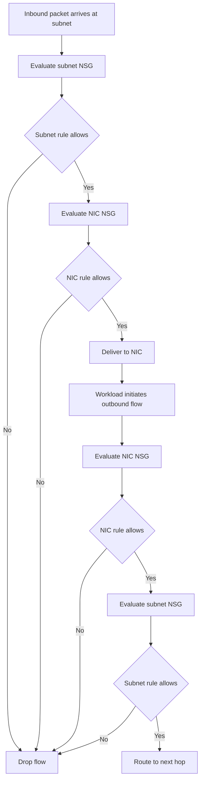
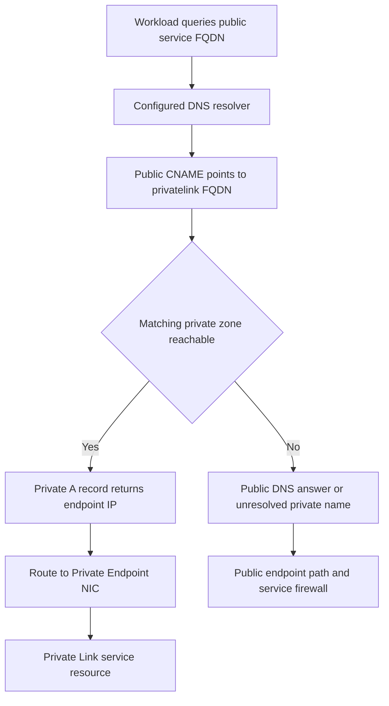
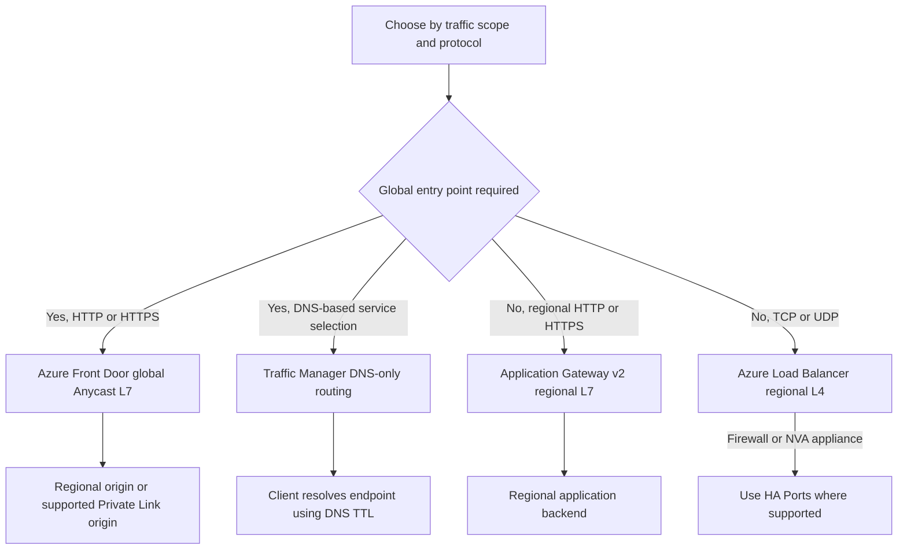

# Module 04: Virtual Networking, Private Link, and Routing

Azure Virtual Network (VNet) provides an isolated, regional IP network for Azure resources. The Azure-specific design work is in subnet and service behavior: address reservation, NSG evaluation at two attachment points, route selection, managed egress, Private Link DNS, and the choice among regional and global traffic services.

This module focuses on Azure implementation details. For provider-neutral IP addressing, routing, DNS, NAT, BGP, and load-balancing theory, see [Networking](../../../architecture/networking/README.md). For cloud networking concepts and service mappings, see [Cloud Foundations](../../../architecture/cloud-foundations/README.md).

---

## 1. VNet and subnet mechanics

A VNet is a regional resource with one or more address spaces. A subnet is a range within that VNet and is also regional; it can host resources in any Availability Zone in the region.

Azure subnets are **not Availability Zone-scoped**. A subnet can contain zone-1, zone-2, and zone-3 resources in the same region, subject to each service's support and subnet requirements.

This differs from AWS, where a subnet is associated with one Availability Zone. Do not carry an AWS subnet-per-zone mental model into Azure address planning.

A VNet's address spaces must not overlap with each other or with networks that need direct routed connectivity, including peered VNets and on-premises prefixes.

VNet peering and VPN connectivity do not perform general-purpose address translation to resolve overlapping ranges. Address overlap must be addressed before selecting direct routing.

### 1.1 Five reserved IPv4 addresses

Azure reserves **five addresses in every IPv4 subnet**, including addresses at the beginning and end of the range.

For an IPv4 subnet `10.20.1.0/29`, the addresses are `10.20.1.0` through `10.20.1.7`. Azure reserves `.0` as the network address, `.1` as the default gateway, `.2` and `.3` for Azure DNS mapping, and `.7` as the broadcast address.

That leaves only three assignable addresses: `10.20.1.4`, `10.20.1.5`, and `10.20.1.6`.

The `.2` and `.3` reservations are Azure's subnet-level DNS slots; the Azure-provided DNS service is reached through the platform virtual IP `168.63.129.16`. Do not describe `.2` and `.3` as the DNS server's literal IP address.

Usable IPv4 address count is therefore the total number of addresses minus five. For subnet prefix length `/p`, the total is `2^(32-p)` and the nominal usable count is `2^(32-p) - 5`, subject to additional service-specific subnet requirements.

| CIDR  | Total addresses | Azure-reserved addresses | Nominal assignable addresses |
| ----- | --------------: | -----------------------: | ---------------------------: |
| `/29` |               8 |                        5 |                            3 |
| `/28` |              16 |                        5 |                           11 |
| `/27` |              32 |                        5 |                           27 |
| `/24` |             256 |                        5 |                          251 |
| `/20` |           4,096 |                        5 |                        4,091 |

Do not size a subnet using only the number of current VM NICs. Include scale-out headroom, service-specific IP consumption, private endpoints, deployment replacement behavior, and any reserved delegation capacity.

Some managed services require dedicated delegated subnets or impose minimum sizes. Confirm those service requirements before assigning the remaining address capacity to unrelated resources.

### 1.2 Subnet delegation

Subnet delegation authorizes a specified Azure service to create or manage service resources in a subnet. It is a control-plane relationship, not merely a tag or route setting.

App Service regional VNet integration uses a delegated subnet with service-specific requirements. The integration subnet is not the same thing as an inbound private endpoint subnet.

Azure Database for PostgreSQL Flexible Server can use a delegated subnet for private network deployment. The service has additional DNS and address planning requirements.

Azure Container Apps environments can require a dedicated infrastructure subnet, with requirements that vary by workload profile and environment mode.

Delegation can constrain which other services or resources may use the subnet. A subnet delegated to one service is not a general-purpose application subnet.

Plan one delegated subnet per service boundary where required, and leave enough address space for scaling and service maintenance operations.

Do not assume that delegating a subnet automatically makes a service private. Service exposure, DNS, routing, and service-level access settings remain separate decisions.

### 1.3 Address planning across regions and connectivity

Use a centrally reviewed IP allocation plan when VNet ranges need to connect through peering, VPN Gateway, ExpressRoute, or a hub.

Reserve address space for future spokes and service subnets instead of assigning every available prefix to the first deployment.

Avoid using the same CIDR for dev and prod if operators may later peer, connect, or route between those environments.

VNet address-space changes require coordination with connected networks. A newly added prefix can be advertised or propagated through gateways and affect remote routing.

When changing a prefix, check existing NICs, delegated services, private endpoints, custom DNS, peering synchronization, gateway advertisements, and on-premises route filters.

---

## 2. Network Security Groups and Application Security Groups

A Network Security Group (NSG) is a stateful Layer 4 filter applied to a subnet, a NIC, or both. Its rules match protocol, source and destination addresses, source and destination ports, and direction.

An Application Security Group (ASG) groups NICs by application role so NSG rules can refer to workload identities rather than repeated IP addresses.

An ASG is a rule selector, not a separate firewall. The NSG still evaluates the rule and the ASG membership does not bypass subnet or NIC filtering.

### 2.1 Stateful five-tuple evaluation

An NSG rule evaluates a flow using a five-tuple: protocol, source address, source port, destination address, and destination port, together with rule direction.

For a newly initiated flow, Azure evaluates the matching rules in priority order. Once permitted, stateful flow tracking allows the corresponding return traffic without requiring a separately authored reverse allow rule.

Stateful behavior does not mean that every asymmetric or unrelated flow is automatically permitted. A new connection in the reverse direction is a separate flow and must match an allow rule.

Custom rule priorities range from **100 through 4096**. Lower priority numbers are evaluated first.

Default rules use priorities in the **65000 through 65500** range and provide baseline virtual-network, load-balancer, and internet rules unless a higher-precedence custom rule changes the result.

The default inbound rules include virtual-network allowance and a final deny for other inbound traffic. Default outbound rules allow virtual-network and internet destinations, subject to route, service, and other controls.

Never use an assumed default rule as a substitute for an explicit security requirement. Review the actual effective rules at the destination NIC.

### 2.2 The dual-NSG evaluation trap

When an NSG is attached to both a subnet and a NIC, **both NSGs must independently allow the flow**.

For inbound traffic, the subnet NSG is evaluated before the NIC NSG. A deny at either point blocks delivery.

For outbound traffic, the NIC NSG is evaluated before the subnet NSG. A deny at either point blocks egress.

An allow rule in one NSG does not override a deny rule in the other. Rule priorities are local to each NSG and do not form one cross-object priority list.

This dual evaluation is a common cause of confusing incidents: a subnet rule appears to allow the flow, but the NIC-level NSG silently denies it.

Network Watcher's **Effective Security Rules** view is the most reliable way to inspect the combined rules that apply to a NIC. Review it for the actual source and destination interface rather than relying only on the intended subnet policy.

### 2.3 NSG evaluation flow

### 2.4 ASG design and limits

Use ASGs to express application roles such as `web`, `api`, and `database` when the participating NICs are in supported VNets and can be assigned to those groups.

A rule from an ASG to another ASG states the allowed application relationship more clearly than a broad subnet-to-subnet CIDR rule.

Keep ASG membership changes controlled. A principal able to change NIC ASG membership may alter which rules apply to that workload.

ASGs do not provide cross-tenant identity or process-level identity. They classify NICs in network policy and do not prove which process originated a packet.

Use explicit address prefixes or service tags when the source or destination is not an ASG-backed NIC.

---

## 3. System routes, BGP routes, and UDRs

Azure installs system routes for VNet address spaces, peering, gateways, and platform destinations. A route table can add User-Defined Routes (UDRs) to direct traffic to a virtual appliance, gateway, or other supported next hop.

VPN Gateway and ExpressRoute can learn or advertise routes through BGP. BGP propagation can be enabled or disabled for a subnet's associated route table.

Route selection uses **longest-prefix match first**. A more-specific prefix wins even when it came from a lower-preference route source.

When routes have the same prefix length and competing next hops, Azure's preference order is **UDR over BGP over system route**.

Do not apply source preference before prefix length. A `/24` system route is selected over a `/16` UDR because it is more specific.

### 3.1 Route-table examples

Assume a packet targets `10.40.2.15`. A route `10.40.0.0/16` through a firewall and a more-specific route `10.40.2.0/24` through a peering path compete; the `/24` wins by longest-prefix match.

If both a UDR and a BGP route cover the same `10.40.0.0/16` prefix, the UDR takes precedence.

If no matching route exists, the packet cannot be delivered through that subnet's route table and is dropped or follows the applicable system behavior.

Use effective routes at the NIC to inspect the route Azure selected after considering system routes, BGP propagation, and UDRs.

### 3.2 Forced tunneling and centralized inspection

A UDR with destination `0.0.0.0/0` can direct outbound traffic to Azure Firewall or a network virtual appliance (NVA).

A more-specific route can bypass that default route. Inspect all effective routes, including service-specific routes and BGP-advertised prefixes, before claiming that egress is forced through the inspection layer.

The appliance must have a valid forward and return path. A packet that reaches a firewall but whose reply takes a different path can fail stateful inspection.

### 3.3 Asymmetric routing failure

A frequent hub-spoke outage occurs when a spoke route sends traffic through a hub firewall, but the destination's return route points directly to the originating spoke or to another gateway.

The firewall then sees only one direction of the flow and drops packets because its state table does not contain a matching established session.

The design must make both forward and return routes symmetric through the same stateful appliance, or deliberately use a supported SNAT pattern that causes replies to return through the appliance.

SNAT can simplify return routing by making the destination reply to the firewall's translated address, but it changes source-address visibility and can affect logging, authorization, and application behavior.

Do not add SNAT as a reflexive fix. First inspect effective routes, BGP propagation, UDR associations, appliance routes, and the desired source identity.

For an NVA design, verify IP forwarding on the NIC, appliance forwarding configuration, health probes, route propagation, and high-availability failover behavior.

### 3.4 Hub-spoke, Virtual WAN, and AVNM

Hub-spoke uses a central VNet for shared services such as firewalling, VPN, ExpressRoute, DNS, and monitoring. Spokes connect by VNet peering and use UDRs to reach shared services.

VNet peering is non-transitive by default. A route from spoke A to the hub and a separate hub-to-spoke-B peering do not automatically create end-to-end spoke-A-to-spoke-B transit.

Virtual WAN provides a managed global transit architecture with virtual hubs, routing intent, and integrated VPN and ExpressRoute connectivity. Choose it when its managed topology and route control fit the organization's scale and operational model.

Azure Virtual Network Manager (AVNM) centrally manages network groups, connectivity configurations, and security admin rules across subscriptions and regions.

AVNM is a governance and configuration plane; it is not itself a packet-forwarding appliance and does not replace the VNet data plane.

Hub-spoke provides direct ownership and appliance control but requires the organization to manage peering, route propagation, and hub scale.

Virtual WAN reduces some transit-plane operations but introduces its own topology, route, service, and cost decisions.

AVNM can standardize network configuration across VNets while leaving forwarding to peering, gateways, and appliances.

Choose based on required transit behavior, global scale, routing control, existing gateway investments, and the team's operational capabilities rather than on a one-size-fits-all diagram.

### 3.5 VNet peering and gateway transit

VNet peering provides private IP connectivity between VNets over the Azure backbone. It is non-transitive and requires non-overlapping address spaces.

When a hub VNet has a VPN or ExpressRoute gateway, the hub peering can enable `allowGatewayTransit`; a spoke's corresponding peering can enable `useRemoteGateways`.

The hub side allows gateway transit, and the spoke side uses the remote gateway. These are configured on the matching peering objects, not as a property of the VNet address space.

A spoke using a remote gateway cannot also use its own gateway for the same peering relationship. Confirm the service's current peering constraints before deploying changes.

Peering is not a firewall. NSGs, Azure Firewall, and service-level authorization still control access.

If an address range changes, synchronize peering so the remote VNet learns the updated space and verify the effective routes at both ends.

VNet peering cannot connect overlapping CIDRs. Use renumbering or an architecture that supports an explicit proxy or translation boundary rather than expecting peering to translate addresses.

---

## 4. Service Endpoints and Private Endpoints

Service Endpoints and Private Endpoints both provide private-network-oriented access to Azure services, but they preserve different endpoint and routing models.

| Property | Service Endpoint | Private Endpoint |
| --- | --- | --- |
| Service address | Public service endpoint IP remains the destination | Private IP assigned to a NIC in the consumer subnet |
| Traffic path | Optimized over the Azure backbone to the public service endpoint | Private Link path to the selected service resource |
| Consumer subnet configuration | Enables a service endpoint for a service or region | Allocates a private endpoint NIC in the subnet |
| Network policy | Subnet NSG and routes still govern the subnet flow | NSG and UDR policy is disabled for private endpoint traffic by default unless enabled |
| Service exposure | Service remains on its public endpoint, with network rules scoped to selected VNets | Service is reached through a private IP, subject to private DNS and service authorization |

### 4.1 Service Endpoints

A Service Endpoint extends a VNet subnet's identity to a supported Azure service so the service can apply a virtual-network firewall rule.

The destination remains the service's public IP address. The route is optimized over the Azure backbone; this does not convert the service endpoint into a private IP.

Service Endpoints are useful when the service firewall can trust selected subnets and a private endpoint is not required by the threat model or architecture.

Service Endpoints do not provide the same service-specific private IP and DNS behavior as Private Link.

Review whether the service supports subnet service endpoints and whether enabling the endpoint changes how on-premises or peered traffic reaches the service.

### 4.2 Private Endpoints

A Private Endpoint creates a network interface with a private IP address in a consumer VNet subnet and connects that interface to a Private Link service resource.

The endpoint is a resource with its own lifecycle, approval state, network policies, and DNS integration. It does not automatically configure every client to resolve the service name to its private address.

The endpoint subnet's `privateEndpointNetworkPolicies` setting controls whether NSG and UDR network policies apply to private endpoint traffic.

By default, NSG and UDR policies for private endpoint traffic are disabled. Enable the relevant private endpoint network policies when the design requires security rules or routes to govern that traffic.

The supported policy values include `Disabled`, `NetworkSecurityGroupEnabled`, `RouteTableEnabled`, and `Enabled`, subject to the current API and service behavior.

An NSG allow rule is not enough to make a Private Endpoint reachable when DNS resolves to the public service address or the service denies the caller.

The private endpoint's approval state, target resource, subresource, zone group, DNS record, client resolver, NSG path, and service authorization all need to agree.

---

## 5. Private DNS and the split-horizon outage

Private Link commonly retains a public service FQDN while adding a private DNS zone that maps the service to a private endpoint IP from within linked VNets.

For Azure Blob Storage, a client may query `acct.blob.core.windows.net`, receive a CNAME to `acct.privatelink.blob.core.windows.net`, and then need a private zone record that resolves to the endpoint's private IP.

The public FQDN CNAME chain does not itself guarantee private resolution. If the matching Private DNS zone is absent, unlinked, or not reachable through the resolver path, the final name can resolve publicly.

The most common Private Endpoint outage is creating the endpoint without linking the matching `privatelink.<service>.core.windows.net` Private DNS zone to the client VNet or without forwarding DNS queries correctly from on-premises.

This produces apparently contradictory symptoms: a laptop can reach the public endpoint while an Azure workload cannot access a private-only service, or an Azure workload can succeed while an on-premises client resolves the public address and receives a `403`.

The exact DNS zone suffix depends on the service and subresource. Use the service's Private Link DNS guidance rather than constructing a zone name from memory.

### 5.1 Resolution path

### 5.2 Private DNS zone linking

Create the service-appropriate Private DNS zone and link it to every VNet whose clients must resolve the private endpoint address.

When many endpoints share a service zone, centralize zone ownership while making the VNet-link relationships explicit.

The zone group on a Private Endpoint can manage the endpoint's DNS record lifecycle, but it does not automatically make the zone visible to every client VNet.

Avoid duplicate conflicting A records and overlapping private DNS zones with the same suffix unless the resolution design intentionally supports that topology.

Test from the actual workload subnet using the configured resolver. A local developer workstation may use public DNS or a VPN resolver that differs from the workload path.

### 5.3 On-premises DNS forwarding

On-premises clients need a DNS forwarding path that can resolve the private zone through Azure. A Private DNS zone link applies to a VNet; it does not directly attach to an on-premises DNS server.

Azure DNS Private Resolver can provide inbound endpoints for on-premises conditional forwarders and outbound endpoints for forwarding selected Azure queries to on-premises DNS.

Forward only the required private suffixes to the resolver path. A broad forwarding rule can capture unrelated public namespaces or create loops.

Check forwarding direction, conditional suffix, resolver endpoint reachability, routing, NSGs, and firewall rules. DNS success and data-plane connectivity are separate tests.

Use `nslookup`, `dig`, or the platform's resolver diagnostics from both Azure and on-premises test hosts. Record the full CNAME chain and final A record.

### 5.4 DNS and authorization are separate layers

A private IP answer proves name resolution, not service authorization. A storage request can still return `403` because of identity, RBAC data actions, firewall settings, or service configuration.

A public IP answer proves only that the resolver selected the public path. It does not prove that the public path is reachable or authorized.

When diagnosing a Private Endpoint, collect DNS answers, TCP reachability, TLS hostname, service response, and identity authorization separately.

---

## 6. Default Outbound Access retirement and NAT Gateway

**Default Outbound Access retirement is effective 2026-03-31.** Only the Network API version released after 2026-03-31 (or VNet creation in the Azure Portal) defaults new subnets to `defaultOutboundAccess: false`, creating private subnets with no implicit internet egress; earlier API versions (including `2025-07-01`) retain the legacy default unless `defaultOutboundAccess: false` is set explicitly.

Existing VNets are unaffected by this new-subnet default. Do not assume that a newly created subnet behaves like an older subnet or that an existing subnet automatically changes because a newer API version is used elsewhere.

New virtual machines in those subnets do not receive implicit outbound connectivity to the internet. Explicitly design egress before relying on package feeds, external APIs, monitoring agents, or deployment-time downloads.

Explicit egress options include NAT Gateway, Standard Load Balancer outbound rules, an instance public IP, or a UDR that sends traffic through Azure Firewall or an NVA.

Choose one intended egress path for each workload and test it from the actual subnet. A route to a firewall does not guarantee that the firewall has a valid internet route or allows the destination.

> [!IMPORTANT]
> A private subnet with no configured egress can still reach some Azure platform and private destinations. Do not interpret “no implicit internet egress” as “no network connectivity of any kind.”

### 6.1 Exam delta: outbound access defaults

Exam material written before the retirement may assume that a VM without a public IP can use default outbound access. For the Network API version released after 2026-03-31 (and Portal-created VNets), newly created subnets default to `defaultOutboundAccess: false`; earlier API versions (including `2025-07-01`) retain the legacy default unless `defaultOutboundAccess: false` is set explicitly.

For exam scenarios, distinguish existing VNets from new subnets created under the post-2026-03-31 default. The durable architecture answer is to configure an explicit, observable egress path rather than depend on implicit outbound access.

### 6.2 Then vs now: migrate implicit egress

**Then:** workloads without a public IP could rely on Azure's default outbound access behavior, with platform-assigned outbound connectivity that was not an explicit customer-owned egress resource.

**Now:** new subnets created with the Network API version released after 2026-03-31 (or created in the Azure Portal) default to private behavior with no implicit internet egress; earlier API versions retain the legacy default unless `defaultOutboundAccess: false` is set explicitly.

Inventory outbound dependencies, including operating-system updates, container registries, package managers, external APIs, telemetry, and deployment scripts.

Select NAT Gateway for managed subnet-level outbound SNAT, Standard Load Balancer outbound rules when the load balancer is intentionally the egress boundary, a public IP only for workloads that need direct public addressing, or Firewall/NVA routing when inspection and policy are required.

Before cutover, verify route selection, name resolution, firewall rules, SNAT capacity, monitoring, and rollback. An egress change can interrupt active outbound connections and should be scheduled and observed.

Remove assumptions about a platform-assigned source IP from allowlists. Record the explicit public IP prefixes that the selected egress architecture owns.

### 6.3 NAT Gateway SNAT capacity

Azure NAT Gateway provides outbound source NAT for subnet traffic without requiring a public IP on each workload NIC.

Each NAT Gateway public IPv4 address supports **64,512 SNAT ports**. With the maximum of 16 public IP addresses, the aggregate configured pool is **1,032,192 ports**.

NAT Gateway can reuse a source port for flows to different destination IP-and-port tuples because the complete flow tuple distinguishes the connections. Many concurrent connections to the same destination tuple consume distinct mappings.

Capacity planning must account for public IP count, destination concentration, connection lifetime, TCP and UDP behavior, idle timeouts, and expected bursts.

NAT Gateway's TCP idle timeout is configurable from **4 to 120 minutes**. Longer timeouts can preserve idle mappings longer but also retain SNAT resources and delay port reuse.

Tune client connection pooling and keep-alive alongside NAT capacity. Large numbers of short-lived connections to a small set of endpoints can create avoidable SNAT pressure.

Monitor NAT Gateway metrics for SNAT connection counts, dropped packets, and port utilization, and alert before exhaustion affects workload health.

Do not increase the public IP pool without reviewing allowlists, egress attribution, security policy, and address ownership.

### 6.4 NAT Gateway versus Standard Load Balancer outbound SNAT

Standard Load Balancer outbound rules can provide outbound connectivity for backend instances, but the port allocation behavior is tied to load-balancer frontend and backend allocation.

Static SNAT allocation on a Standard Load Balancer can reserve a fixed number of ports per backend instance. A high-concurrency burst can exhaust the instance's allocated ports even while other backend instances have unused allocations.

NAT Gateway allocates SNAT ports dynamically across subnet traffic rather than statically partitioning each backend's outbound share in the same way.

This makes NAT Gateway a better fit for general-purpose, bursty subnet egress, while Standard Load Balancer outbound rules remain useful when outbound flows intentionally share the load balancer's frontend identity and allocation model.

Do not attach multiple competing outbound mechanisms without understanding which one owns the effective egress path and source IP.

---

## 7. Load balancing and global traffic decision tree

Azure Load Balancer, Application Gateway, Azure Front Door, and Traffic Manager solve different layers and scopes of traffic distribution.

### 7.1 Azure Load Balancer

Azure Load Balancer is a regional Layer 4 service for TCP and UDP traffic. Standard Load Balancer is the current production choice for new deployments.

Basic Load Balancer is retired. Do not introduce it in new designs; plan migrations for any remaining Basic resources according to the service retirement schedule.

Load Balancer supports inbound rules, health probes, outbound rules, and high-availability ports for supported appliance scenarios.

HA Ports can forward all TCP or UDP ports to an NVA backend pool and are useful in network virtual appliance patterns.

Standard Load Balancer is not an HTTP-aware reverse proxy. It does not provide path routing, host-header routing, or Web Application Firewall inspection.

Review outbound SNAT behavior explicitly. An inbound load-balancing rule does not automatically establish the desired outbound source identity for every backend flow.

### 7.2 Application Gateway v2

Application Gateway v2 is a regional Layer 7 HTTP and HTTPS load balancer with host and path-based routing, TLS termination, and optional Web Application Firewall capabilities.

Use it when the application needs regional HTTP-aware routing, private frontend integration, TLS offload, or WAF policy at the regional ingress boundary.

Application Gateway can serve as a backend for global services and can route to multiple application backends according to host and path rules.

The Application Gateway Ingress Controller (AGIC) connects an Application Gateway to Kubernetes ingress resources. Treat controller ownership, Kubernetes version, and ingress configuration as a separate lifecycle from the gateway resource.

Application Gateway is regional. It does not provide the same global Anycast edge model as Azure Front Door.

### 7.3 Azure Front Door

Azure Front Door is a global Layer 7 edge service using Anycast entry points. It can provide global routing, WAF, caching, TLS handling, and origin selection.

Use Front Door when global HTTP application delivery, edge caching, and global failover are required.

Front Door can use Private Link for supported origins and configuration models. Verify origin-type support and region requirements for the exact product tier and origin before assuming a private origin path is available.

Front Door is not a generic TCP or UDP load balancer.

Keep origin access restricted so clients cannot bypass the edge policy by connecting directly to a publicly reachable origin.

### 7.4 Traffic Manager

Traffic Manager is a DNS-based global traffic routing service. It returns an endpoint choice through DNS rather than proxying client data traffic.

Clients connect directly to the selected endpoint after DNS resolution. Traffic Manager does not inspect HTTP requests or carry the application connection.

DNS caching and record TTL create failover lag. A health probe can mark an endpoint unhealthy, but clients and recursive resolvers may continue using cached answers until their TTLs expire.

Use Traffic Manager when DNS-level endpoint selection is sufficient and client-side resolver caching is acceptable.

### 7.5 Selection guide

Use Azure Load Balancer for regional Layer 4 TCP or UDP distribution.

Use Application Gateway v2 for regional HTTP and HTTPS routing, WAF, host and path rules, or TLS offload.

Use Azure Front Door for global Anycast Layer 7 delivery, caching, WAF, and supported private origins.

Use Traffic Manager for DNS-only global routing when clients can tolerate TTL-based convergence.

For multi-layer designs, document which service owns global routing, regional ingress, TLS policy, WAF, and backend health. Avoid duplicating the same policy at every layer without a clear ownership reason.

---

## 8. Hybrid connectivity

Azure supports encrypted VPN connectivity and private connectivity through ExpressRoute. The right choice depends on bandwidth, latency, encryption, redundancy, routing, and provider availability requirements.

### 8.1 VPN Gateway

VPN Gateway provides IPsec connectivity between Azure VNets and on-premises or other cloud networks.

Route-based VPN is the common flexible design and supports dynamic route exchange with BGP where configured.

An active-active VPN Gateway uses multiple gateway instances and tunnels for resilience. Design the on-premises peer and routing configuration to use both paths.

BGP advertises and learns routes but does not guarantee that the routes are symmetric or that every advertised prefix is desired.

Control advertisements with route filters and inspect effective routes after a VPN or BGP change.

VPN over the public internet provides encryption but depends on internet paths and has different performance characteristics from ExpressRoute.

### 8.2 ExpressRoute

ExpressRoute provides private connectivity from customer or provider edge into Microsoft network locations. It does not inherently encrypt the traffic.

Private peering provides connectivity to private Azure address spaces supported by the ExpressRoute circuit and gateway model.

Microsoft peering provides connectivity to supported Microsoft public services through the ExpressRoute path, subject to current service and route-filter requirements.

FastPath can allow supported traffic to bypass the ExpressRoute virtual network gateway data path, reducing gateway processing for eligible scenarios.

ExpressRoute Global Reach connects ExpressRoute circuits through Microsoft's network where supported, enabling private connectivity between customer sites.

ExpressRoute does not remove the need for routing design, BGP filtering, redundancy, or encryption where the security requirement calls for encryption in transit.

Check current SKU, bandwidth, location, gateway, FastPath, Global Reach, and service limitations before committing a topology.

### 8.3 Resiliency and route operations

Redundant circuits, peering locations, gateways, and customer edge routers address different failure domains. Count each component and its physical dependencies.

Avoid relying on one on-premises router or one provider handoff when the recovery objective requires resilience to those failures.

Test failover by observing BGP route withdrawal, effective routes, application connection behavior, and return-path symmetry.

Document which team owns the customer edge, circuit provider, Azure gateway, BGP policy, and incident escalation.

---

## 9. Bastion and Network Watcher

Azure Bastion provides browser- or client-based connectivity to supported virtual machines over private IP, reducing the need for direct public IP exposure on those VMs.

Bastion is an access service, not a replacement for identity governance, VM authorization, patching, or just-in-time access controls.

Network Watcher provides regional network diagnostics and visibility tools for Azure networking resources.

**Connection Troubleshoot** can test reachability between supported endpoints and identify route, NSG, or connectivity blockers.

**Effective Security Rules** shows the NSG rules applied to a network interface after subnet and NIC association.

**Effective Routes** shows the routes applied to a NIC, including relevant system, UDR, and BGP routes.

NSG and VNet Flow Logs provide traffic-flow visibility for analysis. Prefer current Network Watcher flow logging capabilities and storage destinations over legacy NSG flow-log assumptions.

Flow logs are not packet captures. They show flow metadata and allow/deny outcomes, not the application payload or a complete protocol trace.

Enable diagnostics before an incident where retention and compliance requirements permit. Turning on logging after an outage does not reconstruct flows that were never recorded.

Correlate Network Watcher findings with application logs, firewall logs, DNS query results, and service health. A successful TCP test does not prove that TLS, HTTP authorization, or the application protocol succeeds.

---

## 10. Troubleshooting sequence

Start with the source, destination, direction, protocol, port, and time window. A vague “network is down” report cannot be mapped to route or security policy.

1. Resolve the destination name from the actual workload and record the complete CNAME chain and final address.
2. Confirm that the address is the expected private endpoint, public service IP, or on-premises prefix.
3. Inspect the effective route for the source NIC and identify the selected next hop.
4. Inspect effective security rules at the source and destination interfaces, including subnet and NIC NSGs.
5. Check the private endpoint approval state, target subresource, and private DNS zone links if Private Link is involved.
6. Test TCP reachability and the relevant application protocol separately.
7. Inspect Firewall or NVA logs and verify symmetric forward and return routes.
8. Check NAT Gateway or Load Balancer SNAT metrics if the failure affects outbound connections or appears under burst load.
9. Correlate timestamps, operation IDs, DNS answers, and connection outcomes across Azure and on-premises systems.

Do not change NSGs, UDRs, DNS forwarding, and firewall SNAT simultaneously during diagnosis. Multiple simultaneous changes destroy the evidence needed to identify the failing layer.

Use a narrow temporary test rule only when authorized, time-bounded, and monitored. Remove it after the experiment and record the actual effective rule that resolved the issue.

### 10.1 DNS failure versus route failure

If DNS returns the wrong address, fix the resolver, zone link, or forwarding rule before modifying routes.

If DNS returns the correct private IP but the connection fails, check route selection, NSG policy, endpoint approval, and service authorization.

If DNS works from one network but not another, compare resolver configuration and forwarding path rather than assuming Azure DNS is authoritative for both.

### 10.2 NSG failure versus asymmetric return path

An NSG deny appears as a security-rule decision at the relevant source or destination interface.

An asymmetric route can allow the outbound SYN to reach an appliance while preventing the response from returning through the same stateful path.

Use effective routes at every relevant NIC and firewall logs to establish whether both directions traverse the expected next hop.

### 10.3 SNAT exhaustion versus remote-service failure

Intermittent outbound failures under concurrency can indicate SNAT pressure, especially when connection creation fails while established flows continue.

Check NAT Gateway or load-balancer SNAT metrics and determine whether failures are concentrated on one destination IP-and-port tuple.

If SNAT is healthy, inspect DNS, remote endpoint health, TLS negotiation, application retry behavior, and firewall policy before increasing egress address capacity.

---

## 11. Executable proof and limitations

The executable proof suite for subnet address capacity, NSG ordering, route preference, private DNS requirements, and egress planning is referenced at `../examples/04-vnet-routing-nsg-and-dns.test.ts`.

Local tests can prove deterministic models of reserved addresses, rule evaluation order, route-selection precedence, and DNS-zone association checks.

They cannot prove real Azure DNS propagation, Private Endpoint approval, live route programming, Firewall or NVA behavior, ExpressRoute failover, Front Door origin health, or provider-side SNAT allocation.

Live integration tests require an isolated Azure subscription and should skip with a clear explanation when Azure credentials or disposable network resources are unavailable.

---

## 12. Interview Drill

### Q1: A `/29` subnet is created for a tiny private endpoint workload. The team expects eight usable addresses but Azure only assigns three. Explain the discrepancy and when this subnet may still be too small.

Model Answer

Azure reserves five addresses per IPv4 subnet: the network address, default gateway, two Azure DNS mapping addresses, and broadcast address. A `/29` has eight total addresses, leaving three assignable. Service-specific subnet minimums, additional private endpoints, scaling, or replacement capacity can make it unsuitable even when three addresses exceed the initial count.

### Q2: An inbound TCP flow is allowed by the subnet NSG but does not reach the VM. The NIC also has an NSG. What is the likely issue and which diagnostic view should be checked?

Model Answer

The NIC NSG may independently deny the flow. Inbound evaluation checks the subnet NSG before the NIC NSG, and both must allow. Use Network Watcher's Effective Security Rules for the target NIC to inspect the combined applied rules.

### Q3: A spoke sends outbound traffic through a hub firewall, but replies fail intermittently. The firewall logs show only the outbound direction. What routing design defect is likely?

Model Answer

The return path is asymmetric: the destination's response bypasses the stateful firewall or returns through a different appliance. Inspect effective routes and BGP propagation in both directions. Add a valid return UDR or use a deliberate SNAT design, accounting for the change in source-address visibility.

### Q4: A workload can reach a Storage account from a developer laptop but receives `403` from an Azure subnet after a Private Endpoint was created. What are the first checks?

Model Answer

Resolve the storage FQDN from the workload and inspect the CNAME chain and final address. Confirm the matching `privatelink` DNS zone is linked to the VNet and that the private endpoint record resolves to its private IP. Then check route, NSG, endpoint approval, storage firewall, and data-plane authorization. DNS, network reachability, and authorization are separate layers.

### Q5: An on-premises client resolves a Private Link FQDN to a public address while Azure clients resolve it privately. What is missing?

Model Answer

The on-premises resolver path is not forwarding the private zone suffix to an Azure DNS Private Resolver inbound endpoint or another correctly configured resolver. A Private DNS zone VNet link alone does not make the zone available to on-premises DNS. Check conditional forwarding, routing to the resolver, and the full CNAME chain.

### Q6: A VM in a newly created subnet using the Network API version released after 2026-03-31 cannot download packages. Why is the behavior expected and what are the safe egress choices?

Model Answer

New subnets default to `defaultOutboundAccess: false`, so there is no implicit internet egress. Configure NAT Gateway, Standard Load Balancer outbound rules, an instance public IP, or a UDR through Azure Firewall or an NVA. Verify routes, DNS, allow rules, and source IP before cutover.

### Q7: A high-concurrency service experiences bursty outbound connection failures behind Standard Load Balancer outbound rules, while a NAT Gateway design handles similar bursts. Explain the likely difference.

Model Answer

Static SNAT allocation on Standard Load Balancer can reserve fixed port blocks per backend, so one instance can exhaust its share during a burst while other instances have unused allocations. NAT Gateway allocates ports dynamically across subnet traffic. Validate destination concentration and SNAT metrics before changing architecture, and consider connection pooling as well as capacity.

### Q8: Choose the Azure service for each requirement: global Anycast HTTP delivery with caching, regional path-based HTTP routing with WAF, regional TCP distribution, and DNS-only global endpoint selection.

Model Answer

Use Azure Front Door for global Anycast Layer 7 delivery and caching, Application Gateway v2 for regional Layer 7 path routing and WAF, Azure Load Balancer for regional Layer 4 TCP or UDP distribution, and Traffic Manager for DNS-only routing. Traffic Manager does not proxy traffic, so TTL and resolver caching affect failover convergence.

