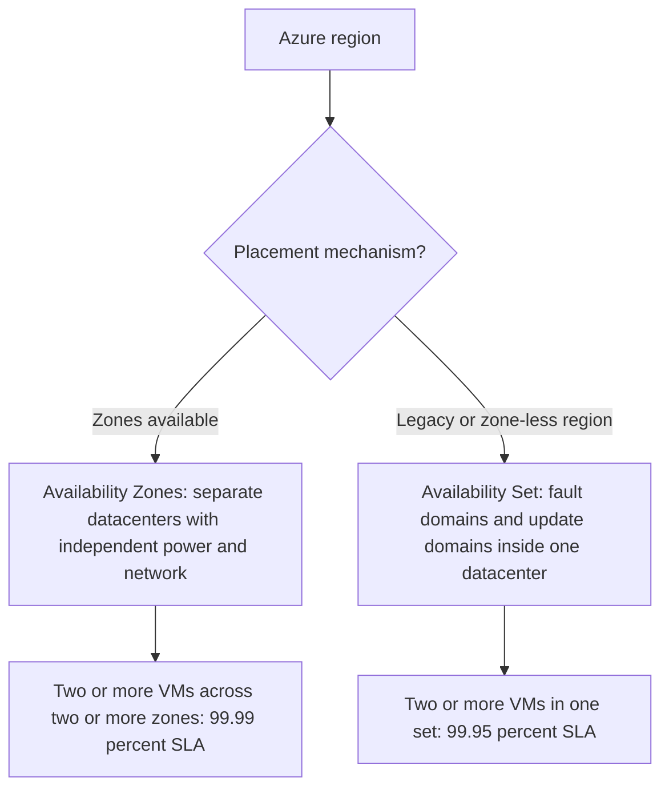
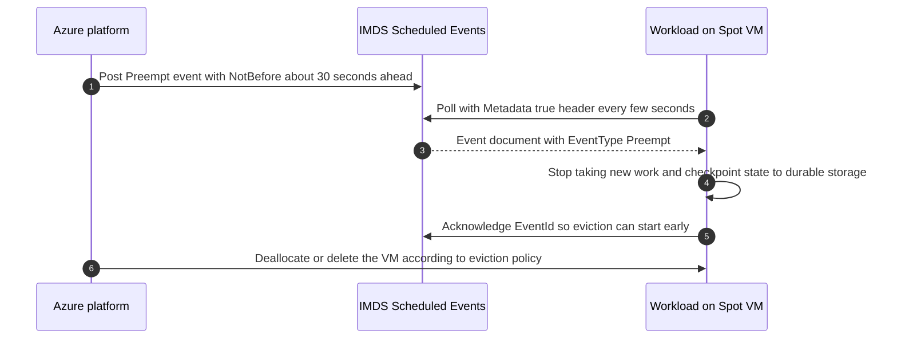
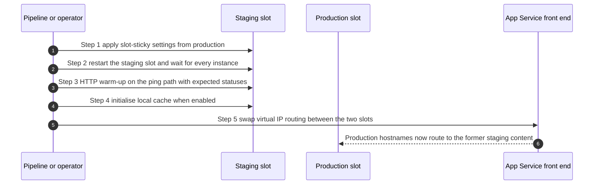
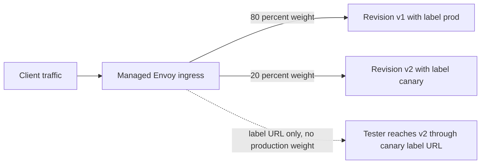

# Module 05: Compute — VMs, App Service, Container Apps, and the AKS Delta

Azure compute spans four operating models that overlap on purpose: infrastructure-as-a-service virtual machines (VMs) that you patch yourself, managed web hosting on App Service Plans, container-native microservices on Azure Container Apps, and full orchestration on Azure Kubernetes Service (AKS). Each model bills a different unit (a VM instance, a plan instance, a vCPU-second of a replica, a node pool), fails in different ways (host eviction, slot swap, KEDA scale-to-zero, node drain), and maps to different exam domains. This module teaches the mechanics that decide production behaviour: the placement guarantees behind availability features, what a Spot eviction actually looks like on the wire, which settings travel with a deployment slot during a swap, how KEDA turns queue depth into replicas, and why AKS networking and identity moved away from their older designs. Generic concepts (shared responsibility, the compute-versus-storage-versus-network decomposition, Well-Architected trade-offs) are owned by [`architecture/cloud-foundations`](../../../architecture/cloud-foundations/README.md), and Kubernetes internals (controllers, scheduling, Services, RBAC) are owned by [`technologies/kubernetes`](../../kubernetes/README.md). This module covers only the Azure realisation and its delta.

The executable proofs for this module are in `technologies/azure/examples/05-compute-and-serverless.test.ts` (referenced as code here because the file ships with the examples directory). Run them from `technologies/azure` with `mise exec -- npm test`.

---

## 1. Virtual Machines: SKU Families, Placement, and Cost Levers

An Azure VM is a hypervisor-hosted guest with a SKU that fixes its vCPU count, memory, network bandwidth, temporary disk, and CPU scheduling contract. The SKU letter encodes the workload shape, and the scheduling contract matters more than the nominal core count when you size a fleet.

### 1.1 SKU families

| Family | Intent | Scheduling and sizing notes |
| --- | --- | --- |
| D | General purpose, balanced vCPU to memory | Default choice for web tiers and application servers; dedicated vCPU allocation for the common sizes |
| E | Memory optimised | Higher memory per vCPU for caches, in-memory analytics, and relational databases |
| F | Compute optimised | Higher CPU to memory ratio for batch, encoding, and CPU-bound services |
| L | Storage optimised | Local NVMe temporary storage for databases and file systems that tolerate ephemeral local disks |
| N | GPU accelerated | Attached NVIDIA or AMD accelerators for training and inference; check quota per region before planning capacity |
| B | Burstable | Accrues CPU credits while idle and spends them under load; the baseline is the sustained ceiling |

The B family is the one that surprises teams. A B-series VM has a baseline CPU percentage (for example 20 percent of one vCPU for a small size, verify per SKU) and a credit bucket. While the average utilisation stays below the baseline, the bucket fills. When a load spike drains the bucket, the platform throttles the VM to its baseline. The guest operating system does not report a fault; a process simply gets a fraction of the CPU it expects, latency climbs, and health probes that time out look like application bugs.

> [!WARNING]
> **The B-series credit trap.** A B-series VM whose credit balance reaches zero is capped at its baseline CPU without any error in the guest. Watch the `CPU Credits Remaining` platform metric in Azure Monitor and alert before it reaches zero. Never place a latency-sensitive or steady-load workload on a B-series SKU, and never size a fleet by the burst figure, which is available only while credits last.

### 1.2 Availability Sets, Availability Zones, and placement

Availability is a placement guarantee, not a redundancy feature. Azure offers two placement mechanisms for VMs, and they describe different failure domains.

An **Availability Set** spreads VMs across **fault domains** (groups of hosts that share a rack, power feed, and top-of-rack switch; the default is up to three) and **update domains** (groups of VMs that the platform restarts together during planned maintenance; the default is five). Fault domains protect against hardware and power failures inside one datacenter. Update domains protect against planned host maintenance, which restarts one update domain at a time. An Availability Set does not protect against the loss of the whole datacenter. Two or more VMs in a set carry a 99.95 percent VM connectivity SLA.

An **Availability Zone** is a physically separate datacenter (or group of datacenters) within a region, with independent power, cooling, and networking. Deploying VMs into different zones protects against the loss of a datacenter. Two or more VMs across two or more zones carry a 99.99 percent SLA. Zones are not free: the cross-zone round trip adds latency that is small but measurable (commonly low single-digit milliseconds inside a region; verify against your own traffic before designing a synchronous quorum that spans zones).



Zone choice is per resource. A zonal VM is pinned to one zone and stays there; if that zone is unavailable the VM is unavailable. A zone-redundant deployment (a scale set spread across zones, or a pair of zonal VMs behind a zone-redundant load balancer) is what delivers the SLA. A single VM in a zone without redundancy has a lower single-instance SLA than the figures above.

### 1.3 VM Scale Sets and Flexible orchestration

A **Virtual Machine Scale Set (VMSS)** manages a group of identical or near-identical VMs with autoscaling, rolling upgrades, and health-based replacement. The orchestration mode decides how the scale set places and manages members.

**Uniform** orchestration is the legacy mode. Every member is a clone of one model, and the platform manages them as identical instances. It is simple, but it cannot mix SKUs or purchase options, and it has fewer placement controls.

**Flexible** orchestration is the current recommendation. It creates VMs that are individually addressable, lets one scale set mix VM sizes, and can combine Spot and on-demand members in a single group. The priority mix policy sets a base number of regular (on-demand) VMs and a percentage of the additional capacity that should be regular, with the remainder created as Spot. A typical policy keeps three on-demand VMs as a floor for availability and fills the rest of a scale-out with Spot capacity, falling back to on-demand members when Spot capacity is unavailable in the region.

```json
{
  "priorityMixPolicy": {
    "baseRegularPriorityCount": 3,
    "regularPriorityPercentageAboveBase": 20
  },
  "priority": "Spot",
  "evictionPolicy": "Deallocate"
}
```

The fragment above is the shape of the scale set's priority configuration in the ARM or Bicep model; the exact property placement depends on the `Microsoft.Compute/virtualMachineScaleSets` API version you pin. Verify it against the API version your IaC emits, because the mix policy lives beside the VM profile and is easy to misplace.

### 1.4 Spot VMs and the Scheduled Events eviction notice

A Spot VM runs on spare capacity at a steep discount, and Azure can evict it when that capacity is needed elsewhere. Spot has no availability SLA. The eviction policy is either `Deallocate` (the disk survives and the VM can be started again if capacity returns) or `Delete` (the VM and its ephemeral disk are removed).

Azure gives a Spot VM a notice before eviction through the **Scheduled Events** service on the Instance Metadata Service (IMDS). The notice is posted with a `NotBefore` time that is about 30 seconds ahead. A workload that polls the endpoint can drain work and checkpoint state before the host is taken away.

```bash
curl -s -H "Metadata:true" "http://169.254.169.254/metadata/scheduledevents?api-version=2020-07-01"
```

A `Preempt` event in the response identifies the VM and the deadline. The workload should acknowledge the event by posting its `EventId` back to the same endpoint, which tells the platform it may proceed immediately rather than waiting out the full notice window. The acknowledgement is an optimisation; the eviction still happens, and any state not checkpointed inside the notice window is lost.



Spot is appropriate for stateless workers, batch jobs that checkpoint, CI runners, and fault-tolerant compute frameworks. It is not appropriate for a single-instance database, a leader in a consensus group without a replacement path, or any workload whose recovery time exceeds the time it takes the scale set to replace a member.

### 1.5 Ephemeral OS disks

An ephemeral OS disk stores the operating system on the VM's local cache or temporary disk rather than on a managed disk in Azure Storage. There is no separate storage charge for the OS disk, reimaging is fast because the disk is local, and the platform does not need to provision a new managed disk when a VM is recreated.

The trade-off is that the OS disk is not durable. Anything written to it is lost when the VM is deallocated, reimaged, or moved to a new host. Ephemeral OS disks suit stateless scale-set members that boot from a golden image and keep their state elsewhere, such as in a database, object storage, or a queue. They are a poor fit for VMs that hold configuration or data on the OS volume, and they require a SKU whose cache or temporary disk is large enough for the image.

### 1.6 Azure Hybrid Benefit

Azure Hybrid Benefit (AHB) lets you apply existing Windows Server and SQL Server licences that carry Software Assurance, or qualifying subscription licences, to Azure VMs and to Azure SQL and SQL Managed Instance workloads. It reduces the licence portion of the hourly price rather than the compute portion. The saving is documented per SKU and per licence type, so read the current pricing calculator figure instead of a remembered percentage.

AHB is a billing setting, not a technical one. It changes what you pay, not how the VM runs. Two traps follow. First, you must attest that the licence entitlement exists, and the attestation is a compliance statement, not a platform check. Second, the benefit for Windows Server is applied per VM or per scale set, so an inventory of licensed cores must match the deployed fleet before a Reservation or Savings Plan is purchased on top of it.

### 1.7 Then vs now: VMSS Uniform to Flexible

| Dimension | Uniform orchestration (legacy) | Flexible orchestration (current) |
| --- | --- | --- |
| Member model | Clones of one model; instances are not individually managed | Individually addressable VMs with their own placement |
| Mixed SKUs and Spot with on-demand | Not supported in one group | Supported through the priority mix policy |
| Zone spread | Possible, with less control over per-zone balance | Explicit per-zone placement and spread |
| Typical use today | Existing fleets that predate Flexible | New fleets and migrations |

Migration is not an in-place switch. You create a new Flexible scale set, shift traffic or membership to it, and retire the Uniform group. Mixing both in one load-balancer backend pool during the transition doubles the number of health-probe targets and needs an explicit plan for session affinity.

---

## 2. App Service: Plans, Slots, and Networking

App Service hosts web apps, APIs, and Functions on managed VM instances. Its unit of compute is the **App Service Plan**, not the app. The plan defines the operating system, the region, the pricing tier, and the set of VM instances that run every app assigned to it.

### 2.1 The App Service Plan as billing and compute boundary

Every app assigned to a plan shares that plan's CPU, memory, disk, and outbound networking. Ten small apps on one plan with four instances consume the same four VMs, the same SNAT port pool per instance for outbound connections, and the same memory ceiling. One app that leaks memory or opens thousands of outbound connections degrades every other app on the plan. Billing follows the plan: you pay for the instances, whether or not each app is busy.

This has three architectural consequences. Group apps by blast radius and by scaling profile, not by team or by resource group, because the plan is the scaling unit. Keep the plan tier high enough for the features you need (VNet integration, deployment slots, and autoscale rules have tier requirements that change over time; verify the current matrix). Treat plan scale-out as the lever for every app on it, which means a noisy neighbour is a scaling problem, not only a code problem.

### 2.2 Deployment slots and the swap mechanics

A **deployment slot** is a live App Service app with its own hostname, its own settings, and its own content, running on the same plan. The production slot is the default; staging slots hold a candidate version. A **swap** exchanges the routing of two slots so that the candidate becomes production and the previous production becomes the staging copy, which makes rollback a second swap.

The swap is not an atomic file copy. The platform performs a fixed sequence, and the sequence is where production incidents come from. The documented steps are:

1. **Apply slot-sticky settings to the source slot.** Settings marked as slot-specific in the target slot are copied to the source slot so the staged app runs with production configuration before it receives any traffic.
2. **Restart the source slot and wait for every instance.** The platform restarts the staged app on all instances so that each instance loads the copied settings.
3. **Warm up over HTTP.** The platform issues requests against the warm-up path on every instance until the response statuses match the expected set. This is controlled by `applicationInitialization` in site configuration or by `WEBSITE_SWAP_WARMUP_PING_PATH` and `WEBSITE_SWAP_WARMUP_PING_STATUSES`.
4. **Initialise the local cache when enabled.** If local cache is enabled, the content is staged on each instance before the routing change.
5. **Swap the virtual IP routing.** The front end switches which slot receives production hostnames. The change is quick because it is a routing update, not a content copy.



Microsoft also offers a multi-phase swap with preview (`applySlotConfig` followed by `completeSlotSwap` or `resetSlotSwap`), which applies production slot-sticky settings to the staging slot so you can validate behavior against production configuration before committing the VIP swap.

### 2.3 Production failure modes of slot swaps

**Failure mode 1: a sticky setting is missing.** Slot-specific settings (app settings and connection strings marked as slot-sticky) stay with the slot on a swap. Settings that are not marked travel with the content. If a database connection string is not marked sticky, the swap moves the production connection string into staging, and staging then writes to production data during its own validation. The mirror failure is also real: a staging-only feature flag that is not sticky reaches production after the swap, and production secrets get reused by a staging deployment that was never meant to hold them. Mark every environment-specific setting as slot-sticky in the template, and review the list in every pull request that adds a setting.

```bicep
resource slotConfig 'Microsoft.Web/sites/config@2023-12-01' = {
  parent: webApp
  name: 'slotconfignames'
  properties: {
    appSettingNames: [
      'FEATURE_FLAG_CHECKOUT'
      'ENVIRONMENT_NAME'
    ]
    connectionStringNames: [
      'OrdersDatabase'
    ]
  }
}
```

The snippet above marks the database connection string and environment-specific settings as sticky. The `apiVersion` is a pin to verify against your own IaC toolchain; sticky-setting names are case-sensitive and must match the setting names exactly.

**Failure mode 2: warm-up is skipped.** If the platform cannot reach the warm-up path, or if the path returns a status outside the expected set, the swap fails or proceeds without warm-up. Proceeding without warm-up sends production traffic to instances that are still loading dependencies, compiling views, or filling caches, which looks like a spike of cold-start latency and timeouts immediately after the swap. Configure `applicationInitialization` with a path that exercises the real dependencies (a readiness endpoint that opens a database connection, not a static health file), and set the expected statuses explicitly with `WEBSITE_SWAP_WARMUP_PING_STATUSES` so that a 500 from a broken dependency fails the swap rather than passing silently.

Rollback is a second swap and does not undo the sticky-setting copy, the database writes made during validation, or the messages the staged app sent to queues. A swap rolls back the routing, not the side effects.

### 2.4 VNet Integration versus Private Endpoints

Teams confuse these two features because both put an App Service on a private network. They work in opposite directions.

**VNet Integration** gives the app outbound access into a virtual network. The app's worker instances get an address in a delegated subnet (delegated to `Microsoft.Web/serverFarms`), and outbound calls to private addresses route through it. Setting `vnetRouteAllEnabled` routes all outbound traffic through the VNet, including public destinations, which lets you apply route tables and firewall rules to outbound flows. VNet Integration does not make the app itself private to inbound callers. It requires a plan tier that supports it and a subnet that is dedicated to the plan.

**Private Endpoint** gives the app inbound access from a private address. The endpoint is a network interface in a subnet that receives traffic for the app's hostname on a private IP, and the Private DNS zone (`privatelink.azurewebsites.net`) resolves the public name to that private address for clients inside the network. For App Service and Azure Functions, Private Link requires **both** `<app>.privatelink.azurewebsites.net` and `<app>.scm.privatelink.azurewebsites.net` (the Kudu/SCM deployment endpoint) in the same `privatelink.azurewebsites.net` zone—omitting the `scm` record causes the classic "site serves traffic while CI/CD deployments fail" outage once public network access is disabled. A Private Endpoint does not give the app outbound access to anything. Public network access can be disabled on the app once the endpoint is in use.

| Question | VNet Integration | Private Endpoint |
| --- | --- | --- |
| Direction | Outbound from the app | Inbound to the app |
| What it places in the VNet | Worker instances use a delegated subnet address | A network interface with a private IP for the app |
| Typical use | Reach a private database or internal API from the app | Let internal clients reach the app without public exposure |
| DNS requirement | Resolve private names for outbound targets | Private DNS zone linked to the client VNet |
| Failure symptom when missing | Outbound calls to private hosts time out | Clients resolve the public address and fail or bypass the intended path |

A secure web app usually needs both: a Private Endpoint for inbound callers in the corporate network and VNet Integration for its outbound calls to private back ends. Missing either one produces a different symptom, so debug the direction first.

### 2.5 Then vs now: App Service Environment v2 to v3

App Service Environment (ASE) gives an isolated, single-tenant deployment of App Service inside your VNet. ASE v3 is the current generation; it runs on newer infrastructure that does not depend on the older dedicated front-end layout, and it is the only generation new environments should target. ASE v1 and v2 retired on **August 31, 2024** along with classic Cloud Services infrastructure, losing SLA guarantees and undergoing decommissioning. The migration is a rebuild, not an in-place upgrade: you create a v3 environment, redeploy the plans and apps, and cut DNS over. Mixing v2 and v3 apps behind one hostname during the cutover needs a traffic plan, because the inbound addresses differ.

---

## 3. Azure Container Apps

Azure Container Apps (ACA) runs containers without a cluster you administer. It is built on Kubernetes and KEDA internally, but the surface is an environment, apps, revisions, and scale rules. For the AI-200 domain "Develop containerized solutions", ACA is the central service: the exam expects you to choose an environment type, configure ingress and scale rules, deploy revisions, and wire Dapr or managed identity into a container.

### 3.1 Environments: Consumption versus Dedicated workload profiles

A **Container Apps environment** is the boundary for networking, logging, and shared infrastructure. Apps in one environment share a virtual network, a Log Analytics workspace destination, and the environment's ingress. The environment defines the workload profiles available to its apps.

The **Consumption** profile is serverless. You pay for the vCPU-seconds and memory-seconds that replicas actually use, and replicas scale to zero when they receive no work. It is the right default for bursty HTTP APIs, queue workers, and event consumers with variable load.

A **Dedicated** workload profile reserves a fixed pool of compute (named profiles with defined vCPU and memory sizes). You pay for the reserved capacity rather than per replica. Dedicated profiles suit steady workloads, workloads that need predictable performance, large replica counts where per-second billing is more expensive than reserved capacity, and workloads that require more memory or CPU than the Consumption profile offers.

An environment can mix both profile types, which lets a team run a Consumption app for a bursty endpoint beside a Dedicated app that needs stable memory. The delegated subnet the environment uses is fixed at creation (minimum `/27` for Workload Profiles environments, `/23` for legacy Consumption-only environments), so size the address space with headroom before the first app is deployed.

### 3.2 Managed Envoy ingress and mTLS

Container Apps runs a managed Envoy ingress layer in front of each environment. Ingress can be external (reachable from the internet) or internal (reachable only inside the environment's network). Envoy terminates TLS for external traffic and routes requests to the right app and revision. You do not manage Envoy configuration; you set the ingress mode, the target port, the transport (HTTP/1.1, HTTP/2, or automatic), and the traffic weights between revisions.

Traffic between apps inside an environment can be encrypted with mutual TLS. The environment-level setting enables certificate-based encryption for internal calls, so a compromised app cannot read a neighbour's traffic in clear text on the same network. Enable it when the environment hosts apps with different trust levels, and verify the current toggle name and its effect on latency in the platform documentation before you rely on it.

Authentication (who the caller is) is separate from transport encryption (who can read the bytes). Use Microsoft Entra ID authentication on the ingress for user-facing APIs, and use managed identities for calls between services. Token validation rules belong to the security track; this module owns only the ingress wiring.

### 3.3 KEDA event-driven autoscaling

Container Apps uses **KEDA** (Kubernetes Event-Driven Autoscaling) to scale replicas from event sources. Each app has a minimum and maximum replica count and a list of scale rules. A rule is a trigger (an HTTP concurrency count, a queue length, an event lag, or a schedule) with a threshold. KEDA converts the trigger's metric into a desired replica count, and the platform adds or removes replicas to match.

| Trigger | Metric it scales on | Scale-to-zero behaviour | Trade-off |
| --- | --- | --- | --- |
| HTTP concurrency | Concurrent in-flight requests per replica | Scales to zero when idle; the next request waits for a cold replica | Lowest latency needs a minimum of one replica |
| Azure Service Bus queue | Active message count (or message count per replica) | Scales to zero when the queue is empty | Messages wait while the first replica starts |
| Azure Event Hubs | Lag in unprocessed events per partition relative to checkpoints | Scales to zero when there is no lag | Lag is per partition, so partition count caps useful parallelism |
| Cron | Schedule window | Scales to zero outside the window | Predictable, but does not react to load |

Scale-to-zero trades cost for latency. A replica that has been removed must start again, pull or reuse its image, run its application start-up code, and establish connections before it serves work. For an HTTP API that a user waits on, set the minimum replica count above zero, or accept a measured cold-start penalty and say so in the service-level objective. For a queue worker, scale-to-zero is usually the right answer because nothing waits synchronously on the first message.

```bicep
scale: {
  minReplicas: 0
  maxReplicas: 20
  rules: [
    {
      name: 'orders-queue'
      custom: {
        type: 'azure-servicebus'
        metadata: {
          queueName: 'orders'
          messageCount: '50'
          namespace: 'sb-orders-prod'
        }
        auth: [
          {
            secretRef: 'servicebus-connection'
            triggerParameter: 'connection'
          }
        ]
      }
    }
  ]
}
```

The rule above adds a replica for every 50 active messages, up to twenty replicas, and scales to zero when the queue is empty. The `messageCount` threshold is a throughput decision: if each message takes two seconds and you want the backlog cleared in one minute per replica, a threshold near 30 is a starting point rather than an answer. Authenticate the scaler with a managed identity where the scaler supports it, and use a secret reference only where it does not.

### 3.4 Revisions: single versus multiple mode, traffic splitting, and labels

A **revision** is an immutable snapshot of an app's template: its image, environment variables, scale rules, and resource limits. Changing any of them creates a new revision. Revisions are the unit of rollout and rollback in Container Apps.

In **single revision mode**, the newest revision replaces the previous one as soon as it is ready and the old one is deactivated. Traffic moves in one step. This is simple and cheap, and it suits services that tolerate a short overlap during deployment, but it offers no gradual rollout.

In **multiple revision mode**, several revisions can be active at once. You assign traffic weights across them (for example 80 percent to the stable revision and 20 percent to the candidate), which gives canary and blue-green patterns without a separate load balancer. A **revision label** gives a stable hostname to a specific revision, so a tester can reach the candidate through its label URL while production traffic still goes to the stable revision.



Rollback in multiple mode is a traffic change, not a redeploy. Set the weight of the previous revision back to 100 percent and the candidate to zero, and leave the candidate active for debugging. Keep at most a small number of active revisions, because each active revision consumes replicas and each one needs its own scale rules and secrets.

### 3.5 Dapr building blocks

Container Apps integrates **Dapr** (Distributed Application Runtime) as a managed sidecar. Dapr exposes building blocks over local HTTP or gRPC: state management, publish and subscribe, and service invocation, among others. The application calls `localhost` on the sidecar port, and the sidecar talks to the configured component (a state store, a message broker) with its own credentials.

Dapr is worth using when you want the application to depend on an abstract capability (save state, publish an event) rather than on a specific broker SDK, and when you want the sidecar to handle retries, mutual TLS between services, and component configuration. It is not free. Each sidecar adds a process to every replica, a second hop on each call, and a configuration surface (components, scopes, and resiliency policies) that must be versioned like code. Use the Dapr building blocks the application actually calls, and do not adopt the whole runtime because it is available.

The pub/sub building block delivers at-least-once semantics in the same way as the broker underneath it. A handler must be idempotent; the delivery semantics theory is owned by [`architecture/distributed-systems`](../../../architecture/distributed-systems/README.md), and this track covers only the Dapr component wiring.

### 3.6 Jobs: manual, scheduled, and event-driven

A **Container Apps Job** runs a container to completion rather than serving requests. It has three trigger types. A **manual** job starts when you or a pipeline asks it to. A **scheduled** job runs on a cron expression. An **event-driven** job starts a replica for each unit of work in a queue or other KEDA source and runs until the work is consumed, which turns a queue into a parallel batch.

Jobs fit database migrations, nightly reports, file processing, and fan-out batch work. Set a replica timeout and a retry limit explicitly. A job that exceeds its timeout is stopped, and a job that retries without idempotency repeats side effects, so the same idempotency rule that applies to queue handlers applies here.

### 3.7 Then vs now: classic ACI and App Service microservices to Container Apps with KEDA

Many teams built microservices in the past by running one Azure Container Instances group per service, or by splitting services across many App Service Plans, and scaled them with CPU thresholds or manual instance counts. ACI has no autoscaling engine and no ingress routing between groups, so every scaling decision was manual or scripted. Plans scaled as whole units, so each small service paid for an instance floor it did not need. Queue-driven services were polled by timers or by a worker that never scaled to zero.

The current pattern runs the services as Container Apps in one environment, scales them with KEDA rules (HTTP concurrency for APIs, queue length for workers), keeps revisions for rollout and rollback, and uses Dapr only where the abstraction pays off. The migration is a service-by-service move: create the app in the environment, route a small percentage of traffic to it with the ingress weights, compare error rates and latency, and retire the old group when the weights reach 100 percent.

---

## 4. Choosing a Compute Service: ACI, Container Apps, App Service, or AKS

The four services overlap, and most architecture mistakes come from picking a service for the wrong unit of work. The decision matrix below compares them on the dimensions that change the operating model.

| Dimension | Azure Container Instances | Azure Container Apps | App Service | Azure Kubernetes Service |
| --- | --- | --- | --- | --- |
| Unit | A container group with a fixed size | An app with revisions and replicas | A web app on a plan instance | A cluster of node pools running pods |
| Scaling | Manual or scripted; no autoscale engine | KEDA rules, HTTP concurrency, scale to zero | Plan autoscale rules on instance count | Cluster autoscaler and horizontal pod autoscaler |
| Ingress | Public IP or internal; no managed routing layer | Managed Envoy with traffic weights and revisions | Built-in front end with custom domains | You install and operate an ingress controller |
| Rollout | Replace the group | Revisions with traffic splitting | Deployment slots and swap | Your deployment tooling (Helm, GitOps) |
| Operations | Lowest; no cluster | Low; no cluster | Low; platform-managed | Highest control and highest operating load |
| Best fit | Short-lived jobs, burst compute, build agents | Microservices, event consumers, APIs with variable load | Traditional web apps and APIs on the Windows or Linux stack | Platform teams running many services with custom controllers |

Choose ACI when a container must start in seconds, run to completion, and disappear, and when you do not need routing or autoscaling. Choose Container Apps for microservices that should scale on events without owning a cluster. Choose App Service when the workload is a conventional web app whose team wants slots and built-in deployment features. Choose AKS when you need the Kubernetes API, custom controllers, or a platform that other teams consume, and accept the operating cost that comes with it. A common mistake is to choose AKS for a handful of HTTP services that Container Apps would run with less operating surface.

---

## 5. AKS Delta: What Changed and Where to Read the Kubernetes Model

AKS is managed Kubernetes. The control plane is managed by Azure, and you manage node pools, networking choices, identity, and upgrades. The Kubernetes model itself (control plane components, scheduling, Services, RBAC, admission) is owned by [`technologies/kubernetes`](../../kubernetes/README.md). This section covers the Azure-specific choices that changed over the platform's life and that appear on the AZ-305 and AI-200 blueprints.

### 5.1 Azure CNI Overlay versus legacy Azure CNI

The Azure Container Networking Interface (CNI) assigns pod addresses. In **legacy Azure CNI**, every pod receives an address from the node subnet of the VNet. A cluster with 50 nodes, each running 110 pods, needs thousands of routable addresses reserved in advance, and a busy cluster exhausts the subnet long before it exhausts compute. The failure is a scheduling error that looks like a capacity problem.

**Azure CNI Overlay** gives pods addresses from a private overlay range that does not consume VNet address space. Only the nodes take addresses from the node subnet. Pod-to-pod traffic is routed through the overlay, and external traffic from pods is translated at the node. The overlay solves IP exhaustion for large clusters and lets the pod range be sized independently of the VNet. It is the default choice for new clusters that do not need pod addresses routable from outside the cluster; verify the current default for your AKS version and the specific pod-to-VNet routing limits before you design around them.

### 5.2 Workload Identity replaces pod-managed identity

Pods that call Azure services need an identity. The older **pod-managed identity** project assigned identities to pods through a node-level component that intercepted the metadata calls. It is deprecated and is no longer the recommended design. **AKS Workload Identity** replaces it. The cluster publishes an OIDC issuer, a Kubernetes service account is annotated with the client ID of a user-assigned managed identity, and a federated identity credential on that managed identity trusts the cluster's issuer for that service account. The pod receives a projected service account token, exchanges it for an Entra token, and calls Azure with no secret in the cluster.

```yaml
apiVersion: v1
kind: ServiceAccount
metadata:
  name: orders-api
  namespace: orders
  annotations:
    azure.workload.identity/client-id: '00000000-0000-0000-0000-000000000000'
```

The client ID above is a placeholder. The federated credential must name the exact issuer URL, namespace, and service account name; a mismatch in any of the three produces a token-exchange error that does not say which field is wrong. Workload Identity is the same federation model used by GitLab and GitHub OIDC from outside the cluster, which is why the token-exchange logic is owned by the security track. This module owns only the AKS wiring.

### 5.3 AKS Automatic

AKS Automatic is a cluster mode that makes opinionated choices for you: the node pools scale and upgrade automatically, the networking uses the recommended defaults, and the security baseline is enforced at creation. It reduces the number of decisions a platform team must make and aligns the cluster with the managed-operation model. It does not remove Kubernetes concepts, and you still need to understand workloads, RBAC, and the failure modes described in the Kubernetes track. Use it when the platform team wants fewer knobs; keep a standard cluster when a workload needs settings that the automatic mode does not expose.

### 5.4 Node pools, taints, and Spot pools

A node pool is a group of nodes with the same VM size, image, and configuration. A cluster has at least one **system** node pool that runs cluster components and one or more **user** node pools for workloads. Separating system and user pools keeps workload spikes from starving the components that keep the cluster running.

Node pools are placed in the cluster with **taints** and **tolerations**. A taint on a node pool repels pods that do not tolerate it. A Spot node pool carries a taint so that only pods that explicitly tolerate eviction are scheduled on it, which prevents a stateful service from landing on capacity that can disappear. The Spot pool also has an eviction policy and a maximum price setting, and the eviction behaviour mirrors the VM Spot behaviour from section 1.4: the nodes receive a notice and their pods are drained, so pods on Spot pools need a disruption budget and a fast checkpoint path.

### 5.5 ACR integration with AcrPull

AKS pulls container images from Azure Container Registry (ACR) with an identity that holds the `AcrPull` role on the registry. The integration is a role assignment, not a shared username and password. The kubelet identity of the node pool is the identity that performs the pull, so the role must be assigned to that identity, not to the pod. Pods that need to pull from a different registry use an image pull secret or the workload identity path, depending on the registry's configuration.

Two traps appear in reviews. First, an assignment made to the cluster's control-plane identity does not grant the kubelet permission to pull, and the pull fails with an authorisation error at pod start. Second, the role assignment takes time to propagate, so a deployment run immediately after the assignment can fail once and succeed on retry. Verify the pull identity in the deployment pipeline before the first rollout, not during the incident.

### 5.6 Then vs now: AKS Pod Identity to Workload Identity

| Dimension | Pod-managed identity (deprecated) | Workload Identity (current) |
| --- | --- | --- |
| Mechanism | Node component intercepts metadata calls and maps pods to identities | Projected service account token exchanged for an Entra token through federation |
| Trust anchor | Node-level identity mapping | Cluster OIDC issuer and federated credential per service account |
| Node dependency | Requires a node-level component and privileged access on nodes | No node-level interception; the workload calls Entra directly |
| Migration | Create the federated credential, annotate the service account, update the SDK to use the token file | Same target state; remove the old pod identity resources after the cutover |

The migration is per workload. Run the old and new paths side by side for one service, confirm the tokens are issued and the calls succeed, and then remove the old mapping. Do not remove the mapping for all services in one change, because a missing federated credential on one service account is an outage for that service only if you keep the rest of the fleet on the old path.

---

## 6. Verification and Reproducibility

The compute behaviours in this module that can be checked offline are the ones with deterministic arithmetic or a deterministic state machine: availability SLA composition, KEDA replica calculation from a metric and a threshold, revision traffic weight validation, the B-series credit model, the swap step ordering, and the Scheduled Events document parsing. The executable proofs in `technologies/azure/examples/05-compute-and-serverless.test.ts` must model these with pure functions and check edge cases such as zero-credit throttling, a scale-to-zero queue with no backlog, and a traffic split that does not sum to 100.

Behaviours that need Azure cannot be proven locally: real Spot eviction timing, IMDS delivery, slot swap timing against a live app, KEDA scaling latency, Private Endpoint DNS resolution from a VNet, and AKS role-assignment propagation. Verify those in a sandbox subscription with the Azure CLI (pinned in the track's `.mise.toml`), using `az deployment group what-if` before every change and a canary revision before every production traffic shift.

```bash
cd technologies/azure
mise install
mise exec -- npm ci
mise exec -- npm test
mise exec -- npm run typecheck
```

---

## Interview Drill

These questions are written for an experienced interviewer. Each model answer names the mechanism, the failure it prevents, and the check you would run.

### Q1. A B-series VM serves an API that was fast in testing and slow in production after a traffic spike, with no errors in the application logs. What is the most likely cause, and how do you confirm it?

<details><summary>Model Answer</summary>

The most likely cause is CPU credit exhaustion on a burstable B-series SKU. The VM accrued credits while idle, spent them during the spike, and the platform capped it at its baseline CPU percentage once the balance reached zero. The guest does not report an error, so the application only shows higher latency and timeouts. Confirm it by checking the `CPU Credits Remaining` platform metric in Azure Monitor over the incident window, and by comparing the observed CPU ceiling with the SKU's baseline. The fix is to move the workload to a non-burstable family (D or E for a steady API), and to alert on the credit balance so a future spike is visible before the bucket empties.

</details>

### Q2. Your team wants 99.99 percent availability for a stateless API running on VMs. A colleague proposes an Availability Set with four VMs. Why is this insufficient, and what do you deploy instead?

<details><summary>Model Answer</summary>

An Availability Set spreads VMs across fault and update domains inside one datacenter, so it protects against rack and maintenance failures but not against the loss of a datacenter. Its SLA is 99.95 percent for two or more VMs. To reach 99.99 percent you need Availability Zones: two or more VMs spread across two or more zones, typically as a Flexible VM Scale Set with a zone spread, behind a zone-redundant load balancer. You would also verify that the health probes and the application can tolerate a zone outage, because the SLA covers the platform, not the application's capacity during a degraded period.

</details>

### Q3. A workload on Spot VMs loses a batch of in-flight work every time a host is evicted, even though the team polls for eviction. What is the mechanism gap?

<details><summary>Model Answer</summary>

The notice is about 30 seconds, and it is only useful if the workload uses that window to stop taking new work, drain in-flight items, and checkpoint state to durable storage. Polling alone does nothing. The likely gap is that the checkpoint interval is longer than the notice window, or the drain path calls a slow dependency, so the state written inside the window is incomplete. The fix is to checkpoint at a granularity that fits inside 30 seconds, make each unit of work idempotent so a re-run after eviction is safe, acknowledge the event with its `EventId` to start the eviction early only after the checkpoint completes, and test the path by simulating the Scheduled Events document in a staging scale set.

</details>

### Q4. A production web app loses its database connection right after a slot swap, and the staging slot now points at the production database. What went wrong, and how do you prevent it?

<details><summary>Model Answer</summary>

The connection string was not marked as slot-sticky. During the swap, the platform moved the production connection string into the staging slot along with the content, so staging validation wrote to the production database. The string was not kept with its own slot, so the two environments no longer had distinct data-store configuration. Mark every environment-specific setting and connection string in the `slotconfignames` resource as sticky, so each slot keeps its own value through the swap. Add a check to the pipeline that fails if a known environment-specific name is missing from the sticky list, and verify with the slot settings page after each change.

</details>

### Q5. You are asked to add VNet Integration to an App Service app so that internal clients can reach it privately. The engineer proposes VNet Integration. Explain why this is the wrong feature and what the correct design requires.

<details><summary>Model Answer</summary>

VNet Integration controls outbound traffic from the app into a virtual network, so it does nothing for inbound access from internal clients. The correct feature for inbound private access is a Private Endpoint, which places a network interface with a private IP in a subnet and needs a Private DNS zone (for example `privatelink.azurewebsites.net`) linked to the clients' VNet so that the app's hostname resolves to the private address. Most secure designs use both: a Private Endpoint for inbound callers and VNet Integration for the app's own calls to private back ends. Verify the design by resolving the hostname from inside the VNet and from outside it, and by checking that public network access is disabled only after the private path works.

</details>

### Q6. A team sets `minReplicas` to zero for an HTTP API that a checkout flow calls synchronously, and users report intermittent multi-second delays on the first click of each session. Explain the mechanism and the trade-off.

<details><summary>Model Answer</summary>

Scale-to-zero removes all replicas when there is no traffic. The first request after an idle period must start a replica, pull or reuse its image, run application start-up code, and establish connections before it responds, and the user waits for that cold start. The trade-off is cost against latency. For a synchronous checkout path the correct design sets a minimum replica count above zero, sized for the warm capacity the flow needs, and accepts the idle cost. Scale-to-zero remains correct for queue workers and batch consumers, where nothing waits synchronously on the first message. Measure the cold-start time explicitly and record it in the service-level objective rather than assuming it is negligible.

</details>

### Q7. A queue-driven worker on Container Apps scales to twenty replicas during a backlog, but the backlog is cleared more slowly than the arithmetic predicts, and the database shows lock contention. What do you check first?

<details><summary>Model Answer</summary>

The scale rule is working on the queue depth, but adding replicas does not add throughput if the replicas contend on a shared resource. Check the database for lock waits and hot rows, and check whether the handler serialises on a key that many messages share, which the queue cannot parallelise. Next check the message-level settings: a low prefetch and a low concurrency per replica reduce the work each replica takes in parallel, and a handler that holds a lock longer than its message lock expires causes redelivery and duplicate work. Only after the downstream is confirmed unsaturated should you raise the replica maximum or lower the `messageCount` threshold, because more replicas against a saturated database make the backlog worse.

</details>

### Q8. An AKS workload fails to pull an image from ACR after a cluster upgrade, with an authorisation error at pod start. A colleague assigned `AcrPull` to the cluster's control-plane identity yesterday. Why does the pull still fail, and what is the correct assignment?

<details><summary>Model Answer</summary>

The image pull is performed by the kubelet identity of the node pool, not by the control-plane identity, so an `AcrPull` assignment on the control-plane identity grants nothing to the node. The correct assignment is the `AcrPull` role on the registry scope for the kubelet identity. Also check whether the role assignment has propagated, because a fresh assignment can fail once before it takes effect, and verify the pull with a test pod after the assignment. Mention the alternative paths for cross-registry pulls (image pull secrets or workload identity) only as a last resort, because they add secret material to the cluster that the role assignment avoids.

</details>
