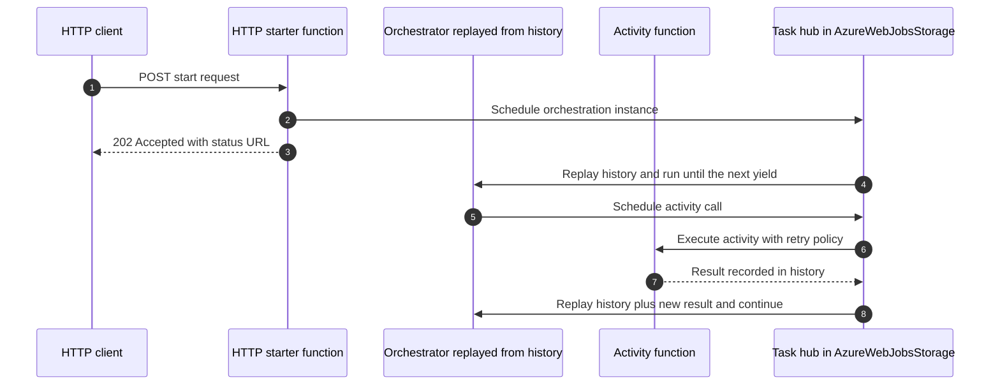
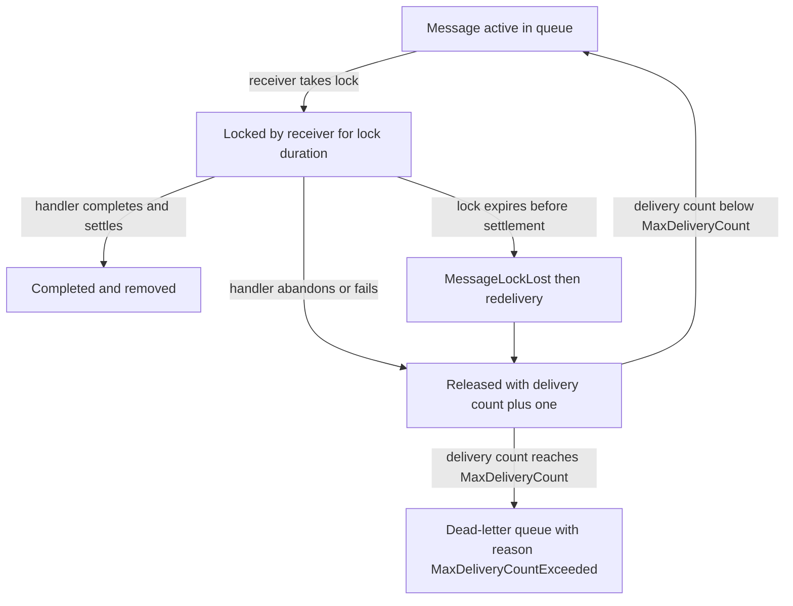
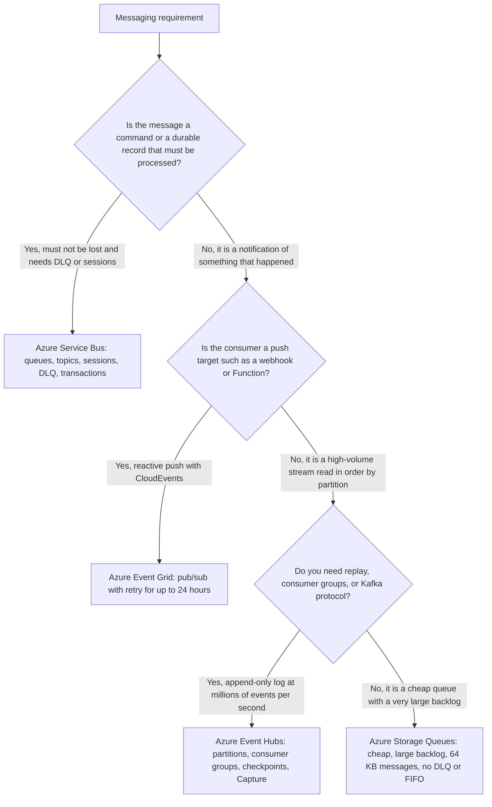

# Module 06: Serverless, Messaging, and Event Integration

Event-driven systems on Azure are built from four messaging services, one serverless runtime, one durable workflow engine, and one API gateway, and each makes a different promise about delivery, ordering, retention, and cost. Choosing among them is a correctness decision, not a preference. A payment command that must be processed exactly once in arrival order needs a different broker from a reactive notification that must reach a webhook within a day, and a log that millions of telemetry events per second append to needs a different broker from either. This module teaches the mechanics that decide production behaviour: Azure Functions hosting plans and their cold-start and networking trade-offs, the determinism contract that makes Durable Functions replayable, the Service Bus peek-lock state machine and the ways it turns slow handlers into duplicates, sessions and duplicate detection, and the API Management policy pipeline that now fronts AI workloads.

Generic messaging theory (delivery semantics, idempotency, sagas as a correctness problem, log abstractions) is owned by [`architecture/distributed-systems`](../../../architecture/distributed-systems/README.md) and by [`architecture/data-systems`](../../../architecture/data-systems/README.md) for stream processing. This module covers only how Azure realises those ideas, the names and limits you must know, and the failure modes that appear in production. Container hosting for Functions and Container Apps is covered in [Module 05](05-compute-vms-app-service-and-containers.md).

The executable proofs for this module are in `technologies/azure/examples/05-compute-and-serverless.test.ts` (referenced as code because the file ships with the examples directory). They model the peek-lock state machine, the duplicate-detection window, the session ordering rule, the orchestrator replay check, and the APIM token-limit arithmetic, and they include negative tests for each determinism and lock violation described below. Run them with `mise exec -- npm test` from `technologies/azure`.

---

## 1. Azure Functions: Hosting Plans and Programming Model

An Azure Function is a unit of code bound to a trigger (an HTTP request, a Service Bus message, a timer) and zero or more input and output bindings. The hosting plan decides how instances are provisioned, how they scale, whether they can reach a virtual network, how long a single execution may run, and what a cold start costs. Choosing the plan is usually a bigger decision than choosing the language.

### 1.1 Hosting plans compared

| Plan | Scaling model | Network | Maximum duration | Cold start behaviour |
| --- | --- | --- | --- | --- |
| Flex Consumption | Per-function scaling with per-instance concurrency; scales to zero | VNet integration supported | Unbounded execution duration (configurable `functionTimeout` in `host.json`; default 30 min, HTTP trigger 230 s load-balancer cap) | Mitigated by always-ready instances that you configure per function group |
| Consumption (legacy) | Event-driven scale to zero with platform-chosen scale | No VNet integration | Default 5 minutes, maximum 10 minutes | Cold starts are common and can spike under bursty load |
| Premium (Elastic Premium) | Event-driven scale with pre-warmed instances | VNet integration supported | Unlimited in practice, subject to the plan's operational guidance | Pre-warmed instances absorb the first requests without waiting for a cold start |
| Dedicated (App Service plan) | Fixed or autoscale plan instances; no scale to zero by default | VNet integration supported | Unlimited | No cold start once the plan instance is running |

Flex Consumption is the current recommendation for new serverless workloads that need VNet access, because it combines scale to zero with per-function scaling and always-ready instances. Legacy Consumption remains for simple public workloads that do not need a network boundary; it has no VNet integration and its cold starts are the usual complaint. Premium keeps warm instances for latency-sensitive paths and offers unlimited execution time. Dedicated treats Functions as one more app on an App Service plan, which is correct when the plan is already paid for and the team wants predictable instances. Functions can also run inside Container Apps, which suits teams that already run the container platform and want Functions' triggers on it.

A cold start is not one cost but a sequence of costs, and each plan removes a different part of it. The platform must allocate an instance, the host must load its runtime, the worker process must start and load the function code and its dependencies, and the first execution then opens its connections (database pools, HTTP agents, SDK clients). Reducing the code's module graph and deferring heavy initialisation out of the module scope shortens the last two phases on any plan. Always-ready instances (Flex Consumption) and pre-warmed instances (Premium) remove the first two phases for the instances they keep alive, which is why a steady request path belongs on one of those plans and a batch consumer does not need either.

Memory is a plan decision too. Flex Consumption offers three instance memory sizes — **512 MB** (0.25 vCPU), **2,048 MB** (1 vCPU), and **4,096 MB** (2 vCPU), each with an additional 272 MB platform buffer for host processes. The memory size applies per instance, and the per-function concurrency setting determines how many executions share one instance, so a larger memory size with higher concurrency is a different cost and failure profile from a small instance that runs one execution at a time.

### 1.2 Programming model: isolated worker versus in-process

Functions runs user code in one of two process models. The **in-process** model loads the function code into the host process itself, which couples the function's dependencies to the host's. The **isolated worker** model runs the function code in a separate process that the host talks to over gRPC, which isolates dependency versions, lets you use a current runtime independent of the host, and removes the coupling that made host upgrades risky.

For .NET, the in-process model reached end of support on **November 10, 2026**; new work must use the isolated worker model, and remaining in-process apps require migration to retain security patches and scaling support. For Node.js, the current programming model is the v4 model, which registers functions in code with `app.http`, `app.serviceBusQueue`, and similar calls rather than through a per-function `function.json` file. The configuration surface is `host.json` plus the function code.

```ts
import { app, type InvocationContext } from '@azure/functions';

app.serviceBusQueue('processOrder', {
  connection: 'ORDERS_SERVICEBUS',
  queueName: 'orders',
  handler: async (message: unknown, context: InvocationContext): Promise<void> => {
    context.log(`processing ${context.triggerMetadata?.messageId ?? 'unknown'}`);
  },
});
```

The registration above declares the trigger in code. The `connection` value names an app setting that holds the namespace identity or connection string, not the secret itself; prefer identity-based connections (`ORDERS_SERVICEBUS__fullyQualifiedNamespace` plus a managed identity with the Azure Service Bus Data Receiver role) over shared access keys.

> [!NOTE]
> The Azure SDK snippets in this module (`@azure/functions` and `durable-functions`) illustrate production Azure SDK signatures; the hermetic runnable proofs in `../examples/` test the underlying protocol and state-machine semantics directly without external cloud credentials.

### 1.3 `host.json` concurrency, prefetch, and batching

`host.json` configures the Functions host for the whole app: extension concurrency, batching, retry behaviour, and logging. The settings that change throughput are the ones that control how many messages the host pulls and processes in parallel.

```json
{
  "version": "2.0",
  "extensions": {
    "serviceBus": {
      "maxConcurrentCalls": 16,
      "prefetchCount": 0,
      "autoCompleteMessages": false
    }
  }
}
```

`maxConcurrentCalls` bounds the number of handler invocations in flight per instance. Raising it increases throughput until the downstream saturates, and past that point it increases lock expirations and duplicate processing, as section 3.4 shows. `prefetchCount` bounds how many messages the client pulls into local memory ahead of the handler. Prefetch improves throughput on fast handlers, and it is also the source of the lock trap in section 3.5, so keep it at zero or small until the lock duration is measured against the handler's worst case. `autoCompleteMessages` set to `false` makes the handler settle each message explicitly, which is the only way to decide between complete, abandon, and dead-letter based on the outcome.

Batching settings (for example the batch size for Event Hubs or queue triggers) move the trade-off the other way: a larger batch amortises per-call overhead and increases the blast radius of one failed message, so a batch handler must either process each message idempotently or return the failure set for partial retry.

### 1.4 The hidden dependency: `AzureWebJobsStorage`

Every Functions app has an `AzureWebJobsStorage` setting that points to a storage account. The host uses that account for internal coordination: singleton leases so that only one instance runs a timer trigger, the state for Durable Functions, scale controller metadata, and blob-trigger bookkeeping. Teams often forget this dependency because the function code never names the account.

The failure mode is specific. A storage account that throttles requests (returns 503 or 500 under load, or is hit by a burst of lease renewals from many instances) causes the host to fail lease renewals. A timer trigger whose lease is lost can run on two instances or stop altogether, and a Durable orchestration whose control-queue reads fail stalls until storage recovers. The application appears healthy while its scheduled work silently pauses. Put `AzureWebJobsStorage` in its own storage account, not shared with application data; use identity-based access for the host where your plan supports it; monitor storage transactions and throttling as part of the Functions health signal; and size the account for the scale-out you expect.

---

## 2. Durable Functions: Event-Sourced Orchestrations

Durable Functions adds stateful workflows to Functions without a separate workflow service. The runtime keeps the workflow state as an append-only **history** of events and rebuilds the in-memory state of an orchestrator by **replaying** that history from the beginning each time the orchestrator resumes. This is event sourcing applied to control flow, and the replay model is the reason the determinism contract in section 2.3 exists.

### 2.1 The three function types

An **orchestrator** function defines the workflow: which activities run, in what order, with which branches and waits. It may not perform side effects itself. An **activity** function performs one unit of work with side effects (call an API, write a database row, send a message). The runtime retries an activity according to its retry policy, so an activity must be idempotent or it must be safe to repeat. An **entity** function holds a small piece of state addressed by an entity ID and processes operations on it one at a time, which gives a serialised actor-style model without a separate actor framework.

The orchestrator calls activities through the context, yields until each result is known, and continues. The runtime records each call and result in the history, so a crash in the middle of the workflow resumes from the last recorded result rather than re-running earlier steps.

### 2.2 Patterns

**Function chaining** runs activities in sequence, passing each output to the next. It is the simplest pattern and the right choice when each step depends on the previous step's result.

**Fan-out and fan-in** starts many activities in parallel and waits for all (or some) of them to complete before continuing. The orchestrator starts the tasks without yielding, then yields on the set of pending tasks, which the runtime completes as the activities finish. The fan-in step aggregates the results. Use it for independent work items such as per-tenant reports or per-file transforms, and bound the fan-out so that one large workflow does not flood a downstream service.

**Async HTTP API** lets a client start a long-running workflow and poll for its status. The HTTP starter returns a `202 Accepted` response with status URLs, the workflow runs, and the client checks the status endpoint until it reports completion. The pattern decouples the client's timeout from the workflow's duration.

**Monitor** runs a loop that checks a condition on a timer until it becomes true or a deadline passes. The orchestrator creates a durable timer, yields until the timer fires, checks the condition through an activity, and either continues the loop or stops. Durable timers survive restarts and scale-out, which a sleeping function cannot do.

**Human interaction** waits for an external event (an approval) with a timeout. The orchestrator races the event against a durable timer; if the approval arrives first, the workflow continues, and if the timer fires first, the workflow takes the escalation path.



### 2.3 The determinism contract

The orchestrator is replayed from its first event every time it resumes. The runtime compares the code's decisions during replay against the recorded history. If the code takes the same path, it reaches the same yield points and reads the same results. If the code produces a different decision — for example because it read a wall clock or generated a random identifier — the replay diverges from history and the Durable Task Framework fails the orchestration with a non-determinism violation (`NonDeterministicOrchestrationException` in .NET / `NonDeterministicWorkflowError` in the executable proof).

The contract has three rules. An orchestrator must not read non-deterministic sources directly: wall-clock time, random numbers, GUIDs, environment that changes between runs, or any value that differs when the code runs again. It must not perform I/O directly: no HTTP calls, no database queries, no file reads, because those results are not recorded and a replay would repeat them with different answers. And it must not start work that is not recorded through the context, such as an untracked background promise, because the runtime cannot replay what it did not see.

The replacements are provided by the context. The current time comes from the context's deterministic clock (in the JavaScript SDK, `context.df.currentUtcDateTime`), which the runtime records and replays exactly. A new identifier comes from the context's GUID generator, not `crypto.randomUUID()`. Any I/O moves into an activity, whose result is recorded once and returned on every replay. A random choice moves into an activity, or is derived from a seed the orchestrator records as an input.

```ts
import * as df from 'durable-functions';

df.app.orchestration('reserveAndCharge', function* (context: df.OrchestrationContext) {
  const order = context.df.getInput<{ orderId: string }>();
  const startedAt = context.df.currentUtcDateTime;
  const reservation = yield context.df.callActivity('reserveStock', order);
  const receipt = yield context.df.callActivity('chargeCard', { order, reservation, startedAt });
  return receipt;
});
```

The orchestrator above reads its time from the context, performs both side effects inside activities, and passes the recorded start time into the activity that needs it. Its replay produces the same yield points every time.

```ts
// ANTI-PATTERN: each line below breaks replay for this orchestrator
df.app.orchestration('badWorkflow', function* (context: df.OrchestrationContext) {
  const now = Date.now();
  const id = crypto.randomUUID();
  const price = yield fetch('https://pricing.example.com/quote').then((r) => r.json());
  if (now % 2 === 0) {
    yield context.df.callActivity('notifyEven', id);
  }
  return { price, id };
});
```

The anti-pattern fails in three distinct ways. `Date.now()` and `crypto.randomUUID()` return different values on each replay, so the branch taken on the second run differs from the first and the replay diverges. The direct `fetch` is not recorded, so a replay performs it again and may receive a different price, which corrupts the history with a decision that no longer matches. The branch itself, once it depends on the clock, changes which activities are scheduled, and the history no longer describes the code. The fix moves all three into activities or into the context. A negative test that replays a recorded history through the current orchestrator code and asserts the same decisions is the only reliable guard, and the examples file contains one.

### 2.4 Versioning running orchestrations

Changing an orchestrator's code while instances are running is the same problem as the determinism contract viewed through time. An instance that started under version one replays its history against version two. If version two reorders activities, adds a yield, or removes a branch, the replay diverges. Version orchestrations by name (a new orchestrator name for incompatible changes) or keep the old code deployed until every instance started under it has completed. Treat an orchestrator's code as a schema for its history, and do not edit it in place while instances are in flight.

---

## 3. Azure Service Bus: Brokered Messaging

Azure Service Bus is an enterprise message broker with queues, topics with subscriptions, sessions, transactions, and dead-lettering. It speaks AMQP as its primary protocol, with an HTTPS option for some operations. It is the right choice for commands, financial transactions, work that must be processed in order per entity, and any flow where a failed message must be inspected rather than silently dropped.

### 3.1 Queues versus topics and subscriptions

A **queue** delivers each message to one receiver. Multiple competing consumers share the queue, and each message is processed by exactly one of them at a time. A **topic** delivers each message to every **subscription** whose filter matches it. Each subscription behaves like its own queue, with its own message store and dead-letter queue, so one slow consumer does not hold up another.

Subscription filters decide which messages a subscription sees. A **boolean filter** is `true`, `false`, or the `1=1` form, and it matches everything or nothing. A **SQL filter** evaluates an expression written in a SQL-92 subset over system and user properties; the expression is evaluated against each message, which is expensive when many subscriptions each run a complex expression. A **correlation filter** matches exact equality on a set of properties. It is implemented as a hash lookup, which keeps the per-message cost low even with many subscriptions.

The practical rule follows from the cost model. Use correlation filters for routing by label or type, because a topic with thousands of subscriptions that each use an exact match is cheap. Reach for SQL filters only when the predicate cannot be expressed as equality, and accept their evaluation cost. Filter on routing properties rather than on the message body, because the body is not indexed for filtering.

### 3.2 Peek-lock: the receive state machine

Service Bus receives messages in one of two modes. **Receive-and-delete** removes the message as soon as the broker delivers it, which means a crash during processing loses the message. **Peek-lock** (the default for reliable processing) keeps the message in the broker but locks it for the receiver for a bounded time. The receiver then settles the message: it **completes** (removes it), **abandons** (releases the lock so another attempt can start, incrementing the delivery count), **defers** (parks the message for retrieval by sequence number), or **dead-letters** (moves it to the dead-letter queue with a reason).



The lock is a lease on the message, not on the work. If the handler takes longer than the lock duration, the broker releases the lock on its own, the message becomes visible to another receiver, and the first handler's later settlement fails with `MessageLockLost`. The first handler may still complete its side effects, so the same message is now processed twice. The lock duration defaults to a value in the tens of seconds and has a maximum of five minutes, so a handler whose worst case exceeds that maximum cannot use a single lock. Measure the handler's p99 and worst-case duration, set the lock duration above the worst case with margin, and use renewal for handlers that legitimately run longer.

### 3.3 Lock renewal

The `@azure/service-bus` client can renew a message lock while the handler runs. The receiver's automatic lock renewal keeps the lock alive up to a configured maximum duration (`maxAutoLockRenewalDuration`), after which renewal stops and the lock expires. Renewal therefore has two limits: the lock duration per renewal, and the total renewal window. A handler that runs longer than the total window still loses its lock, and a handler that stalls (for example on a blocked event loop) stops renewing and loses its lock too.

Set `maxAutoLockRenewalDuration` to a value that covers the handler's real worst case, not an arbitrary large number, because a handler that is stuck and keeps renewing holds the message indefinitely and blocks its session if the entity uses sessions. Pair renewal with a handler timeout that is shorter than the total renewal window, so that a stuck handler is aborted and abandoned rather than renewed forever.

### 3.4 MaxDeliveryCount and the dead-letter queue

Each receive increments the message's delivery count. When the count reaches the entity's **MaxDeliveryCount** (default 10), the broker moves the message to the dead-letter queue with the reason `MaxDeliveryCountExceeded`. A poison message (one that always fails) therefore stops consuming capacity after ten attempts and becomes visible for inspection.

The dead-letter queue is a feature for inspection, not a place where messages are safe to ignore. Messages in the DLQ do not expire unless you configure them to, and nothing re-drives them automatically. A DLQ that grows silently is a production incident: alert on its depth, read the dead-letter reason and description on a sample, fix the cause, and then resubmit the messages through a controlled process. Keep the redelivery budget low enough that a poison message does not hold the queue for long, and separate transient failures (retry with backoff) from permanent failures (dead-letter immediately, with a reason the handler sets).

### 3.5 The prefetch trap

The client can prefetch messages into local memory ahead of the handler to keep it busy. A prefetched message is locked for the receiver but not yet being processed. Its lock timer runs while the message waits in client memory. If the handler is slow and the prefetch buffer is large, a message can reach the front of the buffer after its lock has already expired, and the handler then fails at settlement with `MessageLockLost` after it did the work.

The effect is that prefetch converts a short lock into a shorter effective processing budget. Keep the prefetch count small (zero or a value close to the concurrency) for handlers with variable duration, measure the time between receive and settle in production, and never raise prefetch to hide a slow handler. The root cause is the handler's duration, and the fix is in the handler.

### 3.6 Sessions: FIFO and serialised state per SessionId

A **session** groups messages by a `SessionId` and guarantees that messages in one session are delivered to one receiver at a time, in the order they were sent. Different sessions proceed in parallel. A session is the unit of ordering and the unit of state: a receiver accepts a session, which takes a session lock, processes its messages in order, and releases the lock when the session is finished or the lock expires.

Sessions are the right tool when the order of events for one entity matters (all events for one order, one account, or one device) and different entities can proceed independently. They have costs. A stuck message in a session blocks every later message in that session, because the order is the guarantee. A session that is never released holds its lock and its place in the queue. Session state (a small blob the receiver can store against the session) is useful for a per-entity state machine, but it must be kept small and idempotent, because the same session can be redelivered after a receiver crash.

### 3.7 Duplicate detection

Duplicate detection deduplicates messages whose `MessageId` the broker has already received within a configured time window (**10 minutes** by default; minimum **20 seconds**, maximum **7 days**). Crucially, the broker **accepts the send (`200` / no broker exception) and silently drops the duplicate message** rather than rejecting the send with an error; for partitioned queues and topics, deduplication evaluates `MessageId` together with `PartitionKey` (if set). Duplicate detection is a property of the queue or topic that must be enabled at creation: an entity created without it cannot have it switched on later, so decide at design time, not when the first duplicate appears.

Duplicate detection protects against duplicates created on the send side, such as a producer that retries after a timeout without knowing whether the first send succeeded. It does not protect against duplicates created on the receive side. A lock lost during processing (section 3.2) redelivers the same message with the same `MessageId`, and the duplicate detection window has no effect on that path, because the broker already accepted the message. Receive-side duplicates need an idempotent handler that records the message's processing outcome against its ID (or against a business key) in the same transaction as its side effects where the store allows it.

### 3.8 Scheduled messages, deferral, and transactions

A **scheduled message** sets `scheduledEnqueueTimeUtc` so that the broker holds it and makes it visible at the chosen time. It is the right tool for delayed retries and reminders, and it survives the sender's restart because the broker holds it. Cancelling a scheduled message needs its sequence number.

**Deferral** parks a received message so that it is not visible in the normal receive path, and returns a sequence number that the receiver stores to retrieve the message later. It is the mechanism for a workflow that waits on a dependency before processing a message, without holding a lock for the whole wait.

**Transactions** let a receive and a send, or several sends, commit or roll back together. The `SendVia` pattern routes a send through a transfer queue inside the transaction so that the send is atomic with the receive. Transactions are scoped to one namespace and have limits on the number of operations and the duration; use them for the forwarding case where the atomicity matters, and do not use them to wrap calls to external systems, which the transaction cannot roll back.

### 3.9 Standard, Premium, and partitioned entities

The **Standard** tier is a shared multi-tenant service with pay-per-operation pricing, topics, sessions, duplicate detection, and transactions. Standard queues and topics can be **partitioned**, which spreads an entity across multiple internal message stores for higher throughput, at the cost of some ordering and feature guarantees that you must check per feature.

The **Premium** tier runs in dedicated messaging units with predictable latency and throughput, VNet integration and private endpoints, larger message sizes (up to 100 MB, against 256 KB on Standard), and no partitioned entities, because the reserved capacity already provides the throughput. Choose Premium for regulated workloads that need a network boundary and predictable latency, and for large messages. Verify current message size and limit figures against the Service Bus quota page before design reviews.

### 3.10 The Service Bus emulator

The Service Bus emulator runs a local namespace in Docker for development and CI. It supports queues, topics, subscriptions, sessions, and the peek-lock state machine, which makes it useful for the lock-expiry and dead-letter proofs in this module. Its constraints are real and must be designed around. It accepts AMQP over TCP only, with no WebSockets. It does not persist entities across restarts. It supports one namespace and up to fifty entities. It does not support partitioned entities, and it has no service-level agreement. Use it for deterministic functional tests and never as evidence of production throughput or latency.

---

## 4. Messaging Service Selection

Azure offers four messaging services, and they answer different questions. The decision tree below asks the questions in the order that eliminates the wrong answer fastest.



| Service | Delivery model | Ordering | Retention and backlog | Dead-letter and retry | Choose when |
| --- | --- | --- | --- | --- | --- |
| Service Bus | Brokered; competing consumers or subscriptions; peek-lock | FIFO per session; otherwise best effort | Bounded by entity size limits; messages live until consumed or expired | Built-in DLQ, MaxDeliveryCount, deferral | Commands, financial transactions, ordered work per entity |
| Event Grid | Push to subscribers; CloudEvents or custom schema | No ordering guarantee | Retries for up to 24 hours with exponential backoff, then dead-letter to storage if configured | Dead-letter to a storage account per subscription | Reactive notifications, Azure resource state changes, webhooks |
| Event Hubs | Partitioned append-only log; consumers pull by offset | Ordered within a partition | Retention up to 1 day (Basic), 7 days (Standard), and 90 days (Premium and Dedicated) | No DLQ; consumers own failure handling through checkpoints | Telemetry, clickstreams, Kafka-compatible pipelines, replay |
| Storage Queues | Pull queue; visibility timeout | Best effort | Very large backlogs at low cost; message TTL defaults to 7 days when omitted (since REST `2017-07-29`, `messagettl` can be any positive integer or `-1` for never-expires) | No built-in DLQ; poison handling is a pattern you implement | Cheap work queues with very large backlogs or simple needs |

### 4.1 Service Bus: commands and ordered work

Service Bus is the choice when a message is a command, when losing it is unacceptable, when failed messages must be inspected and resubmitted, and when work for one entity must be ordered. A payment capture, an order fulfilment step, or a per-account ledger update all fit. Its limits set the boundary of its use: a Standard queue has a maximum size, and a backlog approaching that size means the workload has outgrown the broker's model for that entity.

### 4.2 Event Grid: reactive notifications and resource events

Event Grid is a push service. It delivers events to subscribers such as Azure Functions, webhooks, or Event Hubs, and it routes Azure resource events (a blob created, a resource group changed) through system topics. It uses the CloudEvents schema, and it retries delivery for up to 24 hours with exponential backoff before a message goes to a dead-letter destination if you configure one. It is not an ordered log and it is not a work queue: a subscriber that is slow receives events late, and the events arrive in no guaranteed order. Use it to tell many consumers that something happened, and use Service Bus when the consumer must process the message exactly as sent.

### 4.3 Event Hubs: partitioned logs and Kafka compatibility

Event Hubs is an append-only partitioned log. Producers send events to a partition chosen by key or round-robin, and consumers read from a partition by offset. Each **consumer group** keeps its own read position, so several independent pipelines can read the same stream. Consumers record their progress as **checkpoints**, typically in a Blob Storage container, so a restarted consumer resumes from its last checkpoint. **Event Hubs Capture** writes the stream to Blob Storage or Data Lake in Avro files without a consumer.

The service exposes the Kafka protocol, so Kafka clients can produce and consume without code changes. Partition count caps parallelism: a consumer group can have at most one active reader per partition, so the number of partitions sets the maximum throughput for a consumer group. Choose the partition count at design time, because changing it later changes how keys map to partitions. Event Hubs has no dead-letter queue; a consumer that cannot process an event must decide to retry, skip, or write the event to its own failure store.

### 4.4 Storage Queues: cheap queues with very large backlogs

Storage Queues is a simple pull queue in a storage account. It is the cheapest option, it holds very large backlogs, and it is the right answer when the requirement is a work queue with modest features and a backlog that may grow past what Service Bus entities can hold. Its constraints are the 64 KB message size limit, the absence of a built-in DLQ, no FIFO ordering, and no sessions. A poison message needs a pattern you implement, such as a secondary queue and a dequeue counter. Choose it when the feature set is small and the backlog size is the dominant constraint.

---

## 5. API Management: Gateway, Policies, and the AI Gateway

Azure API Management (APIM) is the managed API gateway. It sits in front of backends (Functions, Container Apps, App Service, or AI model endpoints) and applies authentication, rate limits, transformations, caching, and observability through a policy pipeline. The gateway's policies are the place to enforce cross-cutting rules without changing backend code.

### 5.1 Tiers

APIM tiers differ in network placement, scale, SLA, and features. **Consumption** is serverless and billed per call, with no dedicated gateway instances, and it suits low or bursty traffic and fast starts. **Developer** is for non-production use with no SLA. The **v2** tiers (Basic v2, Standard v2, and Premium v2) are the current generation of dedicated gateways with faster provisioning and modern network options; Premium v2 supports VNet injection for private backends. Older Basic, Standard, and Premium tiers remain for existing deployments. Verify the current tier matrix, network options, and per-unit capacity before choosing a tier, because these figures change across releases.

### 5.2 The policy pipeline

Every API operation runs through four sections: **inbound** (before the backend call), **backend** (the call to the backend, which policies may modify), **outbound** (after the backend response, before the client sees it), and **on-error** (when a policy or the backend fails). Policies in a section execute in order, and `<base />` inherits the policies of the enclosing scope (global, product, API, or operation). A policy that is missing from a section is a silent gap, so review each section explicitly.

```xml
<policies>
  <inbound>
    <base />
    <validate-azure-ad-token tenant-id="{{entra-tenant-id}}" header-name="Authorization" failed-validation-httpcode="401">
      <client-application-ids>
        <application-id>{{api-client-app-id}}</application-id>
      </client-application-ids>
    </validate-azure-ad-token>
    <azure-openai-token-limit counter-key="@(context.Subscription.Id)" tokens-per-minute="20000" estimate-prompt-tokens="true" remaining-tokens-header-name="x-remaining-tokens" />
  </inbound>
  <backend>
    <base />
  </backend>
  <outbound>
    <base />
  </outbound>
  <on-error>
    <base />
  </on-error>
</policies>
```

The fragment validates an Entra ID token from a named client application, applies an Azure OpenAI token-per-minute limit keyed by subscription, and leaves the other sections inheriting the base. The `{{...}}` values are named values in APIM, which keeps tenant and client identifiers out of the policy text. JWT validation rules (audience, issuer, signature, and clock skew) are owned by [`architecture/security-identity`](../../../architecture/security-identity/README.md); this module owns only the APIM policy wiring.

### 5.3 AI Gateway policies

For AI-200 and for production LLM traffic, APIM is the place to enforce token budgets and to reduce cost and latency with caching. The **Azure OpenAI token limit** policy caps tokens per minute for a counter key (a subscription, a user, or a product), and it can estimate the prompt tokens before the call so that an oversized request is rejected before it consumes capacity. A **semantic cache** pair (`llm-semantic-cache-lookup` and `llm-semantic-cache-store`) returns a cached response for a semantically similar prompt, using an embeddings backend and a cache store, and it trades a similarity threshold against the risk of returning a stale or wrong answer. **Backend pools** with circuit breaker rules spread requests across several model deployments and stop sending traffic to one that returns throttling or server errors, which keeps one region's capacity limit from failing the whole API.

Each of these policies has a failure mode. Token limits keyed on the wrong counter let one tenant exhaust a shared quota. Semantic caching across tenants leaks answers between them unless the cache key includes the tenant. A circuit breaker with no fallback pool turns a regional throttle into a full outage. Verify the exact attribute names and the cache backend requirements against the current policy reference before you commit a policy file, because the AI policies have changed quickly.

### 5.4 Then vs now: Logic Apps Consumption to Standard

Logic Apps is the low-code workflow service that also appears in integration designs. **Consumption** Logic Apps are multi-tenant, billed per action execution, and deployed as individual resources. **Standard** Logic Apps are single-tenant: they run on an App Service plan in your own VNet, support stateful and stateless workflows, and can be developed locally in an IDE with the workflow definitions as project files. The current recommendation for new integration work that needs a network boundary, predictable cost, or local development is Standard. Consumption remains for simple workflows with low volume and no VNet requirement. Migrating means rebuilding the workflow definitions and connections for the Standard runtime, not switching a setting, so plan it as a project rather than a change.

| Dimension | Logic Apps Consumption | Logic Apps Standard |
| --- | --- | --- |
| Tenancy | Multi-tenant | Single-tenant in your plan |
| Network | Public endpoints for most connectors | VNet integration and private endpoints |
| Billing | Per action execution | App Service plan instance cost |
| Development | Portal-centric | Local IDE with project files and source control |
| Best fit | Simple, low-volume workflows | Network-bound or high-volume integrations |

---

## 6. Then vs Now: Functions and Messaging Migrations

Several Functions and messaging designs that were standard a few years ago are now the wrong default, and the migration path matters as much as the target. The table below names the old pattern, the current one, and the reason for the change.

| Area | Older pattern | Current pattern | Reason for change |
| --- | --- | --- | --- |
| Functions process model | In-process with the host | Isolated worker (and the v4 programming model for Node.js) | Isolates dependencies from the host; the in-process model is retired for .NET |
| Functions hosting | Legacy Consumption for everything | Flex Consumption for VNet and latency-sensitive work | Per-function scaling, VNet support, always-ready instances |
| Functions configuration | `function.json` per function | Code-first registration with the programming model | Less drift between code and configuration |
| Durable workflows | Ad hoc timers and queues across functions | Durable orchestrations with a determinism-checked replay | Recoverable, observable workflows without custom state machines |
| Service Bus lock handling | One long lock and no renewal | Measured duration, bounded renewal, and idempotent handlers | Lock expiry is the main source of duplicate processing |

The migration sequence for a Functions app is the same for most of these: deploy the new plan or model beside the old one, route a small share of traffic or events to it, compare error rates, duplicate counts, and latency, and retire the old path only when the comparison is clean. For Service Bus, the comparison must include the DLQ depth and the `MessageLockLost` count, because those show duplicates that a success counter hides.

---

## 7. Verification and Reproducibility

The messaging and workflow behaviours in this module that can be checked offline are deterministic: the peek-lock state machine transitions, the delivery-count arithmetic that moves a message to the DLQ, the session ordering rule, the duplicate-detection window check, the orchestrator replay comparison, and the APIM token-limit arithmetic. The executable proofs in `technologies/azure/examples/05-compute-and-serverless.test.ts` must model these with pure functions. They must include negative tests: a settlement after lock expiry must fail with `MessageLockLost`, a message at `MaxDeliveryCount` must dead-letter, a non-deterministic orchestrator must fail the replay comparison, and a token request above the limit must be rejected.

Behaviours that need Azure or a real broker cannot be proven locally: real lock timing under load, prefetch behaviour against the live client, the Event Grid 24-hour retry schedule, Event Hubs partition throughput, storage throttling of the Functions host, and APIM policy evaluation against live backends. Use the Service Bus emulator for functional lock and DLQ tests, Azurite (or a storage account) for `AzureWebJobsStorage` and Durable task hubs, and a sandbox subscription for everything else.

```bash
cd technologies/azure
mise install
mise exec -- npm ci
mise exec -- npm test
mise exec -- npm run test:integration
```

The integration suite skips with a clear message when the emulator or Azurite is not running, so `npm test` stays hermetic.

---

## Interview Drill

These questions are written for an experienced interviewer. Each model answer names the mechanism, the failure it prevents, and the check you would run to confirm it.

### Q1. A Service Bus consumer processes an order, then the same order is charged twice. The broker shows no dead-lettering and the handler logs say `MessageLockLost` on the second attempt. What happened, and what do you change?

<details><summary>Model Answer</summary>

The handler ran longer than the message lock. The lock expired before the handler settled the message, so the broker made the message visible to another receiver, and the second receiver processed it again. The first handler's settlement failed with `MessageLockLost`, but its side effects (the charge) had already happened. The fix has two parts. Measure the handler's worst-case duration and set the lock duration above it with margin, using renewal with a bounded window for legitimately long handlers. Make the handler idempotent: record the outcome against the order ID in the same transaction as the charge, or use the payment provider's idempotency key, so that a second processing attempt is a no-op. Verify by simulating a handler that exceeds the lock and asserting that the second run does not charge again.

</details>

### Q2. A team enables prefetch to increase throughput, and then sees more `MessageLockLost` errors without any change in handler duration. Why?

<details><summary>Model Answer</summary>

Prefetched messages are locked by the receiver but wait in client memory before the handler reaches them, and their lock timer runs during that wait. A larger prefetch buffer means messages wait longer, so by the time the handler reaches one, its lock may have expired. The handler then does the work and fails at settlement. The handler's duration did not change, but the effective processing budget did. Reduce prefetch to zero or close to the concurrency for variable handlers, measure the time between receive and settle, and fix the handler if it is too slow. Prefetch is not a fix for a slow handler.

</details>

### Q3. You need an audit trail of every order event for one account, processed in the order it happened, with the ability to inspect failures. Which Service Bus feature set do you use, and what is the main operational risk?

<details><summary>Model Answer</summary>

Use a session-enabled queue or subscription with the account ID as the `SessionId`. Sessions give FIFO delivery per session and serialise processing for one account while different accounts proceed in parallel. Failures are inspectable through the dead-letter queue. The main operational risk is that a stuck message blocks every later message in its session, because order is the guarantee. Alert on session age and on the dead-letter depth, define a policy for poison messages in a session (dead-letter and continue, or park and alert), and keep session state small and idempotent because a crashed receiver causes redelivery of the session.

</details>

### Q4. A colleague enables duplicate detection on an existing queue to stop duplicate processing, and it has no effect. Explain why and what you would do instead.

<details><summary>Model Answer</summary>

Duplicate detection is a queue property that must be enabled when the entity is created, and it only rejects messages that the broker receives again with the same `MessageId` within the window. It protects against duplicate sends from producers that retry after a timeout. It does not protect against redelivery after a lock is lost, because the broker already accepted the original message and redelivers it with the same ID. For the existing queue, the correct fix is an idempotent handler that records processing against the message ID or a business key. If duplicate detection is needed for sends, create a new queue with it enabled and migrate the producers, because the setting cannot be retrofitted.

</details>

### Q5. A Durable Functions orchestrator started failing with a non-determinism error after a developer added a timestamp to log the workflow start, and a second developer added a direct call to a pricing API. Explain the replay mechanism that causes both failures, and show the correct fix.

<details><summary>Model Answer</summary>

The orchestrator is replayed from its history each time it resumes. The timestamp from the system clock returns a different value on each replay, and any decision that depends on it (here, a branch or an activity input) diverges from the recorded history. The direct pricing call is not recorded, so a replay performs it again and may get a different result, which also diverges from history. The fix reads the time from the context's deterministic clock (`context.df.currentUtcDateTime`) and moves the pricing call into an activity, whose result is recorded once and returned on every replay. The check is a replay test that runs the current orchestrator code against a recorded history and asserts the same decisions, which catches the regression before deployment.

</details>

### Q6. A team chooses Event Grid to distribute order events to a fulfilment service that must process every event exactly once, in order, with a dead-letter path. Why is this the wrong tool, and what do you recommend?

<details><summary>Model Answer</summary>

Event Grid is a push notification service with at-least-once delivery, retries for up to 24 hours, and no ordering guarantee. It is designed to tell many subscribers that something happened, not to deliver a command to one consumer in order. For ordered, exactly-once-style processing with a dead-letter queue, use Service Bus: a session-enabled queue keyed by order ID, with an idempotent handler to cover the receive-side duplicates that any at-least-once broker can produce. If the fulfilment service also needs the notification, Event Grid can fan the event out to a Service Bus topic, which keeps the push model for notification and the brokered model for the command. Verify the delivery and retry guarantees against the current Event Grid documentation before you state them in a design.

</details>

### Q7. A telemetry pipeline needs to ingest millions of events per second, allow three independent downstream pipelines to read the same stream at their own pace, and support replay of the last seven days. Which service is right, and what determines the maximum throughput of each downstream pipeline?

<details><summary>Model Answer</summary>

Event Hubs is the right service: it is an append-only partitioned log with consumer groups, so each of the three pipelines keeps its own read position, and retention supports replay. Throughput is set by the partition count. Each consumer group allows at most one active reader per partition, so the number of partitions caps the parallelism of each pipeline. Choose the partition count up front, because changing it changes how keys map to partitions, and checkpoint progress in Blob Storage so that a restarted consumer resumes correctly. Confirm the retention tier, since Standard retention has a shorter maximum than Premium or Dedicated, and check the current limits before sizing.

</details>

### Q8. A Functions app that runs a timer trigger and a Durable orchestration silently stops processing for twenty minutes during a traffic spike, and the Functions host logs show lease renewal failures. The function code never references storage. What is the hidden dependency and how do you harden it?

<details><summary>Model Answer</summary>

The hidden dependency is `AzureWebJobsStorage`. The Functions host uses that storage account for singleton leases (so only one instance runs a timer), for Durable task hub state and control queues, and for scale metadata. When the account throttles under load, lease renewals fail, so a timer can stop or run on two instances, and Durable control-queue reads stall until storage recovers. The application code is healthy, which is why the symptom looks like a silent pause. Harden it by giving the host its own storage account that is not shared with application data, sizing the account for the expected scale-out, using identity-based access where the plan supports it, and alerting on storage throttling and on lease failures in the host logs. Verify with a load test that drives the scale-out and watches the lease metrics before the production spike does.

</details>
