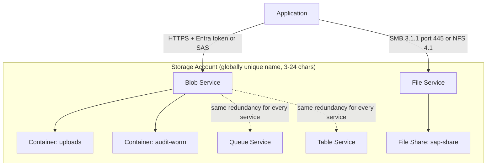
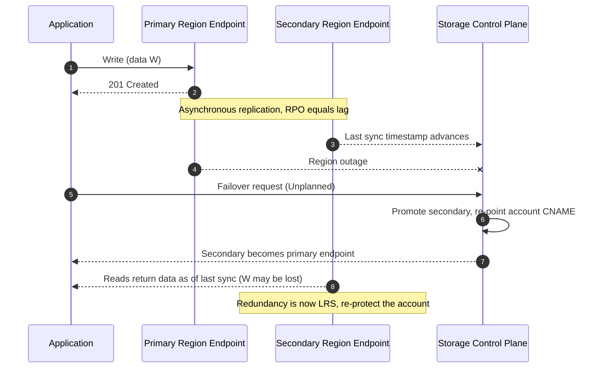
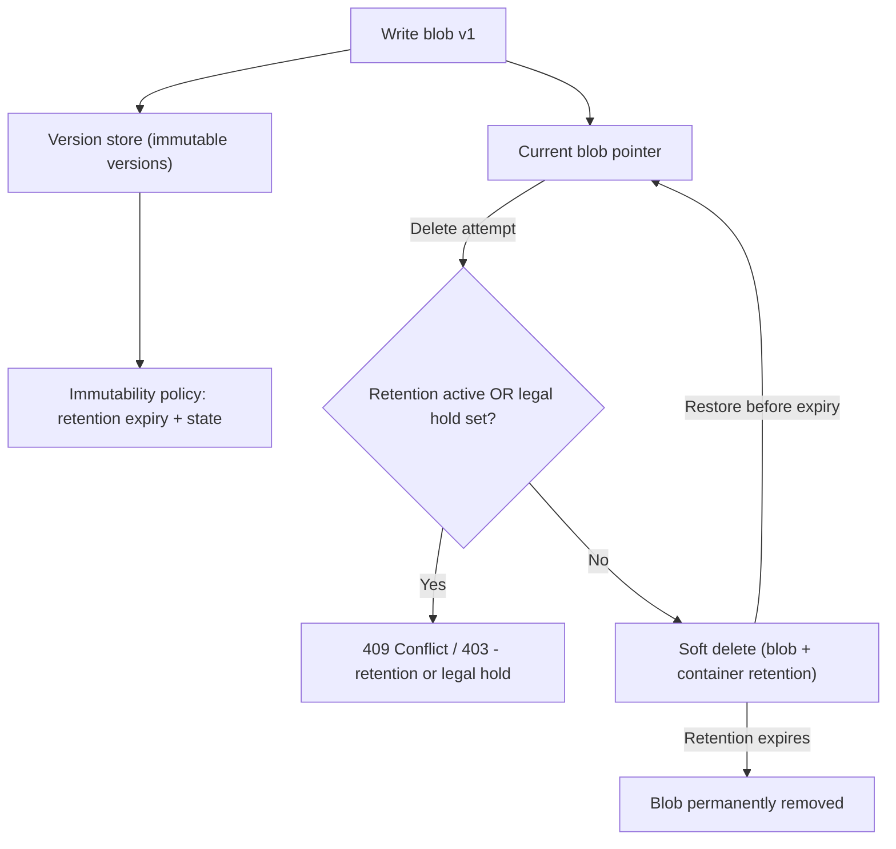

# Module 07: Azure Storage — Blob, Files, Durability, and Access Control

Azure Storage is the substrate under nearly every other data service in Azure: the blob store behind Data Lake, the file share behind lift-and-shift SAP landscapes, the queue behind event fan-out, the customer-facing artefact store, and the tiering target for every on-premises backup product in the market. The service is deceptively simple at the HTTP level and unusually hostile at the edge cases: naming is globally unique, redundancy is asymmetric between primary and secondary regions, access tiers carry prorated early-deletion penalties, Archive is genuinely offline, and every SAS flavour has a different revocation story. This module develops the mechanical reasoning an architect needs to design durable, cheap, and secure storage tiers, and it stays inside the Azure delta: provider-neutral storage-class theory, durability mathematics, and replication vocabulary belong to [`architecture/cloud-foundations`](../../../architecture/cloud-foundations/README.md), and the storage-engine and indexing foundations belong to [`architecture/data-systems`](../../../architecture/data-systems/README.md).

> [!NOTE]
> **Verified against** `@azure/storage-blob` 12.34.0, Azurite 3.38.0, Terraform `hashicorp/azurerm` 5.14.0, Bicep 0.49.2, Node.js 26.13.0, and TypeScript 7.0.2 on 2026-11-20. Redundancy percentages, tier minimums, and rehydration latencies are quoted from the Microsoft Learn pages cited inline.

---

## 1. Core Terminology and Formal Definitions

- **Storage Account**: The Azure Resource Manager resource that owns a globally unique namespace and exposes the Blob, File, Queue, and Table sub-services. It is the unit of billing, of redundancy configuration, of network restriction, and of identity trust.
- **Durability**: The probability that the stored data is not lost over a defined horizon. Azure publishes durability as a percentage with a _nines_ count, for example 99.999999999% (11 nines) for locally redundant storage.
- **Availability**: The probability that the service accepts and serves a request in the interval. Availability is a property of the _service endpoint_, while durability is a property of the _retained bytes_. They are independent: an archive blob can be perfectly durable and completely unavailable.
- **Recovery Point Objective (RPO)**: The maximum interval of committed writes that may be lost during a disaster. For asynchronously replicated storage the RPO equals the replication lag, which is bounded by convention rather than by contract.
- **Recovery Time Objective (RTO)**: The maximum acceptable time to restore service after a failover. RTO for Azure Storage failover is dominated by DNS propagation, not by data movement, because the secondary already holds the data.
- **Redundancy**: The set of physical copies of a piece of data and the geographic spread of those copies. Azure exposes six combinations of intra-region and inter-region replication.
- **WORM (Write Once, Read Many)**: A storage state in which an object cannot be modified or deleted until a declared retention condition expires, enforced by the service rather than by the caller.
- **ETag (entity tag)**: An opaque, version-scoped validator attached to a blob version. It implements optimistic concurrency control: a client presents the ETag it last observed, and the service rejects a write whose precondition no longer holds.
- **Lease**: A time-bounded exclusive claim on a blob for mutation. A lease is mutual exclusion, not a fencing token: the lease identifier is an opaque GUID and carries no monotonic ordering that could be projected onto an external system.
- **SLA-backed RPO**: A recovery-point objective that appears as a contractual commitment in the service-level agreement, as opposed to an engineering target published in documentation.

---

## 2. Storage Account Kinds, Performance Tiers, and Service Surfaces

The account kind fixes which sub-services exist, which redundancy options are legal, and which performance class the media provides. It is immutable after creation: Microsoft documents that you cannot change a storage account to a different type and must instead create a new account and copy the data. That single constraint drives most account-topology decisions, because an accidental `StorageV2` where a `FileStorage` was required means a migration project, not a redeploy.

| Kind | Services exposed | Legal redundancy | Media | Guidance |
| --- | --- | --- | --- | --- |
| `StorageV2` — Standard general-purpose v2 | Blob (incl. Data Lake Storage Gen2), Files, Queues, Tables | LRS, ZRS, GRS, RA-GRS, GZRS, RA-GZRS | HDD-backed, shared | Default choice for new work; supports hierarchical namespace and access tiers |
| `BlockBlobStorage` — Premium block blobs | Block blobs, append blobs | LRS, ZRS | Dedicated SSD | High transaction rates, small objects, consistent low latency; no access tiering |
| `FileStorage` — Premium file shares | Azure Files only | LRS, ZRS | Dedicated SSD | SMB and NFS file shares for SAP, DFS, and latency-sensitive enterprise workloads |
| `Storage` — general-purpose v1 (legacy) | Blob, Files, Queues, Tables | LRS, GRS, RA-GRS | HDD-backed | Retired for new deployments; in-place upgrade to `StorageV2` only |
| `BlobStorage` (legacy) | Blobs only | LRS, GRS, RA-GRS | HDD-backed | Retired; in-place upgrade to `StorageV2` only |

Two additional constraints dominate account design. First, **the redundancy setting is account-wide**: every blob, file share, table, and queue in the account shares one redundancy configuration, so workloads with different durability requirements must live in different accounts. Second, **Archive tier and zone redundancy are mutually exclusive**: the Archive tier is supported only on LRS, GRS, and RA-GRS accounts, which means an account cannot simultaneously be zone-redundant and hold archived blobs. Changing the redundancy of an account that contains archived blobs requires rehydrating every archived blob first.



### 2.1 Endpoint Model and DNS Reality

Each service exposes a hostname derived from the account name: `https://<account>.blob.core.windows.net`, `.file.`, `.queue.`, `.table.`, `.dfs.` (Data Lake Storage Gen2), and `.web.` (static website). Two operational facts follow from that model. First, the endpoint hostname is stable but the CNAME chain beneath it is not, so applications must honour the DNS TTL and must not cache the resolved address — Microsoft explicitly warns that neither the chain nor the A record is stable and that neither change is notified. Second, a custom domain can be mapped to the Blob endpoint for a branded `www` host, which is common for static sites and is the mechanism by which a deleted-and-recreated account name can silently redirect traffic (Section 3.3).

### 2.2 Scalability Targets and the Partition-Scale Pattern

The published default limits for a general-purpose v2 account define the envelope you must design within:

| Dimension | Default limit | Scale-up path |
| --- | --- | --- |
| Request rate | 40,000 requests/second in the listed Americas, Asia Pacific, Europe, Africa, and USGov regions; 20,000 requests/second in all other regions | Quota increase via Azure Support |
| Ingress | 60 Gbps in the listed regions, 25 Gbps elsewhere | Quota increase |
| Egress | 200 Gbps in the listed regions, 50 Gbps elsewhere | Quota increase |
| Capacity | 5 PiB | Quota increase |
| Storage accounts with standard endpoints | 250 per region per subscription | Up to 1,000 by request |
| Network rules | 400 IP rules, 400 virtual-network rules, 200 resource-instance rules | Fixed |
| Private endpoints | 200 per account | Fixed |

Azure Storage meters and scales standard general-purpose v2 accounts in **requests per second, not in IOPS**, because the service abstracts the media behind an object-request interface. IOPS is the currency of the premium kinds: a `BlockBlobStorage` or `FileStorage` account runs on dedicated SSD with published per-instance IOPS and throughput ceilings that grow with the account size, and the limit is a property of the instance rather than of the region. The practical consequence is that the two account kinds scale differently and must be sized differently: a premium account is a _single, sized_ device whose IOPS ceiling you buy, while a standard account is a _request-rate_ pool whose ceiling you can only raise with a quota increase or by adding accounts.

The 20,000 requests/second figure in the lower-tier regions is the number to internalise, because it defines the size of a _partition-scale unit_. A workload that needs more than one account's worth of request rate is not solved by making the application faster; it is solved by sharding the key space across N accounts and balancing across them. The classic partition-scale pattern for blob workloads is to derive an account suffix from a hash of the blob's partition key — `acct` + `base32(sha256(partitionKey))[0:6]` — and to route every read and write for that key to the same account. This keeps related data co-located, keeps the request rate per account below the ceiling, and keeps the mapping stateless and derivable on both sides.

> [!IMPORTANT]
> **The per-blob ceiling is lower than the per-account ceiling.** A single blob is also subject to request-rate limits of the same order as an account. Concentrating a hot partition key onto one blob therefore hits the blob's ceiling long before the account's, and adding accounts does not help unless the _key space_ is also split. This is the storage-side analogue of the Cosmos DB hot-partition failure mode in [Module 08](08-data-platforms-sql-cosmos-and-ai-data.md).

---

## 3. The Globally Unique Naming Trap

### 3.1 The Rules and Why Conventional Naming Fails

A storage account name must be between 3 and 24 characters, may contain only lowercase letters and digits, and must be unique across all of Azure — not merely within a subscription or a tenant. There is no hyphen. The obvious enterprise naming convention, `contoso-prod-uploads`, is therefore invalid three times over: it contains hyphens, it exceeds the character budget when prefixed with a subscription token, and it embeds the organisation name in a namespace that is globally shared with every other Azure customer.

The usual remediation — strip the separators — produces `contosoproduploads`, which is exactly the shape that collides. Two teams in the same tenant that both derive a name from `{org}{environment}{workload}` will collide as soon as one of them uses `prod` and the other uses `production`, or one truncates and the other does not. The failure surfaces at plan time as an opaque provider error from `azurerm_storage_account` (`StorageAccountNameInvalid`), which is a poor place to discover a naming convention defect.

The Azure-recommended shape is `{org}{abbreviatedworkload}{environment}{shortuniquecomponent}` where the abbreviated component is a short hash of the subscription, resource group, or workload identifier, and the total stays under 24 characters. A deterministic hash component removes the collision entirely without making names unrecognisable, and it keeps the same name reproducible from the same inputs across pipelines and worktrees.

```bash
# Deterministic, collision-free naming helper
name="co$(printf '%s' "$SUBSCRIPTION_ID" | sha256sum | cut -c1-8)uploadsprod"
printf '%s (%s chars)\n' "$name" "${#name}"

# Preflight the name against Azure before any pipeline depends on it
az storage account check-name --name "$name"
```

### 3.2 Naming as a Substitution Vector

The account name is a DNS label under `blob.core.windows.net`. If an account is deleted and its name is later re-registered by a different tenant, every hardcoded URL of the form `https://<name>.blob.core.windows.net/...` now resolves to somebody else's storage. Any SAS token issued for the old account was signed by the old account's key, so it will not authenticate against the new account — but the _URL_ will still resolve, and a browser following a link, a custom domain mapped to the blob endpoint, or an integration that reads the public container before authenticating will silently succeed against an attacker's content. This is a subdomain-takeover class defect, and it is entirely preventable.

Three controls close it. First, never hardcode the account name in application configuration; always inject it from the IaC output or from a `azurerm_storage_account` data source keyed by tag. Second, apply `CanNotDelete` resource locks to production storage accounts, and use Azure Policy with a `Deny` effect on `Microsoft.Storage/storageAccounts/delete` for data-critical accounts. Third, for accounts whose name must be recycled during environment teardown, add a random component at creation time so that the freed name is not the one the next environment will request.

> [!WARNING]
> **Deleted storage account names are released for re-registration.** Microsoft holds a deleted name only for a short reservation window before another tenant can claim it (exact window not documented publicly — treat it as eventual, not guaranteed). Any IaC pipeline that destroys and recreates a storage account with a deterministic name must assume the name can be taken in between. Add an unpredictable component or a lock.

### 3.3 The Endpoint-Stability Advice That Conflicts with the Custom-Domain Habit

Microsoft's guidance is to avoid depending on a cached IP address for the storage endpoint and to honour the DNS TTL. That guidance is sound for connectivity, but it creates a friction point with the custom-domain pattern used for static websites: mapping `www.example.com` to a storage account makes the _custom_ name stable while the underlying account can be deleted and recreated, and the custom-domain mapping is itself a resource that must be re-pointed. Treat the custom domain as a first-class deployment artefact with the same change-control as the account.

---

## 4. Redundancy and Failover Mechanics

### 4.1 The Six Options

| Option | Primary region | Secondary region | Durability | Secondary read access | Notes |
| --- | --- | --- | --- | --- | --- |
| LRS | 3 copies in one datacenter | None | 11 nines (99.999999999%) | n/a | Cheapest; a datacenter-level fire or flood is unrecoverable |
| ZRS | 3 copies, synchronously across 3 availability zones | None | 12 nines (99.9999999999%) | n/a | Write returns only after all three zones acknowledge; a downed zone degrades rather than fails |
| GRS | LRS primary | Async copy, fixed paired region | 16 nines (99.99999999999999%) | No | Secondary is unreachable until failover |
| RA-GRS | LRS primary | Async copy, fixed paired region | 16 nines | Yes, via `-secondary` suffix | Secondary reads can be stale by the replication lag |
| GZRS | ZRS primary | Async copy, fixed paired region | 16 nines | No | Zone resilience in the primary plus regional protection |
| RA-GZRS | ZRS primary | Async copy, fixed paired region | 16 nines | Yes, via `-secondary` suffix | Strongest general-purpose configuration |

Two structural facts shape every design decision that follows. The **paired region is determined by the primary region and cannot be changed** — you cannot choose your DR region, you can only choose which region you fail _from_, and whether you accept the pair Microsoft chose for you. And **the secondary always uses LRS internally**, even for GZRS and RA-GZRS, so the secondary protects against hardware failure but not against a zone-level event.

Service-level support is uneven and must be checked before designing around a redundancy option: Azure Files HDD (Standard) SMB shares support **LRS, ZRS, GRS, and GZRS** (only **RA-GRS and RA-GZRS** are unsupported; SSD Premium file shares support LRS and ZRS), and the Archive tier supports only LRS, GRS, and RA-GRS.

### 4.2 Customer-Initiated Failover

Azure does not fail a geo-redundant storage account over automatically. The customer initiates it, and the initiation mode encodes a data-loss trade-off.



**Unplanned failover** is for an outage in which the primary region is unavailable. The secondary is promoted immediately and any write not yet replicated is lost. The RPO is the replication lag at the moment of failure.

**Planned failover** requires the primary region to be reachable, and is used for region migration, for returning to the original region after an outage has been mitigated (failback), and for DR drills where data loss is unacceptable. Because the primary is still reachable, the service can drain outstanding writes before promoting the secondary, which is why the planned path avoids the data loss of the unplanned path.

Three consequences deserve emphasis in a design review.

First, **failover is not instantaneous**. The service must re-point the account's CNAME chain so that the well-known account hostname now resolves into the new primary region, and Microsoft documents that DNS propagation of that change can take up to an hour in the worst case. Applications that cache the resolved endpoint address, or that hold long-lived connections, will not fail over instantly; clients must re-resolve and reconnect.

Second, **the account must be re-protected after a failover**. Following the failover the account's redundancy configuration is converted to LRS, because geo-replication cannot simply resume in the opposite direction. To restore regional protection you must explicitly change the redundancy back to GRS or GZRS, which reseeds the secondary from the new primary. Until that change is applied and completes, the account is a single-region store wearing a geo-redundant name — and IaC that asserts `account_replication_type = "GRS"` will show a permanent drift against a failed-over account until the operator acts.

Third, **RA-GRS secondary reads are stale by construction**. A read against `https://<account>-secondary.blob.core.windows.net/...` returns the state as of the last successful sync, so it can be behind the primary by the full replication lag. The honest way to bound that staleness is to read the account properties and use the geo-replication statistics — the SDK exposes the last-sync timestamp on the account properties — and to treat the secondary as a best-effort path that is acceptable for cache-like, eventually-consistent content but never as the source of truth for a write-after-read invariant.

> [!IMPORTANT]
> **There is no strict SLA on replication lag by default.** The commonly quoted "RPO of 15 minutes or less" is a _typical_ engineering bound for asynchronous geo-replication, not a contractual guarantee in the storage SLA. Microsoft publishes a distinct **Geo Priority Replication** offering that commits to an RPO of 15 minutes or less for block blobs; without it, a 15-minute RPO is a planning assumption you must validate against the observed lag metric rather than a promise you can put in a contract.

### 4.3 Availability Arithmetic Across Tiers

Availability is not a single number per account. For a standard account the SLA on read availability is 99.9% for the Hot tier and 99% for Cool, Cold, and Archive, and write availability is 99.9% for Hot and 99% for the cooler tiers. For RA-GRS and RA-GZRS accounts, read availability against the _secondary_ endpoint is 99.99% for Hot and 99.9% for the cooler tiers. A design that accepts 99% read availability for archived compliance evidence is often acceptable; a design that accepts 99% for a hot read path is not, and the tier choice — not the redundancy choice — is what determines it.

---

## 5. Access Tiers and Lifecycle Economics

### 5.1 Tier Semantics

| Tier    | Minimum retention | Read availability | Time to first byte | Redundancy support    |
| ------- | ----------------- | ----------------- | ------------------ | --------------------- |
| Hot     | none              | 99.9%             | Milliseconds       | All                   |
| Cool    | 30 days           | 99%               | Milliseconds       | All                   |
| Cold    | 90 days           | 99%               | Milliseconds       | All                   |
| Archive | 180 days          | 99%               | Hours              | LRS, GRS, RA-GRS only |

Cool, Cold, and Archive are online tiers in the sense that a request returns data, but they are not equally responsive: Archive is _offline_. An archived blob cannot be read or modified. Its metadata and index tags remain readable, so the blob still appears in listings and can still be found by tag search, but a `GET` on its content returns an error until it is rehydrated. Snapshots are not supported for archived blobs, and tier changes apply only to block blobs, including their versions and snapshots.

### 5.2 The Early-Deletion Penalty

Moving a blob to a cooler tier commits you to a minimum retention period. Deleting it early, or rewriting it entirely, is charged a prorated penalty equal to the remaining days at the destination tier's storage price.

- A blob moved to Cool and deleted after 21 days is charged as if stored 30 days.
- A blob moved to Cold and deleted after 45 days is charged as if stored 90 days.
- A blob moved to Archive and deleted after 120 days is charged as if stored 180 days.

The trap is that the penalty applies to _any_ full-object rewrite, not only to deletion. `Put Blob`, `Put Block List`, and `Copy Blob` all re-bill the object as if the minimum retention had been honoured. A nightly job that re-uploads an archived manifest therefore triggers the penalty every night, which is exactly the shape of an unnoticed runaway bill.

One important interaction: **a blob under soft delete is not subject to the early-deletion penalty** while the retention window is open. The object is only considered deleted once the soft-delete retention expires, at which point the prorated penalty is assessed against the remaining minimum retention.

### 5.3 Archive Rehydration

Rehydration returns an archived blob to an online tier. Two mechanisms exist: `Set Blob Tier` (changes the tier of the same blob) and `Copy Blob` (creates a new blob in the online tier and leaves the source archived).

| Priority | Latency for objects under 10 GB | Cost | Operational notes |
| --- | --- | --- | --- |
| Standard (default) | Up to 15 hours | Retrieval rate | Processed in request order; the "up to 15 hours" figure does not scale for bulk work |
| High | Typically under 1 hour | Higher retrieval rate | Pre-empts standard queue; may exceed one hour under demand |

The critical constraint is the **account-level throughput cap of 10 GiB per hour with priority retrieval**. That ceiling applies to the whole storage account, not per blob, so a bulk restore of a terabyte is not "15 hours" — it is at least 100 hours of retrieval, and the per-blob latency figures are only meaningful in isolation. A further nuance protects against runaway spend: if a high-priority rehydration request for a blob smaller than 10 GB takes more than five hours, the high-priority retrieval rate is not charged, though standard retrieval rates still apply.

Two more operational details: the priority of a pending rehydration can be raised from Standard to High, but **never lowered** from High to Standard; and a high-priority rehydration of more than 10 GiB per hour cannot be requested. In practice, monitor rehydration through Event Grid's `Microsoft.Storage.BlobTierChanged` event rather than by polling `Get Blob Properties` every few seconds.

Choosing between `Set Blob Tier` and `Copy Blob` has a real cost consequence. `Set Blob Tier` leaves the blob's last-modified time unchanged, so a lifecycle rule with a `tierToArchive` action and no `daysAfterLastTierChangeGreaterThan` condition will happily re-archive the blob you just rehydrated. `Copy Blob` creates a new object with a fresh last-modified time and avoids the re-archiving, but leaves the source in Archive, so you pay for capacity twice and the source must not be deleted until the copy completes.

### 5.4 The Transaction-Fee Trap That Inverts Tiering Economics

Per-10,000 transaction charges are charged at every tier, and the unit price rises as the tier gets cooler. A workload that stores millions of small objects therefore has a cost structure dominated by _operations_, not by _bytes_. Consider a repository of 10 million 1 MB objects, each read once per month by an indexing job and listed nightly:

- In Hot, the monthly cost is dominated by storage plus one read transaction per object per month.
- In Cool, each read is charged at the Cool read rate, and each nightly _list_ enumeration is itself a transaction — listing a container with 10 million blobs paginates through millions of `List Blobs` operations, each of which is billed at the Cool list rate.

The break-even point is where the extra per-GB storage saving is exceeded by the extra per-10,000 transaction charge. For an object store with a high operation-to-byte ratio — small files, frequent listing, per-object metadata reads — Cool and Cold can cost _more_ than Hot, while for a write-once, read-never archive of large objects, Archive is dramatically cheaper. The architectural conclusion is that access-tier selection must be driven by the _operation intensity per byte_, not by the age of the data, and that the "tier everything older than 30 days to Cool" reflex is frequently a cost regression.

### 5.5 Lifecycle Management and the Default-Tier Trap

Lifecycle management rules act on last-modified time, creation time, or tier-change age, and can transition tiers and expire blobs. Two behaviours bite in production.

First, **lifecycle rules cannot rehydrate from Archive**. A rule can move a blob into Archive, but there is no lifecycle action that brings it back, which is why rehydration is always an explicit, externally-driven operation.

Second, **changing the account's default access tier retroactively re-tiers every blob that has no explicit tier**. Blobs whose tier was inferred are labelled "Hot (inferred)", "Cool (inferred)", or "Cold (inferred)" in the portal. Toggling the default from Hot to Cool bills a write operation for every inferred blob; toggling it back to Hot bills a read operation plus a data-retrieval charge for every inferred blob. On an account holding millions of objects, a single console toggle is a six-figure event. Set the default tier deliberately at creation, and set the tier explicitly on every write whose tier matters.

Newer capabilities worth tracking in a design review: **Smart tier** moves data between Hot, Cool, and Cold based on observed access patterns, and **Turbo tier** (preview) adds SSD-backed performance for selected blobs inside an otherwise tiered account. The Archive tier itself remains restricted to LRS, GRS, and RA-GRS accounts, so a zone-redundant archive strategy must instead use a Cold-tier or object-lock design.

---

## 6. Access Control, SAS Semantics, and Concurrency Control

### 6.1 Shared Key: Why It Must Be Disabled

A storage account exposes two account keys. Either key grants full control over every blob, file, queue, and table in the account. The problems are structural, not incidental:

- **No identity.** A request authenticated with an account key carries no principal, so audit logs record "shared key" and nothing about _who_ acted.
- **No expiry.** The key is valid until it is rotated by hand. A leaked key is a permanent credential.
- **No least privilege.** The key grants account-wide rights including the right to delete every container and, on an account with hierarchical namespace, to delete the file system.
- **No granular revocation.** You can disable the key, which breaks every consumer at once, or leave it enabled, which leaves the blast radius unbounded.

In a hardened enterprise the control is `allowSharedKeyAccess: false` on the account. The consequence must be understood before it is applied, because it is broader than it first appears: **Account SAS and Service SAS tokens are signed with the account key**, so disabling shared key access invalidates them too. The only SAS flavour that survives is the **User Delegation SAS**, which is signed with a delegation key derived from an Entra ID token. The same switch also breaks the shared-key authentication mode in Azure Storage Explorer and `azcopy --auth-type SharedKey`, so toolchain and pipeline changes must be sequenced with the policy change rather than after it.

```hcl
# Terraform: Entra-only data plane, private networking, and no public blob
resource "azurerm_storage_account" "data" {
  name                     = "co${substr(sha256(var.subscription_id), 0, 8)}dataprod"
  resource_group_name      = azurerm_resource_group.data.name
  location                 = azurerm_resource_group.data.location
  account_tier             = "Standard"
  account_replication_type = "GZRS"
  account_kind             = "StorageV2"

  allow_shared_key_access = false
  shared_access_key_enabled = false
  public_network_access_enabled = false
  min_tls_version             = "TLS1_2"

  blob_properties {
    versioning_enabled = true
    delete_retention_policy { days = 14 }
    container_delete_retention_policy { days = 14 }
  }
}
```

The data-plane RBAC roles that matter are `Storage Blob Data Reader`, `Storage Blob Data Contributor`, `Storage Blob Data Owner`, `Storage Blob Delegator` (required by any principal that must mint user delegation SAS tokens), and `Storage File Data SMB Share Contributor` for Azure Files over SMB. Remember the separation the identity module establishes: `Owner` on the storage account is a _control-plane_ grant and confers no ability to read a blob through the data plane.

### 6.2 The Three SAS Types

| Type | Signed with | Scope | Lifetime bound | Revocation |
| --- | --- | --- | --- | --- |
| Account SAS | Account key | Account-wide: services, resource types, object permissions | Requester-set expiry | Rotate the account key, or revoke a referenced stored access policy |
| Service SAS | Account key | One service (blob, file, queue, table), optionally one container or path | Requester-set expiry | Rotate the account key, or revoke a referenced stored access policy |
| User Delegation SAS | User delegation key derived from an Entra ID token | Same service scoping as Service SAS | Bounded by the Entra token lifetime (maximum 7 days) and the delegation key expiry | Automatic when the principal is disabled, deleted, or its credentials are revoked |

The user delegation SAS is the only flavour that carries an _auditable principal_. The delegation key itself is obtained by calling `generateUserDelegationKey` against the Blob service with a token that holds the `Storage Blob Delegator` role, and the key's lifetime cannot exceed the Entra token that produced it. When the issuing principal is disabled in Entra ID, its tokens stop validating, the delegation key can no longer be renewed, and every outstanding user delegation SAS issued from it becomes useless — the revocation is a consequence of identity lifecycle rather than a storage-side operation. That is the property that makes it the right choice for a regulated environment and the reason `allowSharedKeyAccess: false` is safe to enforce.

Three practical rules for any SAS programme:

1. **Always narrow with `sip`, `spr`, and `srt`.** The IP allowlist, the protocol restriction, and the signed resource type are what turn a bearer token from a data-exfiltration primitive into a scoped capability.
2. **Always prefer a stored access policy over an inline expiry.** A stored access policy on the container or the blob service holds the permissions and expiry; the SAS references the policy by name. Revoking the policy invalidates every token that references it, in one operation, without rotating an account key or waiting out the expiry.
3. **Never accept a SAS from an untrusted caller.** A SAS is a bearer credential. A client that can supply its own expiry and scope can mint a long-lived, wide-scoped token.

### 6.3 Optimistic Concurrency with ETags

Every blob version carries an ETag. Two conditional headers implement compare-and-swap semantics:

- `If-Match: <etag>` — the write succeeds only if the current ETag matches. A mismatch returns **HTTP 412 Precondition Failed**. This is the primitive for "update only if nobody else changed it".
- `If-None-Match: *` — the write succeeds only if the blob does **not** exist. A collision returns **HTTP 409 Conflict** (`BlobAlreadyExists`). This is the primitive for create-if-absent, and omitting it turns `Put Blob` into an unconditional overwrite.

```ts
// Optimistic concurrency: read the ETag, then write under that precondition.
import { ContainerClient } from '@azure/storage-blob';

export async function updateConfig(
  container: ContainerClient,
  name: string,
  next: string,
): Promise<void> {
  const blob = container.getBlobClient(name);
  const props = await blob.getProperties();
  await blob.uploadData(next, {
    conditions: { ifMatch: props.etag }, // 412 Precondition Failed if the ETag moved
    httpHeaders: { 'content-type': 'application/json' },
  });
}

// Create-if-absent: 409 Conflict instead of a silent overwrite.
export async function createOnce(
  container: ContainerClient,
  name: string,
  body: string,
): Promise<void> {
  await container.getBlockBlobClient(name).uploadData(body, {
    conditions: { ifNoneMatch: '*' },
  });
}
```

A failure to handle the 412 is a lost-update bug, not a transient error: the correct response is to re-read, re-compute, and retry with a bounded attempt count, because the conflict may indicate that a human or another service deliberately changed the object.

> [!NOTE]
> The `@azure/storage-blob` snippet above illustrates production Azure SDK signatures; the hermetic runnable proofs in `../examples/` test the underlying ETag precondition and state-machine semantics directly without external cloud credentials.

### 6.4 Blob Leases

A lease grants exclusive write access to a blob for a period between 15 seconds and 60 seconds, or indefinitely. While a lease is active, any other write to the blob must present the lease identifier in `x-ms-lease-id`, or the service rejects it with HTTP 409 (`LeaseIdMismatchWithLeaseOperation` or `LeaseNotPresentWithLeaseOperation`). Deletion is blocked for the duration of the lease as well.

Two properties keep this from being a substitute for a distributed lock service. The lease identifier is an opaque GUID, not a monotonically increasing token, so it cannot be used as a fencing token against a system that is not Azure Storage — a client that lost its lease can still act on other systems, and Azure Storage cannot invalidate those actions. And the lease is bound to the _blob_, not to a logical resource: two services leasing two different blobs that represent the same logical document will both succeed and both corrupt the document.

Use leases when the mutual exclusion boundary is exactly one blob. Use ETags when you need a compare-and-swap on a version. Use an external coordination service — or the transactional guarantees of a relational database — when the protected resource is a business entity rather than a byte range.

---

## 7. Data Protection and Compliance

### 7.1 WORM Immutability Policies

An immutability policy is set on a container and carries three independent controls:

- **Time-based retention**: an `expiryTime` and a `state` of `Unlocked` or `Locked`. While unlocked, the retention period can be shortened. Once locked, it can only be extended, and the locked state cannot be undone.
- **Legal hold**: an independent, flag-shaped hold that suspends deletion and modification indefinitely, regardless of any retention date. Legal holds can be applied and removed by authorised principals, which is precisely why they must be governed separately from retention.
- **Version-level immutability**: protection attached to _blob versions_ rather than to the current blob, which protects historical versions from being overwritten or deleted while still permitting the live blob to change.

Enabling an immutability policy requires blob versioning and soft delete to be enabled on the account, which is a useful forcing function: it means that any container you can lock is also one where the prior versions remain addressable for audit. The combination of versioning, immutability with a locked retention period, and legal hold is the pattern that satisfies SEC Rule 17a-4 and FINRA Rule 4511 for broker-dealer records, because it makes the retention period both enforced by the service and auditable through the version history.



### 7.2 Soft Delete, Versioning, and Point-in-Time Restore

Soft delete at the blob level retains a deleted blob for a configurable period (0 to 90 days, 7 days by default on new accounts), and can be undone with `Undelete Blob`. Container soft delete retains the _container_ and its blob namespace under the same kind of policy, which is the control that protects against a `Delete Container` executed by a misfiring pipeline. A soft-deleted blob is not truly deleted: it is invisible to a normal `List Blobs` unless `include=deleted` is passed, and it cannot be permanently removed until the retention window expires.

Blob versioning keeps every write as a distinct, immutable version. A delete creates a _delete marker_ rather than removing data, so the previous version remains readable and recoverable. Versions are addressable by version ID, which is what makes version-level immutability possible.

Point-in-Time Restore (PITR) sits above both. The service maintains a continuous write-ahead log of block-blob changes for up to 30 days, and can restore a blob — or an entire container — to any point within that window without a customer-managed backup. PITR is the fastest recovery path for "a bad `Put Blob` overwrote the file at 03:14" and it depends on versioning and soft delete being enabled. Azure Files offers an analogous PITR for file shares.

### 7.3 Change Feed and Object Replication

The **change feed** is an ordered, guaranteed-to-be-complete log of the data-plane events for a blob container: create, delete, tier change, and metadata updates. It is the substrate for building secondary systems without polling.

- **Pull model**: the consumer reads from a continuation token, processing at its own pace and persisting the token. This is the classic Change Feed Processor pattern, and it is the right default because it needs no additional Azure resources.
- **Push model**: the change feed is projected to Event Grid, and consumers subscribe to the events. This suits fan-out to many independent consumers, but note that Event Grid delivery is at-least-once, so the consumer must be idempotent — exactly the delivery-semantics discipline described in [`architecture/distributed-systems`](../../../architecture/distributed-systems/README.md).

Typical uses are CQRS read-model construction, event sourcing, feeding a search index, replicating into a warehouse, and building a downstream audit trail.

**Object replication** is the managed, service-side alternative: a replication policy on a source container copies blobs to a destination container, either in place or asynchronously across accounts and regions. It supports both _move_ and _copy_ semantics and can carry index tags and blob versions. It is the right tool for "every blob written here must exist over there with the same lifecycle" and the wrong tool for "I need the domain events of this entity", because it transports objects rather than semantic events.

### 7.4 Choosing a Protection Mechanism

| Requirement | Mechanism | Why not the others |
| --- | --- | --- |
| Recover an accidental overwrite within 30 days | PITR | Soft delete does not help; the overwrite happened, nothing was deleted |
| Recover an accidental deletion | Soft delete + version history | PITR is for point-in-time state, not for namespace accidents |
| Survive a ransomware encryption event | Immutability policy with locked retention | Soft delete and versioning both preserve _encrypted_ content |
| Satisfy SEC 17a-4 / FINRA 4511 | Immutability policy with locked retention plus version history | Backups are not WORM and are not independently auditable |
| Copy every write to another region or account | Object replication, or change feed plus your own consumer | Neither protects against deletion in the source |
| Keep a business audit trail of domain events | Change feed (pull or push) | Object replication moves bytes, not events |

---

## 8. File, Transfer, and Hybrid Services

### 8.1 Azure Files and the Port 445 Problem

Azure Files exposes SMB 3.1.1 on port 445 and, on Premium file shares and selected Standard regions, NFS 4.1. The SMB path is the one that matters for lift-and-shift workloads, and it carries a well-known operational trap: **many ISPs, corporate proxies, and some cloud provider networks block outbound SMB**. A Windows workstation or a build agent that mounts `\\account.file.core.windows.net\share` from the public internet will hang on the TCP handshake rather than fail cleanly, which is indistinguishable from a firewall misconfiguration and generates false incidents.

The mitigations are architectural. A **Private Endpoint** plus a **Private DNS zone** (`privatelink.file.core.windows.net`) linked to the VNet gives in-VNet workloads a clean SMB path over the Azure backbone. For on-premises or branch access, a **VPN Gateway** or **ExpressRoute** carries port 445 over an encrypted tunnel to the same private endpoint, avoiding the public-SMB block entirely. A third option is to stop using SMB from the application tier and consume the share over HTTPS with the Storage REST API or the SDK, which removes the port dependency at the cost of POSIX semantics.

Azure Files also carries its own redundancy and tier constraints: HDD (Standard) SMB shares support **LRS, ZRS, GRS, and GZRS** (only **RA-GRS and RA-GZRS** are unsupported), whereas SSD (Premium) file shares support **LRS and ZRS**. For HDD SMB shares, GRS/GZRS customer-initiated failover is therefore a valid regional DR path; for Premium SSD file shares (or active-active multi-region needs), regional DR relies on Azure File Sync, AzCopy-based replication, or a second file share in another region fed by an application-level process.

Azure Files supports four distinct SMB authentication modes: **on-premises Active Directory Domain Services (AD DS)**, **Microsoft Entra Domain Services**, **Microsoft Entra Kerberos** (for hybrid and cloud-only Entra identities without line-of-sight to a domain controller, distinct from AD DS), and **storage account key (NTLMv2)**. The three identity-based Kerberos options give per-user identity, Azure RBAC share-level permissions, NTFS directory/file ACLs, and auditing that a shared account key cannot.

**Azure File Sync** adds a synchronisation agent that bridges on-premises Windows file servers and Azure Files, with cloud tiering that keeps only frequently used files local and presents the rest as placeholders. It is the standard migration path for a file-server estate into Azure.

### 8.2 Azure Files versus Azure NetApp Files

| Dimension | Azure Files (Premium) | Azure NetApp Files |
| --- | --- | --- |
| Latency | Single-digit milliseconds, platform-managed | Sub-millisecond, dedicated infrastructure |
| Protocol | SMB 3.1.1 and NFS 4.1 | SMB and NFS, ONTAP semantics |
| Capacity model | Pay per provisioned share, grows in discrete tiers | **Capacity pool with a 4 TiB minimum**, volume allocations draw from the pool |
| Networking | Private Endpoint, delegated subnet, or public with NSG | **Delegated subnet** required (`Microsoft.NetApp/volumes`) |
| Scale | Tens of TB per share | Multi-PB pools, hundreds of volumes |
| Typical fit | SMB lift-and-shift, general file shares, File Sync target | SAP HANA, high-IOPS enterprise NAS, performance-sensitive shared filesystems |

The NetApp Files capacity-pool minimum is the decision driver: a workload with 200 GB of genuinely performance-sensitive data cannot be served by NetApp Files at a sensible price, because the bill is for the pool, not the volume. The delegated-subnet requirement is also operationally significant — the delegated subnet must be created before the pool, and it cannot host other resources.

### 8.3 AzCopy

AzCopy is the supported bulk transfer tool and the correct default for moving data between accounts, from a local filesystem, or between regions.

```bash
# Account-to-account copy with Entra identity and a bounded, observable run
azcopy copy \
  --from-to=BlobBlob \
  --src-account="co1234abcdsrcprod" \
  --dst-account="co1234abcddstprod" \
  --src-container=raw --dst-container=raw \
  --recursive \
  --concurrency=32 \
  --checkpoint-file=/tmp/azcopy.checkpoint \
  --log-path=/tmp/azcopy.log --log-level=INFO \
  --include-pattern="*.parquet" --exclude-pattern="*_tmp/*"

# Resume a failed run: the checkpoint file makes the second invocation incremental
azcopy copy ... --checkpoint-file=/tmp/azcopy.checkpoint
```

The `--from-to` switch is what distinguishes a cross-account copy from a download-and-upload pair, and it matters for both performance and correctness: the server-side copy path does not round-trip the bytes through the client. `--concurrency` defaults to 32 and is the first knob to turn when a transfer is slow, because storage throttles per account rather than per object. `--checkpoint-file` is what makes a large transfer resumable; without it a failed 40-hour run restarts from zero. `--include-pattern` and `--exclude-pattern` use filesystem-style wildcards and are applied against the blob path relative to the source root, which is a frequent source of "my filter matched nothing" incidents. For Entra authentication use `--auth-type=EntraID` with a signed-in CLI session; `--auth-type=SAS` with `--sas-token` remains necessary when the account has shared key access disabled and the tool version predates Entra support.

### 8.4 Azure Data Box

For offline migration of petabyte-scale data, Azure Data Box ships an encrypted, shippable appliance. The current generation offers roughly 100 TB of usable capacity for the standard Data Box, a larger Data Box Heavy appliance for PB-scale moves, and Data Box Edge for Azure Arc-enabled edge compute that also acts as a Data Box on demand. The engineering constraints that make Data Box the right answer are physical: uplink bandwidth from a data centre is often the limiting factor for a petabyte move, and Data Box converts that into a physical shipment with a tracked chain of custody. Its operational constraints are equally real — the device must be returned or purchased, the data is encrypted under a customer-managed key during transit, and the device must be returned or purchased — the appliance is a one-way logistics operation, not a subscription.

---

## 9. Local Verification with Azurite

Azurite 3.38.0 is the local Azure Storage emulator, providing Blob, Queue, and Table services. It is what makes the SAS, ETag, and lease semantics testable without an Azure subscription.

```bash
# Start the emulator
npx azurite --location ./azurite-data --debug ./azurite-debug.log \
  --blobPort 10000 --queuePort 10001 --tablePort 10002

# The well-known development account key (emulator only, never a real credential)
export AZURITE_CONNECTION_STRING="DefaultEndpointsProtocol=http;AccountName=devstoreaccount1;AccountKey=Eby8vdM02xNOcqFlqUwJPLlmEtlCDXJ1OUzFT50uSRZ6IFsuFq2UVErCz4I6tq/K1SZFPTOtr/KBHBeksoGMGw==;BlobEndpoint=http://127.0.0.1:10000/devstoreaccount1;QueueEndpoint=http://127.0.0.1:10001/devstoreaccount1;TableEndpoint=http://127.0.0.1:10002/devstoreaccount1;"
```

Two suites in this track exercise the mechanics described above:

- [`../examples/06-storage-sas-and-durability.test.ts`](../examples/06-storage-sas-and-durability.test.ts) proves the SAS lifetime and permission model, the `If-Match` conditional-write path returning `412 Precondition Failed`, the `If-None-Match: *` create-once path returning `409 Conflict`, and the expiry negative case where a token past its expiry is rejected.
- [`../examples/09-azurite-integration.test.ts`](../examples/09-azurite-integration.test.ts) runs the live-emulator integration path against a running Azurite instance, and skips cleanly with an explanatory message when the emulator is not available.

```bash
cd technologies/azure
mise exec -- npm test            # deterministic, hermetic suites
mise exec -- npm run test:integration   # requires a running Azurite
```

What Azurite does **not** emulate must be stated explicitly in a design review, because these are exactly the behaviours that fail in production and pass locally: access-tier transitions and their early-deletion penalties, Archive rehydration and its latency, redundancy and geo-replication, account failover, immutability policies, point-in-time restore, and the change feed. Those require a sandbox subscription and a scheduled verification pipeline, not a unit test.

---

## 10. Then vs Now: Platform Migrations and Version History

| Change | Applied in | Old approach | Current approach | Migration pitfall |
| --- | --- | --- | --- | --- |
| General-purpose v1 accounts | Retired for new deployments | `Storage` account kind with LRS/GRS/RA-GRS only | `StorageV2` with hierarchical namespace, access tiers, lifecycle, private endpoints | The in-place upgrade to `StorageV2` is one-way; verify feature parity before upgrading, because account-level settings such as the HNS feature flag change behaviour |
| Legacy blob-only accounts | Retired for new deployments | `BlobStorage` account kind | `StorageV2` | Legacy blob accounts had no Cold tier and different minimum-retention rules; re-evaluate tiering after the upgrade |
| Classic (ASM) deployment model | Retired 2024-08-31 | Classic deployment model | ARM only | Classic accounts cannot be converted; they must be migrated to ARM resources |
| Shared key authentication | Ongoing | Account keys as the primary credential | Entra ID, RBAC, and user delegation SAS | `allowSharedKeyAccess: false` also invalidates Account and Service SAS; sequence the identity migration before the switch |
| Archive tier | Current | Cold tier as the deepest online tier | Cold (90 days) plus Archive (180 days, offline) | Archive is incompatible with ZRS/GZRS/RA-GZRS and needs an explicit rehydration budget of 10 GiB per hour |
| Storage account endpoint | Current | `<account>.blob.core.windows.net` | Standard endpoints, with Azure DNS zone endpoints in preview | Azure DNS zone endpoints retire in March 2027; do not build new dependencies on them |
| Blob soft delete | Default for new accounts | Explicit opt-in, often off | Enabled by default with a 7-day retention | Existing accounts without soft delete have no undo path; enable it and check the retention meets the recovery objective |
| Geo replication RPO | Current | Typical lag, no commitment | Geo Priority Replication commits to RPO ≤ 15 minutes for block blobs | It is an account-level configuration, and archived blobs must be rehydrated before the redundancy can change |

---

## Interview Drill

<details><summary>Model Answer</summary>

**Q1. A team deploys a storage account named `contoso-prod-uploads`. The Terraform plan fails with `StorageAccountNameInvalid`. Explain every rule the name violates, and design a naming scheme that will not fail again in six months.**

The name violates two rules. Azure storage account names must be 3 to 24 characters, may contain only lowercase letters and digits, and must be globally unique across all of Azure. `contoso-prod-uploads` contains hyphens and is 21 characters, so the character rule is the direct cause of the failure; the uniqueness rule is the latent hazard, because the natural repair — deleting the hyphens — yields `contosoproduploads`, which another tenant may already own, and the same repaired name will collide with a sibling team's environment as soon as two teams derive it from the same organisation and environment tokens.

The durable fix is to make the name a pure function of the deployment identity, not of a human-readable convention. Compute a short deterministic hash of the subscription identifier or resource-group identifier, embed it in the middle of the name, strip all separators, and clamp the total to 24 characters: `co${sha256(subscriptionId)[0:8]}uploads${environment}`. Because the hash component is derived from a value that is unique per deployment, two teams cannot collide, and because it is deterministic, a pipeline can recompute the name without querying Azure. Add `az storage account check-name --name <name>` as a preflight step in the pipeline so the failure surfaces before the plan rather than during apply. Finally, pin the computed name as an output and inject it everywhere; never hardcode a storage account hostname in application configuration, because the account name is a DNS label under `blob.core.windows.net` and a deleted, re-registered name becomes a subdomain-takeover vector.

- Ref: [Section 3: The Globally Unique Naming Trap](#3-the-globally-unique-naming-trap), [Storage account overview — Storage account name](https://learn.microsoft.com/en-us/azure/storage/common/storage-account-overview)

</details>

<details><summary>Model Answer</summary>

**Q2. A geo-redundant storage account fails over during a regional outage. After service is restored, the security team discovers the account is no longer protected against a second regional failure. Explain what happened, and give the remediation plan with its ordering constraints.**

The failover promoted the secondary region to be the new primary and re-pointed the account's CNAME chain. Because geo-replication is directional, it cannot simply resume in the opposite direction, so the account's redundancy configuration was converted to LRS. The account therefore now holds three copies in a single datacenter of the new region: it survived the first regional outage but is exposed to a second one, and it does so while still being _named_ and _reported_ as a geo-redundant account, which is the dangerous part — dashboards and IaC state can both mislead.

The remediation is to change the redundancy setting back to GRS (or GZRS if the account was previously zone-redundant in its primary), which causes Azure to seed a new secondary in the now-secondary region and restore the 16-nines durability guarantee. The ordering constraints matter. First, the change is not instantaneous: seeding a large account takes hours, and the account is LRS throughout that window, so the interim risk must be accepted explicitly and communicated to the business. Second, the account must be identified as failed over before the change is applied, because a plain redundancy change on a GRS account takes effect immediately and, if applied in the wrong direction, can re-protect the wrong region. Third, if the account holds blobs in the Archive tier, the redundancy change is blocked until every archived blob is rehydrated, which at the 10 GiB-per-hour account-level retrieval ceiling is a project, not a step — so the archive export has to be planned and completed before the failover window, not after it. Finally, the IaC state must be reconciled deliberately: the Terraform/Bicep state still asserts the pre-failover redundancy, so the operator either reverts the state to match reality or applies the remediation and commits the change, and that decision must be recorded rather than left to a `terraform apply` that would either re-protect the wrong region or fail confusingly.

- Ref: [Section 4: Redundancy and Failover Mechanics](#4-redundancy-and-failover-mechanics), [Data redundancy — Azure Storage](https://learn.microsoft.com/en-us/azure/storage/common/storage-redundancy)

</details>

<details><summary>Model Answer</summary>

**Q3. A compliance archive stores 5,000 2 GB compliance PDFs. Cold tier is cheaper than Hot per gigabyte, but the finance team is worried about the monthly bill. Model the two costs and explain when Cool or Cold is a net loss.**

Capacity cost falls monotonically as the tier gets cooler, so on a pure bytes-versus-dollars model Cool and Cold always win for 10 TB of data that is read once a year. The number that actually drives the bill is the _operation-to-byte ratio_. Cold storage bills a per-10,000 transaction charge at a higher unit rate than Hot, and every operation counts: reads, writes, list enumerations, and metadata reads.

The break-even calculation is: extra monthly cost of Cool = (capacity saving per GB × GB) − (extra per-transaction rate × monthly transaction count ÷ 10,000). With 5,000 objects, the monthly operation count is dominated by whatever the retrieval job does. A nightly verification job that lists the container and reads each object performs at least 5,000 reads plus a paginated list traversal every night — roughly 150,000 reads per month. The extra read rate in Cool against 150,000 operations will very plausibly exceed the capacity saving on 10 TB. In that regime Hot is cheaper and Cool is a net loss, and the archive should either stay Hot, or be moved to a tier whose economics actually match the access pattern — Archive, if the data is genuinely read rarely and the rehydration latency is acceptable.

The second trap is the minimum-retention commitment. A blob moved to Cold and deleted after 20 days is charged as if stored 90 days, so a compliance archive whose retention schedule is shorter than the tier minimum must never be tiered at all. And because the penalty applies to any full-object rewrite — `Put Blob`, `Put Block List`, `Copy Blob` — a nightly re-upload job over a Cold-tier archive triggers the penalty every single night, which is the shape of the runaway bill the finance team is already worried about.

The correct design is to compute the break-even point per container from its measured operation intensity, to model the retrieval and rehydration costs explicitly (including the 10 GiB-per-hour account-level Archive retrieval ceiling), and to treat the tier as a function of the access pattern rather than the data age.

- Ref: [Section 5: Access Tiers and Lifecycle Economics](#5-access-tiers-and-lifecycle-economics), [Access tiers for blob data](https://learn.microsoft.com/en-us/azure/storage/blobs/access-tiers-overview)

</details>

<details><summary>Model Answer</summary>

**Q4. An architect proposes `allowSharedKeyAccess: false` on a storage account that currently serves a legacy ETL job using an Account SAS and an internal dashboard using a Service SAS. Explain exactly what breaks, what does not, and how to sequence the change.**

Both of those SAS flavours break. Account SAS and Service SAS tokens are signed with the storage account key, and `allowSharedKeyAccess: false` instructs the service to reject requests authenticated with the account key — which includes the signature embedded in those tokens. The client receives `403 AccountIsDisabled` or an authentication failure, not a permissions error, so the failure mode can be mistaken for a role-assignment problem. The ETL job and the dashboard both stop.

What survives is the user delegation SAS, which is signed with a delegation key derived from an Entra ID token and carries no account key. The same switch also breaks the shared-key mode in Azure Storage Explorer and `azcopy --auth-type SharedKey`, so the operational tooling must be updated in the same change window.

The sequencing is the whole answer. Do not flip the flag and then fix the fallout. First, identify every consumer and classify it: account-key direct use, Account SAS, Service SAS, or Entra ID. For each, mint a replacement credential: assign the appropriate `Storage Blob Data *` role to the workload's managed identity, and for browser or partner consumption mint user delegation SAS tokens from a principal holding `Storage Blob Delegator`. Second, redeploy the consumers and prove them working — the SDK's `DefaultAzureCredential` is the right default because it picks up the managed identity automatically. Third, verify that no residual shared-key usage exists, using the storage account metrics that report authentication by credential type, and only then disable shared key access. Note also that disabling shared key access on the account does not retroactively disable the account keys themselves: rotate them after the switch, so that any credential that was captured before the change is also worthless.

- Ref: [Section 6: Access Control, SAS Semantics, and Concurrency Control](#6-access-control-sas-semantics-and-concurrency-control), [Authorising access to blobs with Microsoft Entra ID](https://learn.microsoft.com/en-us/azure/storage/blobs/authorize-data-access)

</details>

<details><summary>Model Answer</summary>

**Q5. Two workers consume a queue of "apply configuration change" jobs against the same blob. Worker A acquires a lease; Worker B does not. Explain the exact interleaving that corrupts the configuration, and how you would design this correctly using ETag-based compare-and-swap instead.**

Leases are per blob, not per logical document. If the two workers address _different_ blobs that happen to represent the same configuration — for example `config/current.json` and `config/prod.json` in separate containers, or two logical documents that a deployment pipeline copies between — both leases are granted, because the service only knows about blob identity. Worker A leases blob one, Worker B leases blob two, both believe they hold exclusivity, and both write. The result is a torn configuration: the last writer wins per blob, and the pair of blobs is now internally inconsistent, which is a worse outcome than either blob being wrong, because the reader sees a plausible configuration that never existed as a coherent state.

The lease would protect the design if the protected resource were exactly one blob and only one blob. In that case the lease is correct and the remaining gap is that the lease identifier is an opaque GUID with no monotonic ordering, so it cannot act as a fencing token against a system outside Azure Storage: a client that lost its lease can still write to the database or the queue it also owns.

The correct general design is optimistic concurrency with ETag compare-and-swap. Read the blob and capture its ETag; recompute the new configuration; write with `If-Match: <etag>`. If another writer changed the blob in between, the service returns `412 Precondition Failed` and the worker re-reads, re-computes against the new state, and retries with a bounded attempt count. This gives correctness for the single-blob case _and_ for the multiple-blob case only if the logical configuration lives in one blob — so the second half of the fix is to normalise the data model so that the unit of consistency is one blob. When the unit of consistency genuinely spans multiple blobs, the answer is not a lease or an ETag but a transactional store: move the coordination to a database row updated under `SELECT ... FOR UPDATE`, or to an append-only log where each change is an immutable event and the current state is a projection.

- Ref: [Section 6: Access Control, SAS Semantics, and Concurrency Control](#6-access-control-sas-semantics-and-concurrency-control), [Leasing blobs and containers](https://learn.microsoft.com/en-us/azure/storage/blobs/lease-blob)

</details>

<details><summary>Model Answer</summary>

**Q6. A regulated bank must retain trading records for seven years, independently of any administrator, including the global administrator and the Azure support team. Design the storage posture and explain why each element is necessary.**

The core control is an **immutability policy with a time-based retention period of seven years, in the `Locked` state**, applied at the container level. Locked means the retention period can be extended but never shortened and the locked state cannot be undone — not by a subscription owner, not by a Microsoft engineer. That is the property that satisfies SEC Rule 17a-4 and FINRA Rule 4511, which require retention that the intermediary cannot unilaterally override.

Three supporting controls are needed. **Legal hold** must exist alongside retention, because litigation and regulatory examinations arrive on a different and unpredictable schedule; a legal hold suspends deletion and modification indefinitely and is applied and removed by an authorised, separately-governed role. **Blob versioning with version-level immutability** is required so that the protected artifacts are the individual historical versions rather than only the current blob — an attacker with write access to the live blob must not be able to rewrite history. **Soft delete on both the blob and the container** protects the namespace layer, because immutability stops deletion of a blob but a `Delete Container` would otherwise destroy the container that holds the policy.

Two operational disciplines complete the design. The container's access must be scoped to a write-only principal for ingestion, with read granted to an audit role, so that the record-takers cannot erase and the auditors cannot fabricate. And the retention must be reviewed for expiry before it elapses: seven years from the write date means each object has its own expiry, and a lifecycle rule that expires blobs by age would be operating against a system that must not delete anything — so the expiry path has to be an explicit, audited decommissioning workflow rather than an automatic rule.

Backups do not substitute for any of this. A backup is a copy that the same administrator can delete, and it is not independently auditable as a WORM control.

- Ref: [Section 7: Data Protection and Compliance](#7-data-protection-and-compliance), [Immutable blob storage](https://learn.microsoft.com/en-us/azure/storage/blobs/immutable-blobs-overview)

</details>

<details><summary>Model Answer</summary>

**Q7. A Windows build agent must mount an Azure file share, but the mount hangs on every attempt. The share is reachable over HTTPS. Explain the likely cause, the diagnostic sequence, and the two remediation options with their trade-offs.**

The likely cause is that outbound SMB on port 445 is blocked on the agent's egress path. Many ISPs and corporate firewalls block TCP 445 outbound, and the block manifests as a hanging TCP handshake rather than a rejected connection, so the mount waits indefinitely. Because HTTPS to the same account works, the failure is unambiguously a port-445 issue rather than a DNS, credential, or account-configuration issue.

The diagnostic sequence: from the agent, test TCP reachability to the file endpoint on 445 and confirm the DNS name resolves to the expected endpoint; verify that the agent resolves through the same DNS view as the failing client, since a split-horizon or Private DNS mismatch produces the same symptom; confirm that the account's network rules admit the agent's address or VNet; and confirm the credentials with `Test-Path -Credential` using the Entra Kerberos identity rather than a storage key, since an authentication failure in SMB is frequently reported as a connection hang.

The two remediations differ in cost and in what they cost the architecture. The first is to **put the client inside the private path**: create a Private Endpoint for the file service, link the `privatelink.file.core.windows.net` Private DNS zone to the agent's VNet, and route the agent through a VPN or ExpressRoute so port 445 travels over an encrypted tunnel rather than the public internet. This preserves full SMB and POSIX semantics for the build agent and is the correct answer when the workload genuinely needs a mounted filesystem, but it introduces network infrastructure and a dependency on the tunnel's availability. The second is to **stop using SMB at this tier**: read and write the share over HTTPS using the Storage REST API or the SDK. This removes the port dependency entirely and is the better answer for build agents that only need to fetch and publish a small number of artefacts, but it costs POSIX semantics — file locking, partial reads, atomic rename semantics — and it is a rewrite of whatever the build script assumed.

A third option is to redesign the interface: if the build agent only publishes immutable artefacts, use a blob container with a SAS or Entra token and a lifecycle policy instead of a file share, and remove SMB from the picture.

- Ref: [Section 8: File, Transfer, and Hybrid Services](#8-file-transfer-and-hybrid-services), [Mount an Azure file share and access directory](https://learn.microsoft.com/en-us/azure/storage/files/storage-how-to-mount)

</details>

<details><summary>Model Answer</summary>

**Q8. The team wants to move 400 TB from a `StorageV2` LRS account in `westeurope` to a GZRS account for compliance. The account contains 90 TB of blobs in the Archive tier. Give the migration plan, including the constraint that will block the naive approach and the workaround.**

The naive approach fails because of two independent constraints.

The first is the **Archive tier's redundancy restriction**: the Archive tier is supported only on LRS, GRS, and RA-GRS accounts, never on ZRS, GZRS, or RA-GZRS. A GZRS destination cannot hold archived blobs at all.

The second is the **redundancy-change precondition**: to change an account's redundancy configuration, every archived blob must first be rehydrated to an online tier. The service will not change the redundancy of an account that still contains archived blobs.

So the plan is a two-phase operation. Phase one is rehydration. Every archived blob must come back to Hot, Cool, or Cold. Two decisions matter here. The rehydration priority: Standard priority takes up to 15 hours per object under 10 GB, High priority typically under 1 hour but at a higher retrieval rate — and for 90 TB of bulk restore the priority choice is nearly irrelevant, because the binding constraint is the **account-level ceiling of 10 GiB per hour with priority retrieval**. Ninety terabytes at that rate is roughly 2,700 hours, on the order of 110 days, and it applies per storage account, so it can be parallelised across accounts but never bypassed within one. This duration must be planned, budgeted, and communicated; a "rehydrate and change redundancy" ticket sized in hours is a ticket that will be rolled back. Also note the cost asymmetry: rehydrating with `Set Blob Tier` leaves the last-modified time unchanged, so a lifecycle rule with a `tierToArchive` action will re-archive the blob immediately unless the rule carries `daysAfterLastTierChangeGreaterThan`; rehydrating with `Copy Blob` creates a new object with a fresh last-modified time and avoids that, at the cost of paying for capacity twice.

Phase two is the copy and the redundancy change. Copy the data into the new GZRS account with AzCopy using `--from-to=BlobBlob` and a checkpoint file so the transfer is resumable, keeping the tier assignments consistent between source and destination and watching the per-10,000 transaction charges, since a 400 TB copy of many small objects is operation-dominated. Only after the destination account holds the complete, verified data set should the source account's redundancy be changed, and then the source is retired rather than left geo-redundant — its whole reason for existing was to hold the archive that the new design stores in Cold or in a separate account.

The alternative that avoids all of it is to **reconsider the requirement**: if the compliance need is seven-year retention rather than zone redundancy per se, a Cold-tier account on GRS or RA-GRS satisfies retention at lower cost and without the rehydration detour, and zone resilience for the archive can be obtained by separating the archive into its own account so the hot corpus carries GZRS independently.

- Ref: [Section 5: Access Tiers and Lifecycle Economics](#5-access-tiers-and-lifecycle-economics), [Blob rehydration from the archive tier](https://learn.microsoft.com/en-us/azure/storage/blobs/archive-rehydrate-overview)

</details>
