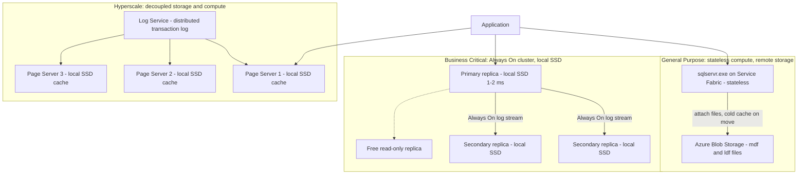
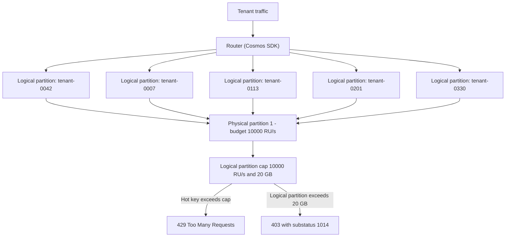
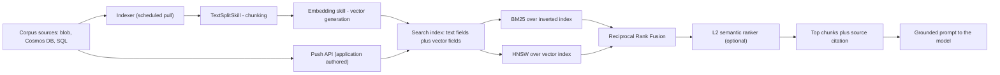

# Module 08: Data Platforms — Azure SQL, PostgreSQL, Cosmos DB, and AI Data

Azure's data platform is a portfolio, not a ladder. Relational workloads land on Azure SQL Database or SQL Managed Instance or Azure Database for PostgreSQL Flexible Server; document workloads land on Cosmos DB; search and retrieval-augmented generation land on Azure AI Search; and the hot-path cache in front of any of them lands on Azure Managed Redis. Choosing wrongly is expensive in both directions: an over-provisioned relational database burns budget that a serverless tier would have returned, while a document database used as a relational store produces a permanently re-architected application. This module develops the decision mechanics — purchase models, service-tier architectures, throughput metering, partition topology, consistency guarantees, and retrieval pipelines — and stays inside the Azure delta. Relational theory, MVCC, the WAL, and VACUUM belong to [`technologies/postgres`](../../postgres/README.md); cache theory, eviction, and the RESP protocol belong to [`technologies/redis`](../../redis/README.md); storage engines, indexing theory, BM25, and vector ANN belong to [`architecture/data-systems`](../../../architecture/data-systems/README.md); and the consistency hierarchy, clocks, and replication formalism belong to [`architecture/distributed-systems`](../../../architecture/distributed-systems/README.md).

> [!NOTE]
> **Verified against** `@azure/cosmos` 4.10.2, Terraform `hashicorp/azurerm` 5.14.0, Bicep 0.49.2, Node.js 26.13.0, and TypeScript 7.0.2 on 2026-11-20. Cosmos DB Linux emulator vNext is GA as of 2026-06-02. Service-tier limits, serverless parameters, and failover-group behaviour are quoted from the Microsoft Learn pages cited inline; verify regional availability before committing to a tier.

> [!IMPORTANT]
> **Exam mapping.** This module carries the weight of AZ-305 _Design data storage solutions_ (20–25%) and of AI-200 _Develop AI solutions by using Azure data management services_ (30–35%), including the vector-search and retrieval-augmented-generation material that replaced AZ-204. The Cosmos DB partitioning and consistency sections and the AI Search hybrid-search section are the highest-yield AI-200 objectives.

---

## 1. Core Terminology and the Platform Decision Map

- **Request Unit (RU)**: Cosmos DB's normalised performance currency, abstracting CPU, IOPS, and memory into a single unit so that every operation, whatever its shape, can be metered and budgeted.
- **Logical partition**: The set of items that share one partition-key value. It is the unit of transactional scope, the unit of read consistency, and the unit of the storage and throughput ceilings.
- **Physical partition**: The internal unit of storage and compute that owns one slice of the key space. Several logical partitions live in one physical partition; the mapping changes as the physical partition splits.
- **Hot partition**: A logical or physical partition whose share of the key space receives a disproportionate share of traffic, saturating its ceiling while the aggregate account utilisation remains low.
- **Serverless**: A compute tier that scales to demand and bills for what is consumed, including scaling to zero when idle.
- **Failover group**: A named group of databases on one logical server that replicates to a second logical server in another region and fails over as a unit behind stable listener endpoints.
- **Vector embedding**: A dense numeric representation of text or media such that semantically similar items have nearby vectors, enabling approximate nearest-neighbour retrieval.
- **Reciprocal Rank Fusion (RRF)**: A rank-based result-merging algorithm that combines multiple candidate rankings without needing to normalise their incomparable scores.

| Workload shape | Primary platform | Why it wins | Where it loses |
| --- | --- | --- | --- |
| Transactional OLTP with joins, constraints, and ACID | Azure SQL Database (vCore, General Purpose or Business Critical) | Full SQL Server engine, managed HA, elastic pools, transparent failover groups | No cross-database joins between logical servers; scale ceiling per database |
| Instance-scoped SQL Server lift-and-shift needing SQL Agent, cross-database queries, CLR | Azure SQL Managed Instance | Near-complete SQL Server feature parity, VNet-injected, instance-level failover | Higher cost, slower scaling, subnet delegation requirement, no free tier |
| Open-source PostgreSQL estate or greenfield app preferring PG | Azure Database for PostgreSQL Flexible Server | Real PostgreSQL, zone-redundant HA, built-in PgBouncer, Entra ID auth | No serverless tier, no hyperscale-style storage decoupling |
| Globally distributed, schema-flexible, API-tiered document store | Azure Cosmos DB for NoSQL | Partition-scoped scale, five consistency levels, multi-region writes, change feed, vector search | Strict partition ceilings, RU metering discipline, relational queries become anti-patterns |
| Full-text plus semantic retrieval over documents for RAG | Azure AI Search | BM25 plus HNSW hybrid with RRF and semantic ranker, indexers, Private Endpoint | Not a system of record; not a transactional store |
| Sub-millisecond hot-path cache, session store, leaderboard, stream | Azure Managed Redis | Redis Enterprise engine, Entra ID auth, active geo-replication with CRDTs | Memory-bound cost, eviction semantics identical to open-source Redis |

---

## 2. Azure SQL Database: Purchase Models and Service Tiers

### 2.1 DTU versus vCore

The **DTU (database transaction unit)** model is the legacy bundled metric: one opaque number representing a standardised blend of CPU, memory, and I/O. Its virtue was simplicity before the vCore era; its defect is that it is a black box, so an on-premises capacity plan cannot be translated into it and a service tier change can alter the underlying hardware underneath a running database. The **vCore model** exposes the actual resources: a number of logical CPUs, a memory-to-vCore ratio that depends on the hardware series, a separate storage limit, and a separate backup-storage bill.

The vCore model is the only one that supports **reserved capacity pricing** and **Azure Hybrid Benefit**, which is what makes it the default for any workload with a predictable baseline. DTU remains supported for existing databases but should not be chosen for new work.

One billing detail matters for every cost model: in General Purpose and Business Critical, the **configured maximum data size** is what is billed, not the used size, and the log file adds 30% to that billable storage. A database provisioned with a 4 TB maximum and holding 20 GB still pays for 4 TB plus 30%. This is the single most common cause of an Azure SQL bill that surprises its owner.

### 2.2 The Three Service Tier Architectures

The service tier is not a performance slider; it is a different machine. The three tiers differ in where the data lives relative to the compute process, and that single fact explains their latency, their availability model, and their failover behaviour.



| Dimension | General Purpose | Business Critical | Hyperscale |
| --- | --- | --- | --- |
| Architecture | Stateless compute over remote Blob storage | Always On availability group, one local SSD per node | Decoupled compute with a distributed log service and Page Servers |
| Storage latency | 5–10 ms | 1–2 ms | 1–2 ms for the cached working set |
| Max data size | 1 GB – 4 TB | 1 GB – 4 TB | 10 GB – 128 TB, not configurable |
| Replicas | 1 | 4 (1 primary + 3 secondary), one of which is a free read-only replica | 1 + up to 4 read scale-out replicas |
| Compute | 2–128 vCores | 2–128 vCores | 2–192 vCores |
| Max IOPS | 320 per vCore, 16,000 total | 4,000 per vCore, 327,680 total | 5,500 per vCore, 544,000 local SSD |
| In-memory columnstore | No | Yes | No |
| Hybrid Benefit | Yes | Yes | Not for new databases; existing provisioned compute until December 2026 |
| Typical fit | Cost-oriented mixed workloads | Low-latency OLTP plus reporting offload | Large or fast-growing OLTP and HTAP |

Three consequences of the architectures deserve to be stated as design constraints.

First, **General Purpose failover moves the compute process, and the new process starts with a cold cache**. The service fabric relocates `sqlservr.exe` to another node and reattaches the data and log files from Blob storage. The data is not lost because Blob storage is durable, but the buffer pool is empty, so the first minutes after a failover are slow — which is the classic "failover recovery looks like an outage because the cache is cold" report. Applications must be sized for a cold-cache start, and the failover cannot be transparent to latency-sensitive traffic.

Second, **Business Critical's price premium buys three things**: low latency, the free read-only secondary replica for reporting offload, and fast failover. Microsoft quantifies the third explicitly: with active geo-replication configured, Business Critical carries a guaranteed **RPO of 5 seconds and RTO of 30 seconds for 100% of deployed hours**. That is a contractual number, unlike the typical asynchronous-replication lag quoted for other tiers.

Third, **Hyperscale's ceiling is a genuine architectural change, not a bigger machine**. Because storage is decoupled from compute, a Hyperscale database grows without waiting for data to be copied onto a new node's local SSD, and read scale-out is a first-class named-replica feature rather than a manually provisioned secondary. The costs are: in-memory columnstore is unavailable, the maximum data size is fixed at 128 TB rather than configurable, and the tier is billed per replica plus allocated data storage with a 10 GB minimum.

### 2.3 The Serverless Compute Tier and the Auto-Pause Wake-Up Trap

The serverless compute tier autoscales compute and bills per second, and it is available only in General Purpose and Hyperscale, only on Standard-series (Gen5) hardware, and only under the vCore purchase model. Business Critical has no serverless tier.

| Parameter | General Purpose | Hyperscale |
| --- | --- | --- |
| Minimum vCores | 0.5 by default | 0.5 by default |
| Auto-pause delay | 15 minutes to 10,080 minutes (7 days), 1-minute increments, `-1` disables | 60 minutes to 10,080 minutes (7 days), 1-minute increments, `-1` disables |
| Default auto-pause delay | 60 minutes | 60 minutes |
| Billing granularity | Per second | Per second |
| Paused-state billing | Compute cost zero, storage only | Compute cost zero, storage only |

> [!WARNING]
> **The auto-pause wake-up trap is a predictable, not random, failure.** When a paused database receives its first connection, the service must resume the compute tier before it can serve that connection. The first connection therefore fails or times out, and the failure is _predictable_ — it happens after every idle period longer than the auto-pause delay, at a predictable cadence, for the first request of every quiet period. Application code must retry with a fresh connection. A connection pool that hands out a half-open socket will amplify the failure; a pool that opens a new connection per attempt and retries with bounded backoff absorbs it. This is not an availability incident to be alerted on, it is a behaviour to be designed for, and Microsoft states it plainly: retry logic is especially important for serverless because temporary connectivity errors due to auto-resume are predictable.

The operational checklist for a serverless database is: retry with backoff on the first connection after idle; verify that no feature in use prevents auto-pause (some settings disable it, and the database then silently bills compute forever); monitor pause and resume events through Azure Monitor rather than inferring them from billing; and keep the auto-pause delay at or above the longest expected quiet period, because a database that pauses between two requests in the same user journey pays the wake-up latency for a user-visible operation. For anything user-facing and latency-sensitive, provisioned compute with an elastic pool is usually the better trade, and the serverless tier is at its best for development, test, and genuinely intermittent single databases.

---

## 3. Availability, Disaster Recovery, and SQL Managed Instance

### 3.1 Active Geo-Replication versus Failover Groups

Both features move a database to another region. They differ in the abstraction level, and the abstraction level is what determines whether your application survives a failover without a code change.

**Active geo-replication** is configured per database. The primary streams its transaction log asynchronously to up to four geo-secondaries, each of which is a readable database on its own logical server. It is the right tool for three specific jobs: per-database disaster recovery where you want to fail over one database rather than a whole server, read scale-out to a same-region secondary, and migration or fail-back to a second server during an application upgrade. Its defining weakness is that **the connection endpoint changes on failover**. After a geo-failover the new primary lives on a different logical server, so its FQDN is different. An application that pins the server name must be reconfigured or must resolve it dynamically.

**Failover groups** are a declarative abstraction layered over active geo-replication. A failover group names a set of databases on a primary logical server and replicates them to a secondary logical server in a different region, behind two stable DNS CNAME listeners:

- The read-write listener `<fog-name>.database.windows.net` always points at the current primary. The failover group name must be globally unique within the `.database.windows.net` domain, because it becomes a DNS label.
- The read-only listener `<fog-name>.secondary.database.windows.net` points at the current secondary, for read-only offload.

The listener DNS records have a **30-second TTL**, so client-side DNS caches expire quickly and the redirection is close to transparent — but not instantaneous, and clients that cache resolved addresses beyond the TTL will keep talking to the old primary.

Two failover modes exist, and the difference is the data-loss contract. **Failover** (planned) fully synchronises the secondary before promoting it and is therefore lossless; it requires the primary to be reachable, and it is the mode for DR drills, planned region relocation, and fail-back. **Forced failover** promotes the secondary immediately, potentially losing transactions that had not yet replicated, and is the mode for an outage in which the primary is unreachable.

The failover policy deserves a decision. The **customer-managed** policy is recommended and is the correct production choice: the team decides when to fail over, which preserves control and allows a selective failover of one group. The **Microsoft-managed** policy delegates the decision to the Azure SQL service team, applies to _all_ failover groups in the region, and requires a grace period that cannot be set below one hour. Microsoft explicitly recommends against relying on it, and for good reason: a Microsoft-managed failover takes every group in the region at once, including zone-redundant databases that were not actually affected by the outage, and it ignores the synchronisation state of the secondaries, so the data loss is unbounded.

Three operational constraints are routinely discovered late. The **initial seeding phase is the longest and most expensive operation** — up to 500 GB per hour for SQL Database, with all databases seeded in parallel — so the failover group must be created well before it is needed. **Zone-redundant high availability is not inherited by the secondary** when the failover group is created for non-Hyperscale databases, so it must be enabled explicitly afterwards; Hyperscale secondaries do inherit it. And **the number of databases in a group directly lengthens the failover**, because the service prepares databases in batches to avoid overwhelming the control plane, so a group of fifty databases fails over considerably slower than a group of five.

One application-level control deserves explicit mention. `sp_wait_for_database_copy_sync` blocks the calling thread until the last committed transaction has been transmitted _and_ hardened on the secondary, and until those transactions have been replayed there. It converts an asynchronous RPO into an application-chosen one at the cost of latency, and it is the correct mechanism for a payments or ledger write path where losing the last few seconds is unacceptable.

### 3.2 Azure SQL Managed Instance and Its Decision Boundary

SQL Managed Instance is the full-instance form of the service: a managed instance of the SQL Server engine, VNet-injected, with near-complete feature parity — SQL Agent jobs, cross-database queries across the instance, Common Language Runtime, Service Broker, and the full `sys.*` catalogue surface.

The boundary that matters for a decision:

| Requirement | Azure SQL Database | Azure SQL Managed Instance |
| --- | --- | --- |
| VNet injection | Not available; use Private Endpoint | Native, via a delegated subnet (`Microsoft.Sql/managedInstances`) |
| Cross-database queries | Not across logical servers | Yes, across databases on the instance |
| SQL Agent | No | Yes |
| Resource model | Per-database compute, elastic pools | Per-instance compute; every database shares the instance vCores |
| Failover mechanism | Failover groups with listeners | Instance-level geo-replication with its own failover group variant and endpoint |
| Scale operation | Seconds to minutes | Hours |
| Relative cost | Lower | Materially higher; no free tier |
| Deployment unit | A database on a shared logical server | A whole instance |

The decision rule is simple: choose Managed Instance when the workload genuinely needs SQL Server instance semantics — SQL Agent, cross-database joins, or an application that cannot be refactored away from them — and choose SQL Database for everything else. The migration path out of SQL Server is smoothest to SQL Database, and Managed Instance is the option that keeps the existing architecture intact while removing the OS and patching burden. Because scale operations take hours on Managed Instance, right-sizing must be planned rather than reactive, which is the opposite of the SQL Database experience.

---

## 4. Azure Database for PostgreSQL Flexible Server: the Azure Delta

Everything about PostgreSQL internals — MVCC snapshots, the write-ahead log, the visibility map, autovacuum and the vacuum horizon, index selection — is taught in [`technologies/postgres`](../../postgres/README.md) and is not repeated here. This section covers only what Azure adds or changes.

- **Service tiers**: Burstable for development and test, with shared, burstable compute and a low cost; General Purpose for production general workloads; Memory Optimized for large `shared_buffers` and large analytical working sets. Compute scale is independent of storage scale, and storage auto-grows without a restart.
- **Zone-redundant high availability**: A standby is maintained in a different availability zone, with synchronous replication to it, so a zonal failure is survived without operator action. This is the PostgreSQL equivalent of Azure SQL's zone-redundant configuration and it must be enabled explicitly at creation time.
- **Built-in PgBouncer**: Connection pooling is a first-class feature of the service rather than something you deploy. Transaction-level pooling is the default for the pooler endpoint and is the correct choice for stateless OLTP traffic; session pooling is required for features that depend on session state such as `SET` commands, prepared statements across a transaction boundary, and advisory locks. The pooler is a managed component with its own limits, and the connection string selects it.
- **Entra ID authentication**: The server accepts an Entra token instead of a password, and the token **expires after one hour**. A long-lived application must therefore either refresh the token on demand or use a managed identity that the driver obtains transparently from IMDS. A password-based connection string that embeds an Entra token works for exactly an hour and then fails — a failure mode that looks like an unexplained authentication outage if the refresh was not designed in.
- **Private access, two ways**: A **delegated subnet** (`Microsoft.DBforPostgreSQL/flexibleServers`) gives the service a private address inside your VNet and requires a Private DNS zone ending in `.postgres.database.azure.com` (for example `<name>.private.postgres.database.azure.com` — **not** `privatelink.*` and **not** `postgresql`); a **Private Endpoint** gives a per-resource private IP using the `privatelink.postgres.database.azure.com` Private DNS zone and is the right answer when the server must be reachable from more than one network or when the resource must be addressed through Private Link from a peered network. Choosing the delegated subnet is a one-way door for that server: converting later means migrating the server. Note also the **ARM lock trap**: placing a `CanNotDelete` or `ReadOnly` lock on the delegated VNet, subnet, or Private DNS zone breaks PostgreSQL Flexible Server provisioning and HA failover DNS updates.
- **Operational lifecycle**: The server can be stopped and restarted on a schedule, which is the cheapest form of cost control for non-production environments — but the restart window is bounded and must be confirmed against the current SKU documentation before it is designed around. Major-version upgrades run in a maintenance window with an explicit rollback point.

The Azure-specific failure mode to plan for is the **token expiry in combination with the pooler**. A pooled connection that is established with an Entra token will eventually be presented with an expired credential, and the failure appears on an arbitrary connection rather than at a deterministic moment. The mitigation is to use managed identity authentication, which the driver renews, rather than a manually refreshed token embedded in a connection string.

---

## 5. Cosmos DB: Throughput Metering and Request Units

### 5.1 The RU Model

A request unit abstracts the CPU, I/O operations per second, and memory that an operation consumes. The canonical calibration is that **reading a single item of about 1 KB by its id and partition key costs 1 RU**, and this estimate holds for every Cosmos DB API. Writes cost more: a small write of roughly 1 KB is commonly metered in the range of 5 to 10 RUs, with the exact figure determined by the number of indexed properties and by the item's property count, because every indexed property adds index maintenance work to the write path.

The metering rules that determine whether a workload is affordable:

- **Item size** drives the cost of both reads and writes.
- **Indexing policy** is a first-class cost lever. Every property is indexed by default; excluding a property from the index reduces write RUs and reduces the storage that counts against the 20 GB logical partition ceiling. Excluding a property from the index means it can no longer be filtered on in a query.
- **Query complexity** drives cost far more than data volume. The number of predicates, the nature of each predicate, the result-set size, the presence of user-defined functions, and whether the query is a projection all matter. A query that returns a projection is materially cheaper than one that returns whole documents.
- **Consistency level** changes read cost. Strong and Bounded Staleness read from two replicas of the four-replica set, so their read RU cost is approximately **twice** that of Session, Consistent Prefix, and Eventual.
- **The same query on the same data always costs the same number of RUs.** This is what makes the request-charge header a usable budgeting tool rather than a noisy metric.

Every response carries a `x-ms-request-charge` header. A production pipeline should sample it, because the RU charge per operation is the only reliable early-warning signal for a query that is about to fan out.

### 5.2 Provisioned, Autoscale, and Serverless

| Mode | How throughput is set | How it is billed | Best fit |
| --- | --- | --- | --- |
| Manual (standard) | A fixed RU/s figure, in increments of 100 RU/s, at database or container scope | Hourly on the provisioned RU/s | Predictable, steady load where the peak is known |
| Autoscale | A maximum RU/s figure; the service scales between **10% and 100%** of that maximum | Provisioned-style billing on the scaled amount | Variable or unpredictable traffic that still needs a hard ceiling |
| Serverless | No provisioning; consumption is metered | Per RU consumed | Development, test, spiky or unknown workloads |

Throughput is provisioned **per region**: if an account has three regions and a container is provisioned at 1,000 RU/s, the total global budget is 3,000 RU/s, because each region needs its own capacity to serve its own traffic.

Serverless carries hard ceilings that make it a development and edge-tier choice rather than a production default: a serverless container is limited to **50 GB of storage** and **1,000 RU/s**, and serverless accounts are billed with per-second and per-region minimums that make steady production traffic more expensive than provisioned throughput. Autoscale's 10% floor is its own trap: the service may scale down to 10% of the maximum while the workload is idle, and then the next burst pays a ramp-up latency before the scale-up completes. For a latency-sensitive workload, set the autoscale maximum so that 10% of it still covers the steady-state load.

---

## 6. Cosmos DB Partitioning Mechanics and Production Failure Modes

### 6.1 The Ceilings

Three hard limits define the partitioning contract, and all three are enforced by the service rather than by convention:

1. **A logical partition may hold at most 20 GB of data**, counting the data _and_ its indexes. Writes beyond that ceiling fail with **HTTP 403 and substatus 1014**. This is a hard stop, not a throttle: the write does not succeed slowly, it fails.
2. **A logical partition may consume at most 10,000 RU/s.** This is the throughput equivalent of the storage ceiling and it is the constraint that makes hot keys fatal.
3. **A physical partition splits when it reaches 50 GB** of storage, and the service divides the key range roughly in half.

The trap in these numbers is that the first two are properties of the _logical_ partition, which is identified by a single partition-key value. Splitting a physical partition therefore **does not raise the 20 GB or 10,000 RU/s ceilings of any logical partition inside it**. A split redistributes a key _range_; a hot _value_ stays where it is.

### 6.2 The Hot Partition Scenario

Consider a container provisioned at 50,000 RU/s that maps to five physical partitions. The account's aggregate utilisation metric shows 10,000 RU/s consumed — 20% — and yet a single tenant is receiving `429 Too Many Requests`. The arithmetic explains it: the provisioned budget is shared across the physical partitions, each physical partition can serve at most 10,000 RU/s, and each logical partition within it is likewise capped at 10,000 RU/s. A single celebrity tenant, a single gaming leaderboard key, or a monotonically increasing timestamp as the partition key concentrates the entire tenant's traffic on one logical partition, which saturates its 10,000 RU/s ceiling while the other four partitions sit idle.



Three mechanisms turn this into a hot partition, and they deserve separate treatment because their remedies differ.

**Monotonic or low-cardinality partition keys.** A timestamp-first key routes all new writes to the same logical partition, because "now" is always the greatest value. The fix is to prepend a high-cardinality component: `userId` then `timestamp`, or a hash prefix. A key with only a handful of distinct values (a tenant id with five tenants) is the same defect: the whole workload funnels through a handful of logical partitions.

**Ceiling-shaped access patterns.** "Give me the last hour of events" queries the highest end of a time-ordered key space, which is exactly the region a monotonic key concentrates writes into. The fix is to make the time component _secondary_ to a high-cardinality component, or to model the data so that the hot query is a single-partition point read rather than a range scan.

**Unbounded logical partitions.** A partition key that groups an entire tenant's history will exceed 20 GB for a large tenant no matter how the traffic is distributed, and the failure is a hard `403/1014` on writes, not a throttle. This is the failure that ends a tenant's ingest rather than degrading it.

### 6.3 Handling 429 and Reading the Retry Signal

When a request is throttled, Cosmos DB returns `429 Too Many Requests` and includes an `x-ms-retry-after-ms` header giving the number of milliseconds to wait before retrying. Correct handling is to honour that header exactly rather than to apply an arbitrary backoff, and the Cosmos SDKs implement this by default when you use the retry policy rather than disabling it.

```ts
// Cosmos DB: honour x-ms-retry-after-ms via the SDK retry policy.
import { CosmosClient, Container } from '@azure/cosmos';

const client = new CosmosClient({
  endpoint: process.env.COSMOS_ENDPOINT!,
  aadCredentials: {
    // Prefer a managed identity credential in production
    tokenCredential: await getManagedIdentityToken(),
  },
  retryOptions: {
    maxRetryAttemptCount: 9, // the default
    maxWaitTimeInMs: 30_000, // the default
  },
});

export async function readOrder(container: Container, id: string, tenantId: string) {
  // The partition key must be supplied; without it the read is a fan-out query.
  const { resource } = await container
    .item(id, tenantId)
    .read<{ id: string; tenantId: string; total: number }>();
  return resource;
}
```

The three mistakes that turn a throttle into an outage are worth naming. Disabling the SDK retry policy, because "the client times out anyway" — which converts a recoverable 429 into an unrecoverable error. Retrying without honouring `x-ms-retry-after-ms`, which synchronises a thundering herd across every client that hits the same partition at the same moment. And retrying a _non-idempotent_ write blindly, which turns a throttled create into a duplicate — Cosmos DB does not deduplicate by operation identifier the way a messaging service does, so the idempotency key must be in the item itself.

> [!NOTE]
> The `@azure/cosmos` snippets in this section illustrate production Azure SDK signatures; the hermetic runnable proofs in `../examples/` test the underlying RU metering, partition routing, session-token, and `429` retry semantics directly without external cloud credentials.

### 6.4 Hierarchical Partition Keys

Hierarchical partition keys, also called subpartitioning, let a container define up to **three levels** of partition key path, for example `/TenantId`, `/UserId`, `/SessionId`. The effect is that **a logical partition key prefix can exceed both the 20 GB and the 10,000 RU/s limits**, because the logical partition is now the full three-level tuple rather than a single value.

```ts
// Hierarchical partition keys: up to three levels, MultiHash kind, version 2.
import { CosmosClient, PartitionKeyBuilder } from '@azure/cosmos';

const containerDefinition = {
  id: 'sessions',
  partitionKey: {
    paths: ['/tenantId', '/userId', '/sessionId'],
    kind: 'MultiHash',
    version: 2,
  },
};

const container = await database.containers.createIfNotExists(containerDefinition);

// Full path routing: a point read on the complete key hits exactly one partition.
const key = new PartitionKeyBuilder()
  .addValue('contoso')
  .addValue('user-8842')
  .addValue('session-0011')
  .build();

const { resource } = await container.item('evt-991', key).read();
```

The routing behaviour is what makes hierarchical keys attractive for a multi-tenant application, because the _filter predicate_ determines how much of the key space a query touches:

| Query filter                                  | Routing                                |
| --------------------------------------------- | -------------------------------------- |
| All three levels specified                    | Single logical and physical partition  |
| `/tenantId` and `/userId`                     | Targeted subset of partitions          |
| `/tenantId` only                              | Targeted subset of partitions          |
| `/userId` only, without the leading level     | Fan-out across all physical partitions |
| `/sessionId` only, without the leading levels | Fan-out across all physical partitions |

Two traps in this feature deserve emphasis. First, **the low-cardinality-first-level trap**: if the first level is `/tenantId` and there are only five tenants, then all writes for each tenant are scoped to a single physical partition until that partition reaches 50 GB and splits, and a split is asynchronous and takes minutes to hours depending on data volume and throughput, during which transient latency spikes can occur. The maximum achievable ingest throughput is bounded by the number of physical partitions times 10,000 RU/s, so a low-cardinality first level caps the whole workload's write throughput. Microsoft's guidance for a workload that is _already_ hitting the 20 GB logical ceiling with a low-cardinality key is to use a **synthetic partition key** rather than hierarchical keys.

Second, **the migration cost is real**: hierarchical partition keys can only be set at container creation time and cannot be changed on an existing container. Migration means creating a new container, copying the data — offline with a container copy job, or near-live with the change feed — repointing the application, and validating that the query prefixes route correctly. There are also feature exclusions: hierarchical keys are currently limited to the NoSQL API, cannot be used with the _users and permissions_ feature (a permission cannot be scoped to a partial prefix of the key path), and the emulator does not support creating or navigating them from Data Explorer.

### 6.5 Partition Splits and RU Dilution

The service splits a physical partition automatically when it reaches 50 GB. Two effects follow, and both are frequently misunderstood.

The first is that a split **never rescues an oversized or hot logical partition**. The 20 GB and 10,000 RU/s ceilings are properties of the logical partition, and the split divides a key _range_ between two physical partitions while the hot _value_ lands on one side of that division. A tenant that is blocked by `403/1014` stays blocked, and a key that is receiving 10,000 RU/s still receives 10,000 RU/s after the split.

The second is the RU-dilution effect on workloads that _were_ evenly spread. The provisioned RU budget is divided among the physical partitions the container maps to, so growing the physical partition count lowers the per-partition share of the budget. For an evenly spread workload this is invisible, because the traffic redistributes with the data. For a range-scan workload — "the last hour of events", "the most recent 1,000 rows" — the traffic does _not_ redistribute, because the query still targets the same end of the key space, and that end now lives in one of the two new partitions. Immediately after a split, such a workload sees its effective per-partition headroom reduced rather than increased, and the throttling can be worse than before the split.

The architectural conclusion is that splitting is a **storage-management mechanism**, not a throughput-scaling mechanism. Throughput is scaled by changing the partition key so that no single logical partition carries more than its share of traffic, by adding logical partitions through a higher-cardinality key, or by adopting hierarchical partition keys.

---

## 7. Cosmos DB: Consistency, Multi-Region Writes, and Change Feed

### 7.1 The Five Consistency Levels

Read consistency applies to a single read operation within a logical partition. The five levels form a spectrum from linearizable to entirely unordered, and the choice is a per-account default that can be overridden per request.

| Level | Quorum reads | Quorum writes | Read RU cost | RPO in a multi-region account |
| --- | --- | --- | --- | --- |
| Strong | Local minority (2 of 4) | Global majority | ~2× | 0 |
| Bounded Staleness | Local minority (2 of 4) | Local majority | ~2× | K versions or T seconds |
| Session (default) | Single replica, session-token gated | Local majority | 1× | < 15 minutes |
| Consistent Prefix | Single replica | Local majority | 1× | < 15 minutes |
| Eventual | Single replica | Local majority | 1× | < 15 minutes |

**Strong** is linearizable: a read returns the most recent committed write, and a client never observes an uncommitted or partial write. The cost is in the quorum: a write must be committed in every region, so write latency equals twice the round-trip time between the two farthest regions plus the p99 overhead, and a strong-consistency account spanning more than 5,000 miles is blocked by default. Strong consistency also uses _dynamic quorum_: in a three- or four-region account, one unresponsive region may be removed from the quorum set to preserve the consistency guarantee, and a region removed this way cannot serve reads until it is re-added. **Strong consistency is incompatible with multi-region write accounts**, because a distributed system cannot offer both RPO 0 and RTO 0.

**Bounded Staleness** bounds the lag between regions by either K versions or a T interval, whichever is reached first. If the replication lag for a partition exceeds the bound, writes to that partition are _throttled_ until the lag falls back within it — so bounded staleness converts a consistency problem into a throughput problem. For a single-region account, the minimum K and T are 10 write operations or 5 seconds; for a multi-region account, 100,000 write operations or 300 seconds. Bounded Staleness in a multi-region _write_ account is an anti-pattern, because it makes correctness depend on inter-region replication lag for a workload that could have read locally.

**Session** is the default and the pragmatic choice. It guarantees read-your-writes and write-follows-reads _within a client session_, and it delivers write latency, availability, and read throughput comparable to Eventual.

> [!WARNING]
> **The session-token trap in stateless architectures.** After every write, the client receives an updated session token and caches it. On a subsequent read, the client sends the token and the service routes the read to a replica that holds at least that version, retrying against other replicas in the region if necessary. The token is **partition-bound** — it belongs to one partition — and it behaves as a _minimum version barrier_, not a historical-version selector: an outdated token still returns the most recent data, never an older one. Two consequences bite hard in a stateless microservice deployment. First, a client instance that is _re-created_ — a new pod, a new process, a cold function — has an empty token cache, and its reads behave exactly like Eventual until it performs its own writes. Second, if the load balancer routes the write to replica A and the follow-up read to replica B, and replica B never received the token, **read-your-writes is silently broken**. The symptom is an intermittent, unreproducible "the user writes and immediately does not see their own change" bug that appears only under horizontal scale. The fix is to propagate the session token explicitly across the call chain — for example, as a request header returned by the write handler and sent by the read handler — and to treat it as opaque and immutable, because the token's contents must never be modified when it is passed between clients.

**Consistent Prefix** guarantees that a batch of writes committed in one transaction is never observed partially: a reader sees either all of the batch or none of it, but never a mix of old and new. Individual single-document writes are eventually consistent.

**Eventual** is the weakest and the fastest. It is the correct level for counters, likes, view counts, and other content where a slightly stale read is acceptable and where the read cost must be minimised.

The operational metric that ties the levels together is **Probabilistically Bounded Staleness (PBS)**, exposed in the portal. It reports, in milliseconds, how often clients actually observe stronger-than-configured consistency, which is how you answer the question "is Session really giving me read-your-writes across regions?"

### 7.2 Multi-Region Writes and Conflict Resolution

A multi-region write account accepts writes in every region. Because two regions can write the same item concurrently, a conflict-resolution policy must decide which write wins.

The default is **last-writer-wins at the item-property path level**: the region that writes last wins for the property it changed, and properties that were not touched by the losing writer are preserved. This is per-property, not per-item, which is a subtle and useful property — two regions updating different fields of the same document do not destroy each other's work.

The alternative is a **custom conflict-resolution stored procedure**, registered on the container, which receives the conflicting versions and writes the merged outcome. This is where domain logic can be applied: increment rather than overwrite a counter, union rather than replace a set, apply a last-writer-wins rule on a business timestamp rather than on the wall clock. The mechanics of multi-region write conflict handling belong to [`architecture/distributed-systems`](../../../architecture/distributed-systems/README.md); the Azure-specific surface is the policy configuration and the **conflict feed**, an ordered log of conflicts that the application can read and resolve asynchronously for anything the policy could not settle.

Two constraints follow from the quorum table above: a multi-region write account cannot use Strong consistency, and Bounded Staleness in such an account forces application servers to read from the region they write to, which removes most of the benefit of multi-region writes while keeping the complexity.

### 7.3 Change Feed

The change feed is an ordered, guaranteed-to-be-complete log of the data-plane events for a container. It is the mechanism for building derived systems without polling the source of truth.

- **Pull model**: the consumer reads from a continuation token, processes at its own pace, and persists the token. The Change Feed Processor library implements the leasing and checkpointing that make many consumers cooperate safely. This is the right default because it needs no additional infrastructure.
- **Push model**: the change feed is projected to Event Grid and consumers subscribe. This suits fan-out to independent consumers, but Event Grid delivery is at-least-once, so consumers must be idempotent.

Typical consumers are a CQRS read model, an event-sourced projection, a search index, a warehouse ingest, and a downstream audit trail. The change feed is also the mechanism used to migrate a container to a different partitioning scheme: create the destination container, replay the change feed into it, then cut over.

### 7.4 Integrated Cache

The integrated cache is a distributed cache attached to the Cosmos DB account itself, sitting in the cache tier of the service fabric rather than behind a network hop. Two consequences matter. The cache is **not a separate system to operate or secure** — there is no endpoint, no TLS termination, and no network ACL to manage. And its consistency is inherited from the account's consistency level, so the cache cannot serve data that is staler than the account's guarantee allows.

It is the right answer for a read-heavy workload with high repetition — a product catalogue read thousands of times per second with the same keys — and it is the wrong answer for a workload with a low repetition rate, where the cache adds a copy without adding hits.

---

## 8. Cosmos DB Vector Search and Hybrid Retrieval

Cosmos DB for NoSQL stores a vector alongside the item and indexes it with a **DiskANN-based approximate nearest-neighbour index**, the FAISS-derived DiskANN algorithm from Microsoft Research. DiskANN is designed for large-scale vector search on disk with a memory-bounded graph structure, which is what makes a vector index viable inside a transactional document store rather than a specialised vector database.

The query path uses a vector predicate alongside the ordinary predicates, and the result is the nearest neighbours by cosine or Euclidean distance:

```sql
SELECT c.id, c.title, c.embedding
FROM c
WHERE ARRAY_CONTAINS(c.tags, "azure")
  AND VectorDistance(c.embedding, @queryVector) < 0.5
ORDER BY VectorDistance(c.embedding, @queryVector)
```

Cosmos DB also offers **hybrid search**: a single query that runs the full-text (keyword) index and the vector index and merges the two ranked result lists. Two operational notes apply. Hybrid search in Cosmos DB **requires the integrated cache** to be enabled on the account, and the supported vector dimensions are API-dependent and run into the thousands — confirm the current per-property ceiling against the Cosmos DB vector search documentation before fixing an embedding width, because changing the model later means reindexing the entire container.

The retrieval theory — why approximate nearest-neighbour search trades exactness for recall, how BM25 scores lexical matches, how rank fusion merges incomparable score scales, and how semantic reranking reorders a candidate set — belongs to [`architecture/data-systems`](../../../architecture/data-systems/README.md). The Azure-specific wiring for a production-grade RAG pipeline is in Section 10.

---

## 9. Azure Managed Redis: the Azure Delta

The Redis data structures, encodings, eviction policies, the RESP protocol, cluster slot migration, Sentinel, and the persistence formats belong to [`technologies/redis`](../../redis/README.md). This section covers only what the managed service changes.

- **Redis Enterprise engine**: Azure Managed Redis is built on Redis Enterprise rather than the community edition, while remaining protocol-compatible. Redis 7.4 is the default version and Redis 8.2 is available in preview for new instances in the Memory Optimized, Balanced, and Compute Optimized tiers — not in Flash Optimized, and not with geo-replication or custom data access policies.
- **Tiers and their memory-to-compute ratios**: Memory Optimized at 8:1 for memory-bound workloads, Balanced at 4:1 for general workloads, Compute Optimized at 2:1 for maximum throughput, and **Flash Optimized**, which keeps a working set in RAM and moves colder keys to NVMe so that a large cache can be sized economically. Flash Optimized reduces latency for hot keys and is the tier for a dataset that mostly fits in memory but not entirely.
- **Active geo-replication with CRDTs**: this is the decisive difference from the legacy Azure Cache for Redis. Conflict-free replicated data types allow **writes in more than one region** with deterministic conflict resolution, which the legacy passive geo-replication could not do. The feature is available on the in-memory tiers on Redis 7.4, is not available on Flash Optimized, and the smallest Balanced SKUs (`B0` and `B1`) do not support it.
- **Microsoft Entra ID authentication**: the instance accepts an Entra token instead of an access key, which removes the long-lived static credential from the deployment entirely. The Entra-authenticated endpoint uses port **6380** with TLS, and the username is the token.
- **Modules**: Redis JSON, RediSearch (including vector search), Redis Bloom, and RedisTimeSeries are available on the in-memory tiers and not on Flash Optimized. This is what turns the instance from a cache into a queryable store.
- **Migration**: the supported path from the retired Azure Cache for Redis Basic, Standard, and Premium tiers, and from the Enterprise tier, is a documented migration to Azure Managed Redis. A migration is a re-provisioning exercise with a data-transfer step, not an in-place upgrade.

---

## 10. Azure AI Search for AI-200 Retrieval Pipelines

Azure AI Search — now branded **Foundry IQ (Azure AI Search)** — is the retrieval tier for retrieval-augmented generation. It is not a system of record and not a transactional store; it is the component that makes a corpus _findable_ by both keyword and meaning.

### 10.1 Index Schema

An index is a named collection of fields with types and attributes. The attributes that matter are `key` (unique identifier), `searchable` (analysed into an inverted index for BM25 retrieval), `filterable` (usable in `$filter`), `sortable`, `facetable` (usable in `facets`), `retrievable` (returned in results), and `vector` with an attached `vectorSearchProfile`.

A vector field declares its dimensions and the profile that indexes it. The profile selects the algorithm — HNSW with tunable `m`, `efConstruction`, and `efSearch` parameters and a distance metric, or exhaustive k-nearest-neighbour for small corpora — and the `vectorSearchConfiguration` that governs how the index is built.

### 10.2 Chunking and Integrated Vectorization

A document is not a retrieval unit; a **chunk** is. The skillset chain that turns a document into retrievable units is `TextSplitSkill` for chunking followed by an embedding skill that calls a model deployment, and the result is a chunk with both its text and its vector. Chunking is the step most often done badly: chunks that are too large dilute the embedding and hurt precision, chunks that are too small lose the context needed to answer, and chunks that split a heading from its body produce orphaned fragments.

**Integrated vectorization** moves the embedding step into the indexer itself: the indexer reads the source, the skillset chunks and embeds, and the index stores text and vectors together, so there is no separate embedding pipeline to operate and no window in which the corpus is text-only.

### 10.3 Hybrid Queries, RRF, and the Semantic Ranker

A hybrid query is a single request that carries both a `search` parameter and a `vectorQueries` array. The full-text leg uses BM25 over the inverted index; the vector leg uses HNSW (or exhaustive kNN) over the vector index; the two legs run in parallel and their ranked lists are merged by **Reciprocal Rank Fusion**, which needs no score normalisation because it fuses _ranks_ rather than scores.

```http
POST https://{{searchServiceName}}.search.windows.net/indexes/docs-index/docs/search?api-version=2026-10-01
content-type: application/json

{
  "search": "how do I rotate a storage account key",
  "select": "id, title, chunk, sourceUrl",
  "filter": "category eq 'security' and language eq 'en'",
  "vectorFilterMode": "postFilter",
  "vectorQueries": [
    {
      "kind": "vector",
      "vector": [ 0.012, -0.44, 0.91 ],
      "k": 50,
      "fields": "chunkVector",
      "exhaustive": false,
      "oversampling": 10
    }
  ],
  "top": 10,
  "queryType": "semantic",
  "queryLanguage": "en-us",
  "semanticConfiguration": "default-semantic-config"
}
```

Four details in that request are load-bearing. `k` should be 50 when the semantic ranker is enabled, because the ranker consumes the top candidates and a smaller `k` starves it. `vectorFilterMode` chooses whether the filter is applied before the vector search (`preFilter`, which maximises recall within the filter) or after (`postFilter`, which is what the documentation recommends for semantic ranking and which must be tested against the corpus). `oversampling` asks the vector engine for more candidates than `k` so that filtering does not discard the true neighbours. And there is deliberately **no `orderby`**, because an explicit sort overrides the relevance ranking that BM25, RRF, and the semantic ranker exist to produce.

The **semantic ranker** is the optional third stage. It reorders the top candidates with a machine reading-comprehension model, which measurably improves relevance on long or indirect queries, at the cost of a model call per query and a dependency on an available model deployment and on a service tier that supports the feature.

### 10.4 Indexers versus Push APIs

An **indexer** is a pull-based pipeline: it is configured with a data source, a skillset, an index, and a schedule, and it reads from a supported source such as blob storage, a Cosmos DB container, or a SQL table. A **push API** writes documents directly to the index from application code. The rule of thumb is that an indexer is correct when the source of truth already exists and changes on its own schedule, and a push API is correct when the document is produced by the application and must be searchable the moment it is produced. A common and sound combination pushes application-authored documents and indexes the document corpus with an indexer.

### 10.5 Security Posture

An AI Search index that is publicly reachable and contains an internal document corpus is a data-exfiltration surface, and the default posture must be tightened: disable public network access, use a Private Endpoint, and disable local admin key authentication (`disableLocalAuth = true`) so that access is governed by Entra ID and Azure RBAC roles such as _Search Index Data Contributor_ for query and ingest and _Search Service Contributor_ for administration. Because the semantic ranker and the embedding skillset call model deployments, the identity of the search service also needs the appropriate role assignment on those resources, and that path of privilege is often forgotten because the obvious attack surface is the query API rather than the indexer.



---

## 11. Executable Proofs and Emulator Fidelity

The suite [`../examples/07-cosmos-partitioning-and-consistency.test.ts`](../examples/07-cosmos-partitioning-and-consistency.test.ts) proves the Cosmos DB mechanics described in this module: the RU cost of a point read against a 1 KB item, the multi-fold RU increase of a fan-out query relative to a single-partition query, the routing difference between a full hierarchical partition-key prefix and a query that omits the leading level, the session-token read-your-writes behaviour and its loss when the token is not propagated across clients, and the `429` retry-signal handling against `x-ms-retry-after-ms`.

```bash
cd technologies/azure
mise exec -- npm test              # deterministic, hermetic suites
mise exec -- npm run test:integration   # live emulator suites, skip cleanly when unavailable
```

The **Cosmos DB Linux emulator vNext** is generally available as of 2026-06-02 and runs on both x64 and **ARM64**, so it works natively on Apple Silicon. The image is `mcr.microsoft.com/cosmosdb/linux/azure-cosmos-emulator:vnext-latest`. It is the right tool for proving partition key design, request-charge accounting, the change feed, and hierarchical partition key routing.

Its limits must be stated, because they are precisely the behaviours that fail in production and pass locally:

- It does **not** emulate multi-region replication, so consistency levels across regions, failover, and multi-region write conflict resolution cannot be tested with it at all.
- Its RU numbers are **not production-exact**. The emulator meters requests, but the absolute figures do not match a provisioned production account, so an emulator-based cost model is not a budget.
- **Consistency levels are not meaningfully emulated**, because there is no second region to be stale relative to.
- The classic Windows emulator also does not support creating or navigating hierarchical partition keys from Data Explorer.

Everything that depends on the _global_ behaviour of Cosmos DB — the consistency spectrum, the failover story, the conflict-resolution policy, the geo-replication RPO — must be validated in a sandbox subscription with at least two regions, and that validation belongs in a scheduled pipeline rather than a unit test.

---

## 12. Then vs Now: Platform Migrations and Version History

| Change | Applied in | Old approach | Current approach | Migration pitfall |
| --- | --- | --- | --- | --- |
| Azure SQL purchase model | Ongoing | DTU bundled metric | vCore with explicit hardware series, memory ratio, and separate storage billing | DTU is legacy; vCore is required for reservations and Hybrid Benefit, and the configured maximum data size — not the used size — is what is billed |
| Azure SQL Service Fabric model | Ongoing | One compute node with local storage | General Purpose: stateless compute over remote Blob storage | Failover relocates the process and starts with a cold cache, so the first minutes after a failover are slow |
| SQL Server Fsv2 and Gen4 hardware | Retired 2026-10-01 and earlier | Fsv2-series and Gen4 compute | Standard-series (Gen5), Premium-series, DC-series | Existing databases are migrated; hardware generation changes can shift performance inside a narrow band |
| Hyperscale | Current | General Purpose or Business Critical for growing OLTP | Decoupled storage with Page Servers and a distributed log service, 128 TB | No in-memory columnstore, fixed 128 TB ceiling, and no Hybrid Benefit for new Hyperscale databases |
| Azure SQL DR | Current | Active geo-replication with per-database endpoints | Failover groups with stable read-write and read-only listeners | The listener DNS TTL is 30 seconds, zone-redundant HA is not inherited by non-Hyperscale secondaries, and Microsoft-managed failover moves every group in the region at once |
| Azure Managed Redis | Current | Azure Cache for Redis Basic, Standard, Premium, and Enterprise | Azure Managed Redis on the Redis Enterprise engine, Redis 7.4 default and 8.2 in preview | Migration is a re-provision with a data transfer; active geo-replication with CRDTs needs Redis 7.4 and is absent on Flash Optimized and on the smallest Balanced SKUs |
| Azure AI Search | Current | Azure Cognitive Search, keyword-only retrieval | Foundry IQ (Azure AI Search) with hybrid BM25 plus HNSW retrieval fused by RRF and an optional semantic ranker | Hybrid queries must omit `orderby`, must use `k: 50` with the semantic ranker, and require a vector-enabled index |
| Cosmos DB vector search | Current | A separate vector database alongside the document store | In-database DiskANN vector index with hybrid retrieval | The integrated cache must be enabled for hybrid search, and the embedding width is fixed per index, so a model change means a reindex |
| Cosmos DB partitioning | Current | A single-level partition key capped at 20 GB and 10,000 RU/s | Hierarchical partition keys up to three levels, bypassing both ceilings for key prefixes | Hierarchical keys can only be set at container creation, so migration means a new container plus a copy or a change-feed replay |

---

## Interview Drill

<details><summary>Model Answer</summary>

**Q1. A container is provisioned at 50,000 RU/s. The metrics show 10,000 RU/s consumed — 20% utilisation — yet one tenant receives `429 Too Many Requests`. Diagnose the cause and give three distinct remediations, explaining why each actually works.**

The metrics show aggregate utilisation, and the throttle is a per-partition event. Three limits are in play. The provisioned budget of 50,000 RU/s is shared across the physical partitions the container maps to. Each physical partition can serve at most 10,000 RU/s. Each logical partition — every item sharing one partition-key value — is separately capped at 10,000 RU/s. With five physical partitions, each has a 10,000 RU/s share, and a single logical partition inside one of them cannot exceed 10,000 RU/s regardless of how much headroom the account has. If the partition key is the tenant id and one tenant is large or famous, its traffic concentrates on one logical partition, saturates at 10,000 RU/s, and is throttled while the other four partitions sit idle. The aggregate metric cannot see this; the per-partition metric can.

The three remediations are structurally different, and each addresses a different root cause.

First, **re-partition to raise cardinality**: change the partition key from `/tenantId` to `/tenantId` combined with a high-cardinality component such as the user or document id, ideally with a hierarchical key of `/tenantId`, `/userId`, `/sessionId`. This spreads one tenant's traffic across many logical partitions, each with its own 10,000 RU/s ceiling, and it also lifts the 20 GB logical partition storage ceiling for the tenant prefix.

Second, **reduce the RU cost of the hot operation**: index fewer properties, project only the needed fields in the query, replace a fan-out query with point reads, or reduce the consistency level from Strong or Bounded Staleness to Session, which halves read cost. This raises the effective ceiling without changing the topology.

Third, **increase the partition count by splitting the key space**: a synthetic partition key such as `tenantId` plus a hash suffix distributes one tenant's data across N logical partitions. This works only if the queries are rewritten to include the suffix, because a query that filters only on `tenantId` then becomes a fan-out across all N partitions — which is exactly the RU explosion the original design was avoiding.

What does _not_ work is relying on the physical partition split. A split divides a key range between two physical partitions and leaves the hot _value_ on one side of it. The 10,000 RU/s logical partition ceiling is unchanged by a split, so a hot key stays hot.

</details>

<details><summary>Model Answer</summary>

**Q2. A tenant's ingest stopped with `403` and substatus `1014`. Explain exactly what was hit, why it cannot be fixed by waiting, and the two structural remedies with their respective costs.**

The error is the logical partition storage ceiling. A logical partition may hold at most 20 GB of data, counting the data _and_ its indexes. Substatus 1014 on a 403 is the service's way of saying that the partition-key value in question has reached that ceiling and no further writes for it will be accepted. Unlike a 429 throttle, which is a transient admission-control decision that clears when traffic subsides, this is a **hard stop**: there is no amount of waiting, retrying, or backoff that makes room, because the limit is on the accumulated size of the partition, not on the instantaneous rate. The write path for that tenant is closed.

The diagnosis has two parts. First, establish which dimension was hit: storage (20 GB) or throughput (10,000 RU/s). Both produce throttling-shaped symptoms but only the storage ceiling produces 403/1014. Second, identify the contribution of indexes. The 20 GB counts data _and_ indexes, so a container whose default indexing policy indexes every property of every item can reach the ceiling at a fraction of its logical data volume. Excluding high-cardinality, low-value properties from the index is a first-line mitigation that costs only the ability to filter on them.

The two structural remedies differ in blast radius.

The first is **hierarchical partition keys**: define up to three levels, for example `/tenantId`, `/userId`, `/sessionId`, so the tenant's data is partitioned on the full tuple and the _tenant prefix_ is no longer a single logical partition. The 20 GB and 10,000 RU/s ceilings then apply to each complete tuple, and the tenant can grow past the old limit. The cost is that the key can only be set at container creation, so this requires a new container, a data copy or a change-feed replay, and a query rewrite so that the leading prefix is always in the filter — otherwise every query becomes a fan-out.

The second is a **synthetic partition key**: append a hash of the tenant id, or a per-tenant bucket number, to the partition key value so that one tenant's data is spread across N logical partitions, each with its own 20 GB ceiling. This is simpler than hierarchical keys and requires no SDK support, but it has the same query-rewrite cost: a query that filters on the tenant id without the suffix fans out across all N partitions, so the bucket must be computed by the query path. Microsoft's guidance is explicit that if the first level of the key has low cardinality, a synthetic partition key is the better answer than hierarchical keys.

The operational lesson for the review is that the partition key is the one schema decision in Cosmos DB that is expensive to change, and it must be reviewed against a projected _ten-year_ data volume per key, not against today's volume.

</details>

<details><summary>Model Answer</summary>

**Q3. A stateless API service writes a document and immediately reads it back. About one request in fifty returns the previous version, and only when the service is running with more than one replica. Diagnose and fix.**

This is the session-token failure mode. Session consistency — the default level — guarantees read-your-writes only when the client presents the session token that the service returned with the write. After every write the client receives an updated token and caches it; the next read must send it so the service can route to a replica that holds at least that version.

Two properties of the mechanism produce the symptom. The token is **partition-bound**, so it is only meaningful for the partition that was written. And the token cache lives **in the client instance**: a newly created client — a new pod, a scaled-out replica, a recycled function — starts with an empty cache, and until it performs its own write, its reads behave exactly like Eventual consistency. When the write lands on replica A, which caches the token, and the read is load-balanced to replica B, which has never seen that token, replica B answers from its own possibly-lagging state. The token was never propagated. That is exactly why the failure appears only under horizontal scale and only intermittently.

The fix is to propagate the token explicitly across the call chain rather than relying on per-instance caching. The write handler must capture the session token from the response and return it to the caller — in a response header, or embedded in the application response envelope — and every subsequent read in the same user journey must send it in the corresponding request header. The token must be treated as opaque and passed unmodified, because modifying its contents invalidates it.

Three alternatives are worth weighing. The first is to use a **stronger consistency level**: Strong is linearizable and eliminates the problem, but it costs roughly double the read RU for minority-quorum reads, forces a global majority quorum on writes, multiplies write latency by the inter-region round trip, and is incompatible with multi-region write accounts. The second is to make the read a **point read of the item the client already holds**, or to carry the written state in the client rather than re-reading it — which removes the dependency entirely at the cost of a slightly weaker invariant. The third is an **application-level idempotency key**: store the write result under a request identifier and have the read path check that key first. This is the most robust answer for a genuinely stateless service, because it survives replica changes, retries, and even a change of consistency level, and it is the pattern to reach for when the read-your-writes guarantee has to hold across a network of services rather than within one process.

</details>

<details><summary>Model Answer</summary>

**Q4. A design review must choose between Azure SQL Database General Purpose and Business Critical for a payments service that must lose at most 5 seconds of data. Justify the choice with the SLA numbers, and state what else the choice does not buy.**

Business Critical, on the strength of its documented numbers. With active geo-replication configured, Microsoft publishes a guaranteed **RPO of 5 seconds and an RTO of 30 seconds for 100% of deployed hours** for Business Critical. That is the only configuration in this service tier matrix that carries a contractual five-second RPO. General Purpose's replication is asynchronous with a typical lag and no equivalent guarantee, and Forced Failover — the mode used when the primary is unreachable — loses whatever has not replicated.

The architectural reason is the Always On availability group: Business Critical runs one primary and three secondary replicas with the data and log files on locally attached SSD, so a failover promotes an already-synchronised replica rather than reattaching files from remote storage, and the storage latency of 1–2 ms rather than General Purpose's 5–10 ms matters for a payments write path.

The choice also brings a free read-only secondary replica, which is useful for offloading reconciliation and reporting queries that would otherwise contend with the primary.

What the choice does _not_ buy must be stated, because these are the places where a design that assumes too much fails. First, the five-second RPO is the _replication_ RPO; it is not zero, and Forced Failover during an outage in which the primary is unreachable can lose up to that window. For a payments ledger, the application-level control is `sp_wait_for_database_copy_sync`, which blocks the committing thread until the transaction has been transmitted and hardened on the secondary — it converts the asynchronous RPO into an application-chosen one at the cost of latency. Second, the Business Critical guarantee applies to the geo-replication link; the application still has to be able to survive the failover, which means a failover group behind stable listeners, a 30-second DNS TTL, and retry logic in the connection pool — because the client's DNS cache and its TCP connections are not re-pointed atomically with the service. Third, the premium is roughly 2.7 times General Purpose's cost, so the review must confirm that the latency, the fast failover, and the free read replica are all needed rather than just one of them; if only the read replica is wanted, Hyperscale with a named read replica, or an elastic-pool General Purpose with a separate read replica, may deliver it more cheaply. Fourth, none of this protects the _application tier_: recovering the service end to end requires the front ends, the identity configuration, the firewall and network rules, and the DNS on the secondary to be equally resilient, which is why the failover policy should be customer-managed so the team controls the switch rather than delegating it to a Microsoft-managed policy that moves every group in the region at once.

</details>

<details><summary>Model Answer</summary>

**Q5. A team wants to store one million 3 KB documents with an embedding vector in Cosmos DB and search them semantically from an Azure OpenAI-backed chat assistant. Design the data layout and the retrieval path, and name the three constraints that will break it.**

The layout: one container, with the document chunk, its metadata, and its vector as a single item. The partition key should be high-cardinality and aligned with the query pattern — a tenant or a document id, never a timestamp — because a single logical partition is capped at 20 GB of data plus indexes and 10,000 RU/s, and one million documents will exceed that. Three million documents at 3 KB each is roughly 9 GB of payload, but with the default indexing policy every property is indexed, and the vector itself is a large number of floats; the storage consumed per document is materially more than 3 KB. If the corpus does not fit under the cap with headroom, the answer is hierarchical partition keys, or a synthetic partition key derived from the document id.

The retrieval path: the assistant embeds the user's question with the same model and at the same dimensions as the indexed vectors, then issues a single Cosmos DB query combining a vector predicate with the ordinary filters, or a hybrid query if the corpus also needs keyword matching. The service returns the nearest chunks with their metadata and source identifiers, and those chunks become the grounding context for the model call, with citations preserved so the answer can be traced.

The three constraints that will break it are specific.

First, **the vector dimension ceiling is fixed per index**. Cosmos DB supports vector dimensions in the thousands, with the exact per-API limit to be confirmed in the current documentation, but the crucial operational fact is that the dimension and the distance metric are properties of the index. Changing the embedding model to a different dimensionality is not a configuration change — it is a full reindex of a million documents, with the associated cost and downtime, and it must be versioned in the pipeline from day one so that a model change is a new index and a parallel cutover rather than an in-place mutation.

Second, **hybrid search requires the integrated cache**. If the design calls for hybrid retrieval — vector plus full-text fused by RRF — the account must have the integrated cache enabled, and that is an account-level configuration with its own cost and capacity implications. Discovering this after the corpus is loaded means a re-provisioning.

Third, **the 20 GB logical partition ceiling counts the vector**. This is the constraint that couples the embedding model choice to the partition key choice: a 1,536-dimension float32 vector is about 6 KB of payload per item, so a million documents carry roughly 6 GB of pure vector data before any text. If the partition key is coarse — a single tenant, a single document family — the ceiling is reached and writes fail with `403/1014`. The partition key, the embedding dimensionality, the chunk size, and the index policy form a single coupled design that must be sized together, and the sizing must be validated against projected growth rather than current volume.

</details>

<details><summary>Model Answer</summary>

**Q6. A hybrid retrieval service returns semantically irrelevant chunks for queries containing product codes and customer names, while it works well for conceptual questions. Diagnose, and redesign the retrieval stage.**

This is the classic failure of pure vector retrieval, and the diagnosis is that vector search has no notion of exact token identity. A BM25 inverted index matches the literal tokens in the query; a vector index matches the _direction_ of the embedding. Product codes, SKUs, error numbers, and personal names are semantically nearly meaningless — every SKU embeds to roughly the same neighbourhood — so the nearest neighbours are arbitrary among items that differ only in the identifier the user actually searched for. Conceptual queries, where the embedding is informative, work perfectly.

The redesign is hybrid retrieval with rank fusion, and it has four parts.

**Both retrieval legs, in one request.** The query carries a `search` parameter for the BM25 leg and a `vectorQueries` array for the vector leg. The service runs them in parallel against the same index.

**Reciprocal Rank Fusion to merge.** The two legs produce incomparable scores — BM25 scores and cosine distances do not share a scale — so they must not be combined arithmetically. RRF fuses the _ranks_: for each document, sum `1/(k + rank)` over the lists it appears in, and sort by that sum. The result is a single relevance-ordered list in which a document that ranks moderately in both legs outranks a document that ranks first in one leg and absent in the other, which is exactly the behaviour that repairs the product-code case.

**Post-filtering and oversampling on the vector leg.** The filter should be applied after the vector search (`vectorFilterMode: postFilter`), and the vector query should request more candidates than it needs (`oversampling`) so that the filter does not discard the true neighbours before they can be fused with the keyword leg. Post-filtering with the semantic ranker is the documented recommendation and should still be benchmarked against the corpus.

**The semantic ranker as the final stage, with the right `k`.** The L2 semantic ranker reorders the fused candidates with a reading-comprehension model, which handles long or indirect queries. It requires `k: 50` on the vector leg so it receives enough candidates, and it requires a model deployment and a supporting service tier. It is optional, but on a corpus with heterogeneous query types it is the stage that most improves the long tail.

Two implementation rules follow. The query must **not** contain `orderby`, because an explicit sort overrides the relevance ranking that the whole pipeline exists to produce. And the **index schema must support both legs**: the text fields must be `searchable` for BM25 and `filterable` for the filters, the vector field must have a `vectorSearchProfile` with the right algorithm and metric, and the `select` list must return the text of the chunk rather than the vector, because the chunk is what becomes the grounding context.

The evaluation method matters as much as the design: hybrid retrieval must be measured against a labelled query set with metrics such as nDCG and MRR — which are owned by [`architecture/data-systems`](../../../architecture/data-systems/README.md) — because a hybrid pipeline that is not measured will silently regress into a pure-vector pipeline the first time somebody tunes a parameter for the conceptual queries and breaks the identifier queries.

</details>

<details><summary>Model Answer</summary>

**Q7. A team is migrating an on-premises PostgreSQL estate to Azure Database for PostgreSQL Flexible Server. They have read that Azure SQL Database is the "default" Azure database. Explain when PostgreSQL is the right answer, and enumerate the Azure-specific operational differences the team will hit in the first month.**

PostgreSQL is the right answer when the application already speaks PostgreSQL and the team values its features and its licence economics. Azure SQL Database is the default because it is the platform Microsoft steers new .NET and Java workloads onto, and because it carries the deepest availability guarantees, the elastic pool model, and the failover group abstraction. But if the application is written against PostgreSQL — `ON CONFLICT`, `jsonb` with GIN indexes, `LISTEN/NOTIFY`, `pg_trgm`, range and exclusion constraints, `RETURNING`, CTEs with `MATERIALIZED`, custom types and operators, PL/pgSQL — then Azure SQL Database is not a cheaper alternative, it is a rewrite. Rewriting a PostgreSQL application into T-SQL is a large, risky programme, and the honest comparison is PostgreSQL on Azure versus PostgreSQL on virtual machines, not PostgreSQL versus SQL Server.

The first-month operational differences are these.

**Authentication changes.** Entra ID authentication replaces the password, and the **token expires after one hour**. A long-lived connection string with an embedded token works for exactly an hour and then fails in a way that looks like an unexplained authentication outage. The team must use managed identity authentication so the driver renews transparently, or build token refresh into the connection management.

**Pooling is built in, and it changes query semantics.** The service provides PgBouncer, with transaction-level pooling as the default. Transaction pooling breaks session-scoped state: `SET` commands outside a transaction, `LISTEN/NOTIFY`, session advisory locks, and some drivers' prepared-statement caches misbehave. The team must decide explicitly between the pooler endpoint and a direct connection, and audit every use of session state before moving.

**Networking is a one-way door.** Private access is either a **delegated subnet** with the service provider `Microsoft.DBforPostgreSQL/flexibleServers` (requiring a Private DNS zone ending in `.postgres.database.azure.com` — not `privatelink.*` and not `postgresql`), or a **Private Endpoint** with the `privatelink.postgres.database.azure.com` Private DNS zone. Choosing the delegated subnet gives a stable private address inside the VNet but binds the server to that network; converting later means migrating the server, and placing a `CanNotDelete` or `ReadOnly` ARM lock on the delegated VNet, subnet, or Private DNS zone breaks provisioning and HA failover DNS updates. The team must decide this before provisioning, not after.

**High availability is a creation-time choice.** Zone-redundant HA maintains a standby in a different zone with synchronous replication. It cannot be retrofitted onto a server in the same way as an application-level setting, so the server must be created with it from the start if it is wanted.

**PostgreSQL behaviour does not change.** MVCC, the WAL, autovacuum, and the vacuum horizon behave exactly as they do on-premises — which means the operational habits that matter on a managed instance are the ones that already matter: a high-churn table needs an autovacuum tuning review, `long-running transactions` block the vacuum horizon, and replication slots left behind can pin the WAL. The managed service removes the OS, the patching, the backup operator, and the failover; it does not remove the need to understand the engine.

**Lifecycle operations differ.** Stop and start for non-production, and major-version upgrades in a maintenance window with a rollback point, are managed features that have no on-premises analogue and no equivalent on Azure SQL Database.

</details>

<details><summary>Model Answer</summary>

**Q8. A leaderboard service uses Azure Managed Redis. The business wants globally consistent rankings with writes accepted in two regions. Evaluate the options and design the deployment, including the failure mode of the obvious one.**

The requirement is multi-region writes with a globally consistent ranking, which rules out every configuration that keeps one authoritative writer.

**Option one: single primary with passive geo-replication.** The primary region accepts all writes and replicates to a secondary. The ranking is globally consistent in the sense that everyone reads the same numbers, but writes in the secondary region pay the replication lag, and during a primary outage the service is read-only until a failover is performed. This does not meet the "writes accepted in two regions" requirement at all, and it is a single point of failure for writes.

**Option two: Redis Enterprise active-active with CRDTs.** This is the option that meets the requirement, and it is the decisive difference between Azure Managed Redis and the retired Azure Cache for Redis: conflict-free replicated data types allow both regions to accept writes concurrently, with deterministic conflict resolution at the replica level. For a leaderboard, the natural CRDT is a sorted set of counter deltas per member, with the effective score computed as the sum of the per-region deltas. Two clients in different regions incrementing the same member produce the same final total regardless of the interleaving, and the "last write wins" ambiguity of a naive replicated counter disappears.

**Option three: a partitioned home region.** Route each member or each shard to a designated home region so that each member's counter has a single writer, and merge the per-region sorted sets for the global ranking. This is a valid design that avoids CRDT semantics entirely, at the cost of an explicit routing layer, a read path that must fan out to every region to merge, and a home-region failure that stalls writes for that shard. It is the design to reach for when the business insists on a single writer per entity for audit reasons.

The design also has to respect the service's constraints. Active geo-replication requires **Redis 7.4**, so an instance on 8.2 cannot be in a geo-replicated pair — and 8.2 is preview and not supported with geo-replication in any case. It is not available on **Flash Optimized**, so a large cache that spills to NVMe cannot be geo-replicated. The smallest Balanced SKUs, `B0` and `B1`, do not support active geo-replication, so the smallest instance in a replicated pair is larger than the smallest instance overall. The Balanced B0 and B1 exclusion and the tier matrix must be checked before sizing, not after.

The obvious design's failure mode is the important part of the answer. The obvious design is "one Redis instance, two regional caches in front of it, with the application writing to whichever cache is closest". That is not a leaderboard, it is two divergent leaderboards with a stale read path in front of them, and the divergence is silent: the regional caches serve plausible, different, wrong orderings, and nothing in the application reports a conflict because there is no replication at all. The second obvious design is "use a Cosmos DB container with a leaderboard document per member and a query for the top N" — this is the one that fails at scale, because a global top-N query is a fan-out across partitions whose RU cost grows with the member count and whose single logical partition cap of 20 GB applies if the partition key is coarse.

The correct answer to that comparison is not a winner but a division of labour: Cosmos DB with hierarchical partition keys, or Azure AI Search for a _searchable_ leaderboard with a filter, if the requirement is a filtered ranking rather than a strict global order. For a strict global ranking with multi-region writes, Redis Enterprise active-active with CRDT-based counters is the right tool, with the explicit caveat that a CRDT counter is eventually consistent across regions: a client in region A that reads immediately after a write in region B may not see that write. If the business requires a read-your-writes guarantee across regions, no cache can provide it, and the answer is a linearizable store.

</details>
