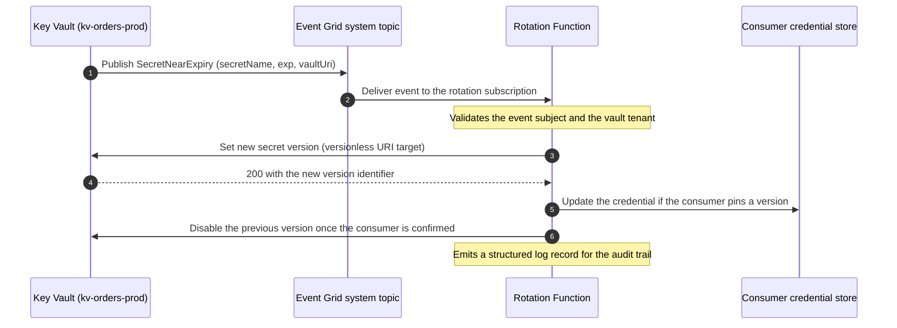
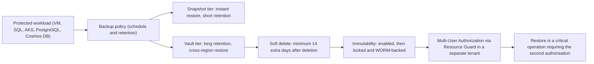
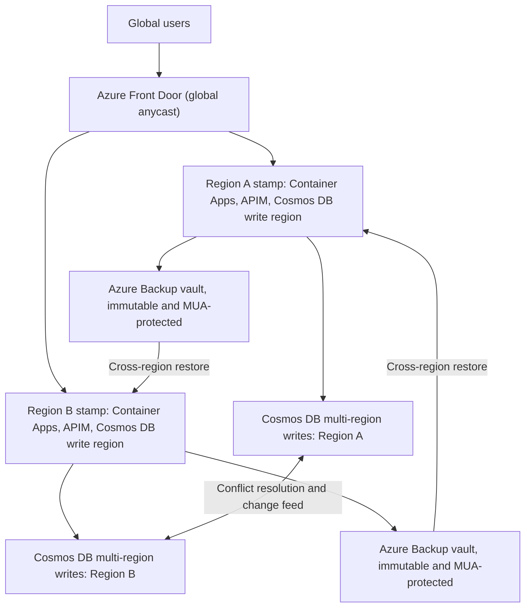

# Module 09: Security, Key Vault, Monitoring, and Business Continuity

Azure separates its control plane (Entra ID plus Azure Policy, covered in Modules 01–02), its data plane (resource-provider RBAC), and its operational surface (a telemetry pipeline that is cheap to enable and expensive to leave unconfigured). This module covers the three subjects an AZ-305 design review always touches: where secrets and keys physically live and who may read them, how you learn that a workload is broken before a customer does, and what you do when a zone or a region disappears. Generic theory is deliberately excluded: the shared-responsibility and cloud-security models belong to [`architecture/cloud-foundations`](../../../architecture/cloud-foundations/README.md); OAuth 2.1, OIDC, PKI, and secrets-management principles belong to [`architecture/security-identity`](../../../architecture/security-identity/README.md); OpenTelemetry semantics, PromQL, and SLO burn-rate theory belong to [`technologies/observability`](../../observability/README.md); replication, consistency, and failure-mode vocabulary belong to [`architecture/distributed-systems`](../../../architecture/distributed-systems/README.md). What remains is the Azure delta: service tiers, limit numbers, defaults, failure modes, and exam framing.

> [!NOTE]
> **Verified against** Azure CLI 2.93.0, Bicep 0.49.2, Terraform `hashicorp/azurerm` 5.14.0, `@azure/storage-blob` 12.34.0, PSRule for Azure 1.47.0, Node.js 26.13.0, and TypeScript 7.0.2 on 2026-11-20. Quotas, retention windows, and plan matrices are anchored in Microsoft Learn documentation cited inline.

The executable proofs for this module are in `technologies/azure/examples/08-keyvault-monitor-and-bcdr.test.ts` (referenced as code here because the file ships with the examples directory). Run them from `technologies/azure` with `mise exec -- npm test`.

---

## 1. Azure Key Vault: Tiers, Authorization, and Lifecycle

### 1.1 Vault tiers: Standard, Premium, and Managed HSM

Key Vault exposes three protection tiers. The choice is not about price alone: it changes the physical boundary of the key material, the FIPS validation story you can assert to an auditor, and the throttling envelope you must design around.

| Tier | Key protection | Tenancy | What it is for | Practical constraint |
| --- | --- | --- | --- | --- |
| **Standard** | Software-protected keys inside a multi-tenant Key Vault service instance | Multi-tenant platform service | Secrets, certificates, and keys for ordinary application workloads | Highest transaction limits of the three; no HSM-backed key operations |
| **Premium** | FIPS 140-3 Level 3 validated HSM-backed keys, plus `oct-HSM` (AES) symmetric keys | Multi-tenant platform service, HSM-backed key material | Regulatory requirements that mandate HSM-protected keys or symmetric AES operations in an HSM | HSM key transactions are throttled far harder than software-key transactions; `oct-HSM` inputs are capped at 4,096 bytes before Base64 encoding |
| **Managed HSM** | Dedicated, single-tenant HSM pool you provision and administer | Single-tenant HSM pool assigned to your subscription | Full control of the HSM lifecycle, custom role definitions, and higher secure-key-release throughput | Hard object ceilings (5,000 keys per instance, 100 versions per key, 50 custom role definitions, 50 role assignments at HSM scope, 5 instances per subscription per region); significantly higher cost and operational burden |

A Managed HSM is not "a vault with a different SKU". It is a separate resource type (`Microsoft.KeyVault/managedHSMs`) with its own data plane, its own local RBAC role model (`/keys/` scoped custom roles rather than the built-in Key Vault roles), and its own backup domain. The security domain is downloaded at provisioning time as a set of RSA public keys; losing the security domain means losing the ability to restore the HSM. Treat that download as a break-glass artefact and store it under the same controls you apply to root CA material.

> [!IMPORTANT]
> **Managed HSM is a different operational model, not a SKU upgrade.** You cannot convert an existing Standard or Premium vault into a Managed HSM, and you cannot point an existing application at one by changing a connection string. Plan for a dual-write or a re-encryption migration, and remember that the `Microsoft.KeyVault/vaults` and `Microsoft.KeyVault/managedHSMs` resource types have different quotas, different throttling tables, and different role definitions.

### 1.2 Authorization: Azure RBAC versus legacy vault access policies

Every vault carries a permission-model flag. In Bicep it is `properties.enableRbacAuthorization`; in Terraform it is `rbac_authorization_enabled`; in the Azure CLI it is `--enable-rbac-authorization`. The flag decides which authorization engine evaluates data-plane requests, and the two engines are not additive — when Azure RBAC is enabled, access policies are ignored entirely.

**Vault access policies** are objects attached to the vault itself. Each policy grants a principal (identified by `objectId` and `tenantId`) a bundle of permissions across an entire permission plane: `secret_permissions`, `key_permissions`, `certificate_permissions`, `storage_permissions`. The finest granularity available is "this principal can `Get` secrets in this vault". There is no object-level scoping, so any principal that can read one secret can read all of them, and the only way to narrow a principal is to move it to a different vault. The vault supports up to 1,024 access policy entries, and Terraform cannot mix the inline `access_policy` block with the separate `azurerm_key_vault_access_policy` resource — the two fight over the same collection.

**Azure RBAC for Key Vault** reuses the control-plane authorization machinery on the data plane. Role assignments are ordinary `Microsoft.Authorization/roleAssignments` at any scope, which means they can be scoped to the vault, to a single secret, to a single key, to a resource group, or to a subscription, and they can be conditioned with ABAC attributes. They can also be made eligible through Privileged Identity Management, which is impossible with a static access policy.

| Concern | Vault access policy | Azure RBAC |
| --- | --- | --- |
| Assignment scope | The whole vault | Vault, resource group, subscription, or a single object such as one secret |
| Least privilege for readers | Every reader can read every secret | `Key Vault Secrets User` on one secret URI grants read on exactly that secret |
| Time-bound elevation | Not possible | Eligible assignment through PIM with an approval and an expiry |
| Delegated administration | Vault Owner or a co-administrator relationship | `Key Vault Administrator` plus `Microsoft.Authorization/roleAssignments/write` at the chosen scope |
| Consistency with the rest of Azure | A separate model to reason about | The same model as the control plane, same roles blade, same audit trail |
| Switching cost | The default for vaults created before 2023 in many tenants | Requires unrestricted `Microsoft.Authorization/roleAssignments/write`; `Key Vault Data Access Administrator` with conditions cannot switch it |

The per-object role assignment is the feature that changes designs. Granting a single consumer the narrowest possible read looks like this:

```bash
VAULT_ID=$(az keyvault show --name kv-orders-prod --query id --output tsv)

az role assignment create \
  --role "Key Vault Secrets User" \
  --assignee-object-id "$WORKLOAD_PRINCIPAL_ID" \
  --assignee-principal-type ServicePrincipal \
  --scope "$VAULT_ID/secrets/db-password"
```

The built-in data-plane roles worth knowing: `Key Vault Administrator` (full data plane, no role-assignment management), `Key Vault Officer` (manage keys, secrets, and certificates but not assign roles), `Key Vault Secrets User` (get and list secrets only), `Key Vault Secrets Officer` (set, delete, and recover secrets), `Key Vault Crypto User` (perform cryptographic operations with keys), `Key Vault Crypto Officer` (manage keys and rotation policy), `Key Vault Certificates Officer`, and `Key Vault Reader` (read metadata and the list of objects, not their values).

In Bicep, the RBAC path and the access-policy path are mutually exclusive, and the ordering trap is real: the role assignment must be created after both the vault and the managed identity exist.

```bicep
resource kv 'Microsoft.KeyVault/vaults@2026-02-01' = {
  name: vaultName
  location: location
  properties: {
    sku: { name: 'premium' }
    tenantId: subscription().tenantId
    enableRbacAuthorization: true
    enableSoftDelete: true
    softDeleteRetentionInDays: 90
    enablePurgeProtection: true
    publicNetworkAccess: 'Disabled'
  }
}

resource secretsUser 'Microsoft.Authorization/roleAssignments@2022-04-01' = {
  name: guid(kv.id, mi.id, secretsUserRoleId)
  scope: kv
  properties: {
    principalId: mi.properties.principalId
    roleDefinitionId: secretsUserRoleId   // Key Vault Secrets User
    principalType: 'ServicePrincipal'
  }
}
```

> [!WARNING]
> **The permission-model switch is a lockout primitive.** A vault created with access policies and later switched to `enableRbacAuthorization: true` stops honouring every access policy in place. Any workload that authenticates with a managed identity holding only an access policy starts failing with HTTP 403 on its next secret read. The reverse switch is equally dangerous: a vault switched back to access policies ignores every role assignment. Before flipping the flag, enumerate the current grants, translate them into role assignments, deploy the assignments, and only then flip the flag. Switching also requires unrestricted `Microsoft.Authorization/roleAssignments/write` — a `Key Vault Data Access Administrator` assignment carrying an ABAC condition cannot perform the switch.

### 1.3 Soft delete and purge protection: the IaC recreate lockout

Soft delete is mandatory. Every Key Vault created since 2020 has it enabled, and the property cannot be turned off. When a vault or a secret is deleted, it enters a soft-deleted state for a retention window that is configurable between 7 and 90 days, with a default of 90. `soft_delete_retention_days` in Terraform is documented as settable exactly once — a later change is not applied.

Purge protection is a one-way ratchet. Once enabled on a vault, it cannot be disabled, and it blocks the permanent purge of the vault and of its objects until the retention window expires. That is exactly the control a ransomware playbook tries to remove, which is why it is mandatory in regulated environments — and exactly the reason an Infrastructure-as-Code destroy-and-recreate cycle breaks.

The failure mode is a sequence, not a single call:

1. A pipeline applies a vault with `purge_protection_enabled = true` and a secret named `db-password`.
2. A `terraform destroy` (or a resource-group delete during an environment teardown) removes the vault. The vault does not disappear; it becomes a soft-deleted vault that is scheduled for permanent deletion at the end of the retention window.
3. The next `terraform apply` with the same vault name attempts a create. The Key Vault data plane rejects it with HTTP 409 Conflict, surfaced as `VaultAlreadyExists`, because the name is still owned by the soft-deleted vault.
4. The same collision happens one level down for the secret itself: creating a secret with the same name while the previous version is in soft-deleted state returns HTTP 409 Conflict with the error code `SecretDeleted`.

Terraform's azurerm provider has a specific behaviour here that is easy to miss, because it lives in the provider block rather than on the resource:

```hcl
provider "azurerm" {
  features {
    key_vault {
      purge_soft_delete_on_destroy    = true   # purges on destroy; dangerous with purge protection
      recover_soft_deleted_key_vaults = true   # default: recover a soft-deleted vault at create time
    }
  }
}
```

With `recover_soft_deleted_key_vaults = true` (the default), the provider silently recovers the soft-deleted vault instead of creating a new one. The apply succeeds, but the recovered vault carries the properties it had before deletion — the permission model, the network ACLs, the enabled-for flags — and Terraform then reconciles them. If the vault was deleted precisely because those properties were wrong, the recovery re-establishes them for the duration of the apply, and a state import plus re-apply is often needed before the configuration is trustworthy. With `recover_soft_deleted_key_vaults = false`, the create fails outright with the 409 above.

ARM and Bicep have no recovery behaviour at all. A `New-AzKeyVault` or a Bicep deployment against a soft-deleted vault name fails with `VaultAlreadyExists`. Recovery is an explicit, out-of-band step:

```bash
# Recover the soft-deleted vault (allowed only inside the retention window)
az keyvault recover --name kv-orders-prod

# Or recover a single soft-deleted secret inside a live vault
az keyvault secret recover --vault-name kv-orders-prod --name db-password

# Purge is blocked while purge protection is enabled
az keyvault purge --name kv-orders-prod   # fails until retention expires
```

Three design choices avoid the lockout entirely, and a production pipeline should use at least two of them:

- **Unique suffixing.** Derive the vault name from a per-deployment random or deterministic suffix (`kv-orders-prod-${suffix}`), so a teardown never collides with a future create. The cost is that the vault URI changes, so anything that pins the URI must be a lookup rather than a literal.
- **Explicit recovery in the pipeline.** Run `az keyvault recover` as a pre-step guarded by a check for the soft-deleted state, then let the IaC tool reconcile the properties. This is the only correct option when the vault name is a contractual constant referenced by other teams.
- **Never destroy production vaults.** Protect the vault and its resource group with a `CanNotDelete` resource lock, and use Deployment Stacks deny settings so that the IaC pipeline itself cannot delete it. Teardown becomes a deliberate, audited action rather than a side effect of a branch merge.

> [!WARNING]
> **Purge protection turns a typo into a 90-day outage window.** If a pipeline creates `kv-orders-prod` with purge protection enabled and the correct name was `kv-orders-prod-2`, you cannot purge the mistake. You cannot rename it, you cannot move it, and you cannot reuse the name for the retention period. Add a pre-deployment name check to CI, and reserve production vault names in a governed namespace so two teams cannot claim the same string.

### 1.4 Throttling limits and client-side resilience

Key Vault enforces transaction limits per vault per region, inside a rolling 10-second window, and the subscription-wide ceiling for all transaction types is five times the per-vault limit. The limits are weighted, and enforcement is on the weighted sum, which is why the same number of GETs can succeed on one key type and fail on another.

| Operation category | Limit per 10 seconds, per vault per region |
| --- | --- |
| RSA 2,048-bit software key, all transactions | 4,000 |
| RSA 2,048-bit HSM key, all transactions | 2,000 |
| RSA 3,072-bit software key, all transactions | 1,000 |
| RSA 4,096-bit HSM key, all transactions | 250 |
| ECC P-256 / P-384 / P-521 / SECP256K1 software key, all transactions | 4,000 |
| `oct-HSM` (AES) key, all transactions | 2,000 |
| HSM key `CREATE key` / `RELEASE key` (shared bucket, secure key release) | 10 |
| Software key `CREATE key` / `RELEASE key` (shared bucket) | 20 |
| `CREATE secret`, `IMPORT certificate`, `IMPORT key` (one shared bucket) | 300 |
| All other secret, certificate, and vault transactions | 4,000 |

Two consequences follow directly from the table. First, the write path is an order of magnitude more expensive than the read path: 300 secret creations per 10 seconds across the whole vault, shared with certificate and key imports. A bulk-seeding job that creates 3,000 secrets will throttle no matter how much read capacity is idle. Second, secure key release and RSA 4,096-bit HSM operations are rare enough to be worth a dedicated design conversation, because their limits are two orders of magnitude below the common case.

Throttling surfaces as HTTP 429 with a `Retry-After` header. The client contract is: honour the header, add jitter, and never retry in a tight loop. Key Vault's own guidance is that a 429 is a signal to reduce load, not to parallelise harder. The application-level pattern that removes the pressure is caching: read a secret once, cache it in process with a TTL shorter than the rotation interval plus jitter, and refresh in the background. Key Vault is not a configuration store — high-churn, non-secret configuration belongs in Azure App Configuration, which is built for that access pattern and has no equivalent per-object transaction ceiling.

> [!CAUTION]
> **The caching TTL must be shorter than the rotation interval, or rotation silently fails.** If a rotation Function publishes a new secret version every 30 days and the client caches for 31 days, the client never observes the new value and fails when the old credential is revoked. Use a TTL comfortably below the rotation interval, add jitter so a fleet of replicas does not stampede the vault at the same instant, and expose cache age as a metric so a stuck refresh is visible.

### 1.5 Secret rotation with Event Grid and Functions

Key Vault publishes lifecycle events to Event Grid. The event that matters for rotation is `Microsoft.KeyVault.SecretNearExpiry`, emitted by default 30 days before the secret's `exp` timestamp (configurable per secret via rotation policy). The event carries the vault URI, the secret name, and the expiry timestamp, which is enough for a Function to act on without calling the vault for a list.

The rotation Function must do three things, and the third is the one teams skip: write the new version, update the consumer if the consumer cannot follow the versionless URI, and record what it did. Writing a new version is a `CREATE secret` against the 300-per-10-seconds shared bucket, so rotation must be rate-limited and staggered rather than fan-out across a thousand secrets at once.

The consumer side is where the design pays off. A versionless secret URI — `https://kv-orders-prod.vault.azure.net/secrets/db-password` with no version segment — resolves to the newest enabled version. Consumers that read through the versionless URI need no change when a new version appears; consumers that pin a version segment need a redeploy.



Rotation is not complete until the old version is disabled or deleted. Leaving every historical version enabled means the versionless URI can still resolve to a version a consumer pinned, and an auditor sees no boundary on credential lifetime. Disable first, confirm the consumer, then delete.

### 1.6 Consumption paths: Key Vault references and the CSI Secrets Store driver

**App Service and Azure Functions** resolve a Key Vault reference at the app-settings layer. The value of a setting or a connection string is the literal string `@Microsoft.KeyVault(...)`, and the platform resolves it before the process starts. Two reference formats exist: `SecretUri=<data-plane URI>` and `VaultName=<name>;SecretName=<name>[;SecretVersion=<version>]`. The identity used is the app's system-assigned identity by default, or a user-assigned identity selected by setting `keyVaultReferenceIdentity` to that identity's resource ID.

The rotation semantics are precise and frequently mis-stated. If the reference omits the version, the app uses the latest version that exists. When newer versions appear, the app is updated automatically and begins using the latest version **within 24 hours**, because App Service caches the resolved values and refetches them on a 24-hour cycle. Any configuration change to the app restarts it and triggers an immediate refetch of every referenced secret. To force resolution without a restart, POST to `https://management.azure.com/<resourceId>/config/configreferences/appsettings/refresh?api-version=2022-03-01`.

A reference that cannot be resolved is not silently replaced by an empty string: the literal `@Microsoft.KeyVault(...)` text is passed through as the setting value, and the application fails in a way that looks like a configuration bug rather than an authorization failure. The usual root cause is a missing `Key Vault Secrets User` role or a missing `Get` secret permission on the identity. A subtler variant appears with network-restricted vaults: the audit log shows a 403 `SecretGet` from the app's public outbound IP followed by a successful `SecretGet` from its private IP, which is by design and not a failure.

**Azure Container Apps** resolves vault references at the environment level with `keyVaultUrl` and an `identity`, which can be the system-assigned identity or a named user-assigned identity:

```yaml
properties:
  managedIdentities:
    systemAssigned: true
  configuration:
    secrets:
      - name: db-password
        keyVaultUrl: https://kv-orders-prod.vault.azure.net/secrets/db-password
        identity: system
```

Because Container Apps secrets are injected into revisions rather than read per request, a rotation is picked up when a new revision is created or when the environment refreshes the secret, which is a weaker guarantee than the App Service 24-hour cache. Design rotation for Container Apps with a revision rollout as part of the rotation runbook.

**Azure Kubernetes Service** uses the Azure Key Vault Secrets Store CSI driver, mounted as a volume rather than injected as environment variables. The `SecretProviderClass` declares the objects to mount, and the provider block selects the identity mode:

```yaml
apiVersion: secrets-store.csi.x-k8s.io/v1
kind: SecretProviderClass
metadata:
  name: orders-app-kv
spec:
  provider: azure
  parameters:
    usePodIdentity: 'false'
    useVMManagedIdentity: 'true'
    userAssignedIdentityID: '<client-resource-id-of-the-user-assigned-identity>'
    keyvaultName: 'kv-orders-prod'
    objects: |
      array:
        - objectName: db-password
          objectType: secret
    tenantId: '<tenant-id>'
```

The driver mounts the secret as a file in the pod's volume, which means rotation is a file-content change and the application must watch the file or be restarted. Setting `enableSecretRotation: "true"` with a `rotationPollInterval` makes the provider poll the vault and update the mounted content, and pairing the driver with `syncWithK8sSecrets` projects the value into a Kubernetes `Secret` so that Deployments using `envFrom` or `secretKeyRef` can consume it — at the cost of storing the secret in etcd. Prefer the mounted file for anything that can watch a path, and reserve the Kubernetes `Secret` projection for images and third-party sidecars that cannot read a CSI volume.

---

## 2. Microsoft Defender for Cloud

Defender for Cloud is a Cloud Native Application Protection Platform (CNAPP) built from three components: **Cloud Security Posture Management** (CSPM), which checks and improves configuration; **Cloud Workload Protection** (CWPP), which defends running workloads; and **DevSecOps**, which pushes posture checks back into code pipelines. It also carries AI security posture management and AI threat protection for generative-AI workloads, which is the part that intersects with the AI-200 domain.

### 2.1 CSPM, secure score, and attack path analysis

The free tier, **Foundational CSPM**, gives continuous posture assessment, the Microsoft Cloud Security Benchmark as a built-in standard, multicloud onboarding, secure score, and code-pipeline insights for GitHub, Azure DevOps, and GitLab. The paid **Defender CSPM** plan adds the capabilities that matter in a design review: agentless vulnerability scanning, data-aware security posture, the cloud security graph, Cloud Security Explorer, attack path analysis, and security governance rules that assign remediation tasks to resource owners with due dates.

**Secure score** is an aggregate of recommendations weighted by the reduction in risk each would deliver. It is a prioritisation aid, not a compliance metric: a score of 80 percent with an unencrypted production database is worse than a score of 60 percent with none. Treat it as a backlog sorter and resist reporting it upward as a KPI.

**Attack path analysis** is the genuinely useful addition. It queries the cloud security graph — a model of your resources, identities, network reachability, and exposure — for chains rather than single misconfigurations. A single finding such as "this storage account allows public network access" becomes a path: an internet-exposed App Service with a managed identity that has `Storage Blob Data Contributor` on a public storage account, reachable because the account's firewall permits the app's outbound IP. Fixing the middle hop of the chain breaks the path, whereas remediating the lowest-severity finding first often changes nothing. In a design review, ask for the attack paths that cross your identity and network boundaries, not the recommendation list.

### 2.2 Defender plans that change your design

| Plan | What it detects or does | Design consequence |
| --- | --- | --- |
| **Defender for Servers** | Threat detection for Windows and Linux in Azure, AWS, GCP, and on-premises, with just-in-time VM access, file integrity monitoring, and vulnerability assessment | Just-in-time access replaces permanently open management ports; Defender for DNS is bundled into Plan 2 rather than sold separately |
| **Defender for Storage** | Malware scanning on upload, sensitive-data-threat detection, and SAS-token misuse detection | Malware scanning runs asynchronously on uploaded blobs; a pipeline that consumes a blob immediately after upload must wait for the scan result rather than assume the upload is safe |
| **Defender for Containers** | Environment hardening, vulnerability assessment, and runtime protection for Kubernetes nodes and clusters | Requires agent components on the cluster; check AKS node image and DaemonSet compatibility before enabling on a production cluster |
| **Defender for Key Vault** | Unusual or harmful attempts to access or exploit vaults, including unusual access patterns and mass secret enumeration | Pairs with Key Vault diagnostic logs; the alert is only as good as the diagnostic settings routing `AuditEvent` to Log Analytics |
| **Defender for Databases** | Attack detection for Azure SQL, SQL on machines, open-source relational databases, and Azure Cosmos DB | Cosmos DB alerts are a plan-level capability, not a database-level one |
| **Defender for Resource Manager** | Suspicious control-plane operations, including unusual deployment activity and role-assignment changes | Covers the ARM control plane, which Azure Policy does not: Policy enforces what is allowed, this detects what was attempted |
| **Defender for App Service** | Attacks targeting App Service apps and APIs | Complements the WAF on Application Gateway; it is not a substitute for one |
| **Defender for APIs** | API security posture, prioritisation, and real-time threat detection | Overlaps with API Management policy; use one as the enforcement point and the other as the detection point |
| **AI Services** | Real-time threat detection for generative-AI applications, including prompt-injection and data-exfiltration patterns | Required for a production RAG platform; enable on the AI Services account that fronts the model deployment |

Defender for Cloud stores its data in Azure Monitor Logs, which means its alerts and recommendations are queryable with KQL alongside everything else. That is the integration point that matters: a Defender alert becomes a Log Analytics alert rule with an action group, which becomes a page, which becomes a runbook.

### 2.3 Microsoft Sentinel as the SIEM sink

Microsoft Sentinel is the SIEM built on the same Log Analytics workspace. Onboarding a workspace to Sentinel enables analytics rules, automation rules, playbooks, and entity-behaviour analytics over the data already collected. The design decision is workspace topology, and it is driven by data residency, blast radius, and billing rather than by feature availability.

A centralised security workspace simplifies cross-resource correlation: a Defender for Key Vault alert, a NSG flow log, and an Activity Log entry about a role assignment can be joined on time and principal. A federated model, where each business unit owns a workspace and Sentinel is onboarded to each, isolates tenants and satisfies data-residency constraints at the cost of cross-workspace queries. Sentinel charges for data ingestion and for retention beyond the included period, and Defender for Cloud's own data lands in the same workspace, so the two services compound each other's ingestion cost. Budget the workspace before enabling both.

> [!WARNING]
> **Enabling Sentinel on a workspace that also receives verbose resource logs doubles a cost problem.** Sentinel bills for ingestion, and Diagnostic Settings that stream every category of every resource into the same workspace feed it. Scope Sentinel's analytics to the tables it needs, and route high-volume resource logs to a Basic or Auxiliary table plan or to storage instead (see §3.2).

---

## 3. Azure Monitor: Metrics, Activity Log, and Resource Logs

Observability theory — what to measure, how to define an SLO, how burn-rate alerts work, how OpenTelemetry models signals — is owned by [`technologies/observability`](../../observability/README.md). This section covers only the Azure realisation: the three telemetry stores, how data gets into them, and the KQL you actually run during an incident.

### 3.1 Platform metrics, Activity Log, and resource logs

Azure Monitor splits telemetry into three stores with different semantics, different retention, and different default states. Confusing them is the single most common monitoring design error.

| Store | What it holds | Default state | Retention | Cost |
| --- | --- | --- | --- | --- |
| **Platform metrics** | Numerical time series emitted by the resource type, one point per minute for most metrics | Collected automatically | 93 days standard platform retention | Free to collect and chart; export costs apply |
| **Activity Log** | Control-plane operations: who created, updated, or deleted what, and the result | Collected automatically | 90 days in the platform | Free; export costs apply |
| **Resource logs** | Data-plane and diagnostic events from inside the resource, per category | **Disabled by default** | Only as long as the destination keeps it | Ingestion or storage charges |

The Activity Log is the control-plane audit trail. It is the only place that answers "who deleted this storage account" and "which deployment changed this NSG". It is retained for 90 days and then gone, so any compliance requirement longer than a quarter mandates export through **Diagnostic Settings** to a Log Analytics workspace, a storage account, or an Event Hubs namespace. An Activity Log that was never exported is an audit trail with a 90-day memory.

Resource logs are off by default for almost every resource type, and each resource exposes a different set of categories. A Key Vault exposes `AuditEvent`; a storage account exposes per-service categories such as `StorageRead`, `StorageWrite`, `StorageDelete`; an Application Gateway exposes `ApplicationGatewayAccessLog`, `ApplicationGatewayPerformanceLog`, and `ApplicationGatewayFirewallLog`. Nothing is collected until a Diagnostic Setting names the categories and a destination. A monitoring review that finds no Diagnostic Settings has found an environment with no data-plane visibility, not an environment with no incidents.

A Diagnostic Setting is a routing rule on a resource, not a storage configuration. Each resource can have up to five settings, and each setting can target one or more of: a Log Analytics workspace, a storage account, an Event Hubs namespace, or a legacy partner solution. Two settings on the same resource both receive the same events, which is how you fan out to a security workspace and to a cost-optimised archive at once.

```bicep
resource kvDiag 'Microsoft.Insights/diagnosticSettings@2021-05-01-preview' = {
  scope: kv
  name: 'to-security-workspace'
  properties: {
    workspaceId: securityWorkspace.id
    logAnalyticsDestinationType: 'Dedicated'
    logs: [
      { category: 'AuditEvent', enabled: true, retentionPolicy: { enabled: true, days: 0 } }
    ]
    metrics: [
      { category: 'AllMetrics', enabled: true, retentionPolicy: { enabled: true, days: 0 } }
    ]
  }
}
```

Setting `retentionPolicy.days` to 0 with `enabled: true` means "retain indefinitely in the destination", which is the correct choice for a Log Analytics destination where retention is governed by the table plan and the workspace retention setting. Setting a non-zero day count on a storage destination applies a blob lifecycle retention, which is how you build a cheap 12-year archive for a fraction of the Log Analytics price.

### 3.2 Log Analytics workspace and the table-plan cost lever

A Log Analytics workspace is a container for tables. Data lands in a table, and each table runs under a **table plan** that decides ingestion price, query price, and which features the table supports. The three plans are the largest single cost lever in Azure monitoring, and most teams never change them.

| Capability | Analytics | Basic | Auxiliary / Lake |
| --- | --- | --- | --- |
| Best for | High-value data for continuous monitoring and real-time detection | Medium-touch data for troubleshooting and incident response | Low-touch verbose data for audit and compliance |
| Ingestion cost | Standard | Reduced | Minimal |
| Query price | Included | Charged per query | Charged per query |
| KQL | Full | Full | Full |
| Query scope | Resource and workspace scope | Workspace scope only | Workspace scope only |
| Alerts | Metric, log search, and simple log alerts | Simple log alerts | Not supported |
| Insights, workbooks, dashboards | Supported | Workbooks and Grafana only | Slow refresh, cost per refresh |
| Data export rules | Supported | Supported | Not supported |
| Sentinel | Supported | Supported | Supported |
| Search jobs, summary rules | Supported | Supported, single-table KQL | Supported, single-table KQL |
| Restore, workspace replication | Supported | Supported | Not supported |
| Interactive retention | 30 days (90 days for Sentinel and Application Insights), extendable up to two years at a prorated charge | Not applicable | Not applicable |
| Total retention | Up to 12 years | Up to 12 years | Up to 12 years |

The practical rule: send security and operational signal to Analytics, send per-request and per-connection logs that you query only during an incident to Basic, and send verbose audit and compliance data you query once a quarter to Auxiliary. Moving a table from Analytics to Basic cuts ingestion cost and moves you to pay-per-query; moving to Auxiliary cuts it further but removes alerting, dashboards, and export. The Auxiliary plan is not available in legacy pricing tiers and is unavailable in Qatar Central; verify regional availability before designing on it.

Workspace design is the second lever. A single workspace simplifies cross-resource queries and access control; separate workspaces isolate tenants, satisfy data residency, and let you apply different table plans and retention to different estates. Workspaces can be replicated across regions, which matters because a workspace in a failed region cannot receive data from resources in that region — a BCDR detail covered in §5.

### 3.3 Azure Monitor Agent and Data Collection Rules

The **Log Analytics agent** (also called the Microsoft Monitoring Agent, or MMA, and its predecessor the OMS agent) is retired. It was replaced by the **Azure Monitor Agent (AMA)**, which is configured through **Data Collection Rules (DCRs)** rather than through workspace-level configuration. This is the single most consequential change in Azure monitoring operations in the last few years, because it inverts where configuration lives.

A DCR is a first-class resource that declares what to collect, how to transform it, and where to send it. It can target resources by resource ID, by resource group, by subscription, or by tag, and it can be associated with multiple resources. The DCR holds a **transformation**, which is a KQL statement applied at ingestion time, and this is where cost control lives: a transformation can drop columns, drop rows that do not match a predicate, or derive new fields before the row is ingested and billed.

```json
{
  "properties": {
    "dataSources": {
      "performanceCounters": [
        {
          "name": "cpuAndMemory",
          "streams": ["Microsoft-Perf"],
          "scheduledTransferPeriod": "PT1M",
          "samplingFrequencyInSeconds": 60,
          "counterSpecifiers": [
            "\\Processor(_Total)\\% Processor Time",
            "\\Memory\\Available Bytes",
            "\\LogicalDisk(_Total)\\Disk Reads/sec"
          ]
        }
      ]
    },
    "destinations": {
      "logAnalytics": [
        {
          "workspaceResourceId": "<workspace-id>",
          "name": "workspace"
        }
      ]
    },
    "dataFlows": [
      {
        "streams": ["Microsoft-Perf"],
        "destinations": ["workspace"],
        "transformKql": "source | where CounterName != 'Idle Time' | project TimeGenerated, Computer, CounterName, CounterValue",
        "outputStream": "Microsoft-Perf"
      }
    ]
  }
}
```

The AMA collects from VMs, from Arc-enabled servers, and from AKS nodes through container insights. The old agent's workspace-level configuration has no automatic migration path: an environment still running the Log Analytics agent needs a per-resource migration plan, and the two agents can coexist on a machine during a transition but must not both collect the same counter, or the data is double-counted and double-billed.

> [!IMPORTANT]
> **The retirement of the Log Analytics agent is an operational deadline, not a deprecation notice.** The agent is retired and no longer supported. Any environment still running it has no security patches for the telemetry path, and any runbook that edits workspace-level agent configuration is editing a resource that no longer applies. Audit for `Microsoft.EnterpriseCloud.Monitoring` extensions in your estate and migrate to AMA plus DCRs.

### 3.4 KQL diagnostic patterns

The KQL language itself is owned by [`technologies/observability`](../../observability/README.md). These are the Azure-specific shapes: which table a category lands in, what the timestamp column is called, and the query you run when someone asks "why did ingestion cost triple".

**Key Vault audit events.** The `AuditEvent` category lands in `AzureDiagnostics` with `ResourceProvider = 'MICROSOFT.KEYVAULT'`, or in the dedicated `KeyVault` table family depending on the resource-specific mode. The operational question is almost always "which principal read which secret and when":

```kql
AzureDiagnostics
| where Category == 'AuditEvent' and OperationName == 'SecretGet'
| where TimeGenerated > ago(7d)
| extend SecretName = tostring(parse_json(properties_s).objectName)
| extend Caller = tostring(parse_json(identity_s).claims.value) // verify claim shape for your schema
| summarize Reads = count(), DistinctSecrets = dcount(SecretName) by Caller, bin(TimeGenerated, 1h)
| where Reads > 100
| order by Reads desc
```

A principal reading hundreds of distinct secrets in an hour is either a bulk-seeding job that should use a different pattern or an attacker enumerating the vault. Defender for Key Vault raises the same signal as an alert; the query above is how you verify it.

**App Service and Functions requests.** The `AppServiceHTTPLogs` table holds request-level data, and `AppServiceAppLogs` and `AppServicePlatformLogs` hold application and platform messages:

```kql
AppServiceHTTPLogs
| where TimeGenerated > ago(1h)
| summarize Requests = count(), P95 = percentile(DurationMs, 95), Failed = countif(ScStatus >= 500)
  by bin(TimeGenerated, 5m), _ResourceId
| order by TimeGenerated asc
```

**Container Apps console logs.** Container Apps writes to `ContainerAppConsoleLogs_CL` (custom table) and `ContainerAppSystemLogs_CL`, with the log stream split by `ContainerAppName_s` and `RevisionId_s`:

```kql
ContainerAppConsoleLogs_CL
| where TimeGenerated > ago(30m)
| where Log_s has_any ("error", "exception", "fatal")
| extend App = tostring(split(ContainerAppName_s, "/")[-1])
| summarize Errors = count() by App, RevisionId_s, bin(TimeGenerated, 1m)
| order by Errors desc
```

**Ingestion volume audit.** The cost question, answered directly:

```kql
Usage
| where TimeGenerated > ago(30d)
| where IsBillable == true
| summarize IngestedGB = sum(Quantity) / 1024 by Solution, DataType
| order by IngestedGB desc
```

Pair that with a table-plan breakdown, because a single verbose `AzureDiagnostics` category is usually the whole answer:

```kql
union withsource = SourceTable *
| where TimeGenerated > ago(1d)
| summarize Rows = count() by SourceTable, _IsBillable = tostring(_IsBillable)
| order by Rows desc
```

> [!TIP]
> **Query the `Usage` table before you tune anything.** It reports billable ingestion by solution and data type for the last 31 days, which is the only honest baseline. Teams routinely reduce sampling on an Application Insights component while the actual bill is dominated by an unexamined `AzureDiagnostics` category from a storage account or a Key Vault.

---

## 4. Application Insights, Alerts, and Action Groups

### 4.1 The Azure Monitor OpenTelemetry Distro

Application Insights is the application-performance half of Azure Monitor. The supported instrumentation is the **Azure Monitor OpenTelemetry Distro**, a distribution of OpenTelemetry that emits traces, metrics, and logs in the OpenTelemetry format and exports them through an Application Insights connection string. It replaces the older Application Insights SDK packages, which used a proprietary correlation format and a different sampling model.

The distro is a thin layer over the OpenTelemetry SDK: you register the resource with the service name and version, add the exporter, and the distro supplies the Azure-specific processors and semantic-convention defaults. Because the signal is standard OpenTelemetry, the same instrumentation can be exported to a second backend without changing application code — which is the practical argument for adopting it over the legacy SDK. For Node.js, the distro registers auto-instrumentation for HTTP, the Azure SDKs, and the popular database and messaging clients; for a workload that calls Service Bus or Cosmos DB, that means distributed context propagation works without manual span creation.

Three Application Insights capabilities are exam-relevant and design-relevant:

- **Adaptive sampling** keeps ingestion volume bounded by adjusting the sampling rate to a target request rate. It is enabled by default in the distro. The trade-off is statistical: sampled traces still give correct latency percentiles at the aggregate level, but a single rare failing request may not be retained. For a low-traffic critical path, disable adaptive sampling and use fixed-rate sampling at 100 percent, and pay the ingestion.
- **Distributed trace correlation** stitches a request across HTTP calls, Service Bus send and receive, Functions invocations, and Cosmos DB operations into a single end-to-end transaction. The W3C trace context propagates through Service Bus message properties and through the Function host automatically, but only if every hop is instrumented. A single uninstrumented hop breaks the trace into two fragments, which is the usual reason a distributed trace "disappears halfway".
- **Live Metrics** streams a one-second-latency view of request rate, failure rate, dependency latency, and sampled in-flight requests, without waiting for ingestion. It is the right tool during a rollout, when the batch pipeline's minutes of lag are too slow.
- **Availability tests** probe an endpoint from multiple geographic locations on a schedule and alert on failures. A standard URL ping test only proves the endpoint returns 200; a multi-step web test or a custom TrackAvailability call from inside the workload proves the dependency chain works. Availability tests are the only synthetic signal Application Insights produces, and they are the usual basis for an external-facing SLO.

Application Insights data itself is stored in a Log Analytics workspace, in tables such as `AppRequests`, `AppDependencies`, `AppTraces`, `AppExceptions`, and `AppAvailabilityResults`. The workspace's Analytics table plan gives Application Insights 90 days of interactive retention rather than 30, which is a documented exception worth knowing when you size retention.

### 4.2 Alerts and action groups

Azure Monitor has three alert rule types, and choosing the wrong one is a common design error.

| Alert type | Signal source | Latency | Use it for |
| --- | --- | --- | --- |
| **Metric alert** | Platform metrics, including custom metrics | Typically under a minute | CPU, memory, queue depth, HTTP 5xx rate, latency percentiles, saturation |
| **Log search alert** | A KQL query evaluated on a schedule | Bounded by the query interval, minutes | Patterns that require joins or aggregation: error-rate by route, exception signature counts, security events |
| **Activity log alert** | Control-plane events | Typically under a minute | Resource deletion, policy compliance change, role assignment creation, service health notifications |
| **Prometheus alert rule** | Azure Monitor managed Prometheus | Typically under a minute | Kubernetes and container workload alerting expressed in PromQL |

Metric alerts are cheap, fast, and stateless; use them for anything a single time series can express. Log search alerts are more expressive but slower and more expensive, because each evaluation is a query. Activity log alerts are the only way to be paged about a control-plane change, and they are routinely omitted from designs that then discover a deleted resource days later.

An **action group** is the notification and automation target: email, SMS, push, voice, a webhook, an Azure Function, a Logic Apps workflow, an Automation Runbook, an ITSM connector, or an Event Hubs namespace. One action group can fan out to several of these, and several alert rules can share one action group, which is how you keep the notification topology manageable.

Two features are routinely missed:

- **Alert processing rules** suppress or apply actions outside a maintenance window, or for a specific resource group, without editing the alert rules themselves. They are the correct way to stop a known-noisy non-production environment from paging during a planned upgrade, and they are scoped by resource, resource group, or subscription. Editing alert rules to mute them loses the audit trail and tends to be forgotten.
- **Alert rule action groups with ITSM connectors** create tickets rather than pages, which is what most business-hours alerts should do. Reserve paging for signals with a customer-visible symptom.

Alert design follows the SLO model from [`technologies/observability`](../../observability/README.md): a symptom-based alert on a user-facing indicator, a burn-rate window, and a page only when the error budget is being consumed fast enough that a human intervention is warranted. An alert on CPU above 80 percent is not an SLO; it is a symptom of a capacity model that was never written down.

---

## 5. Business Continuity and Disaster Recovery

BCDR is AZ-305's third domain and the place where Azure's regional structure dictates the design. Two axes matter: how close together your replicas are (zones versus regions), and how much data you can afford to lose (RPO) against how fast you must be serving again (RTO).

### 5.1 Availability Zones versus region pairs

An **Availability Zone** is a physically separate datacenter within a region, with independent power, cooling, and networking. A zone-redundant deployment places replicas in different zones, and the platform SLA for two or more VMs across two or more zones is 99.99 percent. A zonal deployment pins a resource to one zone and survives only what that zone survives.

A **region pair** is the legacy pairing model: two regions within the same geography, deliberately separated by at least 300 miles, with paired update scheduling and automatic cross-region replication for some services. Modern Azure regions are Availability-Zone-first and are frequently not paired. This is a genuine design change, because several classic BCDR patterns assumed a pair.

| Mechanism | Failure domain protected | Replication behaviour | Where it applies |
| --- | --- | --- | --- |
| Availability Zones | Loss of one datacenter | Synchronous replication inside the region for zone-redundant services | Regions that offer zones; the default choice for in-region high availability |
| Region pair (legacy) | Loss of a region | Sequential platform updates, and automatic cross-region replication for services that use it | Legacy regions that are still paired |
| Unpaired regions | Loss of a region | No implicit pairing; you choose the secondary and configure replication yourself | Modern AZ-first regions |
| Availability Set | Loss of a rack or a maintenance batch inside one datacenter | No replication; placement only | Legacy workloads that cannot use zones |

Two consequences follow. First, you can no longer assume that a secondary region exists or that it is 300 miles away; the secondary is a design decision you document, and its distance drives your RPO because cross-region replication latency is a function of the round-trip distance. Second, zone redundancy is not a substitute for regional redundancy: a region-wide control-plane failure, a regional network partition, or a correlated software defect can take out all zones simultaneously.

### 5.2 Azure Backup

Azure Backup protects data, not running workloads. It is the mechanism that survives a logical disaster — a corrupted database, a ransomware event, an accidental deletion — which is precisely the case that zone and region redundancy does not cover.

Two vault types exist, and the split is by workload:

- **Recovery Services vault**: Azure VMs, SQL Server on Azure VMs, SAP HANA on Azure VMs, Azure Files, the Microsoft Azure Recovery Services (MARS) agent, Azure Backup Server, and System Center Data Protection Manager. This is the vault most enterprises already have.
- **Backup vault**: Azure Kubernetes Service, Azure Database for PostgreSQL, and Azure Cosmos DB, plus Azure Disks and Azure Blobs. This is the vault for PaaS data.

For Azure VMs, backup offers two tiers. The **Vault tier** stores recovery points in the Recovery Services vault and supports long retention, cross-region restore, and cross-subscription restore. The **Snapshot tier** stores recovery points as incremental snapshots in the same storage account as the source disk, which gives an instant restore time at the cost of limited retention and no cross-region restore. A production design usually keeps a short snapshot retention for instant operational restore alongside a long vault retention for genuine disaster recovery.

Three controls turn a backup into a defence against ransomware:

- **Soft delete** on the vault keeps recovery points for a minimum of 14 additional days after deletion, and it is enabled by default on new vaults. It protects against an attacker who gains Backup Contributor and deletes recovery points.
- **Immutability** blocks operations that would lead to loss of recovery points. It can be enabled, or enabled and locked. Enabling is reversible; locking is irreversible and turns on WORM-backed storage. Once locked, no operator — including a Global Administrator — can disable immutability or shorten retention. Immutability applies to the whole vault, and it does not apply to operational backups for blobs, files, and disks. You can scope immutability either to the backup policy's retention period or to a fixed number of days, and the fixed-duration option lets you shorten the immutable window while keeping the lock.
- **Multi-User Authorization (MUA)** with a **Resource Guard** adds a second, independent authorization check on critical operations. The vault administrator must not hold `Contributor`, `Backup MUA Admin`, or `Backup MUA Operator` on the Resource Guard; a separate security admin owns it and temporarily grants `Backup MUA Operator` for a specific operation, ideally through Privileged Identity Management. The Resource Guard can live in a different subscription or even a different tenant for maximum isolation. Disabling soft delete and removing MUA protection are mandatory-protected operations that cannot be excluded.



The residual risk is explicit: MUA protects operations on vaulted backups only. Anything done directly on the data source — deleting a database, dropping a container, wiping a file share — is outside the Resource Guard's scope. Backup protects the copy, not the original.

### 5.3 Azure Site Recovery

Azure Site Recovery (ASR) replicates running virtual machines so that a workload can be brought up in a secondary region. Where Backup protects data, ASR protects the running system, and its whole value proposition is a bounded RPO for a workload you cannot rebuild quickly from backup.

The mechanics that decide your design:

- **Replication is continuous** for Azure VMs, VMware VMs, and physical servers. Site Recovery creates a crash-consistent recovery point every five minutes, and that frequency is fixed — it is not configurable. Application-consistent recovery points require a Volume Shadow Copy Service quiesce on Windows or a custom freeze and thaw script on Linux, and the minimum frequency for those is one hour.
- **Retention** in the replication policy is one day by default, and the oldest usable recovery point is 15 days with managed disks and 3 days with unmanaged disks. If you need to recover to a state from three weeks ago, replication retention cannot give it to you; you need Backup alongside ASR.
- **Failover is not automatic.** It is initiated from the portal, PowerShell, the REST API, or the SDK. There is no built-in health-based failover trigger, so an automated failover requires an external orchestrator that detects the outage and calls the API — which is a decision you should make deliberately, because an automated regional failover during a transient network partition can be worse than the outage.
- **Recovery plans** group replicated VMs into an ordered failover sequence with scripts, manual actions, and dependency ordering. A recovery plan is the unit you test, and testing is a non-disruptive test failover that creates VMs in an isolated network without touching production replication. Test failovers have no separate Site Recovery charge, though the compute created during the drill is billed.
- **Chained replication is not supported**, and ASR does not track source-VM changes made outside the guest OS: change a VM's size at the source and the change is not replicated. Ephemeral OS disks are not supported, and Docker disks must be excluded.

The RPO and RTO numbers come from the design, not the service. A crash-consistent recovery point every five minutes gives you an RPO of roughly five minutes of data loss for a workload that tolerates crash consistency, and an RTO that is the time to create the secondary VMs and start the application — minutes for a scripted recovery plan, hours for a manual one. Application-consistent points with a one-hour frequency mean a database that requires quiesced snapshots has an RPO closer to an hour.

### 5.4 Multi-region composition patterns and SLA arithmetic

BCDR patterns form a spectrum, and the right choice is a function of RTO, RPO, and cost. The four canonical patterns compose differently in Azure.

| Pattern | Secondary state | Typical RTO | Typical RPO | Azure realisation |
| --- | --- | --- | --- | --- |
| **Backup and Restore** | Nothing running; data in a Recovery Services or Backup vault | Hours to days | Hours (the backup interval) | Azure Backup with cross-region restore, exported snapshots to a secondary region |
| **Pilot Light** | A minimal always-on footprint: the data tier replicated, the compute tier stopped | Tens of minutes | Minutes (continuous replication) | ASR for VMs, or SQL Failover Groups with a readable secondary and no compute |
| **Warm Standby** | A reduced-capacity copy of the full stack, always running | Minutes | Seconds to minutes | ASR with a warm target, or a full deployment at reduced SKU behind Traffic Manager |
| **Active-Active** | Full capacity in both regions, both serving | Zero (no failover step) | Zero for replicated state | Front Door or Traffic Manager in front of two regional deployments, Cosmos DB multi-region writes, or SQL Failover Groups with a read-write secondary |

Availability arithmetic decides whether a design actually meets the target. Components in series multiply, because the system is available only when every component is. Components in parallel combine, because the system survives when at least one replica survives.

$$SLA_{series} = \prod_{i=1}^{n} SLA_i$$

$$SLA_{parallel} = 1 - \prod_{i=1}^{n} (1 - SLA_i)$$

Worked through the two shapes that appear in an AZ-305 design review. A single-region deployment of Front Door (99.99 percent), a zone-redundant App Service plan (99.95 percent), and a zone-redundant Azure SQL database (99.99 percent) in series gives $0.9999 \times 0.9995 \times 0.9999 \approx 0.9993$, which is 99.93 percent, not the 99.99 percent that the most expensive component's datasheet advertises. Moving the same three components to two active regions and combining them in parallel gives $1 - (1 - 0.9993)^2 \approx 0.9999951$, which clears 99.999 percent. The parallel combination is what buys the two extra nines, and it is only available if every layer can actually run in both regions — which is why a design review should ask about the data tier first, because a single-write database is the component that quietly forces you back to series.

Cosmos DB multi-region writes and SQL Failover Groups are the two data-layer primitives that make active-active possible. Cosmos DB multi-region writes give you a read-write endpoint in every configured region with conflict-resolution policies for concurrent writes to the same item; the cost is that your application must tolerate conflicts and you pay for cross-region throughput. SQL Failover Groups provide a read-write listener endpoint that follows the primary, with automatic or planned failover, but the secondary is read-only until failover, which means an active-active SQL design still requires you to route writes.



The diagram encodes the ordering rule that matters: replication is bidirectional for the data tier, and backup is cross-region for the recovery tier. A design where only one region backs up is a design where a failed region plus a corrupted primary leaves you with nothing.

> [!WARNING]
> **A region pair is not a continuity plan.** Deploying both regions of a pair inside the same geography does not protect you from a correlated failure: a bad platform release that rolls out to both paired regions on the same schedule, a shared identity provider outage, or a certificate rotation that breaks both. Continuity comes from independent blast radius, tested recovery, and a documented RTO you have actually measured in a drill — not from the region names.

---

## 6. Verification and Reproducibility

The security, monitoring, and BCDR behaviours in this module that can be checked offline are the ones with deterministic arithmetic or a deterministic state machine: Key Vault throttling accounting under a weighted limit with a shared bucket, the soft-delete and purge-protection state machine (including the 409 collision and the recovery path), role-assignment scope parsing and the vault-versus-secret scope decision, table-plan cost comparison for a given ingestion mix, and composite SLA arithmetic for series and parallel compositions. The executable proofs in `technologies/azure/examples/08-keyvault-monitor-and-bcdr.test.ts` must model these as pure functions and check edge cases such as a vault at exactly the 300-per-10-seconds secret-creation limit, a soft-deleted vault inside and outside the retention window, a series chain that falls below a 99.9 percent target, and a parallel composition of two regions each at 99.93 percent.

Behaviours that need Azure cannot be proven locally: RBAC role-assignment propagation latency, PIM eligible-assignment activation, Defender for Cloud attack-path evaluation, Diagnostic Settings delivery latency, Application Insights adaptive-sampling decisions, and every failover path. Verify those in a sandbox subscription with the pinned Azure CLI, using `az role assignment list --scope` to confirm a scoped grant, `az monitor diagnostic-settings list` to confirm categories are routed, and a scheduled Site Recovery test failover to confirm the recovery plan actually runs.

```bash
cd technologies/azure
mise install
mise exec -- npm ci
mise exec -- npm test
mise exec -- npm run typecheck
```

Offline policy gates that belong in the same pipeline: `PSRule.Rules.Azure` against the Bicep and ARM templates to assert `enableRbacAuthorization`, `enablePurgeProtection`, `publicNetworkAccess: 'Disabled'`, and the presence of a Diagnostic Setting on every vault and storage account; and `terraform test` with `mock_provider "azurerm"` to assert the provider `features` block and the absence of an `access_policy` block on an RBAC-enabled vault.

---

## Interview Drill

These questions are written for an experienced interviewer. Each model answer names the mechanism, the failure it prevents, and the check you would run.

### Q1. A vault uses legacy access policies. A new microservice must read exactly one of the forty secrets in that vault. Describe the change you make, the reason the current model cannot express it, and the migration risk you must plan for.

<details><summary>Model Answer</summary>

An access policy is an object attached to the vault that grants a principal a permission bundle over an entire permission plane, so the finest available granularity is "this principal can `Get` secrets in this vault" — which grants read on all forty. The change is to set `enableRbacAuthorization: true` on the vault and then assign the `Key Vault Secrets User` role scoped to the single secret's resource ID: `<vault-id>/secrets/<name>`. The migration risk is the lockout: once RBAC is enabled, every access policy is ignored, so any workload authenticating with a principal that holds only an access policy starts failing with HTTP 403 on its next read. The safe sequence is to enumerate the existing policies, translate each into the equivalent role assignment, deploy the assignments, confirm they are effective, and only then flip the flag. Switching the permission model also requires unrestricted `Microsoft.Authorization/roleAssignments/write`, so a `Key Vault Data Access Administrator` carrying an ABAC condition cannot perform the switch, and `Owner` or `User Access Administrator` is needed. Verify with `az role assignment list --scope <vault-id>/secrets/<name>` before and after.

</details>

### Q2. A Terraform pipeline ran `destroy` and then `apply` against a Key Vault with purge protection enabled. The apply failed. Explain the state the vault is in, the error you see, the two ways out, and the design change that prevents a recurrence.

<details><summary>Model Answer</summary>

The vault is soft-deleted: it still exists as a deleted vault scheduled for permanent removal at the end of the retention window, and purge protection blocks any attempt to purge it before then. A create against the same name returns HTTP 409 Conflict, surfaced as `VaultAlreadyExists`, and the secret-level equivalent fails with `SecretDeleted`. The two ways out are to recover the soft-deleted vault with `az keyvault recover` and let the IaC tool reconcile its properties, or to accept the name as unusable for the retention window and deploy under a new unique-suffixed name. In Terraform specifically, the provider's `features.key_vault.recover_soft_deleted_key_vaults` setting (default true) silently recovers the vault at create time, which makes the apply succeed but leaves the recovered vault carrying its pre-deletion properties — permission model, network ACLs, and flags — which must then be reconciled. ARM and Bicep have no recovery behaviour at all. The design change that prevents recurrence is to stop destroying production vaults: protect the resource group with a `CanNotDelete` lock, use Deployment Stacks deny settings, and suffix non-production vault names so a teardown never collides.

</details>

### Q3. Your team's Log Analytics bill tripled after enabling Diagnostic Settings on every Key Vault and storage account in the subscription. Walk through the diagnosis and the fix, naming the specific table-plan mechanism you use.

<details><summary>Model Answer</summary>

Diagnose first with the `Usage` table, which reports billable ingestion by solution and data type for the last 31 days, and cross-check with a `summarize count() by SourceTable` over the last day to confirm which table dominates. The usual answer is a verbose `AzureDiagnostics` category — for storage accounts the per-service read/write/delete categories are enormous — that nobody intended to keep. The fix is not to disable the settings but to move the noisy tables to a cheaper table plan: Basic reduces ingestion cost and moves you to pay-per-query with full KQL but workspace-only query scope and no Insights; Auxiliary cuts ingestion to a minimum for audit and compliance data but removes alerting, dashboards, data export, and restore, and queries are slower. Keep security and operational signal in Analytics. Then reduce at the source with Data Collection Rule transformations, which run KQL at ingestion and can drop columns or rows before they are billed, and set a non-zero `retentionPolicy.days` on a storage destination to build a cheap long-term archive. Also confirm you are not double-collecting: an environment still running both the retired Log Analytics agent and the Azure Monitor Agent bills twice for the same counters.

</details>

### Q4. An AZ-305 review proposes a single-region deployment of Front Door, a zone-redundant App Service plan, and a zone-redundant Azure SQL database, and claims a 99.99 percent availability target. Assess the claim and state what changes if the target is 99.999 percent.

<details><summary>Model Answer</summary>

The claim is wrong because the three components are in series: the system is available only when all three are. Multiply, do not average — $0.9999 \times 0.9995 \times 0.9999 \approx 0.9993$, so 99.93 percent. The single most expensive component's datasheet figure is not the system figure. Reaching 99.999 percent requires two independent regions combined in parallel: $1 - (1 - 0.9993)^2 \approx 0.9999951$. The enabling change is in the data tier, not the front end — you need a data-layer primitive that can serve writes in both regions, which means Cosmos DB multi-region writes with a conflict-resolution policy, or a design where SQL is single-write and the application is partitioned so each region owns its own data. If the data tier cannot be made multi-region-write, the architecture collapses back to a series and the honest target is 99.93 percent in-region plus a documented RTO for regional failover, not a 99.999 percent SLA.

</details>

### Q5. A ransomware playbook gains Backup Contributor on a Recovery Services vault and deletes the recovery points, then encrypts the source VMs. What in Azure Backup stops this, and what does it not cover?

<details><summary>Model Answer</summary>

Three controls stack here. Soft delete keeps recovery points for a minimum of 14 additional days after deletion, so the delete is not immediately destructive. Immutability blocks operations that lead to loss of recovery points, and once it is enabled and locked the setting is irreversible and WORM-backed: no operator, including a Global Administrator, can disable it or shorten retention. Multi-User Authorization adds a second authorization check via a Resource Guard owned by a different security admin, so the attacker's Backup Contributor on the vault is insufficient for the critical operations — disabling soft delete and removing MUA are mandatory-protected and cannot be excluded from the guard. What it does not cover: MUA protects operations on vaulted backups only. Encrypting or deleting the source VM, dropping the database, or wiping the file share is entirely outside the Resource Guard's scope, and immutability does not apply to operational backups for blobs, files, and disks. The residual answer is therefore immutable vault plus MUA for the copy, and endpoint protection plus just-in-time VM access for the source.

</details>

### Q6. An application reads a database password from Key Vault on every request. After a rotation Function publishes a new secret version, some instances still use the old credential and fail. What are the two independent mechanisms, and how do you fix each?

<details><summary>Model Answer</summary>

The first mechanism is the client-side cache: the application holds the secret value in process with a TTL, and if that TTL is longer than the rotation interval the client never observes the new version. Fix it by setting the TTL comfortably below the rotation interval, adding jitter so a fleet does not stampede the vault, and exposing cache age as a metric so a stuck refresh is visible. The second mechanism is the platform-side reference cache, which applies when the app runs on App Service or Functions: a Key Vault reference without a version segment resolves to the latest version, but App Service caches resolved values and refetches on a 24-hour cycle, so the app picks up a rotation within 24 hours, not immediately. Any configuration change restarts the app and forces an immediate refetch, and you can force it explicitly by posting to the `config/configreferences/appsettings/refresh` endpoint. The broader design lesson: use a versionless URI so consumers follow the latest version, make rotation a two-step publish-then-disable so the old credential is revoked on a known schedule rather than whenever the cache happens to expire, and verify with a canary instance rather than a whole-fleet rollout.

</details>

### Q7. You must design monitoring for a mission-critical Container Apps workload that calls Cosmos DB and Service Bus. Which alert types do you use for which signals, and what do you route where?

<details><summary>Model Answer</summary>

Use metric alerts for anything a single time series expresses: replica count, request rate, HTTP 5xx rate, p95 latency, Cosmos DB RU consumption and 429 rate, Service Bus queue depth and dead-letter count. They are fast, cheap, and stateless. Use log search alerts for signals that need a join or an aggregation: exception-signature counts from `AppExceptions`, error rate broken down by route from `AppRequests`, and security events from `AzureDiagnostics`. They are slower because each evaluation is a query, and more expensive. Use Activity Log alerts for control-plane changes you want to know about: a deployment, a policy assignment change, a role assignment creation, or a service-health notification. Route the signals by value: application traces and dependencies to Analytics tables so alerts and Insights work; Container Apps console logs to Basic or Auxiliary because they are verbose and queried only during an incident; Key Vault audit events to a dedicated security workspace that also has Sentinel onboarded. Wire everything to action groups, use alert processing rules to suppress non-production environments during maintenance windows rather than editing the rules, and send business-hours alerts to an ITSM connector instead of a page. Finally, define the SLO first: an alert on CPU above 80 percent is a capacity symptom, not an availability objective.

</details>

### Q8. A workload runs on VMs with ASR replicating to a secondary region. A drill reveals a 40-minute RTO against a 15-minute target, and the last application-consistent recovery point is 70 minutes old. Which two settings do you change, and what does ASR fundamentally not do for you?

<details><summary>Model Answer</summary>

The 70-minute gap comes from the application-consistent snapshot frequency, whose minimum is one hour: reduce the interval only for workloads that genuinely require quiesced snapshots, and accept that anything under an hour is not available for app-consistent points. For everything else, rely on the crash-consistent recovery points that Site Recovery creates every five minutes, which are fixed and not configurable, and make the application able to recover from a crash-consistent point — that is the real fix, and it means the database must do its own crash recovery rather than depending on VSS. The 40-minute RTO is not an ASR setting; it is the recovery plan. Pre-create the target VMs in the secondary region, order the recovery plan by dependency, put the post-failover scripts into the plan rather than a wiki page, and rehearse it with a test failover, which is non-disruptive and creates VMs in an isolated network. What ASR fundamentally does not do: failover is never automatic — it is initiated from the portal, PowerShell, the REST API, or the SDK — so an automated regional failover needs an external orchestrator you design and test. It also does not track source-VM changes made outside the guest OS, does not support chained replication, does not support ephemeral OS disks, and its replication retention (one day by default, oldest usable point 15 days with managed disks) is not a substitute for Azure Backup.

</details>
