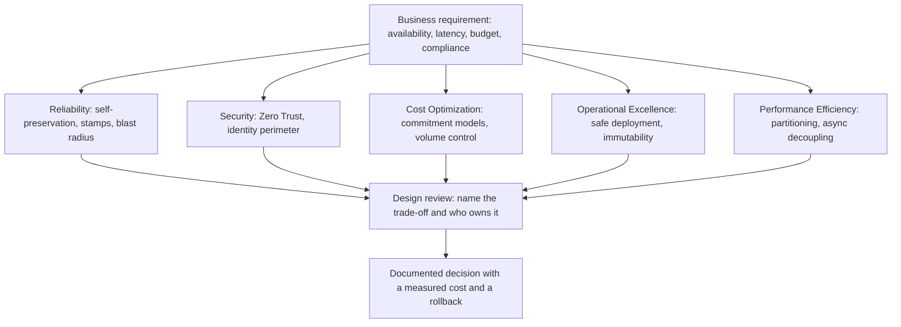
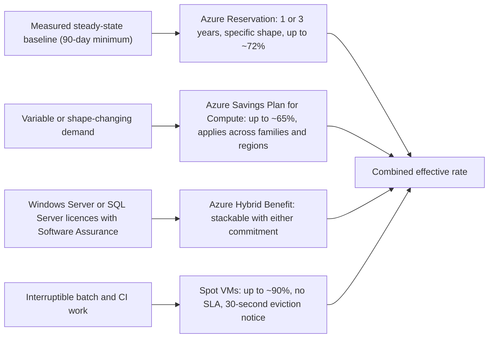
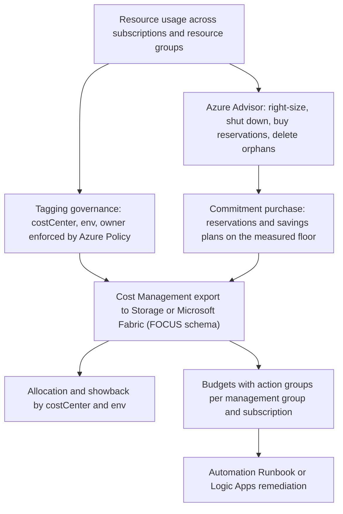
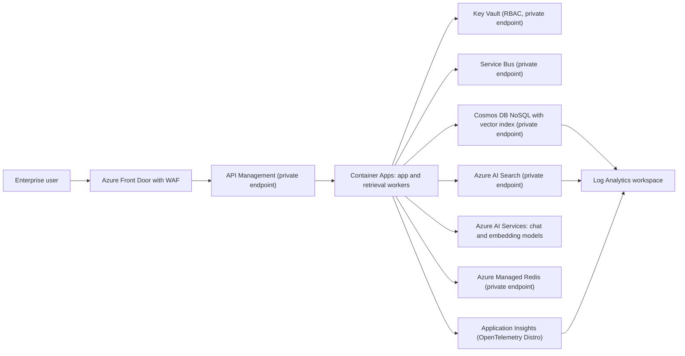
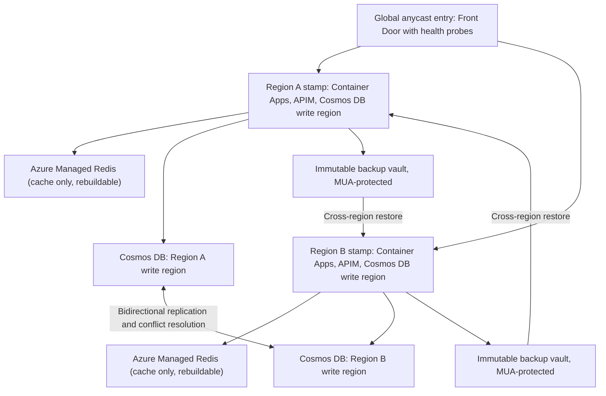

# Module 10: Well-Architected, FinOps, and Platform Evolution

The Azure Well-Architected Framework and FinOps are the two disciplines that turn a working deployment into a defensible one. The framework is how you argue that an architecture is fit for purpose; FinOps is how you keep it that way after the third quarter. This module applies the five pillars to real AZ-305 design reviews, works through Azure's commitment models and the cost traps that survive them, synthesises the production patterns from Modules 01–09, and then does the version-currency work: every place where Azure practice changed materially, what the old shape was, what the new shape is, and what breaks when the two are mixed. Provider-neutral Well-Architected and FinOps theory is owned by [`architecture/cloud-foundations`](../../../architecture/cloud-foundations/README.md) and its service-mapping table lives in [`architecture/cloud-foundations/MAPPING.md`](../../../architecture/cloud-foundations/MAPPING.md); this module covers only the Azure realisation and the decisions that are specific to it.

> [!NOTE]
> **Verified against** Azure CLI 2.93.0, Bicep 0.49.2, Terraform `hashicorp/azurerm` 5.14.0, Azurite 3.38.0, Node.js 26.13.0, and TypeScript 7.0.2 on 2026-11-20. Retirement dates, discount ceilings, and per-GB network fees are quoted from the Microsoft Learn pages cited inline; discount percentages and unit prices change and must be re-verified against the Azure pricing pages before being used in a business case.

---

## 1. The Azure Well-Architected Framework Applied to Design Reviews

The Azure Well-Architected Framework has five pillars: Reliability, Security, Cost Optimization, Operational Excellence, and Performance Efficiency. A design review is not a checklist run against the pillars in order. It is a search for the one or two places where the design has quietly traded a pillar it cannot afford to lose for a pillar nobody asked about.

### 1.1 What each pillar actually forbids

| Pillar | The question it answers | The failure it forbids |
| --- | --- | --- |
| **Reliability** | Does the system meet its availability and recovery targets under failure? | A single failure domain that is treated as if it were redundant |
| **Security** | Is the system protected, and is protection verifiable? | A trust boundary drawn in the wrong place, usually the network edge |
| **Cost Optimization** | Is every dollar buying a unit of value? | Paying for capacity nobody uses, and paying retail for capacity everybody uses |
| **Operational Excellence** | Can the system be deployed, observed, and rolled back safely? | A production change that cannot be undone and cannot be seen |
| **Performance Efficiency** | Does the system scale to demand without redesign? | A scaling limit that is architectural rather than a quota request |

### 1.2 Reliability: self-preservation, stamps, and blast radius

Azure's Reliability pillar adds three ideas that go beyond "add redundancy". The first is **design for self-preservation**: the system must degrade gracefully rather than fail completely. Concretely that means the application implements load shedding, timeouts on every outbound call, bulkheads between dependency paths, and retry budgets rather than unbounded retries — the theory is owned by [`architecture/distributed-systems`](../../../architecture/distributed-systems/README.md), and the Azure realisation is a `maxReplicas` ceiling on Container Apps, a `max_scale_set_size` on VMSS Flexible, a Service Bus `MaxDeliveryCount` that eventually dead-letters rather than retrying forever, and a Cosmos DB client configured to honour `x-ms-retry-after-ms` on a 429 instead of hammering.

The second is **cell-based deployment stamps**: deploy a complete, independent copy of the stack — the application, its data store, its cache, its configuration — as a unit, and route a partition of traffic to each. A stamp is the blast-radius boundary. When one stamp fails, only its partition is affected, and the recovery unit is a whole stamp rather than a list of individual resources. The cost is real: a stamp carries its own data store, which means cross-stamp queries become an application problem, and a small number of stamps leaves you with coarse-grained routing. Stamps are the reason a multi-tenant platform can promise 99.99 percent to a single tenant: the tenant's data lives in one stamp, and no other tenant's traffic can saturate it.

The third is **blast-radius isolation**, which is the general principle behind stamps. In Azure terms: put each environment in its own subscription so a policy mistake cannot reach production; put each workload in its own resource group so a deletion is scoped; put each tier in its own subnet so a network rule change is scoped; and put each tenant's data in its own Cosmos DB partition so a hot partition is scoped. The hierarchy of tenancy → subscription → resource group → resource is a set of nested blast radii, and the design decision is where to draw each one.

### 1.3 Security: Zero Trust and the identity perimeter

The Security pillar is stated as **Zero Trust**: assume breach, verify explicitly, and apply least privilege. The architectural consequence for Azure is that the perimeter moves from the network edge to the identity. A Zero Trust design on Azure looks like this in order: every workload authenticates with a managed identity rather than a credential; every authorization decision is an Azure RBAC role assignment at the narrowest scope, with data-plane roles separated from control-plane roles; every private PaaS access path is a Private Endpoint with a Private DNS zone rather than a service endpoint or a public endpoint with a firewall; every management plane action is behind Privileged Identity Management with an approval and an expiry; and every control-plane event is exported because the identity perimeter is only as auditable as the Activity Log.

This is where the Azure delta matters. A network perimeter is a boundary you can draw on a diagram; an identity perimeter is a set of role assignments you must enumerate, and the enumeration is the review artefact. The question that finds the real problem is not "is the VNet segmented" but "which principals hold a data-plane role on the production Cosmos DB account, at what scope, and are any of them standing rather than eligible".

### 1.4 Cost Optimization

The pillar's core discipline is that cost is a design property, not a finance property. Two levers dominate Azure: the rate you pay for compute, and the amount of data you move and ingest. Rate is managed by commitment models (§2.1). Volume is managed by architecture: choose the right service tier, right-size the compute, and stop paying for telemetry nobody reads. The most common Azure cost failure is not an over-provisioned VM — it is a verbose log category nobody turned off (§2.3).

### 1.5 Operational Excellence: safe deployment and immutable infrastructure

Operational Excellence on Azure means three things. **Safe deployment practices**: infrastructure as code with a what-if preview before every change, deployment slots or revisions with traffic splitting rather than in-place updates, Deployment Stacks with deny settings so the platform prevents drift, and a tested rollback path that is exercised before it is needed. **Immutable infrastructure**: never mutate a running VM or a container in place; replace it. Immutability is what makes a rollback a redeploy rather than a forensic exercise. **Observability by construction**: the Diagnostic Settings and the Application Insights resource are part of the template, not an afterthought, because an environment that was deployed without them cannot be debugged and cannot be audited.

### 1.6 Performance Efficiency: partitioning and asynchronous decoupling

The two mechanisms that matter in Azure are partitioning and asynchronous decoupling. **Partitioning** is how you scale a data tier: a Cosmos DB partition key that distributes RU/s evenly, a Service Bus partitioned namespace with sessions to serialise per key, an Event Hubs partition count that matches your consumer parallelism, and a SQL shard map when a single database is the ceiling. A partition key that concentrates traffic on one partition turns a scalable design into a single-threaded one, and the symptom — a 429 on writes while reads are fast — looks like a capacity problem rather than a modelling problem.

**Asynchronous decoupling** is how you absorb spikes without scaling the expensive tier. A queue between a fast producer and a slow consumer converts a latency problem into a backlog problem, which is cheaper and more visible. In Azure that is Service Bus or Storage Queues between tiers, Event Grid for fan-out, and Event Hubs for streaming. The design rule: a synchronous call chain across a tier boundary is a latency budget you have not written down.

### 1.7 Trade-off matrices

A design review needs the trade-offs made explicit, because the pillars pull in opposite directions and the conflict is resolved by a business decision, not by an architect's preference.

| Trade-off | The tension | How to resolve it |
| --- | --- | --- |
| **Reliability vs Cost** | Multi-region active-active roughly doubles the infrastructure bill for two extra nines of availability | Price the downtime from the SLO, not from the infrastructure. If an hour of outage costs less than a region of compute, buy one region and a tested recovery plan |
| **Security vs Performance** | Private Endpoints add a network hop and a DNS dependency; mTLS and token validation add latency; WAF inspection adds CPU | Encrypt and authenticate everything on the internal path, and put the inspection at the edge where the cost is one hop for all traffic. Measure the added latency; if it is under a millisecond it is not a trade-off |
| **Cost vs Performance Efficiency** | Reservations buy deep discounts for a fixed shape; the flexible alternatives cost more per hour | Commit to the baseline that is genuinely steady-state, and cover the variable remainder on-demand or Spot. Never commit to a shape you expect to change |
| **Reliability vs Operational Excellence** | More redundancy means more moving parts to deploy, observe, and roll back | Prefer platform-managed redundancy (zone redundancy, GZRS) over self-built redundancy (a second region you operate yourself) |
| **Security vs Operational Excellence** | Just-in-time access and MUA slow down legitimate operations | Reserve the friction for the destructive operations. Everything else should be a normal, fast, audited path |



---

## 2. Azure FinOps and Cost Engineering

Azure FinOps runs the three phases the FinOps Foundation defines, and the phases are continuous rather than sequential: **Inform** produces allocation and visibility, **Optimize** changes rates and usage, and **Operate** turns the result into governance that survives the next team.

| Phase | The Azure question | The artefact it produces |
| --- | --- | --- |
| **Inform** | Who spent what, on which resource, and why? | A Cost Management export to Storage or Fabric, tag-driven allocation by `costCenter` and `env`, and a showback report each team can read |
| **Optimize** | What is the cheapest correct shape for each unit of demand? | A commitment plan on the measured floor, a rightsizing backlog from Advisor, a table-plan decision per log category, and a Spot migration for interruptible work |
| **Operate** | What stops this recurring? | Budgets with action groups, Azure Policy that enforces tags and denies the expensive-by-default configurations, and a standing review cadence with an owner |

The failure mode is skipping Inform and going straight to Optimize: a team buys reservations against a bill it cannot attribute, commits to the wrong shape, and then spends the next year arguing about whose workload the wasted commitment belongs to.

### 2.1 Commitment models

Azure discounts compute through four mechanisms that stack in specific ways. Getting the stacking order right is worth more than any other single FinOps action, and getting it wrong wastes money silently.

| Mechanism | Term | Scope of application | Ceiling discount | Fits |
| --- | --- | --- | --- | --- |
| **Azure Reservations** | 1 or 3 years | A specific resource type and region, with instance-size flexibility across sizes in the same size group for VMs | Up to ~72% for 3 years | Steady-state workloads with a known shape: databases, always-on VMs, reserved capacity |
| **Azure Savings Plans for Compute** | 1 or 3 years | A committed hourly spend applied automatically across VM families, regions, and operating systems, plus App Service, Container Apps, Functions Premium, and Dedicated Host | Up to ~65% for 3 years | Workloads whose shape will change: a VM fleet that will migrate to containers, or a region that will move |
| **Azure Hybrid Benefit (AHB)** | Tied to licences with Software Assurance or subscription | Windows Server and SQL Server licences you already own, applied to Azure resources | Combined with a reservation or savings plan, up to ~80%+ | Windows and SQL estates that already own licences — this is the largest single lever in most enterprises |
| **Spot VMs** | None | Evictable capacity with no SLA | Up to ~90% | Stateless, fault-tolerant, interruptible work: batch, CI, rendering, and queue workers with checkpointing |

The arithmetic that decides between them is break-even utilisation. A discounted commitment is a floor you pay for whether you use it or not, so the commitment is cheaper than on-demand only when utilisation exceeds one minus the discount. For a 3-year reservation at 72 percent off, break-even is 28 percent of the hours in the term; for a savings plan at 65 percent off, it is 35 percent.

$$Utilisation_{break-even} = 1 - Discount$$

The practical rule: commit to the measured floor, not the average. Pull the last 90 days of utilisation per resource, take the minimum steady-state level that is genuinely always on, and commit to that. Everything above the floor runs on-demand, and the volatile tail runs on Spot where the workload tolerates eviction.

**Stacking order** is the part that trips teams up. AHB is a licence conversion, not a discount on the compute rate, so it combines with both Reservations and Savings Plans: apply the reservation or savings plan first to reduce the compute charge, then AHB removes the Windows or SQL licence component from what remains. What does not stack is a Reservation and a Savings Plan covering the same resource — the reservation applies first and the savings plan does not double-apply to usage the reservation already discounted, so an over-committed pair of both is pure waste. Reservations and savings plans also do not apply to Spot usage.

### 2.2 Reservation scope, exchange, and the cancellation fee

Three properties of a Reservation are routinely misunderstood and each of them costs money.

**Scope** is a property of the reservation, not of the discount. A reservation can be scoped to a single resource group, to a single subscription, or — with shared scope — to the whole billing enrollment so that any matching usage in any linked subscription consumes it. Shared scope is almost always right, because a reservation scoped to one resource group is wasted whenever that resource group has no matching running instance. The matching condition is resource type plus region plus, for VMs, the size group for instance-size flexibility.

**Instance-size flexibility** applies within a size group, not across a series. A reservation for a D-series size covers other sizes in the same size group; it does not cover an E-series size, and it does not cross regions. That is the boundary between a Reservation and a Savings Plan: the savings plan has no size-group constraint at all, which is why it survives an architecture change and the reservation does not.

**Exchange and cancellation are bounded.** A reservation can be exchanged for a different shape or region, but the exchange is not free of consequence: the new commitment must be of equal or greater value, and refunds are capped. A cancellation carries a cancellation fee computed on the remaining term, commonly quoted as up to 12 percent of what is left (verify against the current terms). This is why a commitment purchased for a workload that is about to be re-platformed is worse than paying on-demand: the exit cost is a percentage of money you already spent.

> [!TIP]
> **Reserve for the shape you cannot change, and plan for the shape you can.** A SQL database's vCore count, a reserved capacity for an analytics engine, and a steady VM fleet are reservation-shaped. A fleet that will move to containers, a region that will be consolidated, or a workload whose SKU family is under active review is savings-plan-shaped. The exchange path exists, but it constrains you to equal-or-greater value and it does not refund the time you held the wrong commitment.



### 2.3 Hidden Azure cost traps

The first invoice surprise is rarely a compute line. These are the traps that survive a commitment review.

**Cross-availability-zone data transfer is billed.** Traffic between zones in the same region is not free. A microservice design that spreads replicas across zones for availability and then has each replica call every other replica synchronously generates zone-crossing traffic on every request, and the network line item grows with traffic rather than with capacity. Keep synchronous chatter inside a zone where the consistency model allows it, and prefer asynchronous fan-out across zones.

**NAT Gateway charges a per-GB data-processing fee, and Private Endpoints charge per GB.** A NAT Gateway is billed for the gateway hours plus a data-processing charge per GB of traffic it processes — the commonly quoted figure is $0.045/GB (verify against the current pricing page, because this is the number that moves). A workload that pushes large volumes of outbound traffic through a NAT Gateway pays the processing fee on every GB. Private Endpoints carry a similar per-GB processed-data charge plus inbound and outbound data charges, so a high-throughput private PaaS integration is a network bill, not a compute bill.

**Log Analytics ingestion explodes from verbose categories and debug traces.** The default trap: enabling Diagnostic Settings with "all categories" on a storage account, a Key Vault, an Application Gateway, and an NSG, then leaving Application Insights at a verbose log level. The result is gigabytes per hour at Analytics-tier prices, and nobody notices until the bill. The fixes are the table plans from Module 09 — move verbose categories to Basic or Auxiliary — plus DCR transformations that drop rows at ingestion, plus a deliberate decision about which categories you actually need.

**Unattached Managed Disks and orphaned Public IPs are the classic leak.** A Managed Disk keeps billing when it is detached from a VM; a Standard SKU Public IP address bills when it is allocated, whether or not it is attached to anything. Both survive scale-in, both survive a failed deployment, and both survive a VM deletion if the disk was created separately. Azure Advisor flags both, but only if someone reads Advisor.

**Cosmos DB over-provisioned manual RU/s and cross-region egress.** Provisioned throughput billed at a flat hourly rate for RU/s you do not consume is the most common Cosmos DB waste: a database provisioned at 10,000 RU/s that peaks at 1,200 pays for the ceiling all month. Autoscale, or move to serverless for spiky workloads, and use a partition key that does not force you to provision to the worst partition. Then there is cross-region egress: every multi-region write and every cross-region read of a multi-region Cosmos DB account moves data between regions, and that is billed at standard egress rates. A four-region write configuration is four times the replication traffic of a single-region one.

> [!CAUTION]
> **A budget alert is not a spend cap.** Azure Budgets notify through an action group when a threshold is crossed; they do not stop a resource, throttle an API, or suspend a subscription. The only hard limit in Azure is a policy or a manual action. Wire the budget's action group to an Automation Runbook or a Logic Apps workflow that scales down or deallocates the offending resource group, and treat the notification as a trigger for automation rather than as a control.

### 2.3 FinOps tooling

**Cost Management exports** push amortised and actual cost data, on a daily or monthly schedule, to a Storage account or to Microsoft Fabric. Exports are the raw material for everything else: the amortised view spreads reservation and savings-plan purchases across the term they cover, which is what makes a per-team chargeback honest. Exports can be emitted in the **FOCUS** schema — the FinOps Open Cost and Usage Specification — which is a vendor-neutral column layout that lets one query run against Azure, AWS, and GCP billing data without rewriting it. FOCUS 1.x is the current generation; check the Cost Management documentation for the supported version before building a pipeline on a specific column set.

**Budgets with action groups** provide the alerting half. A budget is scoped to a management group, subscription, resource group, or a set of resources filtered by tag, and it evaluates on the actual and amortised cost. Attaching an action group turns a notification into a workflow.

**Azure Advisor** produces the cost recommendations that feed the backlog: right-size or shut down underutilised VMs, buy reservations for steady workloads, delete unattached disks and orphaned public IPs, and eliminate idle ExpressRoute circuits. Advisor's recommendations are a starting point, not a decision — a VM that looks idle at the monthly average may be a month-end batch host, and a reservation recommendation based on 30 days of history will happily recommend a 3-year commitment for a workload that is being decommissioned.

**Tagging governance** is the prerequisite for all of it. Cost cannot be attributed to a team without a tag, and tags cannot be relied on without enforcement. Azure Policy enforces this with the `Modify` or `Append` effect to add missing tags on create, `Deny` to reject untagged resources, and `Audit` to report drift. Enforce the three that make chargeback and ownership possible: `costCenter` for the budget, `env` for the environment, and `owner` for the person who gets the call. Inherit them from the resource group where you can, so a team cannot opt out by forgetting a flag.



---

## 3. Practical Production Patterns

### 3.1 Zero-Trust private web with an AI RAG platform

The pattern that recurs across enterprise engagements is a private web front end plus a retrieval-augmented generation platform, and every element of it is a decision from an earlier module. The shape:

- **Ingress.** Azure Front Door with WAF at the global edge, in front of a private-origin Application Gateway or directly in front of Container Apps with a Private Endpoint. Public network access on the origin is disabled, so the only path to the application is through the front door.
- **API tier.** API Management in a VNet with a Private Endpoint, applying authentication, rate limiting, token limits for model calls, and request and response validation. APIM is the single enforcement point for the API contract, which means the backend services can trust the caller identity it asserts.
- **Application tier.** Container Apps in a dedicated workload profile with a user-assigned managed identity, KEDA scaling on the queue depth, and VNet integration for outbound calls. Every secret comes from Key Vault through a Key Vault reference; nothing is in an app setting or an image layer.
- **Data tier.** Cosmos DB for NoSQL with a vector index for retrieval, Azure AI Search for hybrid BM25 plus vector plus semantic ranking, and Azure Cache for Redis or Azure Managed Redis for the hot path. All three are reached through Private Endpoints with `privatelink.*` Private DNS zones linked to the application VNet — the failure mode from Module 04 is a missing zone link, which makes the FQDN resolve to the public IP and works from a laptop while failing from the VNet.
- **AI tier.** An Azure AI Services account fronting the model deployment, with Defender for AI Services enabled for prompt-injection and data-exfiltration detection, and a separate managed identity per workload so that a compromised retrieval path cannot reach the embedding model.
- **Observability.** Application Insights with the OpenTelemetry Distro, distributed trace correlation across the APIM call, the Service Bus hop, the Cosmos DB query, and the model invocation, plus an availability test that exercises the full RAG path rather than just the health endpoint.
- **Governance.** Azure Policy denying public network access on PaaS, denying storage accounts without private endpoints, requiring tags, and denying Key Vaults without purge protection. PSRule for Azure in CI, and Deployment Stacks with deny settings so the pipeline cannot drift.



### 3.2 Multi-region active-active mission-critical stamp

The mission-critical pattern is a cell-based stamp deployed in two or more regions, both active, with the data tier replicated. The design points that make it work are not the replication; they are the routing and the failure detection.

- **Routing.** Front Door or Traffic Manager in front of both stamps, with health probes that exercise a real dependency rather than a static path. A health probe that returns 200 from a static file keeps routing traffic to a stamp whose database is gone.
- **Data.** Cosmos DB multi-region writes with a conflict-resolution policy and a partition key that keeps writes for a given tenant in one region, or a partitioned design where each region owns a slice of the keyspace. The second option avoids conflict resolution entirely and is the better choice when the application can be partitioned.
- **State.** Redis is a cache, not a source of truth; a stamp must be able to lose its cache and rebuild. Anything that must survive a stamp loss belongs in the replicated data tier.
- **Deployment.** Deploy to one region, verify, then to the other — never both at once, because a simultaneous rollout doubles the blast radius of a bad build and removes your rollback target.
- **Backup.** Each region has its own immutable, MUA-protected backup vault with cross-region restore enabled, per Module 09.



---

## 4. "Then vs Now": Migration Matrix

Nine shifts account for most of the Azure practice change a practitioner meets in an existing estate. Each row gives the date range, the driver, the migration steps, and the specific failure caused by mixing the old and the new.

| Domain | "Then" (date range) | "Now" (as of 2026-11-20) | Migration steps and mixing pitfalls |
| --- | --- | --- | --- |
| **Certification path** | AZ-204 Developing Solutions for Microsoft Azure; skills measured until retirement on 2026-07-31 | **AI-200** Developing AI Cloud Solutions on Azure; skills measured 2026-10-07, leading to Azure AI Cloud Developer Associate | Re-map AZ-204 domains to the four AI-200 domains. Pitfall: studying containerised Azure and observability as if they were still the whole exam — AI-200 adds vector search, RAG, and KEDA on Container Apps, and the data-management domain carries the largest weight |
| **VNet egress** | Implicit Default Outbound Access: new VMs and scale sets got outbound connectivity automatically through a platform-assigned address | **Private subnets by default plus NAT Gateway**: Default Outbound Access retirement is effective 2026-03-31 for VNets created with the Network API version released after 2026-03-31 (or in the Azure Portal); earlier API versions (including `2025-07-01`) retain the legacy default unless `defaultOutboundAccess: false` is set explicitly | Create or attach a NAT Gateway (or a Standard Load Balancer outbound rule, or a public IP) to every subnet that needs egress, and confirm package-manager and licensing endpoints are reachable. Pitfall: a VNet created before the retirement keeps the old behaviour while a new VNet in the same subscription does not, so an environment that works in one resource group fails in another with a timeout on outbound calls |
| **Governance packaging** | **Azure Blueprints**: a service packaging resource groups, ARM templates, policy assignments, and role assignments into a versioned, assignable blueprint | **Deployment Stacks plus Bicep plus Policy initiatives**: Blueprints phased retirement began 2026-07-31 and the service retires on 2027-01-31 | Convert blueprint artifacts into Bicep resources (Policy assignments, role assignments, and nested deployments) stored in Template Specs, then create a Deployment Stack with `denySettings`. Pitfall: a Blueprint Operator assignment only worked with a user-assigned managed identity, and any authenticated principal in the tenant could read blueprint definitions — never assume blueprint parameters were private. Mixing an active blueprint assignment with a stack that manages the same resources produces two owners fighting over the same objects |
| **Key Vault authorization** | **Vault access policies**: vault-wide permission bundles, no object-level scoping | **Azure RBAC for Key Vault**: role assignments at any scope including a single secret, with PIM support | Set `enableRbacAuthorization: true`, then create role assignments such as `Key Vault Secrets User` at `<vault-id>/secrets/<name>`. Pitfall: the switch ignores every existing access policy, so any workload holding only a policy starts failing with HTTP 403. Switching also requires unrestricted `Microsoft.Authorization/roleAssignments/write`, and a `Key Vault Data Access Administrator` with an ABAC condition cannot do it |
| **Serverless runtime** | **Functions in-process** .NET class libraries coupled to the Functions runtime; support ends 2026-11-10 | **Isolated worker model** with `Microsoft.Azure.Functions.Worker`, plus **Flex Consumption** as the default serverless plan | Migrate to the isolated worker model, which on Functions 4.x supports .NET 8 through .NET 11 and .NET Framework 4.8; in-process is capped at .NET 8. Pitfall: .NET 10 and later cannot run on Linux in the Consumption plan, so a Linux in-process app must move to Flex Consumption as part of the same change. OpenTelemetry custom telemetry is not supported for in-process C# apps, so an app relying on it must migrate before it can use the distro |
| **Caching** | **Azure Cache for Redis** Basic, Standard, and Premium tiers (and the Enterprise tiers) | **Azure Managed Redis**; retirement has been announced for all Azure Cache for Redis SKUs, with per-tier migration guides published | Follow the published migration for the tier in use, noting that Enterprise and Enterprise Flash migrate differently from Basic, Standard, and Premium. Pitfall: the old tiers are not feature-equivalent — the Basic tier has no SLA and no zone redundancy, and the Enterprise tiers are the only ones with Redis modules — so a "like for like" migration plan silently changes the availability and feature contract. Verify the current retirement date in the retirement FAQ before scheduling |
| **Monitoring agents** | **Log Analytics agent** (MMA / OMS) configured through workspace-level settings; retired 2024-08-31 | **Azure Monitor Agent** with **Data Collection Rules**, plus the **Azure Monitor OpenTelemetry Distro** for applications | Deploy AMA through the `Microsoft.Azure.Functions` or VM extension, create a DCR per data source with a destination and an ingestion-time KQL transformation, and migrate app instrumentation to the distro. Pitfall: running both agents double-counts and double-bills the same counters, and workspace-level agent configuration edits silently stop applying |
| **VM Scale Sets** | **Uniform orchestration**: identical instances managed as one model, no mixed SKUs or purchase options | **Flexible orchestration**: individually addressable instances, mixed sizes, Spot and on-demand in one group via a priority mix policy | Create the scale set with `orchestrationMode: Flexible` and migrate instances, or recreate. Pitfall: Uniform and Flexible are different resource shapes with different API surfaces, so automation written against Uniform properties fails on Flexible rather than degrading |
| **Load Balancer** | **Basic Load Balancer**, free, no SLA, open to inbound by default | **Standard Load Balancer** (and Gateway Load Balancer); Basic retired 2025-09-30 | Use the published Basic-to-Standard upgrade guidance, which is a create-new-and-migrate path rather than an in-place SKU change. Pitfall: Standard is closed to inbound by default and requires an NSG that explicitly permits traffic, so an upgraded environment that worked immediately on Basic goes dark until the NSG rules are written |

### 4.1 The egress change in detail

The Default Outbound Access retirement is the shift with the widest blast radius, because it changes a default rather than deprecating a feature. VNets created with the Network API version released after 2026-03-31 (or created in the Azure Portal) default to private subnets with no implicit outbound path; earlier API versions (including `2025-07-01`) retain the legacy default unless `defaultOutboundAccess: false` is set explicitly. A VM in such a subnet has no route to the internet: no package installs, no licence activation, no extension downloads, no calls to public PaaS endpoints that are not behind a private endpoint.

The remediation is explicit outbound capacity in every subnet that needs it. A NAT Gateway gives predictable SNAT ports and a stable outbound IP for allowlisting, at the cost of the per-GB data-processing fee. A Standard Load Balancer outbound rule is the alternative when the traffic is already load-balanced. A public IP on the VM is the last resort, because it exposes the instance directly.

The mixing pitfall is the sharpest edge here: an existing VNet created before the retirement keeps the old behaviour, so the same Bicep module deployed to a new subscription or a new resource group behaves differently from the one deployed to the old one. The pipeline passes, the tests pass against the old VNet, and the new environment fails on the first outbound call. The fix is to test egress from a freshly created VNet in CI, not from a pre-existing one.

### 4.2 The Functions migration in detail

The in-process model's coupling is the reason for the change: in-process code runs inside the Functions host process, which pins it to the host's .NET version and prevents it from using the isolated worker's OpenTelemetry support. The migration is not a configuration change. It is a project-model change: replace `Microsoft.NET.Sdk.Functions` with the `Azure.Functions.Sdk` project SDK and a `Microsoft.Azure.Functions.Worker` package reference, convert the trigger attributes to the worker's `Function` attribute model, replace the injected `ILogger` with the worker's `FunctionContext` logging, and convert any custom Application Insights telemetry to the OpenTelemetry exporter.

Two traps follow. First, the `FUNCTIONS_INPROC_NET8_ENABLED` setting is a compatibility flag, not a migration: it makes an in-process app run on .NET 8 inside the 4.x runtime while support for the whole in-process model ends on 2026-11-10. Second, the plan change is coupled to the runtime change on Linux: .NET 10 and later cannot run on Linux in the Consumption plan, so a Linux app targeting a current .NET must move to Flex Consumption as part of the same migration, which also changes the cold-start and scaling behaviour you have already tuned.

### 4.3 The Key Vault authorization change in detail

The access-policy model predates the generalisation of RBAC to data planes. It cannot express "this service reads this one secret", so teams that needed isolation created one vault per consumer, which multiplies vaults, complicates rotation, and makes a security review an inventory exercise. The RBAC model expresses it directly, at the cost of requiring an authorization change on the vault that takes effect immediately and ignores everything previously granted.

The migration is a translation exercise, and the safe order matters: enumerate the existing access policies with `az keyvault show --query properties.accessPolicies`, translate each entry into the narrowest role assignment that covers the same operations, deploy those assignments, verify a representative workload can still read and write, and only then set `enableRbacAuthorization: true`. Because the flag change is itself an authorization operation requiring unrestricted role-assignment write access, it is usually performed by a different identity than the one that owns the workload — which is a feature, because it forces a review, and a hazard, because it makes the change slow enough that teams skip it and run on a model that cannot express least privilege.

---

## 5. Azure Platform and Tooling Version History

The milestones below are the ones a practitioner meets in an existing estate, ordered by date.

| Date | Component | Milestone | Why it matters |
| --- | --- | --- | --- |
| **2014-04** | Azure Resource Manager | ARM becomes the control plane for new services | Replaced the classic Azure Service Management model; introduced resource providers, API versions, deployment scopes, and template-based deployment |
| **2018** | Azure Blueprints | Preview, then general availability | The first attempt at packaging governance into an assignable, versioned artefact; now retiring |
| **2020-12** | Azure Key Vault | Soft delete becomes mandatory | Made vault deletion recoverable inside a retention window, which is the root of the IaC recreate lockout |
| **2021** | Azure Monitor Agent | Preview, later the replacement for the Log Analytics agent | Moved collection configuration from the workspace into Data Collection Rules, enabling transformations and scoped targeting |
| **2023** | Azure Deployment Stacks | General availability | Brought lifecycle management and deny settings to ARM deployments, replacing the governance gap Blueprints had filled |
| **2024-08-31** | Log Analytics agent (MMA / OMS) | Retired | Removed the old collection path; environments still running it have an unsupported telemetry plane |
| **2025-09-30** | Basic Load Balancer | Retired | Removed the free, SLA-less, open-by-default load balancer; Standard is the only supported SKU |
| **2025** | Azure Monitor OpenTelemetry Distro | The supported Application Insights instrumentation path | Made Azure telemetry standard OpenTelemetry, so the same instrumentation can be exported elsewhere |
| **2026-03-31** | Default Outbound Access | Retirement effective for the Network API version released after 2026-03-31 (earlier APIs retain the legacy default unless `defaultOutboundAccess: false` is set explicitly) | Changed the default egress behaviour of new VNets; the single widest-blast-radius change in this table |
| **2026-06-02** | Cosmos DB vNext emulator | General availability, with ARM64 support | Made local Cosmos DB development viable on Apple Silicon, replacing a container-only or cloud-only workflow |
| **2026-07-01** | Azure Functions Core Tools | 4.16.1 | Pinned local Functions runtime; in-process projects must reference `Microsoft.NET.Sdk.Functions` 4.5.0 or later or `func start` errors |
| **2026-07-31** | AZ-204 | Retired | Ended the previous developer certification path; AI-200 is the successor |
| **2026-07-31** | Azure Blueprints | Phased retirement begins | Started the migration window to Deployment Stacks and Template Specs |
| **2026-09-30** | (Reference point) | Current stable toolchain snapshot | Azure CLI 2.93.0, Bicep 0.49.2, `hashicorp/azurerm` 5.14.0, Azurite 3.38.0 |
| **2026-10-07** | AI-200 | Skills measured update | The current exam content for Azure AI cloud development, replacing AZ-204's scope |
| **2026-11-10** | Azure Functions in-process model | Support ends | The hard deadline for the isolated worker migration |
| **2026-11-20** | Toolchain | PSRule for Azure 1.47.0, Node.js 26.13.0, TypeScript 7.0.2 | The verification baseline for this track |
| **2027-01-31** | Azure Blueprints | Full retirement | After this date, blueprint definitions and assignments are no longer supported |

> [!IMPORTANT]
> **Toolchain drift is a reliability risk, not a cosmetic one.** Bicep, the Azure CLI, and the azurerm provider move on independent cadences, and a Bicep type or an azurerm argument can change between a local run and a pipeline run if the versions are not pinned. Pin the Azure CLI, Bicep, Terraform, and every provider in `.mise.toml` and `mise.lock` inside the track, and run the same pinned versions in CI. A version that is unpinned in CI is a version that will change without a commit.

---

## 6. Verification and Reproducibility

The FinOps and Well-Architected behaviours in this module that can be checked offline are the ones with deterministic arithmetic: break-even utilisation for each commitment model, the combined rate when a reservation and Azure Hybrid Benefit stack, composite SLA arithmetic for series and parallel compositions, stamp capacity planning, and the cost comparison between Analytics, Basic, and Auxiliary table plans for a given ingestion mix. The executable proofs in `technologies/azure/examples/08-keyvault-monitor-and-bcdr.test.ts` and the track's remaining suites must model these as pure functions and check edge cases such as a utilisation exactly at the break-even point, a commitment that covers more capacity than the workload can consume, and a series chain that falls below its target.

Behaviours that need Azure cannot be proven locally: actual reservation discount application, savings-plan attribution across services, budget action-group execution, Advisor recommendation accuracy, and every failover path. Verify those in a sandbox subscription with the pinned Azure CLI, using `az consumption reservation list` and `az cost management query` to confirm what a commitment actually applied to, and a scheduled Site Recovery test failover to confirm the recovery plan runs.

```bash
cd technologies/azure
mise install
mise exec -- npm ci
mise exec -- npm test
mise exec -- npm run typecheck
```

Offline gates that belong in the same pipeline: PSRule for Azure against the Bicep and ARM templates, `terraform test` with `mock_provider "azurerm"`, and Conftest or OPA policies asserting that no resource is deployed without the required tags, that no Key Vault uses access policies, and that no subnet lacks an outbound path.

---

## Interview Drill

These questions are written for an experienced interviewer. Each model answer names the mechanism, the failure it prevents, and the check you would run.

### Q1. An AZ-305 design proposes two regions behind Front Door, each running the full stack, with a single-write Azure SQL database and a read-only secondary. The stated target is 99.999 percent. Assess the design and state what you would change.

<details><summary>Model Answer</summary>

The claim does not survive the arithmetic. The two regions are in series at the data layer, because a single-write database means every write and every read-write transaction goes through the primary; the secondary only serves reads. The correct model is therefore one series chain — Front Door, application tier, and the database's write path — plus a parallel pair of regions only for the read path. $0.9999 \times 0.9995 \times 0.9999 \approx 0.9993$, so the honest figure is about 99.93 percent for write availability, with a documented RTO for a failover. To reach 99.999 percent the data tier must be able to accept writes in both regions: Cosmos DB multi-region writes with a conflict-resolution policy, or a partitioning scheme where each region owns a disjoint slice of the keyspace and the router directs writes accordingly. I would also ask what the health probe actually tests, because a probe that returns 200 from a static path will keep routing to a stamp whose database is unreachable, and I would ask for a measured failover RTO from a drill rather than an estimate.

</details>

### Q2. A workload runs 400 VMs at a steady 60 percent average CPU. The CFO wants a 50 percent compute reduction. What do you commit to, and how do you compute it?

<details><summary>Model Answer</summary>

I would not commit to the average. Pull 90 days of utilisation and find the measured floor — the level that is genuinely always on — and commit to that with a 3-year Azure Reservation, which reaches up to ~72 percent for a fixed shape. Break-even utilisation is one minus the discount, so at 72 percent off the commitment is cheaper than on-demand from 28 percent utilisation upward; a steady 60 percent average with a floor well above 28 percent clears it comfortably. If the VM shape is expected to change over the term, I would use an Azure Savings Plan for Compute instead, which reaches up to ~65 percent and applies automatically across VM families, regions, and operating systems, plus App Service, Container Apps, Functions Premium, and Dedicated Host. If the estate is Windows Server or SQL Server with Software Assurance, I would apply Azure Hybrid Benefit on top, which stacks with either commitment and pushes the combined saving past 80 percent. The variable remainder above the floor stays on-demand, and any interruptible batch moves to Spot for up to ~90 percent. What I would not do is commit to the peak, and I would verify the actual applied discount with `az consumption reservation list` after purchase rather than trusting the pricing calculator.

</details>

### Q3. Your Log Analytics bill is the largest line item in the subscription and nobody can explain it. Walk through the diagnosis and the three changes you make.

<details><summary>Model Answer</summary>

Diagnose with the `Usage` table, which reports billable ingestion by solution and data type over the last 31 days, and confirm with a `summarize count() by SourceTable` over the last 24 hours. The three changes follow from what that shows. First, change table plans: move the verbose, incident-only categories — per-service storage logs, NSG flow logs, Container Apps console logs — from the Analytics plan to Basic, which reduces ingestion cost and moves to pay-per-query, or to Auxiliary for audit data you query once a quarter, accepting that Auxiliary removes alerting, dashboards, data export, and restore and that queries are slower. Keep security and operational signal in Analytics. Second, reduce at ingestion with Data Collection Rule transformations, which run KQL before the row is billed, dropping columns and rows that will never be queried. Third, stop the double collection: audit for the retired Log Analytics agent coexisting with the Azure Monitor Agent on the same machine, because that bills the same counters twice. I would also check whether Sentinel is onboarded to the same workspace, because Sentinel bills ingestion on the same data, and whether an availability test or a verbose log level is generating traffic nobody asked for.

</details>

### Q4. A Key Vault uses access policies and a new service must read exactly one of forty secrets. Describe the change, the ordering, and the failure you are preventing.

<details><summary>Model Answer</summary>

An access policy is a vault-wide permission bundle, so the current model cannot express "read one secret" — the finest granularity is a principal that can get every secret in the vault. The change is to enable Azure RBAC on the vault with `enableRbacAuthorization: true` and then assign `Key Vault Secrets User` scoped to `<vault-id>/secrets/<name>`, which is an ordinary role assignment and can also be made eligible through PIM. The ordering is what prevents the failure: enumerate the existing access policies, translate each into the narrowest role assignment covering the same operations, deploy the assignments, verify a representative workload still reads and writes, and only then flip the flag. The failure being prevented is the silent lockout, because once RBAC is enabled every access policy is ignored and any workload authenticating with a principal that holds only a policy starts failing with HTTP 403 on its next secret read. Two constraints to plan for: the flag change requires unrestricted `Microsoft.Authorization/roleAssignments/write`, so a `Key Vault Data Access Administrator` carrying an ABAC condition cannot perform it, and the reverse switch is equally destructive.

</details>

### Q5. A pipeline ran `terraform destroy` then `apply` on a purge-protected Key Vault and the apply failed with a conflict. What state is the vault in, what are the two exits, and what design change prevents recurrence?

<details><summary>Model Answer</summary>

The vault is soft-deleted: it still exists, scheduled for permanent deletion at the end of a retention window that is between 7 and 90 days with a default of 90, and purge protection blocks purging it before then. The create fails with HTTP 409 Conflict, surfaced as `VaultAlreadyExists`, and the secret-level equivalent fails with `SecretDeleted`. The first exit is to recover the soft-deleted vault with `az keyvault recover` and let the IaC tool reconcile its properties — note that Terraform's azurerm provider does this by default through `features.key_vault.recover_soft_deleted_key_vaults`, so the apply can succeed while silently re-establishing the pre-deletion permission model, network ACLs, and flags, which then have to be reconciled deliberately. ARM and Bicep have no recovery behaviour at all. The second exit is to accept the name as unusable for the retention window and deploy under a new unique-suffixed name. The design change that prevents recurrence is to stop destroying production vaults: a `CanNotDelete` resource lock on the resource group, Deployment Stacks deny settings so the pipeline itself cannot delete it, and a pre-deployment name check in CI, because a typo'd name with purge protection enabled is a 90-day outage window.

</details>

### Q6. Compare Azure Reservations, Azure Savings Plans for Compute, Azure Hybrid Benefit, and Spot VMs on what they commit you to, and state which two stack.

<details><summary>Model Answer</summary>

A Reservation commits you to a specific resource type in a specific region for one or three years, with instance-size flexibility across sizes in the same size group for VMs, and reaches up to ~72 percent — the deepest discount and the least flexibility. A Savings Plan for Compute commits you to an hourly spend for one or three years, which the platform applies automatically across VM families, regions, and operating systems and across App Service, Container Apps, Functions Premium, and Dedicated Host, reaching up to ~65 percent — less deep, far more flexible, and the right choice when the shape will change. Azure Hybrid Benefit is not a commitment at all: it converts Windows Server and SQL Server licences you already own under Software Assurance or subscription into an Azure discount, and it is the largest single lever in most enterprises. Spot VMs are not a commitment either: they are evictable capacity at up to ~90 percent off with no SLA and a 30-second eviction notice, fit only for stateless, checkpointed, interruptible work. The two that stack are Hybrid Benefit with either a Reservation or a Savings Plan: apply the commitment first to reduce the compute charge, then AHB removes the licence component from what remains. What does not stack is a Reservation and a Savings Plan covering the same resource — the reservation applies first and the savings plan does not double-apply — so holding both over-committed is pure waste. Neither applies to Spot usage.

</details>

### Q7. A new VNet created last month has VMs that cannot reach the internet, while an identical VNet created two years ago works. Explain the mechanism and the remediation.

<details><summary>Model Answer</summary>

The newer VNet was created with the Network API version released after 2026-03-31 (or in the Azure Portal) and therefore defaults to private subnets with no implicit outbound path, because Default Outbound Access retired effective 2026-03-31 (earlier API versions, including `2025-07-01`, retain the legacy default unless `defaultOutboundAccess: false` is set explicitly). The older VNet predates the change and keeps the legacy behaviour of a platform-assigned outbound address, which is why identical templates behave differently in the same subscription. The remediation is explicit outbound capacity in every subnet that needs it: a NAT Gateway, which gives predictable SNAT ports and a stable outbound IP for allowlisting but charges a per-GB data-processing fee on top of the gateway hours; a Standard Load Balancer outbound rule when the traffic is already load-balanced; or a public IP on the VM as a last resort. The mixing pitfall is that a pipeline testing egress against a pre-existing VNet passes while a fresh environment fails on the first outbound call, so egress must be tested from a VNet created in CI rather than one that predates the change. Also budget for the private path: Private Endpoints carry their own per-GB processed-data charge, so a high-throughput private PaaS integration is a network bill rather than a compute bill.

</details>

### Q8. An estate runs the Log Analytics agent, Functions in-process apps, Basic Load Balancers, Azure Cache for Redis Basic and Premium, and Azure Blueprints. Prioritise the remediation and justify the order.

<details><summary>Model Answer</summary>

I would order by the date of the hard stop, then by blast radius. First, the Log Analytics agent, retired 2024-08-31: it is already unsupported, so the telemetry plane has no security path, and every workspace-level configuration edit in the runbooks is silently inert. Migrate to the Azure Monitor Agent with Data Collection Rules, and make sure the two agents are not both collecting the same counters, because that double-bills. Second, the Functions in-process model, with support ending 2026-11-10 — the nearest hard deadline. This is a project-model change to the isolated worker, and on Linux it is coupled to a plan change because .NET 10 and later cannot run on Linux in the Consumption plan, so those apps must move to Flex Consumption in the same migration. Third, Azure Blueprints, whose phased retirement began 2026-07-31 and completes 2027-01-31: convert artifacts to Bicep resources in Template Specs and create Deployment Stacks with deny settings, and remember that Blueprint Operator assignments only worked with a user-assigned managed identity and that blueprint definitions were readable by any authenticated principal in the tenant. Fourth, the Basic Load Balancers, retired 2025-09-30: use the published upgrade path, and write the NSG rules before cutover because Standard is closed to inbound by default and will go dark without them. Fifth, Azure Cache for Redis, where retirement has been announced for all SKUs: schedule the tier-appropriate migration to Azure Managed Redis, and check the feature contract, because the Basic tier had no SLA and no zone redundancy and the Enterprise tiers were the only ones with Redis modules.

</details>
