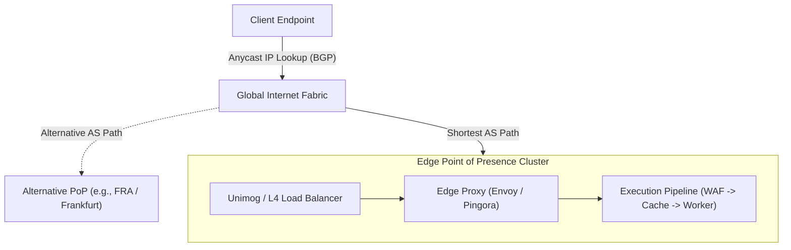
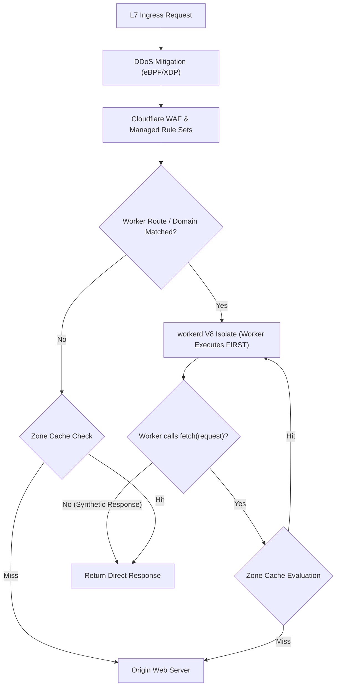
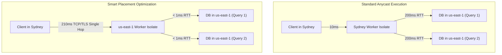

# Module 01: Edge Model and Request Lifecycle

The Cloudflare Workers execution platform departs fundamentally from conventional origin servers and containerized microservices. Rather than dispatching incoming HTTP traffic to localized availability zones or autoscaling clusters of Linux virtual machines, Cloudflare terminates and processes requests directly within its globally distributed border routing fabric. Understanding this model requires analyzing BGP Anycast ingress mechanics, data center dispatch pipelines, isolate lifecycle boundaries, and the asynchronous primitives that govern edge request lifecycles.

---

## 1. BGP Anycast Routing and Edge Topology

At the network layer, every Cloudflare Point of Presence (PoP)—spanning more than 300 cities across 100+ countries—announces the identical IP prefix ranges via Border Gateway Protocol (BGP) Anycast (RFC 4786). When a client initiates a DNS resolution for an Anycast-routed domain, the returned A/AAAA records point to this shared Anycast IP block.



### Ingress Packet Dispatch

1. **Topological Routing**: Intermediate Tier 1 and Tier 2 transit providers route client IP packets along the shortest Autonomous System (AS) path directly to the physically or topologically closest Cloudflare edge router.
2. **L4 Ingress (Unimog)**: Incoming TCP SYN packets arrive at edge switch fabrics and are distributed across a cluster of bare-metal Linux servers running Cloudflare's proprietary Layer 4 load balancer (_Unimog_). Unimog uses consistent hashing with connection tracking to distribute packets across server cores without terminating TCP state.
3. **L7 Ingress**: The connection terminates at Cloudflare's Layer 7 reverse proxy layer (_Pingora_), where TLS 1.3 handshakes, SNI inspection, and ALPN negotiations (HTTP/2 or HTTP/3 over QUIC) occur.

---

## 2. Ingress Pipeline Order: WAF, Cache, and Worker Dispatch

Incoming Layer 7 HTTP requests flow through a deterministic sequence of edge subsystems before reaching user code. Modifying this pipeline requires understanding product evaluation precedence.



### Pipeline Precedence Rules

- **L3/L4 Protection & Edge DDoS**: Evaluated immediately in the Linux kernel via eBPF/XDP filters. Malicious volumetric floods are dropped before socket allocation.
- **Web Application Firewall (WAF)**: Evaluates URI path, payload headers, client IP threat score, and OWASP rule sets. If a request triggers a `BLOCK` or `MANAGED_CHALLENGE` action, it terminates prior to executing Worker logic.
- **Zone HTTP Cache**: By default, standard static assets (images, stylesheets, fonts) evaluate against the zone cache. However, when a Worker is bound via a Route pattern (e.g., `example.com/*`), the Worker executes **before** the zone cache, granting user code total programmatic authority over cache lookups, header mutations, and bypass criteria.
- **Custom Domains vs Routes vs `workers.dev`**:
  - `workers.dev`: Cloudflare-hosted shared domain providing serverless isolate execution without an attached Cloudflare Zone. Zone CDN features (such as Page Rules and automatic cache rules) are bypassed.
  - **Routes** (`zone.com/api/*`): Injects Worker execution into an existing DNS zone.
  - **Custom Domains**: Associates a first-class hostname directly with a Worker, generating DNS CNAME records and managed SSL/TLS certificates automatically.

---

## 3. The `fetch` Handler and Execution Context

Modern Cloudflare Workers follow ECMAScript Module (ESM) syntax. The core entrypoint is the `fetch` handler, receiving the incoming HTTP `Request`, the environment bindings container (`Env`), and the `ExecutionContext`.

```typescript
export interface Env {
  CACHE_KV: KVNamespace;
  API_SECRET: string;
}

export default {
  async fetch(request: Request, env: Env, ctx: ExecutionContext): Promise<Response> {
    const url = new URL(request.url);

    // Early termination / Validation
    if (request.method === 'POST' && !request.headers.has('Content-Type')) {
      return new Response('Missing Content-Type Header', { status: 400 });
    }

    // Execute background telemetry without blocking response return
    ctx.waitUntil(logRequestTelemetry(request.headers.get('cf-ray'), url.pathname, Date.now()));

    // Pass-through failover safety
    ctx.passThroughOnException();

    return new Response(
      JSON.stringify({ status: 'healthy', region: request.cf?.colo ?? 'UNKNOWN' }),
      {
        headers: { 'Content-Type': 'application/json' },
      },
    );
  },
};

async function logRequestTelemetry(
  cfRay: string | null,
  path: string,
  timestamp: number,
): Promise<void> {
  // Simulates asynchronous logging to remote analytics sink
  await fetch('https://telemetry.internal/collect', {
    method: 'POST',
    body: JSON.stringify({ cfRay, path, timestamp }),
    headers: { 'Content-Type': 'application/json' },
  });
}
```

---

## 4. Asynchronous Request Lifecycles: `ctx.waitUntil()` and `ctx.passThroughOnException()`

### The `ctx.waitUntil()` Contract

In traditional long-lived server processes (such as Node.js or Go), background tasks can be spawned asynchronously by detaching promises or goroutines. In an isolate-based edge runtime, returning a `Response` signals that the client transaction has concluded. If an asynchronous operation is in flight and is not awaited, `workerd` suspends or destroys the isolate, abruptly terminating pending promises.

`ctx.waitUntil(promise: Promise<unknown>)` extends the operational lifetime of the isolate invocation:

- The HTTP response stream flushes to the client immediately without waiting for the background promise.
- The isolate remains active until every promise passed to `ctx.waitUntil()` resolves or rejects.
- Platform constraints: Background execution in `waitUntil` is subject to a strict 30-second post-response wall-clock timeout and standard CPU quota limits.

### Fail-Open Resilience: `ctx.passThroughOnException()`

For critical zero-downtime routing, `ctx.passThroughOnException()` modifies the runtime error boundary:

- If unhandled JavaScript exceptions occur within the Worker (such as an unhandled null dereference or syntax crash), Cloudflare catches the fault, suppresses the generic Error 1101 page, and transparently proxies the original client HTTP request to the designated origin server.
- This fail-open behavior guarantees that upstream origin infrastructure handles traffic if edge code encounters unexpected runtime bugs.

---

## 5. Smart Placement Mechanics

When a Worker needs to perform multiple database queries or RPC calls to a centralized origin database (e.g., an AWS RDS PostgreSQL instance in `us-east-1`), executing the Worker at the client's ingress PoP (e.g., Sydney, Australia) causes catastrophic latency amplification:

$$\text{Total Latency} \approx \text{Client RTT} + N \times (\text{Sydney} \leftrightarrow \text{us-east-1 RTT})$$

If $N = 4$ and cross-ocean RTT is 200 ms, total request processing latency exceeds 800 ms.



### Automated Placement Engine

1. **Telemetry Sampling**: Cloudflare analyzes the subrequests made by the Worker, computing the time spent waiting on origin servers versus time serving edge content.
2. **Relocation Dispatch**: When Smart Placement is enabled in `wrangler.jsonc` (`"smart_placement": { "enabled": true }`), the client's Anycast connection is terminated at the local edge, but request execution is dynamically forwarded to a Cloudflare data center geographically adjacent to the backend database.
3. **Latency Inversion**: By paying the 200 ms cross-ocean round-trip cost exactly once during initial payload transfer, all subsequent database subrequests execute with sub-millisecond local latency.

---

## 6. Then vs Now: Evolution of Edge Handlers

| Dimension | Then (Service Worker Syntax) | Now (ES Modules & `workerd`) | Why It Changed |
| --- | --- | --- | --- |
| Handler Registration | Global `addEventListener("fetch", (event) => ...)` | `export default { async fetch(req, env, ctx) }` | Global event listener pattern polluted global scope and made unit testing and dependency injection fragile. |
| Configuration & Bindings | Injected into global `self` / `globalThis` scope | Explicitly passed via typed `env` argument | Global mutable state caused security risks, namespace collisions, and hidden dependencies across requests. |
| Concurrency & Context | `event.respondWith()`, `event.waitUntil()` on event | Native `ctx.waitUntil()`, `Response` return | Standard async function semantics return promises cleanly without imperative event wrapping. |
| Entrypoint Composition | Single monolithic script file per deployment | Multiple named `WorkerEntrypoint` classes with RPC | Enables modular microservices, direct cross-worker RPC, and clean separation of concerns. |

---

## 7. Production Gotchas and Edge Failure Modes

1. **Unawaited Background Work Drops Silently**: Calling an async function without `await` and forgetting `ctx.waitUntil()` will appear to work during local development (where Node.js keeps the event loop alive), but will fail intermittently in production as `workerd` terminates the isolate.
2. **Global Variable Mutation Bleed**: Mutating top-level variables (`let counter = 0;`) persists across subsequent requests within the same warm isolate, leaking state across different client tenants.
3. **Subrequest Fan-Out Throttling**: A single Worker request can issue up to 1,000 subrequests on Paid plans, but `workerd` limits simultaneous outbound connections waiting for response headers to **6 concurrent sockets**. Fanning out dozens of parallel fetches queues silently and spikes latency.

---

## 8. Architectural Case Study: Edge Authentication & Telemetry Gateway

The following production-ready example demonstrates an Anycast gateway that performs client metadata inspection, verifies an API key against a revoked-token blocklist in KV (a read-heavy pattern suited for KV), forwards sanitized headers to origin, and dispatches background audit logs via `ctx.waitUntil`.

```typescript
export interface GatewayEnv {
  REVOCATION_KV: KVNamespace;
  GATEWAY_SECRET: string;
}

export default {
  async fetch(request: Request, env: GatewayEnv, ctx: ExecutionContext): Promise<Response> {
    // Failover safety: proxy directly to origin if edge logic encounters unexpected runtime error
    ctx.passThroughOnException();

    const clientIp = request.headers.get('cf-connecting-ip') ?? '0.0.0.0';
    const apiKey = request.headers.get('x-api-key');

    if (!apiKey) {
      return new Response(JSON.stringify({ error: 'Missing x-api-key header' }), {
        status: 401,
        headers: { 'Content-Type': 'application/json' },
      });
    }

    // Check revoked token blocklist in KV (read-heavy, eventual consistency is acceptable)
    const isRevoked = await env.REVOCATION_KV.get(`revoked:${apiKey}`, { cacheTtl: 300 });
    if (isRevoked !== null) {
      return new Response(JSON.stringify({ error: 'API key has been revoked' }), {
        status: 403,
        headers: { 'Content-Type': 'application/json' },
      });
    }

    // Forward sanitized request to protected origin
    const originUrl = new URL(request.url);
    originUrl.hostname = 'internal-origin.corp';

    const forwardedHeaders = new Headers(request.headers);
    forwardedHeaders.set('X-Edge-PoP', request.cf?.colo ?? 'UNKNOWN');
    forwardedHeaders.set('X-Edge-Client-IP', clientIp);
    forwardedHeaders.set('X-Gateway-Verified', 'true');

    const originResponse = await fetch(originUrl.toString(), {
      method: request.method,
      headers: forwardedHeaders,
      body: request.body,
    });

    // Asynchronously log audit telemetry without delaying the client response
    ctx.waitUntil(logAuditEntry(clientIp, originUrl.pathname, originResponse.status, Date.now()));

    return originResponse;
  },
};

async function logAuditEntry(
  ip: string,
  path: string,
  status: number,
  timestamp: number,
): Promise<void> {
  await fetch('https://telemetry.internal/audit', {
    method: 'POST',
    headers: { 'Content-Type': 'application/json' },
    body: JSON.stringify({ ip, path, status, timestamp }),
  });
}
```

---

## Interview Drill

<details><summary>1. How does BGP Anycast differ from GeoDNS when routing user requests to Cloudflare edge data centers?</summary>

BGP Anycast announces the exact same IP address block from all Cloudflare data centers globally. The routing decision is made at the internet network layer (AS hop count and BGP routing tables) on a per-packet basis. If a data center or route experiences degradation, BGP automatically reconverges in seconds without DNS caching delays. In contrast, GeoDNS inspects the user's recursive DNS resolver IP and returns an authoritative regional IP address. GeoDNS is vulnerable to DNS cache poisoning, recursive resolver mislocation, and client-side DNS caching (TTL), which slows failover down to minutes or hours.

</details>

<details><summary>2. Why does returning a Response immediately terminate unawaited asynchronous promises in a Worker?</summary>

In Cloudflare's serverless isolate model, compute resources are allocated strictly to active client requests. Returning a Response completes the HTTP transaction. To maximize server density and isolate throughput, `workerd` freezes or recycles the V8 isolate once the response stream is initiated, canceling any unresolved microtasks or timer callbacks. To keep the execution environment alive for post-response operations (such as metrics or log shipping), developers must explicitly register background promises with `ctx.waitUntil(promise)`.

</details>

<details><summary>3. In what production failure scenarios would you configure `ctx.passThroughOnException()`?</summary>

`ctx.passThroughOnException()` should be used when a Worker functions as an augmentative reverse proxy (e.g., adding security headers, tracking A/B testing analytics, or performing non-critical rewrites) in front of an existing origin server. If an edge code update introduces an unhandled exception or an edge binding dependency fails, `passThroughOnException()` ensures the request fails open to the origin origin server instead of returning a 5xx Error 1101 to end users. It should be avoided when the Worker enforces strict authentication or billing gates where bypassing the Worker would constitute a security breach.

</details>

<details><summary>4. Explain the mechanics and trade-offs of enabling Smart Placement in `wrangler.jsonc`.</summary>

Smart Placement monitors the latency and network profile of subrequests executed by a Worker. If the Worker repeatedly queries a centralized backend (like a relational database in AWS us-east-1), Smart Placement shifts the Worker's execution location from the user's ingress PoP to a Cloudflare data center closest to the backend database. The trade-off is an increased time-to-first-byte (TTFB) for the initial client TCP/TLS payload to travel across the network to the backend region, offset by a drastic reduction in multi-query backend database latency (reducing multiple cross-continental hops down to a single hop).

</details>

<details><summary>5. What is the fundamental difference in execution order between Cloudflare WAF, Zone Cache, and Workers?</summary>

The incoming request pipeline evaluates Layer 3/4 DDoS and Layer 7 Web Application Firewall (WAF) rules first. Malicious requests are challenged or dropped before hitting user code or the cache. Next, if a Worker is bound via a route or custom domain, the Worker executes **before** the zone CDN cache. This architecture empowers the Worker to inspect headers, modify cache keys, bypass cache, or programmatically query `caches.default`. If no Worker route is matched, the request flows directly into the standard Zone Cache check, and finally to origin on a cache miss.

</details>
