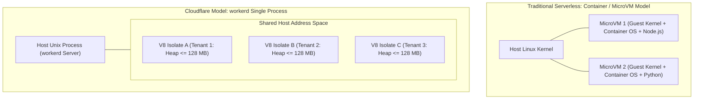
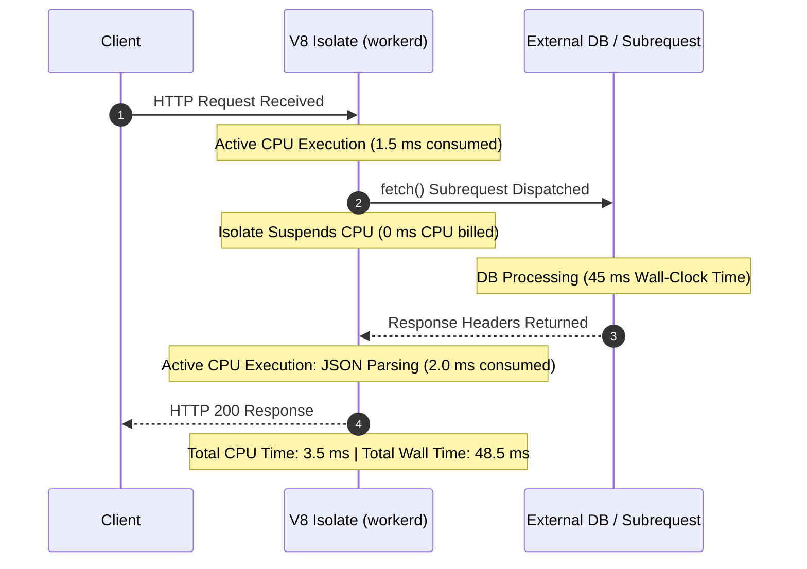

# Module 02: Runtime Internals and workerd

Traditional serverless architectures (such as AWS Lambda or Google Cloud Functions) execute user code inside virtualized guest environments: Linux containers (Docker/cgroups) or lightweight microVMs (Firecracker). While microVMs offer robust operating-system-level fault isolation, they incur non-trivial memory overhead (typically 128 MB to 512 MB per container instance) and cold-start latencies ranging from hundreds of milliseconds to multiple seconds. Cloudflare Workers adopts a radically different architectural approach based on Google V8 engine isolates embedded inside an open-source, capability-based application server named `workerd`.

---

## 1. V8 Isolates vs Linux Containers and MicroVMs

A Google V8 isolate represents an entirely self-contained instance of the V8 JavaScript engine. Each isolate possesses its own discrete call stack, heap memory allocation space, and garbage collector. Crucially, multiple V8 isolates execute simultaneously within a single Unix operating system process.



### Architectural Comparison

| Architectural Property | Linux MicroVMs (Firecracker / Lambda) | V8 Isolates (`workerd` / Workers) |
| --- | --- | --- |
| Isolation Boundary | Hardware virtualization (Intel VT-x/AMD-V) & Guest Linux Kernel | Software memory sandbox enforced by Google V8 pointer compression & type safety |
| Process Model | 1 process per guest container; hundreds of OS processes per host | Thousands of isolates executing inside a single host Unix process |
| Memory Overhead | ~30 MB to 100 MB baseline OS and runtime overhead per tenant | ~3 MB to 5 MB baseline V8 isolate context overhead |
| Cold-Start Latency | 100 ms to 3,000 ms (guest kernel boot, daemon initialization, runtime init) | < 5 ms (often sub-millisecond; allocating a new V8 Context in existing isolate) |
| Multi-Tenancy Density | Tens to hundreds of tenants per physical server blade | Tens of thousands of active tenant isolates per physical server blade |
| Filesystem Access | Virtualized POSIX block devices and ephemeral `/tmp` storage | No local filesystem access; all state resides in memory or capability bindings |

---

## 2. `workerd` Architecture: Nanoservices and Capability Bindings

`workerd` (pronounced "worker-dee") is the open-source C++ application server that executes Cloudflare Workers. It is architected around the principles of object-capability security and event-driven nanoservices.

### Capability-Based Security Model

In conventional server runtimes, an application gains access to resources (databases, network sockets, secret keys) via ambient authority: ambient environment variables (e.g., `process.env.DATABASE_URL`), global network access (`socket()` syscalls), or file paths. If an attacker injects code via a compromised npm package, that code inherits all ambient permissions.

`workerd` strictly eliminates ambient authority:

- An isolate cannot open raw TCP/UDP sockets or access arbitrary network destinations unless explicitly granted a capability.
- External dependencies—such as KV stores, D1 SQL databases, R2 buckets, and inter-worker RPC channels—are injected explicitly into the Worker's `env` object at instantiation.
- An isolate cannot inspect or interact with neighboring isolates inside the same host process unless explicitly connected via a **Service Binding**.

---

## 3. Compatibility Dates and Runtime Flags

To prevent engine improvements from breaking legacy customer applications, `workerd` freezes runtime semantics based on the `compatibility_date` declared in `wrangler.jsonc`.

```jsonc
{
  "name": "payment-api",
  "compatibility_date": "2026-11-01",
  "compatibility_flags": ["nodejs_compat", "transformstream_enable_standard_constructor"],
}
```

### `nodejs_compat` Mechanics

Historically, Workers supported only standard browser Web APIs (`fetch`, `Crypto`, `Streams`). Modern `workerd` provides native support for Node.js core APIs via the `nodejs_compat` compatibility flag:

- Native C++ bindings implement Node.js primitives directly inside `workerd`: `node:buffer`, `node:crypto`, `node:events`, `node:async_hooks`, `node:stream`, and `node:util`.
- It eliminates the need for bulky webpack/esbuild polyfills, dramatically reducing bundle size and isolate memory footprint.
- Unimplemented Node.js APIs (such as `child_process`, raw `cluster`, or POSIX file system mutations via `node:fs` write) throw informative runtime exceptions.

---

## 4. Resource Quotas: CPU-Time vs Wall-Clock Accounting

Understanding resource constraints in `workerd` requires distinguishing between **CPU time** and **Wall-clock time**.



### Quota Enforcement Rules

1. **CPU Time**: Measures the actual clock cycles consumed by the CPU core while executing the isolate's JavaScript instructions.
   - **Free Plan**: Hard ceiling of **10 ms** per request.
   - **Paid Standard Plan**: Default limit of **30 s** of continuous CPU execution (configurable up to 5 minutes for asynchronous queue consumers and workflows).
   - Exceeding the CPU quota terminates the isolate with **Error 1102** (`Worker Exceeded CPU Limit`).
2. **Wall-Clock Time**: Measures elapsed real-world time from request receipt to response conclusion.
   - In `workerd`, wall-clock time spent waiting for subrequests (I/O) is uncapped (subject only to standard client connection timeouts).
   - An isolate waiting 20 seconds for a slow third-party API consumes 0 ms of CPU time during the wait and does not violate the 30-second CPU limit.
3. **Memory Limits**: Hard limit of **128 MB** of V8 heap memory per isolate across all tiers. If an isolate allocates 129 MB of heap, V8 triggers an immediate out-of-memory termination (also throwing Error 1102).

---

## 5. Spectre Mitigations: Timer Coarsening and Single-Threaded Isolation

Because thousands of mutually untrusted customer isolates share the memory address space of a single `workerd` host process, microarchitectural side-channel attacks—specifically **Spectre** (CVE-2017-5753 / CVE-2017-5715)—represent a critical threat vector.

Spectre attacks rely on speculative branch execution in modern CPUs. An attacker trains the branch predictor to speculatively read unauthorized host memory and then measures microscopic differences in CPU cache latency to deduce the secret bytes.

### Defense Mechanisms in `workerd`

1. **High-Resolution Timer Coarsening**:
   - Spectre attacks require ultra-precise timing measurements (nanosecond resolution) to differentiate CPU L1/L2 cache hits from cache misses.
   - `workerd` explicitly coarsens timing primitives (`performance.now()`, `Date.now()`) to a resolution of **5 microseconds to 20 microseconds**.
   - Timers are updated only after discrete event loop turns, defeating cache-probing timing loops.
2. **Restricted `SharedArrayBuffer`**:
   - `SharedArrayBuffer` allows multiple WebAssembly threads to share memory, providing a high-precision counting thread that bypasses timer coarsening.
   - `workerd` disallows unconstrained `SharedArrayBuffer` allocation across isolates by default.
3. **Single-Threaded Execution**:
   - Isolates are strictly single-threaded. An isolate cannot spawn background OS threads or worker threads that poll memory concurrently.

---

## 6. Then vs Now: Runtimes and Standards

| Dimension | Then (Miniflare 1 / V8 Isolates 2018) | Now (`workerd` / Open Source 2026) | Why It Changed |
| --- | --- | --- | --- |
| Local Simulation | Node.js VM context mocking (`vm2` / Miniflare 1) | Local native `workerd` binary (Miniflare 3+ / `@cloudflare/vitest-plugin`) | Node.js VMs exhibited behavioral drift, missing V8 isolate limits, and inaccurate Web API implementations. |
| Node.js Compatibility | Heavy user-space polyfills (Webpack buffer/crypto shims) | Native in-engine C++ `nodejs_compat` bindings | Polyfills bloated bundles, degraded startup time, and exceeded 128 MB memory limits. |
| Open Source Status | Proprietary Cloudflare production binary | Fully open-source under Apache 2.0 (`cloudflare/workerd`) | Allows local self-hosting, reproducible integration testing, and external security audits. |
| Memory Pointer Model | 64-bit absolute memory pointers | V8 Pointer Compression (32-bit offsets in 4 GB cage) | Cuts memory footprint per isolate by 40%, doubling tenant density on edge hardware. |

---

## 7. Production Gotchas and Edge Failure Modes

1. **Large Schema Validation Memory Spikes**: Libraries like Zod (versions prior to 4.5.0) or massive JSON schema compilers build deeply nested prototype hierarchies. In a 128 MB isolate, parsing a 10 MB JSON payload with complex schema validation can immediately trigger an out-of-memory crash (Error 1102).
2. **Timer Measurement Assumptions**: Attempting to benchmark sub-microsecond microbenchmarks inside a Worker using `performance.now()` will yield rounded or identical timestamps due to Spectre timer coarsening.
3. **CPU-Time Exhaustion in Regex ReDoS**: Running unanchored, catastrophic backtracking regular expressions on client-supplied input will quickly exhaust the 10 ms (Free) or 30 s (Paid) CPU quota, resulting in immediate isolate termination.

---

## 8. Architectural Case Study: Safe Streaming JSON Validator

The following example demonstrates building a high-throughput, memory-bounded JSON parser inside an isolate. Instead of loading an entire 20 MB payload into heap memory (which risks exceeding the 128 MB isolate limit), it processes the stream sequentially using `TransformStream`.

```typescript
export default {
  async fetch(request: Request, env: unknown, ctx: ExecutionContext): Promise<Response> {
    if (request.method !== 'POST') {
      return new Response('Method Not Allowed', { status: 405 });
    }

    const contentLength = parseInt(request.headers.get('content-length') ?? '0', 10);
    if (contentLength > 20 * 1024 * 1024) {
      return new Response('Payload Exceeds 20 MB Limit', { status: 413 });
    }

    let bytesProcessed = 0;
    const byteCountingStream = new TransformStream<Uint8Array, Uint8Array>({
      transform(chunk, controller) {
        bytesProcessed += chunk.byteLength;
        // Enforce hard streaming ceiling to prevent heap saturation
        if (bytesProcessed > 20 * 1024 * 1024) {
          controller.error(new Error('Stream exceeded memory safety envelope'));
          return;
        }
        controller.enqueue(chunk);
      },
      flush() {
        console.log(`Stream complete. Total bytes safely streamed: ${bytesProcessed}`);
      },
    });

    const transformedStream = request.body?.pipeThrough(byteCountingStream);

    return new Response(transformedStream, {
      headers: { 'Content-Type': 'application/octet-stream' },
    });
  },
};
```

---

## Interview Drill

<details><summary>1. How can thousands of tenant isolates run inside a single `workerd` process without risking cross-tenant data corruption?</summary>

Google V8 isolates enforce strict memory sandboxing at the software level. Every isolate has its own separate heap, root objects, and garbage collector. Memory addresses within an isolate are managed through V8 pointer compression (32-bit offsets within a 4 GB virtual cage) that cannot point to memory addresses outside the isolate's designated bounds. Furthermore, `workerd` eliminates ambient OS access: an isolate cannot issue raw system calls or access the host filesystem, communicating with external services strictly via explicit capability bindings passed into the isolate context.

</details>

<details><summary>2. Why does a Worker that waits 10 seconds for an external database query not exceed the 10 ms Free tier CPU limit?</summary>

Cloudflare Workers enforces limits on **active CPU execution time**, not elapsed wall-clock time. While awaiting external asynchronous I/O (such as an HTTP subrequest or database query over Hyperdrive), the V8 isolate suspends execution and yields the physical CPU thread back to the `workerd` event loop. The CPU clock stops ticking for that isolate during the wait. Only the CPU cycles spent serializing the query and parsing the incoming response count toward the 10 ms CPU-time quota.

</details>

<details><summary>3. Explain how Spectre side-channel attacks threaten multi-tenant isolate runtimes and how `workerd` mitigates them.</summary>

Spectre attacks exploit CPU branch prediction to speculatively access unauthorized memory locations and leave footprint traces in the CPU L1/L2 data cache. An attacker measures the precise time it takes to access data to determine whether it was cached, leaking memory across isolates. To defeat this, `workerd` coarsens timer resolution (`performance.now()` is rounded to tens of microseconds), restricts `SharedArrayBuffer` (which can create high-precision timing threads), and restricts multithreaded shared memory. Without nanosecond-level timing precision, attackers cannot reliably detect CPU cache hit/miss differentials.

</details>

<details><summary>4. What architectural advantages does native `nodejs_compat` inside `workerd` provide over client-side bundling polyfills?</summary>

Bundling polyfills (e.g., browserify/webpack versions of `buffer` or `crypto`) inject large JavaScript implementations into the Worker's bundle. This bloats the uncompressed script size, slows down isolate initialization (cold starts), and consumes substantial portions of the 128 MB V8 heap memory. In contrast, native `nodejs_compat` compiles Node.js standard library APIs directly into the C++ runtime binary of `workerd`. They execute at native C++ speeds, utilize zero user-space heap allocation for runtime initialization, and conform accurately to Node.js specification behaviors.

</details>

<details><summary>5. What specific failure conditions trigger an Error 1102, and how can an architect diagnose whether memory or CPU was the root cause?</summary>

Error 1102 (`Worker Exceeded Resource Limits`) is triggered by two distinct runtime thresholds: (1) exceeding the CPU-time quota (10 ms on Free, 30 s default on Paid), or (2) exceeding the 128 MB V8 isolate memory heap ceiling. Diagnosis requires inspecting Workers Logs or Logpush metrics: if the error occurs during synchronous compute (e.g., intensive image parsing or regex backtracking), CPU-time exhaustion is the cause; if it occurs during large payload ingestion or high-concurrency object buffering, heap exhaustion triggered a V8 OOM termination.

</details>
