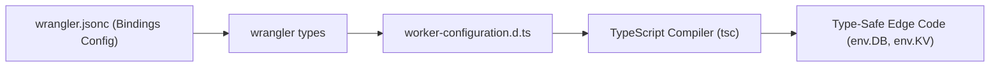
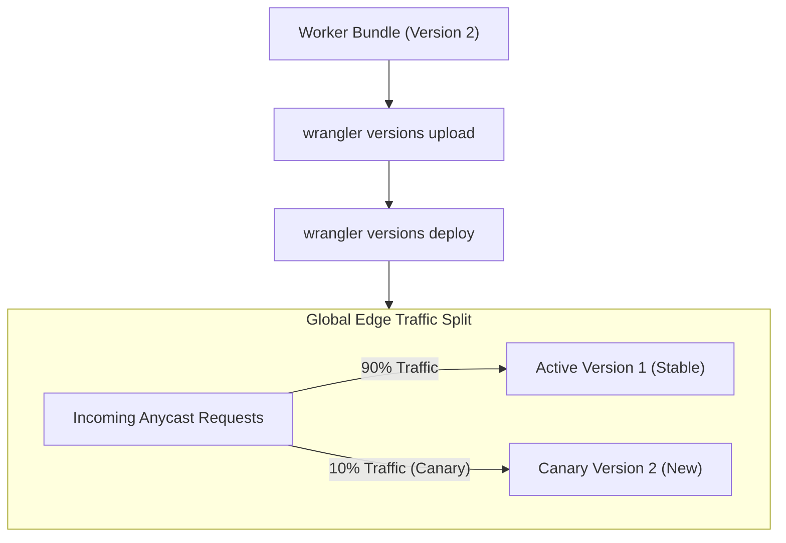

# Module 03: Tooling, Configuration, and Deployments

Building, testing, and operating edge applications on Cloudflare requires a deep understanding of the developer toolchain, declarative configuration schemas, type generation pipelines, and deployment versioning mechanics. The ecosystem has standardized around `wrangler.jsonc`, typed capability bindings generated via `wrangler types`, native Vite integration, and granular version-based deployment rollouts.

---

## 1. Declarative Configuration: `wrangler.jsonc` Schema and Environments

Cloudflare's primary configuration format is `wrangler.jsonc` (JSON with Comments), which provides strict schema validation, autocompletion in modern IDEs, and comments for documentation.

```jsonc
{
  "$schema": "node_modules/wrangler/config-schema.json",
  "name": "checkout-service",
  "main": "src/index.ts",
  "compatibility_date": "2026-11-01",
  "compatibility_flags": [
    "nodejs_compat"
  ],
  "vars": {
    "ENVIRONMENT": "development",
    "API_VERSION": "v2"
  },
  "kv_namespaces": [
    { "binding": "CONFIG_KV", "id": "0123456789abcdef0123456789abcdef" }
  ],
  "d1_databases": [
    { "binding": "DB", "database_name": "orders_db", "database_id": "xxxx-xxxx-xxxx" }
  ],
  "env": {
    "production": {
      "name": "checkout-service-prod",
      "routes": [
        { "pattern": "api.example.com/checkout/*", "zone_name": "example.com" }
      ],
      "vars": {
        "ENVIRONMENT": "production"
      },
      "kv_namespaces": [
        { "binding": "CONFIG_KV", "id": "fedcba9876543210fedcba9876543210" }
      ]
    }
  }
}
```

### Environment Inheritance and Overrides
- **Top-Level Definitions**: Default properties apply to the default (development or staging) environment.
- **The `env` Block**: Named environments (e.g., `production`, `staging`, `preview`) inherit top-level settings and selectively override bindings, routes, and environment variables.
- **Deploying Environments**: `wrangler deploy --env production` applies the configuration defined inside `env.production`.

---

## 2. Capability Bindings and Static Type Generation (`wrangler types`)

In `workerd`, bindings are not environment strings; they are typed JavaScript objects exposing specialized APIs (such as `.get()`, `.put()`, `.prepare()`, or `.send()`).



### Type Drift Prevention
1. **Running Type Generation**: Executing `npx wrangler types` inspects `wrangler.jsonc` and outputs an ambient interface `Env` inside `worker-configuration.d.ts`:
   ```typescript
   interface Env {
     CONFIG_KV: KVNamespace;
     DB: D1Database;
     ENVIRONMENT: string;
     API_VERSION: string;
   }
   ```
2. **CI Static Analysis Gate**: In production CI/CD pipelines, type generation should be verified against git status:
   ```bash
   npx wrangler types
   git diff --exit-code worker-configuration.d.ts
   ```
   If a developer alters `wrangler.jsonc` without updating generated types, the pipeline fails immediately, preventing runtime `undefined` errors.

---

## 3. Local Development Architecture: Miniflare, Vite, and Remote Bindings

`wrangler dev` executes code locally using an embedded `workerd` process powered by **Miniflare 3+**.

### Local Mode vs Remote Mode
- **Local Mode (Default: `wrangler dev`)**:
  - `workerd` runs entirely on the developer's workstation.
  - Bindings (KV, D1, R2, Queues) use local ephemeral or persisted SQLite and filesystem stores inside `.wrangler/state/v3/`.
  - Zero latency, full offline capability, and zero risk to live cloud data.
- **Remote Mode (`wrangler dev --remote`)**:
  - The Worker runs on Cloudflare's edge staging infrastructure.
  - Invocations connect to real, live cloud resources (e.g., production KV namespaces or D1 databases).
  - Essential when testing proprietary edge features that cannot be emulated locally (such as specific WAF rule chains or real Anycast routing).

### Vite Integration (`@cloudflare/vite-plugin`)
Modern frontend and full-stack frameworks (Remix, SvelteKit, Astro, Hono) integrate via `@cloudflare/vite-plugin`:
- HMR (Hot Module Replacement) executes with sub-second feedback.
- Vite unifies the client bundle and edge server build into a single compilation pipeline.
- Automatically handles server-side rendering (SSR) within `workerd` directly inside the Vite development server.

---

## 4. Gradual Deployments, Versioning, and Rollbacks

Historically, running `wrangler deploy` enacted an instant 100% atomic cutover across all 300+ edge data centers. Modern Cloudflare Workers provides granular **Version Deployments**.



### Deployment Commands
1. **Upload Version without Cutover**:
   ```bash
   wrangler versions upload --message "Add optimized database connection pooling"
   ```
   Uploads and assigns a discrete version ID (e.g., `v2_abcd1234`) without routing production traffic to it.
2. **Canary Traffic Splitting**:
   ```bash
   wrangler versions deploy v1_old=90% v2_new=10%
   ```
   Directs 10% of global edge traffic to the new version while monitoring telemetry for error rate spikes.
3. **Instant Rollback**: If Error 1102 or 5xx spikes occur, rolling back requires zero code rebuilds:
   ```bash
   wrangler versions deploy v1_old=100%
   ```
   Global Anycast switches traffic back to the proven stable version in under one second.

---

## 5. Infrastructure as Code: Terraform Provider v5

Enterprise deployments orchestrate Cloudflare resources via Terraform or OpenTofu. In 2024–2026, Cloudflare released **Terraform Provider v5**, a ground-up Stainless-generated rewrite replacing the legacy v4 provider.

```hcl
terraform {
  required_providers {
    cloudflare = {
      source  = "cloudflare/cloudflare"
      version = "~> 5.28"
    }
  }
}

provider "cloudflare" {}

resource "cloudflare_workers_script" "api_gateway" {
  account_id = var.cloudflare_account_id
  script_name = "api-gateway"
  content    = file("${path.module}/dist/index.js")
  compatibility_date = "2026-11-01"
  compatibility_flags = ["nodejs_compat"]

  module = true
}

resource "cloudflare_workers_route" "api_route" {
  zone_id     = var.cloudflare_zone_id
  pattern     = "api.company.com/*"
  script_name = cloudflare_workers_script.api_gateway.script_name
}
```

### Breaking Changes in Provider v5
- Strict 1:1 parity with current Cloudflare REST v4 API schemas.
- Deprecated monolithic blocks replaced with explicit modular resources.
- Native support for Workers Versioning, Dispatch Namespaces, and Workers Static Assets.

---

## 6. Then vs Now: Tooling Evolution

| Dimension | Then (Legacy Tooling 2020) | Now (Modern Tooling 2026) | Why It Changed |
| --- | --- | --- | --- |
| Config Format | `wrangler.toml` | `wrangler.jsonc` | TOML lacked built-in JSON schema validation, typed autocompletion, and native integration with web bundlers. |
| Testing Harness | `@cloudflare/vitest-pool-workers` (Vitest 4 peer) | `@cloudflare/vitest-plugin` (supports Vitest 5+) | The legacy custom pool architecture was brittle and broke on major Vitest releases; the plugin model cleanly integrates with Vite. |
| Deployment Cutover | Instant 100% atomic push | Gradual percentage-based Version Deployments | Instant 100% rollouts caused production outages when bugs bypassed testing; canary rollouts enable zero-risk canary testing. |
| Secrets Configuration | Interactive manual prompts only | Typed `.dev.vars` locally, encrypted remote secrets | Separation of local dev credentials from production cloud state prevents credential leakage. |

---

## 7. Production Gotchas and Edge Failure Modes

1. **Committing `.dev.vars` to Git**: Local development variables and secrets reside in `.dev.vars`. Committing this file to git exposes development secrets. Always ensure `.dev.vars` is explicitly listed in `.gitignore`.
2. **Miniflare Strong Consistency False Sense of Security**: Local `wrangler dev` simulates Workers KV with immediate, strong in-memory consistency. A test that passes locally may fail in production due to multi-second eventual consistency lag across global PoPs.
3. **Terraform Provider v4 vs v5 State Incompatibilities**: Upgrading from Terraform provider v4 to v5 without running state migration tools (`tf-migrate` or manual state manipulation) will cause provider schema validation panics and resource recreation.

---

## 8. Architectural Case Study: Automated CI/CD Canary Pipeline

The following GitHub Actions workflow demonstrates a production deployment pipeline utilizing type verification, Vitest suite execution, version uploading, and canary deployment.

```yaml
name: Deploy Edge Worker

on:
  push:
    branches: [main]

jobs:
  verify-and-deploy:
    runs-on: ubuntu-latest
    steps:
      - uses: actions/checkout@v4

      - name: Setup Toolchain
        uses: jdx/mise-action@v2

      - name: Install Dependencies
        run: npm ci

      - name: Verify Generated Types
        run: |
          npx wrangler types
          git diff --exit-code worker-configuration.d.ts

      - name: Execute Vitest Integration Suite
        run: npm test

      - name: Upload New Worker Version
        id: upload
        env:
          CLOUDFLARE_API_TOKEN: ${{ secrets.CF_API_TOKEN }}
        run: |
          VERSION_ID=$(npx wrangler versions upload --message "CI build ${{ github.sha }}" --json | jq -r '.version_id')
          echo "version_id=$VERSION_ID" >> $GITHUB_OUTPUT

      - name: Deploy Canary (10% Traffic)
        env:
          CLOUDFLARE_API_TOKEN: ${{ secrets.CF_API_TOKEN }}
        run: |
          npx wrangler versions deploy ${{ steps.upload.outputs.version_id }}=10% --message "Canary Rollout"
```

---

## Interview Drill

<details><summary>1. How does `wrangler types` enhance TypeScript safety, and how should it be incorporated into CI/CD?</summary>

`wrangler types` parses `wrangler.jsonc` to generate ambient TypeScript definitions (`worker-configuration.d.ts`) matching all configured capability bindings (KV, D1, R2, vars, DOs). This eliminates reliance on `any` types and guarantees that developers cannot access non-existent bindings. In CI/CD pipelines, `wrangler types` should be executed prior to `tsc --noEmit`, followed by `git diff --exit-code worker-configuration.d.ts`. If someone modified `wrangler.jsonc` without committing the corresponding updated types, CI fails immediately, preventing runtime `undefined` errors.

</details>

<details><summary>2. Why does testing against local `wrangler dev` fail to catch eventual consistency bugs in Workers KV?</summary>

Under the hood, local `wrangler dev` uses Miniflare running against a single local SQLite database or in-memory map. Reads and writes execute against the exact same local state with immediate strong consistency. In production, however, Workers KV consists of central storage clusters and geographically distributed edge caches across 300+ data centers. Writes take seconds to propagate, and negative lookups are cached. A test that reads immediately after a write will succeed locally every time but will fail intermittently in production when requests route to different PoPs.

</details>

<details><summary>3. Explain the operational workflow and failure mitigation advantages of Cloudflare Workers Version Deployments.</summary>

Workers Version Deployments decouples uploading code from routing traffic. A new version can be uploaded (`wrangler versions upload`) without directing any traffic to it. Operators can then split traffic (e.g., 90% to stable version, 10% to canary). Telemetry and error rates can be monitored on the 10% canary. If an anomaly occurs, an instant rollback (`wrangler versions deploy stable=100%`) shifts all edge traffic back to the known-good version in under a second without requiring a rebuild, recompilation, or git revert.

</details>

<details><summary>4. What are the key architectural differences between Terraform Cloudflare Provider v4 and v5?</summary>

Terraform Provider v5 is a complete Stainless-generated rewrite designed to achieve 1:1 structural fidelity with the Cloudflare REST API v4. Provider v4 used manually maintained Go resource schemas that lagged behind new platform capabilities and contained non-standard nested blocks. Provider v5 introduces dedicated resources for modern platform capabilities (such as Workers Versions, Deployments, Static Assets, and Dispatch Namespaces) with strict type checking and improved state management.

</details>

<details><summary>5. How should sensitive environment secrets be managed between local workstations and production edge environments?</summary>

Local secrets must never be committed to version control. For local development, secrets should be stored in a `.dev.vars` file in the project root (which must be listed in `.gitignore`), where `wrangler dev` automatically loads them into `env`. For production, secrets must be provisioned either through the Cloudflare Dashboard or via the CLI using `wrangler secret put <SECRET_NAME>`. These secrets are stored encrypted in Cloudflare's secure secrets management store and decrypted only inside the isolated execution memory of instantiated `workerd` isolates.

</details>
