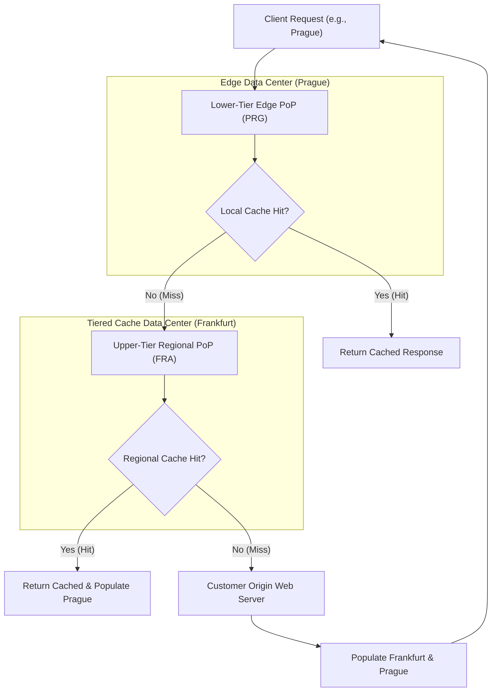

# Module 04: Caching and Edge Content Delivery

High-performance edge systems rely on maximizing cache hit ratios while maintaining deterministic invalidation policies. Cloudflare provides a multi-tiered caching topology combining an Anycast edge cache, regional Tiered Cache hierarchies, programmatic access via the Web Standard Cache API, and granular cache-control header overrides. Understanding the interaction between edge proxy rules and Worker code is essential for designing resilient edge delivery systems.

---

## 1. Caching Topology: Edge PoPs and Tiered Cache

Cloudflare operates an edge-first caching topology distributed across more than 300 data centers.



### The Tiered Cache Hierarchy

- **Direct Origin Fetching (Without Tiered Cache)**: When a cache miss occurs in Vienna, Prague, and Warsaw, each data center independently opens a TCP/TLS connection to the origin server, resulting in redundant origin egress and high load.
- **Hierarchical Aggregation (With Tiered Cache)**: Lower-tier edge data centers route cache misses to a designated regional upper-tier data center (such as Frankfurt for Central Europe). The upper-tier data center caches the asset; subsequent misses from neighboring lower-tier data centers hit the upper-tier cache rather than reaching the origin.
- **Cache Hit Ratio (CHR) Impact**: Tiered Cache typically raises cache hit ratios by 15% to 35% on dynamic or long-tail content while drastically reducing origin egress bandwidth charges.

---

## 2. Header Precedence: `Cache-Control`, `CDN-Cache-Control`, and `Cloudflare-CDN-Cache-Control`

Modern HTTP caching (RFC 9111 and RFC 7234) allows origin servers to send targeted headers to differentiate downstream browser caching policies from intermediate CDN edge policies.

| Header Directive | Evaluated By | Behavior and Precedence |
| --- | --- | --- |
| `Cache-Control: max-age=60` | Browsers, CDNs, Forward Proxies | Standard fallback directive. Browsers and edge caches store for 60 seconds if no CDN-specific headers are present. |
| `CDN-Cache-Control: max-age=3600` | Any compliant CDN (Cloudflare, Akamai, Fastly) | Overrides `Cache-Control` on CDN edge nodes. Browsers continue to obey `max-age=60`, while edge stores for 1 hour. |
| `Cloudflare-CDN-Cache-Control: max-age=86400` | Exclusively Cloudflare Edge Nodes | Highest precedence on Cloudflare. Overrides both `CDN-Cache-Control` and `Cache-Control`. |
| `s-maxage=600` | Shared Caches (CDNs, Reverse Proxies) | Overrides `max-age` for shared intermediate caches if targeted CDN headers are omitted. |

---

## 3. The Worker Cache API (`caches.default`)

Cloudflare Workers exposes the standard Web Cache API via `caches.default`. This allows programmatic storage and retrieval of arbitrary HTTP responses directly from the local data center cache.

```typescript
export default {
  async fetch(request: Request, env: unknown, ctx: ExecutionContext): Promise<Response> {
    const cache = caches.default;
    const cacheKey = new Request(request.url, request);

    // 1. Attempt cache lookup
    let response = await cache.match(cacheKey);

    if (response) {
      // Add custom header to prove edge cache hit
      const headers = new Headers(response.headers);
      headers.set('X-Cache-Status', 'HIT-EDGE');
      return new Response(response.body, { status: response.status, headers });
    }

    // 2. Fetch fresh content from origin
    response = await fetch(request);

    // 3. Cache valid responses asynchronously via ctx.waitUntil
    if (response.status === 200) {
      // Responses stored in Cache API MUST include explicit Cache-Control headers
      const responseToCache = new Response(response.clone().body, response);
      responseToCache.headers.set('Cache-Control', 'public, max-age=600');

      ctx.waitUntil(cache.put(cacheKey, responseToCache));
    }

    return response;
  },
};
```

### Critical Invariant: Per-Colo Scope

The Cache API is **local to the specific edge data center (PoP)** executing the request.

- Writing a response via `cache.put()` in London stores the data exclusively on London edge NVMe/RAM clusters.
- A request arriving at the Frankfurt PoP 10 milliseconds later will miss `caches.default` and query origin unless Tiered Cache or custom replication is utilized.
- Programmatic `cache.delete()` purges the entry only from that local data center; it does **not** broadcast a global cache invalidation.

---

## 4. Custom Cache Keys and `cf` Fetch Options

By default, Cloudflare constructs cache keys from the complete URL: `protocol + host + path + queryString`. Workers can customize this behavior via Cloudflare-specific request properties.

```typescript
export default {
  async fetch(request: Request, env: unknown, ctx: ExecutionContext): Promise<Response> {
    const url = new URL(request.url);

    // Normalize query string: sort keys and strip tracking parameters (e.g. utm_source)
    url.searchParams.sort();
    url.searchParams.delete('utm_source');
    url.searchParams.delete('fbclid');

    // Fetch upstream with specialized caching instructions
    const response = await fetch(url.toString(), {
      method: 'GET',
      cf: {
        // Enforce a custom normalized cache key
        cacheKey: url.toString(),

        // Override edge TTL for this specific subrequest
        cacheTtl: 1800,

        // Status-code-specific TTL rules
        cacheTtlByStatus: {
          '200-299': 3600,
          '404': 60,
          '500-599': 0, // Never cache server errors
        },

        // Request cache bypass
        cacheEverything: true,
      },
    });

    return response;
  },
};
```

---

## 5. Modern Edge Acceleration: Stale-While-Revalidate and 103 Early Hints

### Stale-While-Revalidate (RFC 5861)

When an origin returns:

```http
Cache-Control: max-age=60, stale-while-revalidate=300
```

- Between 0 and 60 seconds: Response is fresh; served directly from edge cache.
- Between 61 and 360 seconds (the 300 s grace window): Response is stale, but Cloudflare edge **serves the stale response immediately** to the client (sub-10 ms TTFB). Simultaneously, the edge dispatches a background subrequest to fetch the updated representation from the origin.
- Beyond 360 seconds: Asset is completely expired; next request blocks on origin fetch.

### 103 Early Hints

HTTP status `103 Early Hints` enables speculative resource preloading:

1. Edge sends a `103 Early Hints` response containing `Link: </style.css>; rel=preload; as=style` before origin compute finishes.
2. The browser parser initiates the TCP/TLS connection and downloads stylesheets while the origin server runs backend database queries.
3. Once origin finishes, the primary `200 OK` response stream arrives; required fonts and stylesheets are already loaded in the browser.

---

## 6. Then vs Now: Caching Architecture

| Dimension | Then (Page Rules 2018) | Now (Cache Rules & Worker Cache API 2026) | Why It Changed |
| --- | --- | --- | --- |
| Rule Engine | Page Rules (limited to URL regex matching, 3-rule order conflicts) | Ruleset Engine / Cache Rules (complex boolean expressions with fields) | Page Rules were limited to 125 rules, lacked granular header inspection, and could not match cookie or device values. |
| Edge Invalidation | Single URL purge or Purge All | Tag-based, Hostname, and Prefix Purges in under 150 ms | Purging entire zones incurred severe origin stampedes; tag-based purging enables surgical invalidation of related entity graphs. |
| Browser vs CDN | Single shared `Cache-Control` header | Explicit `CDN-Cache-Control` and `Cloudflare-CDN-Cache-Control` | Origins had to compromise between short browser cache times and long CDN cache times. |
| Worker Caching | Custom Service Worker cache hacks | Standard Web Cache API + `cf` fetch parameters | Standards compliance enables cross-runtime compatibility and cleaner testing. |

---

## 7. Production Gotchas and Edge Failure Modes

1. **Purging the Zone Cache Does Not Purge `caches.default`**: Calling Cloudflare's purge API (by URL or Cache Tag) invalidates the CDN zone cache, but does **not** invalidate custom response objects inserted via `caches.default.put()` within Workers.
2. **Workers on `workers.dev` Bypass Zone Cache**: Executing subrequests on `*.workers.dev` does not leverage the zone CDN HTTP cache; caching must be managed programmatically via `caches.default` or custom storage.
3. **Cache Inadvertently Storing Authorized Responses**: By default, Cloudflare bypasses cache if an `Authorization` header is present. Overriding this with `cf: { cacheEverything: true }` without normalizing or scrubbing headers will leak authenticated user data to public users.

---

## 8. Architectural Case Study: Tiered Edge Cache with Background Revalidation

The following implementation combines `caches.default`, normalized cache keys, and asynchronous background revalidation via `ctx.waitUntil`.

```typescript
export default {
  async fetch(request: Request, env: unknown, ctx: ExecutionContext): Promise<Response> {
    const url = new URL(request.url);

    // Normalize URL cache key
    const normalizedUrl = new URL(url.pathname, url.origin);
    const cacheKey = new Request(normalizedUrl.toString(), {
      method: 'GET',
      headers: { Accept: request.headers.get('Accept') ?? '*/*' },
    });

    const cache = caches.default;
    const cachedResponse = await cache.match(cacheKey);

    if (cachedResponse) {
      const cachedDate = cachedResponse.headers.get('Date');
      const ageMs = cachedDate ? Date.now() - new Date(cachedDate).getTime() : 0;

      // If cached for longer than 60 seconds, trigger background revalidation
      if (ageMs > 60_000) {
        ctx.waitUntil(revalidateCache(cacheKey, cache));
      }

      const responseHeaders = new Headers(cachedResponse.headers);
      responseHeaders.set('X-Cache-Status', 'HIT-STALE');
      return new Response(cachedResponse.body, {
        status: cachedResponse.status,
        headers: responseHeaders,
      });
    }

    // Cache Miss: Synchronous origin fetch
    const originResponse = await fetch(request);
    if (originResponse.status === 200) {
      const clone = new Response(originResponse.clone().body, originResponse);
      clone.headers.set('Cache-Control', 'public, max-age=300');
      clone.headers.set('Date', new Date().toUTCString());
      ctx.waitUntil(cache.put(cacheKey, clone));
    }

    return originResponse;
  },
};

async function revalidateCache(cacheKey: Request, cache: Cache): Promise<void> {
  const freshResponse = await fetch(cacheKey.url);
  if (freshResponse.status === 200) {
    const freshClone = new Response(freshResponse.body, freshResponse);
    freshClone.headers.set('Cache-Control', 'public, max-age=300');
    freshClone.headers.set('Date', new Date().toUTCString());
    await cache.put(cacheKey, freshClone);
  }
}
```

---

## Interview Drill

<details><summary>1. What is the operational difference between the zone CDN cache and `caches.default` in a Worker?</summary>

The zone CDN cache is the automated caching layer evaluated based on Cloudflare Zone settings (such as Cache Rules and standard file extensions). It is globally purgeable via the Cloudflare dashboard or Purge API by URL or Cache-Tag in under 150 milliseconds. `caches.default` is the programmatic Web Cache API inside the Worker. It is scoped strictly to the local Point of Presence (PoP) executing the code. Objects stored directly in `caches.default` are not tied to the zone cache's automated purge pipeline and must be invalidated manually or expired via HTTP `Cache-Control` max-age headers.

</details>

<details><summary>2. How does `CDN-Cache-Control` solve conflicting caching requirements between browser clients and edge CDNs?</summary>

Before targeted headers were standardized in RFC 9111, an origin server sending `Cache-Control: max-age=3600` instructed both the edge CDN and the client's browser to cache the file for an hour. If a bug was deployed, browsers could not be remotely invalidated until the full hour expired. With `CDN-Cache-Control`, an origin can return `Cache-Control: max-age=60` and `CDN-Cache-Control: max-age=86400`. The browser caches the file for only 60 seconds (enabling rapid recovery from client issues), while the CDN caches it for 24 hours, shielding origin infrastructure from traffic spikes.

</details>

<details><summary>3. Explain how Tiered Cache mitigates origin load and improves global Cache Hit Ratios.</summary>

In a flat Anycast CDN, each edge PoP operates an isolated cache. If an origin serves users in 300 cities, a newly requested asset must be fetched from the origin up to 300 separate times. Tiered Cache arranges PoPs into a hierarchical topology. Lower-tier data centers send their cache misses to a regional upper-tier data center (typically situated at major internet exchanges like Frankfurt, London, or Ashburn). The upper-tier PoP fetches the asset once from origin; subsequent requests from all other lower-tier PoPs in that region hit the upper-tier cache, reducing origin egress by up to 80%.

</details>

<details><summary>4. What happens when an origin returns `stale-while-revalidate`, and what trade-off does it introduce?</summary>

`stale-while-revalidate=N` instructs the edge cache that after the standard `max-age` expires, it may continue serving the expired (stale) representation to clients for up to $N$ seconds while concurrently launching an asynchronous background subrequest to fetch fresh content from origin. The advantage is near-instantaneous response times (sub-10 ms TTFB) with zero origin latency penalty for end users. The trade-off is eventual consistency: clients viewing the page during the revalidation window observe slightly outdated state.

</details>

<details><summary>5. Why does setting `cf: { cacheEverything: true }` on an authorized API request create a high-severity security risk?</summary>

By default, Cloudflare bypasses the cache whenever an incoming request carries an `Authorization` header to avoid caching user-specific private payloads. Forcing `cacheEverything: true` without customizing the cache key overrides this safety check. Cloudflare will store the authenticated user's private response under the generic URL cache key. The next unauthenticated user requesting that same URL will receive the cached private response, leading to severe cross-tenant data leakage.

</details>
