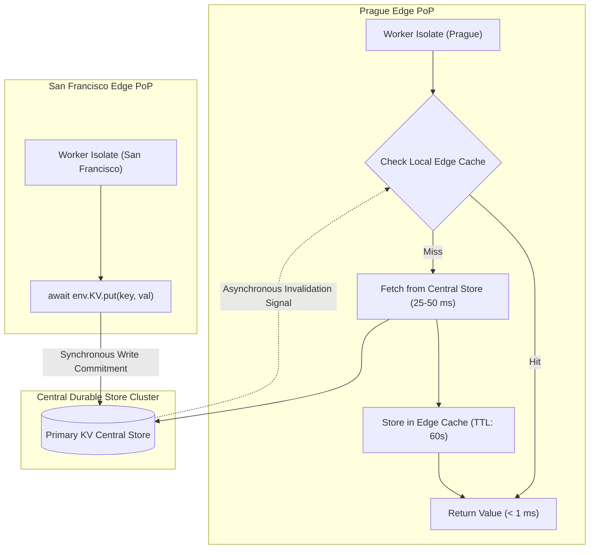
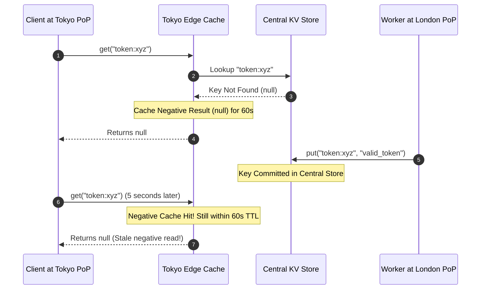
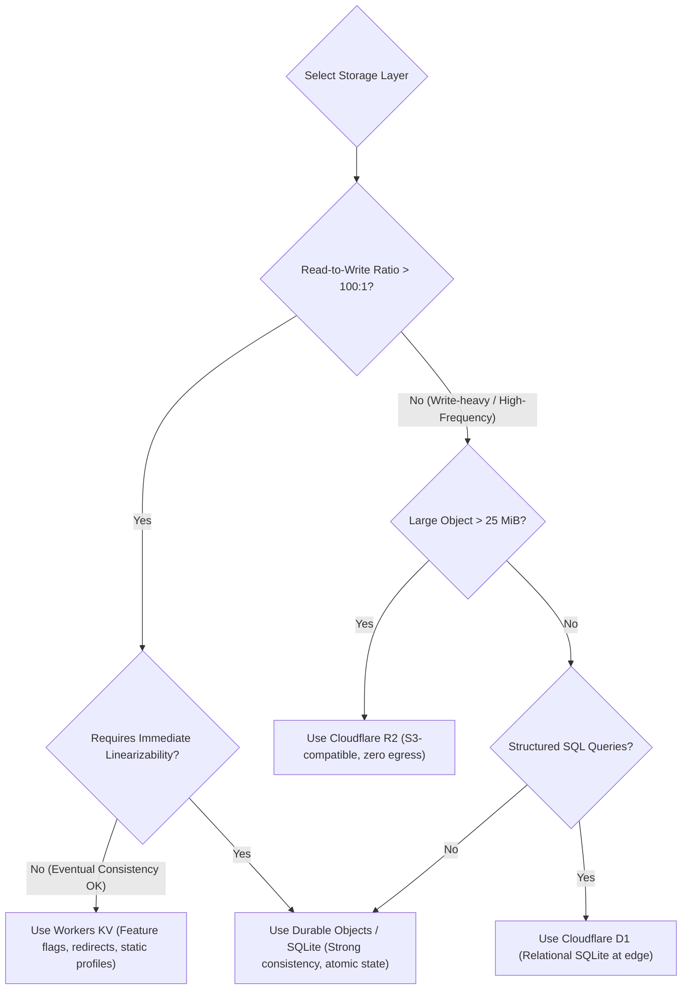

# Module 05: Workers KV and Eventual Consistency

Cloudflare Workers KV is a globally distributed, low-latency, key-value data store designed for ultra-high read throughput. Unlike traditional relational or transactional in-memory databases (such as Redis or PostgreSQL), Workers KV trades strong consistency and high write throughput for global edge read latency. Operating KV effectively requires understanding its central-store-and-edge-cache architecture, eventual consistency propagation windows, negative lookup behavior, and distinct anti-patterns.

---

## 1. Internal Architecture: Central Storage and Distributed Edge Caches

Workers KV is physically partitioned into two distinct infrastructure tiers:
1. **Central Durable Store**: A globally centralized, highly available transactional storage tier (backed by distributed clusters situated in core regions). Writes to Workers KV always commit synchronously to this central store before returning success to the caller.
2. **Edge PoP Caches**: Distributed read caches collocated within every Cloudflare Point of Presence (PoP) worldwide.



### Read Lifecycle Mechanics
- **Edge Cache Hit**: When a Worker invokes `await env.KV.get("config:tier")`, the local data center's memory and NVMe cache is queried. If the key exists and its local TTL has not expired, the value is returned in under **1 millisecond**.
- **Edge Cache Miss**: If the key is not present locally, the edge node queries the central durable store over Cloudflare's private backbone network. The fetched value is returned to the Worker and simultaneously cached locally for future requests.

---

## 2. Eventual Consistency and Propagation Latency

Because edge PoPs cache values locally, Workers KV exhibits **eventual consistency**.
- When a write (`env.KV.put()`) occurs, the change is written to the central store.
- Existing edge caches worldwide are **not** updated synchronously. Instead, an asynchronous invalidation message propagates across the network.
- Edge caches continue serving the previously cached value until either:
  1. The local cache TTL (`cacheTtl`) expires (default is 60 seconds).
  2. The asynchronous invalidation broadcast is received and processed by that data center.
- **Propagation Window**: Full global convergence typically takes up to **60 seconds**. In degraded network conditions, propagation may take slightly longer.

---

## 3. Negative-Lookup Caching

A frequent source of production bugs is **negative-lookup caching**:
- If a client requests a key that does **not** exist in the KV namespace (`await env.KV.get("user:999")`), the central store reports a miss (`null`).
- To protect the central store from being overwhelmed by cache stampedes on missing keys, the local edge PoP caches this negative result (`null`) for the duration of `cacheTtl`.
- If another process creates `"user:999"` immediately afterward, queries arriving at that specific edge PoP will continue returning `null` until the negative cache TTL expires.



---

## 4. API Capabilities: Values, Metadata, and List Pagination

```typescript
export interface Env {
  SETTINGS_KV: KVNamespace;
}

export interface UserMetadata {
  role: string;
  tier: string;
  lastUpdated: number;
}

export default {
  async fetch(request: Request, env: Env, ctx: ExecutionContext): Promise<Response> {
    // 1. Put with TTL and custom JSON metadata (metadata max 1024 bytes)
    await env.SETTINGS_KV.put("user:42", JSON.stringify({ name: "Alice", email: "alice@example.com" }), {
      expirationTtl: 86400, // Expires in 24 hours
      metadata: { role: "admin", tier: "enterprise", lastUpdated: Date.now() }
    });

    // 2. Read with explicit cacheTtl and metadata retrieval
    const { value, metadata } = await env.SETTINGS_KV.getWithMetadata<UserMetadata>("user:42", {
      type: "json",
      cacheTtl: 300 // Cache locally at edge for 5 minutes
    });

    // 3. Paginated prefix listing
    const listResult = await env.SETTINGS_KV.list({
      prefix: "user:",
      limit: 100
    });

    for (const key of listResult.keys) {
      console.log(`Found key: ${key.name}, metadata:`, key.metadata);
    }

    return Response.json({ value, metadata, totalListed: listResult.keys.length });
  }
};
```

### Storage Limits

| Dimension | Constraint Limit | Architectural Implication |
| --- | --- | --- |
| Max Key Length | 512 bytes | Sufficient for hierarchical strings (e.g. `tenant:101:user:42:profile`). |
| Max Value Size | 25 MiB | Designed for configuration, HTML snippets, and small JSON; large files belong in R2. |
| Max Metadata Size | 1,024 bytes (1 KiB) | Enables fast filtering during `list()` operations without reading full values. |
| Minimum `cacheTtl` | 60 seconds | Values cannot be cached at edge PoPs for less than 60 seconds via `cacheTtl`. |
| Max Write Frequency | ~1 write/sec per key | High-frequency concurrent writes trigger HTTP 429 rate limits on central stores. |

---

## 5. Architectural Selection: Best Uses vs Critical Anti-Patterns



### Critical Anti-Patterns in Workers KV
1. **Atomic Counters / Rate Limiting**:
   - `const val = await env.KV.get('counter'); await env.KV.put('counter', val + 1);`
   - **Failure**: Lost updates occur under concurrency because KV lacks atomic increments or Compare-And-Swap (CAS).
2. **Distributed Locks**:
   - Setting a key as a lock flag fails because multiple isolates across different PoPs can observe the lock as absent simultaneously due to eventual propagation latency.
3. **High-Frequency Writes**:
   - Attempting to log live metrics or click streams directly to KV will trigger throttling. Writes must be batched through Cloudflare Queues or Logpush.

---

## 6. Then vs Now: Workers KV Evolution

| Dimension | Then (Workers KV Launch 2018) | Now (Modern KV 2026) | Why It Changed |
| --- | --- | --- | --- |
| Metadata Support | None (values only) | 1 KiB arbitrary JSON metadata embedded in keys | Required reading entire values to filter search results; metadata enables rapid serverless indexing. |
| Value Size Ceiling | 2 MiB, then 10 MiB | 25 MiB per key | Accommodates rich compiled client assets, localized translation bundles, and machine learning embeddings. |
| Listing API | Basic unpaginated listing | Cursor-based streaming pagination with metadata | Enabled managing millions of keys within a single namespace without isolate memory timeouts. |
| Local Simulation | In-memory Node map | Native SQLite-backed Miniflare 3 local state | Eliminates behavioral drift and provides realistic persistence during local debugging. |

---

## 7. Production Gotchas and Edge Failure Modes

1. **The "Write Then Read" Bug in Multi-Region Workflows**: Writing to KV in New York and immediately directing the user's browser to read from London will frequently return outdated data because the edge cache in London has not invalidated yet.
2. **Over-Relying on KV for Authentication Sessions**: Storing revokable user session tokens in KV means that when a user clicks "Log Out", their session token may remain valid in other data centers for up to 60 seconds until edge caches invalidate.
3. **Ignoring `list_complete` Cursors**: In large namespaces, `env.KV.list()` returns at most 1,000 keys per call. Forgetting to loop using `cursor` leaves data sets truncated.

---

## 8. Architectural Case Study: Global Feature Flag Engine with Edge Fallback

The following implementation delivers a zero-latency feature flag engine using KV with local memory caching and default fallbacks.

```typescript
export interface FeatureFlags {
  enableNewCheckout: boolean;
  maintenanceMode: boolean;
  betaFeatures: string[];
}

const DEFAULT_FLAGS: FeatureFlags = {
  enableNewCheckout: false,
  maintenanceMode: false,
  betaFeatures: []
};

// Warm isolate memory cache (sub-millisecond lookup)
let memoryCache: { flags: FeatureFlags; cachedAt: number } | null = null;

export default {
  async fetch(request: Request, env: { CONFIG_KV: KVNamespace }, ctx: ExecutionContext): Promise<Response> {
    const now = Date.now();

    // 1. Isolate Memory Cache Check (valid for 10 seconds)
    if (memoryCache && now - memoryCache.cachedAt < 10_000) {
      return Response.json({ flags: memoryCache.flags, source: "isolate-memory" });
    }

    try {
      // 2. Workers KV Read with 5-minute edge cache TTL
      const flags = await env.CONFIG_KV.get<FeatureFlags>("flags:global", {
        type: "json",
        cacheTtl: 300
      });

      const effectiveFlags = flags ?? DEFAULT_FLAGS;
      memoryCache = { flags: effectiveFlags, cachedAt: now };

      return Response.json({ flags: effectiveFlags, source: flags ? "edge-kv" : "default-fallback" });
    } catch (err) {
      // 3. Graceful degradation on network or binding failure
      console.error("KV Read Error:", err);
      return Response.json({ flags: memoryCache?.flags ?? DEFAULT_FLAGS, source: "emergency-fallback" });
    }
  }
};
```

---

## Interview Drill

<details><summary>1. Explain the architectural trade-offs of Workers KV's central store and edge cache design.</summary>

Workers KV separates storage into a durable, centralized primary store and distributed edge PoP caches. The primary advantage is ultra-low read latency (sub-millisecond) for high-frequency reads across 300+ edge locations, as requests hit local cache rather than traversing the globe. The trade-off is eventual consistency: writes must commit to the central store and propagate asynchronously to edge data centers, resulting in a propagation delay of up to 60 seconds. KV is therefore optimal for read-heavy, write-infrequent workloads (like feature flags or routing tables) and unsuitable for strong consistency requirements (like financial ledgers or counters).

</details>

<details><summary>2. Why does reading a non-existent key from Workers KV cause negative-lookup caching, and how does it impact application workflows?</summary>

When an isolate queries a key that does not exist in the central store, the local edge PoP records a negative cache entry (`null`) for that key for the duration of the cache TTL (default 60 seconds). This protects central storage clusters from being overwhelmed by cache stampedes when malicious or automated traffic probes non-existent keys. However, if an application checks for a user token, receives `null`, and subsequently creates that token, subsequent reads at that same edge PoP will continue returning `null` until the negative cache TTL expires, creating temporary authentication failures.

</details>

<details><summary>3. Why is using Workers KV to implement an atomic counter or distributed lock considered an architectural anti-pattern?</summary>

Workers KV provides no atomic mutation primitives (such as `INCR`, `DECR`, or Compare-And-Swap). A counter requires reading the current value, incrementing it in JavaScript, and writing it back (`put`). In a concurrent edge environment, multiple isolates executing across different data centers will read the same stale value and overwrite each other's increments, resulting in massive lost updates. Similarly, distributed locks fail because eventual consistency allows multiple isolates to believe they acquired the lock before the write propagates globally. Atomic counters and locks must be implemented in Durable Objects.

</details>

<details><summary>4. What is the role of key metadata in Workers KV, and how does it optimize listing operations?</summary>

Each key in Workers KV can store up to 1 KiB of arbitrary JSON metadata alongside the key name. When invoking `env.KV.list()`, the returned manifest includes the metadata for each key without requiring the Worker to fetch the actual key value. This enables developers to build high-performance search indices, store tags, and perform filtering (e.g., checking expiration dates, user roles, or content types) across thousands of keys while paying only for a single list operation and avoiding thousands of subrequests.

</details>

<details><summary>5. How should an architect design an edge application when a user must immediately observe the results of their own write across different geographic locations?</summary>

If an application requires read-your-writes consistency across different geographical PoPs (e.g., updating a profile in New York and immediately viewing it from London), Workers KV should not be used as the primary data store. The architect should use Cloudflare Durable Objects (which provide strong consistency through a single-threaded actor model) or Cloudflare D1 with the Sessions API (which uses cryptographic bookmarks to ensure read replicas have synchronized to the write version before responding). Alternatively, write updates can be returned directly in the response payload to update client-side state locally.

</details>
