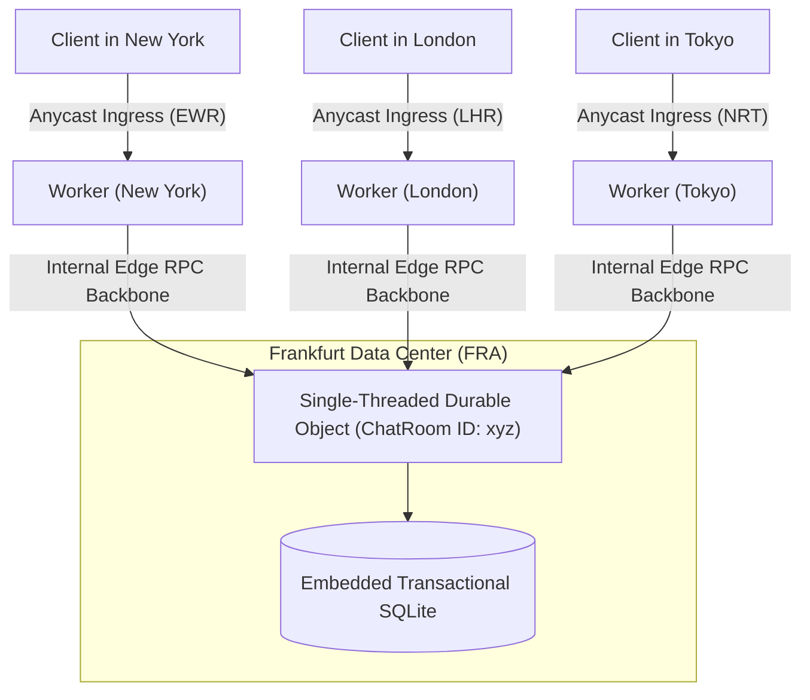
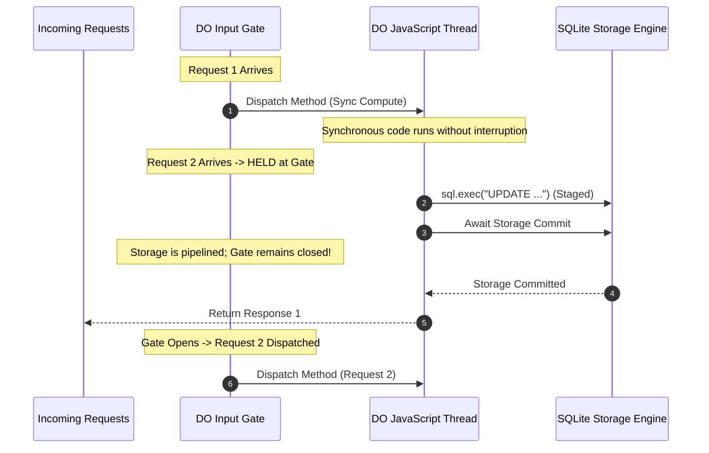
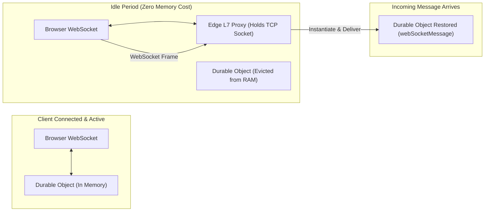

# Module 06: Durable Objects and Actor Model

While stateless functions and eventually consistent stores excel at horizontal scale and read caching, distributed architectures frequently require coordinated state, transactional guarantees, and real-time synchronization. Cloudflare Durable Objects implements the **Actor Model** at the network edge. Each Durable Object is a globally unique, single-threaded stateful actor backed by strongly consistent, transactional SQLite storage.

---

## 1. The Actor Model: Global Uniqueness and Single-Threaded Isolation

The core guarantee of Durable Objects is **global uniqueness**: for any given 256-bit Durable Object ID, exactly one instance of that object executes in memory across Cloudflare's entire global network at any point in time.



### Actor Lifecycle and Placement

1. **Deriving an ID**: Durable Object IDs are deterministic strings derived from names (`idFromName("room-42")`) or unique cryptographically generated IDs (`newUniqueId()`).
2. **Global Coordination**: When a Worker invokes an actor stub (`env.CHAT_ROOM.get(id).fetch()`), Cloudflare's internal control plane routes the request directly to the data center hosting that specific actor instance.
3. **Automatic Instantiation**: If the actor is not currently in memory, `workerd` automatically spins up a new V8 isolate at the optimal data center, initializes its state, and delivers the invocation.
4. **Eviction**: If an actor remains idle with no incoming requests or active WebSockets, it is evicted from memory to free host resources. The underlying SQLite database remains durably persisted on disk.

---

## 2. Concurrency Control: Input Gates and Output Gates

Durable Objects provide strong consistency without manual distributed locking via **Input Gates** and **Output Gates**.



### The Input Gate Rule

- While an actor executes synchronous JavaScript code or waits for local storage operations (`this.ctx.storage.sql` or `get`/`put`), the **Input Gate is locked**. Incoming calls are queued in memory, guaranteeing serial execution.

### The Interleaving Gotcha (External Async I/O)

- **CRITICAL**: If an actor method awaits an **external asynchronous operation** (such as an external `fetch()` subrequest or an unconstrained promise), the **Input Gate opens**.
- While waiting for the external network response, queued incoming requests can execute on the actor thread, interleaving with the active method.
- **Rule**: Never assume internal state remains unchanged across an external `await fetch()`. State must be re-validated after an external await.

---

## 3. Storage Engine: Embedded SQLite and Transactional Rollback

Modern Durable Objects are backed by an embedded, highly optimized **SQLite** engine rather than legacy key-value stores.

```typescript
import { DurableObject } from 'cloudflare:workers';

export class BankAccount extends DurableObject {
  constructor(ctx: DurableObjectState, env: Env) {
    super(ctx, env);
    // Initialize schema on first instantiation
    this.ctx.storage.sql.exec(`
      CREATE TABLE IF NOT EXISTS ledger (
        id INTEGER PRIMARY KEY AUTOINCREMENT,
        account_id TEXT NOT NULL,
        amount INTEGER NOT NULL,
        created_at TEXT DEFAULT (datetime('now'))
      )
    `);
  }

  async transfer(
    fromId: string,
    toId: string,
    amount: number,
  ): Promise<{ success: boolean; error?: string }> {
    // Synchronous transaction execution with automatic rollback
    try {
      const result = this.ctx.storage.transactionSync(() => {
        // 1. Calculate current balance
        const balanceCursor = this.ctx.storage.sql.exec(
          'SELECT COALESCE(SUM(amount), 0) as balance FROM ledger WHERE account_id = ?',
          fromId,
        );
        const currentBalance = balanceCursor.toArray()[0]?.balance as number;

        if (currentBalance < amount) {
          throw new Error('Insufficient Funds');
        }

        // 2. Perform double-entry transfer
        this.ctx.storage.sql.exec(
          'INSERT INTO ledger (account_id, amount) VALUES (?, ?)',
          fromId,
          -amount,
        );
        this.ctx.storage.sql.exec(
          'INSERT INTO ledger (account_id, amount) VALUES (?, ?)',
          toId,
          amount,
        );

        return true;
      });

      return { success: result };
    } catch (err: unknown) {
      // Any uncaught error inside transactionSync rolls back all mutations atomically
      const msg = err instanceof Error ? err.message : 'Transaction failed';
      return { success: false, error: msg };
    }
  }
}
```

---

## 4. Scheduled Alarms and Lifecycle Management

Durable Objects can schedule guaranteed background tasks via the **Alarms API**.

```typescript
export class CacheCleaner extends DurableObject {
  async purgeExpiredSessions(): Promise<void> {
    this.ctx.storage.sql.exec("DELETE FROM sessions WHERE expires_at < datetime('now')");

    // Schedule next maintenance run 1 hour in the future
    const nextRun = Date.now() + 60 * 60 * 1000;
    await this.ctx.storage.setAlarm(nextRun);
  }

  // Invoked automatically by Cloudflare edge infrastructure at the scheduled time
  async alarm(): Promise<void> {
    console.log('Durable Object Alarm Fired: Executing Maintenance');
    await this.purgeExpiredSessions();
  }
}
```

### Alarm Semantics

- **Persistence Across Eviction**: If the actor is evicted from memory, Cloudflare's edge alarm scheduler remembers the scheduled timestamp and instantiates the actor to invoke `alarm()`.
- **Single Alarm per Object**: Calling `setAlarm()` overwrites any existing alarm for that instance.
- **Retry Semantics**: If an alarm handler throws an unhandled error, the runtime automatically retries with exponential backoff.

---

## 5. WebSocket Hibernation API: Massive Real-Time Scalability

Managing thousands of persistent WebSockets in serverless environments traditionally wastes memory because idle connections force the server to maintain an active process. The **WebSocket Hibernation API** solves this.



### Implementation Pattern

```typescript
export class ChatRoom extends DurableObject {
  async fetch(request: Request): Promise<Response> {
    const webSocketPair = new WebSocketPair();
    const [client, server] = Object.values(webSocketPair);

    // Register WebSocket with the Hibernation API
    this.ctx.acceptWebSocket(server, ['general-chat']);

    // Set auto-hibernating connection metadata
    server.serializeAttachment({ userId: 'user_42', joinedAt: Date.now() });

    return new Response(null, { status: 101, webSocket: client });
  }

  async webSocketMessage(ws: WebSocket, message: string | ArrayBuffer): Promise<void> {
    // Invoked automatically when a client sends a message, waking the DO if hibernated
    const attachment = ws.deserializeAttachment() as { userId: string };

    // Broadcast to all active sockets in this room
    for (const socket of this.ctx.getWebSockets()) {
      socket.send(JSON.stringify({ user: attachment.userId, text: message }));
    }
  }

  async webSocketClose(ws: WebSocket, code: number, reason: string): Promise<void> {
    ws.close(code, 'Durable Object Closed Connection');
  }
}
```

---

## 6. Location Hints, Jurisdictions, and Sharding Topologies

### Jurisdictional Restrictions (Compliance)

For strict regulatory compliance (such as EU GDPR or FedRAMP), Durable Objects can be restricted to specific geographical regions:

```typescript
// Guarantees that the actor instance and SQLite storage remain physically inside the EU
const id = env.BANKING_DO.newUniqueId({ jurisdiction: 'eu' });
const stub = env.BANKING_DO.get(id);
```

### High-Throughput Sharding Patterns

Because an individual Durable Object executes on a single thread in a single data center, its throughput ceiling is approximately **1,000 to 2,000 requests per second**. Applications exceeding this throughput must shard state:

- **Tenant Sharding**: Shard by customer ID (`env.DO.idFromName(tenantId)`).
- **Time/Bucket Sharding**: Shard metrics or counters across $N$ sub-actors:
  ```typescript
  const bucketIndex = Math.floor(Math.random() * 16);
  const bucketId = env.COUNTER_DO.idFromName(`counter:clicks:${bucketIndex}`);
  await env.COUNTER_DO.get(bucketId).increment();
  ```
  A reader aggregates all 16 buckets when retrieving the total.

---

## 7. Then vs Now: Durable Objects Architecture

| Dimension | Then (KV Storage Backend 2021) | Now (SQLite Backend 2026) | Why It Changed |
| --- | --- | --- | --- |
| Storage Engine | Key-Value RocksDB storage | Embedded SQLite engine per Object | KV lacked relational indexing, joins, and complex transactions; SQLite offers ANSI SQL and transactions. |
| Transaction API | Asynchronous `ctx.storage.transaction(async (tx) => ...)` | Synchronous `ctx.storage.transactionSync(() => ...)` | Async transactions allowed accidental interleaving and deadlock vulnerabilities; sync transactions guarantee atomicity. |
| WebSockets | Kept isolate warm in RAM continuously | WebSocket Hibernation API | Idle WebSockets drained memory budgets and drove up compute billing; hibernation yields zero RAM cost while idle. |
| Point-in-Time Recovery | Manual backup scripts | Native Point-in-Time Recovery (PITR) | Native transactional rollback protects against logical bugs and data corruption. |

---

## 8. Production Gotchas and Edge Failure Modes

1. **The Global Singleton Bottleneck**: Funneling all application traffic through a single global Durable Object (e.g., named `"global-limiter"`) creates an architectural choke point that serializes all global traffic on a single CPU core.
2. **Declarative Migration Data Loss**: Modifying or removing `migrations` in `wrangler.jsonc` without following safe version migration procedures will signal to Cloudflare that the storage class is deleted, permanently destroying customer data.
3. **Storage Quota Exceeded**: Individual Durable Object SQLite databases have a standard maximum size of **10 GB**. Storing multi-gigabyte files or video streams inside SQLite will exhaust storage limits; large blobs must be offloaded to R2.

---

## Interview Drill

<details><summary>1. How do Input Gates in Durable Objects provide transactional safety, and what happens when an actor performs an external `fetch()`?</summary>

Input Gates automatically synchronize incoming requests. While an actor executes synchronous JavaScript or interacts with its local storage engine, the input gate locks, holding all other incoming requests in memory so mutations occur serially without race conditions. However, when an actor awaits an external asynchronous operation (such as calling `fetch("https://api.example.com")`), the Input Gate deliberately unlocks to prevent deadlocks. During that external network await, other queued requests can execute and modify state. Therefore, developers must re-verify state invariants after any external asynchronous call.

</details>

<details><summary>2. Explain the operational mechanics and cost benefits of the WebSocket Hibernation API.</summary>

In standard WebSocket architectures, keeping an idle connection open requires keeping the server process and its memory allocation active. In a serverless platform, this incurs continuous memory duration charges. The WebSocket Hibernation API decouples the TCP/WebSocket connection from the V8 isolate. Cloudflare's edge proxy maintains the open client connection at the network edge while allowing the Durable Object's V8 isolate to be completely evicted from memory. When the client sends a message, `workerd` instantiates the actor, invokes `webSocketMessage()`, and returns to sleep, reducing memory costs to zero during idle periods.

</details>

<details><summary>3. Why did Cloudflare transition the Durable Objects storage engine from Key-Value to embedded SQLite?</summary>

The original Key-Value storage engine required serializing and deserializing large JSON blobs for any complex data mutation, lacked secondary indexing, and could not perform efficient joins or aggregations. Replacing it with embedded SQLite provides a full relational database engine inside every actor instance. Developers gain atomic ACID transactions (`transactionSync()`), secondary indices, relational queries, constraint validation, and Point-in-Time Recovery (PITR), while executing at native in-memory speeds.

</details>

<details><summary>4. What architectural strategies should be employed when a stateful workflow exceeds the throughput capacity of a single Durable Object?</summary>

Because an individual Durable Object runs on a single CPU core in a single data center, it caps out at roughly 1,000–2,000 operations per second. To scale beyond this, state must be sharded across multiple actors. For counting or analytics, traffic can be striped across $N$ partitioned buckets (e.g., 16 bucket actors) and aggregated during reads. For multi-tenant systems, actors should be partitioned by tenant ID, room ID, or user ID rather than using a single global coordinator.

</details>

<details><summary>5. What are Jurisdictional Restrictions in Durable Objects, and what compliance requirement do they solve?</summary>

Jurisdictional Restrictions enforce data residency laws (such as GDPR in the EU or FedRAMP in the US). By declaring a jurisdiction when generating an ID (`newUniqueId({ jurisdiction: "eu" })`), Cloudflare guarantees that both the in-memory execution isolate and the underlying persisted SQLite storage remain exclusively within data centers physically situated inside that geopolitical boundary, ensuring compliance with data sovereignty regulations.

</details>
