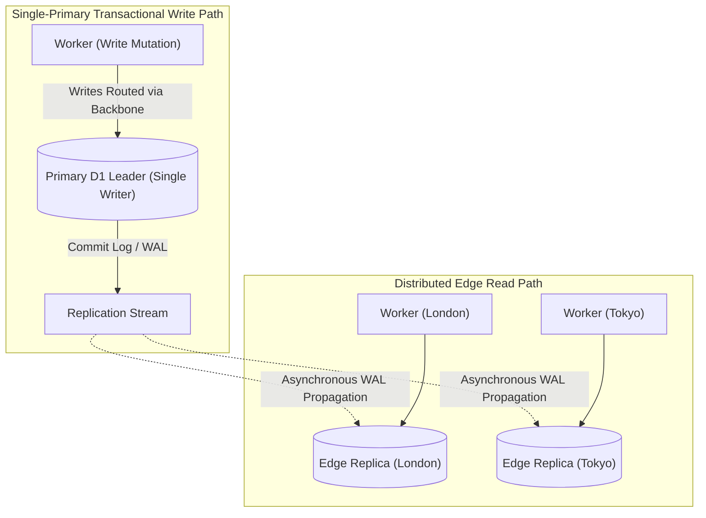
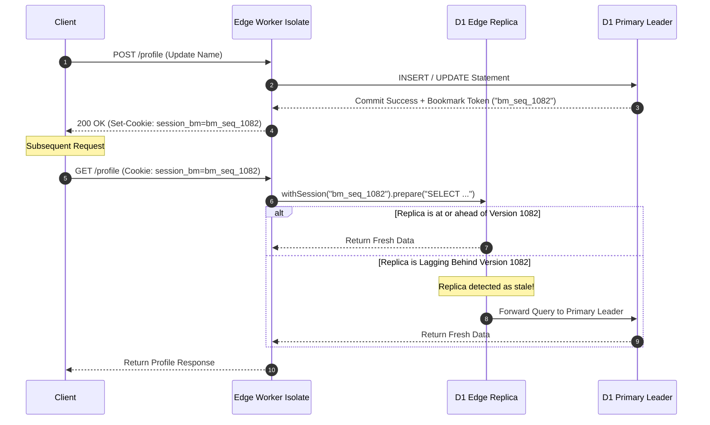
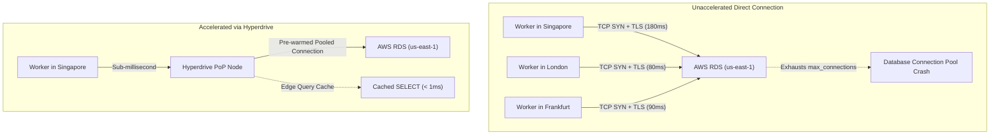

# Module 07: D1 SQL and Hyperdrive

Modern edge architectures require both distributed serverless relational databases and accelerated connectivity to existing legacy centralized databases. Cloudflare provides two complementary technologies: **Cloudflare D1** (a globally distributed serverless SQL database built on SQLite) and **Cloudflare Hyperdrive** (a global connection pooling and query acceleration engine that connects edge Workers to regional PostgreSQL and MySQL clusters).

---

## 1. Cloudflare D1 Architecture: Distributed Serverless SQLite

Cloudflare D1 is a serverless relational database engine designed for high-concurrency read workloads with global distribution.



### Core Architecture Components

1. **Single-Primary Leader**: All write operations (`INSERT`, `UPDATE`, `DELETE`, schema migrations) route synchronously to a designated primary database cluster. This ensures atomic write serialization and eliminates distributed split-brain conflicts.
2. **Edge Read Replicas**: Write-Ahead Logs (WAL) are streamed asynchronously across Cloudflare's global edge network. Local read replicas in major data centers answer read queries (`SELECT`) with single-digit millisecond latency.
3. **Database Size Constraints**: Standard D1 databases support schemas up to **10 GB** (500 MB on the free tier), optimized for low-latency relational application data.

---

## 2. Replication Lag and the Sessions API

Because read replicas receive WAL frames asynchronously, an application reading from an edge replica immediately after writing to the primary might observe stale state. D1 solves this with the **Sessions API**.



### The Sessions API Implementation

```typescript
export interface Env {
  DB: D1Database;
}

export default {
  async fetch(request: Request, env: Env, ctx: ExecutionContext): Promise<Response> {
    const url = new URL(request.url);

    // Extract client session bookmark if present
    const cookieHeader = request.headers.get('Cookie') ?? '';
    const bookmarkMatch = cookieHeader.match(/d1_bm=([^;]+)/);
    const clientBookmark = bookmarkMatch ? bookmarkMatch[1] : undefined;

    // Initialize session-consistent database handle
    const sessionDb = clientBookmark ? env.DB.withSession(clientBookmark) : env.DB;

    if (request.method === 'POST' && url.pathname === '/orders') {
      const order = await request.json<{ id: string; item: string; price: number }>();

      // Execute write on primary
      const result = await sessionDb
        .prepare(
          "INSERT INTO orders (id, item, price, created_at) VALUES (?, ?, ?, datetime('now'))",
        )
        .bind(order.id, order.item, order.price)
        .run();

      // Retrieve bookmark representing the write commit point
      const newBookmark = sessionDb.getBookmark();

      return new Response(JSON.stringify({ success: true, meta: result.meta }), {
        headers: {
          'Content-Type': 'application/json',
          'Set-Cookie': `d1_bm=${newBookmark}; Path=/; HttpOnly; SameSite=Lax`,
        },
      });
    }

    if (request.method === 'GET' && url.pathname === '/orders') {
      // Guaranteed to read at or ahead of clientBookmark (read-your-writes consistency)
      const { results } = await sessionDb
        .prepare('SELECT id, item, price, created_at FROM orders ORDER BY created_at DESC LIMIT 50')
        .all();

      return Response.json(results);
    }

    return new Response('Not Found', { status: 404 });
  },
};
```

---

## 3. Batch Transactions and Prepared Statements

D1 executes multiple statements in a single network round-trip via `db.batch()`:

```typescript
export async function executeAtomicTransfer(
  db: D1Database,
  sourceAccount: string,
  destAccount: string,
  amount: number,
): Promise<D1Result[]> {
  // All statements inside batch() execute within a single transaction
  // If any query fails, the entire batch automatically rolls back
  const statements = [
    db
      .prepare('UPDATE accounts SET balance = balance - ? WHERE id = ?')
      .bind(amount, sourceAccount),
    db.prepare('UPDATE accounts SET balance = balance + ? WHERE id = ?').bind(amount, destAccount),
    db
      .prepare('INSERT INTO transfer_audit (from_acc, to_acc, amount) VALUES (?, ?, ?)')
      .bind(sourceAccount, destAccount, amount),
  ];

  return await db.batch(statements);
}
```

---

## 4. D1 Time Travel and Disaster Recovery

D1 incorporates continuous automated snapshotting and Write-Ahead Log archiving known as **Time Travel**.

- **Point-in-Time Recovery (PITR)**: Restores a D1 database to any designated historical minute within the **30-day retention window**.
- **Undelete Window**: Databases deleted via the CLI or dashboard are preserved in an undelete grace period for **7 days** (as of October 2026 platform standards), after which storage blocks are shredded.
- **CLI Commands**:
  ```bash
  # Restore database to a historical timestamp
  wrangler d1 time-travel restore prod-db --timestamp="2026-11-01T12:00:00Z"
  ```

---

## 5. Cloudflare Hyperdrive: Central Database Acceleration

While D1 solves distributed relational requirements at the edge, organizations frequently operate large legacy relational databases hosted in regional clouds (AWS RDS PostgreSQL, Google Cloud SQL, Supabase, Neon).

### The Edge-to-Origin Database Bottleneck

Connecting to a central database directly from edge Workers exhibits severe architectural failure modes:

1. **Connection Storms**: Serverless edge scaling spins up thousands of concurrent isolates across hundreds of PoPs, overwhelming regional database connection limits (`max_connections`).
2. **Handshake Overhead**: Negotiating TCP and TLS handshakes across cross-continental links adds 150 ms to 300 ms of latency before a single SQL statement executes.



### Hyperdrive Architectural Mechanics

- **Global Connection Pooling**: Hyperdrive maintains pre-warmed, authenticated connection pools from Cloudflare edge PoPs directly to the origin database.
- **Protocol-Aware Query Caching**: Hyperdrive understands PostgreSQL and MySQL wire protocols. It automatically caches read queries that do not modify state (when appropriate), returning cached rows directly from the nearest PoP.
- **Worker Driver Integration**: Workers use standard libraries (like `postgres.js` or `pg`) connecting through the connection string generated by `env.HYPERDRIVE.connectionString`.

```typescript
import postgres from 'postgres';

export interface Env {
  HYPERDRIVE: Hyperdrive;
}

export default {
  async fetch(request: Request, env: Env, ctx: ExecutionContext): Promise<Response> {
    // Hyperdrive provides a pre-configured connection string with edge pooling
    const sql = postgres(env.HYPERDRIVE.connectionString, {
      max: 5, // Local pool limit per isolate
      idle_timeout: 30,
    });

    // Queries execute over persistent, pre-established connections
    const users = await sql`
      SELECT id, name, email FROM users WHERE active = true ORDER BY created_at DESC LIMIT 20
    `;

    return Response.json(users);
  },
};
```

---

## 6. Then vs Now: Edge Relational Architectures

| Dimension | Then (Early Serverless SQL 2021) | Now (D1 & Hyperdrive 2026) | Why It Changed |
| --- | --- | --- | --- |
| Edge Relational | External HTTP-to-SQL proxies (Prisma Data Platform, PlanetScale HTTP) | Native Serverless SQLite (D1) and Native Wire Pooling (Hyperdrive) | External HTTP gateways added unnecessary middle-tier latency, egress cost, and vendor lock-in. |
| Consistency Model | Blind asynchronous read replicas with stale reads | Sessions API with cryptographic bookmarks | Applications broke when users updated state and immediately saw old data on page reload. |
| Connection Handling | Exhausted origin `max_connections` instantly | Distributed global pooling across edge PoPs | Allowed scaling edge compute to millions of requests without destroying backend relational databases. |
| Disaster Recovery | Manual SQL dump backups | D1 Time Travel with 30-day point-in-time recovery | Automated continuous WAL archiving enables instant restoration from accidental data corruption. |

---

## 7. Production Gotchas and Edge Failure Modes

1. **Transaction Timeouts on Long Migrations**: Executing massive schema migrations (e.g., adding a non-nullable indexed column on a 5-million-row table) within D1 can exceed Worker subrequest timeouts. Run large migrations in bounded batches using `wrangler d1 migrations apply`.
2. **Hyperdrive Session State Contamination**: If an application sets connection-specific session state (e.g., `SET timezone = 'UTC'` or `SET search_path`), connection pooling reuse across requests can contaminate subsequent queries. Ensure queries use explicit parameterization.
3. **Database Size Ceiling (10 GB)**: D1 is not designed for petabyte data warehousing. Designing tables with large embedded image blobs will quickly hit the 10 GB limit. Blobs belong in R2, with references stored in D1.

---

## 8. Architectural Case Study: Resilient E-Commerce Checkout with D1 and Hyperdrive

The following pattern illustrates an edge checkout architecture using D1 for rapid edge session caching and Hyperdrive for centralized inventory deduction on a regional PostgreSQL cluster.

```typescript
import postgres from 'postgres';

export interface Env {
  LOCAL_DB: D1Database;
  CENTRAL_PG: Hyperdrive;
}

export default {
  async fetch(request: Request, env: Env, ctx: ExecutionContext): Promise<Response> {
    const url = new URL(request.url);

    if (request.method === 'POST' && url.pathname === '/checkout') {
      const { cartId, userId, amount } = await request.json<{
        cartId: string;
        userId: string;
        amount: number;
      }>();

      // 1. Validate cart locally in edge D1 database (sub-millisecond read)
      const cart = await env.LOCAL_DB.prepare('SELECT * FROM carts WHERE id = ?')
        .bind(cartId)
        .first();
      if (!cart) {
        return new Response('Cart Not Found', { status: 404 });
      }

      // 2. Commit transaction to central PostgreSQL via Hyperdrive
      const sql = postgres(env.CENTRAL_PG.connectionString);
      try {
        const orderResult = await sql.begin(async (tx) => {
          // Atomic inventory deduction
          const [inventory] = await tx`
            UPDATE inventory SET stock = stock - 1 WHERE item_id = ${cart.item_id} AND stock > 0 RETURNING stock
          `;
          if (!inventory) {
            throw new Error('Out of Stock');
          }

          // Create permanent order record
          const [order] = await tx`
            INSERT INTO orders (user_id, amount, status) VALUES (${userId}, ${amount}, 'confirmed') RETURNING id
          `;
          return order;
        });

        // 3. Update edge D1 session asynchronously
        ctx.waitUntil(
          env.LOCAL_DB.prepare("UPDATE carts SET status = 'completed' WHERE id = ?")
            .bind(cartId)
            .run(),
        );

        return Response.json({ status: 'success', orderId: orderResult.id });
      } catch (err: unknown) {
        const msg = err instanceof Error ? err.message : 'Checkout Failed';
        return new Response(JSON.stringify({ error: msg }), {
          status: 400,
          headers: { 'Content-Type': 'application/json' },
        });
      }
    }

    return new Response('Not Found', { status: 404 });
  },
};
```

---

## Interview Drill

<details><summary>1. How does Cloudflare D1 maintain high write integrity while providing low-latency edge reads?</summary>

D1 uses a single-primary architecture combined with distributed edge read replicas. All write mutations (`INSERT`, `UPDATE`, `DELETE`) route through Cloudflare's private backbone to a single authoritative primary database cluster, eliminating multi-master write conflicts. The primary commits the changes to a Write-Ahead Log (WAL) and streams them asynchronously to read replicas in edge data centers worldwide. Read queries (`SELECT`) execute against local replicas with sub-millisecond latency.

</details>

<details><summary>2. Explain how the D1 Sessions API solves read-after-write replication lag.</summary>

In an eventually consistent read-replica topology, a client that writes data to the primary might immediately issue a subsequent read that lands on an edge replica that has not yet applied the latest WAL update. The D1 Sessions API addresses this by generating a cryptographic bookmark token representing the write sequence number. On subsequent queries within that session (`env.DB.withSession(bookmark)`), D1 checks the replica's applied sequence. If the replica is up-to-date, it answers locally; if it is lagging, D1 transparently routes the query to the primary or waits for the replica to catch up, guaranteeing sequential consistency.

</details>

<details><summary>3. What specific problems does Cloudflare Hyperdrive solve when connecting serverless edge Workers to regional PostgreSQL databases?</summary>

Hyperdrive solves two major problems: connection exhaustion and latency. First, serverless workers scale to thousands of concurrent isolates across 300+ data centers, which quickly exhausts the `max_connections` limit of regional databases. Hyperdrive maintains pooled, authenticated connections from edge PoPs, multiplexing requests safely. Second, opening fresh TCP/TLS connections from cross-continental edges incurs multiple round-trip handshakes (150–300 ms). Hyperdrive keeps pre-established connections warm and caches repetitive read queries at the edge.

</details>

<details><summary>4. What guarantees does `db.batch()` provide in D1, and how does it optimize network performance?</summary>

`db.batch()` executes an array of prepared SQL statements within a single atomic transaction over a single network request round-trip. If any statement in the batch fails or violates a constraint, the underlying SQLite engine rolls back all prior statements in the batch, guaranteeing atomicity. Furthermore, by packaging multiple queries into one message, it eliminates sequential network latency round-trips between the Worker and the database engine.

</details>

<details><summary>5. What is D1 Time Travel, and what is the platform undelete retention window?</summary>

D1 Time Travel is an automated point-in-time recovery mechanism that continually archives transaction logs. It allows an administrator to inspect or restore a database to any specific minute within a 30-day retention window to recover from bad deployments, data corruption, or malicious operations. Furthermore, if a D1 database is deleted, Cloudflare preserves the underlying storage in an undelete grace period for 7 days before permanent deletion.

</details>
