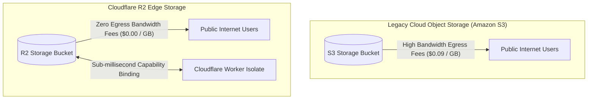
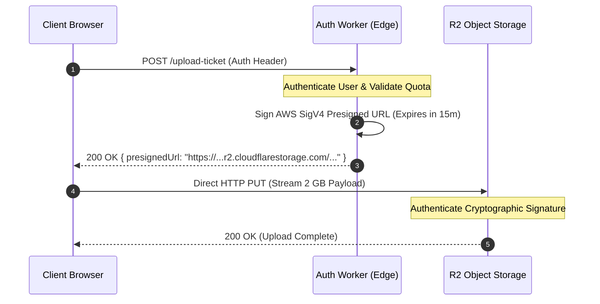
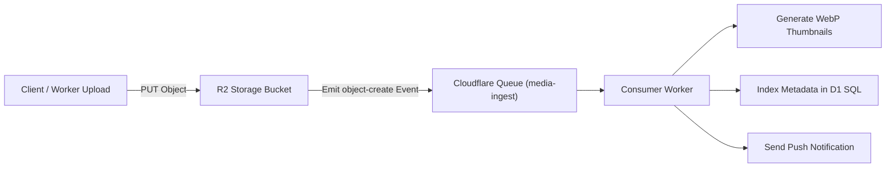

# Module 08: R2 Object Storage and S3 Compatibility

Object storage is the backbone of modern web applications, housing unstructured assets like media, logs, backups, and machine learning models. Traditional cloud providers (such as Amazon Web Services with S3) employ aggressive data egress fees (typically \$0.05 to \$0.09 per gigabyte transferred to the internet), creating vendor lock-in and punishing multi-cloud architectures. **Cloudflare R2** eliminates data egress bandwidth fees completely while providing full S3 API compatibility and high-performance native capability bindings for Workers.

---

## 1. Zero-Egress Economics and Architecture

Cloudflare R2 is built on Cloudflare's global edge network, colocating object storage metadata and caching with Anycast routing nodes.



### Economic Model
- **Bandwidth Egress**: **\$0.00 / GB** across all global operations.
- **Storage Pricing**: Billed strictly for the stored volume per gigabyte-month (with a free tier of 10 GB/month).
- **Operation Classes**:
  - **Class A Operations** (Mutations: `PutObject`, `CopyObject`, `CreateMultipartUpload`, `ListObjects`): Billed per million operations.
  - **Class B Operations** (Reads: `GetObject`, `HeadObject`): Billed per million operations at a fraction of Class A rates.
- **Multi-Region Replication**: R2 automatically replicates object metadata and blobs to ensure 99.999999999% (11 nines) annual durability.

---

## 2. Direct Worker Capability Bindings

When interacting with R2 from inside a Worker, developers do not need third-party AWS SDKs or credential signing libraries. `workerd` provides native, zero-latency capability bindings via `env.BUCKET`.

```typescript
export interface Env {
  MEDIA_BUCKET: R2Bucket;
}

export default {
  async fetch(request: Request, env: Env, ctx: ExecutionContext): Promise<Response> {
    const url = new URL(request.url);
    const key = url.pathname.slice(1);

    // 1. GET: Stream object directly to client with HTTP range support
    if (request.method === "GET") {
      const object = await env.MEDIA_BUCKET.get(key, {
        range: request.headers,
        onlyIf: request.headers
      });

      if (!object) {
        return new Response("Object Not Found", { status: 404 });
      }

      const headers = new Headers();
      object.writeHttpMetadata(headers);
      headers.set("ETag", object.httpEtag);

      return new Response(object.body, { headers });
    }

    // 2. PUT: Stream upload directly into R2 with custom metadata
    if (request.method === "PUT") {
      const contentType = request.headers.get("Content-Type") ?? "application/octet-stream";

      const uploaded = await env.MEDIA_BUCKET.put(key, request.body, {
        httpMetadata: { contentType },
        customMetadata: {
          uploadedBy: "edge-worker",
          clientIp: request.headers.get("cf-connecting-ip") ?? "unknown"
        }
      });

      return Response.json({
        key: uploaded.key,
        etag: uploaded.httpEtag,
        size: uploaded.size
      });
    }

    return new Response("Method Not Allowed", { status: 405 });
  }
};
```

---

## 3. Presigned URLs: Offloading Large Uploads and Downloads

Routing multi-gigabyte uploads (such as user video files) directly through a Worker isolate is an anti-pattern that consumes isolate CPU time and risks exceeding memory ceilings. The standard pattern is generating an **S3-compatible Presigned URL**.



### Implementing Presigned URLs via `@aws-sdk/s3-request-presigner`

```typescript
import { S3Client, PutObjectCommand } from "@aws-sdk/client-s3";
import { getSignedUrl } from "@aws-sdk/s3-request-presigner";

export async function createUploadPresignedUrl(
  accountId: string,
  accessKeyId: string,
  secretAccessKey: string,
  bucketName: string,
  objectKey: string
): Promise<string> {
  const s3 = new S3Client({
    region: "auto",
    endpoint: `https://${accountId}.r2.cloudflarestorage.com`,
    credentials: { accessKeyId, secretAccessKey }
  });

  const command = new PutObjectCommand({
    Bucket: bucketName,
    Key: objectKey,
    ContentType: "application/pdf"
  });

  // URL expires in 900 seconds (15 minutes)
  return await getSignedUrl(s3, command, { expiresIn: 900 });
}
```

---

## 4. Multipart Uploads and Invariants

Uploading files larger than 100 MB requires the **Multipart Upload Protocol**.

```typescript
export async function performMultipartUpload(
  bucket: R2Bucket,
  key: string,
  chunks: Uint8Array[]
): Promise<R2Object> {
  // 1. Initialize session
  const multipart = await bucket.createMultipartUpload(key);

  const completedParts: R2UploadedPart[] = [];

  try {
    // 2. Upload chunks in parallel or sequence
    for (const [index, chunk] of chunks.entries()) {
      const partNumber = index + 1; // 1-indexed

      // Invariant: Parts must be >= 5 MiB (except final part)
      if (index < chunks.length - 1 && chunk.byteLength < 5 * 1024 * 1024) {
        throw new Error(`Part ${partNumber} is smaller than 5 MiB minimum`);
      }

      const uploadedPart = await multipart.uploadPart(partNumber, chunk);
      completedParts.push(uploadedPart);
    }

    // 3. Complete upload: Part numbers MUST be sorted in ascending order
    completedParts.sort((a, b) => a.partNumber - b.partNumber);
    const finalized = await multipart.complete(completedParts);
    return finalized;
  } catch (err) {
    // 4. Abort on failure to avoid orphaned storage charges
    await multipart.abort();
    throw err;
  }
}
```

### Multipart Invariants
- **Minimum Part Size**: Every part except the final part must be at least **5 MiB** (5,242,880 bytes).
- **Ascending Manifest**: When completing the upload, parts must be listed in strictly ascending order (`1, 2, 3...`).
- **Orphaned Storage Cleanup**: Uncompleted multipart sessions consume billable storage until aborted. Lifecycle rules should be configured to abort incomplete multipart uploads after 7 days.

---

## 5. Event Notifications and Asynchronous Edge Pipelines

R2 buckets can emit structured event notifications upon object mutations (`object-create`, `object-delete`) directly to **Cloudflare Queues**.



### Event Payload Schema
```json
{
  "account": "0123456789abcdef",
  "bucket": "media-storage",
  "eventTime": "2026-11-08T18:00:00.000Z",
  "action": "PutObject",
  "object": {
    "key": "invoices/2026-11-08.pdf",
    "size": 154200,
    "eTag": "b10a8db164e0754105b7a99be72e3fe5"
  }
}
```

---

## 6. Lifecycle Policies and Storage Classes

To optimize long-term storage costs, R2 supports automated **Lifecycle Rules**:
- **Infrequent Access (IA)**: Automatically transitions objects that have not been read for 30, 60, or 90 days to a lower storage price tier.
- **Automated Object Expiration**: Deletes ephemeral files (e.g., temporary zip exports or daily log archives) after $N$ days.
- **Incomplete Multipart Aborts**: Automatically cleans up stalled multipart sessions after a configured number of days.

---

## 7. Then vs Now: Object Storage Evolution

| Dimension | Then (Amazon S3 Standard) | Now (Cloudflare R2 2026) | Why It Changed |
| --- | --- | --- | --- |
| Bandwidth Egress Fees | \$0.05 to \$0.09 per GB transferred | \$0.00 per GB (Zero Egress) | Egress fees were artificial vendor lock-in taxes that penalized distributed and multi-cloud systems. |
| Edge Worker Access | Heavy AWS SDK signing libraries over public HTTP | Native in-engine C++ capability bindings (`env.BUCKET`) | Native bindings eliminate SDK bundle bloat, zero out HTTP serialization, and execute at in-memory speed. |
| Event Architecture | Complex AWS SNS -> SQS -> Lambda routing | Native 1-click binding: R2 Event Notifications -> Cloudflare Queues | Greatly simplified infrastructure, eliminated cross-cloud latency, and reduced IAM policy overhead. |
| S3 API Compatibility | Proprietary AWS standard | Full S3-compatible REST API subset (`SigV4`) | Enables drop-in replacement with existing tools (Cyberduck, Terraform, Boto3, AWS CLI). |

---

## 8. Production Gotchas and Edge Failure Modes

1. **Orphaned Multipart Chunks Accumulating Costs**: Uploading parts without calling `complete()` or `abort()` leaves unmerged chunks on disk that accumulate billable storage costs indefinitely. Always attach an automated abort lifecycle rule.
2. **Missing Content-Type Metadata on Upload**: Uploading raw streams without explicitly setting `httpMetadata: { contentType: "image/png" }` causes R2 to default to `application/octet-stream`, forcing downstream browsers to download rather than render images inline.
3. **Attempting to Put Objects Smaller than 5 MiB in Multipart**: Trying to upload 1 MB chunks via `uploadPart()` will throw an invalid part size error upon completion. Single uploads under 5 MiB should use standard `bucket.put()`.

---

## Interview Drill

<details><summary>1. What is the economic and operational advantage of Cloudflare R2's zero-egress pricing model?</summary>

Traditional cloud providers charge between \$0.05 and \$0.09 per gigabyte when clients download objects from storage to the internet. For video streaming, data warehousing, or software distribution, egress fees frequently dwarf actual storage costs and create financial lock-in. R2 charges \$0.00 for data egress bandwidth, billing only for storage volume and standard Class A/B API operations. This allows architects to build multi-cloud architectures, stream heavy media, and train AI models across different providers without bandwidth penalties.

</details>

<details><summary>2. How do native Worker bindings (`env.BUCKET`) outperform third-party AWS S3 SDKs in edge compute environments?</summary>

Using the AWS S3 SDK requires importing large JavaScript libraries that implement AWS Signature Version 4 (SigV4) cryptographic signing. This inflates the Worker's bundle size, slows cold starts, and wastes CPU cycles calculating HMAC-SHA256 signatures over public HTTP requests. Native R2 capability bindings (`env.BUCKET.put`, `.get`) are C++ primitives compiled directly into `workerd`. They communicate directly with R2 storage clusters over Cloudflare's private network without cryptographic signing overhead or external HTTP round-trips.

</details>

<details><summary>3. Why should client browser uploads exceeding 100 MB use Presigned URLs rather than routing through a Worker?</summary>

Routing large file uploads directly through a Worker isolate forces the edge node to ingest and buffer incoming bytes through the isolate runtime. This consumes active CPU-time quotas, increases memory consumption against the 128 MB isolate heap ceiling, and risks connection drops if the client connection is slow. Generating an S3-compatible Presigned URL allows the client to upload directly to R2 storage endpoints, bypassing Worker compute entirely and offloading network transfer to Cloudflare's edge storage infrastructure.

</details>

<details><summary>4. What are the strict invariants governing S3/R2 multipart uploads?</summary>

Multipart uploads require that: (1) every part uploaded must be at least 5 MiB (5,242,880 bytes) in size, with the exception of the final part; (2) parts must be indexed with part numbers between 1 and 10,000; (3) when completing the upload, the manifest must list part numbers in strictly ascending numerical order along with their exact matching ETags. Violating any of these rules causes the completion call to reject with an error.

</details>

<details><summary>5. How do R2 Event Notifications streamline asynchronous media processing pipelines?</summary>

R2 Event Notifications automatically emit lifecycle messages (such as `PutObject` or `DeleteObject`) to a connected Cloudflare Queue whenever objects mutate. This eliminates the need for expensive polling scripts (`list()`). A consumer Worker attached to the Queue ingests events in batches with automatic retries, allowing decoupled, horizontally scalable media transcoding, metadata indexing in D1, and push notifications.

</details>
